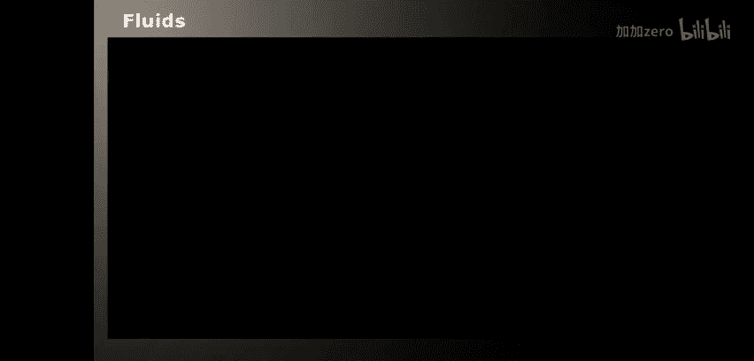

# 【OpenCL编程 RayiYanuTara】 p16 p15 7 - Smoothed Particle Hydrodynamics -BV1X2BRYyEeM_p16-

Hello， welcome to today's webcast。 My name is Brian and I will be your event Special today。

Following the presentation we'll have a question and answer session。

 however you can ask questions at any time during the presentation， click the Ask a question button。

 type your question in the open area and click Ask Quetion to submit。

We will answer as many questions as time allows。If you should need technical assistance。

 please type your inquiry into the tech support box on the left side of your screen and click the Send button。

If you are disconnected from the webcast， you can log on again using the login instructions provided to you。

If you cannot log back all of these instructions。Please call support at 866。271。7，5，9，2。

It is now my pleasure to turn the webcast over to our speaker， Alan Heririck。 Alllan。

 the floor is yours。😊，Thank you， Brianne。Hi， it's nice to meet all of you via internet。

 my name is Alan Herich， I'm a senior member of technical staff here at AMD and I'm going to be talking about an application example in openCL。

 this is an example of computational fluid dynamics specifically a technique known as smooth particle hydrodynamics we also call that SPH for short SPH is used in physics simulations and it's also popular in video games we'll be focused on video games。

This is an outline of my talk。First， I'll discuss fluids， essentially what is a fluid。

 how does a fluid work， try to develop some intuition for that。

Then we'll move into a discussion of the Navia Sts equations。

 the Novious sts equations are partial differential equations of fluid mechanics。

 that were formulated in the 1900s， and they're the basis of most fluid dynamics work today。

After we've discussed the obvious tos equations and hopefully I've given you some intuition for what they mean。

We will look specifically at smooth particle hydrodynamics。

 which is a technique for solving the novel sts equations that was developed in 1992。

 The original application of this technique was for astrophysics calculations， but in fact。

 it's become quite popular in video games and simulations。Finally。

 once we've gone through all of the necessary definitions of the equations and the SPH method。

We will talk about the open C simulation。 This is a program which you can download。

 It's available for you to download， look at， modify， play with any way you want。

And I'll go through the program， explain to you how it works。

 and then we'll open the floor to questions。Okay， so first， what is a fluid。

 well we all have some intuitive notion of what a fluid is。

 the kinds of fluids that we typically run into in real life are liquids and gases。

 an example of a liquid could be water could be some other type of fluid oil， what have you。

Examples of gases are air。U。You may not。If you're not familiar with fluids。

 you may be surprised to learn that air is a fluid and in fact obeys the same fluid principles that water does。

 air flows very much like water， it just has a lighter density。

A third state of matter that qualifies as a fluid is a plasma。

 you might encounter a plasma if you were to take a trip on a rocket ship out to the center of a star。

But here on earth， we don't encounter plasmas very often。

Technically there are some other things that qualify as fluids， for example。

 sometimes plastic is considered a fluid， a fluid that moves very， very slowly， but at a very。

 very slow time scale， plastic can be seen to flow in the same way that a liquid does。

Fluids are generally described by the Naviier Stokes equations。

 Naviier and Stokes were two scientists in the 1900s who formulated these equations of fluid mechanics。

And as I mentioned before， this is really the basis for essentially all fluid mechanical work today。

We will specifically be interested in the incompressible No sts equations。

 which are the form of the equations that govern fluids like water at normal velocities and normal temperatures。

There are other forms of these equations。 There is a compressible form， which is generally used for。

For supersonic or hypersonic phenomena in which you can have shockwas and discontinuities in the solution。

But in the incompressible equations， those things are not allowed and everything behaves very nicely。

 I think it would be safe to say that all of the everyday intuitions that you have about how a fluid works corresponds to the behavior of the incompressible equations。

So for that reason， the incompressible equations are the ones that we're interested in simulating for things like video games。

I'll describe these equations in more detail for now， let's just。

Note that there is an equation of motion。 that's the large equation on the left side。

 I'll point to it with my pointer。 you should see a red dot to the left of the equation of motion。

This basically says that the velocity changes as a function of gravity， pressure and viscosity。

 and I'll explain those terms， there's a smaller equation to the right that's known as the mass continuity equation that essentially says that mass is neither created nor destroyed。

So the phenomena that govern a fluid。Are the gravity， the pressure and the velocity。

You may be familiar with pressure from watching the Weer Cha on television。For example。

 on the weather channel they will tell you that cold fronts and warm fronts occur and that there are high pressure fronts and low pressure fronts and you'll see that the weather flows from regions of high pressure into regions of low pressure in general that is the way a fluid behaves。

 it flows downhill in the gradient of the pressure。嗯。

The viscosity is another important term that governs the fluid。

The viscosity is essentially the stickiness of the fluid。

 and it governs the likelihood of fluid particles to travel in the same direction。Basically。

 if you have a very highly viscous fluid like honey or mud。

The fluid tends to flow all in the same direction and tends to flow as a mass。

If you have an invisted fluid or a fluid with low viscosity， such as air and water。

Different portions of the fluid have much more freedom to move independently。

 and they don't tend to move in a coherent mass。Okay。

 now we're going to see a short video of a fluid here you see fluids in a box and you see the box released。

This doesn't actually look real time as I'm seeing at play。

 but in fact this was real time when we recorded it。

 and this is the output of the program that you can download and play with。

This is a fluid in a box and what you'll see is that the fluid started out all bunched up together。

 the pressure of the fluid caused it to flow to the right。

 and then governed by the box and by the viscosity of the fluid。

 you saw waves traveling back and forth across the box。

So that's the simulation， and I invite you all to take it home with you and play with it。All right。

 so I mentioned that fluids are governed by the No sts equations now I'm going to explain those equations。

 I don't make any assumption that any of you have seen them before， if you have so much the better。

 I don't assume that you have a background in differential equations either。

 I will try to explain these in intuitive terms that everyone can follow。

So these are what the equations look like。Again。There is an equation of motion to the left。

 and there is a mass continuity equation to the right。

The quantities in the equation of motion are as follows。

 the Greek letter row represents the density of the fluid。The Greek the。

The English letter P represents the pressure of the fluid。 And these are both scalar variables。

In addition， on the right hand side of the equation of motion， you will see gravity， which is G。

 that's a vector。And you'll see velocity V which is also a vector。

 these are vectors in three dimensional space。So basically， the equation of motion here。

Says that row times the derivative of velocity。Plus。

 a special term called the convective acceleration term。

Are equal to the gravity minus the pressure gradient plus the viscosity term。

So the fluid moves under the force of gravity， under the force of pressure and under the force of the viscous term。

Now I mentioned the convective acceleration term， again， if you don't know vector calculus。

 these symbols will be mysterious to you， so I've written them out for you。嗯。

The convective acceleration is a very interesting property of a fluid。

 which you're all familiar with if you have used the nozzle on a garden hose。

The phenomenon is that as the fluid is forced through a small opening， it speeds up。

When you take the nozzle on a garden hose and the water is flowing， if you tighten the nozzle。

 you may be familiar with the phenomena that the fluid suddenly flows much farther out of the hose。

 that's because it's moving faster， it's moving faster because it has to move through a smaller opening than before。

And it has to move faster so that the same volume of fluid can move through that opening in a given period of time。

So that's the convective acceleration term on the left hand side of the equation of motion。啊。

The gradient of pressure， a gradient is the higher dimensional analog of a slope in one dimension。

 so I'm assuming that everyone is familiar with the notion of a slope from differential calculus。

The gradient is simply a high dimensional analog of it。

 and you can literally think of it as a hillside or a slope in high dimensions。

So the gradient of P is given by these partial derivatives of P with respect to X， Y and z。And。嗯。

You'll notice that in the equation of motion， it's governed by the negative gradient of pressure。

That tells us that the system as a whole moves downhill in the pressure gradient， and again。

 that's equivalent to saying that the system moves from a region of high pressure to a region of low pressure under its normal equations of motion。

Let me point out also that P， the pressure。Is defined as the difference between the actual density of the fluid at a given point and a quantity called the resting density。

 The resting density is the density of the fluid at equilibrium。

If in a local area the density is higher than the resting density， we will have a positive pressure。

Conversely， if in a given area， the density is lower than the resting density。

 we will have a suction。A negative pressure。So that formula p equals k times rh minus rh0 is the formula for the pressure。

 K is simply a constant， it's a numerical constant， it's an artifact of computation。

 it doesn't have any real physical basis。Finally， the viscosity term is actually somewhat interesting。

 so that's the last term on the right hand side of the equation of motion。

 that's the Greek letter mu times dell squared。Times of V dell squared is a vector calculus operator it's the lapplaceian operator。

 or specifically the vector Laplian， and it's written out at the bottom。

 essentially it's a vector of partial derivatives of V with respect to X， Y and z。

And we'll go into more detail about how that's approximated。

 and I think you'll get some good intuitions for what this mean。

 Those of you who are familiar with differential equations may know that the Dell squared operator is typically described as a diffusion operator。

It diffuses whatever quantity it is applied to。 So in this case， it's diffusing velocity。

 or we could say it's diffusing the momentum of the system。

What this means is that effectively the system under its own natural forces will evolve to a state in which the velocity is equivalent at all locations。

That's the effect of this term。The viscosity term。Okay。

 I also mentioned that there is a mass continuity equation。

 the mass continuity equation says that the divergence of velocity multiplied by the density is zero。

 and in the incompressible equations， density is constant。

 the total density is constant so we can take that away and just say dell dot v equals zero is the mass continuity equation。

In the case of the incompressible equations。 And basically。

 that says that mass is going to be neither created nor destroyed。

 It's not going to fly out of the system under the force of the velocity。

All the masks that we start with， we will still have when we end。

And since we are going to use a particle formulation， the smooth particle hydrodynamics method。

 we have a very easy time with this equation， we don't have to do anything to solve it。

 All we have to do is ensure that particles are neither created nor destroyed。

As long as we have a constant number of particles in the simulation。

 we will satisfy the mass continuity equation trivially。

So that's a nice property of the particle formulation。

There are a couple more steps that we need to go through in looking at these equations in particular。

 we want to represent the dynamics of this system by a set of particles and the way we will do that is by taking the material derivative of the equation the material derivative is the derivative along a path with a given velocity。

And our particles will be traveling along paths in space。

 so to get the equation of motion for a particle， we will simply take the material derivative。

And at the bottom of this slide。You see。呃。Let's see， there we go at the bottom of the slide。

 you can see the equation for a single particle I。This says that the derivative of the velocity of particle I with respect to time is simply gravity。

Minus the pressure gradient divided by our density row。Plus。

 the viscosity term divided by our density row。These are the equations that we will actually solve。

One other point， the Naos tos equations are numerically sensitive to scale。

 we will be simulating a box of size 100 by 40 by 40 units。

 but in fact we have to simulate the equations at a much smaller scale or they simply don't work。

 this is simply a numerical property of the equations， there's nothing we can do about it。

So in the simulation， we will see the calculations that are done of the equations themselves are done at a small scale。

 0。004 times the size of our actual spatial scale， then we have to expand this to the regular spatial scale in order to actually move the particles around in space。

 so we'll do that at the end of the process。Okay。So we talked about fluids。

We talked about the novious dos equations， and in particular。

 we simplified the incompressible noous dos equations by taking the material derivative。

So that we have a simple equation for the motion of one particle。

That was the last equation that we ended up with。Now。

 smooth particle hydrodynamics will show us how to actually solve that equation for one particle。

Again， here's a set of equations， but please don't let your eyes bug out。

The SPH technique was introduced in 1992 for the study of astrophysics galaxy formations。

 turns out these can be governed by fluid equations as well as many other things。

Monahan was the researcher who introduced this and his basic concept was to introduce smoothing kernel representations of quantities。

 so a smoothing kernel is like a basis function if you're familiar with basis functions from things like finite element techniques。

 if you're not familiar with that don't worry about it。

We're simply saying that we can represent any quantity by a summation of the quantity at nearby points multiplied by a weighting function W。

 a smoothing kernel is the technical name for it。AndW will give more strength to points that are close to us and we' make points that are farther away from us have a weaker influence on us。

 and in fact， at points that are more than a certain distance away。

W will become zero and so those points at a distance won't affect us at all。So effectively。

 this is a way to evaluate a quantity by sampling a neighborhood of space and waitinging points according to how close they are to our sample point。

So the general expression for this is given at the top。 It's the notion that a given。

Function A of I can be approximated。 Well， is exactly equal to an integral。

Of a sampled at various other points are prime multiplied by W。W is itself a function of a vector。

From R to R prime。 Actually， I'm sorry。 I said that backwards from R prime to R。

Our prime is the location of a neighboring point and R is the location of our point。

So W depends on the vector between the two points and it depends on the interaction radius H H is the quantity that tells us how far away a particle can be before it stops interacting with us。

So H is the interaction radius。So Monnahan introduced this notion of using smoothing kernels。

 and he introduced approximations to the terms of the noous dos equations。

 specifically the incompressible obviousous dos equations。嗯。And。These next three equations are。

 in fact， these approximations。The first equation says that row。

 the density is approximately equal to the sum of the masses of nearby points。Waied， of course。

 by the weighting function W， by the smoothing kernel W。So that seems fairly reasonable， right。

 densityity is， in fact， the amount of mass at a given point。

So we will approximate density at a point I。By the summation of the density at neighboring points。

 J weighted appropriately。The next term that we need to approximate is the pressure gradient。

So this is the term for the pressure gradient。Divided by row I。

 it is approximately equal to the sums of the masses。At various points J。

 multiplied by this scalar quantity of pressure divided by density， we have Pi over rhi squared。

Plus Pj over Roj squared。And finally， multiplied by the gradient of a smoothing kernel， Grd W。 Now。

 Grd W is， in fact， a vector expression。And because a gradient is a vector。 And so as a result。

 this whole approximation has a vector value， which is what you would expect for the gradient of P。

And finally， the third term that is approximated is the viscosity term。

And here you can actually get a little sense of intuition of how this term works。

Mu is a scalar coefficient that simply says how viscous is the fluid。 If mu has a small value。

 then it's a relatively invis fluid like water。If muu has a large value。

 it can be a relatively viscous fluid like mud or syrup。

And this approximation says that the viscosity term is approximately mu divided by row。Times， again。

 the mass at several points J nearby。Multiplied by the difference in velocity between two points I and J。

 divided by the density of J。And finally， multiplied by the lapplaceian of the smoothing kernel。

 dell squared W。I'll show you explicitly what deel Square W and GrdW and W are in the next slide。

 but first， let's just look at this viscosity term for a moment。

You'll notice that there's a vector subtraction in there， VJ minus B。

If two points have the same velocity， this quantity will be zero and there will be no viscous contribution between them。

No viscous interaction。On the other hand， if the vectors are different。

 if they're slightly different， there will be a small viscous interaction between them。

If they have a large difference， there will be a relatively large viscous interaction between them。

So you can see how over time this term has the effect of encouraging the particles to travel together to move in the same direction。

 particles that are near each other and that travel in the same direction will not influence each other。

 but particles that are near each other and are traveling at different velocities will influence each other and try to pull each other together into common  velocity。

Okay， I mentioned also the smoothing kernels， there are a couple of properties that smoothing kernels have to obey。

 One is at the distance H from your particle， they have to drop away to zero that's so particles that are far away do not interact with your particle。

Secondly， W has to sum to1 over a sphere of radius H。嗯。

Now there are a variety of smoothing kernels that you can use and there has been some research about which smoothing kernels are better than others。

 These are the kernels that people have generally settled on for doing SPH simulations again they're just。

Funny， ugly kernels， there's not a lot of intuition to them。But。

You'll notice that W is a scalar value。It's this constant coefficient multiplied by h squared minus the distance between R and RB again。

 I've changed notation here slightly so I apologize。

 this is the same as R and RJ in the previous slide。So in other words。

What you see in W is these coefficients times h squared minus the distance between two points squared。

 and then that quantity is cubed。Similarly for grad W， you see the distance between the two points。

 H minus the distance between the two points， and that quantity is squared。

And then it's multiplied by a vector quantity， which is the vector between the two points normalized。

So that's a vector expression。Finally， the Laplaceian of W is a scalar expression。

 and you'll see it's simply a coefficient times h minus the distance between the two points。So again。

 there's no deep intuition to be gained here。嗯。But these have good numerical properties。

 and they've been shown in practice to be good to use for SH。So let's put it all together。

This slide is really the key slide for understanding the physics of the program because these are the actual equations that are calculated。

 this is exactly what the program is computing。The order in which he computed is first equation 2。

Compututes an approximation to row for every particle。

And you need row before you can evaluate the other terms。After that equation 3 is evaluated。

 that's the pressure gradient and that depends on row， as you can see and depends on pressure。

 which also you have as soon as you have row， you have pressure because pressure is the difference between row and row zero。

 the resting potential。And next you have equation4， this is the viscous term。嗯。Again。

 this depends on row and on velocity。And finally， when you have equations two，3 and  four computed。

 you can put them together into equation1 and use a simple time steppingping numerical integration scheme to advance first the velocity of the particles and then the positions of the particles。

So this slide summarizes all of the physics of the problem。Okay。

 and this brings us to our discussion of the computer program， which is what you all came for。

So first let's review the numerical algorithm。Again， I'm somewhat repeating myself。

 but the first thing we do is we compute the density with equation 2。

We then compute the pressure with this expression， k times rh minus row0。

We then compute the pressure gradient equation 3， the viscous term equation 4。And the acceleration。

 which is the righthand side of equation 1。Finally。

 we use a very simple numerical scheme to time step the velocities and the positions of the particles。

Now we could write a program that does exactly this。And。

Tests the interactions of all particles against all particles。

 and I'll call this the naive algorithm。So the naive algorithm is correct。

 it'll give you the correct result because the smooth and kernel W goes to zero when you're at a distance H from a particle。

 or in other words， when you're at or beyond the interaction radius for the particle。

So what this means is that although you can compute the interactions among all n squared particles in the simulation。

 only a small number of them will actually influence your particle because for most of those other particles。

 W will be zero and there will be no interaction。So this is a correct way to write the program。

 but it's not a very fast way to write the program。

 and it's not fast because of course order n square grows explosively and the time complexity gets too high。

So what we'd like to do is improve。Improve the algorithm。

So that we only interact with particles that are within our interaction radius。

 and in that way we can cut down the computation a lot。So a better algorithm。

We'll actually divide up space into local regions。Specifically。

 we will take voxels of size 2H on a side， if you remember H is the interaction radius。

 so a voxel of size2H on a side is exactly large enough to contain one sphere of interaction for one particle。

If a particle were located exactly at the center of a voxel。

 all the particles that it interacts with would be in the same voxel。嗯。So in other words。

 we've made the voxels as small as possible such that that property is true。Now， of course。

 in reality， most particles are not at the center of a voxel。

 they're typically into one of eight octaves of a voxel。

You can think of them as being in one corner of a boxel。So in fact。

 they will interact not only with particles in the same voxel。

 but also with particles in neighboring voxels， in particular with a set of two by two by two neighboring voxels。

So in general， we have to search a set of eight neighboring voxels in a two by two by two pattern to find all of the interactions for a given particle。

Now that's a good way to write the program and that does speed it up a lot。

 but we can go even further because we've found through experiment that in most cases you don't even need to take into account all of the particles that you interact with。

 you can choose a subset randomly and those will be good enough and that's how this program works。

 in fact you can see it produces very good wave motion but in fact it only consults 32 particles at a time。

Okay， so。Here's what the good algorithm looks like， the final algorithm。

 first organize the particles into voxels。Second， compute a spatial index from voxels to particles so that we can say where are the particles in voxel number 29。

 let's say？U。Then for every particle， we simply examine a local region of two by two voxels using the spatial index to look up the particles that we're going to examine。

And we only compute interactions with 32 particles。

32 is an empirical number that was found to work through experience。

 we've tried it with 16 and with8 and you can actually get some reasonable looking results in those cases as well。

 although it's kind of hard to believe that with as few as eight particles you would actually get good coherent behavior。

 but it seems to work， however 32 seems to be better， so the number is somewhat arbitrary。

And was found experimentally。All right， now let me mention another point。

This is a bit of a digression， but it's an important point for anyone trying to write a high performance simulation。

Interop is a feature that allows OpenCL to share its data buffers with a graphic system。

 in particular with Direct X or with OpenGL。It's important to do this because。

The simulation data is on the GPU in a GPU buffer， and we'd like to render directly from that GPU buffer。

Interop allows us to do this， the alternative， if we did not have Interop。

 would be that we would have to copy the GPU buffer。

We would have to copy the data from the GPU buffer over to hostt memorymory， which takes time。

 and then we'd have to copy it again from hostt memorym into the Gs memory， which also takes time。

So it's expensive to transfer the data this way， and it's a complete waste of time。

So it's desirable to use Interop so that you can use one buffer。

 this also saves you space in your graphics memory as well。嗯。

I'm going to show you the modifications to your openCL initialization that are required to use InterOP unfortunately I have to tell you that due to the limitations of time we did not get InteropP working in this program so I'm going to show you code that's in the program but in fact if you were to explore internally you'll discover that the program is not using InterOP it actually is doing this expensive roundT of copying the data back and forth to the host memory and as a result it runs slower than it needs to。

So the first thing you need to do is include an appropriate file that contains the Interop constructs。

 we wrote the graphics for this program in D3D10。So we include a file called Cd3d10。

h right after we include cl。hppP in this program we're using C。hPP， which is the openclLC++ bindings。

So we include the appropriate Interop file， and we also have to define use DX Interop in order to enable Inter。

The second thing that we have to do is we have to create our context differently。

 so this is an example of the code for creating a D3D10 Interop context。啊。

You're familiar from your other open C examples with creating a context。

 You have to set up an array of context properties and then pass that into the context creation。

In this case， these are the properties that we pass in。

 property zero is a constant which indicates that we're using the D3D interrupt。

Property one is in fact， the D3D10 device。A pointer to it。

 property two is and three are these quantities， as you can see。

And then you pass those into the context。Again， you'll find that not this is implemented in the code that you have。

 but you'll find that despite that the code is actually passing the buffers back and forth。Okay。

 that was the end of that digression。I just wanted to mention it because it was important。

So let's talk about our program。The open C simulation。We'll use a set of buffers on the GPU。

We'll have buffers for the position， velocity and acceleration of the particles and all of these are float force in reality they are only float3s but we'll use float force because that's a better data type for the hardware and also because there are places in the program where it's useful to use that fourth field to hold some extra data。

Secondly， we'll have a buffer called particleicle index。Now this will be used in sorting。

 we'll have to sort the particles in order to organize them into voxels。

 and the particle index is actually the buffer that gets sorted by our sorting routine。

 our sorting routine sorts key value pairs and the particle index will contain key value pairs。So。

This is necessary because the sorting routine doesn't actually sort the data itself。

 we have to rearrange the data following this sort according to the sorted result of the key value pairs。

Soed position and sorted velocity will correspond to the position in velocity after they've been sorted。

 and again those are float force。Then we need an index into the data structure。

The voxel data structure， and we'll call that the grid cell index。 and in fact。

 we have two versions of it， the grid cell index and the grid cell index fixed up。

And these are essentially the same data structure in two different states of construction。Finally。

 there's another buffer which I oted to mention here called the neighbor map。

 we will go and explicitly make a map of the 32 neighbors that we want each particle to interact with。

As far as kernels go。There are。9ine kernels。The first kernel is called hash particles。

 and that actually associates the particle with a voxel。

Then sort and sort postpass accomplish a sort of the particles。

So that they are now organized into voxels。Now once they're organized into voxels。

 we have to construct the spatial index， the grid cell index。

 and that's done by the kernels called index and index postpass。You'll notice that index has two x's。

 and that's because index with a single X is a reserved word in openCL。Next。

 we will decide which neighbors we want to have interacting and that's the Fine neighborighs Colel。

And finally， once we've done that， we're ready to compute the physics。

And we've talked already about the steps in computing the physics and the kernels for this are compute density pressure。

 compute acceleration， and finally integrate。So let's just rehash this again in light of our final algorithm。

First， we organize the particles into voxels and that's hash particles sort and sort postpass。

Then we construct a spatial index from voxels to particles。 That's index and index postpass。

Then for every particle， we examine a local region of two by two by two voxels。

 and that's accomplished with fine neighbors。And finally， we compute the interactions in the physics。

 And that's the last three kernels there。 Compute density pressure。

 compute acceleration and integrate。Okay， so now let's talk in a little more detail about these kernels and what each of them does。

I should tell you first of all that most of the kernels are dispatched in a one dimensional domain。

 well actually all of them are dispatched in a one- dimensional domain。

 most of them are dispatched by particle ID， so in this simulation we have 32K particles and we'll have 32K work items and each work item will have a different ID。

So that's the way hash particles is dispatched， hash particles computes a scalar voxel ID from a position。

 so we've organized space into voxels of size 2 h on a side， we assign each of those a serial number。

 so the first voxel is ID0， then there's ID1 et ce。

 and these are ordered in a reasonable way by X Y and Z。So excuse me。

In order to compute a scalar voxel IDD from a position。

 we simply have to look at the coordinates and divide it by 2H in order in each coordinate to find out。

Wwhichhi voxel in an XYZ grid the particle falls in。

 and then we have to convert that XYZ voxelization to a serial number from one through maximum number of voxels。

And that's all quite straightforward。We do store the voxel ID in position。w。

 this turns out to be useful later in fine neighbors and other functions that want to know what voxel a particle lives in。

And finally， we write a key value pair to particle index for every voxel。

 so the key value pair are the voxel ID， that's the key and the global ID， which is the particle ID。

 that's the value。Now that's the data that we are actually going to sort。

So next we call a sort function， the sort is actually a raic sort。Which runs only on the GPU。

 so in the CPU version of the code or that's the debug version of the code。

 it will actually call Q sort on the CPU。But Rad SART works very fast on the GPU。

 and it sources these key value pairs and writes them out。

So now that we have the sorted key value pairs， now we have to rewrite the position and velocity data in the order of the sort。

So that's what sort postpass does。The sort postpass kernels。Reads an element of particle index。

 reads the corresponding elements of position and velocity and writes them out to their new positions。

Okay， the next thing we need to do now that we have sorted the particles into voxel order is we have to construct a spatial index from voxels to particles。

And again， this kernel is dispatched in a one dimensional domain， but rather than dispatched for 32。

000 particles， we have actually some number of grid cell indexes or voxels。

 there's a little bit of terminology。Here， I should explain。

This program was originally written to use a hashgrid map rather than voxels。

 so the difference between a hash gridd map and voxels are that a hash grid cell can contain particles from multiple locations。

 both inside the box and potentially outside of the box。

And it uses a repeating spatial pattern to map particles into grid cells。嗯。

That's the reason for the terminology， the kernel is called hash particles rather than voxelized particles and the data structure is called a grid cell index rather than a voxel index if you're interested in extending the program to work more generally。

 one thing you could do is replace the grid cell index with an actual hash grid map。

And then you'd be able to take away the walls of the box and see the fluid flow over the space。

 and the program was still run。The way the program is written right now， however。

 the fluid is constrained to live inside of the box where we have the voxels。

So we're constructing the spatial index from voxels to particles。

 The first step of that is the index kernel。The index kernel。

Is responsible for identifying the lowest numbered particle in a given voxel。

 and it does that by using a binary search。So there is one work item for each voxel in the grid cell index and it binary searches through the sortded positions to find the lowest particle ID if it does not find any particles in the given voxel that leaves the value as negative one。

 otherwise it puts in place the index of the first particle that belongs to that voxel。

Now finally we have to do something about all those negative ones that are left over from the index case。

 and that's the job of index post passss， it simply fills in an index value for empty voxels。

 and it does that by looking upwards in the grid cell index to the next grid cell that contains a non-empty value and it simply copies that value down and that turns out to be the right thing to do from the standpoint of searching through the grid cell index。

Okay， so now we've built our data structures。 We can construct a neighbor map。

By examining the local region of two by two by two voxels that surround each particle。So again。

 this is issued one dimensionally with a work item for every particle。

The first step is to locate the particle within its voxel， within one corner of its voxel。

 it's in one of eight corners of a voxel， or in a rare case it could be exactly in the center。

 but we essentially ignore that case and treat it as though it's in a corner。嗯。

Once you've identified the corner of a vel， you can then identify。

Eight neighboring voxels that you have to search。And the fine neighbors kernel then searches through those voxels for particles。

 and it takes the first 32 particles it finds that are within the interaction radius。Now。

 and it puts those 32 into the neighbor map， and those are used in the subsequent stages。 Now。

 it's important to randomize this search if you were。Well let's put it this way。

 if you were actually interacting with all of the particles in the neighboring voxels。

 it wouldn't matter what order you interacted with them in， you wouldn't need to randomize a search。

 you'd simply go through all of them and compute the contributions。

When you choose to take only a subset of them， it's important not to introduce bias because you are essentially sampling at random from the set of valid particles。

So the way that we eliminate bias here is to generate a random number。

 a random offset into each voxel， so if a voxel has， let's say 2000 particles。

 we generate a random number between 0 and 2000 and we。And we start searching at that location。

We then search adjacent particles until we found 32 that are within the interaction radius。Now。

 we found through experience that you also have to alternate the direction of the search。

 sometimes searching upwards， other times searching downwards。

 and always wrapping around when you reach a voxel boundary。

 we found that if we didn't randomize the search in this way。

 there would be a very visible bias in the results。Okay。

So now that we've constructed the neighbor map， we can compute the physics。

Which is an interaction with 32 particles according to the neighbor map。So again。

 we've gone over this before， so just to repeat， we first compute equation2。

 which gives us the density and the pressure approximations。

 we then compute equations three and four to compute the acceleration。Terms。

 and then we put those all together to compute the total acceleration。

 which is the combination of equations 2，3， and 4。Finally。

 we do a very simple numerical integration step to advance the velocity。

 the velocity is velocity plus time step， times acceleration。

And then we advanced the position similarly， position this position plus time step times velocity。

And finally， we have to enforce some boundary conditions to prevent the particles from escaping from the box。

And you can look at the code if you want to see how that works。Okay。

 so this brings us to our summary and again， let me encourage you to download the source code and play with it and read it if you want more insight。

A summary， we talked about fluids and we talked about the forces that govern fluids。

 primarily the pressure and velocity。Then we talked about the Novious sts equations。

 which are partial differential equations that describe the behavior of the fluids。Specifically。

 we used the incompressible equations， and we took the material derivative of the incompressible equations in order to get equations of motion for an individual particle traveling along a path。

We then reviewed smooth particle hydrodynamics， which was an innovation in 1992 of a new way to solve the incompressible equations。

And finally， we talked about the open seaL simulation itself。

The structure of the program and the kernels。So at this point， I'd like to open it up to questions。

We have a fair amount of time， so I'm happy to answer as many questions as you want to ask。Okay。

 theres one question that was asked earlier when we were talking about methods of solving obvious Dos equations。

 It said， is there other slow method of resolving this equation。

I'm going to take I'm going to sort of guess at exactly what you're trying to ask。

 this was the point where we were talking about the n squared method of solving the equations。

 there are plenty of slow methods of solving the obvious dos equations。

 in fact most methods of solving the obvious dos equations are slow。

 it's a very time consuming process but whether they are optimal or not is another question。

 in fact most fluid dynamic simulations are not real time。

 and the majority of simulations are computed on grids rather than with particles。And typically。

 these grid based simulations can be very high resolution and can take a lot of time to resolve。

So yes， there are lots of slow methods of solving these equations。

 but slow doesn't necessarily mean good。So if that did not get at the gist of your question。

 please feel free to ask another question， and I will。Try。Try to answer them。Okay。

Here's another question。 in an incompressible fluid。

 shouldnn't the density be a constant across the volume。

 The total density will be the same across the volume in an incompressible fluid， locally， though。

 the density can vary。The fact that the total density is constant， in fact。

 is what allows us to simplify the mass continuity equation。

Which you may remember from the introduction。But locally， we can have density variations。

 and that's what gives rise to pressure waves。Okay， here's another question。

Have we tried implicit update instead of explicit update forces， so that's a very good question。

In general， when you numerically integrate something。

 you have a choice of doing it explicitly or implicit， what this means is that explicit well。

 so the tradeoffs are that explicit methods are fairly easy to code up and they're of the form that I showed you。

Implicit methods generally involve inverting a matrix or solving a set of equations that are defined implicitly。

So smooth particle hydrodynamics is not an implicit method， it is an explicit method。

 although the numerical integration actually is semi implicit in that。

Let me go back to slide or so and show you the actual update step。Yeah。

 if you look at the bottom here。You'll see that first。

 we integrate velocity to its new position before using velocity to update position。 I'm sorry。

 I said that wrong。 First， we integrate velocity to its new value。

By saying v equals v plus dt times a。And then we use that new value of V to update the position。

So although the update of velocity is explicit here。

 the update of position is called semi implicit because we're actually using the value of velocity at the next time step。

I think that's probably enough about that。 That's a very good question， and very insightful。Okay。

 so we have another question here let's see if I can read it is there any difference between using float or double what did you use okay this simulation is in float and the reason for that is performance floatat runs approximately twice as fast as double and that's the only reason now if you cared about very high fidelity simulations in high accuracy you would want to use double and that would work just fine。

U。You would need to use F8s instead of float force。But I think that would be the only difference。

Okay here's another question can this algorithm be run on multiple GPUs this program has not been parallellyzed for multiple GPUs but this algorithm certainly can be run on multiple GPUs in fact it would be a fairly straightforward example of spatial partitioning you would divide the you would divide the well actually that's a good question there are two ways you could parallelize this you could parallelze this by dividing space and assigning a subset of space to each GPU but that would lead to cases in which all the particles might be on one GPU and that would run slowly while the others would be imbalanced and run very quickly。

 another way to do it is to parallelize the particles themselves and then you could get an even distribution of work on each GPU but you would have greatly increased communication requirements between the GPUs so that would be an interesting problem to work on to look at those tradeoffs and figure out what's the best way to partition the work。

Probably partitioning by voxels would make the most sense。

 but the algorithm itself is entirely orthogonal to the question of whether you're running it in parallel or not。

 this is a very parallelizable algorithm。Okay， another question。

 does Interop have any gains when working with multiple GPUs？Well。

 so Interop is something that works within a single GPU。

And it has a substantial gain in that you don't have to transfer data back and forth to host memory。

So that that GPU can do both graphics and computing on it， if you have multiple GPUs。

 nothing changes， you would still prefer to use Interop on these multiple GPUs。

 but it does not provide any sharing of data between the GPUs if that was the sense of the question。

 you would still be left entirely on your own to transfer any data that has to be transferred between the GPUs。

Okay， still open for questions。 Please feel free to。Ask away。LetSee， did I just get one？Okay， yes。

 here's a question。Can this method be used for simulating turbulence。

 the sad answer is that in general， no， this method will not produce chaotic flow。

That takes generally very specialized techniques that are specialized for turbulence and very。

 very high resolution， very fine detail simulations。 So， no， I would not use this for turbulence。

 Id use this for what's called laminar flow in which。

The fluid is more or less moving in the same direction where you have a nice coherent wave。

And that's what the simulation showed。Okay， is there any practical maximum to the number of particles in the simulation？

Well， there must be a maximum， although we have not tried to hit it。

 my guess is it would be somewhere around a half million particles at that point I think you would run out of graphics memory for holding the data。

So that would be the practical limit， the other limit of course is that if you want to run in real time。

 typically you want to stay at about 32K or 64K particles on a pretty strong GPU like an MDD 5870 class GPU。

I can tell you that on that class of GPU with a good AMD CPUU。

This simulation runs in real time at 32K particles。

So that would be the other practical limitation is if you care about the performance rate。Okay。

 we don't seem to be getting any more questions。It can wait another minute or so。嗯。Okay， actually。

 one other question which was asked in a previous session I'll touch on。U。

TheAlthough these are incompressible equations， we are not explicitly solving the incompressibility condition。

 So those of you who are。Fluid dynamicsists might recognize that if you truly want incompressible behavior。

 you have to also do something to minimize the density distribution。And we're not doing that。

So we're not doing that because we care about video game physics and we're not interested in real physics。

 so we don't care about it。Okay， here's another question that came in。

 Why have you used buffers instead of cached image memory， that's an excellent question。U。

Wouldn it not be faster to store everything in images Well it actually would be fast to store everything in images and in fact we've done a little bit of experimentation with that the reason that this program does not use images is that at the time we developed it which was fairly recently we did not see a performance advantage to using cached images there are a lot of reasons for that and I'm not sure that we understand what they all are there deep and murky issues in the openC stack。

But it was equally fast to use uncshed buffers。 Now， in the future， in the near future。

 Open C will provide support for cashd buffers。So that gives the caching behavior that you'd like to see with images。

 but it gives it to buffers。So I would be more likely to change the program to support cashd buffers in the future than to try to use cached images。

Okay， let's see any more questions。😔，Okay， it doesn't seem like we have any more questions。

 So I think it's time to wrap up。 Thank you all for listening to me。

 I hope you got something valuable out of this。 And please feel free to download the program and play with it。

 And you can use it in any way you want。 You can modify it， redistribute it whatever。

 There's no limitations to it。Okay， thank you very much。Thank you again for joining us。

 The recording of this webinar will be made available to you。This concludes the presentation。

 You may now disconnect。