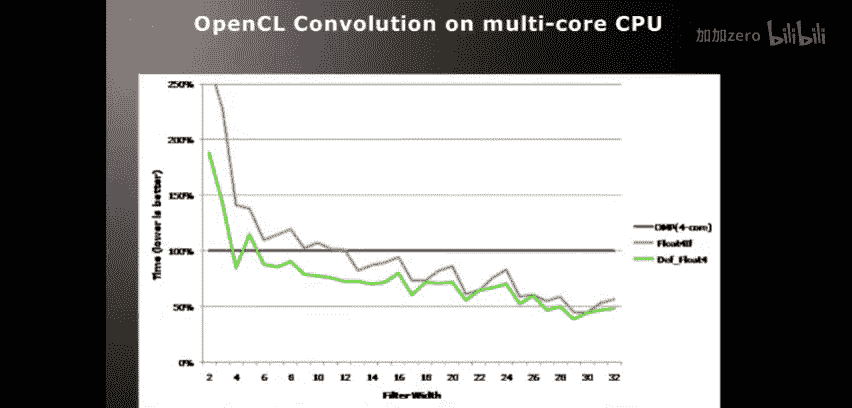
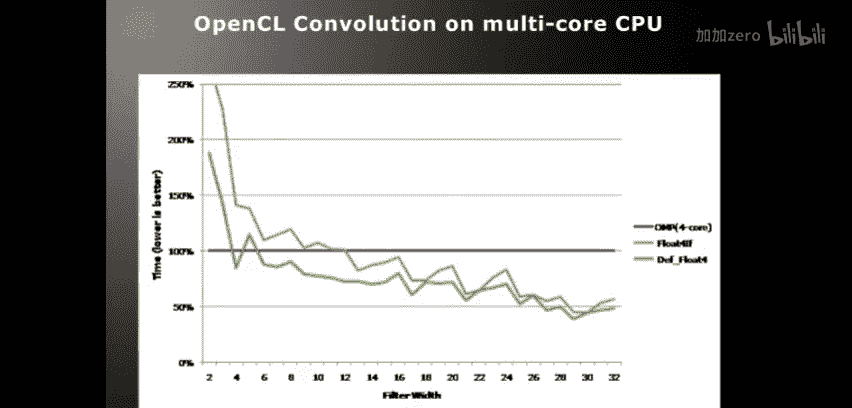
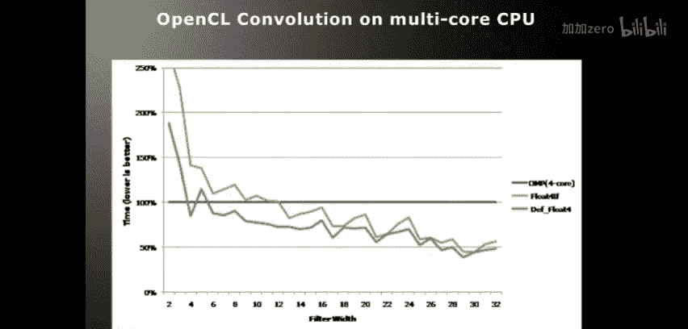
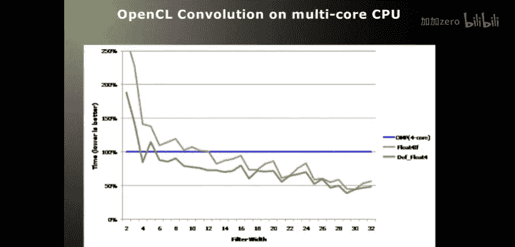
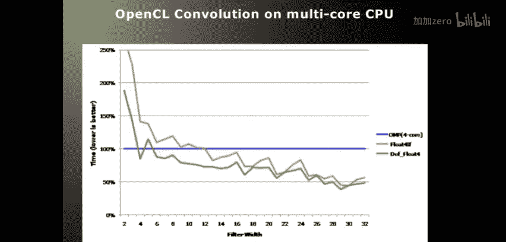
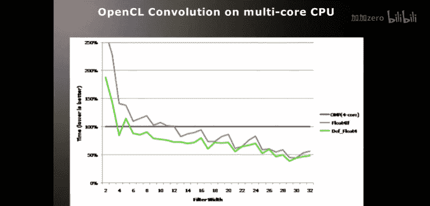
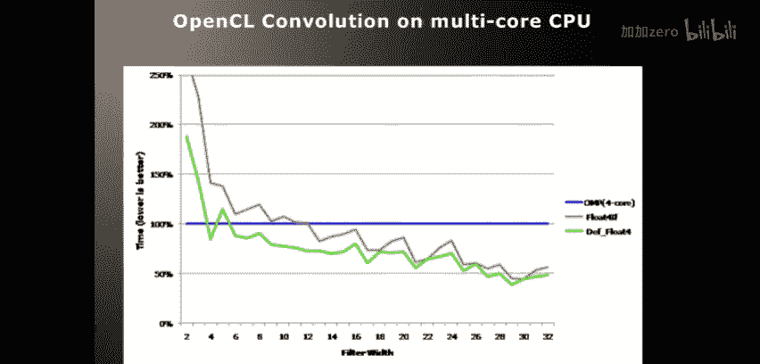
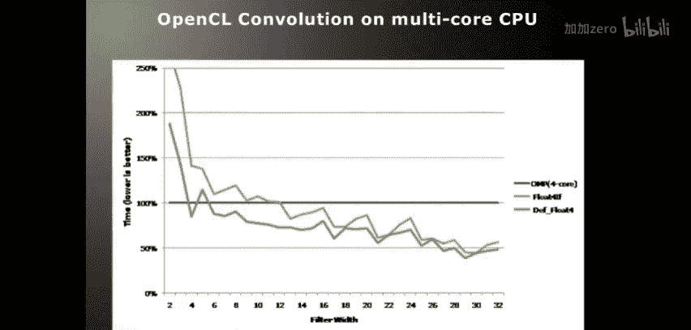

# 【OpenCL编程 RayiYanuTara】 p17 p16 8 - Optimization Techniques： Image Convolution -BV1X2BRYyEeM_p17-

Hello and welcome to today's webcast。My name is Brianna， and I will be your event specialist today。

Following the presentation we'll have a question and answer session， however。

 you can ask questions at any time during the presentation。Click the Ask a question button。

 type your question in the open area and click Ask Quetion to Sub。

 We will answer as many questions as time allows。If you should need technical assistance。

 please type your inquiry into the tech support box on the left side of your screen and click the sendend button。

If you are just connected from the webcast， you can log on again using the login instructions provided to you。

If you cannot log back on with these instructions， please call support at 866。27，1。7，5，9，2。

It is now my pleasure to turn the webcast over to our speaker， Yuidda Boloing。

 Sir the floor is yours。Thank you。Welcome everyone， Im with the Boley。

 I work for AMD in the field of GP GPU applications specifically for compute。

So today I'm going to talk about。Different optimization techniques that you can use specifically for GPS。

 But I'll also touch upon a few simple CPU optimizations that you can do。Using OpenCL。

 and I'll use image convol as an example algorithm to sort of showcase and to highlight the different optimizations that we can do using OpenCL so before I start I'm assuming that most of you already you haven' been listened to thebin to our webinar series。

 you know more or less what OpenCL is you are familiar a little bit with OpenCL。

I'm assuming you are familiar with。Programming on multi core CPUus and also on GPus， however。

 I will still go over our GPU architecture just to make sure that everybody is on the same page as far as our GP architecture goes。

 because when we start optimizing， it is quite important for us to understand what the underlying architecture is。

 so。I will give a very view sort of the world's fastest overview on AmD GPU hardware and on the AMD GPU architecture。

 Then I will sort of。I have a few slides which show the mapping between the open seal terms and what actually goes on underneath the covers in our hardware for example。

 what do you mean by open seal textures if you do open seal textures what is actually going on inside the hardware right so that once I do that then I'll move over to the different optimization techniques and hopefully we will be able to see。

Why a particular optimization works and how that particular optimization actually works under the covers in the hardware。

 right？So we'll get started and。Feel free to shoot any questions。

 but because the questions pop up on the screen I may not be able to get them。

 get to them until late or until I have finished talking through all the slides I expect this to be one of the shorter presentations not too much so feel free to ask questions。

All right。The contents for。Today's webinar would be the first I'll touch upon AMD GPU architecture。

 then I'll talk about the how openCL maps onto the AMD hardware like for example。

 what are the different construction of OpenCL and what are the different hardware blocks that they actually map to then I'll briefly go over the convol algorithm I just have one slide talking about different optimizations that we can do on the CPM then I'll move over to optimizations on the GPU which is actually the main focus of today's talk。

So。One of the things I want to highlight here is that our OpenCL。

 our Opense implementation works both on CPUUs and GPUs in case you hadn't heard about that。

 so it works actually quite well on the CPU it automatically does multi trading。

 it does transparent multi trading it if you， for example have a six core or eight corere CPU or even a let's say a two socket 12 corere CPUs so that would give you 24 core。

 so even in that scenario instead of using other APIs like openmpP threads which are actually already quite good。

 you can also use your openCL kernels that you have written for the GPU。

 they will get automatically translated and they can run transparently on the CPU， they will get。

They'll automatically get multi ted。 They'll use all the core。 and you can get。

You can get quite good scaling with that。 So the whole idea is not。

 is that if you're riding a kernel and if you're doing software investment。

 that is going primarily towards the GP， but just in case。

It happens that one of the users of your software doesn't have a GP。

 or maybe you just want to run the kernels on your laptop。 You can do that， and it is not emulation。

 it runs in quite a high performance mode， even on the CPU。

So that is more or less the content of our webinar， so let's go over to the architecture of our GPUs。

I will focus， mostly on the。The Evergreen series of our GPUs， which are the Radon 5000 series。

 so we have the 5700s and 5800s。This particular slide that I have here is about the Cypress GPU that is the 5870 and 5850 series。

 so the 5870 has 20 Sbi units which units which is what I show here the 5870 or sorry the 5850 has 18 Cbi units so two of the S units are disabled right so let's talk about the 5870 the Cyrus right so the Cyrus has 20 Cds。

RightAnd I'm assuming， you know what a S is。 So the S is a single instruction， multiple data unit。

 So each of those 20 Cds can work independently。 That is they can they will be taken and they will be executing different instructions。

 but within each S。Each Cdi will execute just one instruction per clock cycle， right。

 It'll have one instruction。But it'll apply the same instruction on many， many different data。

That's the definition of the same D， right。This particular GPU， the 5870， has 2。

72 draft flops of single precision。And right now， for this particular generation。

 our double precision rate is one fifth of the single precision rate。

 So our peak double precision is 544 giglops and the memory bandwidth from the global memory。

 not from the on chip cashs， right， The global memory that's。That's on board。

 The memory bandwidth is 153。6 gigy per second。 So I put these numbers in here so that you can get an idea of how fast your algorithm can go。

 For example， if you're writing a kernel， you can do it。

Let's say a quick math to figure out how much。How much alu that particular cardinal needs or how much memory that needs。

 And if you're getting close to you。80 or90 or even 80% of the peak。

 I'd say you were already getting pretty close here。 So as far as optimization goes。

 that should be your target。 Let's say you start at， you start getting towards。

70 or 80% of the utilization。 You should be in a happy place。 and then。

It's not for all particular algorithms， but for certain ones。

 you can tweak it further to get maybe up to 85 is。 That should be pretty good， right so。

One key thing to note is that most of the algorithms are actually initially。

 unless you optimize them。They are actually memory bandwidth limited， right so。

If you're running an algorithmium and youre seeing， let's say 1。5ter flos of performance and not 2。

5ter flops as you'd expect， that is probably because you are hitting the memory bandwidth limit。

 so that's one thing that you should definitely keep in mind，So moving on to seeing this。

Each Cdy has。Two pieces of。Two different types of caches。

 one is called local memory and the other one is what we call L1 cache so in terms of openC the local memory would correspond to the openC local or what we can call a shared memory sometimes and the cache memory corresponds to openC images or textures so let'll talk about Cdys in more detail。

 but let me highlight this。So this particular， this is one sym， right？So here you have one C。

And the blue。然。This is one particular。Cash， which is the texture cash。

 And this is a different type of cash， which is the local data share。

So let's move on to a more detailed diagram about thesemblies。All right。

 so this is in this particular figure I'm showing two Cds。So for each SD。

 you can see each SMD has 16 different units， so it has 16 different ALlu units so in the previous slide when we were talking about SIDs I was saying that each SD will execute one instruction per clock cycle。

 but it can execute on multiple data， so in this particular case for our GPUs。

 we execute each instruction on 16 different ALUs。So we can execute each instruction on 16 different data。

 16 different data elements， for example， if there is eion instruction that's going on in one particular clock cycle。

 the same eion instruction will execute on all the 16 different AE Europe。喂。So' know that Cindy has。

嗯。16 Alu units， These A units are actually VIW units， but let's not worry about that right now。

 let's just call them 16 Alu units。So we have。This is the。

Local data share that that is one type of cash。 And then we also have。第。The texture cast。

 which is the second type of cast， and I'll hit up on both。

So this is more or less the diagram of the texture unit， right， the local data share is 32 kilobytes。

And the unit， the cash is 8 kB。Okay。So。Let's move on to the next slide。All right。So， no。For each SMD。

We have， I mentioned， we have 1680 units。But what actually happens when we execute kernels on our GPU is that our GPU。

Our GPUs have quite a few pipeline stages and because they are heavily pipelined。

 what we need to do is that to keep the pipeline filled， we execute the same instruction。

Over four different clock cycles， so what happens is that in one clock cycle you have 16 instructions or one instruction running on 16 different as now the same instruction actually runs over four different clock cycles on four different batches of data。

Right so we had 16 different data on one Cdy in one clock cycle in the next clock cycle we take  16 different elements of data in the third clock cycle we take 16 more and then in the fourth one we take 16 more so in terms of in open seal par parance when we talk about work items。

You can think about each Cdy as executing 64 different work items。Right， so。In effect。

 although we have 16 year units in one Sdi， In effect， what will happen is that we will take。

Four batches of 16。And we will in fact， have sort of something like a virtual virtual Cdy。

 which is 64 elements wide， right， So each instruction in effect will actually run on 64 different elements。

 That is one important thing to remember on our hardware。 So if you have experience with running。

Kuda in Nvidia。 So this concept is very similar to what they call the warp。 In their case， it is 32。

 In our case， the equivalent of warp happens to be the wavefront and it is 64。

 It is not 64 on all GPUus on our very。Low end GPS， it is 32， so you can check using opencl。

 But in most of our GPSus， it is 64。So now we have talked about。

All this indy or all the all of these 64 work items executing just one instruction。

 So what happens if there is a branch in the code， right？ So what happens， for example， if there is。

What happens if there are 63 work items that have to go towards the left branch and there's just one odd work item？

Because of some boundary condition or something else， it has to go to the right branch。Right。

 so what will happen is that the whole wavefront that is all the 64。

Work items will execute the left branch。RightAnd that one particular work item。

 which is supposed to to the right branch， it'll be masked。After we finish the left branch。

 we will go back to the start and we'll execute the right branch。For all of the 64 work items。

 but now in this case， 63 of those work items have already executed the left branch。

 so we'll just must and will not write anything to them。

 and the one loan item which was executing the right branch will actually now get executed。

So you can imagine that we have in our code， if we have branching。

 we have the left branch and the right branch。So。If all the work items have to go in one direction or the other one。

 we do not have any issues。 like this is the same for our GP or。Any other GPUs。

 But if our work items， if during execution。TheWithin the wavefront。

 some of the work items have to go to the left front and some other the ones have to go to the right branch。

 Then we will need to execute both paths。Right so。If you are wondering why maybe your kernelll is taking twice as long。

 if your whole kernelll is divided into left branch and a right branch。

 that may be because some of the threads are maybe even just one thread。

Is executing one side and all the other threats are executing the other one。 right。

 So this is something。This is something that you need to remember。When quoing， this is not。

This is only important if you have a lot of branching。 And if Alu performance becomes a bottleneck。

 But otherwise youd not， you just need to keep this in the back of my mind。

 This is back of your mind。 This is not such a。Sort of a performance bottleneck。Right。Okay。

So now how does this translate to OpenCO？In Opense。

 you have this concept of merging work items into a work group， right and。So， you know。

 when coding for our GPS。You can have what group sizes of 64， 128 or 256。So。

 that is equivalent to having。group one wavefront， two waves or four wave fronts。

per work group right so if you have a war group size of 256 in OpenCL that will translate to four different wavefronts on our hardware right and it so happens that if you create a work group in OpenCL。

 all the wavefronts that belong to that workgroup will execute on the same SD。

So if you have a work group， let's say if you use a work group， which is。

Size which is not a multiple of 64。 let's say you have a work group size， which is 32 or which is 96。

RightNow that does not translate very well onto our hardware because if you use a work group size of 32。

 our wavefront size is 64， so only half of the LU is being utilized if you have a workgroup size of let's say 96。

That translates to1。1 and half times our wavefront size right so we'll have one wavefront and another half wave front so there are a cycles that go underutil if you have a non-64 multiple work group size so you can have work group sizes which are let's say8 by8 which is 64。

 you can do8 by 16 which is 128 or you can do 16 by 16， which is 256。

 you can also do something like 256 by one or1 by 256。

 it depends on how you want to arrange your algorithm or how you want to subdivide your whole execution domain into different work groups。

All right。Moving on to the next slide。So。This is the open seal view of。of the AMd GPU。

 So how does open， how the different the different opense terms translate onto our GP， right。

So open seal constants go to our constant cash， and our constant cash actually lies in they are not on chip。

 We have small， constant cash on chip， but they actually come from the global memory。

We have war groups and as I mentioned earlier， war groups map onto Cds。All the reference。

 if your work group is larger than a wavefront size。

 all the reference in one work group will go to one assembly。Image cache。

 so when you use openC images， openC images， the data from OpenCL images are cached and they get mapped onto this particular8 KB cache that we have on our GPS。

Global memory is outside of the chip on the。On the board， so it is a high latency memory。

And we have local memory， which is the user defined cache or which is the user enable cache。

 So when you use underscore and local in Opense。That gets translate to this particular piece of hardware。

Okay。And then this is the L2 cache that is sort of almost transparent to you。 So the image path。

 when you use open seal images， they go to L2 and then they go to L1。Right。

So let's now look at the same thing from a reverse angle。

 this is the if you have looked at Opense before you have seen this many times the memory hierarchy in open seal。

 the different kinds of memory that you have。So this is sort of the reverse slide compared to the previous one。

Where does。Opense private memory resideed。 it resides in the registers。On our GPSUus。

 sometimes they may also be。Push back to LD pushush back to what we call this Lds。

 the 32 Kb Lds that we have， right， The work item。 the work item goes to the threat processor unit。

 which is one of the 168 units per empty。The unit， the compute unit。

The whole computer unit maps onto the CD， right， So when you have an open seal work group。

 that maps onto the Opense computer unit， which happens to be our Cds。What about local memory。

 local memory maps to the 32 kilobytes of local data share？

And the global memory happens to be the onboard memory。

 which may be one gigabyte of memory or two gigabte。

 one GBM or 2 GBM that we talk about that we have on the boards。

 that is where the global memory resides。喂。Coect。So。This is the view that。

 So this is more or less our GPU architecture and the opense mapping onto our GP architecture。

 So this is， keep this in mind always。 And then if you have doubts when writing Opense。

 refer back to this so that you have a very good idea of。

What particular when you're writing a kernel and when you are using different pointers and different blocks of memory。

 you will have an idea of how fast that memory is， in the particular where in the GPU that particular memory resides so you can know。

How fast or how slow that memory is。Okay。Now， moving on to the next stage， so this is going to be。

 I'm going to very quickly go with the convolution algorithm。

 It is the simplest algorithm in the world that we could use for this particular webinar。

 I'm sure all of you are。All of you have used it are hard about it。 So if not。

 I'll just go through a very brief overview。 And then I'll just take a quick small detour。

 And since were， since I mentioned CP， I'll just have， I have one slide where I'll talk about。

How to do optimizations on CPU， which coincidentally is not different from the optimizations that you would do for the GP。

 right， And then we move on to the real thing that we are here for， the optimizations on the GPus。对。

So what is convolation convolation is in convolation and you can do convolation on many different types of input data on 1D signals on images and on even on 3D data and so on。

I'm just taking the example of a 2D image so you take an input image。

Right 2D input image and you take a mask now a mask or filter now the mask or filter just happens to be some weights and the filter can be。

 let's say three by 3 or 16 by 16 or whatever you choose to be。Now。

 what you do in the algorithmthium is that to get the output。You place the mask over the input image。

 centered at different pixels。And whenever you place the mask。

 you take a weight at some of all the neighbors of the pixel at the center and the weights being the weights in the filter。

 you do a weight at some and that becomes your output as simple as that right so basically for each output image for each pixel in the output image all you are doing is a weighted sum over the neighbors。

Okay。Moving on。So。For every pixel， it is basically a nested follow， right， right。

 for all the neighboring pixels across。In my case， if I have a three by three mask。Right。

 we go over for all the， all the three rows and all the three columns。 right。

 So it's a double nested loop。 And all we are doing is we have a sum。And the sum is a weighted。

It's a weighted sum。 So these are the weights。 and these are the neighboring inputs。 right。

 And so all we do is that we say output is equal to the。

Is the sum total of the weighted products or of the weighted values of our input？

So here's the key thing。For a three by three filter。

We are doing nine reads from our input and 9 reads from the filter。

 right so this is what we need to remember for our conventional algorithm for large filters。

 like for example， if we have a 16 by 16 filter。We have 256 reads from the input image and 256 reads。

From the filter。And so we are doing 256 reads and 256 reads for every right。

 so what is happening is that this is becoming a heavily memory bottleneck deelth right we spend a lot of time doing reads。

Now the key thing is note that as you move around the mask。

 there is a lot of overlap between neighboring pixels right so for example if you have a 16 by 16 filler and if you move from one pixel to the next pixel and you move the whole thing by one column。

So of those 256 pixels， only 16 are new。Right everything else， all the other reads are the same。

 So at some point of time， the optimization will involve reusing this particular data。Okay。

 so now we'll move on to。Let's move on to the CPU optimization。

 so you remember the particular algorithm we had， this was our algorithm right for all the rows。

And for all the columns， do a weighted sum。Now what can we do for CPU first？Unroll loops。

RightThe second one is at compile time。So the nice thing about OpenC is that when you're running an algorithm thing。

You can do a just in time compilation for the openseL kernel that is the OpenseL kernel can be compiled at application runtime right so I call it application runtime but opense compile time。

 so because its application runtime you may be able to pass in the filter with pass how wide the filter is how wide the input data is many different parameters that you have at application runtime but at opense compile time so because you are compiling at runtime you can pass in a lot of hash defines。

Into the open seal kernels， and that helps。And of course， the final one would be to use vector types。

 so if you use vector types， for example， if you use int force or float force or float8s or whatever have you。

So if you use 128 bit vector types， or I shouldn say 128 bit， if you use four wide vector types。

 that gets translated into SSc。And it gets translated into Sc for both A CPUs and internaltel CPUs。

 doesn't matter what CPU you have And because it gets translated to SC。

 you can so we have we will have SSc and we will also have multi tradinging right。

 So it actually gives you a very good performance because of SSC and multi tradinging combined together because otherwise sometimes if you just write a follow up。

 for example， if you write a for up in。GCC are visual plus， plus on。Quite often。

 it does not do auto vectorization， and it does not spit out SSc instructions in the back end。

So these are the three very quick things that you can do for doing optimization on the CPU。

 I have a tutorial up on the web that you can go look at for further details if you are interested。

 the whole idea is that the same optimizations that we will end up doing for the GPU。

Will actually help will also help on the CPU， and it can make your CPU implementation faster than doing multi trading using Openapp。

 for instance。

So。Here's an example right so the red line is a multi threadreadded openmp implementation of the convolation algorithm and then I just have two different implementations of our kernel on the CPU。

 one is using vectorization， it has float force the other one is using vectorization and also I pass in hash defines different values like for example that filter width and then the loop limits。

During runtime， it's runtime， open sale compile time。 So you can see that we can get up to。

Twice the speed of standard multi trading using vectorization on the CPU， right？Okay。

So let me see how we are doing on time。 right I think we are okay。All right。

 so now finally we come to the interesting part， which is optimizations on the GPU， right。So。

Let's remember now I want to go back and reiterate。What we have on our CDs？

Because this is quite important。Right。Let's see。The two things I want to highlight are。Yes。Right。

Image cache。And the local memory or the user cash。 right， You remember when you talked about the。

Convolution algorithm， I say that there is a lot of there is the potential for a lot of data we use。

For example， if you have a three by two mask。And then you calculate the weighted sum for one particular location。

 you move the mass to the next location。So let's say you shift the whole mask by one column to the right。

So。Six of the N elements that you have already read can be reused in this particular step。

 only three of those elements are new， so the whole idea now is that how we can reuse the data and to reuse the data we will have to reuse data from cache so once the data is loaded onto cache we'll try to reuse it as much as possible so we'll explore both partss。

 we'll try to use the image cache using the Opense images route and we'll try to use the user cache which is using the Opense local memory route。

So， let's go back to the。呃。GPU optimizations。喂。All right。First。

 let's talk about naive implementation， naive implementation。

 as in I just replicate what I just replicate the very simple nested follow loop that I showed you for the CPU right。

It is exactly the same as the CPU， except that。In open seal。

 all you need to do is get the output I right you'll say what is the X location and what is the y location of the output I and then do a weight at sum and then write it out right So the meat of the kernel。

 which is the two nested loops， remains the same so。For our webinar here， we'll take this particular。

Examples。We will。Take willll use a 16 by 16 filter。We will use a。

A 4K by 4K output image and for this 4K by 4K output image what we need is a 4K plus 15 and a 4K plus 15 input image and we need this input image to be a little bit larger because the mask actually overhangs so when we put the mask as a location on the output image。

So there a the mask needs neighboring pixels and when we put the mask at the corner pixel of the output image。

 you can imagine that the mask extends a little bit outside of the output image。

 which is why we need a larger input image。We can do things with borders and replication et cetera。

 et cetera， but。I just want to have an input image with borders， because our focus is not on the。

Use of or how to do convol better。 But our focus is on optimization， right， okay。

So we have a filter which is 16 by 16， we have the output image which is 4K by 4K and our open seal work group。

 I'll start with a war group size of 64 because that happens to be our wavefront size right we need a work group size to be at least 64 and to be multiple sub 64 for good performance on our GPSUs so if I do that。

It takes on radance。One execution of the kernelel takes 1，500 milliseconds， so 1。5 seconds。喂。

All right。So one thing I haven't mentioned on these slides is how to actually do timing on OpenCL。

To to get a good timing， like if you' are just interested in timing right if you' are just doing benchmarking and not doing the not actually using the algorithm in sort of in a pipeline along with many different other kernels that you might have。

 what you want to do is that to launch you want to encu the kernel。A lot of times。

 let's say you executequee the kernel 100 times or maybe even a thousand times you say you do CL kernel。

 you set parameters， you set all the kernel parameters and after you are done with everything you call CL finish。

 just to synchronize the pipeline just to make sure your pipeline。

 everything is empty just to make sure that the GP has done。

 everything it needs to do through that point。After you call C finish。

 you know that the GPU is fresh right and you can start timing。

 so after you do C finish you say timer start。After you sit time or start， you can do。In a follow。

C Nq and the range kernel for， let's say，100 times or 10 times， right。

 You just say Nq Nq Nq Nq and keep doing it After you have done all the Nqs。

 you can call C finish once。Right， after you call C finish， then you immediately take the time。

So what you are essentially doing is that you are calling 1000 NQ kernels and then you are calling one C finish。

And then you are taking time。 So this gives you the closest possible approximation of how fast your kernel is going。

 Now， the reason。What is the other thing that you can do。

 the other thing that you can do is that when you call the kernel， let's say inside the follow loop。

 you can say CL and Q&D range kernel and then you can call C finished both inside the call loop inside the follow loop。

 so NQ andD range kernel C finish NDrange kernel C finish right？

What happens in that case is that seal finish。Take some time of its own。 right。 And if you do that。

 if you call C finish for in every iteration， you'll also be measuring C finish time。

So wed not want to do that I mean you may want to do that。

 but I just want to distinguish the two different scenarios for you。

 so in what particular scenario you are measuring both the kernel time and the CL finish time in the other scenario you are measuring the kernel time as much as possible。

So ideally， if you want to just take the kernel time。

 call it a thousand times and queue the kernel a thousand times and then call C finish once。 okay。

So that is how I measured。That is how I measure this particular time， that is 15。

11 milliseconds for the very naive kernel without doing anything。Okay。Moving on to the next slide。

 let's try our first optimization。 So as I mentioned。

 the immediate thing that stands out is that we are not reusing data right in the knife kernel。

 We are accessing everything from global memory， and we know that it is not cached。By the way。

 That is very important for you to remember that when you have a global pointer。

 let's say underscore underscore global float pointer， it is not cashd， for example。This。

Is not cached。This is not cashd， and this is not cashd。 None of these are cached。

 So what happens is that even if you're accessing the theme element。

20 times or 30 times that same element， if it is not cached。

 will be accessed 20 times or 30 times from the global memory， which has a very high latency。

 We do not want that。So what well do？Our first step is to put them into what we call LDS on our hardware and in open sale parlance。

 what is called as local memory in QUuda parlance， it's called as shared memory， right。So。

If you want to do the math。For every output pixel， we were fetching 256 input pixels。

 and we are not even talking about the filter。 We are not even talking about the mask weights， right。

 we are just talking about the input pixels。So what we'll do is that we'll share the input data。

Within each work group， right， now， this is important。

So we can only share data within a workgroup right that is what OpenCL says that when you use un risk called local。

 that particular pointer is shared inside a workgroup and why does OpenCL force you to do that inside a workgroup。

 that is because the hardware。That gets mapped onto local the hardware， which is LDS。

 which we call as LDS， is unique for each SMD， so each CD has its own LDS right and one CMD cannot really access LDS from another SD。

So if I'm a， I have to access my own LDS。RightSo what happens is that when you have a work group and when you use local。

 the whole work group maps to one CD and this local maps to the LDS。

 the particular LDS on that particular CD。So what we're going to do is that we'll put all the memory onto the local pointer。

 which would be LDS， and then we'll start accessing the memory again and again repeatedly from that local memory。

So。Let's say if our work group is eight by eight， right？And our filter is 16 by 16。

So now we know that the output image that we are going to spit out from this particular work group。

Is also8 by8 because for the eight by8 work group， we have eight by8 work items。

 which is 64 work items， which will be 64 pixels on our output image， right？

So the input image that is loaded onto the LDs。If you have an8 by8 output image。

The input image that you need is。8 plus 15 and say 8 plus 15， that is 529 values。Right。

 so you can see instead of 256 values。Do you have 529 values。Oh， sorry， my bad。Now， this was。

256 values for each pixel。Right， so。In the knife kernel， what we are doing is 256 times 64。

For the whole work group。Now， in this case， we are just doing 529。Right。So。

We have reduced the number of。We have reduced the input items fetch per output pixel to 8。3。

 so it went straight from 256。To 8。3。Partar every output pixel。

 So this is a massive reduction in the number of。In the number of input pixels that we are reading。

So as soon as we do that， the convolation time goes from 1500 to 359 milliseconds。Right， boililer。

 that's like a four times speedup， right。Okay。Moving on。No。We have seen that。

WeWe can reuse data from the neighboring pixels， right？

So we were using a 8 by8 war group now what if we use a 16 by 16 work group there'd be more data we use right so we are going to try to increase the ward group size。

 so the largest war group size that we have on the GPU and 16 by 16。

 the largest on the CPUU is 302 by 30。Okay。So we'll say let's use instead of using a work group of aid by8。

Let's use a workgroup of 16 by 16。All right， so somebody asked， what is the global work group size？

The global workgroup size in this case is4 by。The global work size in this case， is 4K by 4K。

 which is our output image。Right so we have 4K by 4 output pixels and I just decided that one work item part one output pixels so we'll have 4K by 4K work items right so that is our global work size and we divide the global 4K by 4K domain in the previous slide we used eight by8 blocks。

8 by8 work groups now in this slide let's try using。16 by 16 blocks。 So if it's 16 by 16。So。

Filllary 16 by 16， right？The work group size is 16 by 16。

 So the input image that needs to be loaded is。961。Right。So。The output items or the sorry。

 the input items fetched per pixel is actually 3。7。And as soon as we do that。

 the conversion time reduces even further to 182 milliseconds， right？Just 3。

7 items that we read from global memory and we get a conversion time of 182。

Compared to the previous slide。8。3 items， red part pixel， 359。Compared to the previous slide。

256 items， red per output pixel and 151 milliseconds， right。

 so the first optimization that we did was。嗯。Put data into LDS so that we start reusing it。

 The second one we did that the second optimization that we did was that we knew that hey。

 if we use LDS， why not make the workgroup size larger because thatll enable more。More data re。

 So we decrease this。 We decrease the speed even further。So this is about LDS now。Moving on。

Let's try the other caching method。Which is。Taketure cast。

So when you use local memory or when you use LS， what happens is that you need to write code。

 you need to first say。You need to first read data from the global memory and store into local and then you yourself start using the local memory。

 which is why I call it user managed cache right it is up to the programmer the programmer loads data into LDS the data remains there and then you start using the local memory right what if you do not want to go into all that trouble what if you want to just say。

Give me the best cash that you can， and I don't really want to write quote for local memory。

 So what we will do。Is we can use the open seal concept of images。

So if you use openseL concept or images for the different work group sizes。

 here's what you get for eight by8 you get 346 milliseconds and for 16 by 16 you get 207 milliseconds。

 so again both are very close， both are similar to what you use for LDS right and the whole idea is that you are using the concept of opense images。

 opense images are cached right。Moving啊。So。Now we did that， right， we did LDS， we did war groups。

 and we did images。Now let's go back to the naI algorithm like that was trying to take care of data reuse and let's try to think about some other optimizations。

Right。So。嗯。What about the filter area， the filter itself is 16 by 16 and it is not cached。

 we have been reading the filter again and again from the global memory that is also not optimized right so what we can do is that we can try to cache the filter so we have two options。

1 is that we use the automatic caching that is provided by open seal images， right， L。

 we can use the constant buffer。 So how do we use the constant buffer。

IfTo use the constant buffer when we say。We say underscore underscore constant instead of saying underscore underscore global。

 And we have to say for our GPSus right now， we have to say， what is the max size。

If our max size is less than 64K bytes， then it's good。

 we cannot right now support more than 64K bytes， so in this case my max size is just let's say less than 4K so which is fine it goes to constant memory。

 so what happens if it goes to constant memory？So if it goes constant memory。

 if all the threats are accessing the same element， it gets cached。So if work item zero。

 work item one and work item to all of them are accessing filter zero at the same clock cycle。

 it gets cached right better than before。So what happens is that in the knife knife implementation time we had 1511 if we cache the filter。

 remember we now went back to the knife1， we are not using the data use of local and texture。

Even in the na1。We see some data improvement。 We go from 15，11 to 13，7，5。Right， okay。

That was optimization for。Moving on。Let's try something else now， let's try unrolling the loop。

 right？So why should we try enrolling the loop？Because it reduces control flow overhead， right？

Doing any kind of loops， it has a certain overhead of its own on the GPUs。

 so it reduces the loop overhead and on top of that what we can do is that we can now fetch four floats。

 four input data at once。Instead of fetching just one input data。

 like if the follow loop executes over one input item at a time。

 we access one input data and then another input data in the next iteration and the third data in the next iteration。

 So in this case， what we will do is we will just。We enroll the loop by four times and we access four different elements of the input data at once。

Now that helps because accessing 128 bit data is faster than accessing 32 bit data， right。

 so accessing as float 4 is faster than accessing as float。So that should give us better performance。

 And it does。 So if we just do the unrolling， we do unrolling and we fetch us float for instead of float。

 we go to。401。It drastic speed up， right？On top of it， if we say。We makeake our。

Filter fetch also float for。 we go to 389。Right。So。

I'm just doing this to show that if you're accessing as floats and if you can change your kernel so that insert floats you can access as float force。

 you can achieve in most cases right， there's no guarantees it's sometimes it backfires。

 but in most cases you can see a speed up。This particular speedup is due to both is due to loop unrolling。

 like getting rid of the loop overhead and also doing the float for doing the  128 bit accesses。

All right。Moving on。 So Mola， a quick recap。 What did you do in this one， optimization 4。

 we used the constant buffer in optimization 5。 We did unrolling， right，Optimization 6。

What if we do both four and five？Let's try both four and five when I tried both four and five。

It went to 680。Well， that's not good， right， because。We were already at 389。

Now we were already at 3D9 and it should have increased even further， but that didn't happen why。

Because when we did constant float。It increases the earlier usage。 Now， here's a key point。Do know。

AU was not the bottleneck till now memory access was the bottleneck， right。

 we were doing a lot of memory access。 We were doing redundant memoryes。

 memory accesses and they were killing us right as we started speeding up the algorithm and as we started using caches more and more and as we started doing float for excesses we unrolled the loop。

 we made things faster right， now memory accesses are becoming less and less of a bottleneck and now。

If I say constant float pointer， it increases my early usage if you look at the ISA。

 which is the assembly， you will see in the assembly that it increases quite a bit。Right。So。嗯。

All right， it looks like I have 10 minutes left I， I just have a couple of more slides to go。So。

What can we do Now， the reason there is an Alu increase when we use constant float。

Is that the compiler has to now。It fetches 128 bit data。

 it fetches float force and then now it has to do some math to figure out which particular float you wanted from that。

 so it has to do sort of the indexing math， which is what contributes to the AEU usage and it has to do this indexing math for every fetch for filter for every filter multiplication。

 every weighted multiplication which is quite a lot。So。Instead， if we use a constant float4。

 it gets rid of all the Alus， right， it gets rid of all the Ale math， and now this is what we expect。

 we see 346。Which is fantastic。 We started from 1，5，1，1， and we reached 346。

By doing all these other optimizations， right。So let's try everything else now。

We start from na implementation。1511， right？And I have the results for both LES and textures。

 so we do data reuse， we get to 182 or 207 right we use constant float4 on this one we get to 190 and 160。

You do optimization 5 from 190， you go to 90， from 160， you go to 130。

Number you do float4 which is the slightly better optimization for number5。

 go to 83 and 127 right and then you do the constant which is the bad cases that I showed。

 it increases slightly， it increases by a lot。Right， and then you go to the final optimization。

 which is the good one。 You go to 71， and you go to 93。 So remember， we started from 1，5，1，1。

And we we started from four digits and we went to two digits， now， right okay？

So let's see what else we can do。Now I talked about this on the CPU side。

 so when you are doing OpenCL， the nice thing about OpenCL。

 you can do a adjustment time comp that you are running the application somebody says oh what kind of filter do you want to write or run。

 I want to run a 7 by7 filter， you can pass the values7 inside the openCL kernel if you want to add application runtime add OpenC compile time right you can do a lot of those things you can pass in all sort of values that you think are constant。

Using hash defines， Why do you want to do that， you want to do that， Because if you do that。

 our compiler， the driver compiler can do a very good job of optimizing things out if it gets constants。

 for example， it can unroll the loop to the best of its ability。

 it knows a lot of things it can do it can create different pathways statically it can do a lot of static compilation things that it cannot otherwise do if you pass in variables right how to do that。

 when you compile a kernel， you pass in the minus D option。

 minus D defined let's say you have filter with right minus D filter with equals 16。

 you pass in that string， it gets compiled right so。You can pass in filter sizes。

 you can pass in war group sizes， you can pass in whatever is available， right？

So what happens if we do that？Okay。Now， if we do that。Take a look at these。It goes to 69。25，68，66，26。

 And finally， it goes to 25。Right。We started from 15， this is almost 100 times speed up。

From where we started。If we use textures。Notice that all of these are 128，127，127， et cetera。

 et cetera。 right， And in final one， when we do constant float for， it goes to 63。

 What does this tell us， It tells us that in this texture case。For textures。It has become a limited。

When you pass in the hash defines， right， using textures gets it caching and it gets a limited。

It gets a limited， and then it remains a limited for a while until you pass in the constant float for when it goes to 63。

So this is an example where all the optimizations are not helping because we need to do A optimizations or we need to do some other the optimization at this point right so that is all we have。

 basically we started from optimization， we did optimizations on LDS optimizations on workgroup。

 we tried to use textures， we to unroll the loops， right， we try to do fetch force。

 we try to make the filter we try to use a constant buffer and finally we try to use hash defines。

So that's all the optimizations that we have。 If you need the slides。

 these will be up on the opense zone。 We'll have a bunch of other。

 We already have a bunch of other training， and。Slide materials。

 And then we keep updating open sales zone quite a bit， so。

Keep coming back and let me quickly go through the questions now， all right。So。Yes。

 somebody asked about code snippets so I will try to make the whole source code for these available on the web。

 so give me some time I will need to some time to clean it up and post it on the web I already have the tutorial for optimization on CPU and I will try to do the same thing I'll try to create a tutorial out of it and then put it on the GPUs。

 a tutorial for GPUs and put it out on the web， the whole source code。

Do you use vectorization on the radio？ Yes， I use vectorization。 So optimization 5。

When I talked about unrolling the loops。So。I did not use。Rectorization till that。 But what I did。

 the optimization。What I did or when I did the。Loop unrolling， I unrolled by 4。

 So now when you unroll by 4 inside the unroll loop， you had four。

Four weighted products so yeah you have the filter times input image right so you have that filter times input image four times so what I do is that put the input image into a float form put the filter into a float for and multiply。

So that was what optimizationim 5 was about。Okay。Where you say global pointers are not cached。

Are you only referring to L1 cash？Is L2 cache used for both images and buffers No。

 so right now in this particular in our particular SDK in what you have right now。

 if you have a global buffer， it is not cached at all。 No L2 cache， no L1 cache。

 we are trying to come up with some optimization so that if it's a read only buffer。

 it will get cached but we are not there yet right it'll come up in a future release For now。

 if you have global pointers， they' are not cached at all。

 if you have images they' are cached through L2 and then2 L1。So you never actually see L2 and L1。

 I just wanted to show it to you so that you understand what is going on so that is what is going on。

 yes， images are always cached， no matter what channel order and channel data are used。

 images are always cached， but beware though that many the CD runs many different wavefronts right。

And the cache is actually very tiny， so the cache only helps if you access very neighboring elements。

 if try to if you go to random access， then caching sort of the effects of caching go away。

On the CPU side， how do you define the constant filter？Yes。I just pass it as an normal float， yep。

So for the CPUU side on this slide I have the link and then you can also get the link if you just do an image convolution openCL search on Google you'll see my tutorial and you can download the source code that's very nice actually it's for beginners it's a step by step tutorial you can see what changes I do from each step to the next step it should be very straightforward for you。

嗯。All right， GPU memory stays the same between kernel launches and after seal finish。

Onboard memory remains the same registers， local memory do not remain the same right global pointers underscore underscore global and images like open seal buffers。

 the buffers that you could create with open seal remains the same， yes。

For the rub unroll by a factor of4 do you do it manually。I do it manually。 by the way， right now。

 we are going to release a new version of opense very， very soon。

 We are going to release a stick at 2。3 very soon。 And in 2。3， there is a loop unroll pragma。

 So you can say hash pragma， loop unroll something， and it will unroll the loop for you。

 So it'll make it much easier for you。Right， okay， local work group size， because。

4K by 4K is a huge number。 Yes， so 4K by 4K is the global size。 It's not the local size right。

 The local size optimization1， Local size was 8 by 8， optimization2， Local size was 16 by 16。

 and that is the max that you can do in opense right now。喂。So I think that is it。

 And the last question， I'll take the last question。 Okay， direct compute。Allows 1，0，2，4 thread size。

 Should we use direct impe。 Yes， direct impe uses that， And then we are trying to。

We are taking a look at what we can do， So there are many advantages and disadvantages for doing that。

 for example， increase when you increase the work group size。

 what happens is that you decrease the number of work groups that can simultaneously run on assemblyly right So what happens is that。

Again， I'm going back to architecture。When you run things on one particular CD。

 one particular CD has the capacity to run many wavefronts。

How many wavefront it runs depends on the war group size。

 it depends on the register count and it depends on the local memory size right for example。

 if just one wavefront takes the whole local memory on the India which is 32K then you cannot run any more wavefronts because just the first wavefront took up all the local memory right similar thing about registers。

If one wavefront takes up a lot of registers， you cannot run more wavefronts。

Now why do you need more references， you need more waves to do latency hiding to hide memory accesses so what happens is that one wavefront is trying to do memory accesses from global memory。

 another wavefront can come in and do ALU on the same S right so there is a tradeoff between all these different optimizations。

So if you start increasing wargroup size， if you start increasing the amount of local memory that you are using。

 if you start increasing the amount of registers that you are using。

 then you will start decreasing the number of wavefronts and that may have an adverse effect on the optimization。

So I think that is the last question that I can take right now。

