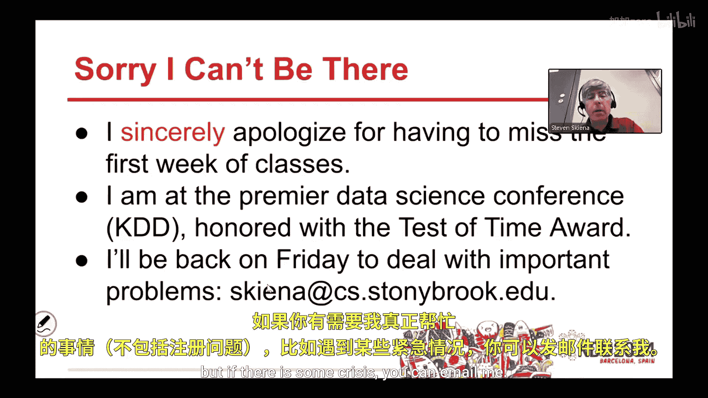
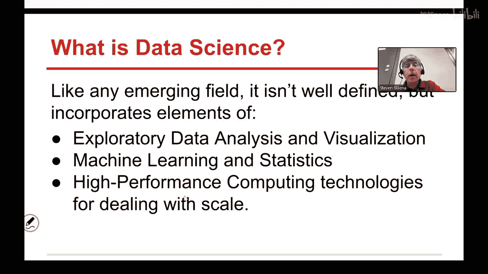
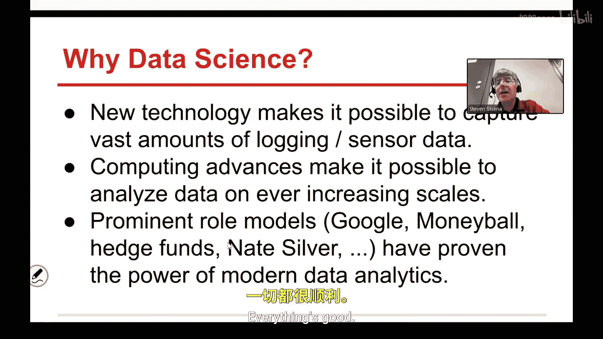
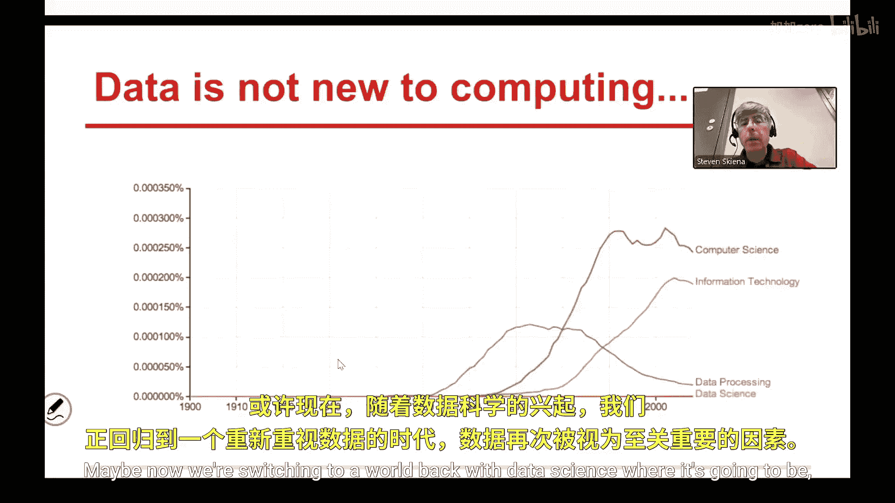
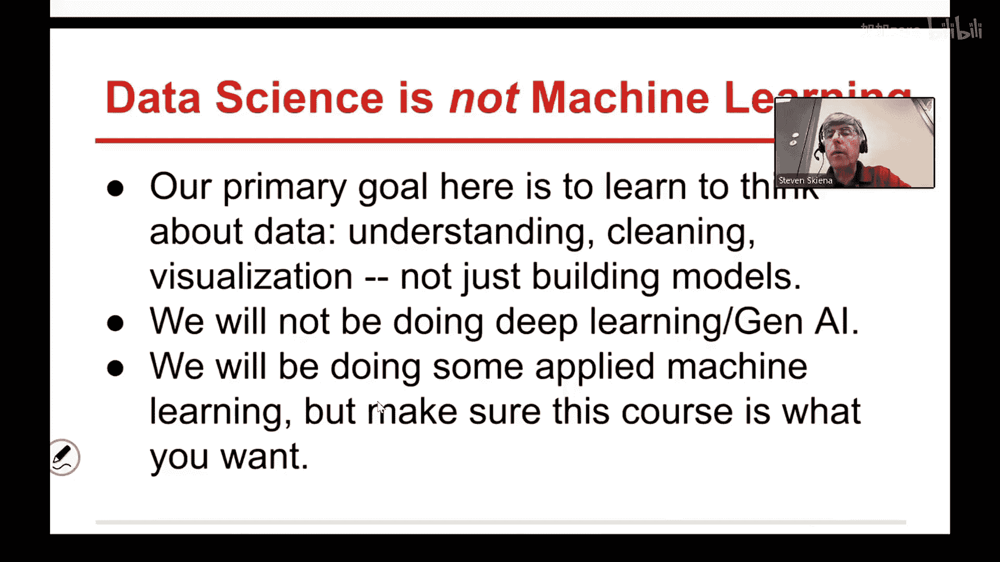
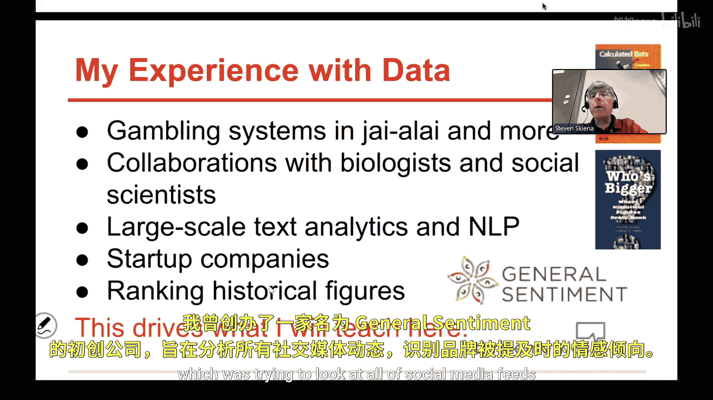

# 001：课程介绍与概述 (2024秋季)

在本节课中，我们将学习课程的基本信息、数据科学的定义及其重要性，并了解本课程的核心内容与方向。

## 课程介绍

我叫史蒂夫·斯基纳，这是CSE519数据科学课程。

很抱歉今天无法亲自到场。由于我在西班牙巴塞罗那参加一个会议并领取奖项，因此本次课程将通过远程方式进行。我将在周五返回学校处理相关问题。如有紧急事务，可以通过邮件联系我。

## 什么是数据科学？

上一节我们介绍了课程的基本情况，本节中我们来看看数据科学的定义。

数据科学是一个交叉领域，它处于计算机科学、统计学、机器学习等学科的交叉点。

数据科学涉及**探索性数据分析**、**应用机器学习**以及**大规模计算**。

数据科学成为一个重要领域的原因有以下几点：
*   **数据量激增**：新的记录技术（如互联网）产生了海量数据。
*   **计算能力进步**：例如亚马逊云服务等技术使得大规模数据分析成为可能。
*   **商业价值显现**：通过现代数据分析处理大量数据能创造巨大价值。例如，文艺复兴科技公司通过对股票数据进行分析取得了巨大成功；在体育领域，数据分析也被用于选拔优秀运动员和制定最佳策略。

## 数据科学的历史背景

在了解了数据科学的定义后，我们来看看它的历史演变。

我使用Google Ngrams（一个分析海量书籍文本中词汇使用频率的工具）的数据来说明。分析显示，“计算机科学”一词在20世纪60年代中期之前并不存在，大约在80年代开始流行。而在“计算机科学”之前，这个领域常被称为“数据处理”。这表明，早期计算的核心驱动力被认为是数据，随后重点转向了算法等其他方面。如今，“数据科学”的兴起可能意味着我们正回归到一个重新认识到数据重要性的时代。

## 本课程的核心内容

明确了数据科学的历史脉络后，本节将具体介绍本课程的重点。

数据科学不等同于机器学习。本课程将包含一些机器学习内容，但这并非课程最核心或最基础的部分。

我们将学习如何**处理数据和模型**，包括：
*   某些模型的工作原理。
*   **数据清洗**：数据的来源以及如何为机器学习模型准备数据。
*   **数据可视化**。
*   许多与**数据解释**相关的内容。

本课程**不会**重点讲授深度学习和生成式人工智能。虽然课程中包含应用机器学习，但如果你希望深入学习生成式AI或深度学习，可能需要选择其他课程。

## 讲师背景

在介绍了课程内容后，以下是关于我本人教学背景的说明，这影响了本课程的设计。

我教授的内容基于多年的项目经验，这些项目都涉及基于数据的建模。我曾撰写过相关书籍，并开发过一个涉及数学建模和统计分析的运动博彩系统。多年来，我与生物学家和社会科学家有许多合作，他们看待数据的方式与计算机科学家历史上“将数据视为程序运行材料”的视角截然不同，更倾向于将数据视为理解世界如何运作的材料。我还在大规模文本分析和自然语言处理领域有多年研究项目经验，并曾创办一家旨在分析所有社交媒体数据的初创公司。

## 总结

本节课中我们一起学习了课程的基本安排，探讨了数据科学的定义、其成为重要领域的原因以及历史背景。我们明确了本课程将侧重于数据处理、清洗、可视化和解释等基础技能，而非深度学习和生成式AI的前沿内容。最后，了解了讲师的相关背景。