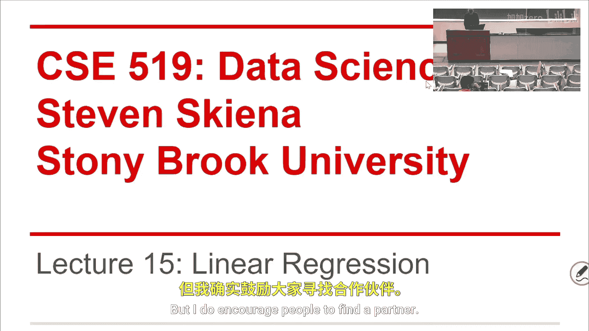
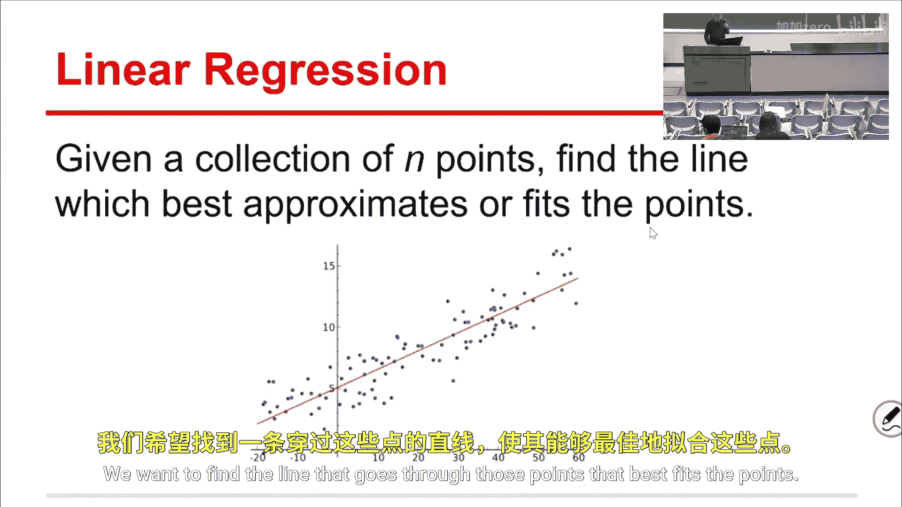
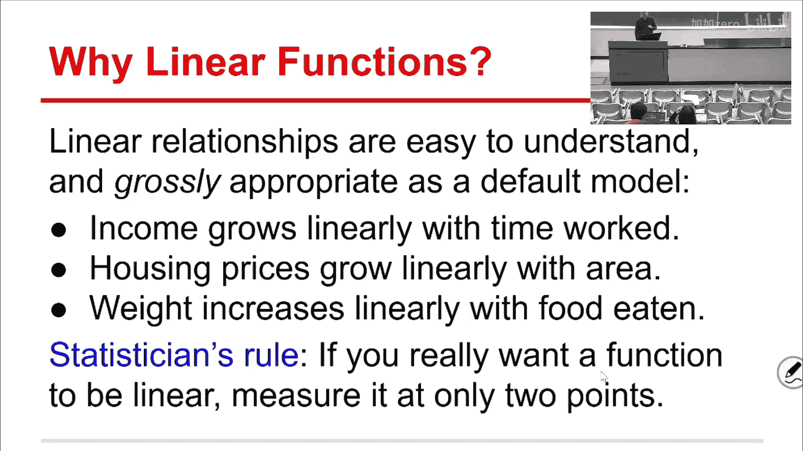
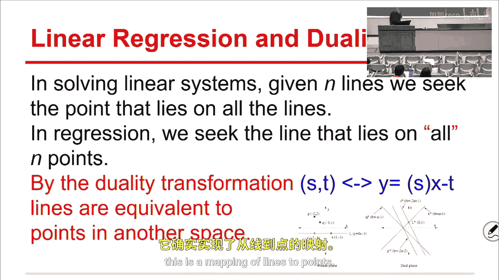
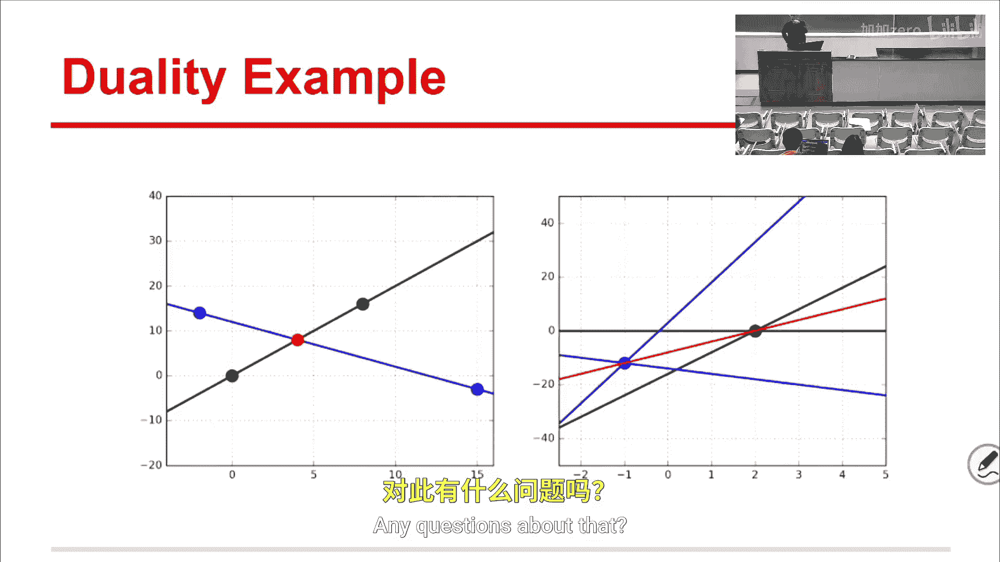
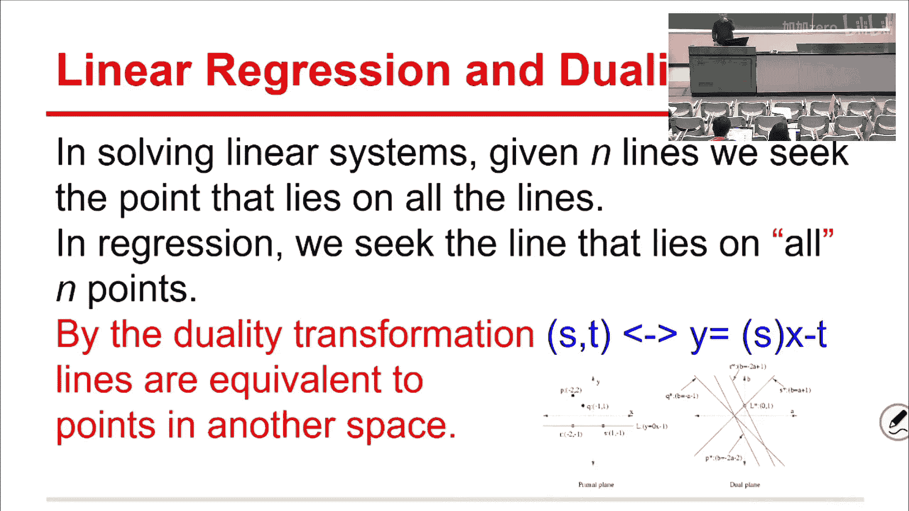

# 002：线性回归 📈

在本节课中，我们将学习线性模型在分类和回归中的应用。我们将从线性回归的基本概念开始，探讨其重要性、工作原理以及一个有趣的几何视角。

## 概述

线性回归是数据科学中最基础且重要的模型之一。尽管有人认为它有些传统，但它对于构建可解释的模型、理解更复杂模型的训练过程以及认识纯线性模型的局限性及其解决方法都至关重要。本节课我们将深入探讨线性回归的核心思想。

## 线性回归简介

线性回归的目标是，给定一组变量（特征 `X`）和对应的目标值 `Y`，找到一条最能拟合这些数据点的直线（或超平面）。

用公式表示，我们试图找到参数 `w`（权重）和 `b`（偏置），使得线性函数 `Y ≈ w * X + b` 能最好地预测数据。

上一节我们介绍了线性回归的基本目标，本节中我们来看看为什么线性函数如此受欢迎。

## 为何选择线性模型？

线性函数易于理解。在许多情况下，事物随变量的增长呈线性关系，因此线性模型是一个合理的假设。

然而，现实世界中几乎没有事物是绝对线性的。严格来说，如果你希望某关系是线性的，你只应在两个点上进行测量。

尽管如此，线性模型因其简单性和可解释性，在实践中仍然非常有用。

## 一个有趣的几何视角：对偶性

在思考线性回归的难易时，有一个有趣的视角。考虑以下两个问题：
1.  给定 N 条直线，找到一个同时位于所有这些直线上的点。
2.  给定 N 个点，找到一条穿过所有这些点的直线。

这两个问题本质上是相同的。这可以通过“对偶变换”来理解。

在对偶变换中（以二维空间为例），点和线可以相互转换：
*   一个点 `(s, t)` 可以解释为一条直线：`y = s * x - t`。
*   一条直线 `y = s * x - t` 可以解释为一个点 `(s, t)`。

这个变换的神奇之处在于它保持了“隶属”关系。例如，如果一个点位于某条线上，那么在对偶空间中，对应的线将穿过对应的点。

因此，求解线性方程组（找多条线的交点）的问题，在对偶空间中就变成了找穿过多个点的直线的问题。这揭示了两个问题在数学上的等价性。

理解了寻找精确穿过点的直线问题后，我们来看看线性回归的核心挑战是什么。

## 线性回归的核心挑战

线性回归的挑战性在于引号中的“最佳”二字。

我们寻找的并非精确穿过所有数据点的直线（这通常不可能），而是**最能拟合**所有数据点的直线。这意味着我们需要一个标准来衡量“最佳”拟合，并有一个方法来找到它。

## 总结

本节课我们一起学习了线性回归的基本概念。我们了解到线性模型因其可解释性和作为理解更复杂模型的基础而具有重要意义。我们探讨了一个通过“对偶变换”理解线性回归问题的有趣几何视角，并明确了线性回归的核心是寻找对数据点的“最佳”拟合，而非精确穿过。在接下来的课程中，我们将深入探讨如何定义和计算这个“最佳”拟合。