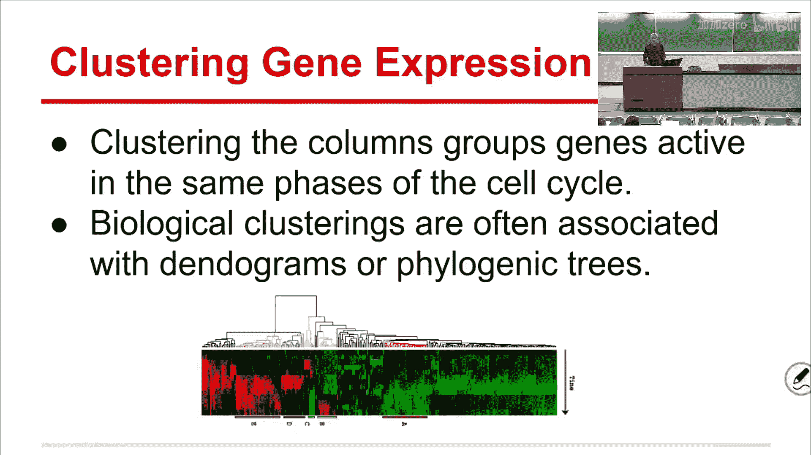

# 003：聚类分析 🧩

在本节课中，我们将学习聚类分析。聚类是一种无监督学习方法，旨在从数据点集中发现自然的分组或“簇”。我们将探讨其基本概念、应用场景以及一个著名的科学发现案例。

---

## 课程概述与作业答疑

现在，我们开始上课。首先，关于作业3，大家有任何问题吗？

有多少同学觉得作业在掌控之中？

我看到不少同学觉得没问题。那么，有没有遇到什么技术障碍？

没有技术障碍吗？

好的。有没有什么有趣的观察，或者让同学们感到惊讶的发现？

好的。

关于降维。我们会在接下来的几节课中，可能是下一节，详细讨论降维。

降维的目标是在降低数据维度的同时，尽可能保留其内在结构。

当维度降低过多时，结构可能会消失。问题是，多少算“过多”？这可能取决于具体的应用场景。

现在，回到你刚才提到的问题，具体是什么？

关于降维到特定维度时的情况。

当我将高维嵌入向量降维时。

好的，我明白了。你的意思是，首先，这里有两个不同的任务：语言任务和视觉任务。

语言和视觉任务上的表现可能不同。

我们快速做个调查。对于视觉任务，当我们将维度降至中等水平时，聚类的准确性是大幅下降还是基本保持不变？

我听到有同学说下降了。

现在看看语言任务。当你将语言数据的维度适度降低时，准确性是下降还是基本保持不变？

我听到教室这边说基本不变。教室这边呢，是保持不变还是下降了？

什么？好的，所以教室里出现了两个“簇”。这边是认为准确性基本不变的同学，那边是认为准确性下降的同学。

下降幅度大吗？还是小幅下降？😡

小幅下降。好的。当我们做实验时，我记得在语言任务上做过。我不太确定在视觉任务上是否做过。

我不太确定我们是否在视觉任务上做过。

在视觉任务上，我观察到的是，当你将维度降低相当多时，质量基本保持不变。

有时甚至在降低维度后，质量还略有提升。有谁看到了这种情况？

他看到了。他看到了。有些同学没看到。

第一个问题是，为什么降低维度有可能使结果变好？

一个可能的原因是，许多维度包含了噪声。

假设我拿到你的数据集，你说：“哦，我的数据只有100个维度。”

我说：“我可以再给你100个维度，只需在每个列生成随机数。”现在你有了200个维度。这会让你的聚类效果更好还是更差？

可能更差。现在，如果你进行降维处理，很可能会试图剔除噪声。

这样你可能会得到更好的结果。这就是为什么降维可能提升性能的奥秘。😡

也许你数据中的许多特征包含噪声，它们并不重要，或者它们与其他特征高度相关，本质上是重复的。

这就是为什么降维可能带来改善。

好的。对于那些性能下降的情况，我记得在NLB1任务中，你们从多少维度降到了10维？

多少？

什么？我没听清。768？好的，所以是从768维降到了10维。

嗯。

有多少同学发现性能至少保持了合理的相似性？

如果性能基本相似，请举手。

他说是的。他说是的。他们说“是”，你们这边不说“是”吗？

降维前后的准确率大概是多少？

准确率的大概数值。

好的。

我预期的是，首先你们自己做实验，但我认为你们会发现，对于语言任务，压缩维度后，应该能大致保持相同的准确率。

哦。

我们下节课会详细讨论降维。至于为什么降维有用，如果它能剔除噪声，就可能会提高准确性。

即使不能提高准确性，也肯定能让数据处理更方便。

当然，如果降维完全破坏了所有数据结构，那就不好了。

关于这一点还有问题吗？关于作业还有其他问题吗？最后，关于课程项目有任何问题吗？如果有问题，可以下课后找我讨论，或者在我办公时间来谈。😊

有问题吗？好的，接下来我想讨论的是聚类分析。

---

## 聚类分析简介 🎯

聚类分析是我在上节课末尾简单介绍过的问题。基本上，它是指给定一组通常位于某个数据空间中、具有某种结构的数据点，目标是找出它们自然的群组。

这是我见过的最好的聚类应用案例之一。我想解释一下这个图表，因为它代表了一项惊人的科学发现。

这些是数据。有多种技术可以……你们身体里都有细胞。

这些细胞会分裂，对吧？

你们都看过这些图片吧？一个细胞，突然它……这样，然后“噗”一下变成两个细胞。

当你的细胞分裂异常时会发生什么？有谁知道细胞分裂出问题时，你会怎么样？

异常分裂。癌症，是的，坏事。癌症本质上是一种细胞分裂疾病。因此，理解细胞如何分裂非常重要。

细胞分裂是细胞功能的一个非常基本的部分。细胞必须学会、必须进化出分裂的能力。

这是在数十亿年前，不是最近。

所以，所有细胞的分裂方式大致相同。

这是一项试图弄清楚酵母细胞分裂如何运作的研究。你们在多大程度上像酵母？嗯，在很多方面你们比酵母聪明，但你们的细胞分裂方式大致相同。

那么，这项研究试图做什么？

问题是，哪些基因参与了细胞分裂过程？

酵母的基因数量相对较少。

---

## 课程总结

本节课中，我们一起学习了聚类分析的基本概念。我们首先回顾了作业中关于降维的讨论，探讨了降维可能通过剔除噪声来提升聚类性能的原因。接着，我们正式引入了聚类分析，将其定义为在数据点集中发现自然分组的方法。最后，我们通过一个关于酵母细胞分裂的基因研究案例，初步展示了聚类在真实科学发现中的强大应用。下节课我们将深入探讨具体的聚类算法。