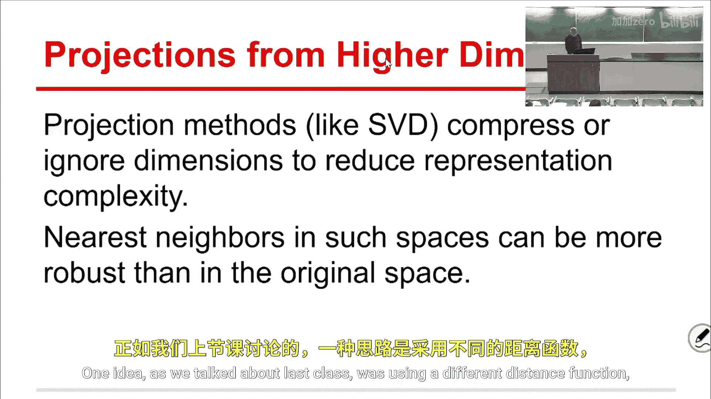
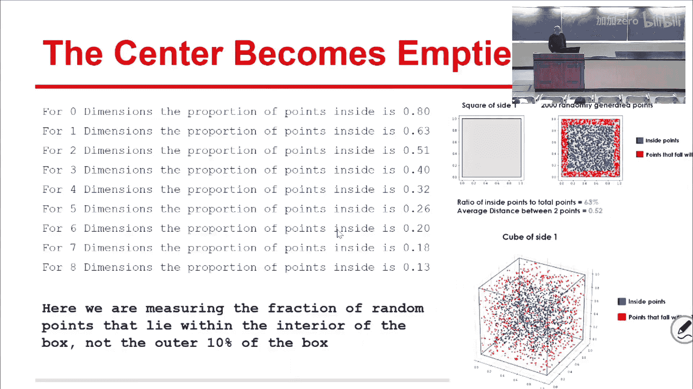
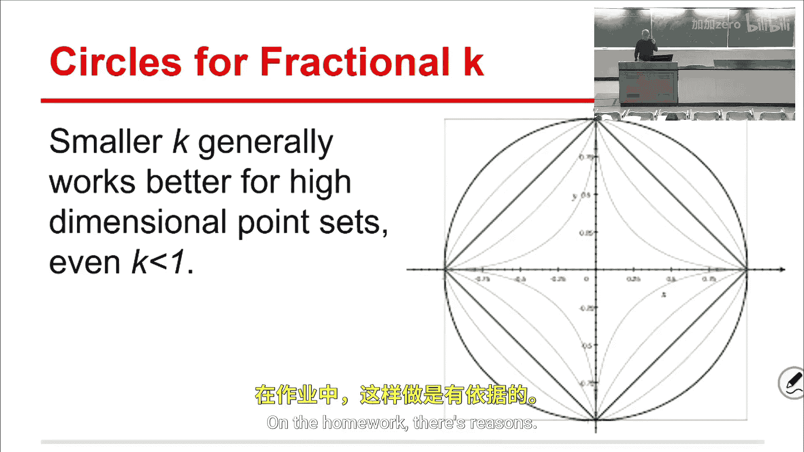
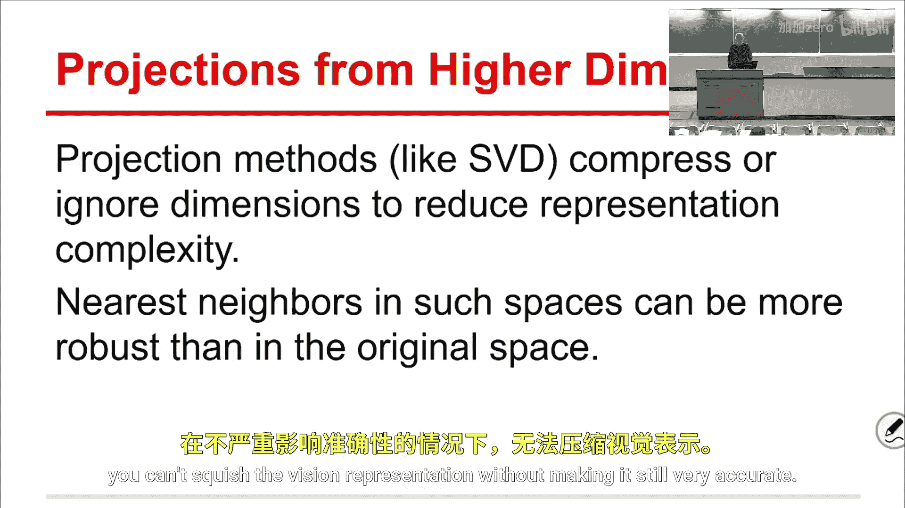
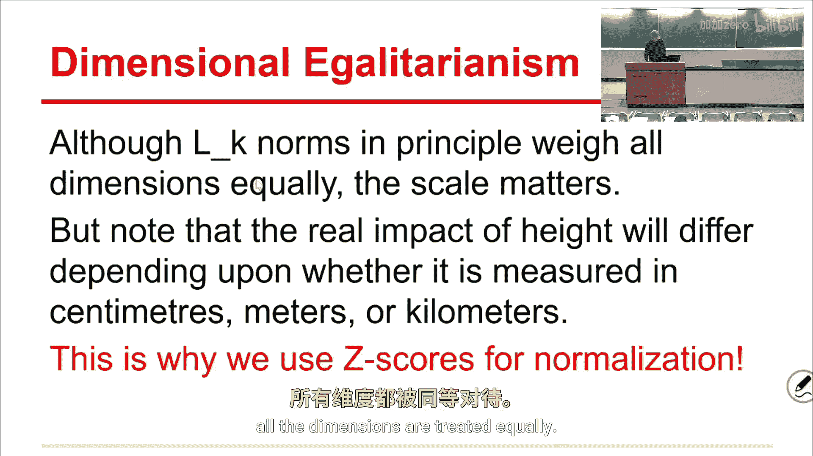

# 004：最近邻方法（第二部分）

在本节课中，我们将继续探讨最近邻方法，特别是处理高维数据时面临的挑战及其解决方案。上一节我们介绍了距离函数的基本概念，本节中我们将看看维度缩减技术及其对最近邻分类性能的影响。

## 概述

最近邻方法的核心思想是：你有一些已标记的数据点，以及一些未标记的数据点。你将未标记点标记为与其距离最近的已标记点的类别。然而，当数据点位于高维空间时，距离的概念会变得复杂，性能可能下降。因此，我们需要一些技术来应对高维数据。

## 高维数据的挑战

在上一节中我们提到，高维空间中的“距离”概念与低维空间不同。一个常见的应对策略是使用不同的距离函数。

以下是几种距离函数的公式：
*   **Lk距离**：`distance = (Σ|xi - yi|^k)^(1/k)`
*   当 `k=2` 时，即为**欧几里得距离**。
*   当 `k=1` 时，即为**曼哈顿距离**。

通常，较小的 `k` 值（如 `k=1`）在处理高维数据时表现更好。你可以在作业中尝试调整这个参数。

## 维度缩减

使高维数据“降低维度”的一种方法是使用维度缩减技术。在我的线性代数讲座中（稍后会回顾），我们将学习一种称为**奇异值分解（SVD）** 的流行方法。在作业中，你们需要将数据点的维度压缩到更小的数量。

为什么这是一个好主意？因为距离函数在低维空间中更有意义，因此处理起来更简单。

维度缩减的潜在缺点是：理论上，如果原始维度是精心构建且重要的，压缩过程会丢失信息。然而，实际情况往往令人惊讶，你通常可以大幅压缩数据而性能保持不变，甚至更好。

有时，维度缩减能帮助去除误差而非重要信息。例如，如果嵌入向量中的每个元素都添加了随机噪声或测量误差，那么进行维度缩减时，最有可能被去除的正是这些噪声，从而可能得到更纯净、更好的数据表示。

关于作业中的实验结果，有同学反馈在视觉任务上进行维度缩减后，准确率下降很多；而在自然语言处理任务上则没有。这可能是因为不同数据集的特性不同。对于NLP任务，我们的经验是能够显著降低维度同时保持准确率大致不变。请你们通过实验亲自验证。

## 距离范数的注意事项

再次强调，当你使用任何距离范数时，默认情况下所有维度都被平等对待。这意味着每个特征对最终距离的贡献权重相同。在某些情况下，你可能需要对不同特征进行加权，但这超出了当前讨论的范围。

## 总结

本节课我们一起学习了应对高维数据最近邻分类的挑战。我们探讨了使用不同距离函数（如Lk距离）的策略，并重点介绍了通过奇异值分解等方法进行维度缩减的技术。维度缩减可以帮助我们在低维、更易处理的空间中工作，有时还能通过去除噪声来提升模型性能。请通过实践作业来深入理解这些概念。