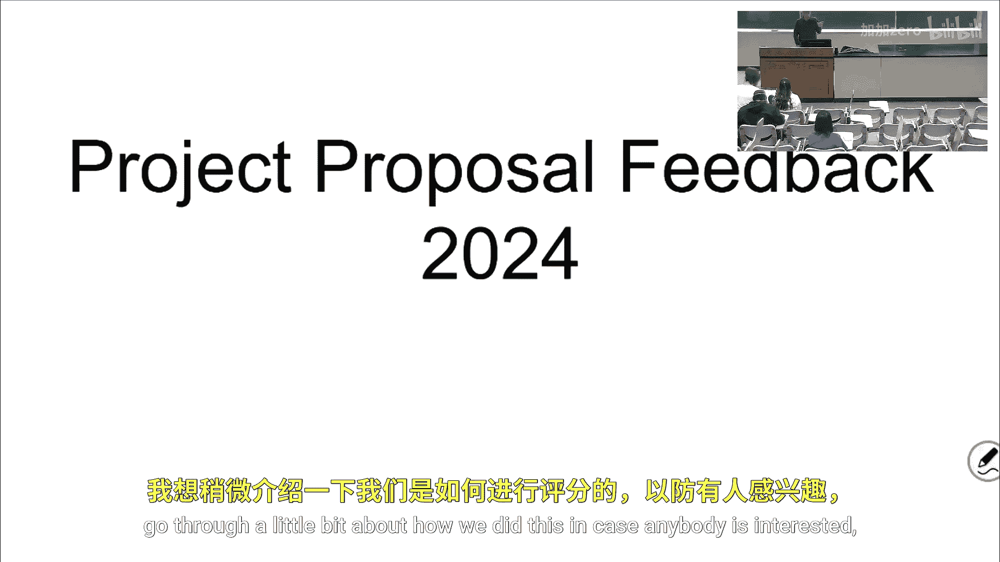
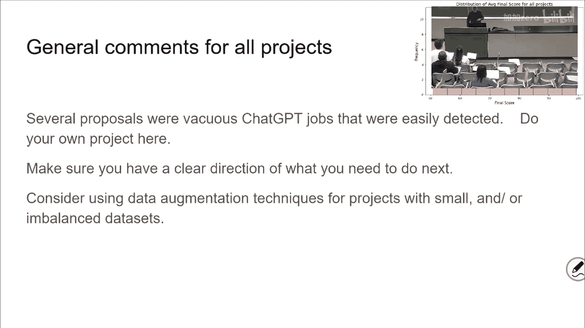
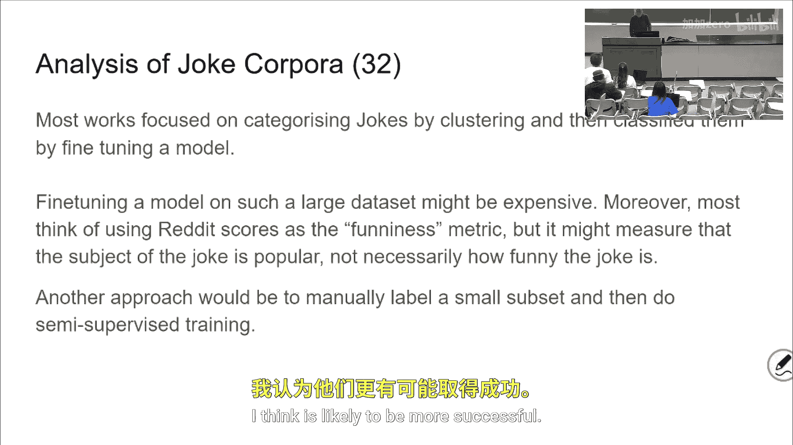

# 005：决策树与提升（2024秋季）

在本节课中，我们将学习决策树与提升算法的核心概念。首先，我们会回顾项目提案的评分流程，并提供一些通用反馈。接着，我们将深入探讨决策树的工作原理、如何构建以及如何通过提升技术来增强其性能。

## 项目提案评分流程回顾

上一节我们介绍了课程背景，本节中我们来看看项目提案的具体评分流程。

提案由两位不同的评分者（助教或教授）进行评审。每位评分者会依据三个标准进行打分，每个标准的平均分目标设定为4分（满分为7分）。评分完成后，会对所有分数进行标准化处理，使最高分约为100分。最终成绩基于标准化后的总分进行计算。

以下是评分时关注的三个核心标准：
*   **创新性**：项目想法的原创性与新颖程度。
*   **工作量**：项目预计的复杂度和所需投入的工作量。
*   **推进计划**：对项目后续步骤的清晰规划和愿景。

提案的平均分中位数约为72分。得分较高的提案通常具有明确的方向、已开始初步实验并对问题难度有所了解。得分较低的提案则可能内容空泛、方向模糊，或仅完成了基础的数据概览。

提案的评分已经确定。当前的重点是根据反馈，明确后续三周内的具体工作方向。如果对方向感到不确定，建议与教授或助教讨论。

## 各项目提案通用反馈

在了解了整体评分机制后，我们来看看针对不同项目数据集的一些通用观察与建议。

最受欢迎的项目是关于“乔笑话语料库”的分析，共有32份提案。由于选择同一数据集的人数众多，若想脱颖而出，需要一个清晰且独特的切入点。

助教们注意到，许多提案计划对笑话进行分类或聚类，并微调模型。对此有几点需要考虑：
*   **微调目标**：需明确模型预测的目标，例如是预测“有趣程度”还是“话题流行度”。
*   **可行性**：微调模型可能成本较高，且不一定是获得有趣结果的最佳路径。
*   **替代方案**：可以考虑手动标注少量笑话作为训练集，而非完全依赖现有评分数据。

核心建议是：在众多同类项目中，找到一个巧妙且独特的分析角度更可能获得成功。

## 决策树基础原理

现在，让我们从项目讨论转向核心教学内容。本节我们将介绍决策树的基本原理。

决策树是一种模仿人类决策过程的机器学习模型。它通过一系列简单的“是/否”问题对数据进行分割，最终达到分类或回归的目的。

构建决策树的关键在于如何选择每个节点上进行分割的特征。其目标是使分割后的子集尽可能“纯净”。我们使用**信息增益**或**基尼不纯度**等指标来量化这种纯净度。

**信息增益**基于熵的概念。熵衡量了集合的混乱程度，公式为：
`Entropy(S) = - Σ p_i * log₂(p_i)`
其中 `p_i` 是集合 `S` 中第 `i` 类样本的比例。信息增益则是分割前后熵的减少量。

**基尼不纯度**衡量从数据集中随机抽取两个样本，其类别标签不一致的概率，公式为：
`Gini(S) = 1 - Σ (p_i)²`
基尼不纯度越小，数据集越纯净。

决策树会递归地选择能带来最大信息增益（或最小基尼不纯度）的特征进行分割，直到满足停止条件（如达到最大深度或节点样本数过少）。

## 提升算法：从弱到强

单一的决策树可能容易过拟合或表现不佳。本节中我们来看看如何通过提升算法组合多个弱模型来创建一个强模型。

提升算法的核心思想是**顺序地训练一系列弱学习器（通常是浅层决策树，即“树桩”）**，每个后续模型都专注于纠正前一个模型所犯的错误。

最著名的提升算法之一是**AdaBoost**。其工作流程如下：
1.  初始化所有训练样本的权重，使其相等。
2.  对于每一轮迭代：
    *   使用当前的样本权重训练一个弱学习器。
    *   计算该弱学习器的加权错误率。
    *   根据错误率计算该弱学习器的“话语权”（权重），错误率越低，权重越高。
    *   更新样本权重：增加被当前弱学习器错误分类样本的权重，减少正确分类样本的权重。这使得后续的弱学习器更关注难分的样本。
3.  将所有弱学习器的预测结果按其权重进行加权求和，得到最终的强模型预测。

通过这种关注错误样本、加权组合的方式，提升算法能够显著提高模型的整体性能。

## 总结

本节课中我们一起学习了两个主要内容。首先，我们回顾了项目提案的评分细节，并强调了为最终项目确定清晰、独特方向的重要性。其次，我们深入探讨了决策树与提升算法：决策树通过递归分割数据做出决策，而提升算法（如AdaBoost）则通过顺序组合多个弱学习器来构建强大的集成模型，后续模型专注于修正前序模型的错误。理解这些基础概念对于构建有效的预测模型至关重要。