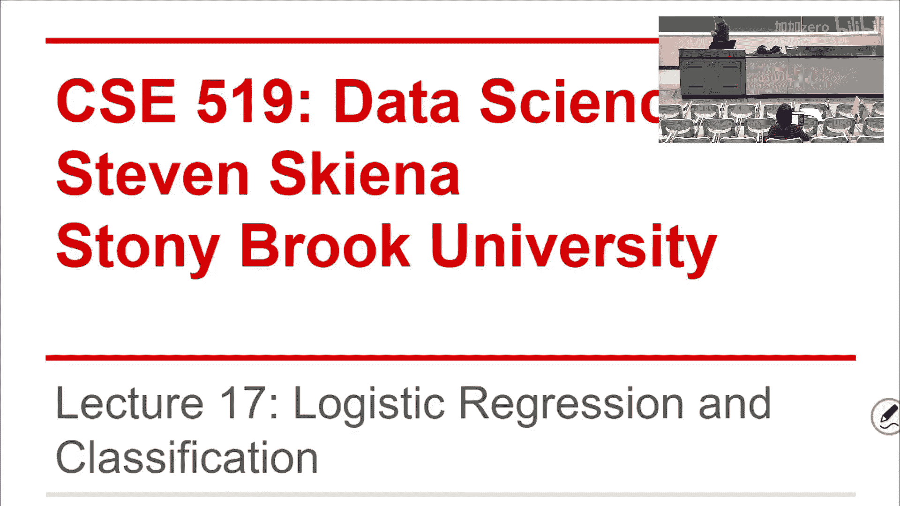
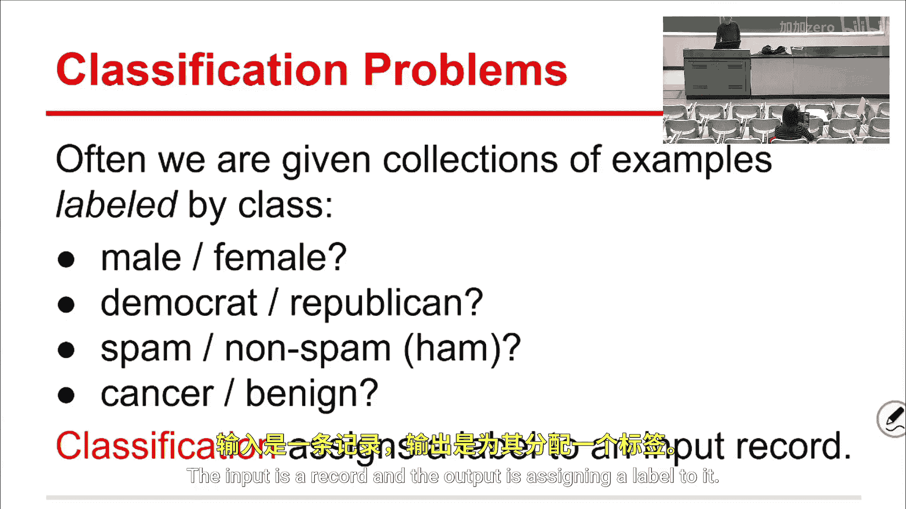
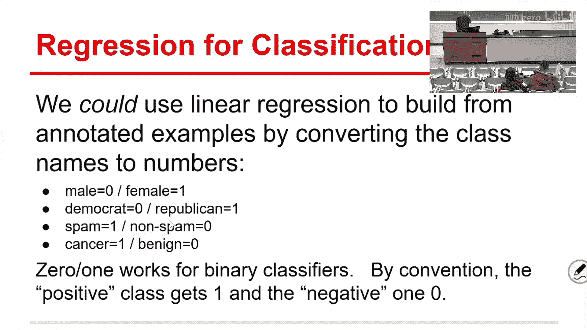
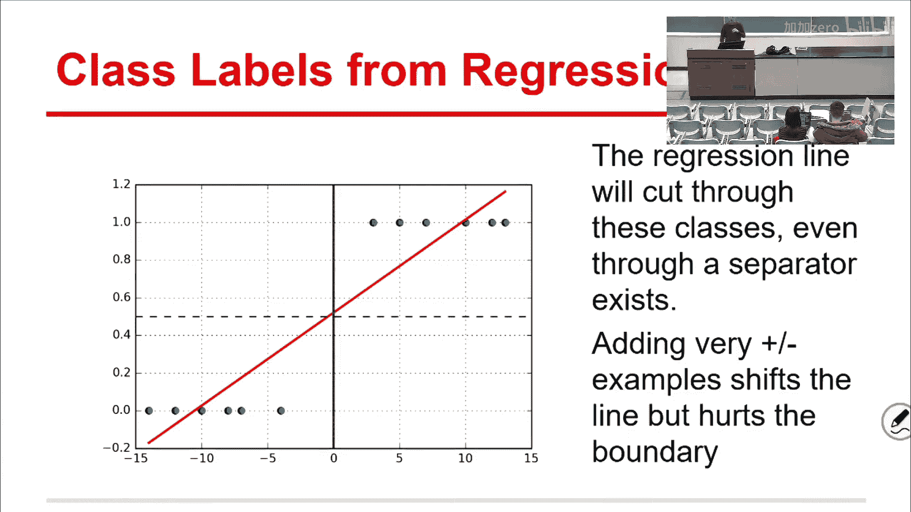
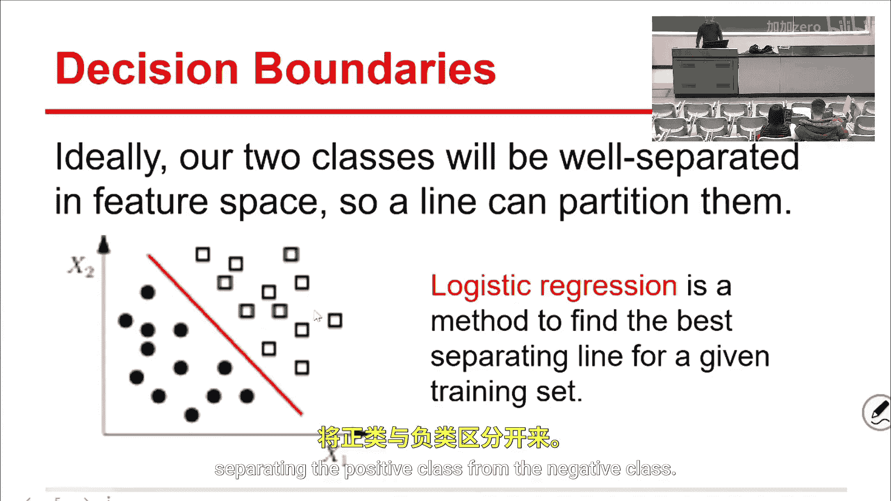

# 006：逻辑回归与分类

在本节课中，我们将学习如何将线性模型应用于分类问题。我们将从探讨使用线性回归进行分类的局限性开始，然后引入逻辑回归这一专门为分类任务设计的核心方法。

## 项目提案提醒

项目提案今晚截止。关于项目提案有任何问题需要澄清吗？

提案要求三页正文加参考文献，不要提交四页。目标是说服我们你清楚自己要做什么。这意味着你需要一个清晰的计划，说明从现在到项目完成期间打算做什么。清晰的计划不意味着要列出每天或每周的具体任务，但需要明确下一步的行动方向，以及如果某个方案行不通，你的备选方案是什么。

理想情况下，提案中应包含你目前已开展工作的证据。如果你已获得部分结果、图表或进行了背景阅读，将这些内容放入提案中是很好的做法。请在三页的篇幅内，展示你认为最有价值的内容。

关于提案还有问题吗？如果只是罗列一堆想法，例如“我们有10个想法，看看哪个可行”，这不如明确说明“这是我最感兴趣的方案，这些是可能遇到的障碍，如果无法克服，我将转向另一个方案”来得有效。如果你能提供一些初步实验或结果来佐证你的计划，那会更好。

今天下课后我需要立刻赶回办公室参加一个11点的电话会议。如果你想课后和我讨论项目，可以和我一起跑过去，或者必要时等我的电话结束。

## 从线性回归到分类问题

上一节我们介绍了线性回归，讨论了如何使用线性代数或梯度下降法求解，以及如何构建线性回归问题。本节中，我们来看看如何将这类线性模型用于分类问题。

分类问题是指：给定一些样本，你需要尝试识别它们属于哪个类别。例如：
*   判断一个人是男性还是女性（二分类）。
*   预测一个选民会投票给民主党还是共和党（二分类）。
*   判断一个活检样本是恶性还是良性（二分类）。
*   在你们上次的作业中，处理的是多分类问题，例如给定一张图片，判断它是猫、汽车还是飞机；或者给定一段文本，判断它是新闻文章还是体育文章。

分类问题的输入是一条记录，输出是为其分配一个标签。这是数据科学中一项基础且常见的任务。

## 为何线性回归不适合分类？

首先，我们看看如何尝试用线性回归做分类，并分析其优劣。

回想一下，线性回归的目标是接收一条记录并预测一个连续的目标值。那么，如果目标变量是二元的（例如，正类标记为0，负类标记为1）呢？你可以想象训练一个线性回归模型，其中X值是项目的所有特征，而你要预测的Y值就是这个二元目标变量。这种形式对于二分类是可行的。

现在，假设我们有一个一维数据集，有正例和负例。我们试图区分女性和男性，女性在左边，男性在右边。我们找到了最佳拟合线。

我们如何将这个回归线用作分类器？对于给定的X值，我们预测其Y值。你可能会说，如果预测值大于0.5，就判定为男性；小于0.5，则判定为女性。这看起来似乎可行，但这种做法有什么问题或缺点呢？

这种做法有几个奇怪的地方：
1.  **对异常值敏感**：如果我们在训练集中加入“超人”（一个特征值极大、确定性极高的男性样本）会怎样？回归线会严重偏向这个异常点，试图拟合它。这是我们想要的吗？不是。添加“超人”反而会使我们的分类器对普通样本的表现变差。
2.  **优化目标不匹配**：分类器真正需要的是一个**决策边界**，一条能将两类数据分开的线。回归线隐含了一个边界（如0.5处），但它的优化目标是最小化所有点到线的距离平方和（拟合数据），而不是最大化分类的准确性（分隔数据）。

因此，使用线性回归进行分类效果不会很好。构建分类器时，我们真正需要学习的不是一条拟合数据的线，而是一条划分数据的线，即分离正类和负类的决策边界。

## 逻辑回归：专为分类设计的模型

为了解决上述问题，我们引入**逻辑回归**。逻辑回归虽然名字中有“回归”，但它是一种用于分类的线性模型。其核心思想不是直接预测类别标签（0或1），而是预测一个样本属于正类的**概率**。

逻辑回归通过一个特殊的函数——**Sigmoid函数**（或逻辑函数）——将线性组合 `w·x + b` 的结果映射到 `(0, 1)` 区间，这个值就被解释为概率。Sigmoid函数的公式如下：

**`σ(z) = 1 / (1 + e^{-z})`**

其中，`z = w·x + b`（即特征的线性组合）。

这个函数具有完美的S形曲线：
*   当 `z` 趋近于正无穷时，`σ(z)` 趋近于1。
*   当 `z` 趋近于负无穷时，`σ(z)` 趋近于0。
*   当 `z = 0` 时，`σ(z) = 0.5`。

这样，逻辑回归模型的输出 `P(y=1|x) = σ(w·x + b)` 就是一个介于0和1之间的概率值。我们可以设定一个阈值（通常为0.5），当概率大于等于阈值时，预测为正类；否则预测为负类。这里的 `w·x + b = 0` 就定义了决策边界（一个超平面）。

## 总结

本节课中，我们一起学习了分类问题的基本概念，并分析了直接使用线性回归进行分类的局限性（对异常值敏感、优化目标不匹配）。接着，我们引入了**逻辑回归**模型，它通过**Sigmoid函数**将线性组合转换为概率，从而专门用于解决二分类问题。逻辑回归的核心在于学习一个决策边界，而非简单地拟合数据点，这使其成为更强大、更鲁棒的分类工具。