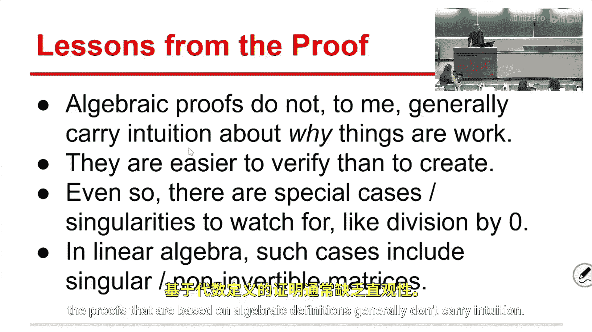

# 007：线性代数复习

在本节课中，我们将回顾线性代数的核心概念。线性代数是数据科学的数学基础，它提供了处理和分析数据矩阵的强大工具。我们将从矩阵的基本概念开始，探讨其在不同数据科学场景中的应用，并理解一些关键公式背后的直观含义。

## 矩阵是什么？🤔

上一节我们介绍了线性代数在数据科学中的重要性，本节中我们来看看矩阵的具体定义和常见形式。

矩阵是一个由数字排列成的矩形阵列。在数据科学中，矩阵是表示数据的核心结构。一个 **N × M** 矩阵可以代表多种事物：

以下是矩阵在数据科学中的几种常见表示形式：
*   **特征矩阵**：行代表数据对象（例如，用户、产品），列代表特征（例如，年龄、价格）。公式表示为：`数据点 = 矩阵的行`。
*   **几何点集**：用于聚类等任务。每一行是一个点的坐标，每一列是一个维度。
*   **方程组**：在求解线性方程组时，矩阵的每一行代表一个方程，每一列代表一个变量的系数。
*   **图/网络**：表示具有 N 个顶点的网络。通常使用 **N × N** 的邻接矩阵，其中元素 `M[i][j]` 表示从顶点 i 到顶点 j 的边数。
*   **向量**：矩阵的任意一行或一列都可以被视为一个向量。

## 强大的矩阵公式 💪

了解了矩阵的基本形态后，我们来看看线性代数如何通过简洁的公式表达复杂的思想。线性代数的一个优势在于，它能用非常紧凑的矩阵公式来描述具有强大功能的操作。

例如，考虑以下公式：
`w = (A^T A)^{-1} A^T b`

这个公式实际上是**线性回归**的解。我们来解读一下：
*   **A** 是数据矩阵，每一行是一个数据点（样本），每一列是一个特征。
*   **b** 是目标值向量，对应每个数据点的实际输出。
*   **w** 是我们要求解的权重向量，它定义了各个特征对预测结果的贡献。

这个公式通过矩阵运算，直接给出了使得预测误差最小的最优权重 `w`。它浓缩了最小二乘优化的整个过程，展示了矩阵表示法的威力。

## 代数证明与直觉 🔍

虽然像线性回归解这样的矩阵公式非常强大，但单纯通过代数推导来理解它们有时会缺乏直观性。代数证明是一系列严密的数学陈述，但可能不总是能提供深刻的洞察。

一个经典的例子是“证明 2=1”的伪证：
1.  假设 `a = b`。
2.  两边乘以 `a`：`a^2 = ab`。
3.  两边减去 `b^2`：`a^2 - b^2 = ab - b^2`。
4.  因式分解：`(a - b)(a + b) = b(a - b)`。
5.  两边除以 `(a - b)`：`a + b = b`。
6.  由于 `a = b`，代入得：`b + b = b`，即 `2b = b`。
7.  两边除以 `b`：`2 = 1`。

这个“证明”的每一步在代数形式上似乎都正确，但结论显然是荒谬的。问题出在第5步：因为最初假设了 `a = b`，所以 `(a - b) = 0`。**除以零**是一个未定义的操作，导致了错误的结论。

这个例子说明，仅仅遵循代数步骤而不理解其背后的逻辑和限制（例如，除以零的无效性），可能会得到误导性的结果。因此，在数据科学中，我们不仅需要掌握公式，还应努力理解其背后的统计或几何直觉。

## 总结 📚

本节课中我们一起学习了线性代数在数据科学中的核心角色。我们回顾了矩阵作为数据表示的基本单元，探讨了其在特征矩阵、几何空间、方程组和图论中的多种应用。我们重点分析了一个关键的矩阵公式——线性回归的解，领略了线性代数表达式的简洁与强大。最后，我们通过一个“2=1”的伪证例子，强调了在运用代数工具时保持逻辑严谨和寻求直观理解的重要性。掌握这些基础，将帮助我们更好地理解和构建后续更复杂的数据科学模型与算法。