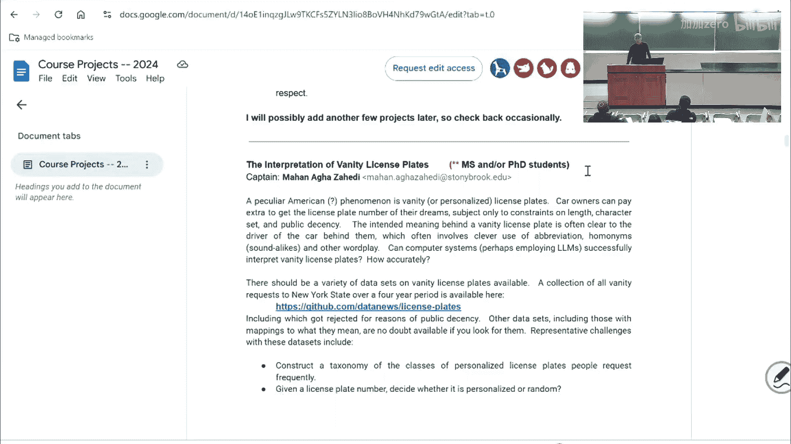

# 009：最近邻方法（第一部分）📚

在本节课中，我们将学习最近邻方法，这是一种基础且直观的机器学习技术。课程开始前，我们先处理一些关于作业和课程项目的行政事务。

## 关于作业3的讨论

首先，关于作业3，有多少同学已经开始着手了？实际上，开始的人数比我预想的要多。对此我感到很满意。关于作业有什么问题吗？

有多少同学已经进行到获取自然语言处理和视觉嵌入向量的步骤了？好的，有不少同学。这些嵌入向量的表现是否符合你们的预期？它们能较好地完成分类任务，并且结果看起来不错吗？还是说结果完全是一团糟？已经完成的同学中，有谁看到结果呈现出聚类现象或其他有意义的模式吗？

目前没有人表示看到的结果是完全混乱的。这有点出乎意料，因为我们之前测试时并未发现这种情况。稍后我会在课堂上做个小测试，看看大家是否真的遇到了问题。除了这个，关于作业还有其他问题吗？没有的话很好，希望大家能尽早开始并理清思路。我们稍后会尝试澄清这个问题。

## 课程项目安排

接下来，我想谈谈本学期的课程项目。这是本学期结束前必须完成的任务。

我们有一项作业3，大约在一到两周后截止。之后的一周，你们需要提交一份三页的项目提案。你可能会觉得三页纸不算什么，但重要的是要认真思考你的提案内容。我今天会详细讲解。虽然它会评分，并且只有三页（你可能会说ChatGPT就能写），但仔细完成以确保你有一个可行的项目、并提前扫清可能阻碍项目顺利进行的障碍，这至关重要。

这些提案会很快被评分。然后，在课程的最后一天，你们需要提交最终的完整报告，我记得是八页纸。对此有什么问题吗？

项目要求以小组形式完成。我倾向于2到3人的小组，不鼓励单人小组，因为我认为在项目中与他人互动是有益的。我也非常不鼓励4人或以上的小组，因为我认为这些项目的规模是有限的，更大的小组未必有帮助。

我会分析项目得分与小组规模的关系。理论上，三人小组的项目应该比两人小组更好。如果我发现评分存在因小组规模而产生的偏差，我将在最终评分时进行相应的调整。例如，如果所有三人小组的项目得分都远高于两人小组，那么在理想情况下，我们会相应调低三人小组的权重。不过说实话，通常差异不会那么大。对此有什么疑问吗？

## 项目经验与建议

根据我的经验，我鼓励大家阅读项目手册。我很快会讲到项目主题，但我想先告诉你们一个我常觉得有趣的现象：你们通常会自发组队，然后去看我列出的项目清单。我会告诉你们哪些项目我认为最令人兴奋、最有做出有趣成果的潜力。但根据以往课程的经验，你们往往会一窝蜂地选择那个看似最无聊、最没有发挥空间的项目。我们看看今年是否还会如此。

有些项目更具开放性，有更大的发挥空间，我个人认为这些更有趣。有些则限制得非常严格，似乎很难做出出彩的成果。当然，你可以选择后者，我猜很多人会这么选。但我想提醒的是，当你真正开始做项目时，可能会发现自己并不那么兴奋，最终的成果也可能不尽如人意。对此有什么问题吗？我会根据我的判断给你们一些提示，但我也要说，大多数班级的学生通常不会采纳我的建议。

## 项目提案的重要性

我给你们这么长时间（以小组形式）写三页提案的原因是，我希望你们在这段时间里能考虑多个项目选项。我希望你们能展示一些初步成果。因为一旦有了初步结果，你们就会对完成项目更有信心。很可能发生的情况是，你选择了一个项目，但在学期结束前一周尝试时，才发现无法获取所需的数据集，导致项目无法进行。我们需要通过提前规划和验证来避免这种情况。

## 小组与评分规则

我希望各项目的小组人数能大致平衡。如果我看到所有人都涌向同一个项目，我可能会让提案最弱的小组在第二阶段更换项目。这种情况有时会发生，但我并不期望达到完美的平衡。

为了在助教评分时保持匿名性，请确保不要在提交的论文中包含姓名或学号。我们将通过Google Classroom发送一份表格，每个小组都需要填写一份小组注册表，这样我们就能知道哪个项目对应哪些学生了。

有任何问题吗？

我需要提醒你们，在项目结束时，小组成员需要描述如何分配组内贡献。例如，在两人小组中，你们可能同意五五开，或者承认某位成员贡献更大。当我看到你们分配的成绩时，如果存在不一致，我会追查并要求你们达成一致。我们稍后会详细讨论。本学期我计划不采用同伴互评，我认为我们有足够的助教，并且通常大家对同伴互评有抵触情绪，所以将由我和助教们来完成评分。

关于这些规则，还有什么问题吗？

## 项目清单与负责人

接下来，我想谈谈我列出的一些项目想法。当你查看每个项目条目时，会看到一个“负责人”。负责人是一位助教的名字，你应该首先向他/她咨询与该项目相关的问题。这位负责人很可能（但不一定）是负责给该项目评分的人。对于每个项目，我都会给出建议，说明它适合哪类学生（例如硕士生或博士生）。但这并非硬性规定，如果我说某个项目适合硕士生，但博士生非常想做，也是可以的。