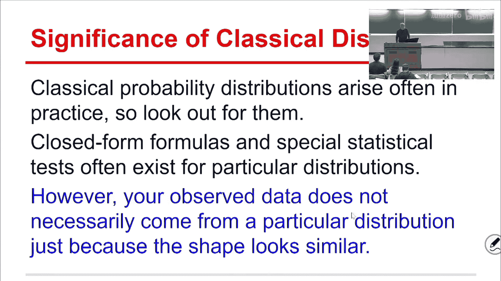

# 010：统计分布 📊

在本节课中，我们将学习统计学中的核心概念——统计分布。我们将探讨几种常见的概率分布，理解它们为何重要、在何种情况下出现，以及如何应用它们。课程开始前，我们先回顾一下期中考试的相关安排。

## 期中考试安排 📝

上一节我们介绍了课程进度，本节中我们来看看期中考试的具体细节。

考试将于周四上午9:30进行，时间为常规上课时间。

以下是考试地点安排：
*   如果你的学号低于116，请前往Fryha 309考场。
*   如果你的学号是116或以上，请在本教室参加考试。

关于考试内容，最佳复习方式是查看教材后面的作业题。我已发布了一份往期考试样卷，你可以从中了解考试题型。

考试规则如下：
*   不允许携带书籍。
*   不允许使用计算器。
*   不允许携带笔记。
*   建议携带铅笔和钢笔。

我希望答案能包含定量或至少是定性的推理，并给出清晰的解答。考试内容将涵盖所有讲授过的幻灯片内容，除了特别说明的与作业相关的背景材料（例如NLP部分）。幻灯片和指定阅读材料中的内容均在考试范围内。

最后请注意，考试期间助教将不会回答任何关于试题内容的问题。这是为了确保所有考生获得一致的信息。如果你对某道题目不确定，请在答卷上写下你的假设。

## 统计学的视角 🔍

在深入探讨具体分布之前，我们先了解一下数据科学中统计学的视角。传统上，数据科学家被定义为比计算机科学家更懂统计，比统计学家更懂计算机科学的人。统计学家研究数据的历史更长，他们通常从一个假设的真实总体出发进行研究。

由于无法研究整个总体，统计学家会进行随机抽样以获得样本。接下来通常有两步：
1.  **描述性统计**：计算样本的属性，如可视化、均值、标准差等。
2.  **统计推断**：利用样本统计量来推断总体的真实属性。

一个经典的例子是民意调查。调查者通过询问一小部分样本的投票意向，来分析并推断整个选民群体的行为。

## 为何关注经典概率分布？ 🤔

在推断过程中，一个重要的假设是，随机变量的分布往往遵循某些反复出现且具有完善理论的重要分布。了解这些分布、它们的形态、出现的原因及用途至关重要。

你可能会问，在当今生成式AI通过数据自我学习的时代，为什么还要关心这些有封闭形式的经典分布？原因如下：
*   **封闭公式有时很有用**：它们为计算和理论分析提供了便利。
*   **存在特定的统计检验**：许多假设检验是针对特定分布设计的。
*   **普遍性**：这些分布之所以经典，是因为它们在实践中频繁出现。为常见事物命名是理解和交流的基础。

但请注意一个原则：**数据呈钟形曲线并不意味着它一定是正态分布；事物在数值较大时变得罕见也不意味着它一定是幂律分布**。我们需要根据具体情况判断。

## 总结 📚

本节课我们一起学习了期中考试的安排、统计学的基本研究范式，以及理解经典概率分布的重要性。我们了解到，统计学家通过样本来描述和推断总体，而一些特定的概率分布在各种现象中反复出现，掌握它们有助于我们更好地理解和分析数据。在接下来的课程中，我们将具体探讨四种重要的概率分布。