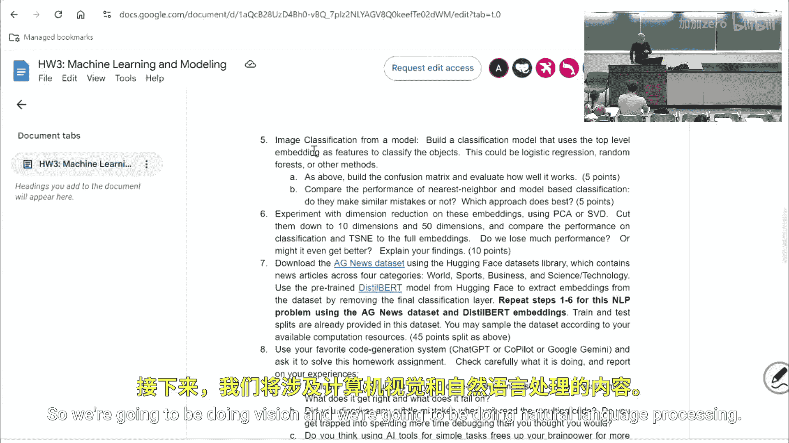

# 011：构建与验证模型 (2024秋季)

在本节课中，我们将学习如何构建和验证机器学习模型。我们将从讨论即将到来的作业开始，该作业旨在让大家亲身体验使用现代预训练模型进行计算机视觉和自然语言处理任务。

## 作业3概述

上一节我们讨论了模型构建的一般概念，本节中我们来看看本次作业的具体内容。作业3的目标是让大家在不深入底层细节的情况下，应用现有的强大预训练模型来解决实际问题。

以下是作业3的核心任务：

1.  **计算机视觉部分**：你将使用一个包含60,000张图像的数据集，这些图像分为10个类别。你的任务是构建一个系统来识别图像所属的类别。
2.  **自然语言处理部分**：你将使用一个包含不同类别新闻文章的数据集。你的任务是构建一个系统来对文章进行分类。

这两个部分的核心思路是一致的：利用预训练模型将原始数据（图像或文本）转换为**嵌入向量**，然后基于这些向量进行分类。

## 核心概念：嵌入向量

嵌入向量是一个数值向量，它是复杂数据（如图像、文本）经过模型处理后得到的一种紧凑、有意义的表示。你可以把它想象成数据在数学空间中的一个“坐标”。

*   对于图像，我们可以使用如 **ResNet** 这样的预训练卷积神经网络。网络的最后一层（或倒数第二层）的输出就是一个代表该图像内容的嵌入向量。
*   对于文本，我们可以使用如 **BERT** 或类似的大型语言模型。模型的顶层输出就是一个代表该文本语义的嵌入向量。

一旦我们获得了每个数据点的嵌入向量，后续的分类任务就可以在这个向量空间中进行，变得相对简单。

## 计算机视觉任务详解

现在，让我们详细拆解计算机视觉部分的具体步骤。

以下是需要完成的步骤列表：

1.  **获取图像嵌入**：使用预训练的ResNet模型，为数据集中每一张图像计算其对应的嵌入向量。公式上，这可以表示为：`embedding = ResNet(image)`。
2.  **可视化嵌入**：使用**t-SNE**技术将高维的嵌入向量降维到2D或3D空间并进行可视化。用不同颜色标记不同类别的点，观察同类别的点是否自然地聚集在一起。
3.  **基于质心的分类**：为每个类别计算其所有样本嵌入向量的**质心**（即平均值向量）。对于一个新图像，通过计算其嵌入向量与各个类别质心之间的距离，将其分类到距离最近的类别。这本质上是一种最近质心分类器。
4.  **评估与找出异常值**：评估上述质心分类法的准确率。并找出每个类别中距离其质心最远的样本，这些可以被视为该类别的“异常”或“不典型”样本。
5.  **构建传统分类器**：使用嵌入向量作为特征，构建一个传统的分类模型，例如**逻辑回归**或随机森林。评估其性能，并分析哪些样本容易被混淆（例如，通过混淆矩阵）。
6.  **探索降维影响**：使用**主成分分析**等方法，将原始的嵌入向量（例如1000维）降维到更低的维度（如10维或50维）。然后重复步骤3-5，观察并分析降维对分类性能的影响。

## 自然语言处理任务详解

完成了计算机视觉部分后，自然语言处理部分的流程将与之高度相似。

以下是需要完成的步骤列表：

1.  **获取文本嵌入**：使用指定的预训练语言模型，为每篇新闻文章计算其嵌入向量。
2.  **后续分析**：重复计算机视觉部分中的步骤2至步骤6。即进行t-SNE可视化、质心分类、构建传统分类器以及探索降维影响。

关键在于，一旦你获得了数据的嵌入表示，无论是图像还是文本，后续的分析流程和代码都可以在很大程度上复用。这体现了嵌入向量作为通用数据表示方式的力量。

## 总结

本节课中，我们一起学习了如何利用现代预训练模型来简化机器学习任务。我们介绍了**嵌入向量**的概念，它作为连接原始数据与机器学习算法的桥梁。通过作业3，你将实践如何：
*   使用 **ResNet** 获取图像嵌入。
*   使用预训练语言模型获取文本嵌入。
*   利用 **t-SNE** 进行可视化。
*   实现**基于质心的分类**。
*   应用**逻辑回归**等传统模型在嵌入空间进行分类。
*   探索**PCA降维**对模型性能的影响。

这个作业的核心思想是：在数据科学中，我们常常不需要从零开始构建复杂模型，而是可以巧妙地利用现有的、强大的工具（预训练模型）来提取高级特征，从而更高效地解决问题。