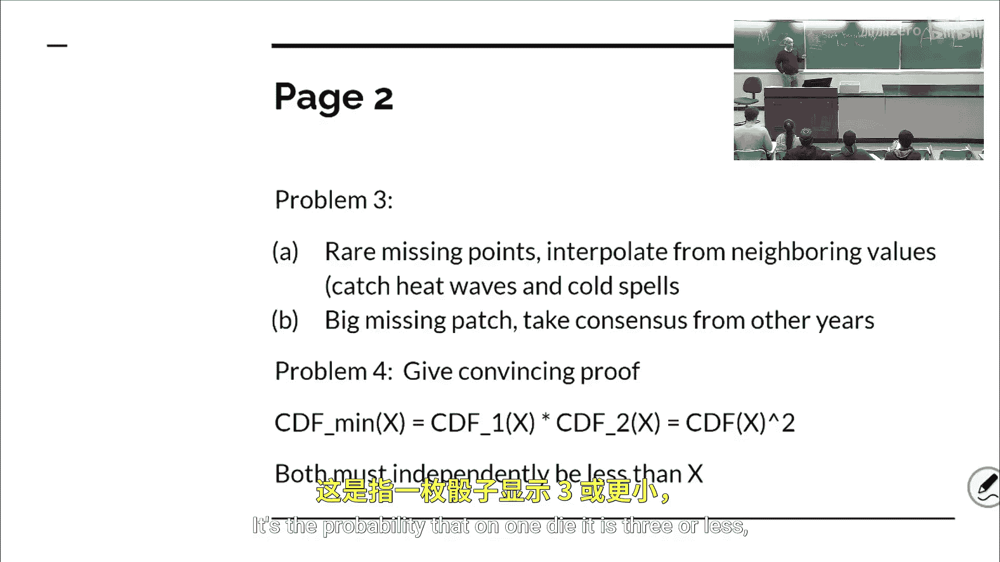

# 013：统计显著性（2024秋季）

在本节课中，我们将回顾期中考试的整体情况，并讲解部分考题的解题思路。我们将重点关注如何理解考试成绩分布、处理考试中的异常情况，以及分析几个典型的概率与统计问题。

---

## 考试情况概述 📊

上一节我们介绍了课程背景，本节中我们来看看期中考试的整体情况。

考试成绩分布大致在30分到90分之间。平均分和中位数约为60至62分。最高分为91分。这表明在此次考试中取得好成绩是可能的。

如果你的分数是62分，即处于中位数水平，这大致对应于A-到B+的等级。因此，不必过分担忧分数本身。

以下是关于成绩分布的要点：
*   平均分和中位数约为60-62分。
*   最高分为91分。
*   分数为62分大致对应A-到B+的等级。

关于考试，助教报告有5名学生的行为存在可疑之处，例如在版本1的试卷上出现了版本2的答案。考试设计有两个版本，外观相似。

如果你对考试中的行为有所顾虑，建议通过邮件与我沟通。关于此事的最终处理决定将在期末考试后做出。在期末考试中，请务必保持诚信。

---

## 试题讲解与回顾 📝

现在，让我们快速回顾几道考题。如果你对答案有疑问，现在是讨论的好时机。

### 问题一：均值与标准差比较

第一道题旨在考察对数据分布的基本直觉。题目给出了四组数据点，要求判断哪组数据的均值更高、标准差更大。

精确计算均值和标准差可能比较困难，但通过观察数据点的分布是否均匀，可以大致判断标准差的大小。分布越分散，标准差通常越大。

### 问题二：随机折断木棍的期望长度 🎲

这是一个概率问题。假设有一根长度为1的木棍，在其上随机选择一个点（均匀分布）将其折断。我们关心的是较短那一段的长度。

设折断点为 `X`，且 `X` 服从 `[0, 1]` 上的均匀分布。那么较短一段的长度 `L` 为：
`L = min(X, 1-X)`

其概率密度函数（PDF）在 `[0, 0.5]` 区间内是均匀的。累积分布函数（CDF）是一条从0到0.5的斜线。

因此，较短一段长度的期望值 `E[L]` 为 **0.25**。一些同学错误地使用了正态分布进行分析，但在此问题中并不适用。

### 问题三：时间序列数据缺失值处理 ⏳

这是一个开放性的数据分析问题。给定一个温度时间序列数据集，其中1%的值随机缺失。

对于随机散落的单个缺失值，最佳估算方法通常是利用其时间上的自相关性。例如，可以用缺失日前后两天的温度平均值来估算，这比使用所有年份同日的平均温度更合理，因为天气具有连续性。

对于连续缺失一整月数据的情况，由于缺乏前后时间点的信息，此时参考其他年份同月份的温度数据（如取中位数或平均值）可能是最可行的估算方法。

### 问题四：最大值的累积分布函数

问题要求推导从同一分布中抽取的两个独立随机变量的最大值的累积分布函数（CDF）。

设原始随机变量为 `X`，其CDF为 `F(x)`。定义 `Y = max(X1, X2)`，其中 `X1` 和 `X2` 独立同分布。

事件 `{Y ≤ y}`（即最大值小于等于 `y`）等价于事件 `{X1 ≤ y 且 X2 ≤ y}`。由于 `X1` 和 `X2` 独立，因此：
`P(Y ≤ y) = P(X1 ≤ y) * P(X2 ≤ y) = [F(y)]^2`

所以，最大值 `Y` 的CDF是原始CDF的平方：`F_Y(y) = [F(y)]^2`

**举例说明**：考虑一个均匀的六面骰子，其原始CDF `F(x)` 是阶梯上升的。那么，投掷两个骰子后，得到的点数最大值 `≤ 3` 的概率，就等于一个骰子点数 `≤ 3` 的概率的平方，即 `(3/6)^2 = 1/4`。

---

## 总结

本节课中我们一起学习了期中考试的总体情况，包括分数分布的意义和对考试纪律的提醒。随后，我们详细讲解并分析了四道考题，涵盖了数据分布比较、概率期望值计算、时间序列数据插补策略以及统计量（最大值）的分布函数推导等核心概念。理解这些基础问题有助于巩固数据科学所需的概率统计知识。