# 014：期中复习（2024秋季）📊

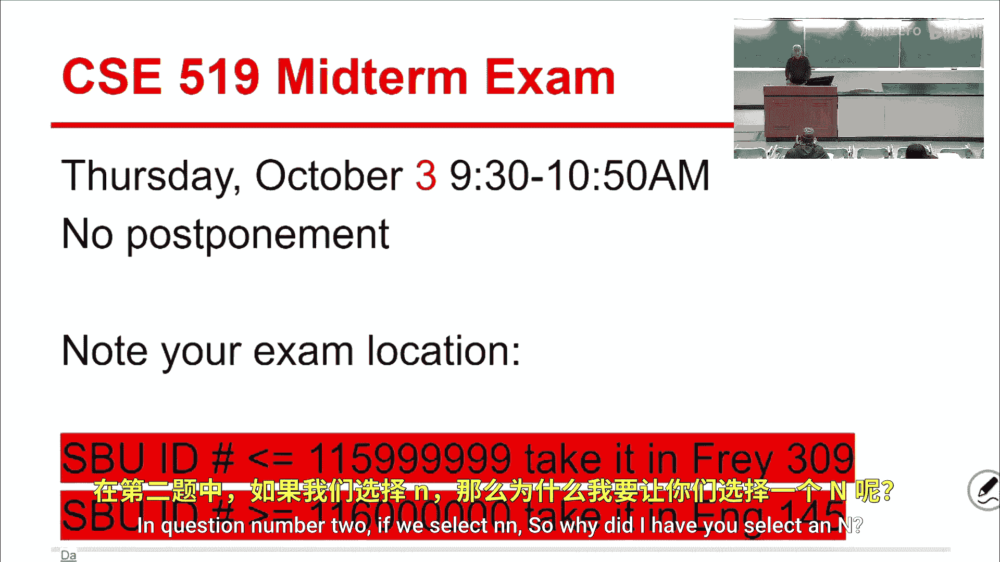

在本节课中，我们将回顾期中考试前的一些关键概念，并讨论一份即将截止的作业。我们将重点关注数据处理、相关性分析以及可视化技巧，这些是数据科学实践中的核心技能。

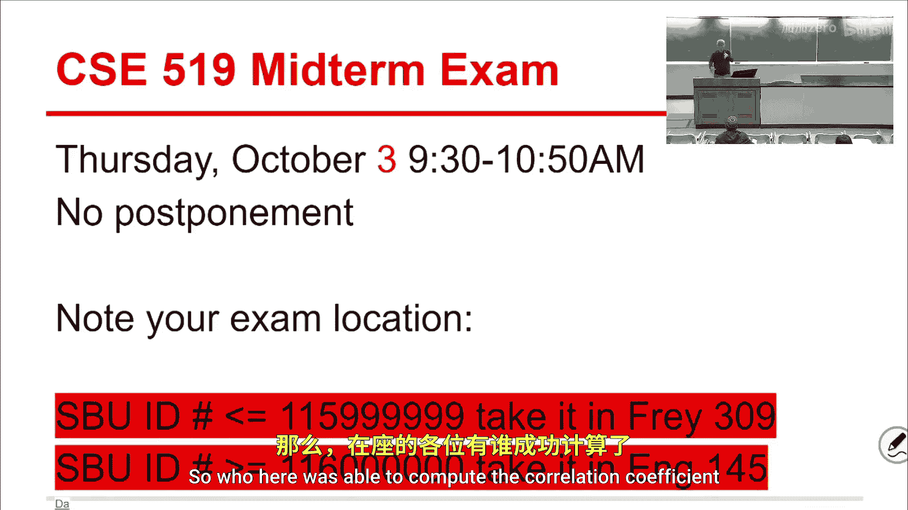

## 作业提交与问题讨论 💻

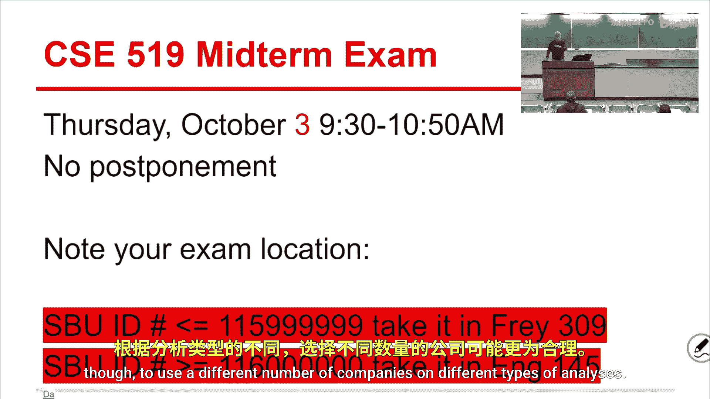

首先，我们讨论今天截止的作业。我建议不要等到最后一刻才提交，因为可能会遇到各种技术问题。如果遇到问题，可以通过 Piazza 论坛寻求帮助。

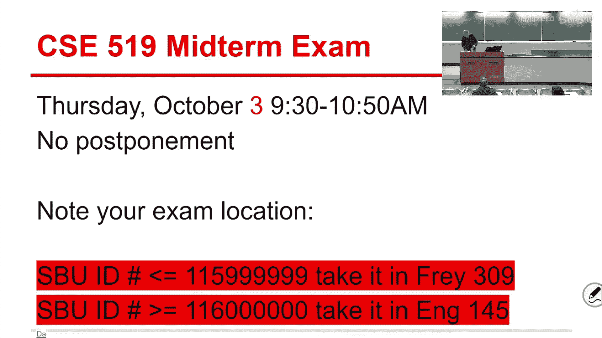

以下是关于作业的一些常见问题与解答：

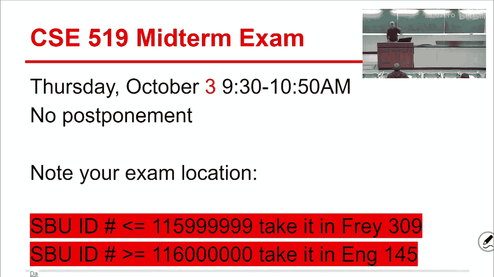

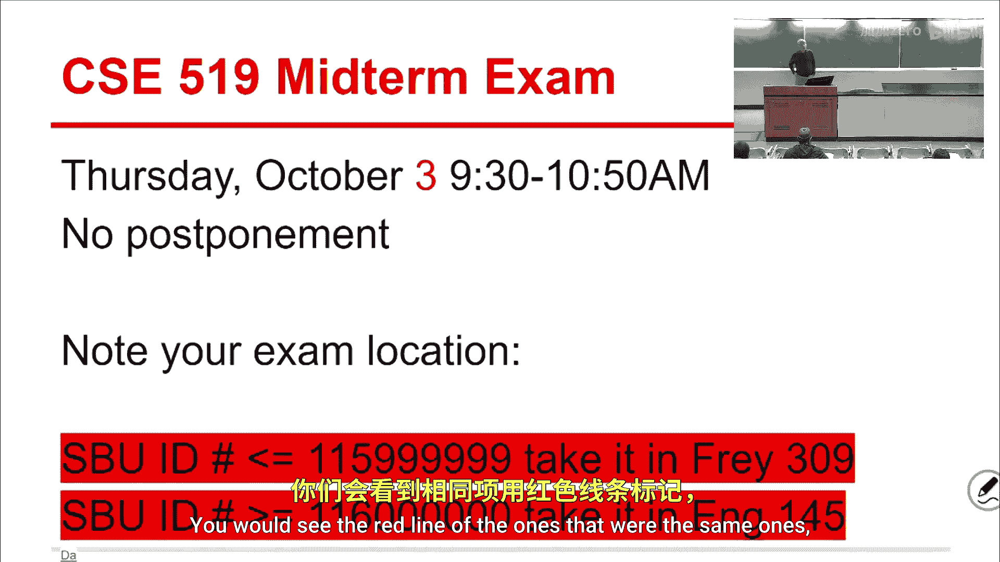

*   **关于问题二中选择公司数量 `N` 的原因**：主要原因是考虑到部分同学可能使用性能较旧的计算机。选择较小的 `N` 可以避免在计算大规模矩阵（例如 500x500 的相关性矩阵）时遇到性能瓶颈。不过，根据反馈，使用现代计算机计算 500 只股票间的相关系数仅需几秒钟。
*   **关于可视化大规模矩阵**：直接显示 500x500 的数值矩阵难以阅读。更有效的方法是使用**颜色映射**来呈现数据。通过颜色深浅，可以直观地识别出数据中的模式和结构。
*   **关于增强可视化效果**：除了使用颜色，对矩阵的列（或行）进行**重新排序**也能揭示更多信息。例如，可以按照公司所属行业、市值大小或通过聚类算法得到的相似性来排序，这样相关性高的公司会聚集在一起，在图中形成明显的色块。

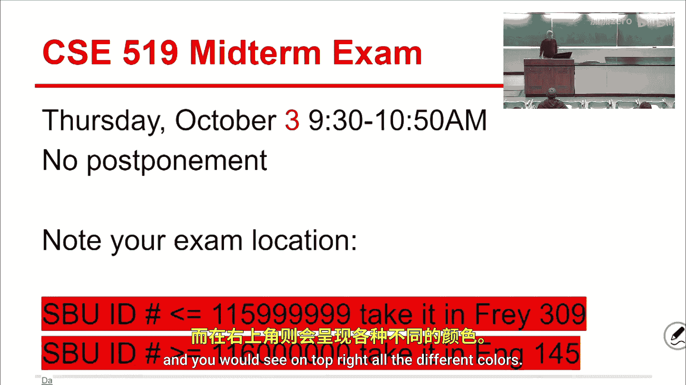

## 数据洞察与领域知识 🔍

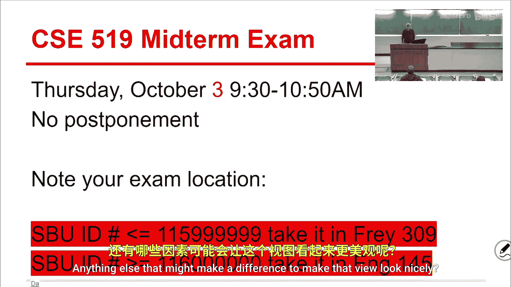

上一节我们讨论了技术层面的处理，本节中我们来看看如何结合领域知识获得更深层的洞察。

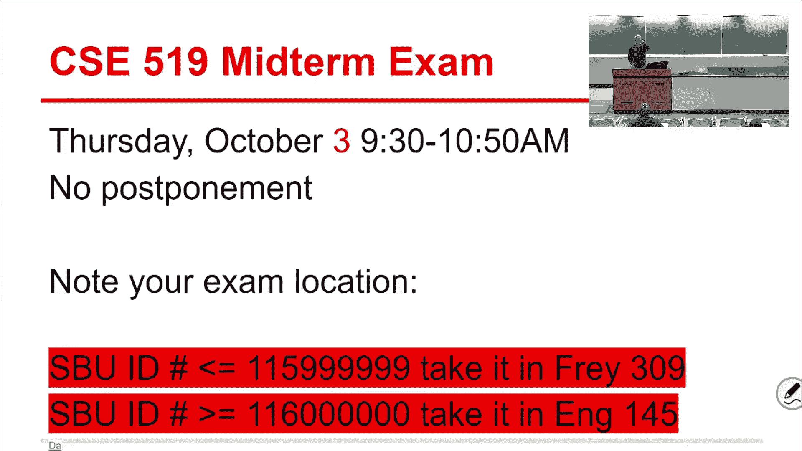

在分析股票数据时，结合金融领域的背景知识非常重要。例如，如果发现所有银行股的表现高度相关，这可能是合理的，因为它们可能共同受到利率变化或金融危机等宏观因素的影响。

在回归分析中，深入思考数据的本质和所属领域总能带来回报。理解业务背景有助于提出更合理的假设，并解释模型的结果。

## 核心概念总结 📝

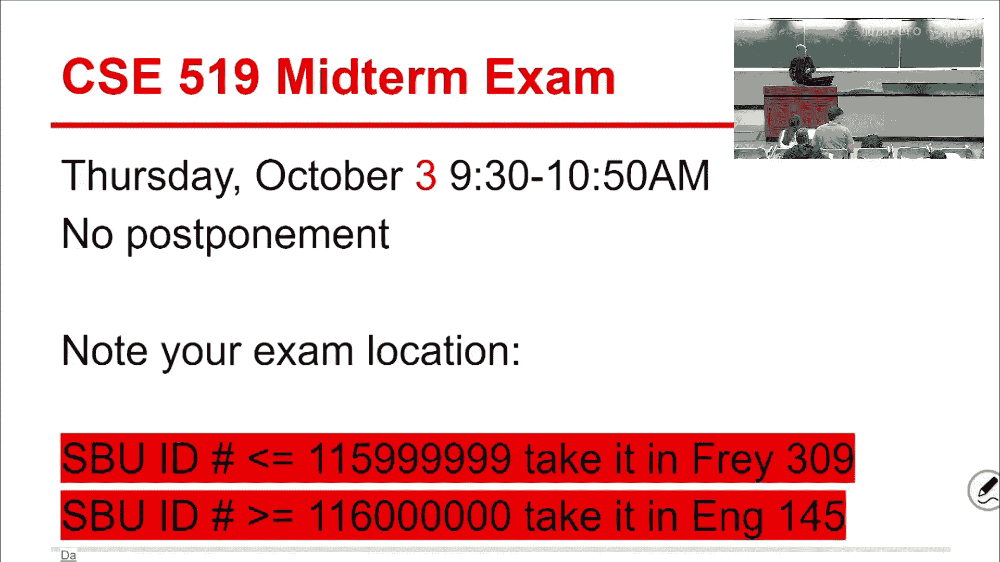

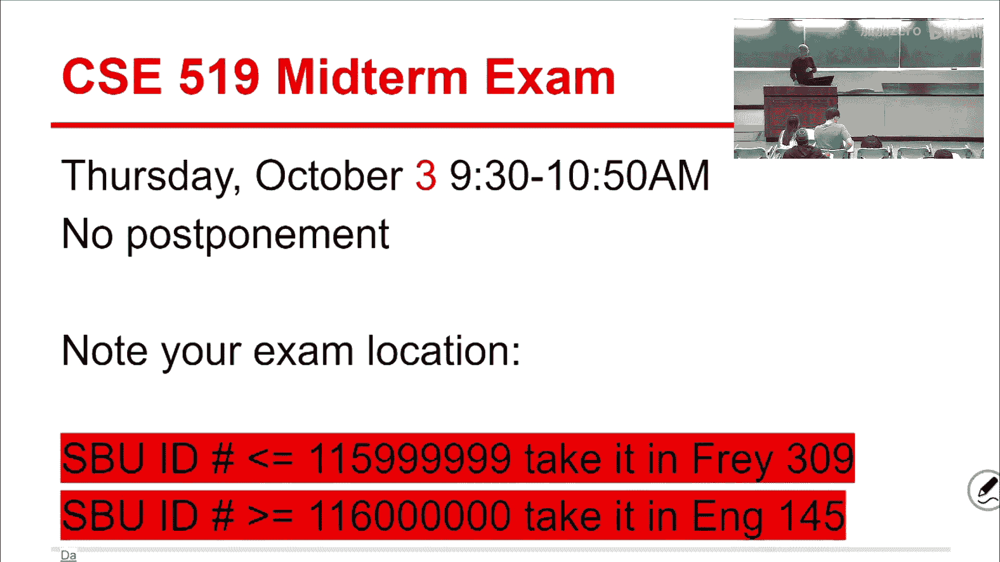

本节课中我们一起学习了以下关键点：

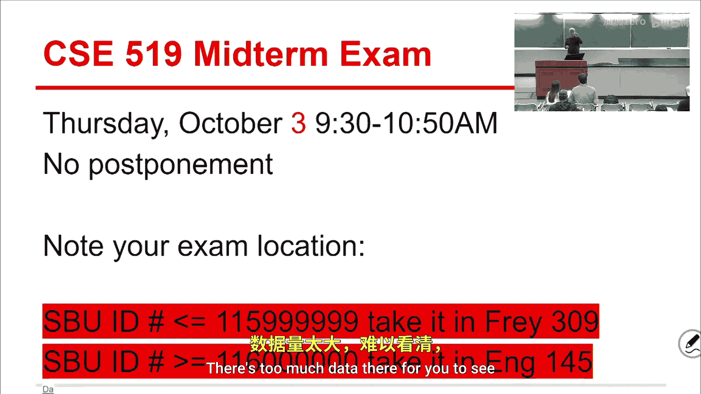

1.  **提前提交作业**：为避免意外，应提前提交作业并善用课程论坛解决问题。
2.  **处理大规模数据**：计算大规模相关性矩阵时需考虑计算资源，但现代计算机通常能快速处理。
3.  **有效的数据可视化**：对于高维数据，使用颜色映射和智能排序（如聚类排序）比直接显示数字矩阵更能有效揭示数据中的结构和模式。
4.  **结合领域知识**：数据分析不应脱离实际背景。结合领域知识（如金融市场规律）可以帮助理解数据模式、构建更合理的模型，并对结果做出有意义的解释。

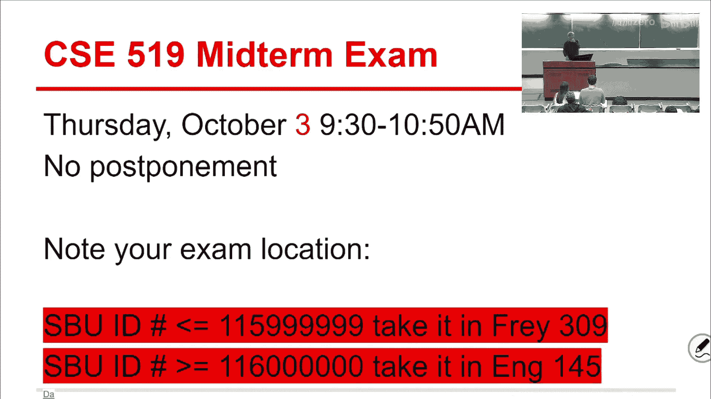

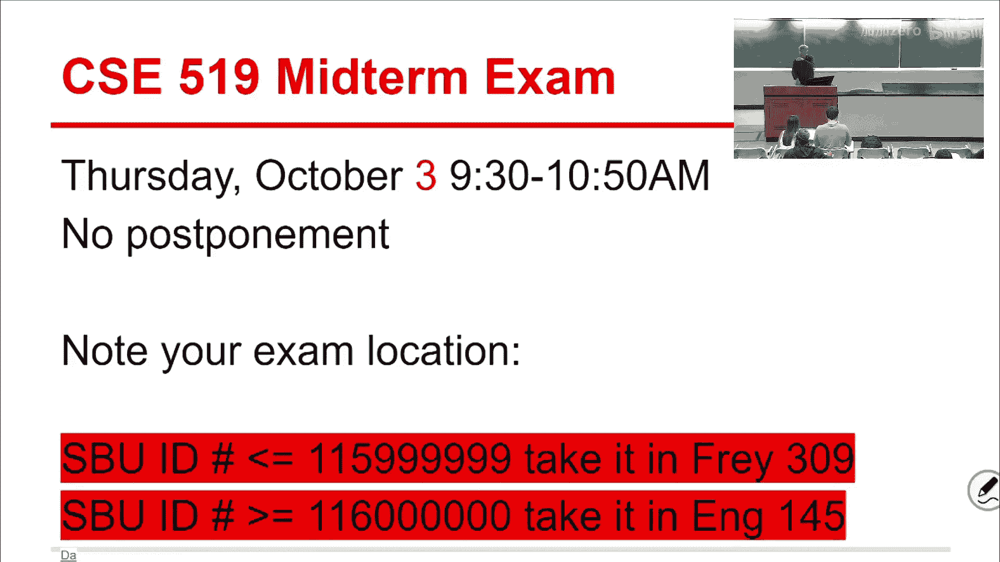

记住，在数据科学中，**探索性数据分析**和**批判性思维**与掌握算法和工具同等重要。