# 015：分数与排名（2024秋季）

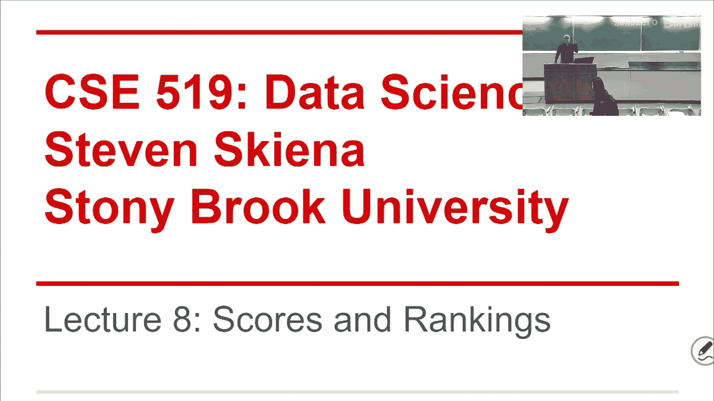

在本节课中，我们将探讨数据科学中的一个重要环节：如何评估模型性能，并讨论特征工程中的关键概念，特别是特征变换的重要性。我们将通过一个具体的作业问题来展开讨论。

## 作业进度与问题讨论

首先，我们来了解一下大家完成作业的进度。有多少同学已经完成了作业的初步审阅？

我看到一些同学热情地挥手，还有一些同学在犹豫，这很好。那么，有多少同学还没有完成呢？

我看到后排的同学似乎更热情一些，不过没关系。关于作业，大家有什么问题吗？

好的。

**关于问题8**：你是否希望我们将问题8像问题7那样，也拆分为第一部分和第二部分？

这似乎没有坏处。不过，有人完成了问题7的第一部分吗？

那些可能做得很好或很差的同学。

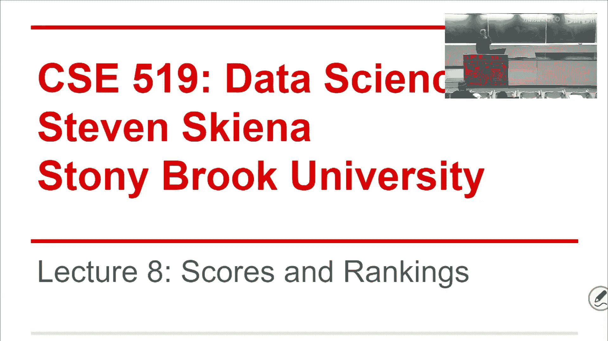

看起来情况不太理想。有其他人说做得好或不好吗？不好。那么在这种情况下，也许你可以两部分都做，或者思考一下为什么做得不好。

有人在Piazza上做得很好，我记得。大家看到那个帖子了吗，还是只有我看到了？

我认为那位同学将目标变量用作了一个特征。这很可能就是他们做得好的原因。

**关于问题1**：你说第一部分和第二部分都做得不好。

第二部分稍微好一点，这让我有点惊讶，因为第二部分是根据年份进行预测。

关于这一点，有什么评论、想法或思考吗？

有人查看过特征并试图找出为什么第一部分也做得不好的原因吗？

好的。只有一个特征计算每股收益，那是什么？

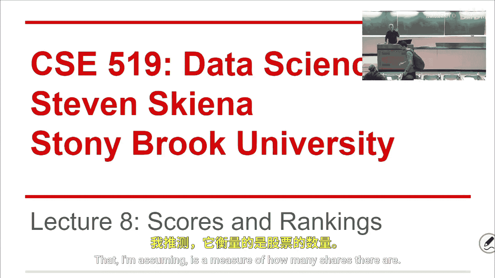

是“预估流通股数”，好的。

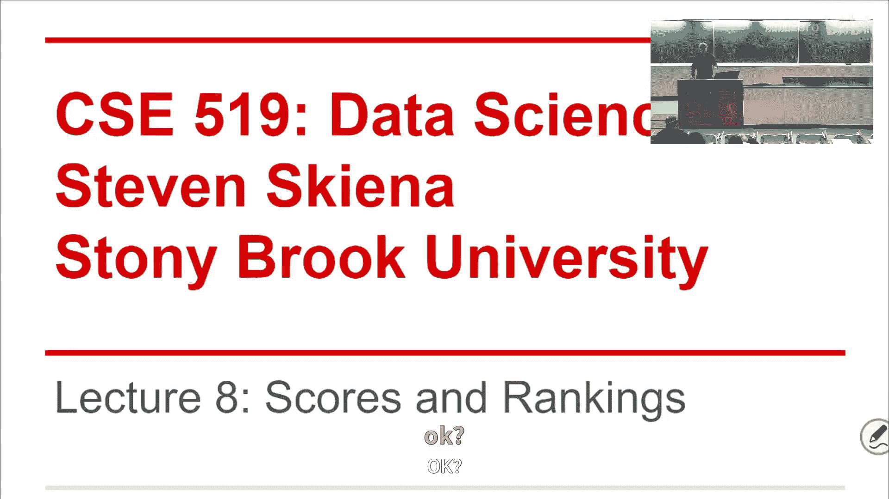

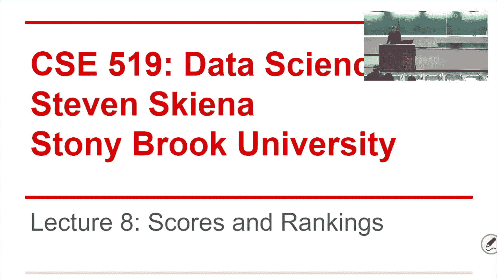

让我们思考一下这些变量的含义。我希望大家思考一下：首先，“预估流通股数”是什么，它衡量的是什么？

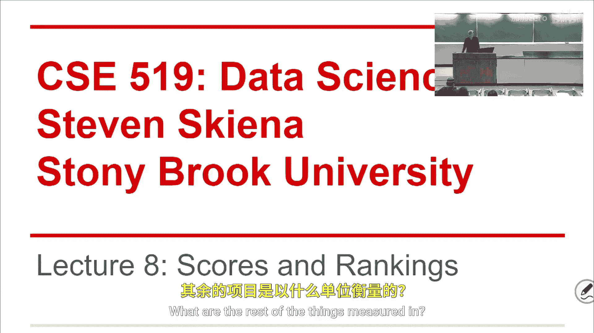

我假设这是衡量股票数量的指标。大家都同意吗？

好的。

其他特征与什么有关？在那个回归问题中，你使用的其他特征是什么？

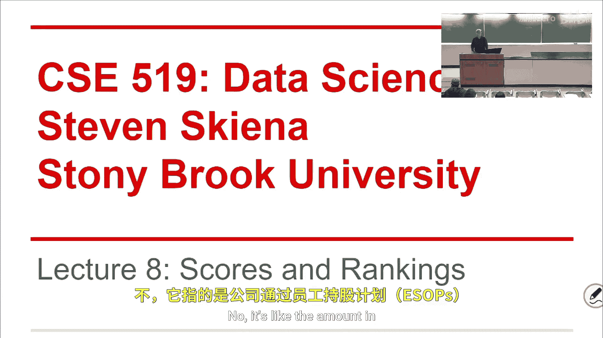

净收入。净收入是以什么单位衡量的？美元。其他东西是以什么单位衡量的？

好的。有其他人看过任何特征名称吗？你用于回归问题的特征是以什么单位衡量的？

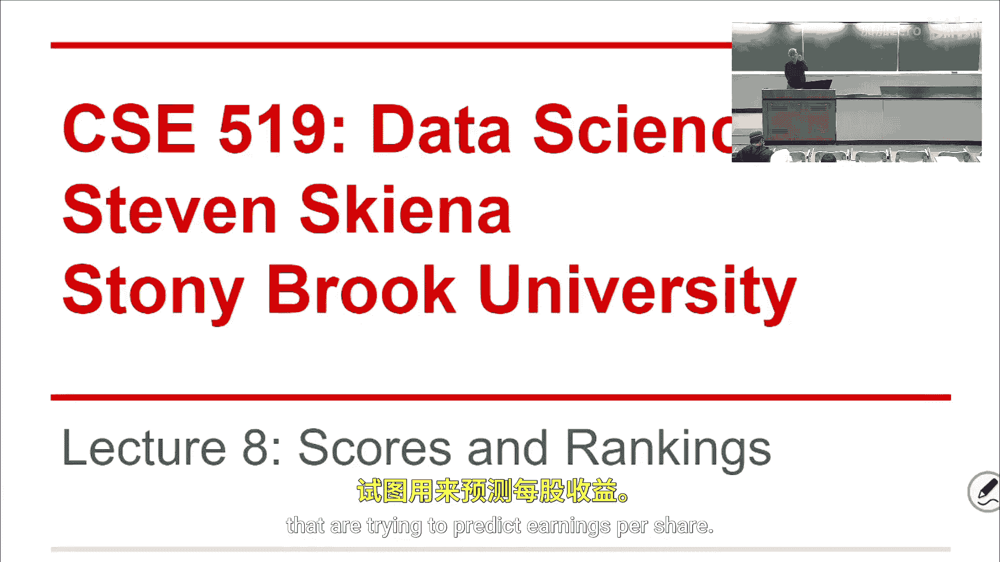

资本公积。那是以什么单位衡量的？是以英寸还是什么单位？

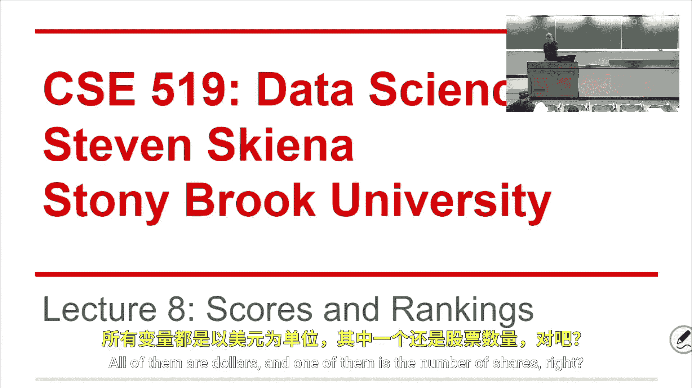

每股价格。每股价格的结果。

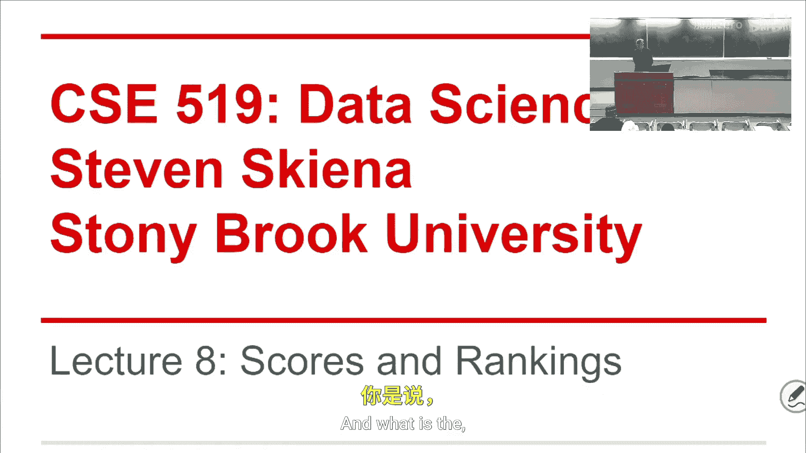

它的单位是什么？所有东西都是美元，对吗？

所以，如果我理解正确的话——我不知道你们做得对不对——你们有一堆特征试图预测每股收益。

好的，它们都是美元，而其中一个特征是股票数量，对吗？

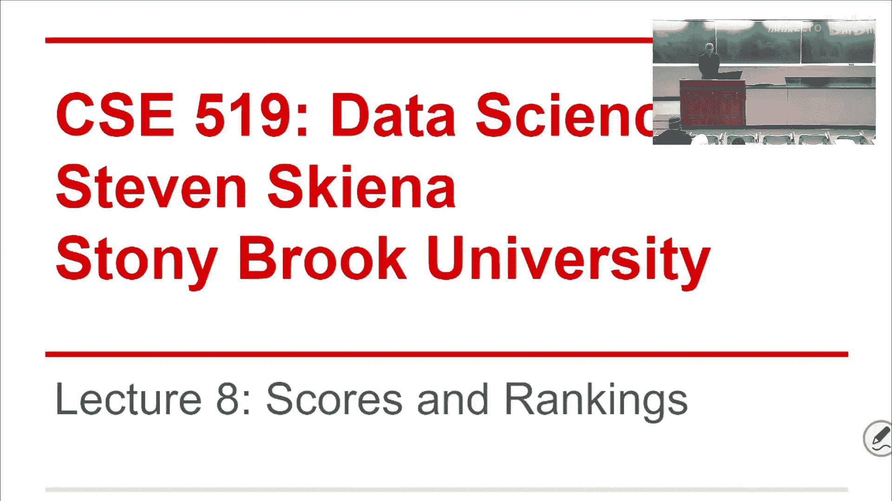

唯一有用的那个是股票数量。

营收年份和收入之类的。

好的。其他人在这方面有什么其他经验吗？

你说那里有一些比率。好的，那里有一些比率起了作用。那些不是以美元衡量的，对吗？其他人还有什么经验吗？

好的。尽管如此，我实际上没有做过任何这些，但当我听到这个时，我在想。

有没有什么方法……你试图预测的是每股收益，对吗？

现在，如果这家公司在之前进行了股票分割，每股收益会发生什么变化？

假设进行了一次一拆二的股票分割。每股收益会发生什么变化？会减少多少？那么，这能在你的模型中体现出来吗？不能。

你们能想到任何方法，也许可以将这些美元数字转换成可能更好地预测每股收益的特征吗？

有什么想法吗？

如果你有这些收益数字，会发生什么？如果这些收益数字除以股票数量，是否会更有价值？

好的。这在我看来是……我什么都没做。我怎么知道呢？

但我知道，当你这样做时，你开始用与目标变量具有可比性的特征来构建模型。大家都能明白这一点吗？有人能看出为什么线性回归无法捕捉到这一点吗？

有人能给我一个想法，为什么线性回归无法捕捉到“除以股票数量可能有用”这个事实吗？

因为它是线性的。像“一个变量除以另一个变量”这样的变换，并不是直接从那些特征中产生的。

关于这一点有什么问题吗？大家可能看到这个想法了吗？

还是我说得太隐晦了？大家明白我在说什么吗？有人不明白我在说什么吗？

有几个人在犹豫，好的。再次强调，你有一些变量试图预测一个比率，即每股收益。

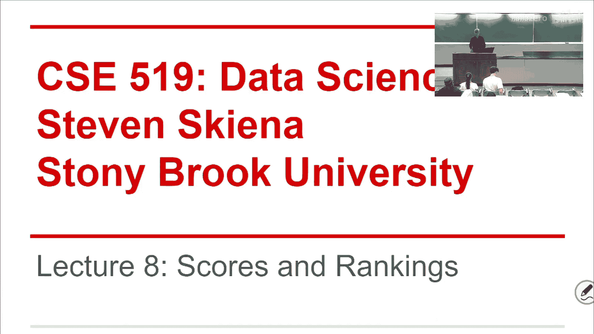

你有一些特征是收益，基本上是美元计价的收益。

你还有一些股票数量的特征，好的。

一种可能性是改变……看看如果你将美元计价的收益转换为每股收益会发生什么，这可能是一件有趣的事。

另一种实现同样效果的方法，也许更容易。我们想要认识到，你有未经处理的美元数据和股票数据，有没有办法改变……也许我们可以改变特征？

还有什么其他可以改变的吗？归一化是什么意思，你归一化什么？

所以Z分数可能是一种方法。但你在按股票数量归一化之前，考虑过Z分数吗？

只是归一化可能……我们今天会更多地讨论Z分数，但Z分数仍然会转换变量。

所以它们会在量级和范围上具有可比性，这就是Z分数的作用。

它们不会做非线性变换。从英尺到米的转换是线性变换，我乘以一个常数，对吗？

如果我乘以一个常数并减去平均值，这仍然是一个线性变换。

有时，变量可能需要非线性变换，对吗？

我认为这里发生的情况是，你的变量和目标之间可能存在明显的不兼容性。

因此，如果你试图预测每股收益，一个建议可能是处理变量，使它们变成“每股”的形式，对吗？

## 总结

本节课中，我们一起探讨了在数据科学项目中评估模型性能时可能遇到的问题。我们通过一个具体的作业案例，分析了特征与目标变量之间单位不匹配的问题，并讨论了特征工程的重要性，特别是线性与非线性变换的区别。我们了解到，当预测目标是一个比率（如每股收益）时，将原始特征（如总收益）转换为可比的形式（如每股收益）可能显著提升模型性能。这提醒我们，在构建模型前，深入理解数据含义并进行适当的预处理至关重要。