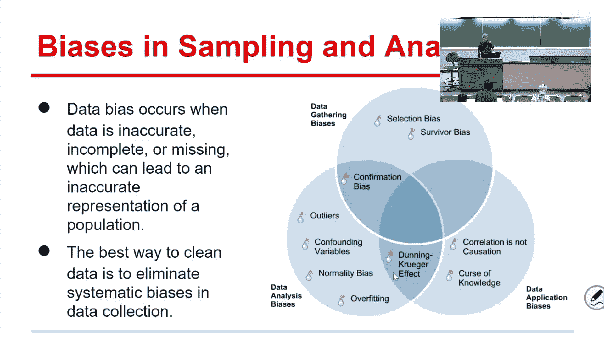

# 016：数据清洗

在本节课中，我们将要学习数据清洗的相关知识。数据清洗是数据科学流程中至关重要的一步，它确保我们分析的数据是准确、完整和可靠的。我们将探讨数据中可能存在的各种偏差，并理解它们如何影响我们的分析结果。

上一节我们介绍了数据收集，本节中我们来看看数据收集过程中可能引入的偏差。

## 数据偏差的类型

数据偏差是指数据不完整、不准确或缺失，从而无法完全代表总体的情况。了解偏差的类型有助于我们识别和纠正数据中的问题。

以下是几种常见的数据偏差类型：

*   **确认偏差**：倾向于接受符合自己已有信念的信息，而拒绝与之相悖的信息。例如，当你编写的程序第一次通过测试时，你可能会立即认为它是完全正确的，而不再深入检查。
*   **幸存者偏差**：只关注“幸存”下来的成功案例，而忽略了那些失败或中途消失的案例。这会导致对成功概率或整体情况的错误认知。
*   **选择偏差**：由于数据收集方法（如抽样方式）导致样本不能代表总体。例如，标准普尔500指数只包含500家大型上市公司，这本身就忽略了许多中小型公司。

## 案例分析：标准普尔500数据集

让我们通过课程作业中使用的标准普尔500数据集来具体理解幸存者偏差。

这个数据集收集了2016年时标准普尔500指数成分股公司过去五年的数据。这意味着，数据集只包含了那些在2016年仍然“存活”在指数中的公司。

*   在数据收集期间，有24家公司被**添加**到了指数中。
*   然而，没有一家公司从数据集中**消失**。

这是为什么呢？因为数据收集者是在2016年回溯历史数据。那些在2016年之前就已经被移出标准普尔500指数的公司，根本不会被纳入这个数据集中。因此，我们只看到了“幸存者”的故事，而错过了那些失败或退市的公司。这就是一个典型的幸存者偏差案例。

## 邓宁-克鲁格效应

邓宁-克鲁格效应是一种认知偏差，指能力不足的人会高估自己的技能水平，而能力高的人则会低估自己的相对能力。在数据科学中，这提醒我们要保持谦逊，持续验证自己的假设和结论。

本节课中我们一起学习了数据清洗的重要性，并重点探讨了数据偏差。我们了解了确认偏差、幸存者偏差和选择偏差等概念，并通过标准普尔500数据集的实例分析了幸存者偏差如何在实际数据中体现。认识到数据中可能存在的偏差，是进行可靠数据分析的第一步。