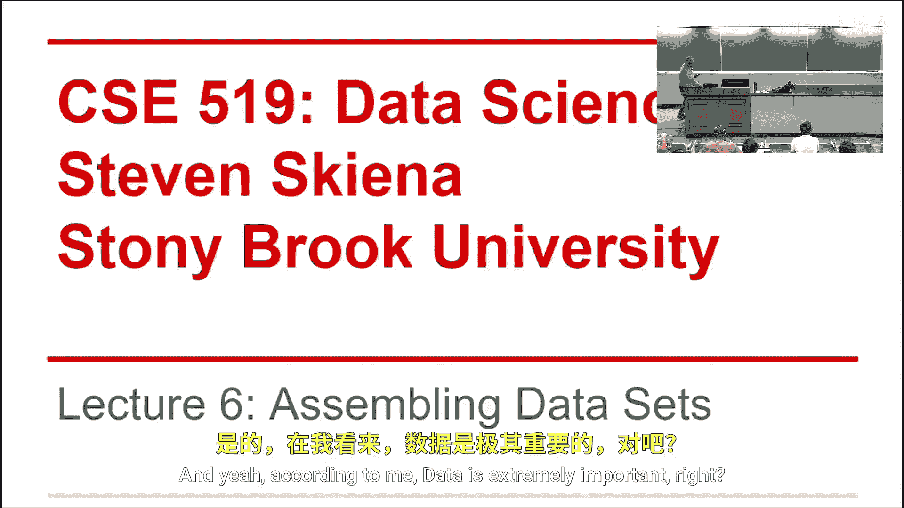
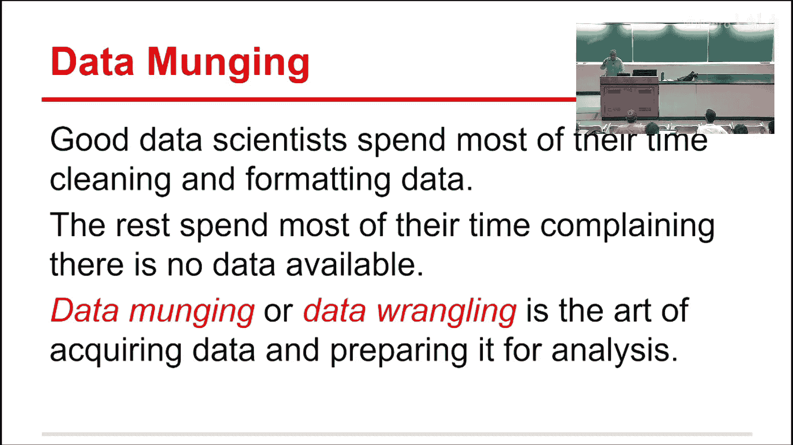
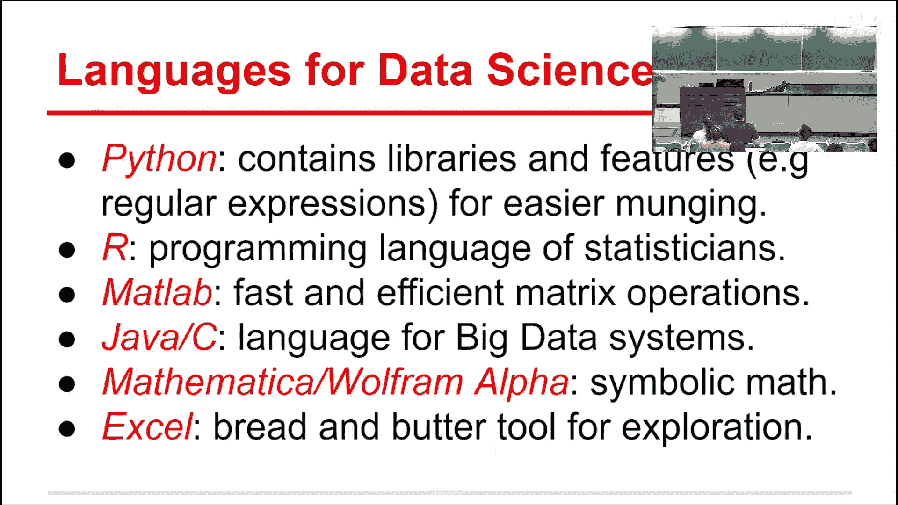

# 017：数据集的构建 🧩

在本节课中，我们将要学习数据科学中一个至关重要的环节：数据集的构建与整理。我们将从理解数据的重要性开始，逐步深入到数据整理的具体概念、常用工具以及核心步骤。

---

## 数据的重要性与数据整理

没有数据，就没有数据科学。数据是任何分析项目的基石。在开始建模之前，我们首先需要获取并准备好数据。这个过程通常被称为数据整理或数据清洗。

上一节我们介绍了数据的重要性，本节中我们来看看什么是数据整理。

数据整理是指获取数据并为其分析做准备的过程。我们很少能直接获得完全干净、可直接使用的数据。通常，数据会包含缺失值、异常值、噪音或不一致的格式，这些都需要在分析前进行处理。

数据科学家将大部分时间（约50%到80%）都花在数据的清洗和格式化上。这凸显了数据整理步骤在数据科学项目流程中的核心地位。

---

## 数据科学中的编程语言 🐍

在开始具体的数据整理工作之前，我们需要选择合适的工具。对于数据科学家而言，编程语言是必不可少的工具。

以下是数据科学领域最常用的一些编程语言：

*   **Python**：目前数据科学领域的首选语言。它语法简洁、学习曲线平缓，并且拥有极其丰富和强大的库生态系统。
*   **R**：在统计学家和学术界中非常流行，特别擅长统计分析和可视化。
*   **SQL**：用于管理和查询关系型数据库的标准语言，是获取数据的关键技能。
*   **Julia**：一种较新的高性能语言，特别适合科学计算和数值分析。
*   **Scala**：常与Apache Spark等大数据处理框架结合使用。
*   **Java**：在企业级应用和大规模系统中广泛使用。
*   **SAS**：在商业智能和传统统计分析领域有深厚基础。
*   **MATLAB**：在工程和数学建模领域应用广泛。

Python之所以成为主流，主要归功于其易用性、庞大的社区支持以及专门为数据科学设计的库，例如用于数据操作的`pandas`、用于数值计算的`NumPy`、用于机器学习的`scikit-learn`和用于可视化的`Matplotlib`。

---

## 数据整理的核心步骤

了解了工具之后，我们现在可以深入探讨数据整理的具体步骤。这个过程通常涉及多个阶段，以确保数据的质量和可用性。

以下是数据整理过程中常见的核心任务：

1.  **数据获取**：从各种来源（如数据库、API、文件、网络爬虫）收集原始数据。
2.  **数据清洗**：处理数据中的问题，例如：
    *   处理缺失值（如填充或删除）。
    *   纠正错误或异常值。
    *   统一格式（如日期、字符串）。
3.  **数据转换**：将数据转换为更适合分析的格式，例如：
    *   数据规范化或标准化。
    *   创建新的衍生特征（特征工程）。
    *   将数据从宽格式转换为长格式，或反之。
4.  **数据集成**：将来自多个来源的数据合并成一个一致的数据集。
5.  **数据验证**：检查整理后的数据是否符合预期，确保没有引入新的错误。

---

## 总结

本节课中我们一起学习了数据科学项目的基础——数据集的构建。我们首先明确了数据是数据科学的根本，并引入了“数据整理”这一核心概念，即花费大量时间对数据进行清洗和格式化以使其可用于分析。接着，我们探讨了数据科学领域的常用编程语言，特别是Python因其强大的库生态系统而占据主导地位。最后，我们梳理了数据整理的关键步骤，包括获取、清洗、转换、集成和验证。掌握这些内容是进行任何有效数据分析的前提。