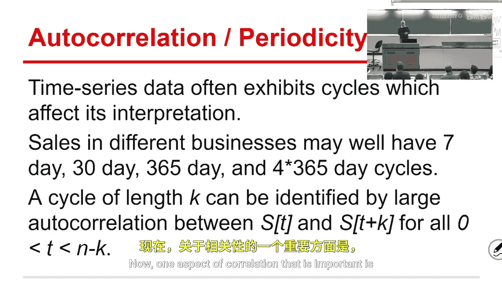

# 018：作业前瞻与相关性深入

在本节课中，我们将深入探讨相关性分析，并提前了解作业中涉及的线性回归概念。我们将从回顾相关性的定义开始，讨论其与因果关系的区别，并通过实例理解相关性的多种可能性。最后，我们会简要介绍线性回归，为完成作业做好准备。

## 回顾相关性定义

上一节我们介绍了各种相关性统计量。当在两个变量之间发现相关性时，意味着它们之间存在某种统计上显著的关系。

相关性系数 `r` 的计算公式通常为皮尔逊相关系数：
`r = Σ[(xi - x̄)(yi - ȳ)] / √[Σ(xi - x̄)² Σ(yi - ȳ)²]`

## 相关性不等于因果关系

然而，著名的原则是：**相关性并不意味着因果关系**。

一个明显的原因是相关性是对称的。变量A与B的相关性，等同于变量B与A的相关性。因此，它不能同时表示A导致B且B导致A。但人们常常在看到高相关性时，急于断定一方导致了另一方。

人们经常错误判断因果关系的方向。例如，观察城市中各辖区的犯罪率与警力数量。你可能会发现，犯罪率高的地方警力也更多。

那么，是警察导致了犯罪，还是犯罪导致了需要更多警察？很可能，犯罪是导致部署更多警察的原因。但这仍然是一个需要验证的假设。

社会科学家非常关注因果关系，并擅长论证。他们会指出多种可能性：可能是警察导致了犯罪，可能是犯罪导致了警察，或者两者可能相互独立。确定是否存在真正的因果关系，与仅仅观察统计相关性是不同的。相关性是一种统计观察，而因果关系是关于世界如何运作的一种主张。

## 相关性的多种可能性

那么，当两个变量之间存在相关性时，有哪些可能性？

以下是几种主要情况：
*   **A导致B**：变量A是变量B变化的原因。
*   **B导致A**：变量B是变量A变化的原因。
*   **C导致A和B**：存在第三个变量C，同时导致了A和B的变化。例如，冰淇淋销量与晒伤率呈正相关。是冰淇淋导致晒伤，还是晒伤导致人们购买冰淇淋？更可能的情况是，阳光（变量C）同时导致了冰淇淋销量增加和晒伤率上升。
*   **虚假相关**：相关性纯属巧合，没有实际的因果联系。一个著名的例子是，有人发现孟加拉国的黄油产量与美国股市涨跌高度相关。是黄油产量导致股市波动吗？这很可能只是一个虚假相关。请记住，统计显著性（例如p<0.05）意味着有5%的可能性这种相关性是偶然出现的。当你用足够多的时间序列数据进行测试时，总有一个会表现得“最好”。一旦这个“规律”被发现，它通常就会失效，因为它从未真正存在过。

因此，避免过度解读相关性非常重要。优秀的社会科学家不会轻易地从相关性推断出因果关系。

## 实例分析：纬度与皮肤癌

这是一个关于防晒霜的图表，它展示了皮肤癌死亡人数与纬度的关系。图中每个点代表美国的一个州。

我们预期会看到什么？我们预期离赤道更近的州（纬度更低），因为接受更多日照，皮肤癌死亡率会更高。图表显示的趋势大致符合这个预期。

## 线性回归简介

接下来，我们将简要介绍线性回归，这是作业中会用到的一个重要概念。

线性回归旨在找到一条最佳拟合直线，来描述一个自变量（X）与一个因变量（Y）之间的关系。其基本模型公式为：
`Y = β₀ + β₁X + ε`
其中：
*   `Y` 是因变量。
*   `X` 是自变量。
*   `β₀` 是截距。
*   `β₁` 是斜率，表示X变化一个单位时Y的平均变化量。
*   `ε` 是误差项。

在后续课程中，我们会更深入地讲解线性回归。本节的目的只是确保大家对作业中涉及的基本概念有所了解。

---

本节课中，我们一起学习了相关性与因果关系的核心区别，探讨了相关性的多种可能解释（包括直接因果、共同原因和虚假相关），并通过实例加深了理解。最后，我们简要介绍了线性回归的基本模型，为完成课程作业打下了基础。记住，在数据科学中，谨慎解读统计结果至关重要。