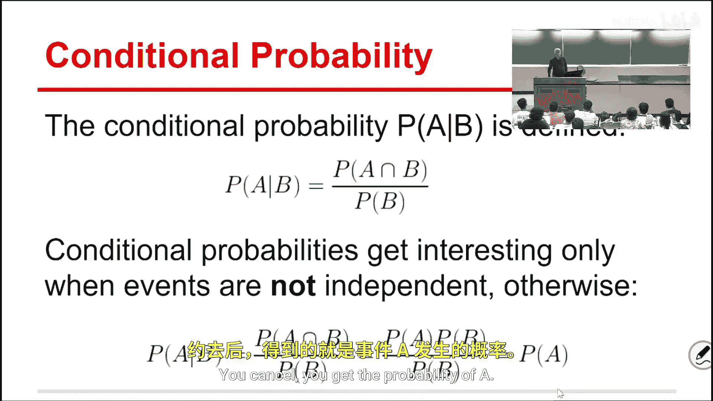
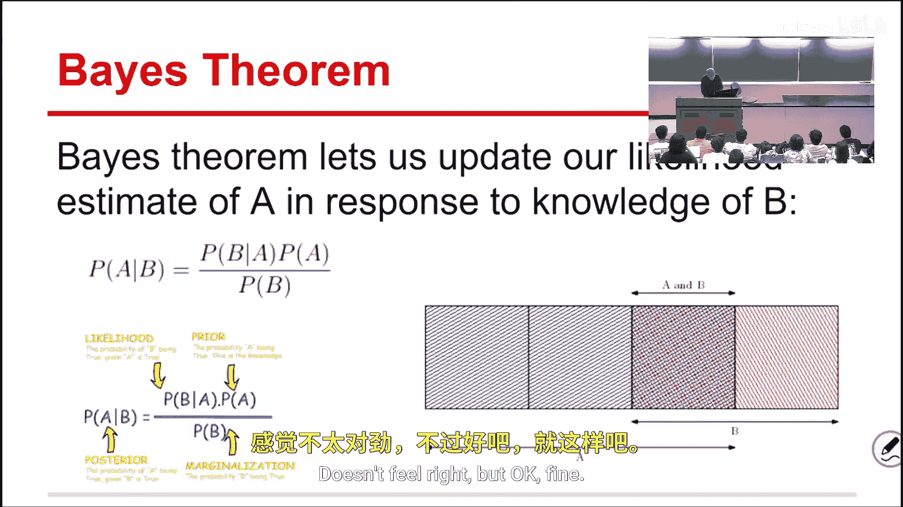
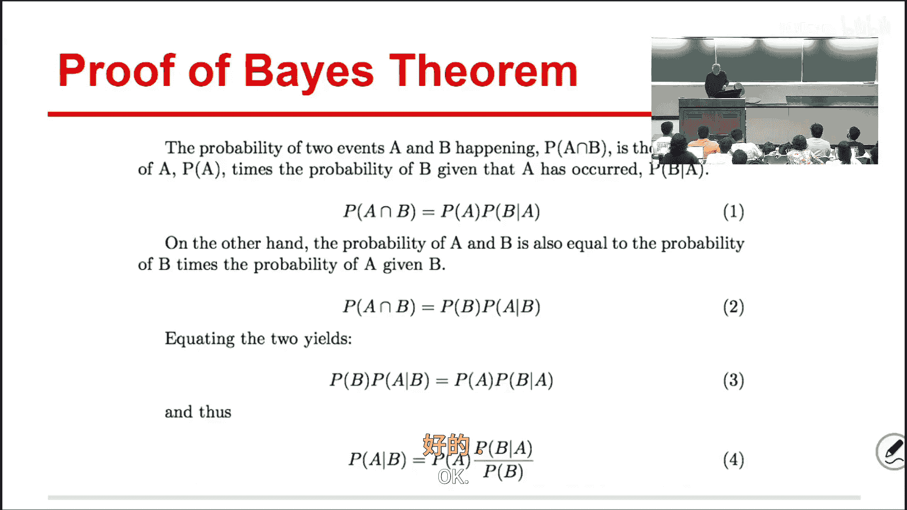
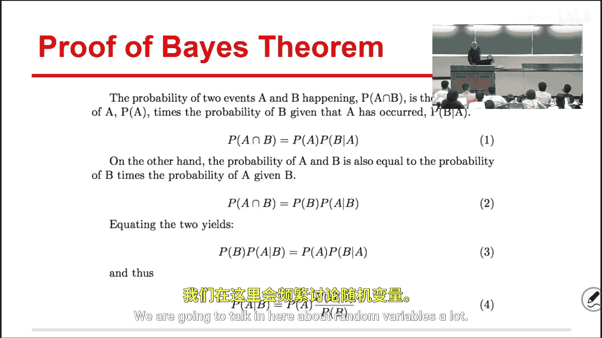
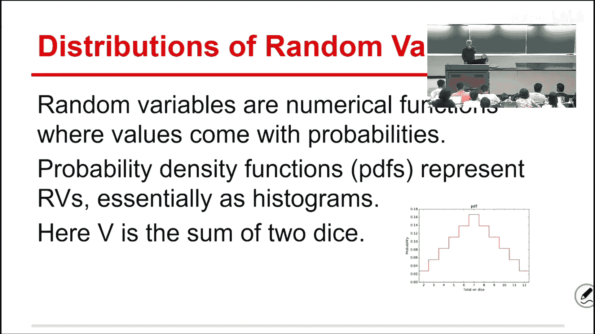
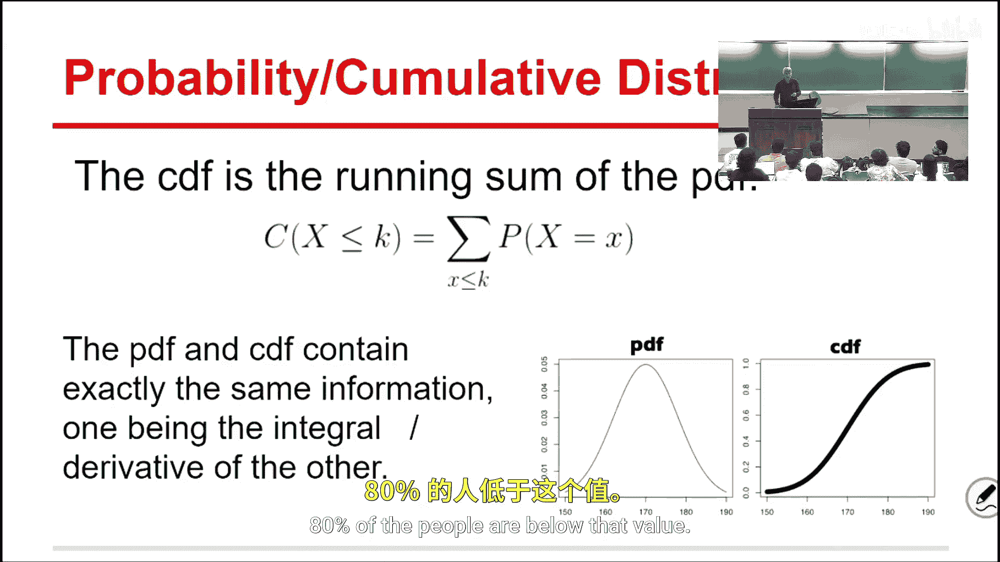

# 020：数学预备知识

在本节课中，我们将要学习概率论中的两个核心概念：条件概率与贝叶斯定理，以及随机变量及其分布。这些是理解数据科学中不确定性建模和推断的基础。

## 条件概率

上一节我们介绍了概率的基本概念，本节中我们来看看条件概率。条件概率描述了在已知某个事件（B）发生的情况下，另一个事件（A）发生的概率。

条件概率的公式定义如下：

**P(A|B) = P(A ∩ B) / P(B)**

这个公式的含义是：事件A在事件B发生的条件下的概率，等于事件A和事件B同时发生的概率，除以事件B发生的概率。

以下是关于条件概率的两个关键点：

*   **独立性**：当事件A和事件B相互独立时，条件概率 `P(A|B)` 就等于 `P(A)`。因为如果A和B独立，则 `P(A ∩ B) = P(A) * P(B)`，代入公式后 `P(B)` 会被约去。
*   **非独立性**：条件概率在事件不独立时才更有意义，它量化了一个事件的发生如何影响另一个事件发生的可能性。

## 贝叶斯定理

理解了条件概率后，我们来看一个极其重要的定理——贝叶斯定理。它提供了一种“逆转”条件概率的方法。

贝叶斯定理的公式如下：

**P(A|B) = [P(B|A) * P(A)] / P(B)**

这个定理的有趣之处在于，它将我们可能难以直接计算的 `P(A|B)`，与可能更容易获得的 `P(B|A)`、`P(A)` 和 `P(B)` 联系了起来。这在基于新证据（B）更新我们对某个假设（A）的信念时非常有用。

贝叶斯定理的证明非常简单，它源于条件概率的定义和概率的对称性。

1.  根据定义，`P(A|B) = P(A ∩ B) / P(B)`。
2.  同样，`P(B|A) = P(A ∩ B) / P(A)`。
3.  由第二个等式可得 `P(A ∩ B) = P(B|A) * P(A)`。
4.  将第三步的结果代入第一个等式，即得到贝叶斯定理：`P(A|B) = [P(B|A) * P(A)] / P(B)`。

## 随机变量与分布

现在，让我们从具体事件的概率转向更一般的概念——随机变量。随机变量是将随机实验的结果映射为数值的函数。例如，一次考试的成绩、掷两颗骰子的点数之和，都可以看作是随机变量。

描述随机变量最常见的方式是使用概率分布。主要有两种表示方法：

*   **概率密度函数/概率质量函数**：对于连续型随机变量，我们使用概率密度函数；对于离散型随机变量，我们使用概率质量函数。它们描述了随机变量取某个特定值的（相对）可能性。在图表上，通常横轴（x轴）代表可能的数值，纵轴（y轴）代表概率密度或概率。
*   **累积分布函数**：累积分布函数描述的是随机变量取值小于或等于某个特定数值的概率。它是概率密度函数从负无穷到当前点的积分（或求和）。例如，在身高分布中，累积分布函数在180厘米处的值为0.8，意味着有80%的人身高低于180厘米。

---

本节课中我们一起学习了条件概率的定义及其在独立与非独立事件下的意义，掌握了能够逆转条件关系的强大工具——贝叶斯定理及其证明，并了解了随机变量的概念以及描述它的两种主要方式：概率密度函数和累积分布函数。这些数学工具是后续进行统计推断和机器学习建模的基石。