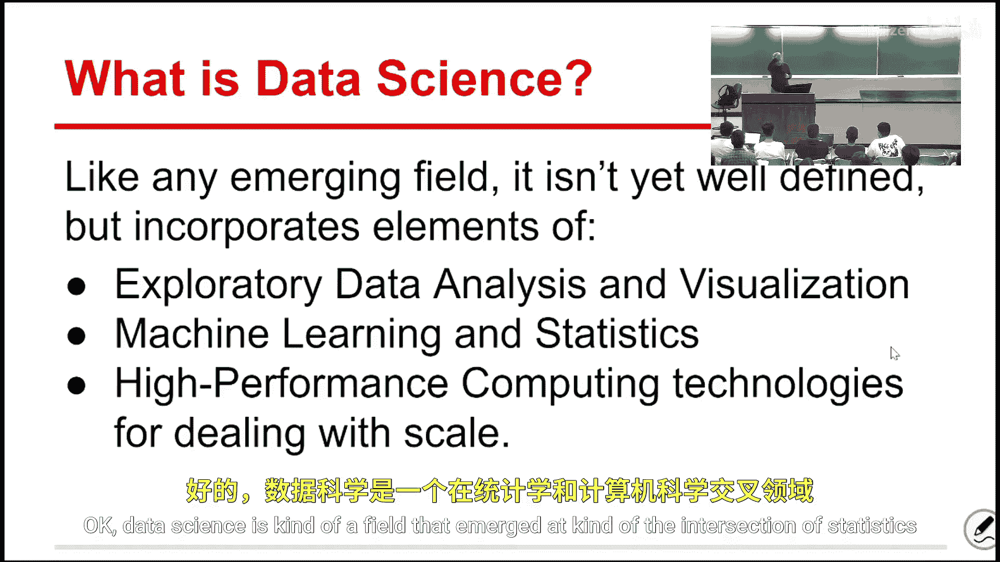

# 021：数据科学导论 (2024秋季) 🎯

在本节课中，我们将学习课程的基本运行规则，并探讨数据科学的初步定义与范畴。

---

我是史蒂夫·斯基尼纳，这门课程的授课教师。很抱歉我错过了第一周的课程。我希望萨巴和我的学生们把课堂事务处理得很好。

在进一步深入之前，关于课程管理有任何问题吗？例如课程将如何运行，或类似的事情？我已经在课程大纲中说明了规则。如果有人还没领取大纲，我这里还有副本。有任何问题吗？

首先，请马汉下来一下。我们现在又有了助教。萨巴是我们得到的第一位助教。这学期我们现在有四名助教。这是马汉。请大家给马汉一些掌声。

不。当涉及到成绩复议时，你们被允许“欺负”他吗？答案是不。他将认真批改你们的作业。他会尽一切努力做到正确。如果他弄错了，我们耸耸肩，然后继续前进。清楚了吗？好的，公平合理。现在，去做你的其他事情吧，包括帮助准备从下周开始的测验。

从今天开始，我们将为测验做准备。所以，每节课都会有一个测验。测验将于周三的某个时间开始，并在今天下课前截止。更准确地说，是在下一节课开始之前。所以，如果你来上课时还没做测验，那么测验就结束了。清楚了吗？

如果你错过了一次测验，你会抱怨吗？你不会抱怨。测验必须在课程开始前完成。有问题吗？是的。

理想情况下，测验将基于上一讲的内容。测验在总成绩中占很小一部分。如果你在测验中表现很好，这意味着你一直在关注课堂内容。测验的设计初衷并不是巨大的智力挑战，而是为了让大家在整个学期中保持对教学内容的关注，而不是等到期中考试时才想起来问“这学期我们学了什么？”。我想这就是目标。

有任何问题吗？当然，如果你想问的话，是的，请说。

测验将主要基于上一节课的内容。实际上，通常就是上一节课。这次我希望其中会有一两个问题来自更早的内容，但我们会看看情况。再次强调，测验只是为了让你保持警觉，并非巨大的智力挑战。好的，关于这个有任何问题吗？好的。

关于测验，有一个我认为正在发生的变化。我想让马汉告诉我，如果我说的是真的。我们可能正在将测验转移到Brightspace平台。这是真的吗？好的。我之前对Google Classroom做了很多说明。我仍然很可能要求你们通过Google Classroom提交项目和作业。助教们已经说服我，他们可以在Brightspace上处理测验。所以你们需要注意。

今天的测验什么时候可用？我是说明天。它将在明天……我们不知道。那么你怎么知道呢？哦，这是个好问题。一种可能性是查看Brightspace，也许。另一种是查看Piazza，那里会有课程更新。所以，理论上在Piazza上某个时候会有一个公告，说“嘿，第一个测验准备好了”。并且我们假设从那以后，测验每天都会在这个时间准备好。

如果你去找测验却找不到，你应该怎么办？有人有想法吗？发邮件是一种可能性，但有更好的可能性。有人能想到更好的可能性吗？Piazza。如果你发邮件，你得到了答案，但其他人得不到答案。如果每个人都发邮件，我或助教们就得回复183封邮件。正确的做法是在Piazza上提问。所以，如果到了周三晚上6点以后，你们开始发送礼貌但坚定的消息说“我找不到测验”，这是完全可以的。大家都明白这个想法了吗？这就是我们沟通的方式。

再次强调，如果你有个人问题，我很乐意和你交流。但我认为那些可能对其他同学也有用的问题，Piazza是合适的平台。是的。你们可以期待在周一晚上、周三晚上有测验，并且必须在下一节课前完成。好的，我想让大家养成一个习惯，是的。

我不这么认为，但这些测验并不是设计成长时间的练习。如果你觉得你想在笔记中查找答案，那也没关系。但我希望是一次性完成。因为风险并不高，如果你答错了一个测验问题，从大局来看真的不重要。测验占你总成绩的5%，总共会有25次，每次测验大概有四道题。如果你在一次测验中错了几道题，或者甚至每次测验都错一道，也没太大关系。但如果你完全不做测验，那就有关系了。是的。

会花多长时间？我相信会花四到五分钟。现在你知道了。如果你随机回答，当然可以更快。你能做得更慢吗？我相信如果你用心，可以花更多时间，但这本意不是一次认知练习，而是一次快速的检查。关于这个有任何问题吗？关于测验还有其他问题吗？

好的，这里谁还没加入Piazza？谁还没注册Piazza？好的，你们所有人都最好注册Piazza。它现在叫“Fall 2024”，所以你们要确保加入的是正确的Piazza页面，一开始有些小故障。我应该把旧的Piazza页面关掉。但请加入那里，并证明你已经加入了。有任何问题吗？好的。

关于课程后勤还有其他问题吗？下一节课，我们将发布第一个作业，那将开始成为真正的事情，我们到时候再处理。好的，还有其他事吗？

---

好的，所以今天我想开始谈谈我所理解的数据科学。

也许这堂课会比其他的课更偏向哲学性一些。所以，如果你开始听到我喋喋不休地谈论我的观点，在这里会比在其他时候更常见，所以别太害怕。我希望大家在这里提问或互动，这很重要。我们今年所在的这个教室，我想知道是否有人喜欢这个教室？谁不喜欢这个教室？我习惯在一个又大又漂亮的教室Fry Hall 104教学，那里很漂亮，很大，有白墙之类的，但我讨厌那个房间，因为学生离得很远，就像在对一个体育场讲课。在这里，你们就在我面前，这我喜欢。所以我希望这里有提问，希望这里有互动。好的，关于这个有任何问题吗？

---

那么，什么是数据科学？当我思考数据科学时，我认为它有点像……让我看看能不能把这个点移到某个地方。这个位置对点来说更好吗？好的。它有点像是一个出现在……交叉领域的学科。

数据科学大致出现在**计算机科学**、**统计学/数学**与**领域专业知识**的交叉点上。