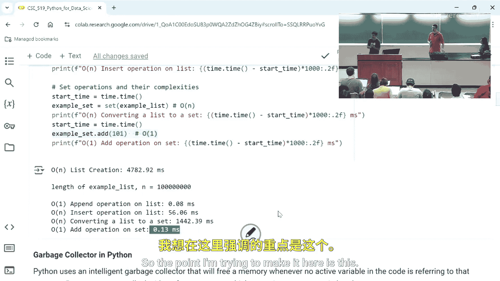

# 022：Python 数据科学应用（2024秋季）


在本节课中，我们将学习Python中几个核心且实用的编程概念，包括匿名函数（lambda）、关键字参数、字典与集合的操作，以及不同数据结构的时间复杂度分析。理解这些概念对于编写高效、可读性强的数据科学代码至关重要。


---

## 匿名函数（Lambda）的强大之处


上一节我们介绍了函数的基础知识，本节中我们来看看匿名函数（lambda）的威力。匿名函数真正的力量在于它们可以作为参数被嵌入到另一个函数内部使用。

在后续的教程中，特别是在Pandas的`apply`函数和列表排序中，你会频繁地看到这种用法。请记住这一点。

---


## 关键字参数的便利性


接下来，我们探讨函数调用的另一个便捷特性：关键字参数。

例如，我们来看同一个`excite_string`函数，但现在它包含多个参数。假设我们有两个额外参数：`excitement_level`和`excitement_character`，然后在函数内部对它们进行处理。


```python
def excite_string(s, excitement_level, excitement_char):
    # 使用参数进行某些操作
    return s + excitement_char * excitement_level
```


现在，如果我们直接调用这个函数，可能会因为参数顺序错误而得到报错。这种情况在使用C++或Python时都相当常见，如果不回头查看函数定义，很容易记不清哪个参数在前。


有一种有用的方法可以避免这类错误：你可以传递关键字参数，并明确指出每个参数的值。例如，即使`excitement_char`是第二个参数，我也可以在任何位置指定它，因为我明确地告诉了函数`excitement_char`的值是`‘#’`。

```python
result = excite_string("Hello", excitement_char='#', excitement_level=3)
```

由于我们使用了参数名，参数的顺序就不再重要，代码可以完美运行。这在处理机器学习等包含大量参数的场景时尤其方便，是一种更佳的编码实践。


---


## 字典与集合

在Python基础中，接下来是字典和集合。这是我最喜欢的数据结构，在其他语言中通常被称为哈希表。它的核心是建立键到值的映射。


以下是一个函数示例，它将一个列表转换为字典并统计其中字母的出现次数：


```python
def list_to_count_dict(input_list):
    count_dict = {}
    for item in input_list:
        count_dict[item] = count_dict.get(item, 0) + 1
    return count_dict

test_list = ['O', 'n', 'e', ' ', 'm', 'u', 's', 't', ' ', 'i', 'm', 'a', 'g', 'i', 'n', 'e', ' ', 'S', 'i', 's', 'y', 'p', 'h', 'u', 's', ' ', 'h', 'a', 'p', 'p', 'y']
test_dict = list_to_count_dict(test_list)
print(test_dict)
```


输出结果会用花括号`{}`包裹，显示每个字母（包括大写字母‘O’）及其出现次数。


以下是字典的一些常用操作：

*   **获取键**：`dict.keys()` 返回所有键。
*   **获取值**：`dict.values()` 返回所有值（顺序与键对应）。
*   **获取键值对**：`dict.items()` 以元组形式返回所有键值对。

我们可以将`items()`的结果转换为列表，然后进行排序。这里我们将看到lambda函数的首次实际应用。


首先，将键值对放入列表并直接排序：

```python
pairs_list = list(test_dict.items())
pairs_list.sort()
print(pairs_list)
```


默认排序会按字母顺序排列。但我们可以通过向`sort`函数传递一个参数来按不同规则排序，这正是lambda函数的用武之地。

我们传入一个键值对（二元元组）`x`，并指定按`x`的第二个元素（即统计次数）进行排序：


```python
pairs_list.sort(key=lambda x: x[1], reverse=True)
print(pairs_list)
```


现在，所有出现次数为3的字母排在了顶部，出现次数为1的排在底部。在处理字典时，你经常需要关心键，但又需要按值排序，使用lambda函数可以高效地完成这个任务。

---


## Python数据结构的时间复杂度

接下来是一个相当重要的主题，尤其对于Python初学者。我们需要了解Python中不同数据结构操作的时间复杂度。

在数据科学基础课程中，学生最常见的问题之一是：“为什么这行简单的代码运行起来需要几个小时甚至几天？” 你确实需要理解这“一行代码”背后发生了什么。虽然不必深究所有细节，但应该对操作的预期时间或内存复杂度有基本概念。

让我们通过一些代码来理解：

**1. 创建列表（O(n)操作）**
```python
import time
start = time.time()
large_list = [0 for _ in range(10**8)]  # 创建包含1亿个0的列表
end = time.time()
print(f"创建列表耗时：{end - start:.2f} 秒")
```
创建这个列表是O(n)操作，耗时约几秒。


**2. 列表末尾追加（O(1)操作）**
```python
start = time.time()
large_list.append(1)
end = time.time()
print(f"列表追加耗时：{(end - start) * 1000:.2f} 毫秒")
```
在列表末尾追加元素是O(1)操作，速度极快，仅需零点几毫秒。


**3. 列表中间插入（O(n)操作）**
```python
start = time.time()
large_list.insert(500000, 999)  # 在中间位置插入
end = time.time()
print(f"列表插入耗时：{(end - start) * 1000:.2f} 毫秒")
```
在列表中间插入元素是O(n)操作，因为它可能需要移动大量元素。这个操作比追加慢近千倍。


**4. 列表转集合（O(n)操作）**
```python
start = time.time()
large_set = set(large_list)
end = time.time()
print(f"列表转集合耗时：{end - start:.2f} 秒")
```
将列表转换为集合也是O(n)操作，需要遍历整个列表。


**5. 集合中添加元素（O(1)操作）**
```python
start = time.time()
large_set.add(-1)
end = time.time()
print(f"集合添加耗时：{(end - start) * 1000:.2f} 毫秒")
```
向集合中添加元素是O(1)操作，速度非常快。

我想强调的重点是：你应该对代码中指令的最坏情况复杂度有一个基本了解。选择正确的数据结构（如需要频繁插入时使用集合而非列表）能极大提升程序效率。


---


## 总结

本节课中我们一起学习了：
1.  **匿名函数（lambda）**：作为参数内嵌在其他函数中时非常强大，常用于排序和Pandas操作。
2.  **关键字参数**：通过指定参数名调用函数，可以避免参数顺序错误，提高代码可读性和健壮性。
3.  **字典与集合**：字典用于键值映射，集合用于存储唯一元素。我们学习了如何对字典按键或值排序，并首次应用了lambda函数。
4.  **时间复杂度分析**：理解了列表和集合常见操作（如创建、追加、插入、转换）的时间复杂度差异。认识到选择合适的数据结构对程序性能至关重要。



掌握这些概念将帮助你写出更高效、更专业的Python代码，为后续的数据科学工作打下坚实基础。