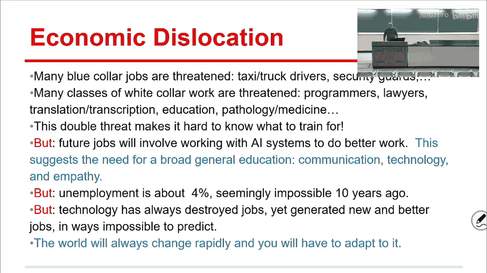

# 023：以人为本的数据科学

在本节课中，我们将探讨数据科学和人工智能领域中与人相关的议题，包括伦理问题、社会影响以及如何利用人类智慧（众包）来解决复杂问题。课程最后，我们会讨论期末考试的相关安排。

## 期末考试安排

上一节我们介绍了课程的整体方向，本节中我们来看看期末考试的具体信息。

期末考试将于一周后的周一举行，时间为上午11:15开始，持续两个半小时。考场与期中考试相同。

关于考场容量，我需要确认是否舒适。如果309教室过于拥挤，我可能会考虑调整安排，确保没有学生需要在走廊考试。

以下是关于期末考试的一些要点：
*   考试将包含约12至15道简答题。
*   题目类型与期中考试类似，侧重于需要思考的定性问题。
*   考试内容涵盖整个课程，是累积性的。
*   复习的最佳方式是练习教材中的习题，并参考以往的期中、期末考试题目。

如果你有好的期末考试题目想法，欢迎通过邮件发给我。如果你发送了题目，建议你同时知道答案。

## 人工智能的社会关切

在了解了期末安排后，我们将进入本节课的核心主题：数据科学中的人文视角。当前，数据科学常与机器学习和人工智能联系在一起，并引发了许多社会担忧。

首先，我想了解大家的看法。作为技术领域的学习者，你们对人工智能与社会的关系有何担忧？通过快速调查，我发现大家的意见各不相同。

我认为人们的担忧主要可以归纳为以下四个类别：

**1. 经济错位 😡**
核心担忧是机器是否会取代人类的工作。例如，自动驾驶技术可能威胁卡车司机和出租车司机的职业。

**2. 隐私问题**
人们担心个人数据和隐私信息被机器收集和分析，导致“它们对我了解过多”，这可能带来负面影响。

**3. 偏见问题 😡**
这是指模型可能从数据中学到关于人的错误观念或刻板印象。当模型开始基于这些有偏见的认知为人做决策时，就会产生问题。

**4. 代理权问题**
即人工智能是否会获得感知能力并失控，甚至“接管世界”，导致人类在其做出错误行为时无法控制。

接下来，我们将逐一探讨这些类别。我鼓励大家就此展开讨论。

## 深入探讨：对技术岗位的冲击

在概述了四大关切领域后，我们首先深入探讨经济影响，特别是对我们自身领域的冲击。

作为一个具体问题：在座的各位计算机科学领域的学生，有多少人担心人工智能会取代程序员的工作？根据现场反应，对此表示担忧的人似乎不多。

这引出了一个有趣的现象。虽然许多蓝领工作（如司机、保安）已明显受到新技术威胁，但白领工作，包括技术岗位，也开始面临变化和挑战。

## 总结

本节课中，我们一起学习了期末考试的具体安排，并重点探讨了以人为本的数据科学视角。我们分析了围绕人工智能的四大社会关切领域：经济影响、隐私、偏见和代理权问题，并特别讨论了其对技术岗位的潜在冲击。理解这些伦理和社会影响，对于成为一名负责任的数据科学家至关重要。