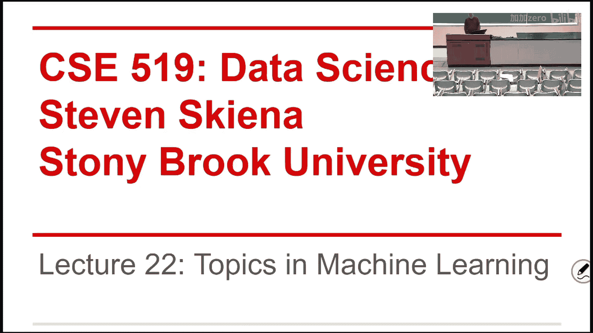
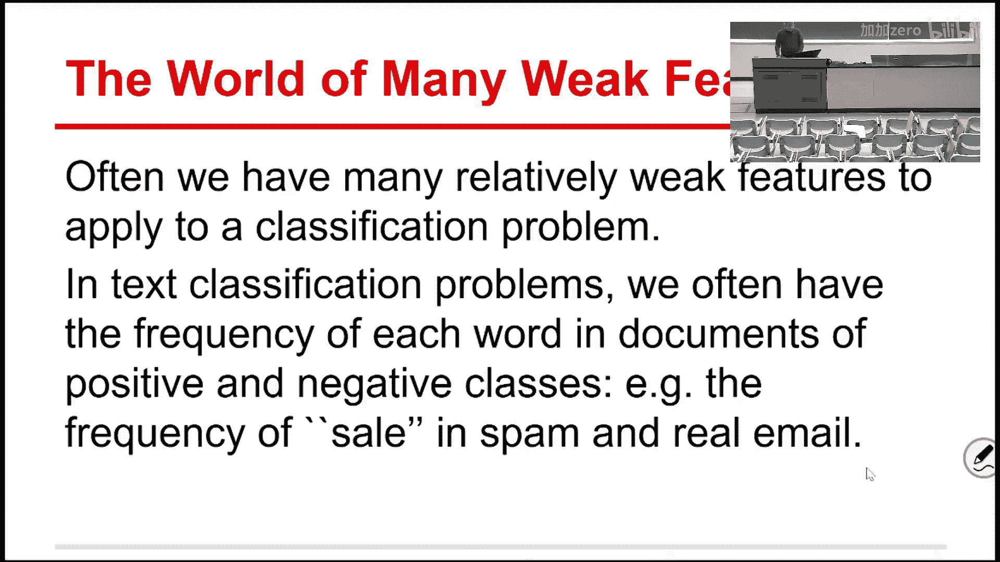
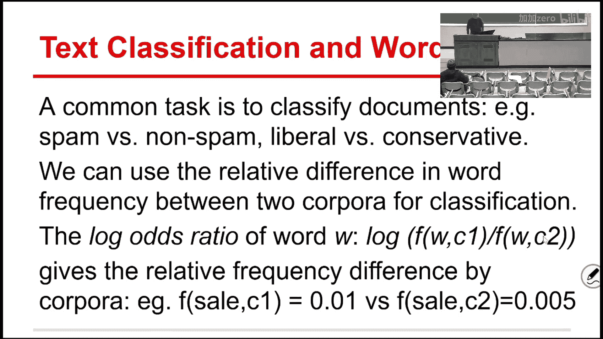

# 024：机器学习专题（续）🎯

在本节课中，我们将继续探讨机器学习方法。我们将学习朴素贝叶斯和支持向量机，并希望初步了解神经网络。不同的机器学习方法各有其优缺点。

上一节我们介绍了决策树和提升方法，其核心思想是利用大量弱特征来解决分类问题。本节中，我们来看看如何利用词汇特征进行文本分类。

## 文本分类与词汇特征

在文本分类问题中，例如区分垃圾邮件与正常邮件，最基础的特征通常是文档中每个词汇的出现频率。

以下是构建特征的基本步骤：
1.  准备两个文档集（例如垃圾邮件集和非垃圾邮件集）。
2.  统计每个词汇在每个文档集中出现的总次数。
3.  将次数分别除以对应文档集的总词数，得到每个词汇在每个类别中的相对频率。

例如，在垃圾邮件中，“sale”一词的出现频率可能为1%，而在非垃圾邮件中可能只有0.5%。这种频率差异是分类的关键。

## 优势比：量化词汇重要性

为了量化一个词汇对区分两个类别的贡献度，我们使用**优势比**。

其计算公式为：
`优势比 = (词汇在类别A中的频率) / (词汇在类别B中的频率)`

为了使其对称且易于解释，我们通常取其对数：
`对数优势比 = log(优势比)`

对数优势比的值可以清晰地表明一个词汇在某个类别中是过度出现（正值）还是出现不足（负值）。

### 研究实例：Twitter用户迁移分析

优势比在实际研究中非常有用。例如，在一项关于Twitter用户个人简介的研究中，我们分析了用户迁移模式。

研究过程如下：
*   收集了数亿条用户的自我描述（个人简介）。
*   通过用户资料中的位置信息，识别出哪些用户迁入了某个州，哪些用户迁出了该州。
*   计算每个词汇在“迁入”和“迁出”两组用户简介中的对数优势比。

通过分析，我们可以发现：
*   哪些词汇（如“student”）在迁移人群中普遍过出现。
*   特定词汇（如“Stony Brook”）的优势比可以揭示该大学对人口流动的影响。
*   这种方法有助于从宏观层面理解社会群体的变化与差异。

## 文档的向量化表示

基于上述方法，我们可以将任何文本文档转化为一个数学向量，这个过程称为向量化。

向量化表示如下：
`文档向量 = [词1的频率， 词2的频率， ...， 词n的频率]`

这样，每个文档都被表示为一个n维空间中的点，其中n是我们的词汇表大小，每一维对应一个词汇在该文档中的相对重要性（通常由TF-IDF等加权频率表示）。这为后续使用各种机器学习算法进行分类奠定了基础。

本节课中我们一起学习了如何利用词汇频率进行文本分类，重点介绍了优势比的概念及其在量化词汇区分度中的应用，并通过一个实际研究案例展示了其用途。最后，我们了解了如何将文档转化为数值向量，这是许多文本机器学习模型的输入基础。