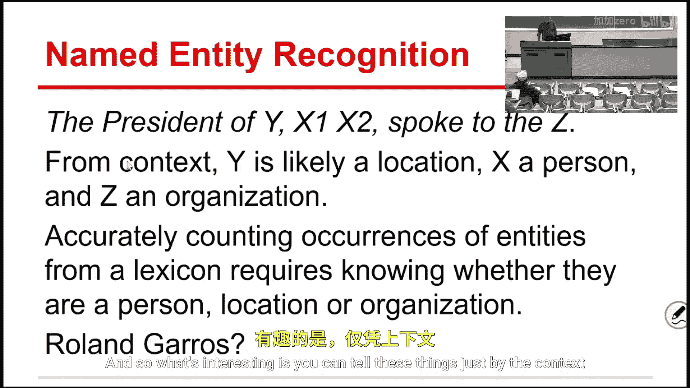

# 025：自然语言处理与大语言模型 (2024秋季) 🧠

在本节课中，我们将学习自然语言处理（NLP）的基础知识及其发展历程，探讨从传统的词频统计方法到现代大语言模型（LLMs）的演变，并思考这些变革对数据科学领域的影响。

---

上一节我们提到了课程安排，本节中我们来看看自然语言处理的核心内容。首先，我想谈谈一些经典的NLP方法，以及人们如何将文本作为数据使用。这个领域在我职业生涯的20年里发生了翻天覆地的变化。20年前，NLP很大程度上基于古典语言学，而今天的模型已经摒弃了许多那时的概念。我的目标是快速回顾一些我认为在经典NLP中至今仍有用的东西。

然后，我将讨论当今的模型，特别是Transformer的工作原理。最后，我想探讨一下，在这个大语言模型的世界里，数据科学意味着什么。我认为我们正处在一个一切都在变化的时代，我想稍微思考一下哪些东西变了，哪些没变，或许这能引发一些讨论。

---

## 经典NLP：词频统计 📊

首先，当我们回想20年前我刚起步时的NLP，很多工作都围绕着**统计词频**展开。统计词频至今在许多方面依然是一个好方法。

例如，我早期参与的一个情感分析系统，后来变得相当知名，甚至成立了一家公司。它的核心就是统计词频：统计事物被提及的频率，以及它们是否与正面或负面词汇一同出现。

人们现在仍在使用词频统计完成许多任务。我们上次讨论的朴素贝叶斯分类就是一个词频统计的应用，它统计每个词在不同语料库中出现的频率。

以下是词频统计的一些常见应用：
*   **词云**：人们喜欢词云。它的原理是分析文档，根据词语的使用频率，按比例展示每个词的大小。这是一种快速理解两个不同语料库之间差异的有效方式。

词频统计的效果好坏取决于两个主要因素：
1.  你用于训练的语料库是否有意义。
2.  你选择统计哪些词。

当你构建一个统计词频的系统时，需要做出一些决策。以下是需要考虑的设计决策：
*   你需要决定“大写的Apple”和“小写的apple”是否相同。
*   你需要决定是否关心**停用词**。停用词是指那些在所有文本语料库中出现频率通常都很高且意义不大的词（如“the”、“a”、“is”）。
*   你需要考虑是否关心单词的**变形**。例如，“apples”和“apple”是否算作同一个东西。如今我们可能会说大写的“Apple”和小写的“apple”不同，但“little apple”和“little apples”可能指的是类似的东西。
*   有一种称为**词干提取**的技术，它试图将所有单词的不同形态变化还原到同一个词干。通常，统计相同的词干比统计所有变体更好，因为这能减少特征数量，尽管会损失一些语义信息。
*   一个关键问题是，如何将文本分割成单词。通常人们根据空格来分割单词，但单词之间可能存在标点符号（例如“blank-dash”被视为两个词）。如何处理标点符号会产生影响。如果完全忽略标点，“#S”和“@S”可能被视为相同。

---

上一节我们介绍了基础的词频统计，本节中我们来看看更复杂的语言分析。NLP的另一个经典部分是尝试确定单词在句子中的**词义和角色**。

当你学习英语语法时，你了解了名词、形容词、动名词等。**词性标注**的目标就是给定一个句子，试图找出每个单词在句中扮演的角色。这是你能进行的最基础的句法分析形式，但它仍然被证明是有用的。

有些单词天生就容易混淆是名词还是动词。我常用的一个例子是“run”。“run”可以是动词，比如“去把某人叫来”；有时它也可以是名词，比如“去跑个步”，或者旧时人们穿的丝袜“抽丝了”。因此，过去NLP的一项重要工作就是尝试确定句子中单词的角色。

---

## 命名实体识别 🏷️

NLP在过去乃至现在仍然重要的另一个部分是**命名实体识别**。

给定一个句子，你希望尝试找出句子中的人物、地点和事物。例如，在这个句子中：“Y国的总统X1 X2在Z地向O发表了讲话。”，我们可以推断：
*   “Y”很可能是一个地点（国家）或组织。
*   “X1 X2”将是那个人的名字。

有趣的是，你仅仅通过上下文和句子结构就能判断出这些信息。

---

## 现代模型：Transformer架构 ⚙️

现在，让我们转向现代模型。当今NLP的核心是**Transformer**架构，它是大语言模型（如GPT系列）的基础。Transformer的关键创新在于**自注意力机制**，它允许模型在处理一个词时，权衡句子中所有其他词的重要性。

自注意力机制的核心计算可以用以下公式表示：
`Attention(Q, K, V) = softmax(QK^T / sqrt(d_k)) V`
其中：
*   **Q (Query)**：代表当前需要关注的词。
*   **K (Key)**：代表句子中所有可供关注的词。
*   **V (Value)**：代表句子中所有词的实际信息。
*   `softmax`函数将注意力权重归一化。
*   `sqrt(d_k)`是一个缩放因子，用于稳定梯度。

通过这种方式，模型可以动态地捕捉长距离的依赖关系，理解上下文，这是它强大能力的重要来源。

---

## 大语言模型时代的数据科学 🤔

最后，我想探讨一下，在这个大语言模型（LLMs）的时代，数据科学意味着什么。我们生活在一个一切都在变化的世界。

LLMs能够生成文本、翻译语言、编写代码，甚至进行一定程度的推理。这改变了我们处理文本数据的方式。传统的数据科学任务，如分类、情感分析，现在可以通过提示（prompting）或微调（fine-tuning）预训练的LLM来完成，有时不再需要从头开始构建复杂的特征工程模型。

然而，这并不意味着经典方法完全过时。理解词频、句法结构和语义角色，仍然有助于我们设计更好的提示、解释模型的输出，以及在资源受限或需要高度可解释性的场景下构建高效的专用系统。数据科学家的角色可能正在从“模型构建者”转向“模型引导者”和“结果解释者”。

---

本节课中我们一起学习了自然语言处理的发展脉络。我们从经典的词频统计、词性标注和命名实体识别开始，了解了文本作为数据的基础处理方法。接着，我们探讨了现代NLP的引擎——Transformer架构及其核心的自注意力机制。最后，我们思考了大语言模型崛起对数据科学领域带来的挑战与机遇。理解这些演变，将帮助我们在快速变化的技术 landscape 中更好地定位和应用这些强大的工具。