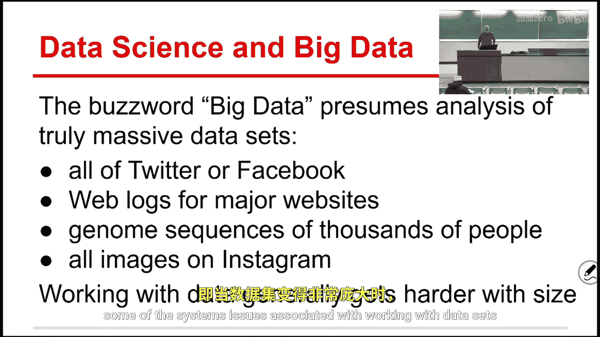
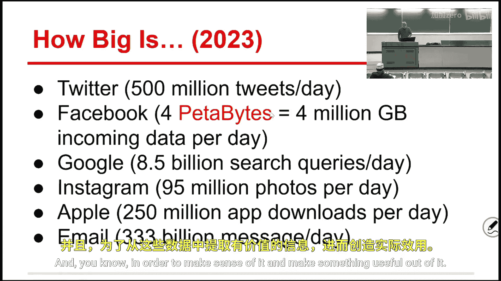
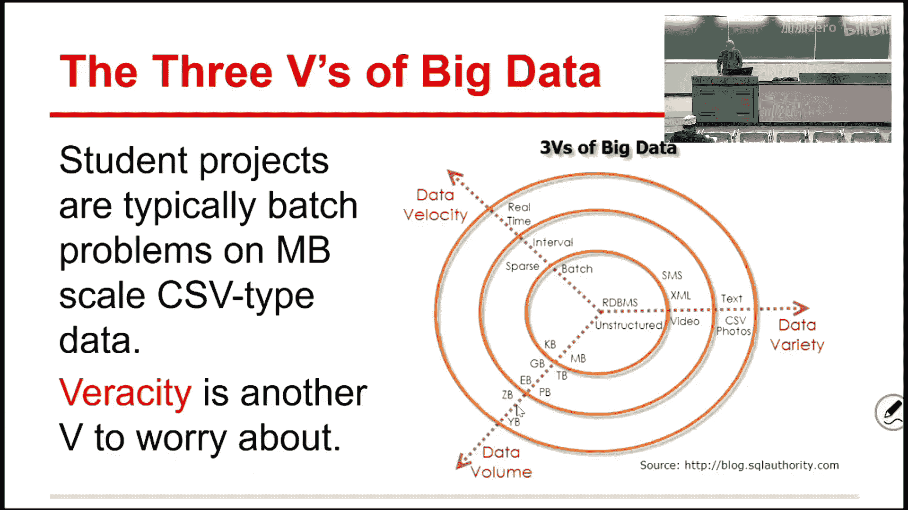
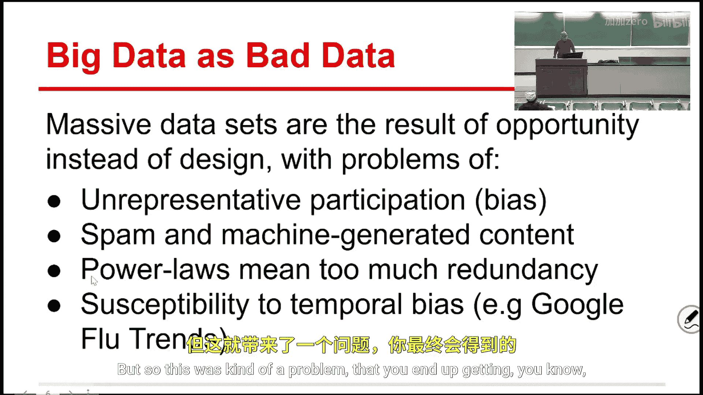

# 026：实现规模化处理

在本节课中，我们将探讨处理大规模数据集时面临的挑战与核心概念。我们将了解“大数据”的特性、其来源带来的问题，以及为何处理海量数据本身就是一个重要的计算瓶颈。

---

上一节我们介绍了课程背景，本节中我们来看看“大数据”通常如何被定义。人们常用三个维度来描述大数据。

以下是描述大数据的三个关键维度：

*   **速度**：指处理数据的频率。一端是要求毫秒级响应的实时应用，另一端是每天或每小时运行一次的批处理作业。
*   **多样性**：指数据的类型和结构。从结构规整的数据库（列、数字、文本），到包含视频、文本等多种非结构化数据的社交媒体内容，多样性越高，处理方式越复杂。
*   **体量**：指数据集的规模。范围可以从兆字节（MB）到拍字节（PB）乃至泽字节（ZB）。例如，Facebook每天接收约4PB的新数据。

---

现在，我们了解了大数据的特点，接下来要思考这些海量数据从何而来。一位算法专家曾提出一个有趣的观点：**大数据即坏数据**。

大数据集通常来源于**机会性收集**，而非精心设计。公司收集海量数据，往往是因为其拥有大量用户和用户行为，而非一开始就计划收集如此规模的数据。这导致数据分析是在分析**既有的数据**，而非理想中为特定问题定制的数据。

分析这类数据集会带来几个特定问题：

以下是分析机会性收集的大数据时面临的主要挑战：

*   **样本偏差**：数据仅代表特定平台用户，而非全体人口。例如，分析Twitter数据只能了解Twitter用户的想法，这部分人群本身存在偏差（如需要一定的文化水平）。
*   **垃圾与机器生成内容**：数据中混杂大量垃圾信息和机器生成内容（如机器人账号）。如今，AI生成的内容更难与人类发布的内容区分。
*   **幂律分布与冗余**：在许多现象中（如发帖量），遵循幂律分布：少数用户产生大量内容，多数用户产生很少内容。这导致数据高度冗余。例如，分析人们对苹果产品的讨论可能数据丰富，但分析对飞机发动机的讨论则可能数据稀少。

---

本节课中我们一起学习了处理大规模数据的核心议题。我们了解了定义大数据的三个维度（速度、多样性、体量），并探讨了机会性收集的大数据所带来的独特挑战，包括样本偏差、垃圾信息干扰以及数据冗余问题。理解这些是设计有效大规模数据处理方案的基础。