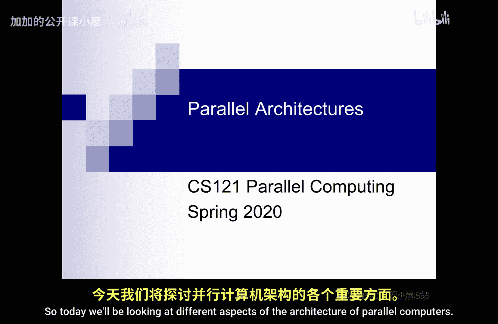
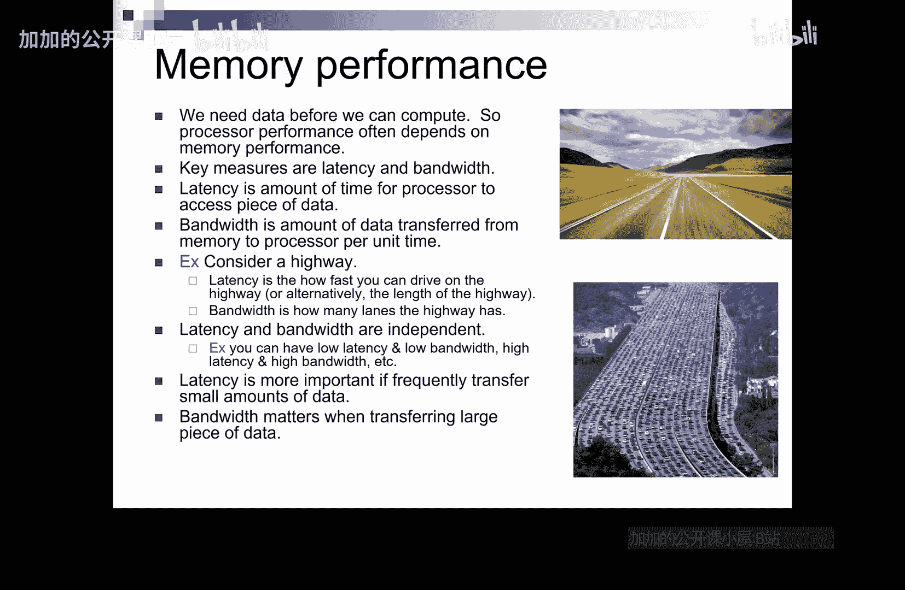
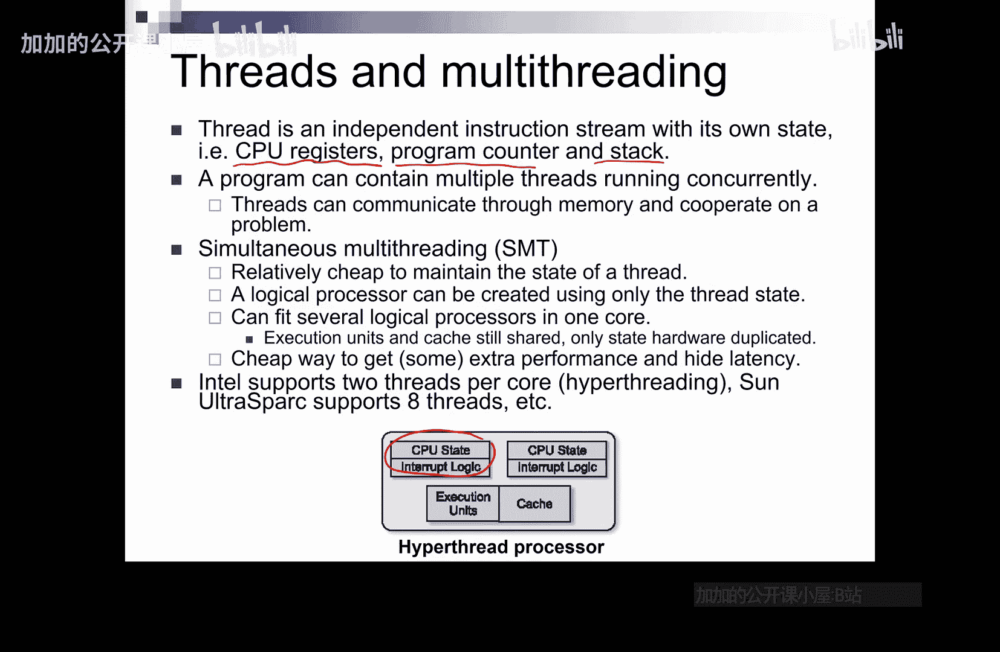
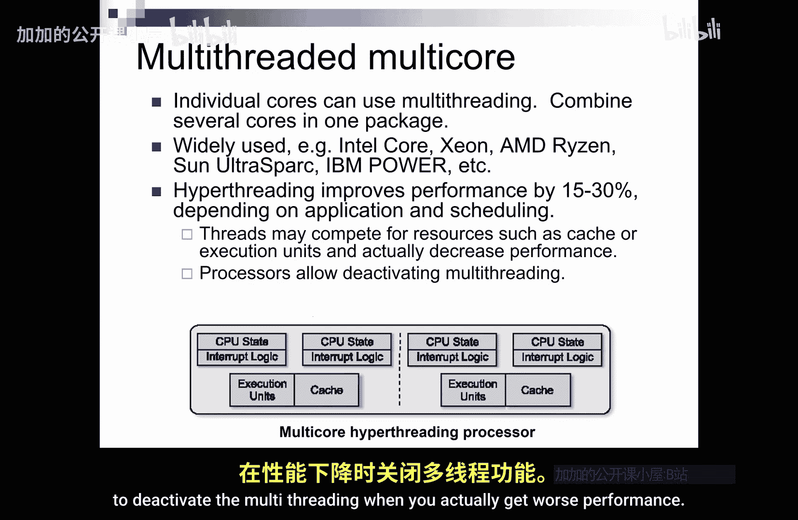
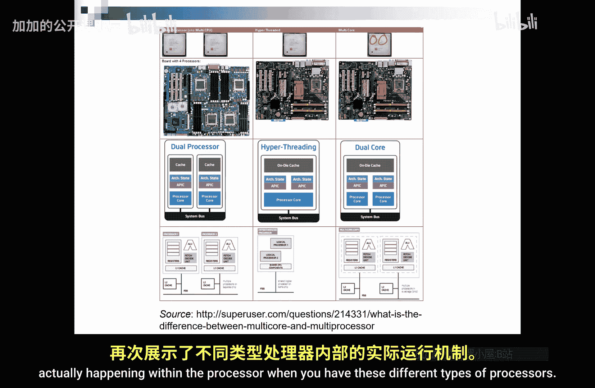
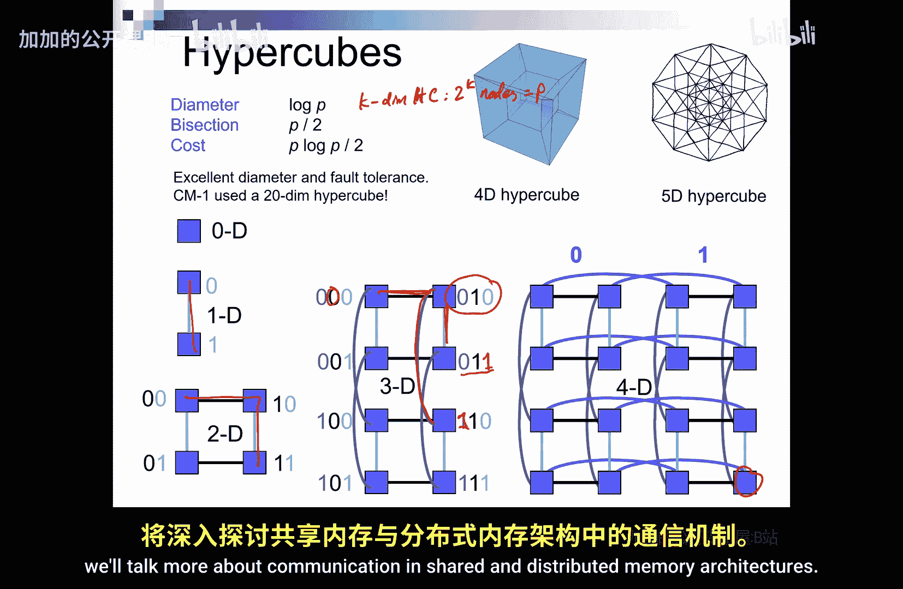

#  002：并行计算机架构 🏗️



在本节课中，我们将学习并行计算机架构的不同层面。我们将从单个处理器内部的并行性开始，逐步扩展到多核处理器、共享内存和分布式内存系统，并探讨处理器间的互联网络。

## 单处理器内部的并行性 🔍

上一讲我们提到了并行计算机中存在多个层次的并行性。本节中，我们来看看即使在单个处理器核心内部，也存在多种并行执行指令的方式。

### 流水线并行

执行一条指令通常包含多个子步骤，例如：取指、译码、执行、访存、写回。流水线技术将这些步骤分解，并在不同的硬件单元上同时执行不同指令的不同阶段，从而实现隐式并行。

**核心概念**：一个五级流水线处理器在每个时钟周期可以处理多达五条指令的不同阶段，理想情况下可获得近五倍的加速比。

然而，流水线面临一个主要挑战：分支预测。如果代码中存在条件分支，处理器需要猜测执行路径。如果预测错误（分支误预测），整个流水线需要被清空，导致性能损失。因此，高精度的分支预测对流水线性能至关重要。

### 超标量并行

超标量架构在流水线的基础上更进一步，它为每个功能单元（如取指、译码单元）配备了多个副本。这样，即使代码本身是顺序的，处理器也能在每个时钟周期发射并执行多条指令。

以下是超标量处理器如何并行执行一段代码的示例。假设我们要将四个内存地址的值相加：

```assembly
LOAD R1, [1000]
LOAD R2, [1004]
ADD R1, R1, [1008]
ADD R2, R2, [1012]
ADD R3, R1, R2
```

这段代码中，前两条`LOAD`指令是相互独立的，可以同时被两个取指单元获取并解码。同样，后续的`ADD`指令也存在可以并行执行的机会。超标量处理器会动态地发现这些机会。

### 数据依赖与指令调度

指令能否并行执行，取决于它们之间的数据依赖关系。如果一条指令需要使用前一条指令的结果，则必须顺序执行。



比较以下两段功能相同但顺序不同的代码：

**代码A（依赖少，并行度高）**:
```assembly
LOAD R1, [1000]
LOAD R2, [1004]  // 与上一条独立
ADD R1, R1, [1008] // 依赖 LOAD R1
ADD R2, R2, [1012] // 依赖 LOAD R2，但与上一条 ADD 独立
ADD R3, R1, R2     // 依赖前两条 ADD
```

**代码B（依赖多，并行度低）**:
```assembly
LOAD R1, [1000]
ADD R1, R1, [1004] // 依赖上一条
ADD R1, R1, [1008] // 依赖上一条
ADD R1, R1, [1012] // 依赖上一条
```

代码A的指令间依赖更少，为超标量并行提供了更多机会。为了充分利用硬件，处理器需要复杂的硬件来动态检测依赖、重排序指令流，并尽可能填满所有功能单元，避免资源闲置。

### 超长指令字并行

VLIW（超长指令字）是另一种利用隐式并行的方式。与超标量在运行时动态发现并行指令不同，VLIW依赖编译器在编译时静态地将多条可以并行执行的指令打包成一条很长的指令。

*   **优点**：编译器可以进行更复杂、更全局的优化来寻找并行性，硬件设计得以简化（无需复杂的动态调度逻辑）。
*   **缺点**：编译器无法预知运行时的所有情况（如缓存命中、分支走向），可能错过一些仅在运行时才显现的并行机会，导致性能潜力无法完全发挥。

## 内存性能与层次结构 🧠

处理器的性能不仅取决于计算速度，还严重依赖于获取数据的速度。内存系统的两个关键指标是**延迟**和**带宽**。

*   **延迟**：处理器请求一块数据到收到该数据所需的时间。
*   **带宽**：单位时间内可以从内存传输到处理器的数据总量。

它们可以用高速公路来类比：延迟好比车辆从起点到终点所需的时间（或公路的长度），而带宽好比公路的车道数，决定了单位时间内能通过多少车辆。

### CPU-内存性能鸿沟

多年来，处理器性能的提升速度远远超过了内存性能的提升，导致两者之间出现巨大鸿沟。一个能执行100 GFLOPs的处理器，如果内存带宽只能支持每秒传输50亿个浮点数（20 GB/s），那么实际性能将被限制在5 GFLOPs，仅为峰值性能的5%。

### 内存层次结构



为了解决这个鸿沟，现代计算机采用了**内存层次结构**。从快到慢、从小到大依次包括：寄存器、L1缓存、L2缓存、L3缓存、主内存（RAM）、二级存储（如硬盘）。速度越快的内存，容量通常越小。



**缓存**是位于处理器芯片上的小型、高速内存，充当处理器和主存之间的缓冲区。其目标是让处理器最常访问的数据驻留在缓存中，从而以低延迟和高带宽进行访问。



### 局部性原理

缓存要发挥作用，程序必须具有良好的**局部性**：
1.  **时间局部性**：如果某个数据被访问，那么它在不久的将来很可能再次被访问。
2.  **空间局部性**：如果某个数据被访问，那么其邻近地址的数据很可能很快被访问。

当程序具有良好局部性时，缓存命中率会很高。缓存命中率对平均访问时间有巨大影响：

**公式**：`平均访问时间 = 命中率 × 缓存延迟 + (1 - 命中率) × 内存延迟`

例如，假设缓存延迟5 ns，内存延迟100 ns：
*   缓存命中率80%时，平均访问时间 = `0.8*5 + 0.2*100 = 24 ns`
*   缓存命中率90%时，平均访问时间 = `0.9*5 + 0.1*100 = 14 ns`

相比之下，若无缓存，每次访问都需100 ns。因此，缓存能显著提升系统有效性能。

## 多处理器架构 🧩

了解了单处理器内部的并行后，我们现在进入并行层次结构的下一级：将多个处理器组合成更大的系统。

### 核心、处理器与线程

*   **核心**：一个独立的执行单元，包含取指、译码、执行、寄存器状态等部件，可运行一个或多个线程。
*   **线程**：一个独立的指令流，由程序计数器、寄存器状态等定义其执行状态。

### 架构分类

1.  **单核单处理器**：传统顺序处理器的基础。
2.  **多处理器**：多个独立的处理器芯片通过主板互联，通常通过共享内存进行通信。
3.  **多核处理器**：单个芯片上集成多个核心。核心间可以共享最后几级缓存，通信延迟低，能提高缓存利用率，但也可能因竞争缓存导致性能下降。
4.  **同时多线程处理器**：在单个核心上复制多份线程状态（寄存器、程序计数器），但共享执行单元和缓存。这使得单个核心能同时运行多个线程，当线程使用不同的功能单元时，可以提高硬件利用率。Intel的**超线程**技术就是SMT的一种实现。
5.  **多核超线程处理器**：现代处理器的常见形态，结合了多核和每个核心上的SMT。

## 弗林分类法 🏷️

另一种从指令和数据流角度对处理器进行分类的方法是弗林分类法：

1.  **SISD**：单指令单数据。传统顺序处理器。
2.  **SIMD**：单指令多数据。同一指令同时作用于多个数据元素。非常适合向量运算、图形处理。现代CPU的向量指令（如AVX）和GPU都是SIMD或类似架构。
    *   **优点**：硬件设计相对简单，控制单元只需一份。
    *   **缺点**：遇到条件分支时，不同数据元素可能导致不同执行路径，造成**分支发散**，需要串行化处理各路径，降低效率。
3.  **MISD**：多指令单数据。不常见，可认为流水线是某种形式的MISD。
4.  **MIMD**：多指令多数据。每个处理器独立执行不同的指令流处理不同的数据。这是最通用的并行架构，多核CPU和分布式内存集群都属于MIMD。

现代系统通常是SIMD和MIMD的混合体。例如，一个多核CPU（MIMD）的每个核心都支持SIMD向量指令。

## 互联网络与内存架构 🌐

多个处理器需要互联以协作。互联网络的拓扑结构对系统性能和可扩展性至关重要。

### 内存架构类型

1.  **共享内存**：所有处理器共享一个统一的逻辑地址空间。任何处理器都能直接访问任何内存地址。
    *   **优点**：编程模型简单，数据共享直观。
    *   **缺点**：可扩展性有限，通常只能扩展到数百个处理器。需要复杂的缓存一致性协议。
    *   **变体**：
        *   **UMA**：均匀内存访问。所有处理器访问任何内存位置的时间相同。
        *   **NUMA**：非均匀内存访问。处理器访问不同内存模块的时间不同，取决于物理距离。

2.  **分布式内存**：每个处理器拥有自己的本地内存，构成独立的地址空间。处理器不能直接访问其他处理器的内存，必须通过**消息传递**进行通信。
    *   **优点**：可扩展性极好，能构建成千上万个处理器的大型系统。
    *   **缺点**：编程模型复杂，程序员必须显式管理数据的分布和通信。

3.  **混合架构**：大规模并行计算机的常见形态。节点内部采用共享内存（多核），节点之间采用分布式内存（消息传递）。

### 网络拓扑结构

互联网络的性能常用以下指标衡量：
*   **直径**：网络中任意两个节点间的最长距离（跳数）。直径越小，最坏情况下的通信延迟越低。
*   **对分带宽**：将网络分成大小相近的两部分时，必须切断的链路的总带宽。对分带宽越大，网络并行通信能力越强。
*   **成本**：网络中的链路总数。

以下是几种常见拓扑结构的比较：

以下是几种常见拓扑结构的特性总结：

| 拓扑结构 | 直径 | 对分带宽 | 成本 (链路数) | 描述 |
| :--- | :--- | :--- | :--- | :--- |
| **线性阵列** | P-1 | 1 | P-1 | 处理器排成一条线，简单但性能差。 |
| **环** | P/2 | 2 | P | 在线性阵列首尾增加一条连接。 |
| **2D 网格** | 2(√P - 1) | √P | ~2P | 处理器排列成二维网格，可扩展性较好。 |
| **2D 环面** | √P | 2√P | ~2P | 在2D网格的每行每列首尾增加连接。 |
| **3D 网格/环面** | 3(∛P - 1) | ∛P² | ~3P | 扩展到三维，进一步降低直径。 |
| **二叉树** | 2 log₂ P | 1 | P-1 | 直径小，但对分带宽是瓶颈。 |
| **胖树** | 2 log₂ P | P/2 | ~(P log₂ P)/2 | 树中越靠近根节点的链路带宽越大，解决了对分带宽问题。 |
| **超立方体** | log₂ P | P/2 | (P log₂ P)/2 | 由递归方式构建，直径和对分带宽性能都极佳。 |

**超立方体**是一种性能优异的拓扑。一个k维超立方体有2^k个节点，每个节点有k个邻居（其二进制标签仅一位不同）。其直径仅为k（即log₂ P），对分带宽为P/2。虽然难以可视化高维超立方体，但它被用于一些经典超级计算机（如Connection Machine CM-2）的互联网络。

## 总结 📚

本节课我们一起学习了并行计算机架构的多个核心方面：

1.  **单处理器内部的并行**：通过**流水线**、**超标量**和**VLIW**等技术，挖掘指令级并行。性能受限于**数据依赖**和**分支预测**。
2.  **内存系统**：**延迟**和**带宽**是关键指标。**CPU-内存性能鸿沟**通过**内存层次结构**（尤其是**缓存**）来缓解，其有效性依赖于程序的**时间局部性**和**空间局部性**。
3.  **多处理器架构**：认识了**多核**、**超线程**等组织多个计算单元的方式。
4.  **弗林分类法**：从指令/数据流角度将架构分为SISD、SIMD、MISD、MIMD。现代系统多为混合型。
5.  **互联网络与内存模型**：区分了**共享内存**和**分布式内存**模型及其优缺点。探讨了多种**网络拓扑结构**（线性、网格、环面、树、超立方体等）及其对**直径**、**对分带宽**和**成本**的影响。



理解这些底层架构概念，是编写高效并行程序、为其选择合适平台的基础。下一讲，我们将深入探讨共享内存和分布式内存架构中的通信机制。