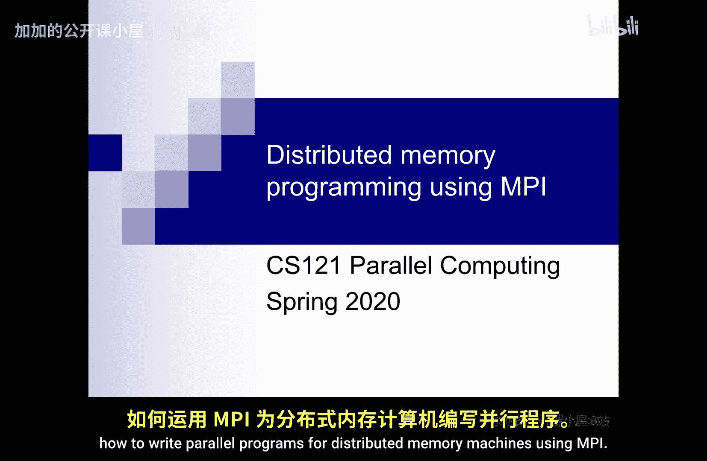
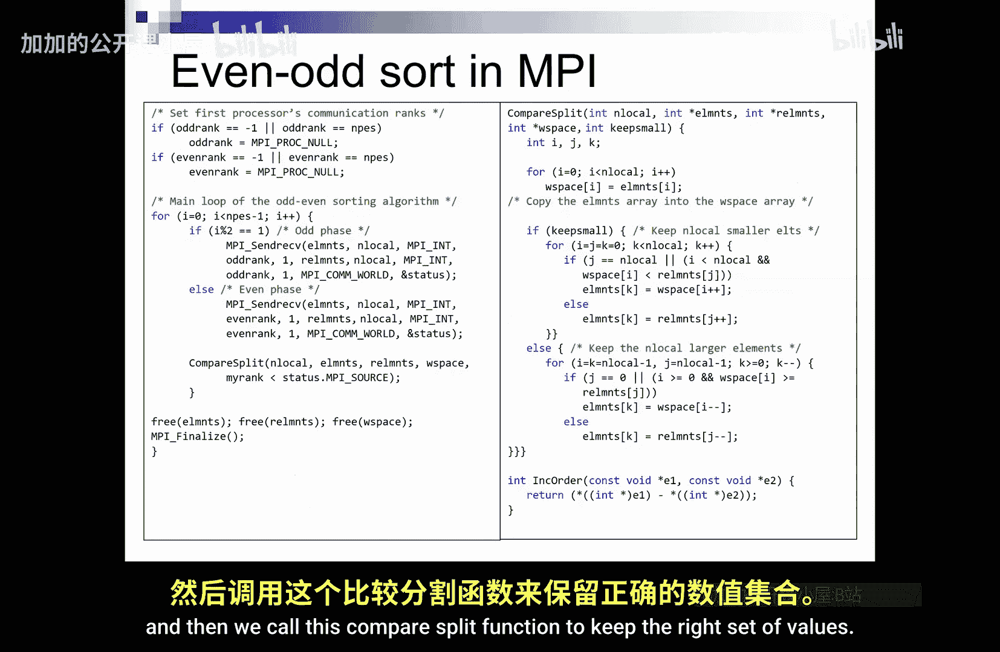

#  005：MPI 第一部分



在本节课中，我们将要学习如何为分布式内存机器编写并行程序，使用的工具是 MPI。

## 概述

上一节我们介绍了并行计算的基本概念。本节中，我们来看看一种具体的并行编程模型——消息传递接口。我们将学习 MPI 的基本概念、编程模型以及如何使用它进行进程间通信。

## 分布式内存架构

首先，让我们回顾一下分布式内存架构。

观察左侧的图表，分布式内存架构包含多个不同的处理器。每个处理器都有自己的内存，可以直接访问。然而，如果一个处理器想要访问另一个处理器的内存，它需要通过网络发送消息。接收消息的处理器从其自身内存中获取数据，然后发送回初始处理器。这就是分布式内存处理。

接下来，观察右侧的图表。这里展示的是分布式内存架构和共享内存架构的结合。我们拥有多个节点，每个节点内部有多个 CPU 和一块内存。节点内的所有 CPU 都可以访问这块内存的任何部分。但是，如果一个节点内的 CPU 想要访问另一个节点的内存，它同样需要通过网络发送消息，然后接收处理器获取该内存数据并发送回第一个处理器。因此，在每个节点内部，我们处于共享内存环境；而在不同节点之间，我们处于分布式内存环境。今天我们将讨论如何为这些分布式内存机器编程。

## MPI 简介

我们主要使用标准 C、C++ 或 Fortran 语言编程，但这些语言本身不支持分布式内存操作。因此，我们需要一个库来处理分布式内存通信。虽然有多个库可用，但最标准、使用最广泛的是 MPI。

MPI 代表消息传递接口。这个库由学术界和工业界在 90 年代开发。在 90 年代初期之前，存在多种相互竞争的分布式内存编程方法，情况相当混乱，因为使用不同库编写的程序彼此不兼容。最终，人们聚集起来，希望标准化这个过程，创建一个所有人都能使用的库来进行分布式内存处理。

开发 MPI 时有几个目标：
*   **可移植性**：希望 MPI 代码能在不同架构上编译和运行。
*   **高效性**：添加了各种功能以提高效率。
*   **通用性与灵活性**：能够编写任何类型的分布式内存程序。

MPI 有几个版本。第一个版本从 90 年代中期持续到大约 2008 年。MPI 2.0 于 2008 年发布，MPI 3.0 则在 2015 年发布。MPI 是一个接口规范，它定义了库必须支持的函数，但不规定如何实现这些函数。不同的供应商在实现 MPI 时，会针对自己的硬件进行优化。然而，所有支持 MPI 的供应商都支持相同的编程接口，因此你编写的 MPI 程序具有可移植性。

流行的 MPI 实现包括 MPICH 和 Open MPI。此外，英特尔、微软等硬件供应商也提供商业实现。

## MPI 程序结构

一个 MPI 程序主要包含四种类型的函数：

1.  **进程创建与管理函数**：用于启动和初始化程序。
2.  **通信函数**：这是 MPI 的核心，用于在进程间发送和接收消息。它又分为两类：
    *   **点对点通信**：在两个特定进程之间发送或接收消息。
    *   **集体通信**：在一组进程之间进行通信，例如广播。
3.  **数据类型定义函数**：MPI 支持基本数据类型，也允许用户定义新的数据类型。
4.  **通信组与拓扑函数**：用于创建和管理通信组。通信组是一组可以相互通信的进程集合。在 MPI 中进行通信时，必须指定使用哪个通信组。还可以在组上定义虚拟拓扑，以优化通信。

在本次讲座的剩余部分，我们将重点学习点对点和集体通信函数。

需要强调的是，在 MPI 模型中，一个进程无法直接读取另一个进程的数据，必须通过发送和接收消息来完成。这与共享内存编程模型形成对比，在共享内存中，所有进程共享一块公共内存，任何进程都可以通过正常的读写操作访问它。不过，近十年发布的新版 MPI 也部分支持共享内存风格的编程，但 MPI 主要还是用于消息传递类型的程序。

## MPI 进程模型：SPMD

MPI 使用一种称为 SPMD 的进程模型，它代表单程序多数据。

这意味着对于一个 MPI 程序，所有处理器都将运行同一份代码。如右图所示，我们有一个源代码文件，编译后生成一个可执行文件。为了并行运行程序，我们将同一个可执行文件发送给所有不同的进程。因此，我们在不同处理器上运行的是同一个程序。

当然，我们不希望所有处理器做完全相同的事情，那样只是重复工作。我们希望它们运行相同的程序，但操作不同的数据片段。实现这一点的关键是，每个进程都有一个唯一的 ID。在 MPI 程序中，你可以根据进程的 ID 来指定不同的进程执行不同的操作。

需要指出的是，SPMD 与我们之前见过的 SIMD 非常不同。SIMD 是一种硬件架构，意味着多个处理单元在同一时间点执行完全相同的指令，处理器之间是同步的。而在 MPI 的 SPMD 模型中，进程运行相同的程序，但进程之间没有隐式的同步。一个进程可能处于程序的一个点，而另一个进程可能处于完全不同的另一个点。

一个处理器上可以运行多个 MPI 进程。例如，有 10 个处理器和 20 个 MPI 进程，你可以在每个处理器上放置两个进程。但通常，你会让进程数与处理器核心数一致，以避免资源争用。不过，如果进程工作量很小，有时也会在一个处理器上运行多个进程以充分利用资源。

在 MPI 中，程序员通常无法控制进程到处理器的映射。

## 编写第一个 MPI 程序

现在，让我们实际看看如何在 MPI 中创建进程。

首先，要使用 MPI，必须包含 MPI 头文件。然后，为了启动 MPI 程序，需要调用 `MPI_Init` 函数。使用完 MPI 后，需要调用 `MPI_Finalize`。

以下是一个简单的 MPI “Hello World” 程序示例：

```c
#include <mpi.h>
#include <stdio.h>

int main(int argc, char** argv) {
    int num_procs, my_rank;

    MPI_Init(&argc, &argv);
    MPI_Comm_size(MPI_COMM_WORLD, &num_procs);
    MPI_Comm_rank(MPI_COMM_WORLD, &my_rank);

    printf("From process %d out of %d: Hello World\n", my_rank, num_procs);

    MPI_Finalize();
    return 0;
}
```

程序解释：
*   `#include <mpi.h>`：包含 MPI 头文件。
*   `num_procs`：存储进程总数。
*   `my_rank`：存储当前进程的 ID。
*   `MPI_Init(&argc, &argv)`：初始化 MPI 环境。
*   `MPI_Comm_size(MPI_COMM_WORLD, &num_procs)`：获取默认通信器 `MPI_COMM_WORLD` 中的进程总数。`MPI_COMM_WORLD` 是 MPI 启动时创建的包含所有进程的默认通信器。
*   `MPI_Comm_rank(MPI_COMM_WORLD, &my_rank)`：获取当前进程在 `MPI_COMM_WORLD` 中的排名。
*   `printf`：每个进程打印自己的排名和总进程数。
*   `MPI_Finalize()`：结束 MPI 环境。

要运行此程序，在安装 MPI 后，可以使用类似以下的命令：
```bash
mpirun -np 8 ./my_program
```
这将启动 8 个进程。你会在运行命令的主机上看到 8 条消息。但消息的打印顺序不一定按照排名 0, 1, 2... 的顺序，因为进程之间没有同步，运行快的进程会先打印。

## 另一种模型：MPMD

在继续之前，需要提及分布式内存编程的另一种模型：MPMD，即多程序多数据。

在 MPMD 模型中，通常采用主从方法。开始时只有一个主进程。当主进程发现有很多工作需要并行处理时，它会执行生成操作来创建其他从进程。从进程运行的代码可能与主进程不同。与 MPI 的 SPMD 模型不同，MPMD 模型的进程数是动态变化的，进程可以随时创建。这会带来一些创建开销，但编程方式可能更自然。例如，PVM 库支持这种模型。然而，MPI 是目前最流行的分布式内存编程方式，因此我们将重点学习它。

## MPI 函数概览与通信器

MPI 拥有数百个函数，但编写高效通用的 MPI 程序通常只需要掌握其中一小部分。这些函数包括：
*   **初始化函数**：如 `MPI_Init`, `MPI_Finalize`。
*   **点对点通信函数**：如 `MPI_Send`, `MPI_Recv`。
*   **集体通信函数**：如广播、散播、聚集、全局归约、扫描、屏障等。
*   **派生数据类型创建函数**：如连续、索引、结构、向量等类型。
*   **通信器创建与拓扑定义函数**。

我们不会逐一讲解所有函数，但会展示每种类型的例子。如需完整列表，可查阅 MPI 文档。

现在，让我们更详细地讨论通信器。

通信器，也称为通信域，是一组可以相互通信的进程的集合。在一个程序中，可以创建多个通信器。你可以将进程分成多个组，每个组是一个通信器，一个进程可以同时属于多个通信器。使用通信器的目的是帮助组织通信。

例如，假设我们有一个进程网格。可以定义一个包含所有进程的通信器。此外，还可以为每一行进程定义一个行通信器，因为有时你只想与同一行的进程通信。同样，也可以定义列通信器。这样，当只想与同列进程通信时，使用列通信器即可，而无需使用整个通信器。

通信器具有类型 `MPI_Comm`。进行任何类型的通信时，都必须指定一个通信器。调用 `MPI_Init` 后，MPI 会自动创建一个名为 `MPI_COMM_WORLD` 的默认通信器。

通信器有大小，可以通过 `MPI_Comm_size` 获取。通信器内的每个进程都有一个排名，可以通过 `MPI_Comm_rank` 获取。排名用于区分不同进程，使它们能基于排名执行不同的操作。

## 点对点通信：发送与接收

接下来，我们看看如何实际发送消息。这是 MPI 中最基本的操作。

要发送消息，调用 `MPI_Send` 函数。其参数如下：
*   `buf`：指向要发送数据的指针。
*   `count`：发送的数据项数量。
*   `datatype`：发送数据的 MPI 数据类型。
*   `dest`：目标进程在指定通信器中的排名。
*   `tag`：消息标签，用于区分发送到同一目的地的多个消息。
*   `comm`：通信器。

在一对进程之间，所有发送和接收的消息都按先进先出顺序处理。

要接收消息，调用 `MPI_Recv` 函数。其参数如下：
*   `buf`：指向用于存储接收数据的缓冲区的指针。
*   `count`：计划接收的数据项最大数量。
*   `datatype`：期望接收数据的 MPI 数据类型。
*   `source`：源进程在指定通信器中的排名。可以使用 `MPI_ANY_SOURCE` 表示接受来自任何进程的消息。
*   `tag`：期望接收消息的标签。可以使用 `MPI_ANY_TAG` 表示接受任何标签的消息。
*   `comm`：通信器。
*   `status`：`MPI_Status` 对象，用于获取接收操作的详细信息，例如当使用 `MPI_ANY_SOURCE` 或 `MPI_ANY_TAG` 时，可以通过它查询实际的消息来源和标签。

如果多个发送都匹配一个接收（例如使用 `MPI_ANY_SOURCE`），则只有一个发送能完成接收，其他的可能会被“丢失”或等待。

## 发送接收示例与阻塞问题

让我们看一个使用 `MPI_Send` 和 `MPI_Recv` 的简单示例。假设只有两个进程，排名为 0 和 1。目标是让进程 0 发送一条消息给进程 1，然后接收一条返回消息；进程 1 先接收消息，然后发送回复。

```c
if (my_rank == 0) {
    MPI_Send(&data_to_send, 1, MPI_CHAR, 1, tag, MPI_COMM_WORLD);
    MPI_Recv(&data_received, 1, MPI_CHAR, 1, tag, MPI_COMM_WORLD, &status);
} else if (my_rank == 1) {
    MPI_Recv(&data_received, 1, MPI_CHAR, 0, tag, MPI_COMM_WORLD, &status);
    MPI_Send(&data_to_send, 1, MPI_CHAR, 0, tag, MPI_COMM_WORLD);
}
```

使用这些函数时需要小心，因为 `MPI_Send` 是阻塞函数。这意味着调用 `MPI_Send` 后，进程会阻塞，直到发送成功完成。这是为了确保数据被正确发送，因为 MPI 进程之间不同步，发送方需要等待接收方准备好接收，以避免消息丢失。

`MPI_Send` 阻塞的时间长短取决于 MPI 实现是否具有硬件发送缓冲区。如果有缓冲区，`MPI_Send` 只需等待数据从用户缓冲区复制到系统缓冲区即可返回。如果没有缓冲区，发送方必须一直等待，直到接收方准备好并完成接收操作。

另一方面，`MPI_Recv` 总是阻塞的，因为调用它意味着进程希望接收数据，在收到数据之前它会一直等待。

## 非阻塞通信

有时我们希望进行非阻塞通信，这样在发出通信请求后，进程可以继续执行其他计算。这可以通过非阻塞通信函数实现。

非阻塞发送函数是 `MPI_Isend`，非阻塞接收函数是 `MPI_Irecv`。这些函数调用后会立即返回，不会阻塞。但是，你需要知道这些操作何时完成，因为在操作完成前，不能修改发送缓冲区或使用接收缓冲区中的数据。

为了检查操作是否完成，可以使用 `MPI_Test` 函数，它接受一个 `MPI_Request` 对象（由 `MPI_Isend` 或 `MPI_Irecv` 返回）并检查操作状态。如果需要等待操作完成，可以使用 `MPI_Wait` 函数，它会阻塞直到指定请求对应的操作完成。

## 死锁与避免

使用发送和接收函数时，另一个需要注意的问题是死锁。死锁意味着系统中的所有进程都卡在某个点，无法继续执行，程序完全冻结。

以下是死锁可能发生的例子：

**例子1：标签顺序不匹配**
进程0先发送标签1的消息，再发送标签2的消息。进程1先尝试接收标签2的消息，再接收标签1的消息。如果没有缓冲，进程0会阻塞在发送标签1的消息上，等待进程1接收；而进程1阻塞在接收标签2的消息上，等待进程0发送。两者互相等待，导致死锁。如果有缓冲区，则可能避免。修复方法是确保发送和接收的标签顺序一致。

**例子2：环状通信**
假设有多个进程连接成一个环，每个进程都想发送消息给下一个进程，并从上一个进程接收消息。一个简单的写法是每个进程都先执行 `MPI_Send` 给下一个进程，然后执行 `MPI_Recv` 从上个进程接收。如果没有缓冲，所有进程都会阻塞在 `MPI_Send` 上，因为没有人执行 `MPI_Recv`，从而导致死锁。

避免这种环状死锁的一种方法是让一半的进程（例如偶数排名进程）先发送后接收，另一半的进程（奇数排名进程）先接收后发送。这样就能打破循环等待。

然而，对于复杂拓扑，编写无死锁算法可能很繁琐。一个更好的方法是使用一个能同时完成发送和接收的函数：`MPI_Sendrecv`。这个函数结合了发送和接收，能自动避免许多常见的死锁情况。例如，在环状通信中，可以简单地调用 `MPI_Sendrecv` 来同时处理发送给下一个进程和接收自上一个进程的操作。

## 综合示例：奇偶交换排序

最后，让我们通过一个更复杂的算法——奇偶交换排序，来综合运用这些 MPI 函数。

奇偶交换排序是一种并行排序算法。假设有 n 个进程，算法进行 n 个阶段（奇偶交替）。在奇数阶段，进程按 (0,1), (2,3), ... 配对；在偶数阶段，进程按 (1,2), (3,4), ... 配对。配对的进程比较并交换（或归并）它们持有的数据（可能多个值），使得数据在进程间逐渐有序。

算法的 MPI 实现核心步骤如下：
1.  初始化 MPI，获取进程总数和本进程排名。
2.  每个进程初始化自己本地的一组数据并排序。
3.  根据当前阶段（奇/偶）和本进程排名的奇偶性，计算配对进程的排名。
4.  进行 n 个阶段循环：
    *   使用 `MPI_Sendrecv` 与配对进程交换数据（避免死锁）。
    *   调用一个 `compare_split` 函数，将接收到的数据与本地数据合并，然后根据本进程是“左”进程还是“右”进程，保留较小的一半或较大的一半数据。
5.  n 个阶段后，所有数据在整个进程集合中排序完成。

这个算法虽然不是最高效的排序算法，但并行度很高，因为在每个阶段，不同的进程对可以同时工作。

## 总结



本节课中，我们一起学习了 MPI 的基础知识。我们了解了分布式内存架构与 MPI 的作用，掌握了 MPI 的 SPMD 编程模型，并编写了第一个简单的 MPI 程序。我们深入探讨了通信器的概念，学习了如何进行点对点通信，包括阻塞的 `MPI_Send`/`MPI_Recv` 和非阻塞的 `MPI_Isend`/`MPI_Irecv`。我们还认识了死锁问题及其避免方法，特别是通过 `MPI_Sendrecv` 函数。最后，我们通过奇偶交换排序的例子，看到了如何将这些概念组合起来解决实际问题。MPI 是高性能计算中至关重要的工具，掌握其基础将为编写复杂的分布式并行程序打下坚实基础。