#  006：第6讲 MPI 第二部分 - 集体通信与高级特性 🚀

在本节课中，我们将深入学习MPI中的集体通信操作，以及一些高级特性，如自定义数据类型、通信器管理和虚拟拓扑。我们将通过具体的例子和代码片段来理解这些概念，并学习如何将它们应用到实际问题中，例如矩阵向量乘法。

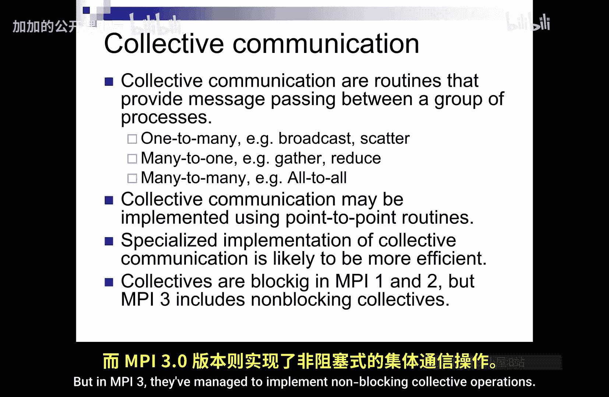

---

## 概述 📋

上一节我们介绍了MPI的点对点通信。本节中，我们来看看MPI的集体通信操作。集体通信允许一组进程之间进行协调的数据交换，这对于许多并行算法至关重要。我们将学习广播、归约、扫描、聚集、散播等操作，并了解如何定义自定义数据类型、创建新的通信器以及利用虚拟拓扑优化进程布局。

---

## 集体通信简介

集体通信是指在一组进程（一个通信器内）之间进行的协调通信例程。与点对点通信不同，集体通信通常涉及通信器中的所有进程。

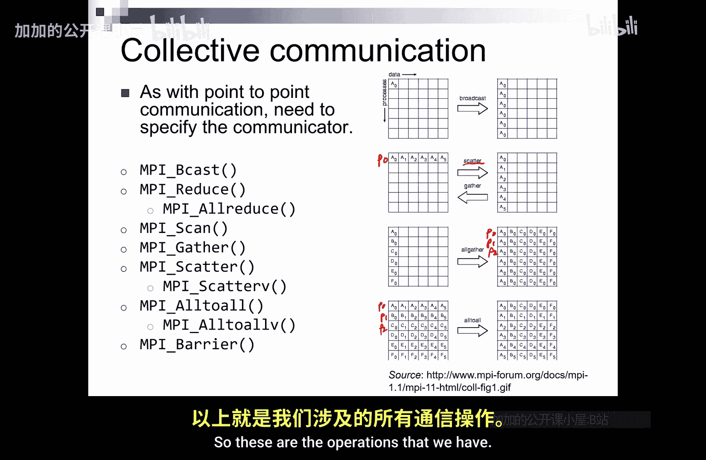

集体通信主要分为三种类型：
*   **一对多**：一个进程与多个其他进程通信。
*   **多对一**：多个进程向一个进程发送数据。
*   **多对多**：所有进程相互通信。

一种简单的实现集体通信的方法是使用多个点对点通信。例如，要实现广播，发送进程可以向其他每个进程单独发送消息。但这效率不高，因为单个进程需要承担所有工作。MPI库提供了更高效的内部实现。

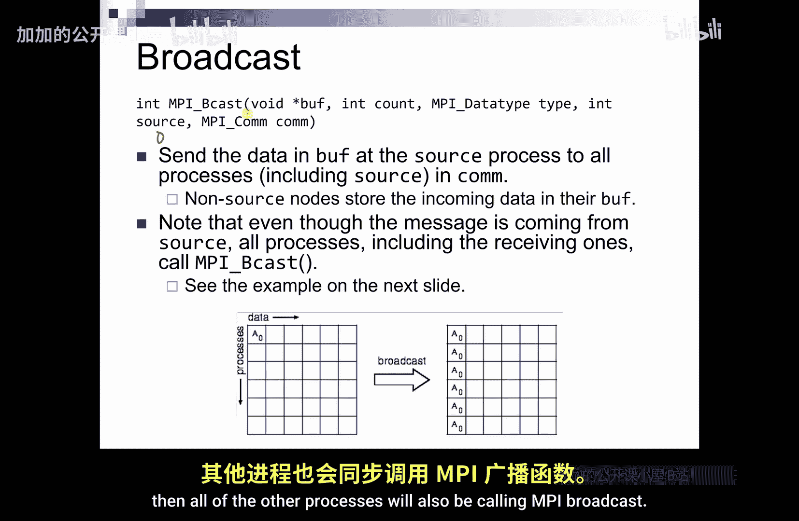

在MPI 1和2中，集体通信操作是**阻塞**的。在MPI 3中，引入了非阻塞的集体通信操作。

---

## 集体通信原语详解

与点对点通信一样，集体通信也需要指定进行通信的进程组（通信器）。

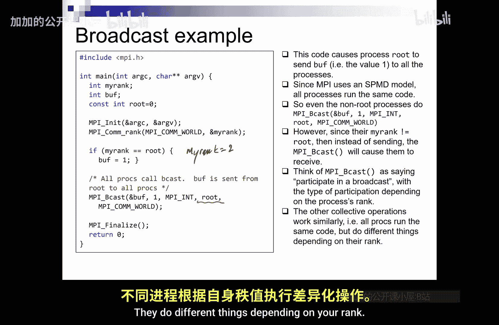

以下是我们将要详细探讨的几种主要集体通信原语，我们可以通过视觉化表示来理解它们。假设有P个进程，用网格的行表示不同进程，列表示来自不同进程的数据。

### 广播

广播操作中，假设一个进程（例如进程0）拥有一份数据。执行广播后，**所有**其他进程都将拥有这份相同的数据。

**MPI_Bcast** 函数原型：
```c
int MPI_Bcast(void *buffer, int count, MPI_Datatype datatype, int root, MPI_Comm comm)
```
*   `buffer`: 包含要广播数据的缓冲区指针。对于根进程，这是发送缓冲区；对于其他进程，这是接收缓冲区。
*   `count`: 缓冲区中数据项的数量。
*   `datatype`: 数据项的类型（如 `MPI_FLOAT`）。
*   `root`: 执行广播的源进程的秩。
*   `comm`: 通信器。

**重要说明**：在SPMD（单程序多数据）编程模型下，所有进程都执行相同的代码。因此，**所有进程**（包括根进程和非根进程）都会调用 `MPI_Bcast`。调用时，进程根据自身的秩与 `root` 参数的关系来决定行为：
*   如果进程秩等于 `root`，则执行发送操作。
*   如果进程秩不等于 `root`，则执行接收操作。

可以将 `MPI_Bcast` 理解为“我将参与一个广播”，具体参与方式（发送或接收）由调用者的秩决定。

**示例**：根进程（秩为0）广播整数值1。
```c
int value = 1;
MPI_Bcast(&value, 1, MPI_INT, 0, MPI_COMM_WORLD);
// 执行后，所有进程的 `value` 变量都变为1。
```

---

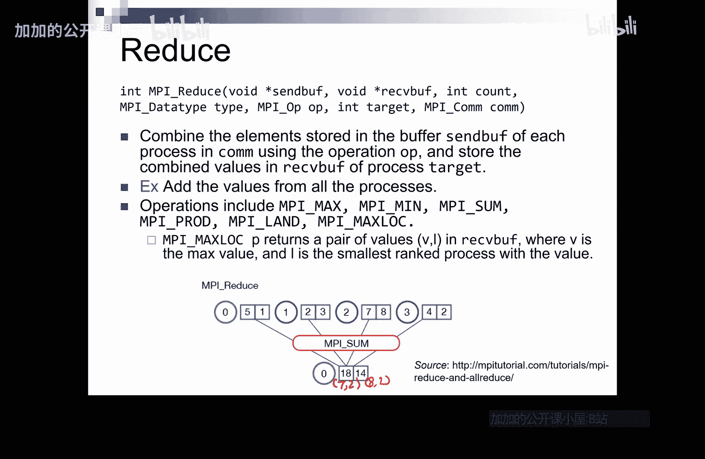

### 归约

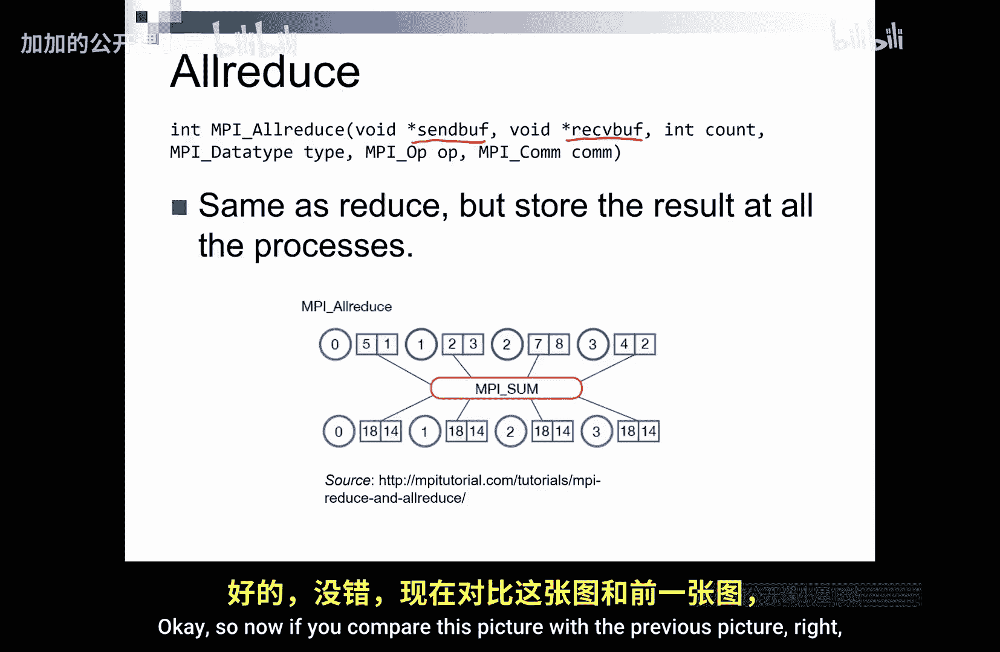

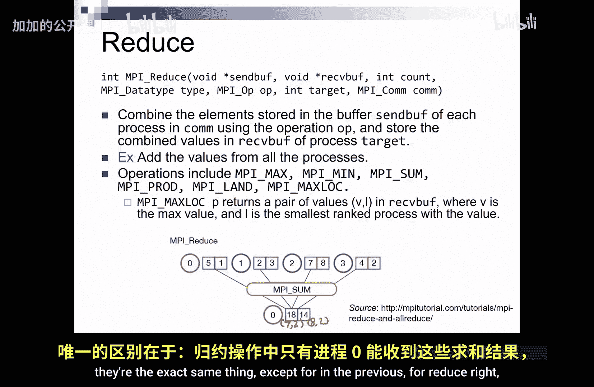

归约操作将来自通信器中所有进程的数据，通过某种运算（如求和、求积、求最大值等）组合起来，并将结果存储在指定的目标进程中。

**MPI_Reduce** 函数原型：
```c
int MPI_Reduce(const void *sendbuf, void *recvbuf, int count, MPI_Datatype datatype, MPI_Op op, int root, MPI_Comm comm)
```
*   `sendbuf`: 每个进程的发送缓冲区地址，包含本地数据。
*   `recvbuf`: 仅**根进程**需要提供的接收缓冲区地址，用于存放归约结果。
*   `count`: 每个进程发送/接收的数据项数量。
*   `datatype`: 数据项类型。
*   `op`: 归约操作（如 `MPI_SUM`, `MPI_PROD`, `MPI_MAX`, `MPI_MIN`, `MPI_MAXLOC` 等）。
*   `root`: 接收结果的根进程的秩。
*   `comm`: 通信器。

与广播类似，所有进程都调用 `MPI_Reduce`。根进程收集并组合数据，其他进程则发送其本地数据。

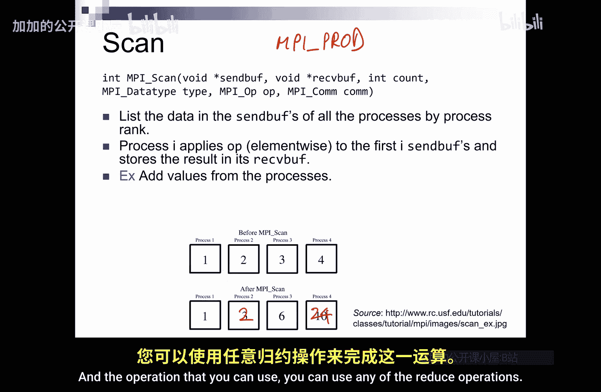

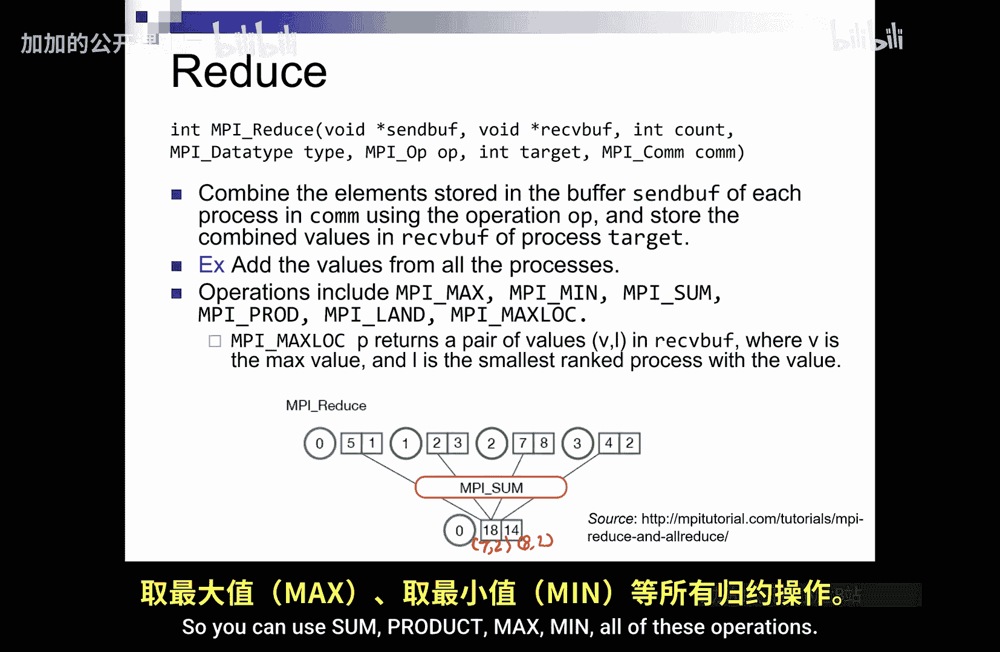

**示例**：假设有4个进程，每个进程有一个包含两个整数的向量。使用 `MPI_SUM` 归约到进程0。
*   进程0数据: `[5, 1]`
*   进程1数据: `[2, 3]`
*   进程2数据: `[7, 8]`
*   进程3数据: `[4, 2]`
执行 `MPI_Reduce(..., MPI_SUM, 0, ...)` 后，进程0的 `recvbuf` 中得到结果 `[5+2+7+4, 1+3+8+2] = [18, 14]`。

**特殊操作 `MPI_MAXLOC`**：此操作返回最大值及其所在进程的秩。对于上述数据，对第一个元素使用 `MPI_MAXLOC`，结果可能是一个结构体 `{max_value=7, rank=2}`。

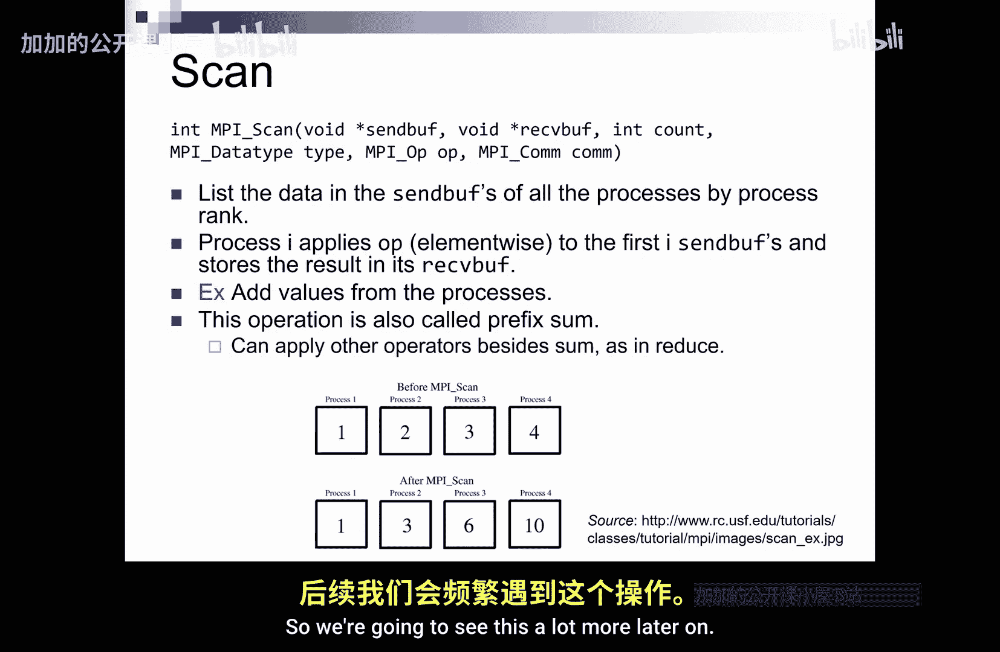

---

### 全归约

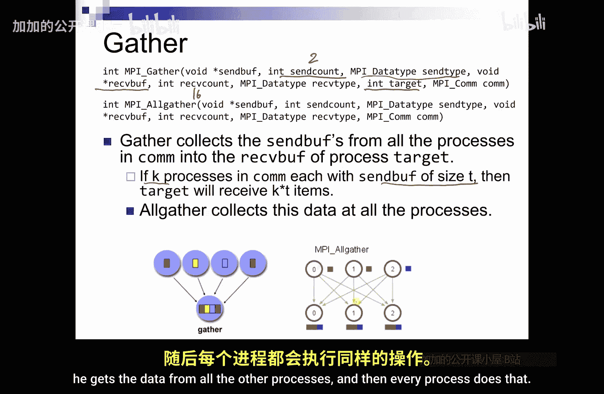

全归约与归约类似，区别在于**所有**进程都会收到归约后的结果，而不仅仅是根进程。因此，函数签名中不需要指定 `root` 参数。

**MPI_Allreduce** 函数原型：
```c
int MPI_Allreduce(const void *sendbuf, void *recvbuf, int count, MPI_Datatype datatype, MPI_Op op, MPI_Comm comm)
```
*   `recvbuf`: **所有**进程都需要提供的接收缓冲区。

---

### 扫描（前缀操作）

扫描操作（或称前缀操作）对进程秩顺序排列的数据进行累积操作。每个进程得到的是从秩0进程到自身秩的所有数据的累积结果。

**MPI_Scan** 函数原型：
```c
int MPI_Scan(const void *sendbuf, void *recvbuf, int count, MPI_Datatype datatype, MPI_Op op, MPI_Comm comm)
```
*   `sendbuf`: 每个进程的本地数据。
*   `recvbuf`: 每个进程的接收缓冲区，存放前缀结果。
*   `op`: 操作（如 `MPI_SUM`, `MPI_PROD` 等）。

**示例**：4个进程的数据分别为 `[1, 2, 3, 4]`。
*   使用 `MPI_SUM` 扫描：
    *   进程0结果: `1`
    *   进程1结果: `1+2 = 3`
    *   进程2结果: `1+2+3 = 6`
    *   进程3结果: `1+2+3+4 = 10`
*   使用 `MPI_PROD` 扫描：
    *   进程0结果: `1`
    *   进程1结果: `1*2 = 2`
    *   进程2结果: `1*2*3 = 6`
    *   进程3结果: `1*2*3*4 = 24`

当操作为 `MPI_SUM` 时，此操作常被称为**前缀和**。前缀和在并行计算中应用非常广泛。

---

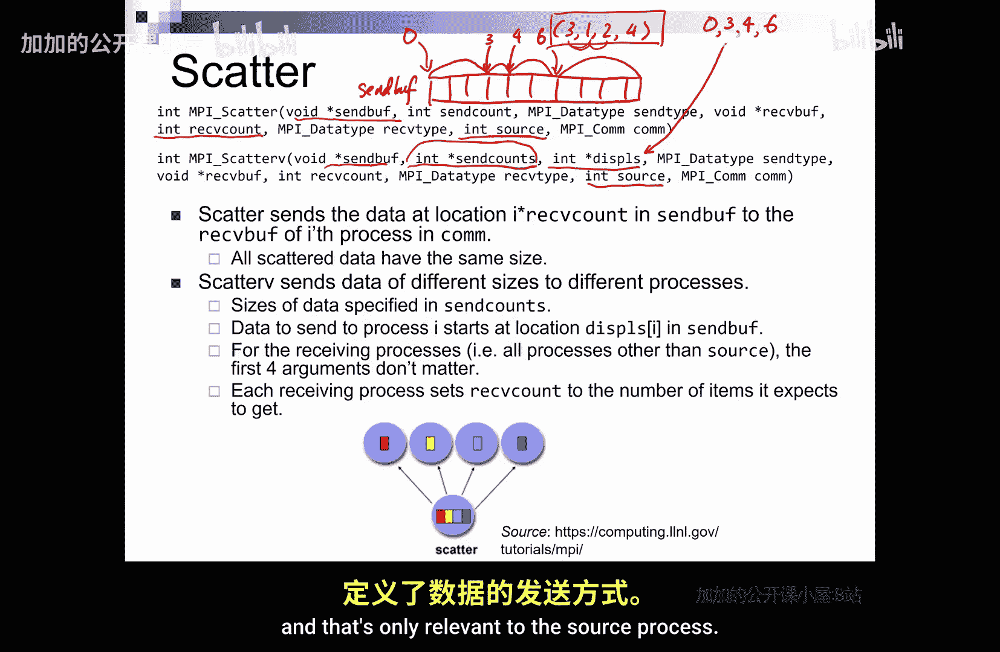

### 聚集

聚集操作是散播的逆操作。每个进程拥有自己的数据，这些数据被收集到指定的目标进程中。

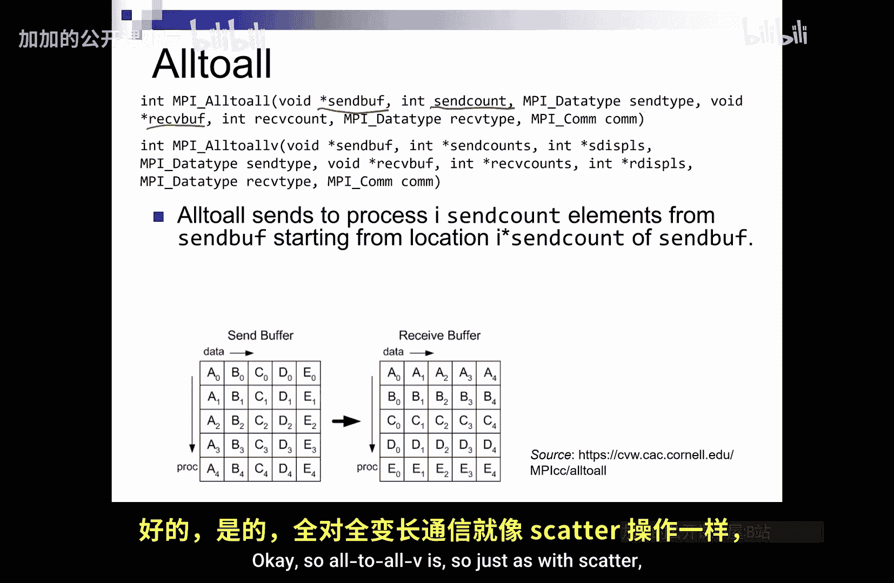

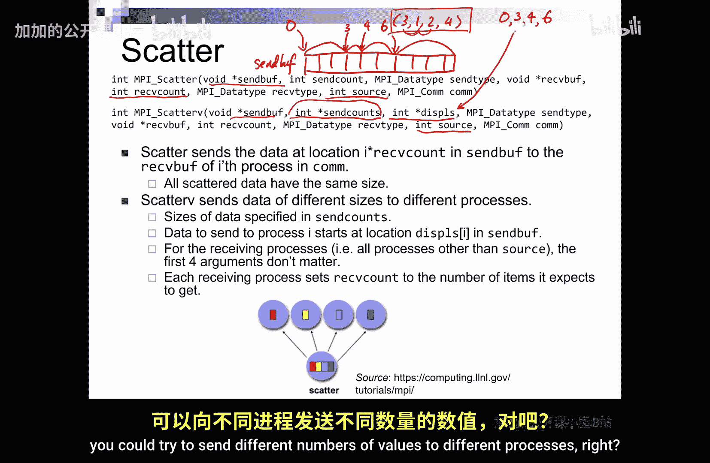

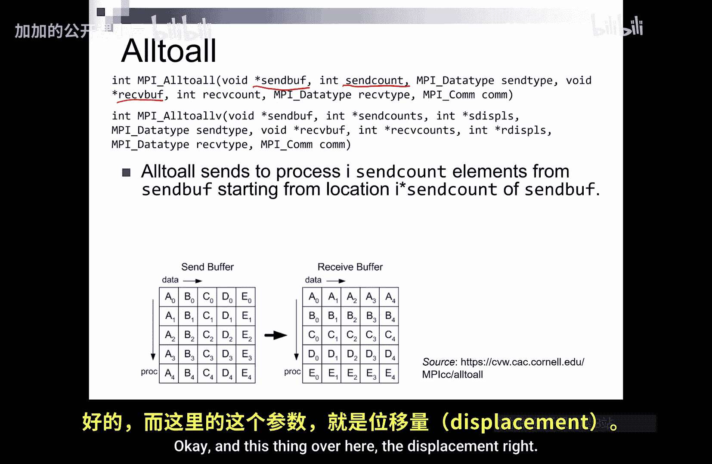

**MPI_Gather** 函数原型：
```c
int MPI_Gather(const void *sendbuf, int sendcount, MPI_Datatype sendtype, void *recvbuf, int recvcount, MPI_Datatype recvtype, int root, MPI_Comm comm)
```
*   `sendbuf`: 每个进程的发送缓冲区。
*   `sendcount`: 每个进程发送的数据项数量。
*   `recvbuf`: 仅**根进程**需要提供的接收缓冲区。如果通信器有 `k` 个进程，每个进程发送 `sendcount` 个数据，则根进程的接收缓冲区必须能容纳 `k * sendcount` 个数据项。
*   `recvcount`: 根进程期望从**每个进程**接收的数据项数量（通常等于 `sendcount`）。
*   `root`: 目标进程的秩。


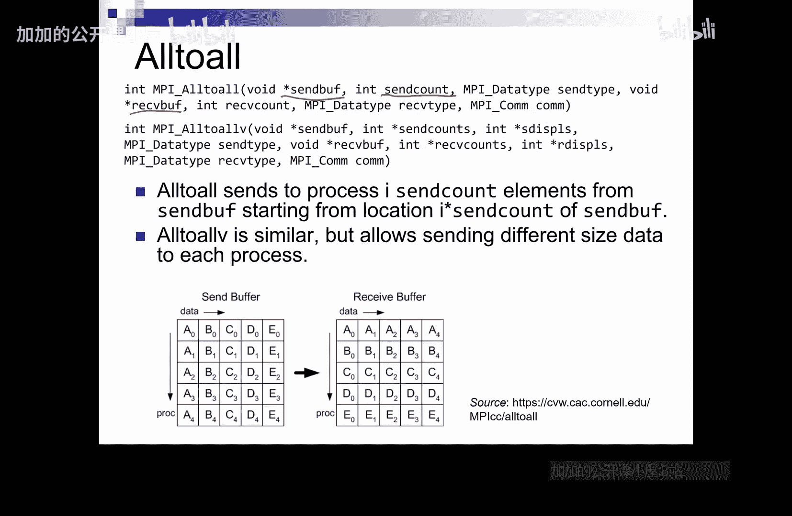

所有进程调用 `MPI_Gather`。根进程收集数据，其他进程发送数据。

---

### 全聚集

全聚集操作意味着**每个**进程都执行一次聚集操作。因此，每个进程最终都会拥有来自所有进程的数据。

**MPI_Allgather** 函数原型：
```c
int MPI_Allgather(const void *sendbuf, int sendcount, MPI_Datatype sendtype, void *recvbuf, int recvcount, MPI_Datatype recvtype, MPI_Comm comm)
```
*   `recvbuf`: **所有**进程都需要提供的接收缓冲区，大小需能容纳来自所有进程的数据。

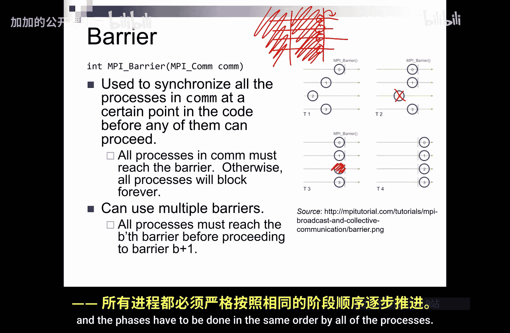

---

### 散播

散播操作与广播类似，但源进程向其他每个进程发送的是**不同**的数据块。

**MPI_Scatter** 函数原型：
```c
int MPI_Scatter(const void *sendbuf, int sendcount, MPI_Datatype sendtype, void *recvbuf, int recvcount, MPI_Datatype recvtype, int root, MPI_Comm comm)
```
*   `sendbuf`: 仅**根进程**需要提供的发送缓冲区。假设有 `k` 个进程，每个进程接收 `recvcount` 个数据，则根进程的发送缓冲区需包含 `k * recvcount` 个数据项。数据按进程秩顺序分块。
*   `sendcount`: 根进程发送给**每个进程**的数据项数量（通常等于 `recvcount`）。
*   `recvbuf`: 所有进程的接收缓冲区。
*   `root`: 源进程的秩。

---

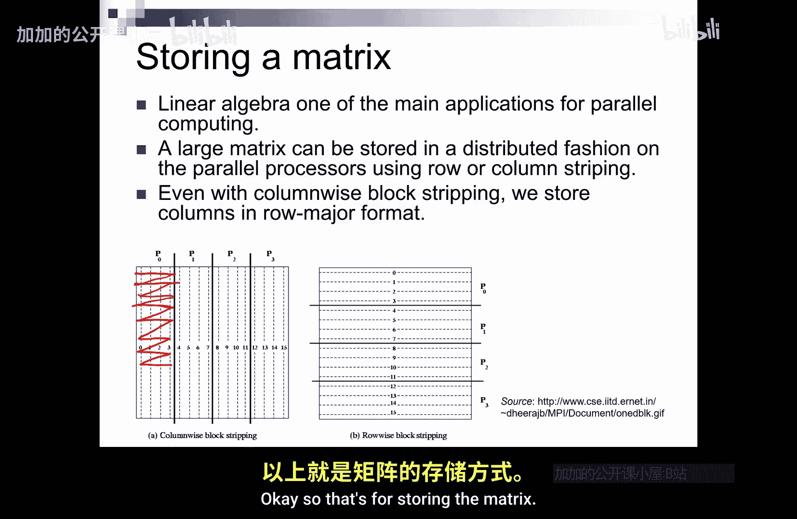

### 向量散播

标准散播要求发送给每个进程的数据量相同。`MPI_Scatterv` 允许向不同进程发送不同数量的数据。

**MPI_Scatterv** 函数原型：
```c
int MPI_Scatterv(const void *sendbuf, const int sendcounts[], const int displs[], MPI_Datatype sendtype, void *recvbuf, int recvcount, MPI_Datatype recvtype, int root, MPI_Comm comm)
```
*   `sendcounts[]`: 一个数组，指定发送给每个进程的数据项数量。
*   `displs[]`: 一个数组，指定发送缓冲区中，发给每个进程的数据的起始偏移量（以 `sendtype` 的项数为单位）。

`displs` 数组通常通过计算 `sendcounts` 的**前缀和**来获得（第一个位移为0）。这是一个前缀和的简单应用。

对于接收进程，`sendcounts` 和 `displs` 参数仅对根进程有意义；其他进程可以忽略它们。

---

### 全到全

在全到全操作中，每个进程都向所有其他进程发送数据，同时也从所有其他进程接收数据。可以理解为每个进程都执行了一次散播。

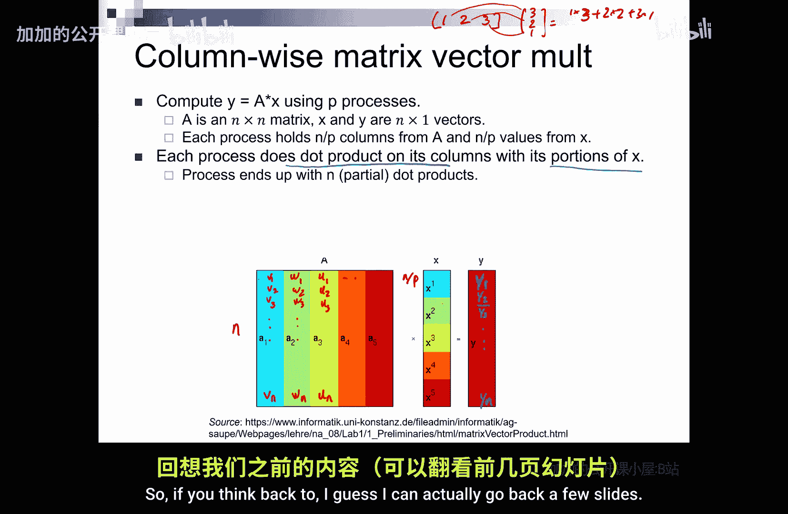

**MPI_Alltoall** 函数原型：
```c
int MPI_Alltoall(const void *sendbuf, int sendcount, MPI_Datatype sendtype, void *recvbuf, int recvcount, MPI_Datatype recvtype, MPI_Comm comm)
```
*   `sendbuf`: 发送缓冲区，包含要发送给所有进程的数据，按目标进程秩排列。
*   `sendcount`: 发送给**每个**其他进程的数据项数量。
*   `recvbuf`: 接收缓冲区，将从所有进程接收数据，按源进程秩排列。
*   `recvcount`: 从**每个**其他进程接收的数据项数量。

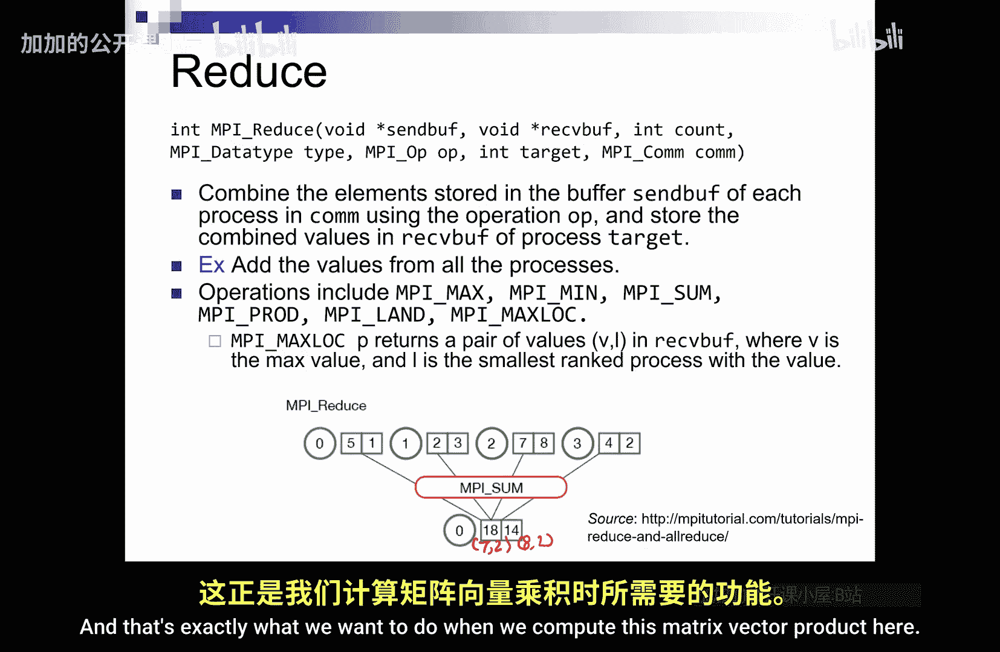

---

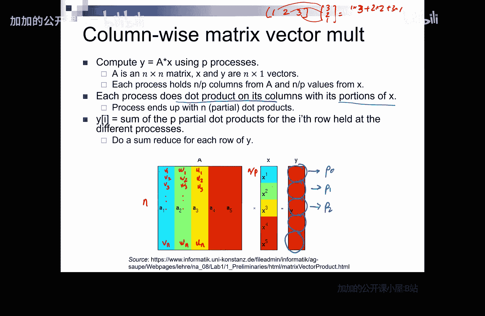

### 向量全到全

`MPI_Alltoallv` 是 `MPI_Alltoall` 的变体，允许每个进程向其他进程发送不同数量的数据，也从其他进程接收不同数量的数据。它需要更复杂的参数来指定发送/接收计数和位移。

---

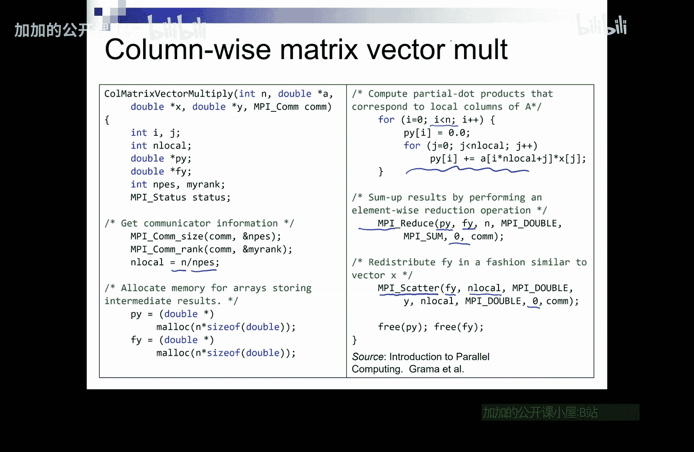

### 屏障

屏障操作用于同步一个通信器中的所有进程。调用 `MPI_Barrier` 的进程将在此处阻塞，直到通信器内的**所有**进程都调用了该函数，然后它们才能继续执行后续代码。

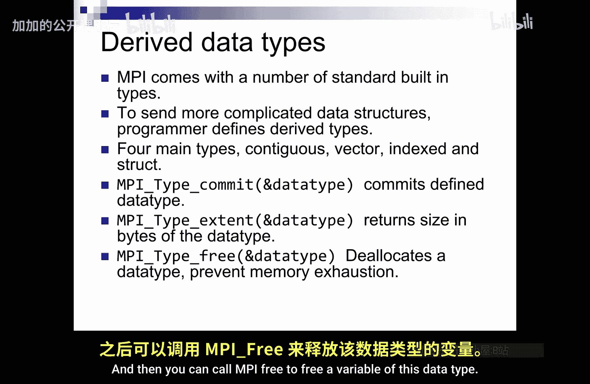

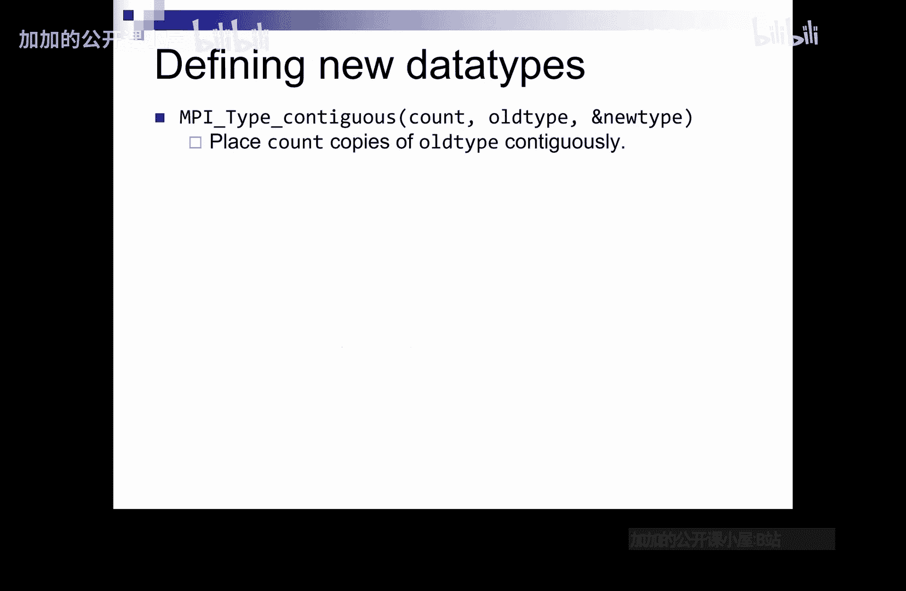

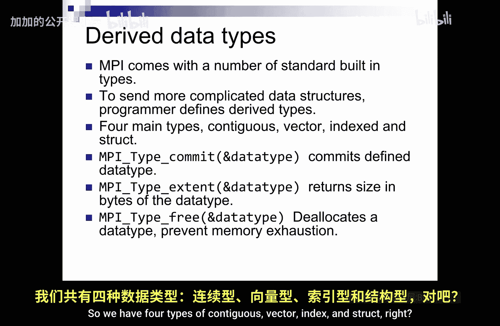

**MPI_Barrier** 函数原型：
```c
int MPI_Barrier(MPI_Comm comm)
```
使用屏障可以将程序执行划分为多个阶段，确保所有进程完成一个阶段后，才同时进入下一个阶段。

**注意**：必须确保所有进程最终都能到达屏障，否则程序将永远等待。

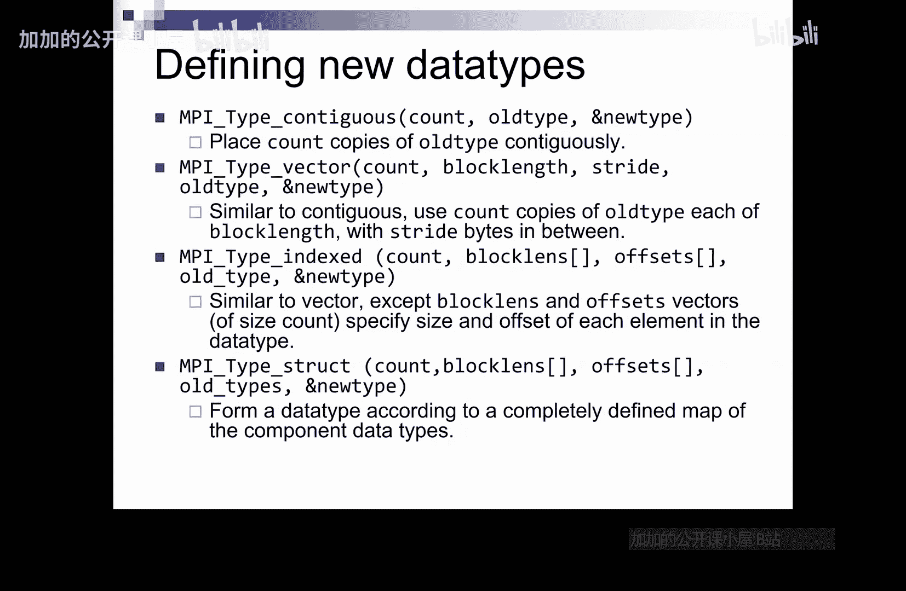

---

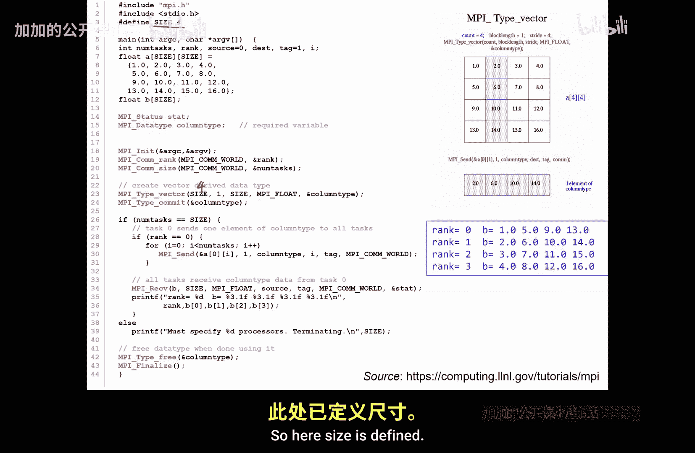

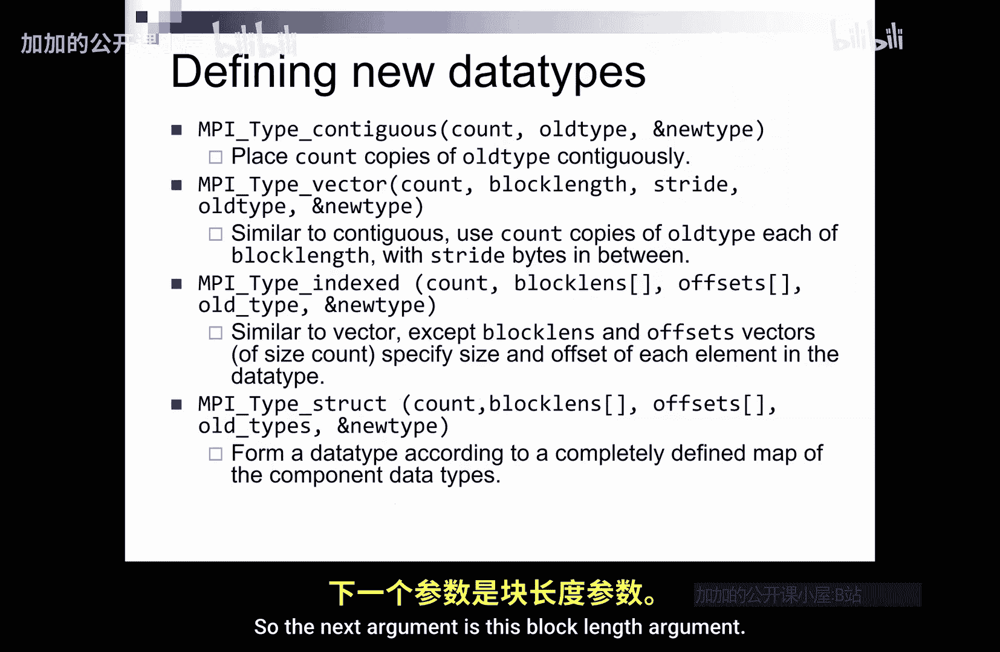

## 应用实例：矩阵向量乘法

现在，我们来看如何利用集体通信操作解决一个实际问题：矩阵向量乘法 `y = A * x`。我们假设矩阵 `A` 按列分块存储在不同进程中，向量 `x` 也相应地被分块。

**算法步骤**：
1.  **局部计算**：每个进程计算自己拥有的矩阵列块与本地向量 `x` 分量的点积，得到部分结果向量（长度为矩阵行数 `n`）。
2.  **全局归约**：所有进程通过 `MPI_Reduce`（使用 `MPI_SUM` 操作）将它们计算出的部分结果向量相加。结果被收集到根进程（例如进程0），形成完整的向量 `y`。
3.  **结果散播**：根进程使用 `MPI_Scatter` 将完整的向量 `y` 分发给所有进程，使每个进程获得最终结果中属于自己的那一部分。

**代码框架**：
```c
// 假设每个进程拥有：局部矩阵 A_local[n][n_local]，局部向量 x_local[n_local]
// 目标：计算 y_local[n_local]

double partial_y[n]; // 存储局部点积结果
double y[n]; // 仅根进程需要，用于存储完整的y
double y_local[n_local]; // 每个进程的最终结果部分

// 1. 局部计算：对每一行i，计算 A_local[i][:] 与 x_local 的点积
for (int i = 0; i < n; i++) {
    partial_y[i] = 0.0;
    for (int j = 0; j < n_local; j++) {
        partial_y[i] += A_local[i][j] * x_local[j];
    }
}

// 2. 全局归约：将所有进程的 partial_y 求和到根进程的 y 中
MPI_Reduce(partial_y, y, n, MPI_DOUBLE, MPI_SUM, 0, MPI_COMM_WORLD);

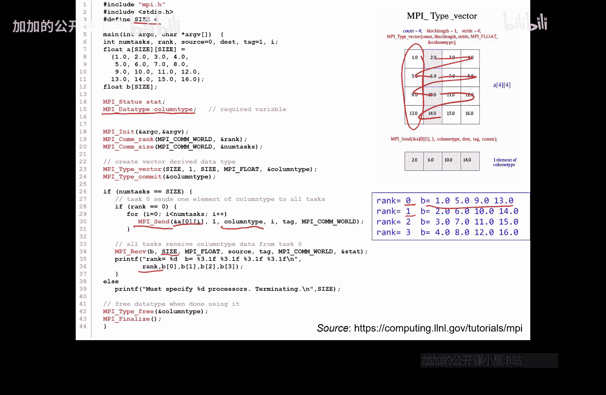

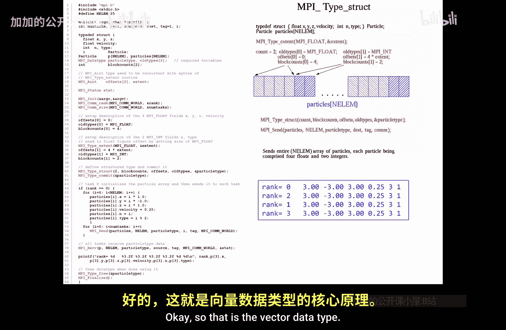

// 3. 结果散播：根进程将 y 散播到所有进程的 y_local 中
MPI_Scatter(y, n_local, MPI_DOUBLE, y_local, n_local, MPI_DOUBLE, 0, MPI_COMM_WORLD);
```


---

## 高级MPI特性

### 派生数据类型

MPI允许用户定义自己的数据类型，以便于发送结构体或非连续内存数据。定义后需使用 `MPI_Type_commit` 提交。

主要派生数据类型构造函数：
1.  **MPI_Type_contiguous**: 定义连续存放的多个相同类型数据。
    ```c
    MPI_Datatype float4;
    MPI_Type_contiguous(4, MPI_FLOAT, &float4);
    MPI_Type_commit(&float4);
    ```
2.  **MPI_Type_vector**: 定义具有固定步长的向量（如矩阵的一列）。
    ```c
    // 从4x4矩阵（行主序）中取一列（4个元素，步长为4）
    MPI_Datatype column_type;
    MPI_Type_vector(4, 1, 4, MPI_FLOAT, &column_type); // count=4, blocklength=1, stride=4
    MPI_Type_commit(&column_type);
    ```
3.  **MPI_Type_indexed**: 允许指定不同的位移来选取数据块。
4.  **MPI_Type_struct**: 定义结构体，包含不同类型的成员。
    ```c
    typedef struct {
        float pos[4];
        int id[2];
    } Particle;

    // 创建 Particle 类型
    MPI_Datatype particle_type;
    int blocklengths[2] = {4, 2};
    MPI_Aint displacements[2];
    MPI_Datatype types[2] = {MPI_FLOAT, MPI_INT};

    // 计算位移
    displacements[0] = offsetof(Particle, pos);
    displacements[1] = offsetof(Particle, id);

    MPI_Type_create_struct(2, blocklengths, displacements, types, &particle_type);
    MPI_Type_commit(&particle_type);
    ```

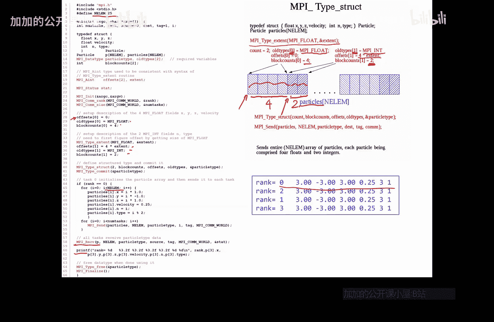

使用完派生数据类型后，应使用 `MPI_Type_free` 释放。

---

### 通信器管理

除了默认的 `MPI_COMM_WORLD`，MPI允许创建新的通信器，将进程分组。

**示例：分割通信器**
```c
MPI_Comm new_comm;
int color = my_rank / 4; // 将8个进程分为两组 (0-3) 和 (4-7)
MPI_Comm_split(MPI_COMM_WORLD, color, my_rank, &new_comm);

int new_rank;
MPI_Comm_rank(new_comm, &new_rank);
// 现在，进程可以在新的、更小的通信器内进行集体通信
```

---

### 虚拟拓扑

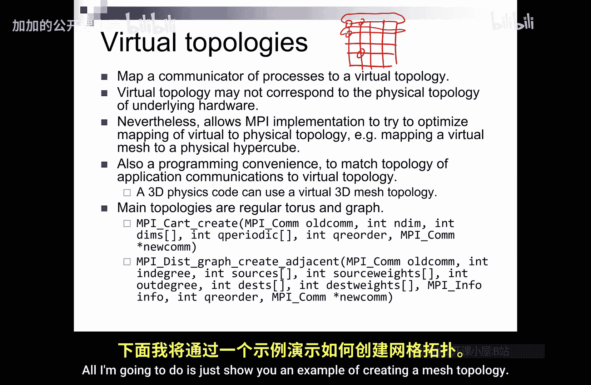

虚拟拓扑允许用户为进程定义逻辑布局（如网格、环面、图），以匹配算法的通信模式。这有助于MPI运行时将进程映射到物理处理器拓扑上，优化通信性能。

**示例：创建二维笛卡尔网格拓扑**
```c
int dims[2] = {4, 4}; // 4x4网格
int periods[2] = {0, 0}; // 非周期性（非环面）
MPI_Comm cart_comm;
MPI_Cart_create(MPI_COMM_WORLD, 2, dims, periods, 1, &cart_comm);

int coords[2];
MPI_Cart_coords(cart_comm, my_rank, 2, coords); // 获取本进程在网格中的坐标

// 查找邻居进程
int up, down, left, right;
MPI_Cart_shift(cart_comm, 0, 1, &up, &down);   // 维度0（Y方向）的邻居
MPI_Cart_shift(cart_comm, 1, 1, &left, &right); // 维度1（X方向）的邻居
```

---

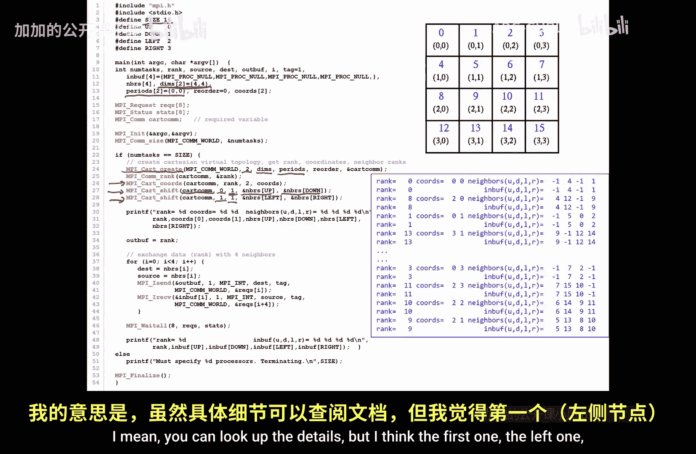

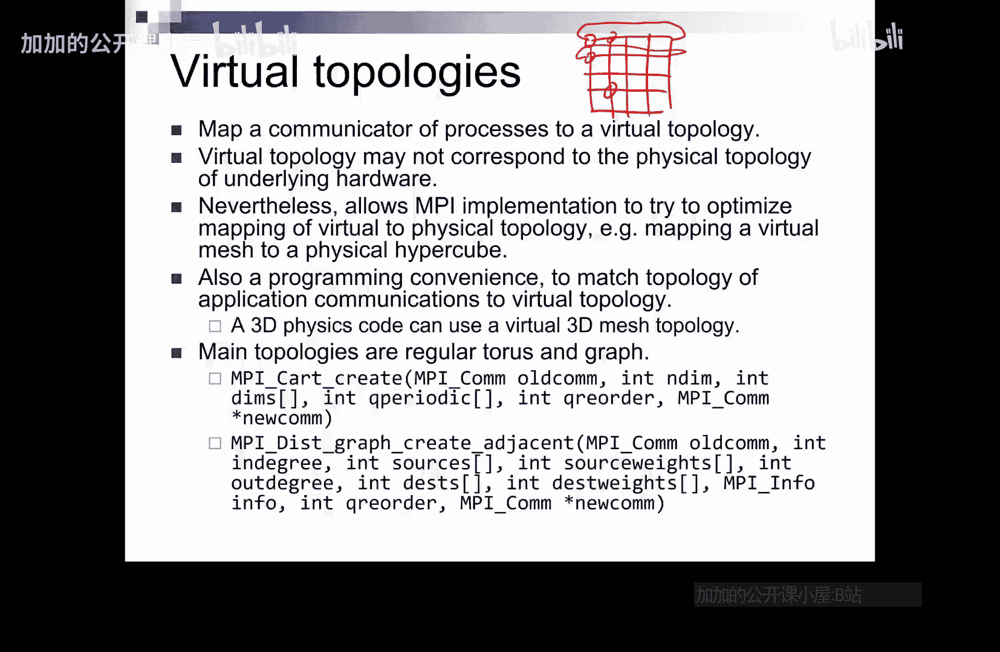

## MPI版本演进

*   **MPI-1**: 提供了核心的点对点和集体通信、派生数据类型、通信器管理等。
*   **MPI-2**: 增加了动态进程创建、跨通信器的集体操作、并行I/O、**单边通信**（RMA - Remote Memory Access）。
*   **MPI-3**: 引入了非阻塞集体操作、改进的单边通信、更好的多线程支持。

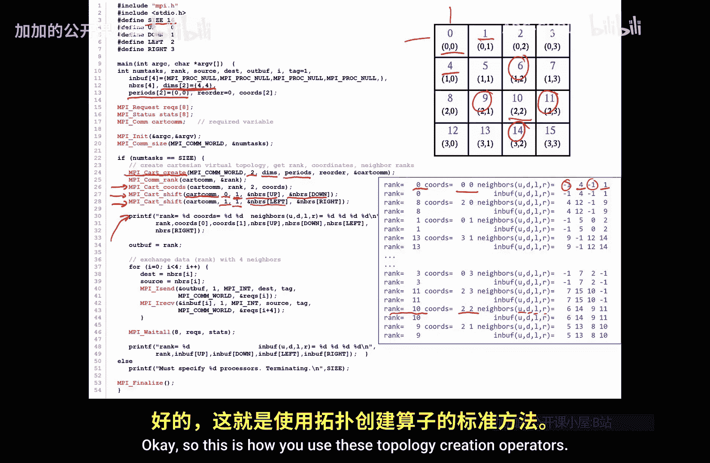

单边通信允许一个进程直接访问另一个进程的内存，而无需目标进程显式调用接收函数，为某些编程模式提供了更大的灵活性。

---

## 总结 🎯

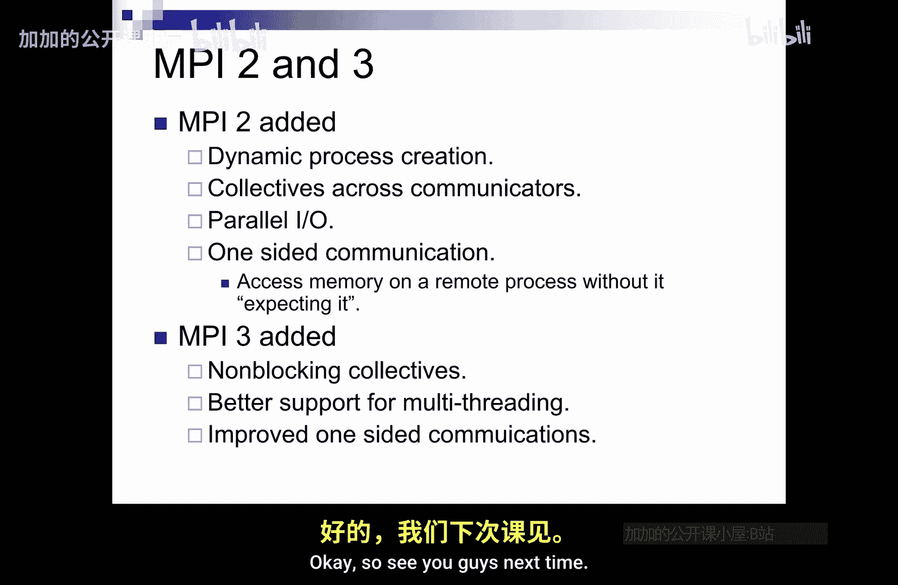

本节课中我们一起学习了MPI集体通信的核心概念和操作，包括广播、归约、扫描、聚集、散播及其变体，以及屏障同步。我们通过矩阵向量乘法的例子，看到了如何将这些操作组合起来解决实际问题。此外，我们还探讨了MPI的一些高级特性，如派生数据类型、通信器分割和虚拟拓扑创建，这些工具能帮助我们编写更高效、更结构化的并行程序。最后，我们简要回顾了MPI标准的演进。下一讲，我们将深入探讨这些集体通信操作在底层是如何高效实现的。