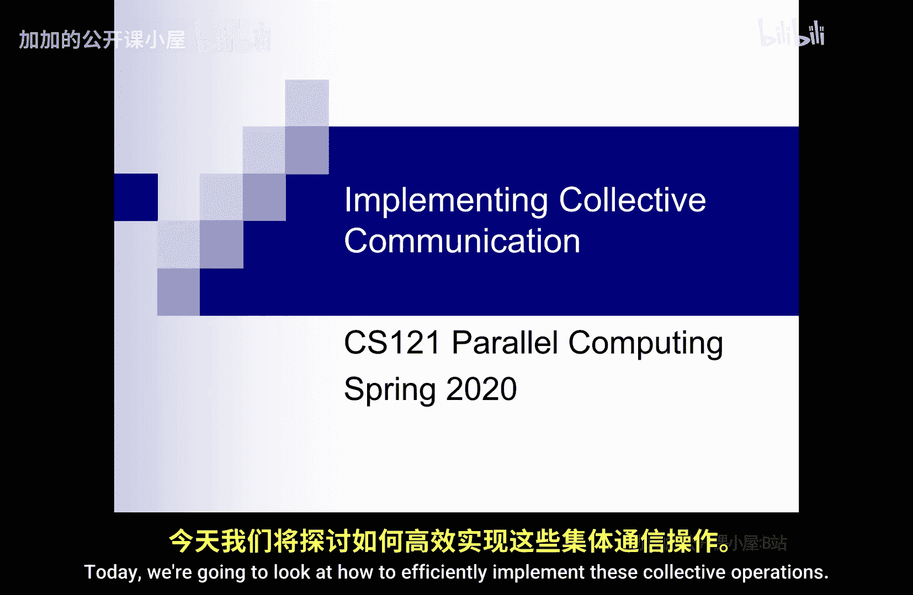
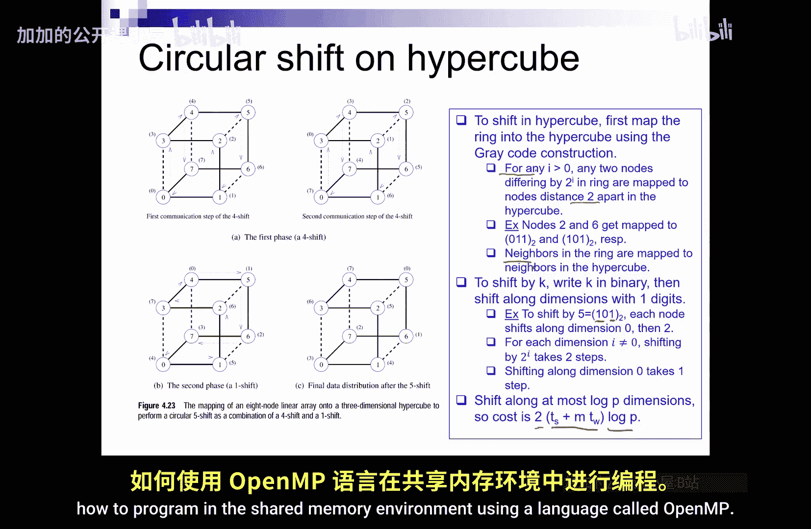

#  007：集体通信操作的实现 🚀

在本节课中，我们将学习如何高效地实现MPI中的集体通信操作。上一讲我们探讨了如何使用这些操作来解决问题，本节我们将深入其背后的并行算法实现。

## 概述 📋

集体通信操作（如广播、规约等）是许多并行算法的核心。虽然可以通过多次点对点通信来实现，但通常存在更高效的并行通信算法。我们将首先定义一个通信成本模型，然后分析在不同网络架构（如环、网格、超立方体）上实现各种集体操作的方法及其时间复杂度。

## 通信成本模型 💰

在讨论算法之前，我们需要定义一个通信成本模型。这个模型基于我们之前关于网络通信的讨论。

发送一个大小为 **M** 的消息，其成本主要由两部分构成：
*   **启动时间**：在发送消息前需要进行的启动操作，时间为 **Ts**。
*   **传输时间**：发送每个字（word）需要时间 **Tw**。发送 **M** 个字的总时间为 **M * Tw**。

因此，发送一个大小为 **M** 的消息的总时间 **T** 可以表示为：
`T = Ts + M * Tw`

在这个模型中，我们忽略了消息传输的距离（即网络跳数带来的延迟），因为该延迟通常远小于 **Ts** 和 **M * Tw**。同时，如果发送过程中存在**争用**（Contention），例如有 **C** 个进程试图同时使用同一条链路发送 **M** 个字，那么所有发送完成的时间将是：
`T = C * (Ts + M * Tw)`

我们将基于这个模型，分析在不同通信架构（如环网、网格、超立方体）上实现集体操作的成本。我们将要分析的操作包括：
*   广播与规约
*   全广播与全规约
*   前缀和
*   散发与收集
*   全散发与全收集
*   循环移位

## 环网上的广播算法 🔄

假设一个包含 **P** 个进程的环，其中一个进程（如进程0）拥有一个值，并希望将其广播给所有其他进程。

一种简单的方法是进程0依次向其他 **P-1** 个进程发送消息，但这是一种串行算法，速度较慢。我们可以采用并行算法来加速。

以下是并行广播算法的步骤：
1.  **第一步**：进程0将消息发送给环上距离为 **P/2** 的进程（即环的另一半）。例如，在8个进程的环中，进程0发送给进程4。
2.  **第二步**：现在进程0和进程4都拥有消息。它们同时将消息发送给距离为 **P/4** 的进程。进程0发送给进程2，进程4发送给进程6。
3.  **第三步**：现在进程0、2、4、6都拥有消息。它们同时将消息发送给距离为1的邻居进程。最终，所有8个进程都获得了消息。

这个算法通过让获得消息的进程“帮助”源进程进行广播，实现了并行化。

## 环网上的规约算法 ➕

规约操作是广播的逆过程。假设环上每个进程都有一个值，我们希望将所有值求和（规约）到进程0。

由于规约是广播的逆操作，我们可以简单地反转广播算法中的所有通信步骤来实现规约：
1.  **第一步（对应广播的最后一步）**：进程7发送给进程6，进程5发送给进程4，进程3发送给进程2，进程1发送给进程0。接收方将接收到的值加到自己的值上。
2.  **第二步**：进程6发送其当前和（6+7）给进程4，进程2发送其当前和（2+3）给进程0。接收方再次进行加法。
3.  **第三步**：进程4发送其当前和（4+5+6+7）给进程0。进程0将其加到自己的和（0+1+2+3）上，最终得到所有8个值的总和。

## 时间复杂度分析 ⏱️

对于环网上的广播和规约算法：
*   **步骤数**：在广播算法中，每一步拥有消息的进程数翻倍。因此，经过 **log₂(P)** 步后，所有 **P** 个进程都获得了消息。规约算法步数相同。
*   **每步成本**：每一步，进程发送一个大小为 **M** 的消息，成本为 `Ts + M * Tw`。
*   **总成本**：总时间 `T` 为：
    `T = (Ts + M * Tw) * log₂(P)`

## 网格上的广播算法 #️⃣

一个二维网格可以看作是环的推广。在 **√P × √P** 的网格上实现广播，可以分两个阶段进行：
1.  **行广播**：首先，源进程（假设为(0,0)）在其所在行进行广播。这相当于在一个大小为 **√P** 的环上进行广播，需要 **log₂(√P)** 步。
2.  **列广播**：完成行广播后，该行所有进程都拥有了消息。然后，这些进程同时在各自的列上进行广播。这同样需要 **log₂(√P)** 步。

总步数为 `2 * log₂(√P) = log₂(P)`。每步发送大小为 **M** 的消息，因此总时间与环网广播相同：
`T = (Ts + M * Tw) * log₂(P)`

## 超立方体上的广播算法 🧊

在超立方体上，我们可以利用其层次结构进行高效的广播。一个 **P** 个进程的超立方体有 **log₂(P)** 维。

算法按维度递归地进行：
1.  **第一步**：源进程（如000）将消息发送给在最高维上相反的邻居（如100）。这样，问题被分解为在两个低一维的超立方体（前四面体和后四面体）上分别进行广播。
2.  **后续步骤**：在每个低维超立方体内，重复此过程：拥有消息的进程将消息发送给在下一个维度上相反的邻居，进一步分解问题。
3.  经过 **log₂(P)** 步后，所有进程都获得了消息。

每一步发送一个大小为 **M** 的消息，总时间同样为：
`T = (Ts + M * Tw) * log₂(P)`

## 环网上的全广播算法 🌐

全广播是指每个进程都拥有一个值，并希望将自己的值广播给所有其他进程。

一个高效的算法是让每个进程同时将自己的消息沿着环传递：
*   **算法过程**：在第一步，每个进程将自己的值发送给环上的下一个进程。在第二步，每个进程将上一步从上一个进程收到的值（不是自己的值）继续传递给下一个进程。如此重复 **P-1** 步。
*   **无冲突**：由于每个步骤中，所有消息都在不同的链路上传输，因此可以并行执行，没有冲突。
*   **时间复杂度**：总共有 **P-1** 步，每步发送一个大小为 **M** 的消息。总时间为：
    `T = (Ts + M * Tw) * (P - 1)`

## 总结 🎯

本节课我们一起学习了多种集体通信操作在不同网络拓扑上的高效实现算法：
*   我们首先建立了通信成本模型 `T = Ts + M * Tw`。
*   在**环网**上，广播和规约算法通过对数步（`log₂(P)`）完成，利用了并行帮助机制。
*   在**网格**和**超立方体**上，广播通过将问题分解为多个低维子问题并行解决，同样达到了对数级时间复杂度。
*   对于**全广播**操作，在环网上可以通过让所有进程同时沿环传递消息，在 **P-1** 步内无冲突地完成。

理解这些基础算法的实现和成本分析，对于设计和优化并行程序至关重要。下一讲我们将进入共享内存编程，学习使用OpenMP语言。