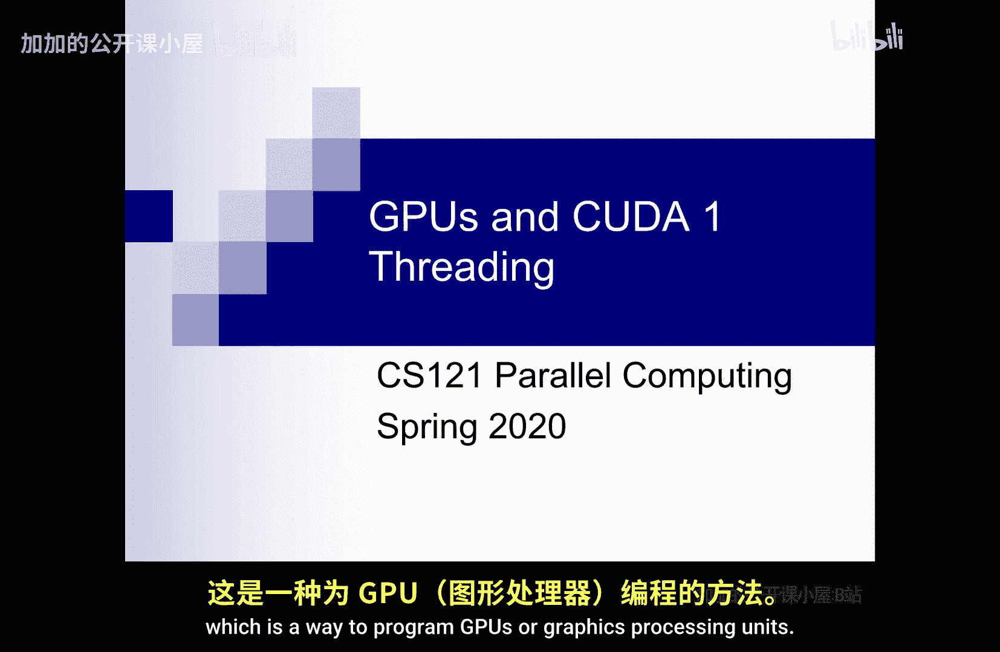
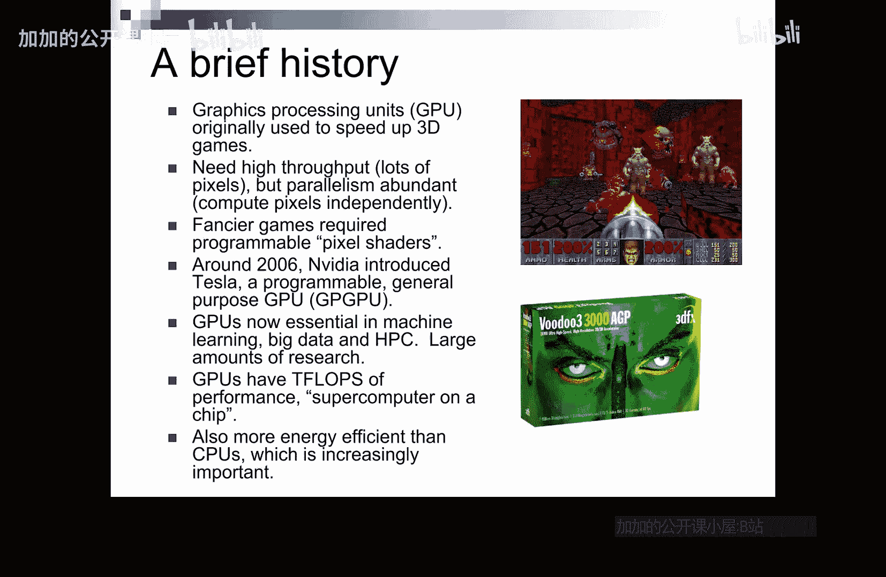
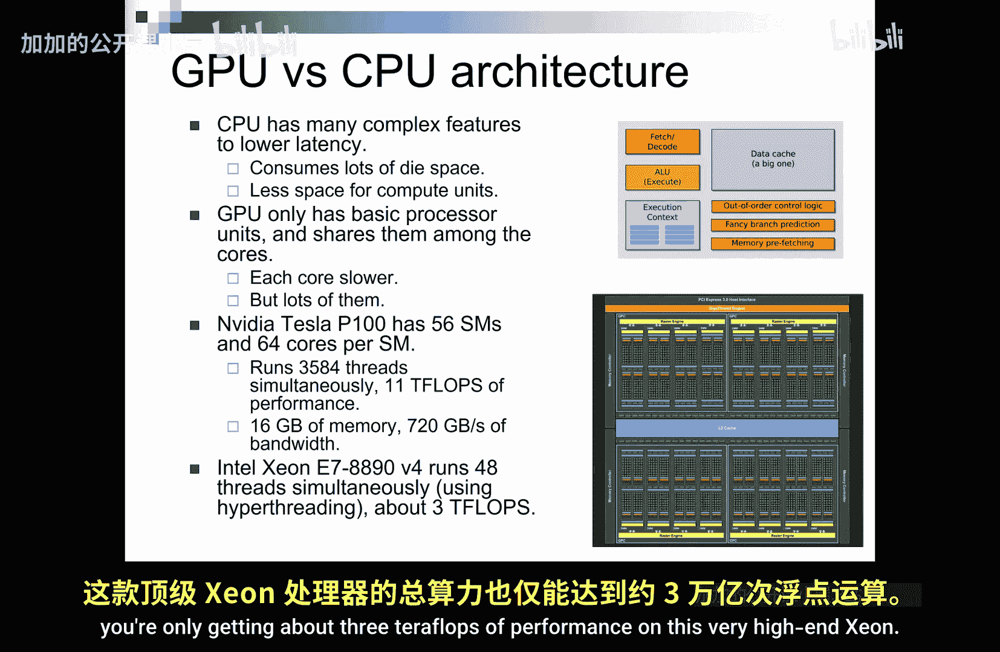
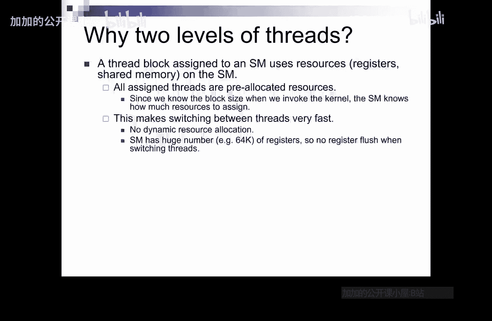
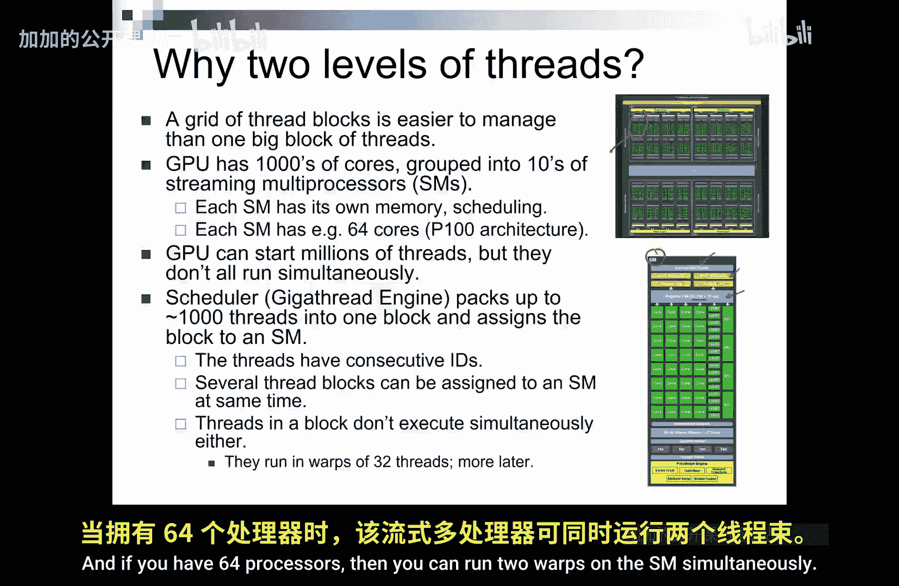
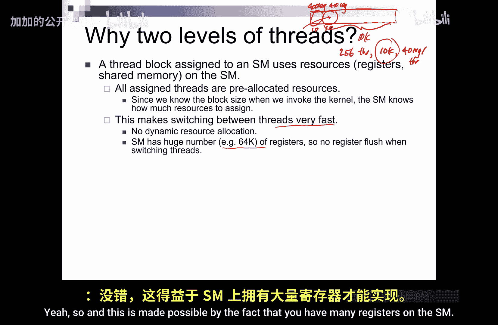
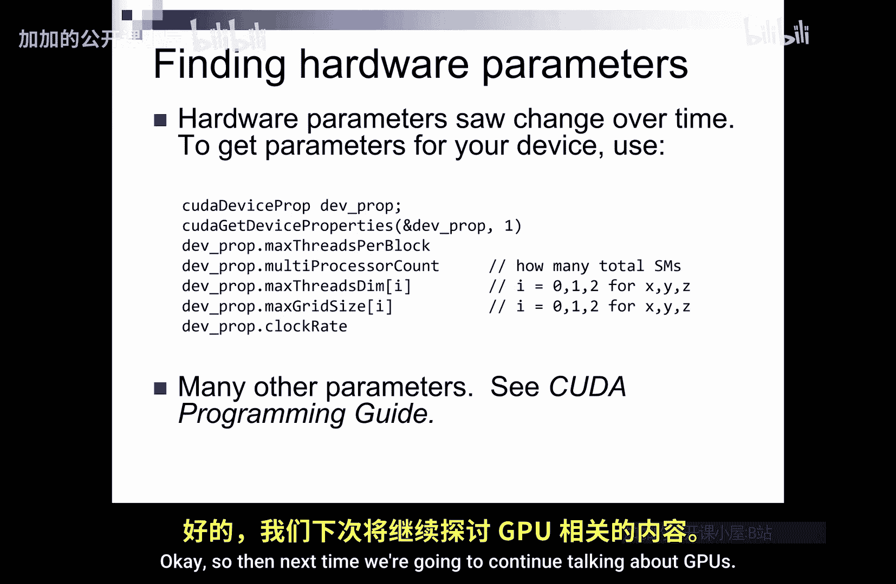

#  011：CUDA线程模型入门 🚀



在本节课中，我们将开始学习CUDA编程语言，这是一种用于对GPU（图形处理单元）进行编程的方法。



## GPU的简要历史

上一节我们介绍了并行计算的基本概念，本节中我们来看看GPU的起源。我们需要回溯大约25年到20世纪90年代中期，那时第一代3D游戏开始出现。当时的计算机速度较慢，无法流畅运行这些游戏，因此人们决定创建专门的硬件来运行它们。这就是图形处理单元作为CPU的协处理器诞生的背景。例如，当时非常流行的Voodoo3显卡，可以让玩家运行像《毁灭战士》这样的游戏。尽管如今《毁灭战士》仍在推出新版本，但在当时，其图形效果被认为是革命性的。



## GPU的设计哲学与特点

GPU的设计哲学与CPU有根本不同。CPU旨在最小化每个计算任务的延迟，力求让每个计算都快速完成。而GPU则旨在最大化吞吐量，即单位时间内能完成的工作总量，它不关心单个任务需要多长时间。

以下是CPU与GPU的主要区别：
*   **CPU**：采用多核处理器，核心数量较少（通常几十个），但每个核心架构复杂，包含分支预测、乱序执行、大容量缓存等特性以加速单个任务。
*   **GPU**：采用面向吞吐量的处理器，拥有数千个核心。每个GPU核心比CPU核心简单得多，专注于计算，去除了许多复杂的CPU特性，因此体积更小，能在相同芯片面积上集成更多核心。

例如，基于Pascal架构的Tesla P100 GPU拥有56个流式多处理器，每个包含64个核心，总计3584个核心，可提供11万亿次浮点运算的性能。相比之下，高端CPU如Intel Xeon拥有24个核心，总性能约为3万亿次浮点运算。

## GPU的适用场景与限制

由于GPU拥有远超CPU的原始计算性能和更高的能效，它们被广泛应用于许多领域。然而，GPU并非万能，它们主要针对特定类型的工作负载进行了优化。

GPU最适合**数据并行**任务。数据并行的核心思想是：对多个数据项应用相同的操作。其架构基于**单指令多数据**模型，即许多核心同时执行相同的指令，但操作不同的数据。

以下是数据并行任务的例子：
*   **向量加法**：对两个向量的每个对应分量执行加法。
*   **线性代数运算**：如矩阵向量乘法，其计算模式与向量加法类似。
*   **计算机图形学**：渲染图像时，对每个像素执行基本相同的处理过程。
*   **深度学习**：大量运算可归结为密集的线性代数运算。

GPU在处理需要大量线程间同步或不规则工作负载（即线程执行不同指令）的任务时效率较低，甚至可能无法运行。

## CUDA编程简介

CUDA是NVIDIA推出的、用于对其GPU进行通用计算的编程模型和平台，现已成为GPU编程的事实标准。CUDA基于C语言，通过添加扩展来实现。

除了CUDA，还有其他GPU编程方式：
*   **OpenCL**：开放标准，语法和概念与CUDA相似，更具可移植性（支持AMD GPU、CPU等），但性能通常略低于CUDA。
*   **OpenACC**：基于指令的编程模型，类似于OpenMP，易于使用但性能通常不及CUDA。

编写和运行CUDA程序的基本步骤如下：
1.  **主机初始化**：程序在CPU（称为**主机**）上开始执行，进行初始化和串行计算。
2.  **设备内存分配**：在GPU（称为**设备**）上分配内存。
3.  **数据传输**：将需要计算的数据从主机内存复制到设备内存。
4.  **内核启动**：指定线程配置，调用在GPU上执行的函数（称为**内核**）。
5.  **结果回传**：将计算结果从设备内存复制回主机内存。
6.  **资源释放**：释放设备上分配的内存。

主机和设备之间通过`cudaMemcpy`函数进行数据传输，并使用`cudaMalloc`在设备上分配内存。

## CUDA线程组织与内核

在CUDA中，线程被组织成一个两层结构：
1.  **网格**：由多个**线程块**组成。
2.  **线程块**：包含多个**线程**。

启动内核时，需要指定网格维度（即线程块的数量）和线程块维度（即每个线程块中的线程数）。线程可以通过内置变量唯一标识自己：
*   `blockIdx`：线程所在块的索引。
*   `threadIdx`：线程在其块内的索引。
*   `blockDim`：线程块的维度（即每个块有多少线程）。
*   `gridDim`：网格的维度（即有多少个线程块）。

以下是一个向量加法的CUDA内核示例：
```c
__global__ void vectorAdd(float *A, float *B, float *C, int n) {
    // 计算当前线程对应的全局索引
    int i = blockIdx.x * blockDim.x + threadIdx.x;
    // 确保索引在数组范围内
    if (i < n) {
        C[i] = A[i] + B[i]; // 每个线程计算一个加法
    }
}
```
主机代码调用该内核的示例：
```c
// 假设每个块有256个线程
int threadsPerBlock = 256;
// 计算需要的块数，确保总数至少为n
int blocksPerGrid = (n + threadsPerBlock - 1) / threadsPerBlock;
// 启动内核
vectorAdd<<<blocksPerGrid, threadsPerBlock>>>(d_A, d_B, d_C, n);
```
这种映射方式确保了向量中的每个元素都由一个唯一的线程处理。

## 线程执行模型与GPU硬件

GPU硬件由多个**流式多处理器**组成，每个SM包含多个核心（如32或64个）。虽然可以启动数百万个线程，但GPU上同时活跃的线程数受限于SM的数量和每个SM的资源。





GPU通过两层调度高效管理大量线程：
1.  **GigaThread引擎**：将线程块调度到可用的SM上执行。
2.  **SM warp调度器**：在每个SM内部，线程被进一步分组为**warp**（通常是32个线程）。SM的调度器负责在多个warp之间快速切换。

线程切换开销极低的关键在于**资源预分配**。当一个线程块被调度到SM上时，SM会为其预分配所需的寄存器、共享内存等资源。切换线程时，只需切换指向不同寄存器组的指针，无需将数据保存到慢速内存中，因此几乎没有延迟。




## 同步与块大小选择

在CUDA中，同步能力有限：
*   **线程块间**：无法同步，线程块的执行顺序是不确定的。
*   **线程块内**：可以使用`__syncthreads()`函数进行屏障同步，确保块内所有线程都到达同步点后再继续。

选择线程块大小时，目标是最大化**占用率**，即每个SM上同时活跃的线程数。这受到硬件限制的约束：
*   每个SM的最大线程数（如1536）。
*   每个SM的最大线程块数（如8）。
*   每个线程块的最大线程数（如1024）。
*   寄存器数量限制。

通常，需要平衡考虑。块大小过小可能导致SM无法被完全利用；块大小过大可能受限于每个SM的线程块数量或寄存器资源，并可能因线程间工作负载不均或同步等待而导致效率下降。NVIDIA提供了分析工具来帮助确定代码的最佳占用率和块大小。

## 总结



本节课中我们一起学习了CUDA编程的基础知识。我们从GPU的历史和设计哲学讲起，理解了其面向吞吐量、适合数据并行任务的特点。我们介绍了CUDA作为主流的GPU编程模型，学习了其主机-设备交互模式、线程的两层组织架构（网格和线程块），以及如何编写和启动一个简单的内核。我们还探讨了GPU硬件的执行模型，了解了warp调度和资源预分配如何实现高效的大规模线程管理。最后，我们讨论了CUDA中同步的局限性以及选择合适线程块大小的考虑因素。掌握这些概念是进行高效GPU编程的第一步。