#  012：GPU内存架构与Warp概念

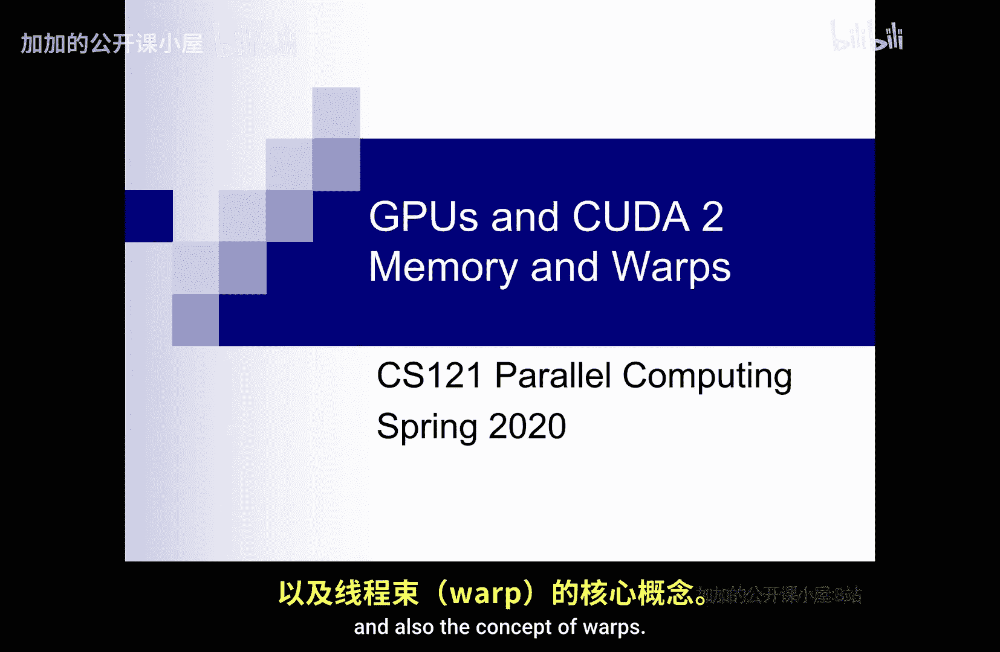

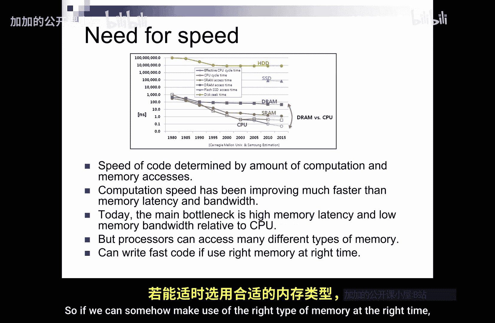

在本节课中，我们将要学习GPU的内存系统以及一个核心概念：Warp。理解内存层次结构对于在GPU上获得高性能至关重要，因为许多程序的瓶颈在于内存访问速度，而非计算能力。

## 内存层次结构

上一节我们介绍了GPU并行计算的基本模型，本节中我们来看看GPU的内存系统。为了应对处理器与内存之间的性能差距，计算机采用了内存层次结构。GPU的内存层次结构包含多个层级，它们具有不同的大小和速度。

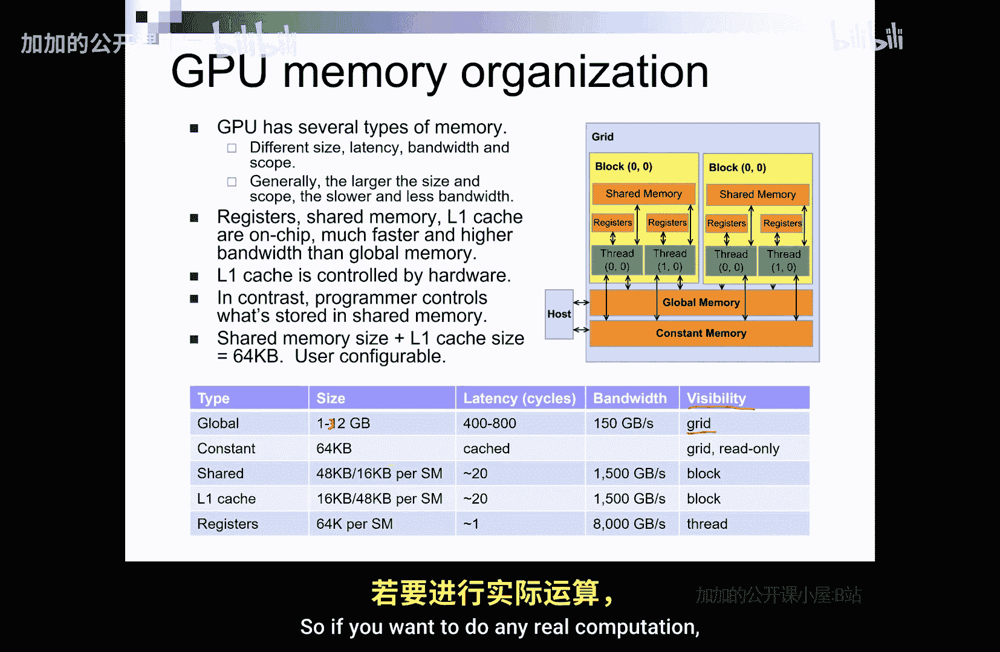

以下是GPU内存层次的主要组成部分：

*   **全局内存**：这是GPU上最大但最慢的内存，容量通常在1到32GB之间。所有线程都可以访问全局内存，但其延迟高达数百个计算周期，带宽也有限。
*   **共享内存/L1缓存**：位于流式多处理器上，速度远快于全局内存。一块约64KB的物理内存可以在运行时被配置为共享内存和L1缓存。共享内存由程序员显式控制，L1缓存则由硬件自动管理。其可见性仅限于单个线程块。
*   **寄存器**：速度最快、带宽最高的内存，位于SM上。每个线程拥有私有的寄存器，其他线程无法访问。寄存器的状态在Warp切换时通过改变指针快速切换，这是实现低开销多线程的关键。

## 全局内存访问优化

由于大部分数据存储在全局内存中，优化其访问是性能提升的关键。全局内存面临两大挑战：高延迟和有限带宽。

### 延迟隐藏

全局内存访问延迟高达数百周期。如果线程在内存操作完成前一直等待，性能将极其低下。GPU采用**大规模多线程**技术来隐藏这种延迟。

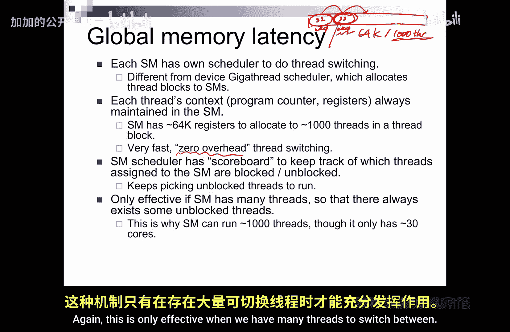

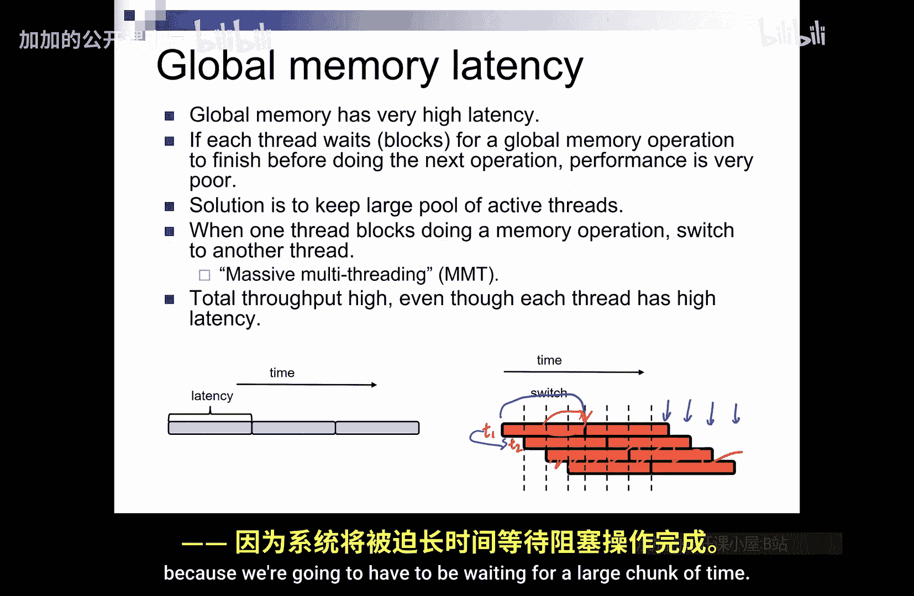

其工作原理是：当一个线程发起高延迟的内存操作后，SM调度器不会让该线程空等，而是迅速切换到另一个就绪的线程去执行。通过在许多线程之间快速切换，可以有效地将内存访问的延迟与计算重叠起来，从而保持计算核心的忙碌。

为了实现有效的延迟隐藏，需要满足两个条件：
1.  线程切换必须非常快速。GPU通过为每个线程块预分配寄存器，并在Warp间切换时仅需更改寄存器文件指针来实现。
2.  必须有足够多的线程可供切换。这就是为什么我们需要追求较高的**SM占用率**，即在每个SM上调度尽可能多的线程，以确保总有就绪的线程可以执行。

### 带宽优化与数据复用

即使隐藏了延迟，全局内存的有限带宽也可能成为瓶颈。例如，在矩阵乘法中，每个输出元素的计算与内存访问之比可能很低，导致性能受限于内存带宽。

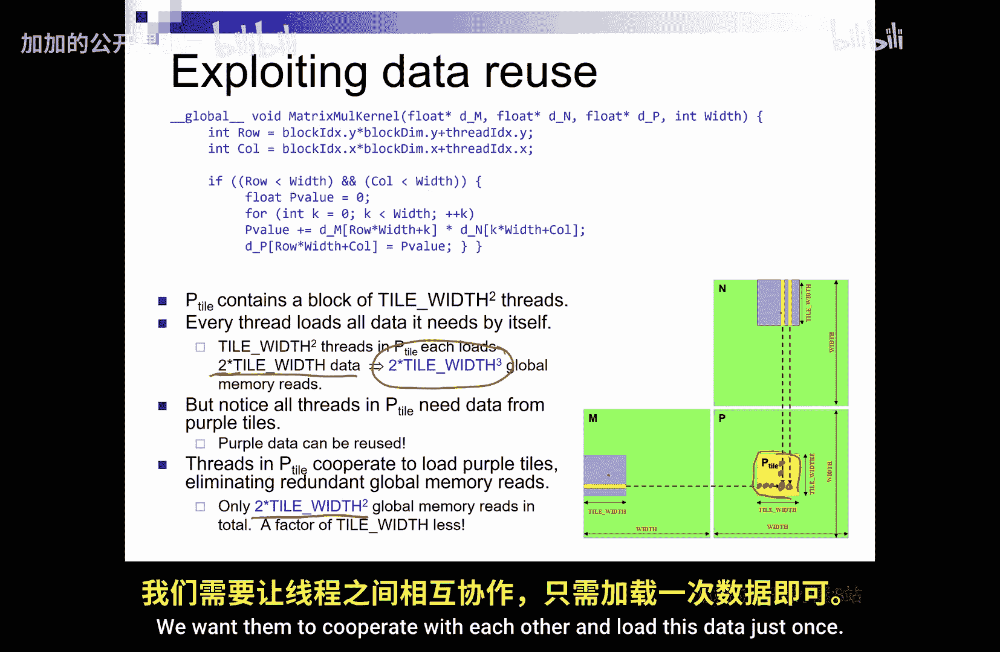

解决方案是**数据复用**，即减少从全局内存读取的数据量。以矩阵乘法为例，在朴素算法中，同一行或同一列的线程会重复读取相同的数据块，造成大量冗余的全局内存访问。

我们可以利用**共享内存**来优化：
1.  让一个线程块内的线程协作，将所需的一小块数据（Tile）从全局内存一次性加载到共享内存中。
2.  所有线程随后从高速的共享内存中重复读取这部分数据进行计算。
3.  计算完当前Tile后，再加载下一个Tile，如此迭代。

这种方法并未减少总的内存访问次数，但将大量缓慢的全局内存访问替换成了快速的共享内存访问，从而显著提升了有效带宽。

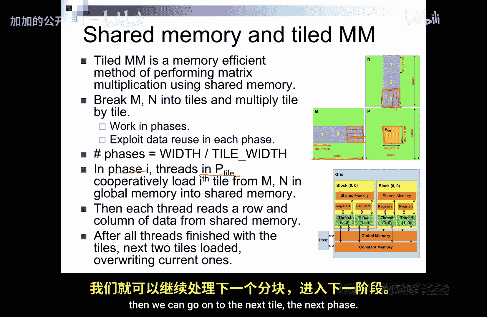

以下是分块矩阵乘法的核心代码结构示意：
```cpp
__global__ void matrixMulTiled(float* d_M, float* d_N, float* d_P, int width) {
    // 1. 在共享内存中声明Tile
    __shared__ float s_M[TILE_WIDTH][TILE_WIDTH];
    __shared__ float s_N[TILE_WIDTH][TILE_WIDTH];

    int bx = blockIdx.x; int by = blockIdx.y;
    int tx = threadIdx.x; int ty = threadIdx.y;

    int row = by * TILE_WIDTH + ty;
    int col = bx * TILE_WIDTH + tx;

    float pValue = 0;

    // 2. 分阶段循环
    for (int p = 0; p < width/TILE_WIDTH; ++p) {
        // 协作加载数据到共享内存
        s_M[ty][tx] = d_M[row*width + (p*TILE_WIDTH + tx)];
        s_N[ty][tx] = d_N[(p*TILE_WIDTH + ty)*width + col];

        // 3. 屏障同步，确保Tile数据加载完毕
        __syncthreads();

        // 4. 从共享内存读取数据进行计算
        for (int k = 0; k < TILE_WIDTH; ++k) {
            pValue += s_M[ty][k] * s_N[k][tx];
        }

        // 5. 屏障同步，确保所有线程完成当前Tile计算
        __syncthreads();
    }

    // 6. 将结果写回全局内存
    d_P[row*width + col] = pValue;
}
```
使用大小为 `M` 的Tile，可以将全局内存访问量减少为原来的 `1/M`。例如，使用16x16的Tile，性能可提升约16倍。

## 内存声明与同步

我们了解了不同内存的用途，现在来看看如何在代码中声明它们以及如何进行线程同步。

### 内存声明

*   **寄存器**：在函数内声明的自动变量（非数组）通常存储在寄存器中。作用域为单个线程，生命周期随线程结束。
*   **共享内存**：使用 `__shared__` 限定符声明。作用域为整个线程块，生命周期随线程块结束。
*   **全局内存**：在主机端使用 `cudaMalloc` 分配，或在设备代码中使用 `__device__` 限定符声明。作用域为整个网格（所有线程），生命周期持续到应用程序释放。

### 线程同步

在CUDA中，**线程块内的线程可以使用 `__syncthreads()` 进行同步**，这是一个屏障操作。所有线程必须都到达这个调用点，才能继续执行后续代码。这在分块算法中至关重要，例如确保所有线程完成共享内存的数据加载后再开始计算。

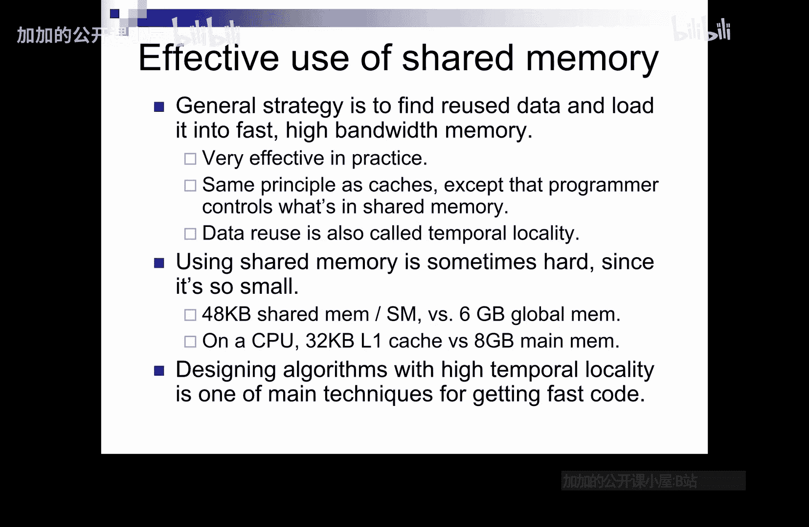

使用 `__syncthreads()` 时需注意：
*   必须确保同一线程块中的所有线程都能执行到该调用。如果存在分支，且屏障只出现在某个分支中，可能导致死锁。
*   同步可能引入等待开销，应谨慎使用。

**注意：不同线程块之间无法直接同步**，它们的执行顺序是不确定的，可能并发执行。

## Warp：执行的基本单位

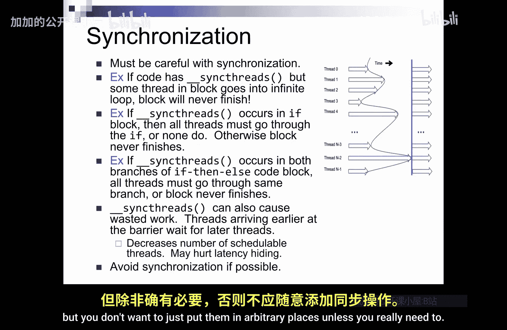

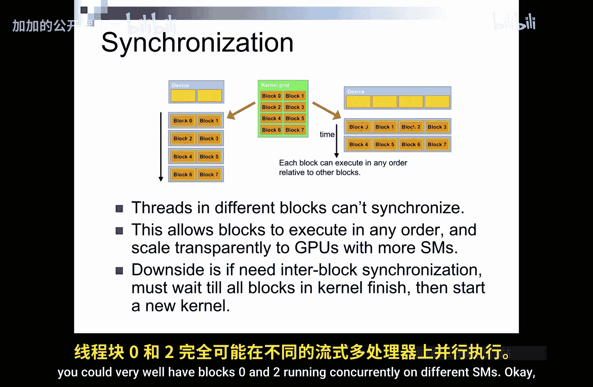

接下来，我们深入探讨GPU执行模型的核心——Warp。一个Warp是SM上调度和执行的基本单位，通常包含32个线程。SM希望一个Warp内的所有线程能以锁步（SIMD）方式执行相同的指令，这样才能达到最高效率。

Warp层面的优化主要有三个目标：**合并内存访问**、**避免分支发散**和**避免存储体冲突**。

### 1. 合并内存访问

这是针对全局内存的优化。全局内存被划分为连续的段（如128字节）。当一个Warp中的所有线程访问**同一段内连续**的内存地址时，硬件可以合并这些访问，只需一次内存事务即可传输所有数据，这称为**合并访问**。

反之，如果Warp内的线程访问的内存地址分散在不同的段中，硬件可能需要对每个段发起单独的内存事务，即使其中很多数据并不需要。这会严重浪费带宽，称为**非合并访问**。

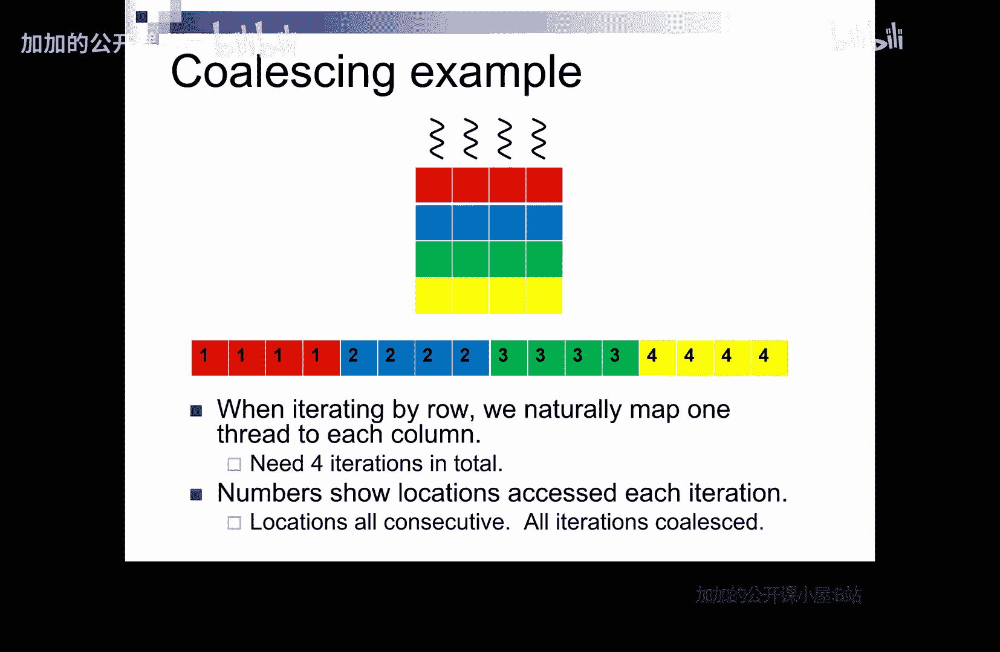

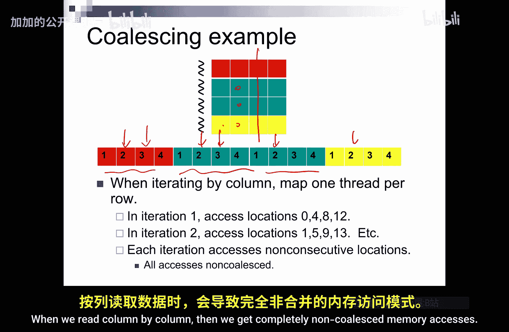

**示例**：访问行主序存储的矩阵。
*   **按行访问**：Warp读取连续内存地址，是合并访问。
*   **按列访问**：Warp读取的地址间隔很大（跨行），通常是非合并访问。

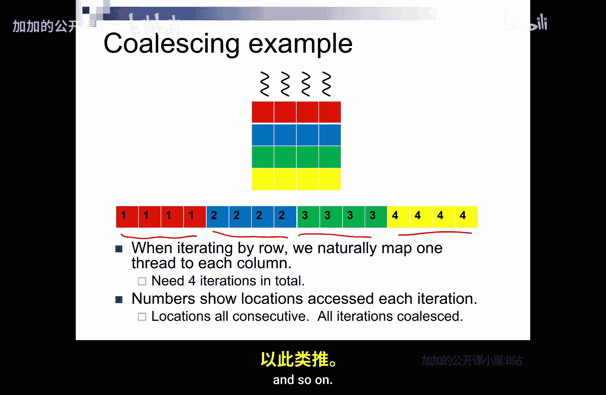

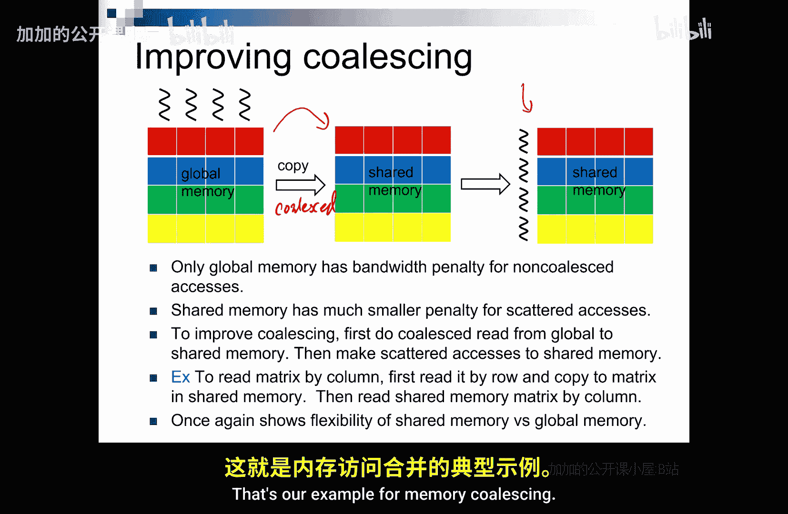

**优化技巧**：如果算法需要非合并访问模式（如按列访问），可以先将数据从全局内存**按行**（合并方式）加载到共享内存，然后再在共享内存中进行所需的非连续访问，从而避免全局内存的非合并访问。

### 2. 避免分支发散

由于Warp以SIMD方式执行，如果Warp内的线程在执行时遇到条件分支（如 `if` 语句），并且不同的线程走了不同的分支路径，就会发生**分支发散**。

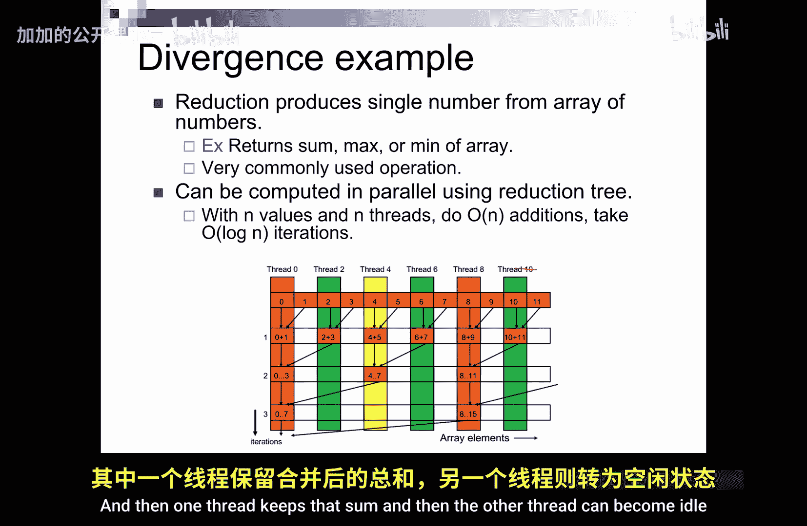

发生分支发散时，GPU必须串行化执行所有不同的分支路径。例如，一个Warp中一部分线程执行 `if` 块，另一部分执行 `else` 块，那么SM会先执行所有走 `if` 路径的线程（其他线程空闲），然后再执行所有走 `else` 路径的线程。这会导致有效执行时间增加。

**示例**：归约求和。
*   **朴素算法**：在每次迭代中，只有一部分线程（如索引为偶数的线程）执行加法操作，另一部分线程空闲。这导致Warp内部分支发散。
*   **优化算法**：改变配对策略（从大跨度开始），可以确保在最初的几次迭代中，整个Warp要么都执行操作，要么都不执行，从而避免了分支发散，提升了性能。

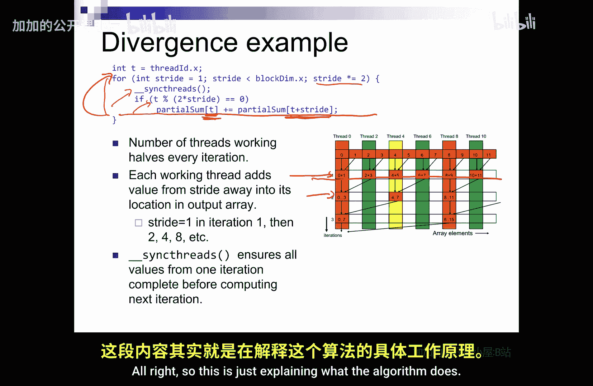

### 3. 避免存储体冲突

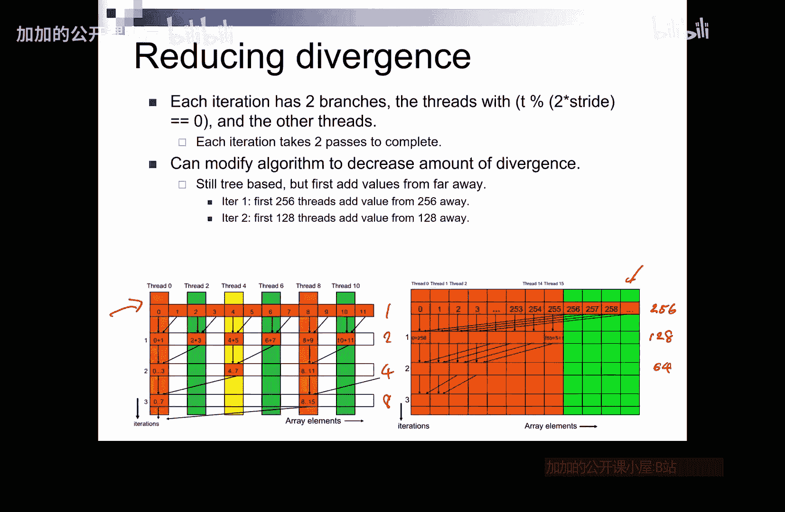

这是针对共享内存的优化。共享内存被划分为多个（通常是32个）存储体。理想情况下，一个Warp中的32个线程应同时访问32个不同的存储体，这样可以并行处理，效率最高。

如果同一个Warp内有两个或更多线程访问**同一个存储体**中的**不同地址**，就会发生**存储体冲突**。冲突的访问必须被序列化，从而增加访问延迟。如果所有线程访问同一存储体的同一地址，则会发生广播，不视为冲突。

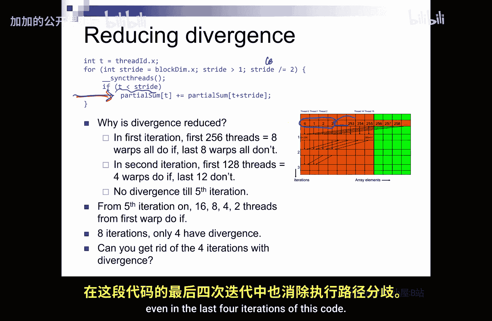

**示例**：多个线程连续加载数据到共享内存时，如果访问模式设计不当，可能导致多个线程访问同一存储体。
**优化技巧**：通过调整数据布局或改变线程访问数据的顺序，可以化解存储体冲突。例如，使用填充字节来错开原本会映射到同一存储体的数据地址。

## 总结

本节课中我们一起学习了GPU编程的两个核心主题：内存架构与Warp。
1.  **内存层次结构**：我们了解了全局内存、共享内存/缓存和寄存器的特性、速度差异及可见性范围。高性能编程的关键在于将数据保留在更快的内存中并促进数据复用。
2.  **全局内存优化**：通过大规模多线程隐藏访问延迟，并通过利用共享内存进行数据复用来提升有效带宽。我们以分块矩阵乘法为例，详细阐述了这一优化过程。
3.  **Warp概念**：Warp是SM的执行单位。我们学习了如何通过实现合并内存访问、减少分支发散和避免存储体冲突来保证Warp的高效执行。理解并优化Warp级别的行为对于挖掘GPU性能潜力至关重要。

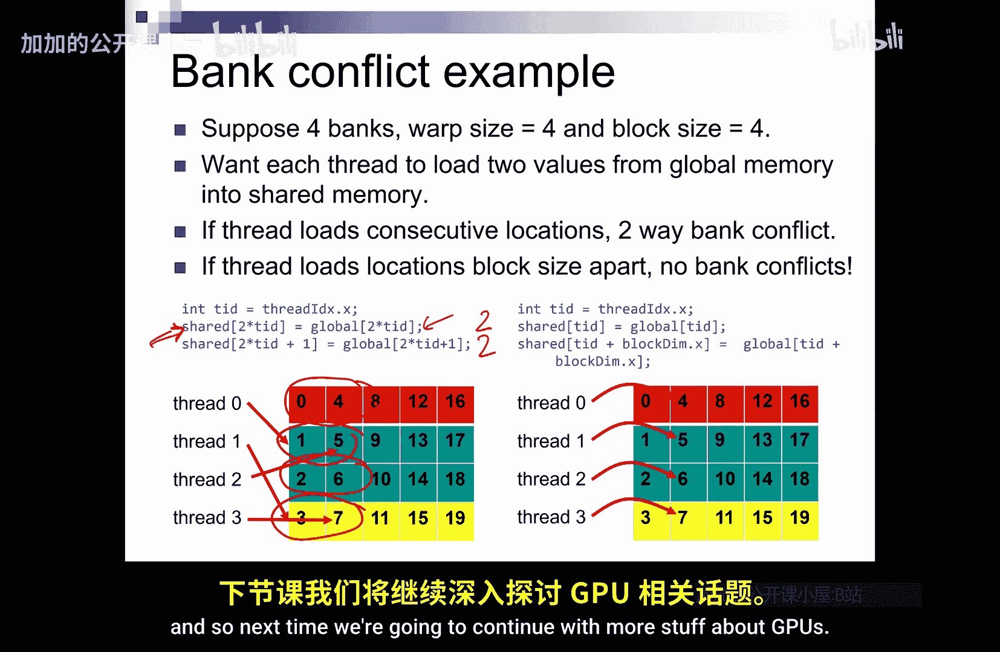

掌握这些概念是编写高效CUDA程序的基础。下一讲我们将继续探讨GPU编程的其他高级主题。