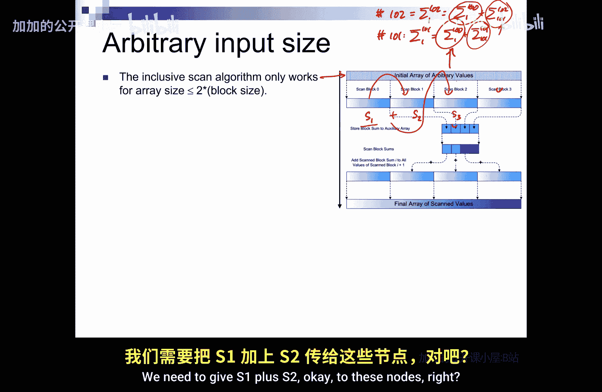
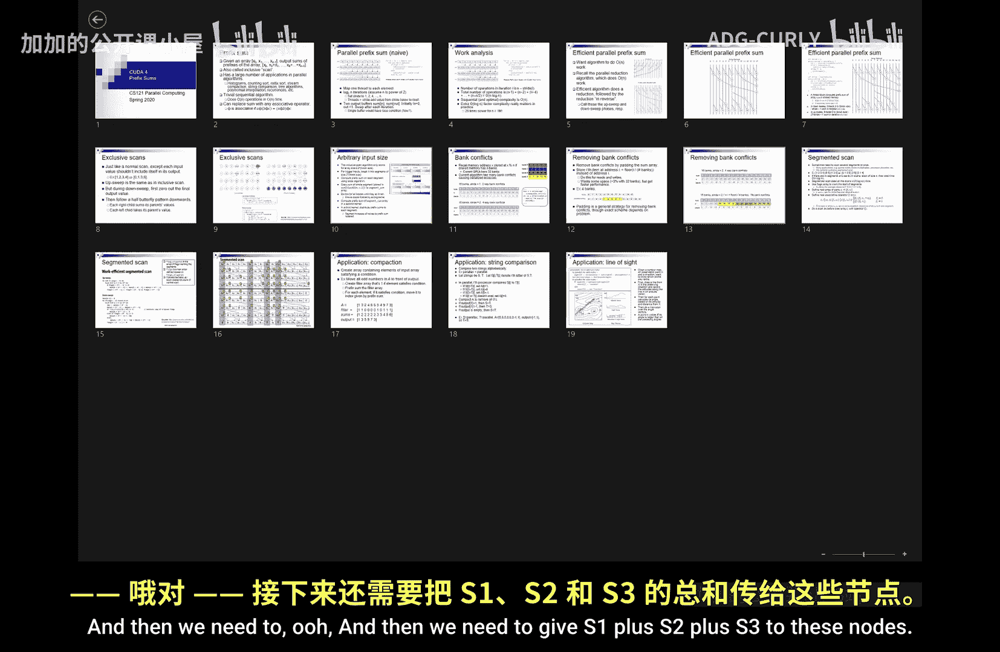
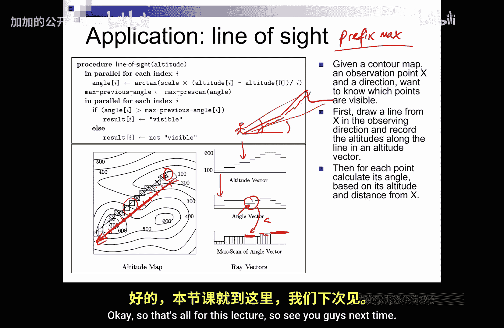

#  014：前缀和算法与应用

在本节课中，我们将学习并行计算中的一个核心基础操作：前缀和（Prefix Sum），也称为扫描（Scan）。我们将探讨其定义、多种并行实现算法（包括低效的朴素算法和高效的工作最优算法），并了解其在GPU上的实现细节，如避免存储体冲突。最后，我们将看到前缀和在多个实际问题中的强大应用。

---

## 前缀和的定义与重要性

前缀和操作的定义很简单。给定一个包含 `n` 个数字的输入数组 `[x0, x1, ..., x(n-1)]`，其输出是一个同样长度为 `n` 的数组，其中第 `i` 个输出元素是前 `i+1` 个输入元素的和。

**公式表示：**
```
output[i] = sum_{j=0}^{i} x[j]
```

这种操作被称为“前缀和”，因为每个输出都是输入数组一个前缀（从开头到某个位置）的总和。它也被称为“包含式扫描”（Inclusive Scan），因为第 `i` 个输出包含了第 `i` 个输入。

还存在一种“排除式扫描”（Exclusive Scan），其第 `i` 个输出是前 `i` 个输入元素的和（不包含第 `i` 个输入）。

**公式表示：**
```
exclusive_output[i] = sum_{j=0}^{i-1} x[j]
```

虽然前缀和看起来是一个基础操作，但它在并行计算中至关重要，是构建许多其他高效并行算法（如直方图计算、排序、过滤、树算法等）的基石。其重要性甚至曾引发关于在硬件中直接支持前缀和操作的讨论。

---

## 朴素并行前缀和算法

上一节我们介绍了前缀和的基本概念。本节中，我们来看看一个直观但并非最优的并行实现方法。

该算法的核心思想是分阶段进行配对相加。假设有 `n` 个输入元素（为简化，设 `n` 为2的幂）。算法进行 `log₂(n)` 个阶段，每个阶段有一个“跨度”（stride）值。

*   **第一阶段**：跨度 `stride = 1`。每个线程（或处理元素）将其当前值与左边相距 `stride` 位置的值相加（如果存在）。最左边的元素没有左邻居，保持不变。
*   **后续阶段**：每个阶段将跨度加倍 (`stride = 2, 4, 8, ...`)。每个线程将其当前值与左边相距当前 `stride` 位置的值相加。
*   **终止**：经过 `log₂(n)` 个阶段后，跨度达到 `n/2`，此时所有元素都包含了其之前所有元素的和，即得到了正确的前缀和。

**算法伪代码示意（使用双缓冲避免读写冲突）：**
```cpp
for stride = 1, 2, 4, ..., n/2:
    for all i in parallel where i >= stride:
        out[i] = in[i] + in[i - stride]
    swap(in, out) // 交换输入和输出缓冲区
```

**工作复杂度分析：**
该算法总共需要 `O(n log n)` 次加法操作。而最优的串行算法仅需 `O(n)` 次操作。因此，这个朴素并行算法引入了 `log n` 倍的额外工作，对于大规模数据（如百万级）来说，效率损失显著（例如20倍慢）。

---

## 高效工作最优算法：Brent-Kung

由于朴素算法的额外开销较大，我们需要寻找工作最优（Work-efficient）的并行算法，即总操作次数为 `O(n)`。Brent-Kong 算法是其中的经典代表。

该算法的灵感来源于高效的并行归约（Reduction）操作。它分为两个阶段：上行扫描（Up-Sweep）和下行扫描（Down-Sweep）。

**第一阶段：上行扫描（归约阶段）**
此阶段与并行归约树完全相同。从叶子节点开始，逐层向上将值两两相加，最终在根节点得到所有元素的总和。同时，树中许多中间节点也计算出了其对应子树中所有元素的和。

**第二阶段：下行扫描（分发阶段）**
此阶段将上行扫描中计算出的部分和，正确地分发到需要它们的节点。从根节点开始，携带部分和值向下传播，通过特定的加法规则，确保每个叶子节点最终获得其前缀和。

**算法核心操作（以下行扫描为例）：**
```cpp
// 假设 stride 初始为 n/2，并逐次减半
for stride = n/2, n/4, ..., 1:
    for all k in parallel where k % (2*stride) == 0:
        temp = left_value
        left_value = right_value
        right_value = temp + right_value
```

**正确性直觉：**
每个节点的索引可以表示为二进制。算法确保了节点最终的值，恰好是其二进制表示中所有为 `1` 的位所对应的、上行扫描中产生的部分和的总和。例如，节点13（二进制1101）的结果，来自第8个元素的部分和（位`1000`）、第4-7个元素的部分和（位`0100`）以及其自身的值（位`0001`）。

Brent-Kong 算法总操作次数为 `O(n)`，实现了工作最优。

---

## 排除式扫描与分段扫描

### 排除式扫描
排除式扫描要求第 `i` 个输出不包含第 `i` 个输入。一个简单的方法是先计算包含式扫描，然后每个输出减去自己的输入值。但存在更优雅的直接算法。





该算法同样采用上行扫描和下行扫描结构。关键区别在于下行扫描开始时，将归约树的根节点值设为0，并在下行过程中执行一种“半蝶形”操作，将部分和值广播到正确的子树中，同时确保不包含自身值。

### 分段扫描
分段扫描是指我们需要对同一个数组中的多个独立段分别进行前缀和计算，且各段长度可能不同。

**解决方案：**
1.  **标记**：使用一个标志数组（Flag Array）标记每个段的起始位置（例如，段首为1，段内其他位置为0）。
2.  **定义新操作**：将原始值 `(value)` 与标志 `(flag)` 组合成对 `(flag, value)`。定义一个新的结合操作符 `⊙`：
    ```
    (f1, x1) ⊙ (f2, x2) = (f1 | f2, (f2 == 0) ? (x1 + x2) : x2)
    ```
    这个操作符的巧妙之处在于：当 `f2` 为0时，表示 `x2` 与 `x1` 在同一段内，因此相加；当 `f2` 为1时，表示 `x2` 是一个新段的开始，因此只保留 `x2`，不累加前一段的值。
3.  **应用扫描**：使用修改后的前缀和算法（如Brent-Kong），但将加法操作替换为这个新的 `⊙` 操作。最终结果中的 `value` 部分就是正确的分段前缀和。

分段扫描算法也是工作最优的，其时间复杂度与所有段的总长度成线性关系。

---

## GPU实现：处理大规模数据与存储体冲突

### 处理大规模数据
Brent-Kong 等算法通常设计用于单个线程块（Thread Block）内，能处理的数据大小受限于块的大小（例如，1024个线程最多处理2048个元素）。为了处理百万甚至更大规模的数组，我们需要分块处理。

**三步法：**
1.  **块内扫描**：将输入数组划分为多个块，每个块独立使用前述算法计算其**本地**前缀和。
2.  **收集与扫描**：收集每个块的**最后一个元素**（即该块所有元素的总和），形成一个更小的“块总和数组”。对这个块总和数组执行一次**全局前缀和**。
3.  **结果修正**：将第2步得到的全局前缀和结果（每个块需要添加的偏移量）分发回对应的块，每个线程将自己的本地前缀和结果加上这个块的偏移量，得到最终正确的全局前缀和。

### 避免共享内存的存储体冲突
GPU的共享内存被划分为多个存储体（通常32个）。当多个线程同时访问同一个存储体时，会发生存储体冲突，导致访问串行化，降低性能。

在前缀和算法的某些阶段，线程的访问模式会导致严重的存储体冲突（例如，当跨度为2的幂时，多个线程会访问同一存储体）。

**解决方案：内存填充**
通过将数据在共享内存中错位存储，可以消除这种冲突模式。基本思想是为每个数据元素添加一个基于其索引和存储体数量的偏移量（填充）。

**填充地址计算示例：**
```cpp
padded_index = original_index + (original_index / num_banks);
```
例如，在16个存储体的情况下，原始索引19的元素将被存储在地址 `19 + (19/16) = 20`。这种策略会浪费少量共享内存空间（约 `1/num_banks`），但能彻底消除访问冲突，显著提升性能。

---

## 前缀和的应用实例

前缀和作为一种基础并行原语，其应用非常广泛。以下是几个典型例子：

### 1. 流压缩
给定一个数组和一个条件，输出所有满足条件的元素。
*   **步骤**：
    1.  并行为每个元素计算一个“标志”：满足条件为1，否则为0。
    2.  对这个标志数组计算**排除式前缀和**。结果数组给出了每个满足条件元素在输出数组中的目标位置。
    3.  并行地将所有满足条件的元素根据前缀和结果给出的位置，散射到输出数组中。

### 2. 并行字符串比较
比较两个字符串的字典序。
*   **步骤**：
    1.  并行比较两个字符串的每个对应字符，产生一个数组 `A`：`S[i] > T[i]` 为1，`S[i] < T[i]` 为-1，相等为0。
    2.  使用**流压缩**移除 `A` 中所有为0的元素。
    3.  检查压缩后数组的第一个元素：若为1，则 `S > T`；若为-1，则 `S < T`；若数组为空，则 `S == T`。

### 3. 视线计算
给定地形高度，判断从观察点沿一条线看出去，哪些点可见（未被中间高点遮挡）。
*   **步骤**：
    1.  沿视线计算每个点相对于观察点的仰角。
    2.  对这个仰角数组计算**前缀最大值**（将前缀和中的加法替换为 `max` 操作）。
    3.  并行比较每个点的实际仰角与它的前缀最大值。如果实际仰角**小于**前缀最大值，则该点被遮挡；否则可见。

---

## 总结

本节课中我们一起深入学习了并行计算中的关键操作——前缀和。
*   我们首先明确了其定义和两种形式（包含式与排除式）。
*   接着分析了一个直观但低效的朴素并行算法，其工作复杂度为 `O(n log n)`。
*   然后，我们重点介绍了高效的 Brent-Kong 工作最优算法（`O(n)`），它通过上行扫描（归约）和下行扫描（分发）两阶段实现。
*   我们还将算法扩展到排除式扫描和更复杂的分段扫描，后者通过定义巧妙的结合操作符来处理多个独立段。
*   针对GPU实现，我们探讨了如何通过分块处理大规模数据，以及如何使用内存填充技术来避免共享内存的存储体冲突，从而优化性能。
*   最后，我们通过流压缩、并行字符串比较和视线计算等实例，展示了前缀和如何作为基础模块来解决各类实际问题。



掌握高效的前缀和实现，是构建更复杂、高性能并行应用的重要一步。