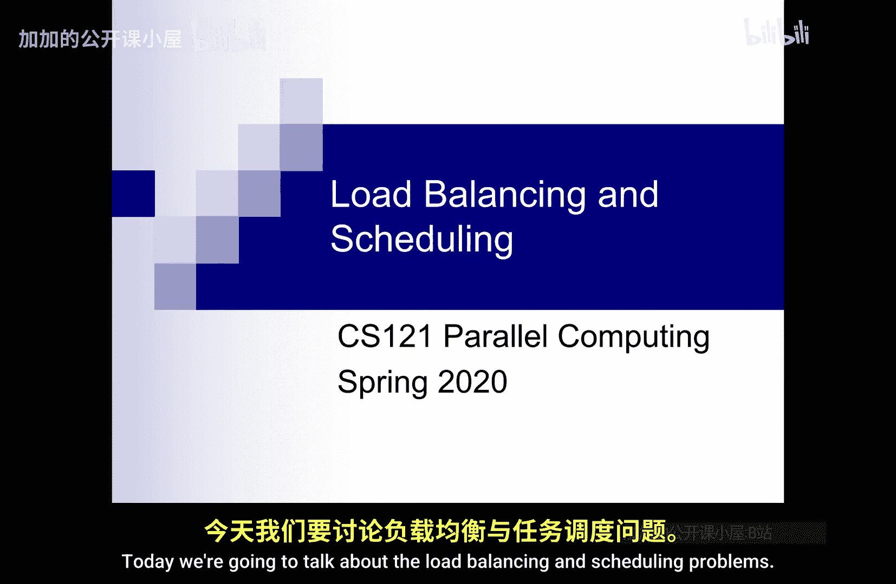
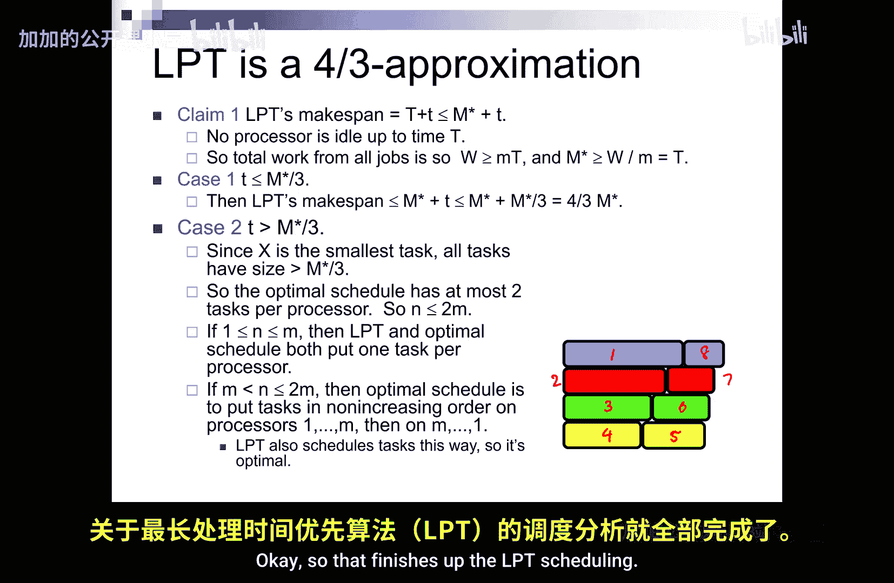
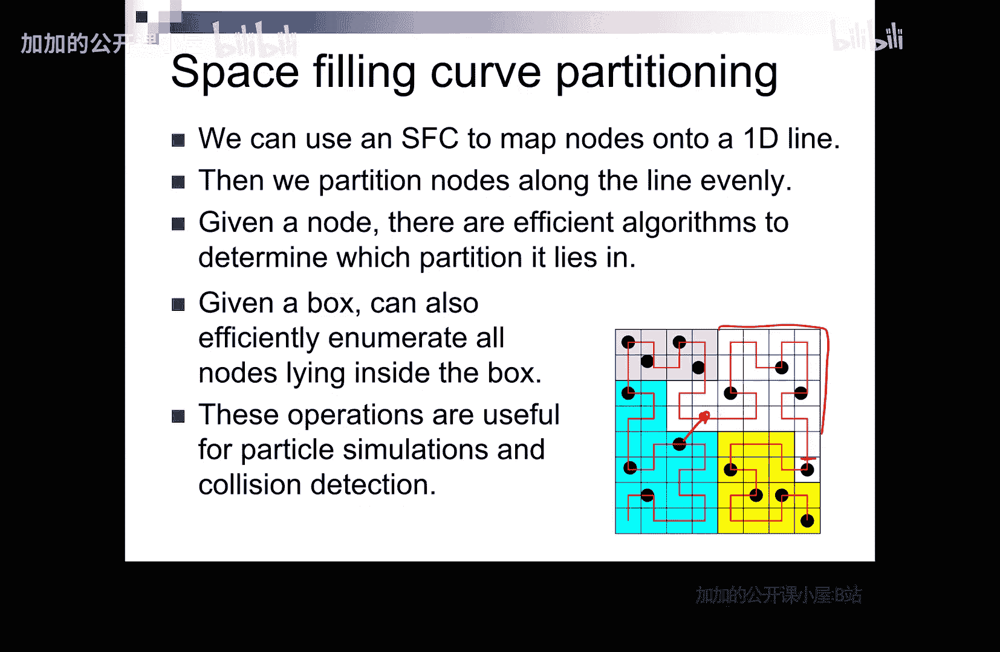
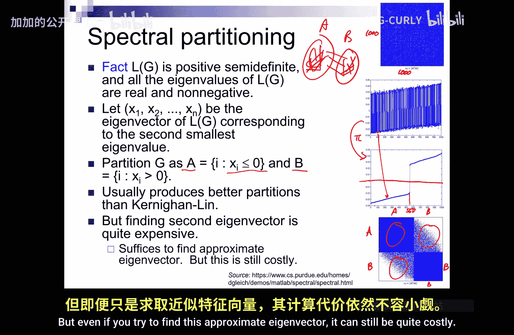
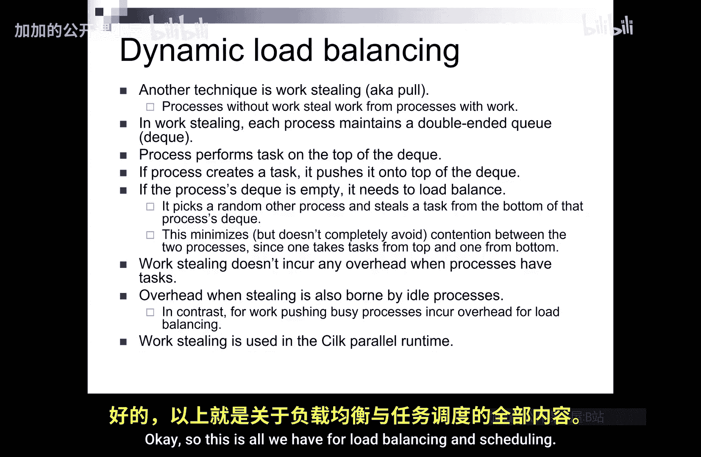

#  020：负载均衡与调度 📊

在本节课中，我们将要学习并行计算中的两个核心问题：负载均衡与调度。我们将探讨它们的目标、面临的挑战、不同的模型以及一些实用的算法和启发式方法。

## 概述

负载均衡与调度问题的目标是：给定一组任务和一组并行处理器，我们希望尽可能快地完成所有任务。负载均衡决定将哪些任务分配给哪些处理器，而调度则决定在处理器上执行这些任务的顺序。这两个问题在并行与分布式计算、操作系统、运筹学等领域都有大量研究。

## 负载均衡与调度的类型

以下是几种不同类型的负载均衡与调度问题。

### 静态调度

在静态调度中，我们在计算开始前就知道所有任务及其计算量和通信模式。例如，稠密线性代数运算或快速傅里叶变换。由于所有信息已知，我们可以在计算开始时进行一次负载均衡，并且可以花费更多时间来获得更好的平衡。

### 半静态调度

在半静态调度中，我们周期性地获得关于任务的信息。算法可能分多个阶段运行，在每个阶段开始时，我们知道一些任务信息。例如，粒子模拟中，粒子的位置会缓慢变化，我们可以基于初始位置进行负载均衡，运行一段时间后，当位置变化较大时，再开始新阶段并重新平衡。

### 动态调度

在动态调度中，我们只在运行时才知道计算内容。例如，在构建搜索树时，节点是动态生成的。因此，我们需要在运行时不断进行重新平衡，这要求算法必须非常高效。

## 负载均衡的粒度与方式

负载均衡可以在不同粒度上进行，也可以采用集中式或分布式的方式。

### 细粒度与粗粒度

*   **细粒度负载均衡**：将每个任务视为独立个体。这可以获得最佳结果，但任务数量庞大时，会消耗大量时间和内存。
*   **粗粒度负载均衡**：将多个任务分组，然后在组级别进行调度。这可以降低开销。

### 集中式与分布式

*   **集中式负载均衡**：一个中心节点收集所有任务信息，并计算最优分配方案。它可以基于全局信息做出最佳决策，但该中心节点可能成为性能瓶颈。
*   **分布式负载均衡**：多个节点通过相互通信来共同决定如何平衡负载。这种方式更具可扩展性，能更快响应系统变化，但可能无法达到全局最优解，且可能需要多次迭代才能收敛。

### 分层方法

我们可以结合集中式和分布式的优点，采用分层方法。首先将任务粗粒度分组，然后由中心节点解决粗粒度负载均衡问题（因为组数少，计算快）。接着，中心节点将初步的负载均衡方案分发给其他节点，各节点再基于此进行分布式的细粒度负载均衡。

## 负载均衡的关键问题

在进行负载均衡时，我们需要考虑几个关键问题：

1.  **负载估计**：我们需要估算每个任务的计算负载。
2.  **通信模式预测**：对于非静态计算，我们需要预测任务间的通信模式和通信量。
3.  **负载变化与任务迁移成本**：如果负载发生变化，我们需要重新进行负载均衡或迁移任务。迁移任务（代码或数据）会产生成本。

## 基础模型：列表调度算法

我们从一个最简单的模型开始：我们有一组任务，每个任务只有大小（计算量），任务间没有依赖关系，也没有通信。目标是将这些任务分配到 M 个速度相同的处理器上，最小化完成所有任务的时间（即**完工时间**）。

即使在这个简单模型中，最小化完工时间也是 NP 难问题（即使只有两个处理器）。我们可以通过将 **子集和问题** 归约到两处理器完工时间最小化问题来证明这一点。

因此，在实践中，我们寻求近似算法。**列表调度** 是一种简单的贪心算法：
*   将任务按任意顺序列出。
*   每当有处理器空闲时，就将列表中的下一个任务分配给它。

列表调度算法可以保证其产生的完工时间 **M** 最多是最优完工时间 **M*** 的两倍，即它是一个 **2-近似** 算法：`M ≤ 2 * M*`。

列表调度算法简单高效，在实践中常用。即使任务间存在**前驱约束**（即某些任务必须在其他任务完成后才能开始），只需修改为“将下一个**所有前驱任务已完成**的任务分配给空闲处理器”，该算法依然能保持 2-近似的性能保证。

### 列表调度的局限性

列表调度在最坏情况下可能达到 2 倍于最优解的完工时间。考虑一个例子：有 M 个处理器，M² 个大小为 1 的任务，和 1 个大小为 M 的任务。如果列表顺序是先排所有小任务，最后排大任务，列表调度的完工时间约为 2M，而最优调度（先排大任务）的完工时间约为 M+1。

## 改进：最长处理时间优先调度

列表调度失败的原因在于，大的任务被安排在了最后，破坏了之前的负载平衡。**最长处理时间优先** 调度通过先安排大任务来解决这个问题。

LPT 调度算法：
*   将任务按处理时间从大到小排序。
*   使用列表调度算法（按此排序后的列表）进行分配。

LPT 调度可以证明是一个 **4/3-近似** 算法：`M ≤ (4/3) * M*`。其证明思路是分析最后一个完成的任务：如果它“小”，则完工时间有界；如果它“大”，则可以证明 LPT 实际上给出了最优调度。

尽管 LPT 有更好的理论保证，但列表调度在实践中更常用，因为：
1.  **动态性**：列表调度可以处理动态到达的任务，而 LPT 需要预先知道所有任务并进行排序。
2.  **无需负载估计**：列表调度不关心任务大小，而 LPT 需要知道任务大小来排序。

## 几何负载均衡

现在我们将关注点转向具有几何坐标的任务，例如粒子模拟，其中通信只发生在附近的任务之间。我们假设所有任务大小相同，目标是平衡负载并最小化处理器间的通信。

### 递归二分法

递归二分法在几何空间上递归地划分任务点集：
1.  首先在 x 方向找一条垂直线，将点集分成左右数量相等的两部分。
2.  然后在每个子区域中，在 y 方向找水平线进行平分。
3.  如此交替在 x 和 y 方向递归进行，直到分区数量等于处理器数。

这种方法简单，但可能产生**高纵横比**的分区（即形状又长又窄），导致分区边界变长，通信开销增加。

### 空间填充曲线法

空间填充曲线（如 Z 曲线、希尔伯特曲线）是一种能填满空间的 1D 曲线。我们将所有任务点映射到这条曲线上，然后将这条 1D 曲线切成若干段，每段包含大致相同数量的点，并分配给一个处理器。由于空间填充曲线具有**空间局部性**（曲线上接近的点在原始空间中也接近），这种方法能在平衡负载的同时，让相邻的任务尽可能被分配到同一个处理器，从而减少通信。

### 惯性分割法

惯性分割法旨在找到一条切割线，使得被切割的边（即通信）尽可能少。其思想是：
1.  寻找一个旋转轴 **L**，使得所有点绕 **L** 旋转的**转动惯量**最小。这对应着点集在垂直于 **L** 的方向上“最薄”，即跨切割线的通信潜力最小。
2.  将所有点投影到直线 **L** 上。
3.  找到投影值的中位数，并作一条垂直于 **L** 的切割线，将点集分成两部分。
4.  如果需要更多分区，则递归应用此方法。

## 基于图的划分

当任务和通信可以用图来表示时，我们使用**图划分**。图中节点代表任务（可有权重表示计算量），边代表通信（可有权重表示通信量）。目标是将图划分为 **k** 个部分（k 为处理器数），使得：
1.  每个部分的节点权重和大致相等（负载均衡）。
2.  被切割的边的权重和最小（通信最小化）。

图划分本身也是 NP 难问题。以下是几种启发式方法：

### 局部搜索：Kernighan-Lin 算法

KL 算法是一种贪心改进算法：
1.  从任意一个将节点平分为两部分的初始划分开始。
2.  进行多轮迭代。在每轮中，考虑交换一对分别来自两个分区的、尚未在本轮中使用过的节点，选择能使切割边权重减少最多（或增加最少）的一对进行交换，并标记它们为已使用。
3.  一轮迭代完成后，检查本轮中产生的最佳划分（切割边权重最小）。如果它优于当前划分，则采用它并重新开始算法；否则，保持当前划分。

### 谱划分法

谱划分利用图的**拉普拉斯矩阵**的特征向量。拉普拉斯矩阵 **L** 定义为：`L = D - A`，其中 **D** 是度矩阵（对角矩阵），**A** 是邻接矩阵。
1.  计算 **L** 的**第二小特征值**（称为 Fiedler 值）对应的特征向量。
2.  将特征向量的分量按值排序。
3.  根据排序后的顺序，将节点分成两部分：一部分对应负特征值分量，另一部分对应正特征值分量。

这种方法通常能产生质量很高的划分，因为特征向量蕴含了图的整体连通性信息。但计算特征向量的开销较大。

### 多级划分法

多级划分法结合了速度和质量：
1.  **粗化**：通过将图中的节点配对（匹配）并合并，生成一个更小的、保留原图结构的粗化图。重复此过程，得到一系列越来越小的图。
2.  **初始划分**：在最粗的图上应用划分算法（如谱划分或 KL），因为图很小，所以很快。
3.  **解粗化与细化**：将粗化图上的划分投影回上一层较细的图中。然后在较细的图上使用局部搜索算法（如 KL）对划分进行**细化**，以改进质量。
4.  重复步骤 3，直到得到原始图上的划分。

## 动态负载均衡

对于任务动态创建的场景（如搜索算法），我们需要分布式负载均衡。

### 扩散法

扩散法是一种“推”策略：负载过重的处理器主动将一些任务发送给邻居处理器。任务像扩散一样在网络中传播，直到负载均衡。缺点是可能收敛慢，且通信开销大，因为繁忙的处理器也需要参与任务传递。

### 工作窃取法

工作窃取法是一种“拉”策略，在实践中更高效：
*   每个处理器维护一个**双端队列**存放自己的任务。
*   处理器从自己队列的**头部**取出任务执行。
*   当处理器创建新任务时，将其放入自己队列的**尾部**。
*   如果一个处理器的队列为空（空闲），它会随机选择另一个处理器，并尝试从该处理器队列的**尾部**“窃取”任务。

这种方法的优点是：
*   **开销低**：只有空闲处理器才需要付出窃取开销，繁忙处理器只需处理自己的任务。
*   **冲突少**：由于窃取是从队列尾部，而任务执行是从头部，两者通常不冲突，减少了同步需求。

工作窃取被广泛应用于实践，例如 Cilk 语言就基于此模型。

## 总结

本节课我们一起学习了并行计算中负载均衡与调度的核心概念。我们从最简单的列表调度模型及其理论保证开始，探讨了针对几何数据的划分方法（递归二分、空间填充曲线、惯性分割）和基于图表示的划分算法（局部搜索、谱划分、多级划分）。最后，我们了解了适用于动态场景的分布式负载均衡策略，特别是高效的工作窃取法。理解这些基本思想和方法，是设计和实现高效并行程序的基础。