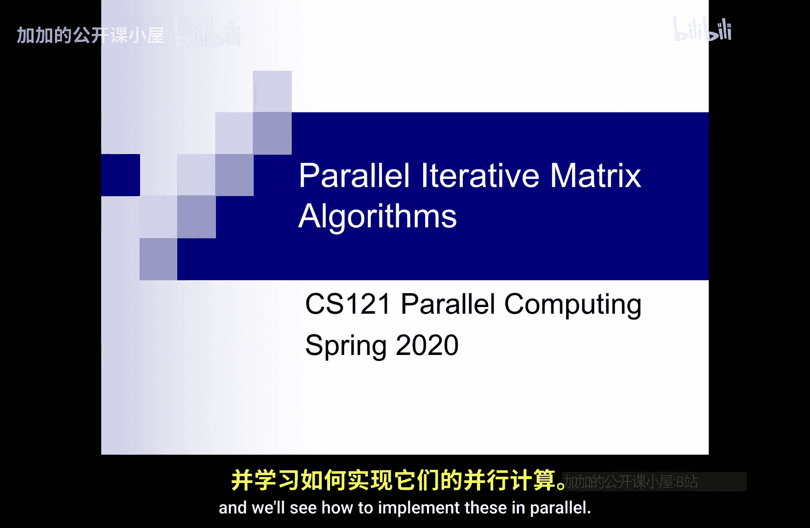
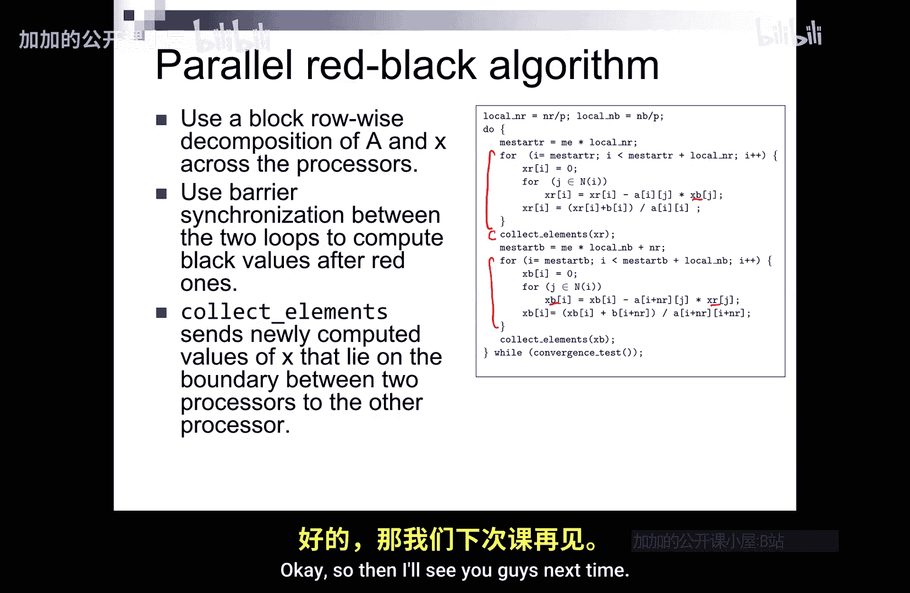

#  022：迭代矩阵算法

在本节课中，我们将学习一类称为迭代矩阵算法的算法，并探讨如何并行实现它们。

## 概述

在上一讲中，我们讨论了求解线性方程组 `A x = B` 的方法，例如高斯消元法。然而，对于非常大的矩阵（例如百万级变量），即使并行运行，`O(n^3)` 的时间复杂度也过于缓慢。因此，我们需要更快的算法。

今天，我们将首先关注一类具有特殊结构的矩阵——带状矩阵。对于这类矩阵，我们可以使用迭代解法来更快地求解 `A x = B`。更一般地，对于稀疏矩阵，我们可以使用迭代算法来获得 `A x = B` 的近似解。这些算法之所以称为“迭代”，是因为它们从一个初始猜测解 `x` 开始，通过逐步迭代，使 `A x` 越来越接近 `B`，最终收敛到精确解或一个足够好的近似解。

## 基本迭代方法

设 `A` 是一个 `n x n` 矩阵。我们将 `A` 分解为 `A = M - N`，其中 `M` 和 `N` 也是 `n x n` 矩阵。第一个要求是 `M` 的逆矩阵 `M^{-1}` 易于计算（例如，`M` 是对角矩阵）。

假设 `x*` 是方程 `A x = B` 的解。将 `A = M - N` 代入，得到：
`M x* = N x* + B`

现在定义矩阵 `C` 和向量 `d`：
`C = M^{-1} N`
`d = M^{-1} B`

将 `M x* = N x* + B` 两边同时乘以 `M^{-1}`，得到：
`x* = C x* + d`

迭代算法的核心是反复应用这个公式。我们从某个初始向量 `x_0` 开始：
`x_1 = C x_0 + d`
`x_2 = C x_1 + d`
...
`x_{k+1} = C x_k + d`

我们的目标是，随着迭代次数 `k` 的增加，`x_k` 收敛到真实解 `x*`。

## 收敛性分析

为了分析收敛性，我们考察误差 `e_k = x_k - x*`。根据迭代公式 `x_{k+1} = C x_k + d` 和 `x* = C x* + d`，可以推导出：
`e_{k+1} = x_{k+1} - x* = C (x_k - x*) = C e_k`

进一步展开，可以得到：
`e_k = C^k e_0`

其中 `e_0` 是初始误差。为了使迭代收敛到 `x*`，我们需要 `e_k` 随着 `k` 增大而趋近于零，即 `C^k` 趋近于零矩阵。

设 `ρ(C)` 为矩阵 `C` 的谱半径（即其最大特征值的模）。**定理**：如果 `ρ(C) < 1`，则对于任意初始向量 `x_0`，迭代序列 `{x_k}` 都会收敛到解 `x*`。

## 雅可比迭代法

基本迭代方法的具体实现取决于如何选择 `M` 和 `N`。第一种方法是**雅可比迭代法**。

我们将矩阵 `A` 分解为三部分：
*   `D`：`A` 的对角线元素构成的对角矩阵。
*   `-L`：`A` 的严格下三角部分（不含对角线）。
*   `-R`：`A` 的严格上三角部分（不含对角线）。

因此，`A = D - L - R`。

在雅可比方法中，我们选择：
`M = D`
`N = L + R`

由于 `M` 是对角矩阵，其逆矩阵易于计算。此时：
`C = M^{-1} N = D^{-1} (L + R)`
`d = D^{-1} B`

`C` 矩阵的元素可以显式写出。对于非对角线元素 `(i, j)`（`i ≠ j`）：
`C_{ij} = -A_{ij} / A_{ii}`
对角线元素 `C_{ii} = 0`。

向量 `d` 的第 `i` 个分量为：
`d_i = B_i / A_{ii}`。

迭代公式 `x_{k+1} = C x_k + d` 按分量写为：
`x_{i}^{(k+1)} = (B_i - Σ_{j≠i} A_{ij} x_j^{(k)}) / A_{ii}`

**收敛条件**：如果矩阵 `A` 是**严格对角占优**的，即对于每一行 `i`，有 `|A_{ii}| > Σ_{j≠i} |A_{ij}|`，则可以保证雅可比迭代收敛。

### 雅可比方法的并行实现

观察迭代公式 `x_{i}^{(k+1)} = (B_i - Σ_{j≠i} A_{ij} x_j^{(k)}) / A_{ii}`。为了计算第 `k+1` 次迭代的第 `i` 个分量，我们只需要第 `k` 次迭代的所有分量 `x_j^{(k)}`。并且，不同 `i` 对应的 `x_{i}^{(k+1)}` 的计算之间没有依赖关系。

因此，**一旦我们有了 `x^{(k)}`，所有 `x^{(k+1)}` 的分量都可以并行计算**。

以下是使用MPI实现并行雅可比方法的伪代码思路：

1.  **数据分布**：将矩阵 `A` 按行分块，向量 `B` 和 `x` 也相应分块。每个处理器拥有 `n/p` 行数据（`n` 为矩阵维数，`p` 为处理器数）。
2.  **局部计算**：每个处理器使用自己存储的 `A` 的行块、`B` 的子向量以及全局的 `x^{(k)}`（来自上一次迭代），计算自己负责的那部分 `x^{(k+1)}` 的分量。
3.  **全局通信**：使用 `MPI_Allgather` 操作，每个处理器将自己计算出的 `x^{(k+1)}` 局部块发送给所有其他处理器，从而让每个处理器都获得完整的 `x^{(k+1)}` 向量，用于下一次迭代。
4.  **收敛判断**：计算两次迭代间 `x` 的变化量，如果小于预设容差或达到最大迭代次数，则停止迭代。

## 高斯-赛德尔迭代法

高斯-赛德尔迭代法是雅可比方法的一个改进，通常收敛更快。

我们仍然有 `A = D - L - R`。但在高斯-赛德尔方法中，我们选择：
`M = D - L`
`N = R`

这里 `M` 是一个下三角矩阵（包含对角线），其逆矩阵可以通过前向替换法高效计算。此时：
`C = M^{-1} N = (D - L)^{-1} R`
`d = (D - L)^{-1} B`

迭代公式 `x_{k+1} = C x_k + d` 可以推导出按分量的形式：
`x_{i}^{(k+1)} = (B_i - Σ_{j=1}^{i-1} A_{ij} x_j^{(k+1)} - Σ_{j=i+1}^{n} A_{ij} x_j^{(k)}) / A_{ii}`

**关键区别**：在计算 `x_{i}^{(k+1)}` 时，对于下标 `j < i` 的分量，我们使用**当前**迭代 `k+1` 中已经计算出的新值 `x_j^{(k+1)}`；而对于 `j > i` 的分量，我们仍然使用**上一次**迭代 `k` 的旧值 `x_j^{(k)}`。

**收敛性**：如果矩阵 `A` 是严格对角占优的，高斯-赛德尔方法也能保证收敛。直观上，由于它部分使用了更“新鲜”（当前迭代）的数据，因此通常比雅可比方法收敛得更快。

### 并行性的挑战

然而，高斯-赛德尔方法的并行化面临挑战。观察公式 `x_{i}^{(k+1)}` 依赖于 `x_{1}^{(k+1)}, x_{2}^{(k+1)}, ..., x_{i-1}^{(k+1)}`。这意味着在计算第 `k+1` 次迭代时，分量必须**按顺序**计算：`x_{1}^{(k+1)}`，然后 `x_{2}^{(k+1)}`，依此类推。

因此，**我们无法像雅可比方法那样同时计算 `x^{(k+1)}` 的所有分量**。并行性仅限于对每个固定 `i`，在计算 `x_{i}^{(k+1)}` 时，对其求和项 `Σ_{j≠i} A_{ij} ...` 进行并行化。如果矩阵维数 `n` 不是非常大，这种细粒度的并行可能无法有效利用大量处理器，通信开销可能占主导。

## 逐次超松弛迭代法

SOR方法是高斯-赛德尔方法的进一步推广，通过引入松弛因子 `ω` 来加速收敛。

迭代公式为：
`x_{i}^{(k+1)} = (1 - ω) x_{i}^{(k)} + (ω / A_{ii}) [ B_i - Σ_{j=1}^{i-1} A_{ij} x_j^{(k+1)} - Σ_{j=i+1}^{n} A_{ij} x_j^{(k)} ]`

当 `ω = 1` 时，SOR方法退化为高斯-赛德尔方法。当 `0 < ω < 2` 且矩阵 `A` 对称正定时，SOR方法收敛。

SOR方法的并行性与高斯-赛德尔方法相同，面临同样的顺序依赖挑战。

## 特殊应用：求解泊松方程

对于具有特殊结构的矩阵，我们可以设计出并行性更好的高斯-赛德尔迭代。一个经典的例子是求解**泊松方程**的离散化系统。

泊松方程 `∇²φ = f` 在二维正方形区域上离散化后，可以得到一个线性方程组。每个网格点 `(i, j)` 上的未知数 `u_{ij}`（代表 `φ` 在该点的值）满足：
`4u_{ij} - u_{i-1,j} - u_{i+1,j} - u_{i,j-1} - u_{i,j+1} = b_{ij}` （忽略边界和常数因子）

其中 `b_{ij}` 与 `f` 相关。这形成了一个 `n x n` 的网格（`N = n^2` 个未知数）。对应的系数矩阵 `A` 每行只有5个非零元素：对角线为4，上下左右四个邻居位置为-1。

### 对角线迭代法

如果我们按**行优先**的顺序给网格点编号，那么高斯-赛德尔迭代中，计算某个点 `x_{k+1}` 需要其左边和上边邻居的 `x_{k+1}` 值。这形成了网格上的计算依赖关系。

观察依赖图可以发现，所有位于同一条“反斜对角线”（从左上到右下）上的点，它们彼此之间没有依赖关系，因为它们依赖的点都位于前一条对角线上。因此，我们可以**按对角线顺序进行迭代**：
1.  首先计算第一条对角线上的点（并行）。
2.  然后计算第二条对角线上的点（并行，但需要第一条对角线的结果）。
3.  依此类推。

这样，我们可以在每条对角线上实现并行，最大并行度约为 `n`（网格边长）。虽然比纯顺序计算好，但在迭代开始和结束时，对角线较短，并行度较低。

### 红黑排序法

为了获得更高的并行度，我们可以采用**红黑排序**（Checkerboard Ordering）。将网格点像国际象棋棋盘一样染成红色和黑色。在排序时，将所有红点排在前面，所有黑点排在后面。

在这种排序下，系数矩阵 `A` 具有特殊的分块结构。重要的是，**任何一个红点只与黑点相连，任何一个黑点只与红点相连**。

应用高斯-赛德尔迭代到这种排序的方程上，可以推导出：
*   所有红点的 `x_{k+1}` 值**只依赖于**黑点的 `x_{k}` 值。
*   所有黑点的 `x_{k+1}` 值**只依赖于**红点的 `x_{k+1}` 值。

这产生了巨大的并行优势：
1.  **阶段一**：可以**并行计算所有红点**的新值 `x_{k+1}`，因为它们只依赖于上一轮的黑点旧值，彼此间无依赖。
2.  同步通信，交换红点新值。
3.  **阶段二**：可以**并行计算所有黑点**的新值 `x_{k+1}`，因为它们只依赖于刚计算出的红点新值，彼此间也无依赖。

这样，我们每轮迭代可以并行计算大约一半的网格点（所有红点或所有黑点），并行度高达 `O(n^2/2)`，远高于对角线方法的 `O(n)`。

## 总结

本节课我们一起学习了迭代矩阵算法。
*   我们从基本迭代公式 `x_{k+1} = C x_k + d` 出发，理解了其收敛条件 `ρ(C) < 1`。
*   我们详细探讨了三种经典迭代法：**雅可比法**、**高斯-赛德尔法**和**SOR法**，分析了它们的公式、收敛性和并行潜力。
*   雅可比法天然具有很好的并行性，但收敛速度可能较慢。
*   高斯-赛德尔法和SOR法收敛更快，但固有的顺序依赖限制了其并行扩展性，通常只能并行化内部的求和操作。
*   最后，我们以**求解泊松方程**为例，展示了对于具有规则结构（如五对角矩阵）的问题，通过巧妙的**对角线迭代**或**红黑排序**策略，可以显著提高高斯-赛德尔迭代的并行效率。这说明了针对问题结构设计算法的重要性。