# 上海科技大学【中英⚡并行计算｜CS121 2020 Parallel computing】 p01 P1 Intro -BV1VqypBaEaP_p1-

。Hello， welcome to CS121 Para Computing for the spring 2020 semester。

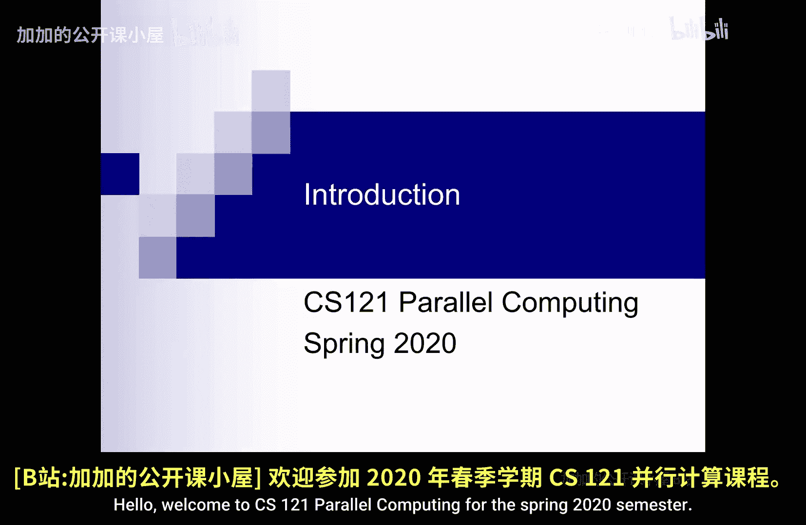

So this is the first lecture， so Id like to begin by talking about the format for this class。

So to introduce myself， my name is Ray Fan， I'm an associate professor in the School of Information Science and Technology at Shanghai Tech。

The best way that you can reach me is through email at this email address。

And if you have urgent matters， you can also call me at my cell phone at the cell phone number。

So the format for this class will be different than from previous editions of the class。

 so we'll be taking an online flipped classroom format。

And what that means is that I will upload lecture notes and videos to the course Blackboard website。

 like I'm doing for this current lecture， and I'll do that a few days before each class。

And once the material is online， students should look at the videos and also study the lecture notes before class。

And then for the classes， we'll also be doing those online and those will be held weekly at the regular lecture hours。

 which are Mondays and Wednesdays at 3 to 4：40 pm。And so during these online classes。

 I'll get a chance to interact with all of the students and you will be able to ask questions about anything that you're not clear about or and we can also have discussions about other aspects of the class。

And in addition to this， I'll set up a course Piazza website where we can have additional questions and answers and other types of discussions。

So the way that we're going to do these online classes is using the software called Zoom。

 so the software is available for all the different operating systems， including Windows or Mac。

 Linux and also for your cell phones like iPhone or Android。Okay。

 so the way that you can use Zoom is， first of all。

 you can to the you can go to this website right so here I've given the URL for the to download the Windows installer。

And depending on your operating system， you might need a different URL。

And then once you get the software， you should make an account with the software。

And then before the start of class right so before Mondays and Wednesdays at3 o'clock you can log into Zoom and when you log in you need to give a meeting ID right so this is the ID for the class for the meeting room where our classes will be held okay so we'll always be using this number so every week when you log into Zoom you can log in with this meeting ID。

And the reason that we're using Zoom and not some other format like WeChat or something is because Zoom allows you to see what is on my computer screen right so Zoom allows you to do screen sharing and so this way we can have more useful discussions because。

 for example， I can draw diagrams or write equations which I cannot do with something like WeChat。

Okay， so I have actually not used Zoom before to do a class。

And I'm hoping that we won't encounter any technical issues， for example。

 we have about 25 students in this class so hopefully the bandwidth on my computer is enough to keep up with all these students so if they design the software well then everything should work well and if we do find any problems then we'll figure out some other way to get around these。

 but for now let's try to use Zoom for the first class。Okay， so in addition to the lectures。

 we have a TA for the class， his name is of Wang Lehan and his email address is given below。

And the TA will also be able to answer questions from the students， and in addition。

 the TA will hold recitations， maybe once every two weeks or so。

So the recitations are basically designed to answer questions about the problem sets right so each time a problem so each time you submit a problem set we'll have a recitation the following week。

And the format and time for the recitations is to be determined and we'll let you know how that goes。

Okay so next about how the course will be assessed。

 so basically we have five components for the course okay so the first component is problem sets and this counts for about 20% of your overall mark for the course。

So we'll probably have a problem set every， let's say two weeks or so。

 right so there's going to be about six problem sets in total。Okay。In addition to that。

 we'll have labs for the class and the labs are designed so that you can get practice using the various programming languages that we'll be talking about in this class and in particular OpenM and the Kuda language so I'll give you different problems that you will code up using OpenM and KUa。

Okay， next we have a project， so in fact we have two projects。

 the first project is a reading project so this also counts for 20% of your grade。

 but you will do this project in teams of two people okay so you can select who you want to work with and so just let me know who you want to partner up with。

So the reading project basically is a way to expose you to the research literature that's happening in parallel computing。

Okay， so in this class， we'll mostly be talking about sort of some of the fundamental concepts in parallel computing。

 but it's good for you to get exposure to some of the state of the art also。

And so for this reading project， I will propose a reading list to which I'll put online。

So the reading list is going to consist of interesting research papers on different research frontiers in parallel computing。

And so from that list， you and your partner should pick a paper that you find interesting and you should write a report on the paper okay。

 so first of all， so I'll put up the reading list in about in a few weeks okay so I'll announce when that reading list comes out and then you should take a look at that and then by week8 or which is about April 24th。

You should let me know which paper from that list you want to。You want to read and report on。

And then eventually what you need to turn in is a report which summarizes a paper。

And also you need to make a video summary about the paper and for the video you can make it in the format of for example。

 these lecture videos， so just make an MP4 of your report and the video should be about 20 minutes long and again it should summarize the main content of the paper。

And this should be submitted at the end of the class， the course， which is week 16。

 which is June 19th， if I have my dates right。Okay。

 and the other project for the course is a programming project， it's a course project。

It again counts for 20% and again you can work in teams of two people。

 so you can work in the same team for the reading project and the course project and here the difference is that instead of finding a paper to report about you should find a problem that you think is interesting right and then you should write an efficient parallel program to solve that problem。

Okay， so I'll have some suggestions for what kind of problems you can look at okay and you should decide on your problem by week 10。

 which is May 8th， okay so you should tell me what your problem is and then you know we can have a maybe a small discussion about whether that problem is appropriate or feasible。

And then for this project， you need to write a program to solve your problem and then also write a report about how your program works。

 its performance and other aspects of this project。And again。

 you should make a short video about your project。And this needs to be submitted by the very end of the course right so after the final final exams are over。

 which is by July 3rd。And then the final part of the course is a final exam， which。

So I haven't decided on the format of this， but probably this will be some sort of it will use some sort of online component so I imagine that we'll set an exam date and then on that day I'll basically upload the exam to the course website to the Blackboard website and then all of you can download the exam do the exam in about two hours and then and then to submit your exam I think I'll have you take just pictures。

 just photos of your solutions and then send those to me okay so it's a normal exam of about two hours it'll be partially open book meaning that you' are allowed to have let's say a few pages of notes so I'll decide how many pages later so you can write up some notes by yourself and you can use those notes during the exam。

 but you're not allowed to use any other resources so for example。

Not allowed to go online to look for answers obviously okay and then yeah。

 so so we can think about we can talk about the format for the exam as the course goes on。Okay。

 so that's the basic way that the course will be assessed。Okay。

 so now let me get into the main content for this class okay so to begin with so this is parallel computing and so the first question you would have is you know what is parallel computing and why should I care about parallel computing？

Okay， so so for the first question， panel computing is basically studying how we can use multiple computers to solve a problem okay so when when you take your algorithms class right class the algorithms that you get well they're presented in a linear format right so there's basically you kind of imagine that there's one processor executing your program。

However， if you have a very large program then having one processor would take a long time to execute the program and so in that case we want to have multiple computers solving this problem together so that's what parallel computing is。

Now in terms of why you want to do parallel computing， well there are many different reasons。

 so the first reason is that if you have a large problem and if you use multiple computers to solve it。

 then you can solve that problem faster。So in fact， ideally。

 if you use K processors to solve a problem， then you can solve the problem k times faster。

OkaySo if you have a thousand processors， maybe you can solve your problem a thousand times faster。

Okay， another reason to use multiple computers is that when you have multiple computers。

 then collectively they have more memory and so they can solve a larger problem。Okay， so for example。

 if you're trying to do a simulation of some sort if you have only one computer。

 it's got a limited amount of memory， and so you can only do a small simulation。

 if you have many computers， then altogether you have much more memory and so you can do a much larger simulation。

You can also think about doing the same simulation， the same size of simulation。

 but you can do it with more accuracy。Okay， so because you have more memory then you can look at the data in a more precise fashion and you can solve the same problem with greater accuracy。

Okay， a third reason you might want to use parallel computing is that it could be more fault tolerance because if you if you're running a program and you only have one processor。

 then if that processor fails， your program won't finish but if you're using multiple processors。

 if you're using a thousand processors for example， then even if one processor fails。

 you can still continue with the rest of your computation， so you get this fault tolerance。However。

 this is kind of a double edge sword in the sense that when you use more computers。

 you get more fault tolerance， but you also increase the probability that one of your computers will fail。

Because if you're using 1 thousand0 computers， then it's more likely that at least one of those computers will fail during your computation than if you're simply using one computer。

Okay， so we have to be able to deal with these faults also。

Okay another reason that we want to study parallel computing is because basically all computer systems that you encounter today are parallel so if you want to make efficient use of the computer architectures that we have available today。

 you need to understand parallel computing。So if you look at multicore processors so not only do you have multicore processors in your desktop computer or your laptop。

 even your cell phones nowadays have multiple cores in them right so if you have an iPhone or an Android it's going to have four processors or six processors or eight processors so those are multicore processors。

If you play games， you're also using parallel computing because the graphics processing units that you play the games on。

 those actually have many， many processors， those have thousands of little processors within them。

And of course if you go online then you're using something like a cloud computing resource and those are also built from many。

 many thousands of processors， so basically all types of modern computer systems are parallel so if you want to know how they work and if you want to be able to make use of them efficiently。

 then you need to understand how to do parallel computing。Okay and finally。

 parallel computing is crucial for many of the applications that we care about nowadays so for example。

 many things that we do today rely on machine learning and the reason machine learning has been successful in the past few years or one of the main reasons that it's been successful is because it can make use of parallel computing to do the computations much faster without parallel computing。

 we can still do machine learning， but everything would be so slow that nobody would want to use machine learning。

啊。We also have data mining right so whenever you go to a website it can make suggestions for what you should do at the website and this is based on mining the data that the website knows about you right and these algorithms are also very computationally expensive and they also use they also depend on parallel computing。

And then also there are many types of simulations that use parallel computing。

 and I'll talk about a few of those later and why they're important。Okay。

 so that was why Powerable computing is useful and in fact， essential for modern computing。Okay。

 so next， let's talk about what we should try to accomplish in this class。

So the goal for this class is for you to understand the basic techniques and concepts in parallel computing okay so both from the algorithmic perspective and also from the hardware perspective so I'll be talking about different hardware models of computing different types of parallel computers and how they're constructed and also'll talk about how these different hardware models interact with the software that you design for these models。

So in fact， for parallel computing， there needs to be a very close synergy between the types of software that you use and the type of hardware that you're running the software on so that interaction is something I'll be talking about also。

Okay something else we'll talk about are limitations of are both the power and limitations of parallelism okay so if you use parallel computing in the right way。

 you can get a lot of benefit out of it， but parallel computing is not a magic bullet for everything so there are。

There are certain limitations and challenges that we need to be aware of。

 and that's also something we'll cover。And then lastly。

 we'll talk about a number of different efficient parallel algorithms。

And these algorithms are often building blocks that you need to use when you write larger real world parallel applications。

Okay， so next， I'd like to begin by talking about some of the actual applications that we encounter for Pow computing in everyday life。

Okay so there are many different types of applications so one type are different types of simulations。

 so one type of simulation are these fluid dynamic simulations okay so for example if you're designing an airplane right then you can you would like to know how the air is going to flow around your airplane and so to do that you need to conduct a very large scale simulation。

For the airflow and that simulation is going to involve a very large amount of computation and to do that in a feasible amount of time。

 you need to parallellyze that computation。Likewise。

 you can do similar simulations to study how the weather will behave， right。Yeah。

 so model you can write down various equations about how airflow and temperatures change and interact with each other。

 and you can plug that into a very large simulation。

 and that will let you predict hopefully with some accuracy how the weather will be changing over time。

Okay， another type of simulation that we can do are simulations for biological applications。

 so for example we can look at we can do simulations about how proteins will behave so proteins we know that the function of the protein is based on the structure of the protein and so we want to so given a description of the protein in terms of its amino acids we want to know what shape that protein will take and to do that we can we can run a very largescale simulation to predict how the protein will change or fold into certain shapes。

And we can also look at how drugs and so drugs are also biological molecules。

 so we can look at how different drugs will interact with proteins and other parts of the body。Okay。

 other types of simulations we can do are various types of simulations for physics such as quantum simulations or cosmological simulations。

 and these have applications both scientifically and also they have engineering applications。

 so for example some of these quantum applications can help us do more precise simulations when we want to design new materials。

Okay another application for parallel computing is crypto analysis。

 so a lot of the data on the internet is encrypted for privacy reasons。

 but sometimes the government wants to have access to this data in order for various purposes and to do that they need to decrypt the information and since right now we have no efficient means to decrypt certain types of encrypted communication。

 then the only method that we have are basically brute force methods and so this involves a huge amount of computation which we need to use parallel computers for。

Another type of application is big data analytics right so I mentioned that know when you go to a website。

 this website actually knows a lot of information about you because you might have visited the website in the past or the website as many other visitors so basically the website collects a lot of information and uses that to predict how you would interact with the website so these types of analytics also involves a huge amount of data and this also requires parallel computing。

We can also use simulations to simulate various types of financial or social behaviors right so how will the stock market behave so to know that we need to construct a model for the different companies and we also need to construct a model for how people behave because people are the ones who buy and sell these stocks or well actually nowadays we have computer programs that buy and sell these stocks so we can try to construct a model for how these computer programs behave and once we have this model of many different components of this financial or social system we can put it all together and then run a big simulation to predict future behaviors of the system。

And another very important application for parallel computing nowadays is machine learning and artificial intelligence so of course you all know about the importance of things like deep learning and how successful it's been for things like image recognition and speech recognition and there are new applications for machine learning being discovered all the time。

 such as reinforcement learning and other directions。

And so these all involve learning patterns or discerning patterns from large。

 very large amounts of data so the only feasible way that we have of doing these of running the current generation of machine learning algorithms is through using very large scale parallel computations。

Okay， so so the current algorithms that we have for machine learning are not really。

Are not really doing anything intelligent， basically they're just finding patterns in the data。

 so one of the main goals for science is to be able to actually understand how to create a truly intelligent system。

And so one way to do that is， well， the only example that we have or truly intelligent system is the human brain and so there are attempts to simulate the human brain and not just sort of superficial behaviors of the human brain。

 but really to have a very deep and complete simulation of the brain。

So we know that the brain has billions and billions of neurons and trillions of connections between these neurons and so in order to run such a simulation。

 we need to have a very large scale computer so this is also an important application and future direction for parallel computing。

Okay， so next I want to give an overview of the types of parallel hardware that we deal with。

Okay so as I mentioned， the hardware in parallel computing。

 the hardware and the software need to somehow match each other。

 this is less of a consideration in sequential computing when you write a sequential program。

 you don't think that much about how your processor is designed。

And the basic reason is that there's basically just one design for sequential computers。

 but when you get to parallel computing， there are actually many different designs for parallel hardware。

 and so when you write a parallel software， you need to be very aware of the type of hardware that you plan to run on。

 and you need to make the software， use the capabilities。

 be able to exploit the capabilities of your hardware。Okay， so what does parallel hardware look like。

 well a parallel system basically consists of many processors so each of the processors can do independent computation。

 but because we want to combine all of these processors to solve one overall problem。

 then the processors need to communicate with each other， and this is done through an interconnect。

 communication interconnect between the processors。Okay， so as I mentioned。

 when you look at sequential computing， there's basically one model for sequential computing。

 which is this von Neuman model right so the von Neuan model is that you have memory and you have a processor and then you have communication between these two things。

When you move to parallel computing， however， you have many different。Paraallel architectures。Okay。

 so。Yeah， so for example， in this figure over here I'm showing one particular architecture right so this is a。

It's a combination of a distributed and shared memory architecture and in later lectures I'll talk more about what those terms mean。

 but basically right now what you see is that here we have a collection of 16 cores so the course are these little red things over here and this is where the computation is being done and of course we need the course to be able to communicate with each other。

And so what we've done is we've broken these 16 cores into four blocks with four cores each right so each of the blocks can communicate with each other through this thing called a shared memory and again I'll talk more about shared memory later。

However， if you want course from two different blocks to communicate。

 then they have to go through this black region over here。

 which represents a communication network okay， so there's two types of communication in this architecture。

 both a shared memory and the network。Now， as you can imagine。

 you can actually combine the shared memory and the network in many different ways。

 and these different combinations lead to different types of parallel hardware designs。Okay， so。

Right and in addition， the course themselves can also or these processors right these little red regions over here。

 they themselves represent either cores or processors and they can be designed in different ways。

 so for example we can have processors which are multi corere processors or many core processors or FPGAs or other types of designs。

And I'll get into that more about that later。Okay another way in which different parallello computers can differ is the way that their interconnects are designed so there are many possible interconnect architectures。

 so here I'm just showing a few of them you know we have things like the bus architecture which is one of the most basic architectures。

 we have a ring architecture which is like a bus with one additional edge， we have a star。

 we can have a mesh， a tree or even a fully connecteded architecture so the communication architecture of the computer as a major effect on the performance of that computer and also the complexity of building such computer and so several so we'll have later lectures which discuss different aspects of designing these interconnected networks。

Okay， and something else I will say is that we can have when you build a parallel computer。

 it's not a uniform system， rather it's a hierarchical system where we have parallelism at multiple different levels。

 okay so the overall parallelism that you have is sort of the aggregate of all the parallelism that you have at the different levels。

Okay， so for example， this figure on the right， this is showing the design of a supercomputer。

So here we have parallelism at multiple levels， have a we start out with a single chip and the chip has within itself parallelism add for example。

 the instruction level or the core level so we can put several of those chips together into a processor and put that into a card and then we can take several of these cards and put them together into a node。

 we can put multiple nodes together into a rack， and then we can combine multiple racks into a big supercomputer。

So in fact， I'll go through more about this process later when I show you the more details about the design of a particular supercomputer。

 the Tianhe2 computer。Okay， so next let's talk about some aspects of parallel software。Okay。

 so so here we're thinking about how we can design a program which solves a problem in order to solve a problem in parallel。

And so what we need to do for that program is if we're trying to solve a large problem。

 we first of all， since we're trying to use multiple processors to solve this large problem。

 we need to break the large problem into small subproblems。

And then we'll assign different processors to solve each of those different sub problemsblem。Okay。

 so， and the sub problems should be somewhat independent of each other in the sense that。

We can work on multiple ones of these problems at the same time， that's what independence means。

on the other hand， if all of these problems were dependent on each other， if for example。

 we have three problems， but you need to solve the first one before you solve the second one and you need to solve the second one before you solve the third one。

Then there's no way that we can achieve parallelism because the only thing that we can do is solve these problems one at a time。

 because the problems depend on each other。On the other hand， if the problems are independent。

 then we can assign multiple processors to solve all of these problems at the same time。Okay。

 so the first step is to take a problem and break it into these sub problemsblems or these tasks。

Okay， so next we need to use the operating system and the scheduler in the operating system to decide how to。

How to execute these tasks？Okay， so the first thing is that we need to allocate。

 so we have a fixed number of processors and a sum number of tasks。

And we need to allocate the tasks to the processors。And so for example， in this figure on the right。

 I'm showing one instance of some example problem， so this problem consists of a bunch of these tasks which are indicated by these circles。

O。And furthermore， there are dependencies between these tasks。Because for example。

 we need to solve the top red task before we can solve any of the tasks below it。

🤧So whenever we have an arrow between two tasks， that's to indicate that。

The tail of the arrow needs to be solved。😡，Before the task at the head of the arrow。Okay。

 so when we allocate these tasks using the the operating system。Or the scheduler。

We need to do so in a way that respects these dependencies between the tasks。Okay。

 something else we need to do for the Pbble software is that the way that we decompose our problem should be matched to the hardware that we're running on okay。

 so for example， there should be similar amounts of concurrency in both our task decomposition and the hardware。

So if we decompose our task into， let's say these， well， I'm not sure how many there are。

 but let's say there are 20 of these tasks， okay， so now we have 20 tasks。

And we should have something like。You know， something like five or 10 processors。

 right we don't want to have a thousand0 processors if we only have 20 tasks because that way you know most of our processors won't be used。

But likewise， if you have many， many tasks， you don't want to just have a few processors so here we have let's say 20 tasks。

 we would like to have more than just say one or two processors so that we can do more of these tasks in parallel。

So we need to match the amount of concurrency in both the software and the hardware。

Something else is that the the hardware has to be able to support the communication pattern that the software requires Okay。

 so different different programs have different communication patterns。 So， for example。

 some programs might be quite simple and you could。You can arrange the tasks， let's say， on a line。

 and then each task only needs to communicate with two other tasks， right itss neighbors on the line。

🤧咳。So in that case， you can actually run the program on a。

On a pretty simple piece of parallel hardware。But if you have a more complicated program where all of the tasks need to communicate with all of the other tasks。

Then you need to make sure that your communication network can actually support that large amount of communication。

Okay and so because different programs require different types of hardware in order to run efficiently。

 then that implies that there's no single type of parallel hardware that is efficient for all parallel softwares。

Okay， so another way to say that is that parallel programs are not portable。

If you take one particular parallel program and you run it on different parallel machines。

 you get very parallel you're going to get very different performance because for example。

 some of those machines might support very efficient communication whereas others do not。

 and so you get very different performance。And so this is another reason that you need to match the requirements of your software to the capabilities of your hardware。

Okay， so this lack of portability for parallel software is actually a big problem right so one of the great things that we have about sequential computing is that sequential hard software is usually portable you can take the same program and you can run it on on an Intel processor or an AMD processor or know if you recompile it you can run it on an arm processor and basically you get。

You get similar types of behavior， because。Even though we have different types of processors。

 fundamentally， they're working in similar ways。But again， this is not true for parallel computing。

OkayAnd so to overcome this problem of lack of portability。

 people have tried to build different conceptual abstract models for parallel computation in order to have a model which is general enough so that your parallel software can become more portable。

so one such model is called the PRRAM model， okay， so we'll talk more about the PRRAM model towards the end of the course。

 but basically the PR RamM model tries to build an abstract model for parallel computations。

And it's successful in some ways， so for example， the PM is really good for helping us understand where the parallelism is in a problem。

Okay however， it's less successful in other ways， because even though we know where the parallelism is。

 PM doesn't say much about how you can successfully execute that amount of parallelism and the reason is that the PRM model does not account for the cost of communication。

Okay， so communication is actually quite important or is actually very important。

 and the PRRIM model does not have any way to account for this communication。

 and so therefore the costs that you get in the PRBM model do not match usually do not match the performance that you get in real life。

Nevertheless， the PVI model does have some uses and as I mentioned。

 we'll look more at that model later。In the course。Okay。

 so now let's talk about some of the challenges in parallel computing okay so parallel computing is all about getting you know many。

 many entities to work together to solve one big problem sort of like how the pyramids are built right so if you look at the pyramid right you can't imagine building that with only one person。

 you need thousands and thousands of people working together in order to build that pyramid。However。

 even if you have thousands of people， it does not mean that they can actually build this pyramid because the people need to work together as a team and when you want many。

 many people to work together as a team， then you face many challenges。Okay， so for example。

 one of the challenges you have is， as I mentioned。

 it's communication so in order for many processors to work together to solve one big problem。

 the processors need to talk to each other， need to share data they need to tell each other which parts of the problem they're working on and which parts they've finished。

Okay and and communication is hard because first of all。

 processors can compute much faster than they can communicate okay so in each second your processors can do many。

 many computations， but they're not able to pass the results of all those computations to other processors there's a bandwidth limit on how much your processor can communicate。

And furthermore， when you have multiple processors。

 then the amount of communication actually increases very quickly and so the problem so this communication bottleneck gets much worse as the number of processors increases。

So for example， if you have let's say three processors， right。

 then you could have maybe this oops this triangular communication pattern。

 right so you need three communication links between the three processors。Now。

 if you have a fourth processor， right， then if this fourth processor needs to talk to all of the other processors。

 then now you have six communication links。Okay， if you have a fifth processor， right。

 let's say over here， right then。Then are we're going to have 10 communication links Okay。

 so in fact， if you have M processors。Then if all of the processors need to talk to each other。

 we're going to have basically n squared communication links。Okay。

 so the amount of communication is growing much faster。

 it's growing quadraically compared to the number of processors。

And this is one of the main bottlenecks for Plo computing。Okay。

 another challenge that we face is synchronization between the processors。Okay， so the。

So when we're trying to solve multiple tasks together。

 the tasks can actually interfere with each other。OkaySo as a sort of an illustration of that if you look at this road so there are multiple things that can happen in parallel on this road。

 so for example， the cars can cross either horizontally or they can cross in this vertical direction right？

However， they cannot cross both horizontally and vertically at the same time。

 right these different cars that are crossing in the different directions need to synchronize with each other。

 they need to coordinate with each other， and that's why we have traffic lights。

And if you don't have this coordination， then you can get things like this situation here where you have so basically all of the cars are stuck right。

 none of them can move， the buses can't move， the cars can't move because they're all being blocked by each other。

So we need to have this synchronization， for example， the traffic lights。But of course。

 having synchronization imposes costs， nobody likes waiting at a traffic light。

 but this is the cost that you have to pay in order for many cars to use of roads in parallel。🤧。

Another problem that we face is scheduling okay so I briefly showed an example of how scheduling works。

 so we have many tasks and we need to allocate those tasks to processors and we also need to decide when the processors run the different tasks okay so there are many different dependencies to enforce and so the scheduler actually needs to run a pretty complex algorithm in order to make sure that it enforces all those dependencies and in addition to that the processor wants to make sure that it's using all of the hardware resources it has available so if it has many tasks and many processors it wants to make sure that all of those processors are actually running something they're not sitting idle。

Okay， so in order to find a good allocation between the task and the processors。

 we need to consider issues like data locality， or we have different types of heterogeneous processors and we need to think about which tasks we put onto which types of processors。

And then once we've assigned these tasks to processors。

 we should also think about how to allocate the resources on each processor to the task， right。

If we have one processor and it's running several threads。

 how much memory should we give to each thread so that altogether the threads can run efficiently？🤧。

Okay， other challenges。So we have this distinction between us problems which are structured versus unstructured。

So a structured problem would be something like a dense matrix computation right so for example。

 if you think about multiplying two matrices what you do is you take a row of a matrix of the first matrix and you multiply by a column of the second matrix you do the dot product of that。

And you do that for every single entry of your output。Okay。

 so this is a very structured computation in the sense that every output you produce is produced using the same process and this process is a very regular process right you go through one row and one column。

On the other hand， if you look at other things like if you do computations on a graph。

 okay so you can see that graphs are much messier than matrices on a graph you could have a node which is connected to many other nodes or it's only connected to a few nodes。

There's very little structure to the graphs that we have to deal with in real life。

And so it's actually easier to solve problems when you have the structure， okay。

 if you know for example， which data you need to access and what kind of computations you're doing on this data。

 then you can build custom hardware for those computations。

 whereas if you don't know the structure of your computation。

 then you have to build a very general purpose hardware， which is necessarily will be less efficient。

Okay， another challenge for Plet computing is that。

Even if we can address all of these problems about communication and synchronization and structure。

 there are some problems which are simply not parallellyizable or at least they don't seem to be parallellyizable we have problems that we currently have no efficient parallel algorithms for solving them。

We also cannot prove that there does not exist an efficient parallel algorithm。

 but currently the state of the art is that we don't have efficient parallel algorithms for certain problems。

Okay so for example， one problem is the shortest path problem if you use dixts algorithm okay so dixtres algorithm lets you find the shortest path from a single node in a graph to all of the other nodes in the graph however。

 the way that diyxtruss is set up is if you remember how the algorithm works。

It's basically it's a very sequential process because at any point in the execution you have these values for all of the nodes right so these are the estimated distances。

And you're always processing the node with the smallest estimate right the unprocessed node with the smallest estimate right so this this seems to be a very sequential process because every time you process one node。

 it affects the distances on all of the other node and so you don't know the order that the nodes will be processed it you can only know the next node to process after you process the current node。

Okay so Dextra seems to be an inherently sequential type of algorithm。

 and currently we don't have any efficient parallel ways to run Dexter's algorithm。Okay。

 now there are other algorithms which they look like they're sequential。

 but they're actually not sequential right you could come up with a more clever algorithm run something to solve these problems in parallel。

Okay， so one example would be computing the Fibonacci series okay so if you remember the Fibonacci series is a series of numbers and the way you get the next numbers is that you add up the previous two numbers。

Okay， so therefore this process looks like it's a sequential process because。

 whenever you want the next number， it seems like you need to know the previous numbers。Okay。

 however， it turns out that if you use a more clever algorithm。

 you can actually compute the Fibonacci series in parallel。Okay。YeahSo so therefore。

 a big part of parallel computing is coming up with algorithms that can solve a problem with sufficient parallelism。

Um， but sometimes you know， we're stuck， there are problems that nobody has been able to come up with efficient parallel law solutions for。

 like this dixtterrous problem。Okay and the last challenge to designing parallel in parallel computing is just this sort of human factor that we as people have to come up with these algorithms and design this hardware and the reason it's hard for us to come up with parallel algorithms。

 for example， is because in a parallel algorithm， you have many things happening at the same time that's the definition of parallelism is that you have many things happening concurrently。

And so if you want to design an efficient and correct algorithm for this。

 you have to keep track of all you as the person who's designing this algorithm。

 you have to keep track of all of these different things happening and this is hard to keep track of so many things in your head。

Right I mean， people aren' just aren't built for that。

 people are built for keeping track of one thing at a time。

 and if you try to think about 10 things happening at the same time， you your brain gets fried。Okay。

 so yeah， so there's that human factor also in designing efficient parallel algorithms。Okay。

 so that was like a brief introduction to different aspects of parallel computing， right。

 the parallel hardware， the software and the challenges that we face。Okay。

Now I'm going to give you an outline for what we'll be covering in the course。Okay。

 so we'll begin with。So the first part of the course we'll talk about different types of parallel architectures。

 so I mentioned that we have the shared memory architecture。

 we have what's called distributed memory and we have many core architectures and we'll covered different aspects of these architectures。

Okay after that， I'll tell you about different ways that we can program the parallel hardware so because there are different types of hardware。

 different there are also different types of languages that we use to take advantage of these different hardware architectures。

O， so the languages well cover include open MP， MPI， Kuda and Ma produceduce。

Okay so after we cover the languages， I'll talk about how you can go about designing an efficient parallel algorithm okay so there are several steps for example。

 you need to decompose a problem you want to ensure that your decomposition has certain properties like the different tasks are balanced with each other and then you also want to be able to schedule these tasks onto the hardware so we'll talk about these different aspects。

And then as I mentioned there are these parallel algorithms which are building blocks for other types of parallel computations and so we'll try to cover most of the fundamental building algorithmic building blocks so these include things like dense and sparse matrix algorithms right it includes sorting in parallel or searching in parallel we'll talk about some parallel graph algorithms。

And then I mentioned that there is this P Ram model， which is a theoretical model， which is meant to。

Help create portable parallel algorithms Okay so now there are issues with this model。

 as I mentioned， however， the algorithms that you design using PgramM。

 at least you can take those core ideas and try to apply them in different real world settings and so therefore we're going to go through some of these PM algorithms and see how you can use these these basic ideas in more real。

For the next part of the lecture， I'd like to talk to you about the history of parallel computing。

 how we got to where we are， and also the state of the art in parallel computing。

Okay so to start with a history， so parallel computing basically started in the 60s so it started quite a long time ago basically with a dawn of computing。

 so computing might have started in the 40s and once we got to the 60s and real electronic computers when people started thinking about how we can use many of these computers to be able to solve problems faster。

So by 1976 we have the first supercomputer， the Cray1， which had a speed of about 160 megafls。

 so it could do 160 million floating point operations per second。Okay and during the '80s。

 supercomputing really flourished， and there were a number of successful supercomputing companies。

 supercomputer companies that started up， including Cray and thinking machines and many other companies。

And now one property， one characteristic of these computers that were built during the '80s is that they were basically custom built。

 okay so each of these computers had its own architecture and its own processor。

And it was very expensive to design these processors， okay。

 so it took years and years and a huge amount of effort to come up with each new generation of these processors。

嗯。And so because it took so much effort to construct these custom supercomputers。

 then as we went into the 90s， a new type of architecture for supercomputers came to be adopted。

 and this was called the massively parallel processor architecture and the cluster architecture。

So these MPPs and the clusters， they are related to each other， but there is a difference。

So both the MPPs and the clusters use， they do not use custom processors。

 instead they use these commercial off the shelf processors like Intel processors or IBM processors。

However， the MPPs use these commercial processors， but they have their own custom interconnects。Okay。

 so they don't buy a commercial interconnect， they design a special interconnect to connect up all of these different regular processors。

Now on the other hand， the clusters they not only use the off the shelf processors but they also use off the shelf interconnects such as Ethernet。

 and so it becomes very and the operating system that they use is typically Linux so basically to build a cluster computer it really doesn't take that much effort you just buy some processors buy some by some networking equipment and then put a regular operating system on top of all this and then you could have a pretty powerful computer。

Okay so in fact， this is the way that most data centers today are built， they're cluster computers。

Whereas most of the supercomputers today are MPPs， they have their own custom interconnects。

Okay so in fact， today the fastest supercomputer we have is the IBM sumummit computer。

 and this is a massively parallel processor and it runs at about 150 petaflops per second so a petafloop is it's 1000 teraflops so it can do 150。

000 trillion operations floating point operations per second。

And this is about a million times faster than a typical death workstation that you have at home。Okay。

 now， apart from these supercomputers， which continue to be built ever since the '80s。

Progress in parallel computingut actually sort of stalled right so basically the only area where people were working heavily with supercomputing from the 90s until the mid 200s was in the supercomputing area。

Okay， so now I want to talk about the reason that there was such sort of a dry period in parallel computing during the 90s to the 2000s。

And so basically the reason is that it was not cost efficientic to study parallel computing during those years and the reason it wasn't cost efficientic is because of Moore's law。

 so I'm sure you've all heard of Moore's law so just to recap back about 50 years ago right in 1965。

 Gordon Moore， who was the co-founder of Intel， predicted that the number of transistors that we could put onto a processor would double every 18 months。

And remarkably， this prediction has basically held true for the last 50 years。Okay。

 so here what we see graph on the bottom is the number of transistors on different processors over time。

And we can see that it's basically followed this exponential growth pattern that Moore predicted over 50 years ago。

Okay now it's important to note that Moore predicted the number of transistors would double every 18 months。

 he didn't predict that the speed of computers would double every 18 months。However。

 what has been true in the past until about the mid-200s。

 until about 2005 was that whenever the transistor count doubled。

 the speed of a processor would also double。Right。And so what that meant was that even on a single processor。

 we could double the number of transistors every 18 months。

 and that would also double the processing performance of that processor every 18 months。

And so this was the thing that held back development of parallel computers because there was simply no need to design a parallel computer because it takes such a long time to design each parallel computer and by the time you finish with the design the speed of a single processor would have already improved dramatically。

 and there would be no need for this parallel computer。Right。Yeah， and so so this。

This phenomenon was true until about 2005 but once we got to 2005。

 something happened which made Para computing become much more important。

And what happened around 2005 is well we can see it in this plot okay so if we look at 2005 over here。

 what we see is that before 2005 so the top line that we see over here is Moores law so this is saying that the number of processors would double every 18 months。

And this has been true even after 2005， right， in fact， it's true even up to today。

🤧And what we see before 2005 is that each time the number of transistors doubled， right。

 we could also。Increase the clock frequency of processors。And by increasing the clock frequency。

 we could also increase the performance of the processor so the frequency is shown in green and the performance of a single processor which is shown in blue。

Okay，However， once we got to 2005， you see that the frequencies could no longer increase anymore and because frequencies couldn't increase then the performance of a single processor also could not increase anymore。

🤧。And the reason we couldn't increase frequency anymore was that once you got to a certain transistor count。

The transistors became so small they generated that when you put them onto a single processor。

 it generates a huge amount of heat and also consumes a large amount of power and also leaks a lot of power and because of these reasons you can't increase the clock frequency anymore。

Okay， so then if we're stuck with the same frequency， how do we increase performance？Well。

 you see that basically at around the same time that the green line flatlined。

 you see that this black line over here， okay， picked up。

Now this black line here is the number of cores that we have on a processor。Okay。

 so so basically a processor。 So a core is the the basic computational unit that we have。 Okay。

 it's the thing that does all the computation。And a processor would consist of multiple cores。🤧K。

So once we got to 2005， we couldn't increase the performance for each core。

 because we couldn't increase the frequency of the cores anymore。So therefore。

 to get improved performance， we needed to increase the number of cores that we had。Okay。

 so now each processor that we have has four cores or eight cores。

 and some processors even have 64 cores。Okay， so this is how you get better performance now。

 not through increased frequency， but through increased parallelism by increasing the number of cores。

And so this is why parallel computing became ever more important after 2005 before 2005。

 you didn't need parallel computing for better performance。But since 2005。

 this has been basically the only way that we can get improved performance。🤧嗯嗯。Okay。

 so the the chips that we use nowadays are typically。Well there ares several architectures。

 one of the predominant ones that you use， for example。

 in your laptop or your desktop is the multi corere computer。🤧Okay， so what we do is that。Again。

 instead of making a single core faster， we're going to put multiple cores onto the same processor。

 and so that way we can multiply our computational capabilities。Okay。

 so this is more efficient than putting a single high speed processor。

 right it's better to replace that high speed processor with multiple slower processors。

another way that you can get better performance is by stacking multiples one of these processors together into a 3D structure。

 but this is still more in the research stage， and so this is something that people are looking towards in the future。

 but it's not a mature technology yet。Now developing software for multi so we've actually been quite successful in scaling the number of cores that we put onto a single chip so nowadays you have for example。

 chips from Intel or AD have dozens let's say 64 cores on a single chip so that scaling has been quite successful however it's actually been harder to develop software for multiCs than it was to develop the hardware and the reason is that in order to develop parallel software you get into this issue about this sort of human centric issue that I mentioned previously。

 which is that humans are not built to think about multiple things happening at the same time if a developer writes a program with many threads then quite often those programs have bugs in them the threads don't interact in the right way。

And so therefore there's a big demand nowadays for software developers who know how to use parallel computing successfully because the only way that we have of taking advantage of our parallel hardware is to develop efficient parallel software and we need developers with those skills。

Okay， so now where are we currently in in terms of parallel computing。

 okay so the computers that we have， the parallel computers we have today mainly fall into four architectures。

 so we have the multicore architectures and these have a small to moderate number of cores。However。

 the good thing about these courses is that they completely general purpose courses。

 they can do any type of computation and the course themselves are quite fast。

So examples of these would include the Xion processors from Intel， the IBM power processors。

 the AMD E processors， the Sunpark and many other ones。O。In addition to the multi cores。

 we have things called many cores okay， so many cores simply have more cores okay。

 so instead of a few dozen cores， they might have thousands of cores。However， these many cores。

 because we have so many of them， they're much simpler than the multi cores。

 so the multi cores are fully general purpose processors and each is very powerful。

 whereas for the mini cores we have many much simpler cores， each less powerful。

And so good examples of the many cores are the GPUs that we have， the NviDdia GPUs。

 or the Y fees from Intel。We also have things called FPGAs， so they're basically custom hardware。

 but you can reconfigure them on the fly。And since they're custom hardware。

 they're geared towards specific problems， and so they can be much faster for those specific problems。

And then finally， we have these Asics， which are completely customized hardware designed for very specialized problems。

So examples of these would be something like the Google TPU。

 which is used to process these deep learning workloads or the Apple Ne engine this is also used for deep learning or the IBM2 North so these are very specialized and geared towards things sort of matrix computations。

Okay， now it's not all about speed right so in addition to having a fast processor。

 we want a processor which is energy efficient and this is important because computers nowadays consume a huge amount of power。

If you look at a large data center， it can consume hundreds of megawatts of power。

 that's equivalent to the amount of power used by tens of thousands of homes。Okay。

 and big supercomputers nowadays can also consume like。Dozens of megawatts of power。 Okay。

 so it's very important that we build computers that。

That are more power efficient because otherwise if we keep trying to scale these data centers ever larger。

 we're going to get to scales that are simply infeasible so right now these data centers are usually supported by their own power plans if we can't improve energy efficiency but we still want to have larger data centers。

 in the future we would need to have multiple power plans， just to support one data center。

And that's just not cost effective。Okay， so one goal that we have would be for example。

 achieving something like for each wat of power that we put in。

 we want to have 50 gigablos of computational performance okay that's like a goal for the future。

 but we're not nowhere near that right now currently the best supercomputers can achieve something like one to five gig like gigablos of performance for each wat of power。

Okay， now in terms of supercomputers， how do we look at the power of these things。

 well there are different ways， but one of the most common widely used ways is this thing called the top 500 list。

So this is basically a list of the fastest 500 supercomputers in the world。Okay。

 and this list was produced twice a year。And the way they measure the performance of a computer of a supercomputers is in terms of how many floating point operations it does per second on a specific benchmark。

 which is called the LiAC benchmark。So this benchmark basically tries to solve a dense matrix problem。

 a dense linear system， okay， so we're given a dense matrix A right。

 and we want to solve for the vector X so that Ax equals some input B。

And the way it solves it is using Gaussian elimination。Okay。

 so if you look at performance using this Li benchmark。

 then the fastest supercomputer right now is this summit supercomputer。

Which is based on the IBM Power9 processors and also Nvidia the Vol processors。

 the Vol GPUs from NVIDdia。Okay， so this summit computer has over 2 million cores。Okay。

 so there are over 2 million of these power nine cores。And。

And it achieves something like 150 petaflops of performance。Okay。

 and it uses about 11 megawatts of power。Okay now the number two supercomputer is called Sierra and this is basically just a scale down version of the summit computer。

 the design of summit and Sierra are very similar to each other。

 but Sierra is about one thirdd smaller than summit so you can see that it's got about one thirdd fewer cores。

 it's got one third less performance it uses about one third less power。Okay。

 so the third and fourth place computers are both computers designed in China。

 so the third place computer is this computer called Taihu Zhiguang。🤧And it basically。

 so this computer actually uses over 10 million cores and it achieves about 100 petaflops in performance at about  15 megawatts of power right？

嗯。Okay， oh right， so this list is coming from November so this is the latest top 500 list from November 2019 and so in a few more months we'll get a new list because this list comes out twice a year。

Now， there's something I should mention for the Liact benchmark， which is that。

Because it's solving this dense linear system using Gaussian elimination。

 this computation is very computationally intensive。However， it doesn't do many memory operations。

So this Li is a good measure for how fast your processors are。

But not for how good your communication network is。Okay， and as I mentioned。

 many computations actually rely a lot more on communication than on computation。🤧。And so therefore。

 this impact benchmark might not be representative for performance on real world problems。

 which have to use the memory system a lot more。Okay， so something else I'll mention is that。

We have these terminology for various speeds and various sizes in in computing。So mega is a million。

 Gia is a billion。 Terra is a trillion。 Pe up is。🤧1000 trillions。

 and the next step up from that is going to be exa， okay， which is 1000 petaflops or。

And so you can see that currently the fastest computers the summit computer it's still far away from doing one exofflop。

 it's doing about a tenth0th of an exofflop right so the next big challenge for supercomputing is to reach one exflop of performance in a single supercomputer。

Okay， and also just to compare these supercomputers with you something that you might have at home。

 right， for example， an Intel multi core， right， an Intel multi corere。So the multi core has。

 of course， multiple cores， but each of those cores can do something like maybe 50 gigablobs of performance。

 if there are fast cores。And also you can compare this performance to a graphics processing unit。

 a GPU， which can do about 10 terralops per GPU。Okay， and and here right again。

 we're doing about 150 petaflops， okay， so that is what that's like 15。

000 times faster than a GPU which can only do 10 teraflops。

Okay something else interesting about the Tod 500 is that we can look at how the performance of these computers have increased over time so this plot over here goes all the way back to 1993 so back in 19 so now there are three lines being shown so the blue line is the one that people usually talk about so the blue line represents the fastest supercomputer for that year and as you can see for 2019。

 the fastest supercomputer did about 150 petaflos per second。Okay。

 the orange line or the yellow line below that is actually the performance of the slowest computer in the top 500 list okay。

 so that's so since we have 500 computers in the list， it's the 500th fastest computer in that list。

And you can see that for last year， this computer only did about one petedafloop。

 so that's about 150 times slower than the fastest computer on the list。And finally， the purple line。

 right， so this is actually the sum of all of the performance of all of the 500 computers in the list。

Okay， so you can see that if you add up all 500 computers， you can get about 1，600 petaflobs。

 or roughly 10 times the performance of the fastest computer。Now。

 it's interesting to look at how these curves grow over time。Okay， so for example。

 if you go back about 20 years right so in 2000， if you look at the computer。

 the performance of the fastest supercomputer in the world at that time。

 you have that it does about  10 terralobs。Right。And as I mentioned previously。

 if you have a GPU nowadays， the GP can also do about 10 teroflobs。

So that means that the fastest computer in the world back in 2000 is equivalent to a GPU that you can buy for like $500 today。

Okay， so that shows you in a quite impressive way how much faster computers have been getting over time。

Now the other thing to notice about this。About these plots is that you see that there is an exponential growth in the speed of computers over time right however you notice that if you look past let's say 2015 so past that point the growth in the speed has been sort of flatlinning right you see that it's no longer keeping up with this sort of exponential growth which is given by the straight line over here。

So what this is showing is that our current ways of building these supercomputers is not is sort of petering out okay we're not getting the same improvements in performance using the same old techniques anymore so therefore if we want to reach even higher performance for example。

 one exafFop performance which is 1000 petaflos then we need to fundamentally rethink how we're going to design these computers because we can't just put six summits together and call that an exafloop computer that's going to use too much power and the processors won't be able to communicate with each other efficiently we have to have new ways of designing the interconnects to scale up to an exofloop。

Okay， something else we can look at is the architecture of these supercomputers over time so here I'm showing how many do we have five main architectures or sorry six architectures so back you know at the very beginning of the top 500 list some of the computers on that list were simply single processor computers。

Right so it was a computer， it was a supercomputer consisting of only one single very fast processor。

And then some of the other types of architectures， but as you can see。

 the single processor architecture died out quite quickly because it's simply impossible to build a very。

 very fast to build one processor which is very， very fast so if you want high speed。

 you're going to have to use multiple processors。So another architecture， which eventually died out。

 were these SPs， which are these shared memory processors。Okay so the shared memory processor。

 basically all of the so here you have multiple processors。

 but all of the processors have the same access to a common pool of memory。

Okay so because you want all the processors to be able to access the same memory。

 you have to put all the processors pretty close to each other physically。

 close to each other and so as you design larger and larger computers like this。

 it becomes harder and harder to put many processors close to each other so therefore you see that this SP architecture eventually also died out because it's not possible to have many。

 many thousands of computers， be able to share one common block of memory。

So now if you look at the modern architectures， right。

 so the main two types of architectures we have today are the cluster computers。

 the cluster supercomputers and the MPP， the massively parallel processors。Okay。

 so remember that I so basically both the cluster and the MPP architecture are built on commercial off the shelf processors like Intel processors or MDD processors the main difference between them was that the cluster computers also use off the shelf networking whereas the MPPs are using custom networking。

Okay， and the fastest supercomputers today are still using custom networks， for example。

 the summit and the CRra computers。Okay so in fact we can look at the types of interconnects which are being used nowadays okay so if you look at the sort of the end of this graph right then well it's kind of hard to tell the colors on this because there's so many different colors but basically the main popular architectures today are these are the areasries in interconnect right so I think that's representing this blue region over here so this is being used in the Cray computers。

Okay， also， you have a lot of computers which are using Ethernet。

 right either 10G Ethernet or gigabit Ethernet。Okay。

 you also have lots of different flavors of Infin band， which are being used， right？

Oh and and we have more infin down here okay Miranet is also something oh I'm sorry not mirrornet。

 but Intel omnipath okay， so this is omnipath down here okay and we have a 40 gig gigabit you think that over here so so the types of interconnects used over time has changed quite a bit right you see that for example this this one is I guess a hypercube the hypercue。

Yeah， so I guess a hypercbe was quite popular， but now basically if computers are not using this anymore because it's very hard to design these hypercuubs。

Okay， so nowadays， most of these things are either custom interconnects like the Aries interconnect or just commercial interconnects like the Ethernets。

Okay so next we can look at some applications that we have for these supercomputers so you see that nowadays most of these applications。

 so first of all I'm only showing this graph up to 20 2015 and the reason is that if you show the graph for 2019 you see that this purple region basically completely dominates everything it takes up like 95% of everything so you can't even see the other parts and what this purple region is is that it's not specified okay so it's not saying what it's actually using the supercomputer what kind of applications it's using but even though it's not specified what's actually happening is that these supercomputers are being used for many different applications so it's not one specific applications it's many different applications and what are these applications well there's still these applications which are being listed over here so you have uses supercomputers for。

Things like research or finance or chemistry or energy or defense。Okay。

 except for now that supercomputers are so general purpose。

 you can use the same computer to do many of these tasks。

Whereas previously sometimes people built a computer just to do one type of task。

Okay so I mentioned that the way the top 500 so it's actually measuring performance on Liac right and Liac is basically looking at how good your computer it is for compute intensive operations and these compute intensive operations the properties are that it has a very uniform control flow and also predictable memory access patterns so the canonical application would be like matrix application right so there the control flow is that you go through a row of a matrix and a column of a second matrix so therefore you know exactly which operations you're doing and also you know exactly which memory locations you're accessing because it's always going to be a row in a column。

Okay， however， nowadays the applications that we care about right they're not this regular。

 we have many data intensive applications， for example， on graphs on big graphs。

 and because graphs usually don't have much structure to them。

 then we don't know which operations we're going to do and we also don't know which memory locations we're accessing。

Okay， and so computers that work well for these compute intensive operations don't necessarily work well for data intensive applications。

And so therefore， to measure the performance of computers on these new types of applications。

 we need new benchmarks。For example， one benchmark is called HPCG。

 so this is a high performance conjugate gradient。And here。

 instead of measuring performance on dense matrices， we measure performance on sparse matrices。

 which have much more irregular memory access patterns。

There's also a benchmark called the Graph 500 benchmarkchmark。

 which measures performance on a graph problem， which basically breathth first search。Okay。

 and what we're going to see is that a computer's performance can actually differ dramatically depending on the benchmark that you're using to measure this computer。

Okay， so first let's look at the HPCG benchmark， so these are results from November 2019。

 and so here we see that the summit and the Sierra computers are still the fastest computers for high performance conjugate gradients。

Okay， however， what's interesting is that if you look at their performance on this benchmark。

Remember that the summitcomputer got about 150 petaplos of performance on the high performance Li on the dense matrix operations。

But once you move to sparse matrix operations， it's only getting about three petaflobs of performance。

Okay， so that's only about 1。5% its performance for HPL。Okay。

 so this shows that doing these sparse matrix operations is actually much harder than doing these dense matrix operations。

 right because you get this like sort of what a 50 fold drop okay in performance once you move to these sparse matrix operations。

Right and you see the same thing for the Sierra computer because basically CRer and summit are have the same architecture right。

 so again， you see that the performance for。For the dense operations。

 right it's something like you more than5 it's like 60 times better than the performance for the sparse operations。

Okay。And you can also see that so the third place computer used to be the Taihuo computer。

 but now you see that once you move to HPCG， the Taihu computer actually moves to sixth place because it's actually quite inefficient for this HPCG benchmark it's only getting about 0。

4% of its performance on sparse matrix operations it's getting about half a petafloop as opposed to almost 100 petaflops for dense matrix operations。

Okay， so this shows that the type of benchmark you look at is very important。Okay。

 so next we can look at the graph 500 benchmark right so here you see that the Taho computer so here the way that you measure so what this benchmark is measuring is this measure called GTab okay so the stands for billions which is the G billions of traversed edges per second。

Because what we're doing is our breath first search。

 so the way that you measure the performance is just how many edges for this BFS can you do per second？

So you see that the Taihoo computer is doing about sorry 23，000 billion traversed edges per second。

And furthermore， it's able to use all of its cores so this computer has about 10 million cores and it's actually able to use all of them for this computation。

 which is quite impressive。Now if you look at the summit computer right。

 so the summit computer gets much lower performance。

 but one reason is that it's using far fewer cores it's using less than 100。

000 cores and this computer has over 2 million cores so it's using less than 120th of the total number of cores that it has。

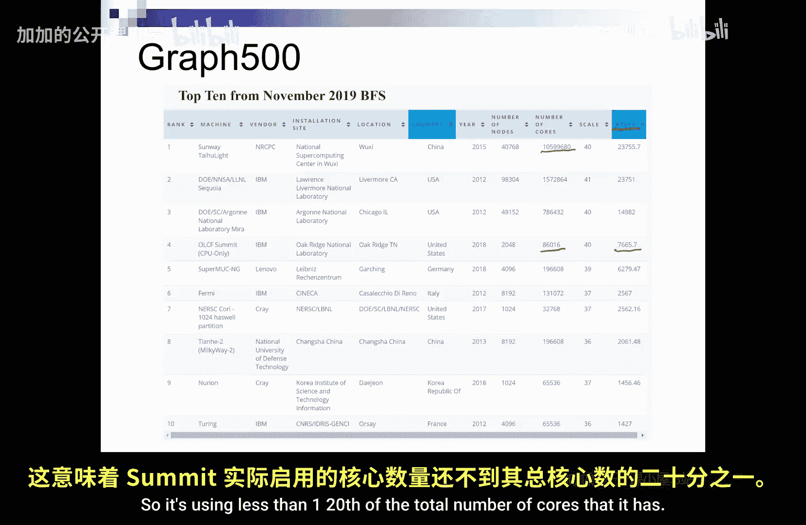

Okay， so for the final part of this lecture， I want to take you through the design of one particular supercomputer so these slides are prepared by this person Yu Tong Lu。

 and this is an overview of the Tianhe2 computer。Okay， so I'm using his slides because， you know。

 he's done such a good job on them that there's sort of no point in me redoing his slides。Okay。

 so the Tianho computer is currently the fourth fastest supercomputer in the world。

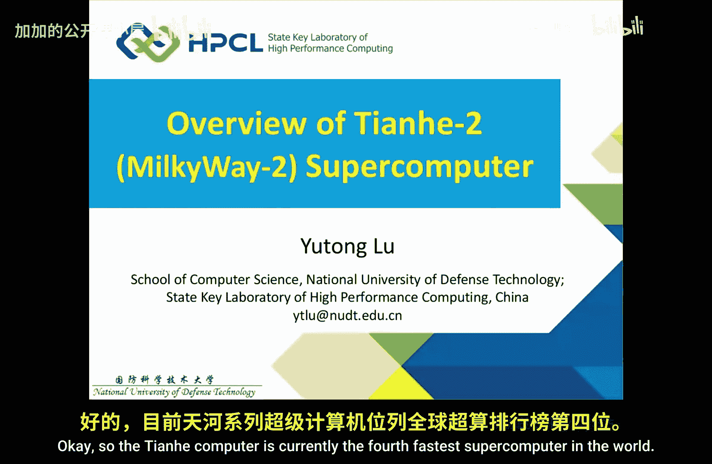

And here's a picture of the computer。So it consists of all of these racks。

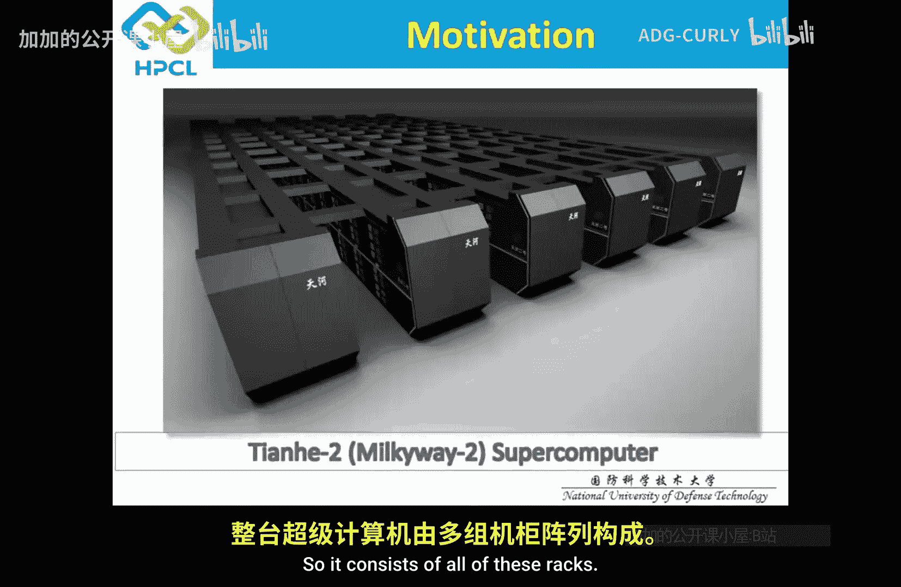

Okay， so yeah， so we're going to go through the architecture of this computer。 So first of all。

 just some numbers， this T0hua computer has， it's based on Intel processors。 So it's got 32000。Sorry。

 so it's got 32，000 Intel Xon CPUs。Okay， and then in addition to that， it's got 48000 Zon Phi CPUs。

 So or Zon5hi CPUs。 Okay， so these Zon Phis are the are the many core processors。 Okay。

 and the Zons are the。Are the multi corere processors？And then in addition to that， it's got about 4。

000 of these FT CPUs， which are used to manage the computer。

They're not actually used for the main computation in the computer。And so if you add up all of this。

You get about 55 petaflops of performance okay so in fact I think they've slightly upgraded this computer recently so that it's getting slightly over 60 petaflops of performance but back when the slides were prepared the computer had about 55 petaflops of performance。

Okay， so you see that this computer is using commercial off the shelf processors just Intel processors。

 but the interconnect right so this is proprietary to this computer right this was designed by the team that built this computer right and this is called the TH Express 2。

Okay， in terms of how much memory it's got in total， it has 1。4 petabytes of memory and for storage。

 it's got about 12 petabytes of storage。And the way this computer is set up is that it's built from a number of cabinets and so it has 162 cabinets in total。

 but there are different types of cabinets， so you have 125 computation cabinets， right。

 you have 13 communication cabinets and then you have 24 cabinets which are devoted to storage。

And then in total， this computer uses about 18 megawatts of power using a air cooling system。

 closed air cooling system。

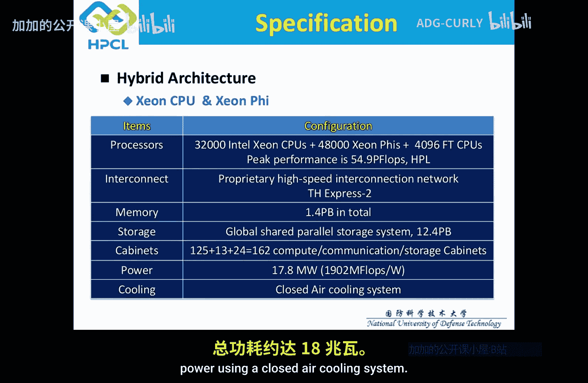

Okay， so let's see how these different components of the chip of this computer are arranged okay。

 so we said that there are 32，000 Xion CPUs and 48，000 Zion fee CPUs right and。

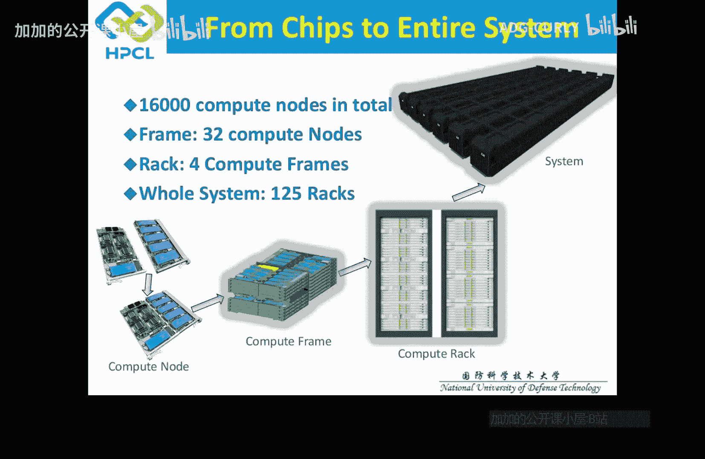

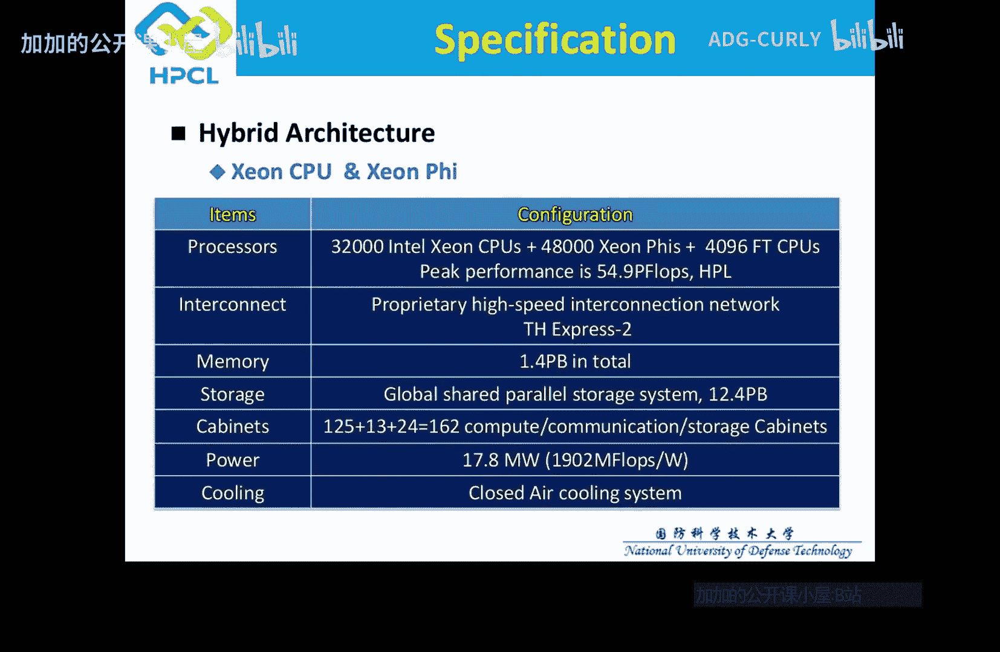

And these are actually arranged into 16，000 computational nodes。

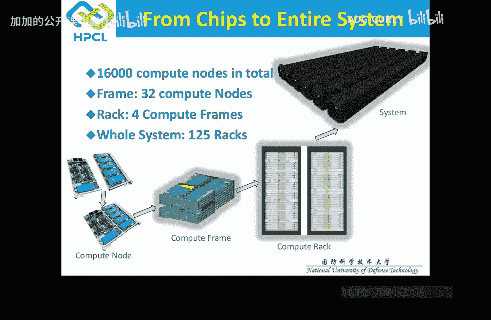

Okay， so each node is going to have two Intel Zons and then three Zion phis。

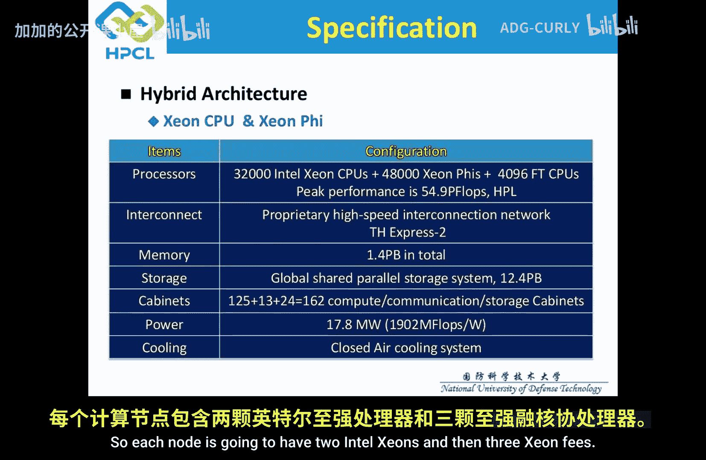

Okay， so these are the nodes over here， okay， so we have 16，000 of these nodes。

Now we're going to combine 32 of these nodes into a frame。O。And then for each of these four frames。

 we put them together into a rack okay so rack is basically one of these black things that you can see over here。

 it's one of those and the total computer has 125 computational racks。😊，Okay， so in fact。

 so the total number of nodes is if you do 32 times 4 times 125， you come out with 16。

000 computational nodes。Okay， so now let's look inside of each node so as I mentioned。

 each node has two Intel Xion CPUs and then three Intel Zion5hi CPUs or not CPUs。

 but many core processors。Okay， each of these nodes has 64 gigabytes of memory。Okay。

 and it uses PCI3 with 16 lanes。And so if you put all this together， each of these nodes has about 3。

4 terralobs of performance。And then we have 16，000 of these nodes。Okay。

 so that's for the processing now for the interconnect between these processors so this interconnect is based on something called a fat tree topology Okay so later on in a different lecture we'll talk about what this topology is。

But basically there are 13 cabinets to do the interconnect for the Tianhe computer and each of these cabinets uses a factory topology and it has 576 ports so each of these cabinets。

 13 of these right it's got 576 ports。And it uses a proprietary communication protocol。Okay。

 so the way this whole computer is put together， the way you program this computer is that there are actually several layers to the programming。

 okay， so at the bottom layer you have the system the environment， so you have the operating system。

 you have a parallel file system， and then you have basically a scheduler which manages all the resources。

Okay so on top of this then you can begin to write your programs so now you have the programming environment right and so you can write programs using different frameworks right so one framework would be MPI right another framework is openM right and then it also supports something called openM。

And then we have a bunch of different debugging tools and compilers to help us manage all of these and profilers to help us manage all of these different programming environments。

And then finally， once we have the programming environment。

 then we can talk about the applications right so for the applications。

 so here's where you have things like Liak and where you have the actual applications that you run on top of this computer right so here this is the application environment。

And then all of this is being managed in terms of so since we have so many processors。

 it's quite likely that over time some of these processors will fail， okay。

 so therefore we need a way to manage the fall tolerance using this component over here。

And we also have an overall management environment for things like power using this management environment over here。

Okay， so in terms of the operating system and the resource management system， right。

 so the operating system is a flavor of Linux called Kyin Linux。

And the resource management system is， well， this is responsible for things like scheduling the different tasks。

 okay， and then keeping track of the power that's being used。

Okay so now let's talk about some applications that you can run on the system。

 so one of the most successful applications that it ran was this very large scale shallow water simulation okay so this simulation managed to use 4000 nodes okay so remember that the computer has 16。

000 nodes so it managed to use  one quarter of this entire computer right？

And then so basically what the simulation does is that it's trying to。

 I guess model the flow of water or something， I'm not really sure exactly what the simulation does。

 but basically the way it works is that if you want to look at how water flows in this case how water flows on the entire planet。

 then what we do is we chop up the planet into these grids。

So here they're using six grids to cover the entire planet。

And what we have is that if you know the conditions within each of these grid points。

 right so if you know the conditions at these various grid points， right？

And then we also have we also know how these different grid points will interact with each other。

 how water flows between these different grid points。

 then you can run a very large scale simulation to see how water flows over the entire planet。

Okay so each of these grid points might represent unknown variables and so altogether we have many。

 many of these unknown variables， we have over 200 billion unknowns so this is quite an impressive accomplishment that they managed to use 4000 nodes and run something with 200 billion unknowns。

And of course， there are many other applications that this computer has been used for。

Okay so that's basically an overview of this Tampa computer and to finish up the first lecture I just want to mention some of the textbooks that you can use for this class so these textbooks are not necessary because all of the material that we plan to cover in the course will be provided in the lecture slides and the lecture videos but if you want some reference materials which goes into more detail about some of these some of these topics that I can suggest following texts so you can look at so the reason I'm listing several textbooks here is that there actually is no single textbook which covers all of parallel computing in a very in- depth fashion。

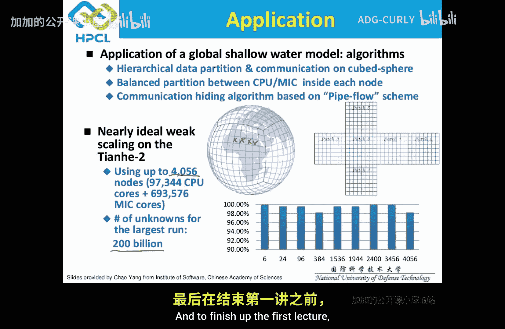

Okay， so unfortunately， we're going to have to look at several different textbooks。O。

So one of the more complete introductions to parallel computing is the first one this book by Grandma E Al right another book that you can look at which goes into more depth about programming languages。

 is this book by Pacheco， this introduction to parallel programming by Pacheco。

Eventually we're going to look at how to program GPUs using the Kuda language and so a very good reference for that part of the course is this book by Kirk and who called Programm massively Para Processors。

And then finally， if you want to get more examples of KudDa programs。

 you can look at this book called Kuda by example。Okay。

 so some of these books are available online and if you really don't have access to these books。

 you can come talk to me， but again， the books are not strictly necessary for the course。

 it's just something if you're interested in。Okay， so that's the end of the first lecture。

 so for all the subsequent lectures， they'll be the same format。

 I'll be uploading videos onto Blackboard and so I'll talk to you guys again in the second lecture。

 bye bye。

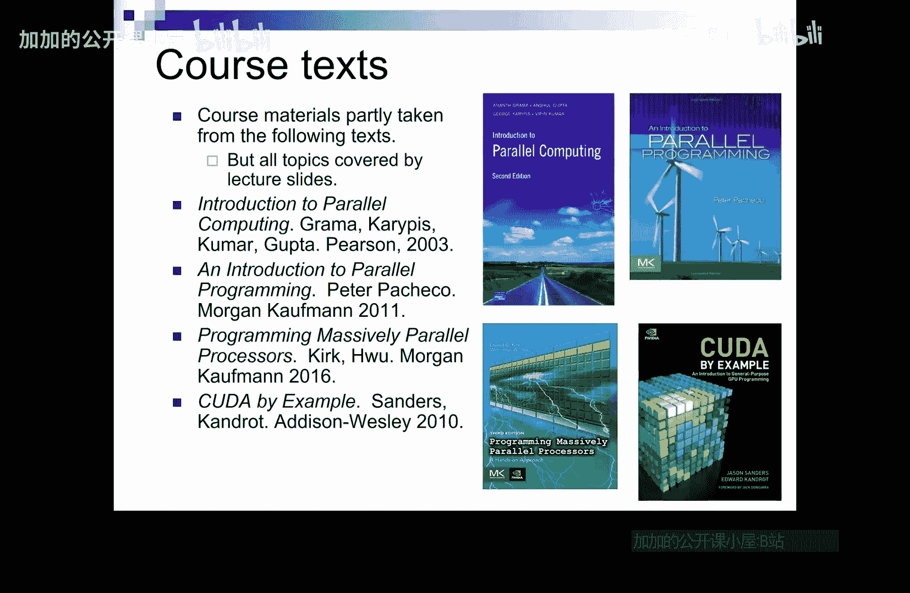