# 并行计算：P01：课程介绍与概述

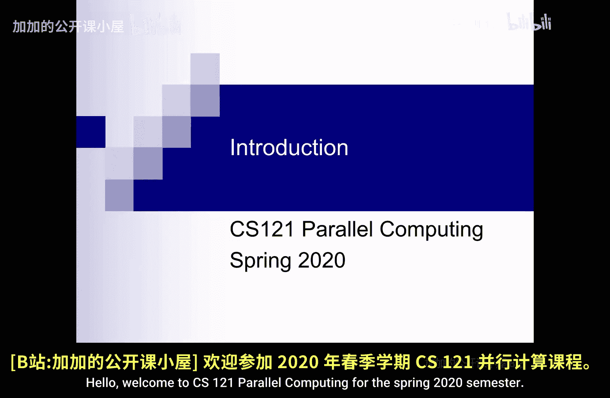

在本节课中，我们将学习并行计算课程的基本信息、课程目标、核心概念以及并行计算在现代计算中的重要性。

## 课程基本信息与形式

大家好，欢迎来到2020年春季学期的CS121并行计算课程。

我是范睿，上海科技大学信息科学与技术学院的副教授。联系我的最佳方式是通过电子邮件。如有紧急事务，也可拨打我的手机号码。

本课程的形式将与以往不同，我们将采用在线翻转课堂的形式。这意味着我会提前几天将讲义和视频上传到课程Blackboard网站。材料上线后，学生应在课前观看视频并学习讲义。

课程本身也将在线进行，每周在常规授课时间（周一和周三下午3点至4点40分）举行。在这些在线课堂上，我将有机会与所有学生互动，你们可以就任何不清楚的问题提问，我们也可以讨论课程的其他方面。

此外，我将建立一个课程Piazza网站，用于额外的问答和其他类型的讨论。

我们将使用名为Zoom的软件进行在线课程。该软件适用于所有操作系统，包括Windows、Mac、Linux以及iPhone或Android等手机。使用Zoom的方法是：首先访问其网站下载对应操作系统的安装程序。安装软件后，应创建一个账户。在每次上课前（即周一和周三下午3点前），登录Zoom并输入会议ID加入我们的课堂会议室。我们每周都将使用同一个会议ID。

选择Zoom而非微信等其他形式的原因是，Zoom允许你们看到我电脑屏幕上的内容，即可以进行屏幕共享。这样我们可以进行更有用的讨论，例如我可以绘制图表或书写公式，这在微信上是无法做到的。

除了讲座，我们还有一位助教，名叫王乐涵。助教也可以回答学生的问题，并且将大约每两周主持一次习题课。习题课旨在解答关于习题集的问题。每次提交习题集后，我们将在下周安排一次习题课。习题课的具体形式和时间待定，我们会另行通知。

## 课程评估方式

课程评估包含五个部分。

第一部分是**习题集**，占总成绩的20%。我们大约每两周会布置一次习题集，总共大约有六次。

第二部分是**实验**，旨在让大家练习使用本课程中将讨论的各种编程语言，特别是OpenMP和CUDA语言。我会给出不同的问题，要求你们使用OpenMP和CUDA进行编码。

第三部分是**项目**。实际上有两个项目。第一个是**阅读项目**，同样占总成绩的20%。你们需要两人一组完成。这个项目旨在让大家接触并行计算领域的研究文献。我会提供一个关于并行计算不同研究前沿的有趣论文阅读清单。你和你的搭档需要从中选择一篇感兴趣的论文，并撰写一份报告。此外，还需要制作一个约20分钟的视频来总结论文的主要内容。阅读清单将在几周后公布，你们需要在第8周（大约4月24日）前告知我你们选择的论文。最终的报告和视频需要在课程结束时（第16周，6月19日）提交。

第二个是**编程项目**，也占总成绩的20%，同样可以两人一组完成。你们可以与阅读项目是同一组。这个项目的不同之处在于，你们需要找到一个自己感兴趣的问题，并编写一个高效的并行程序来解决它。我会提供一些关于可以研究哪些问题的建议。你们需要在第10周（5月8日）前决定要解决的问题，我们可以进行简短讨论以确认问题的适当性和可行性。对于这个项目，你们需要编写解决问题的程序，并撰写一份关于程序工作原理、性能等方面的报告。同样，也需要制作一个关于项目的短视频。这需要在课程完全结束后（期末考试之后，7月3日前）提交。

最后一部分是**期末考试**。我尚未决定考试形式，但可能会采用某种在线形式。我设想我们会设定一个考试日期，在那天将试卷上传到Blackboard网站，然后你们可以下载试卷，在大约两小时内完成，并通过拍照的方式提交答案。这将是一场部分开卷考试，允许携带几页自己整理的笔记，但不允许使用任何其他资源，例如上网搜索答案。关于考试的具体形式，我们可以在课程进行中再讨论。

## 什么是并行计算及其重要性

现在让我们进入本课程的主要内容。首先，什么是并行计算？我们为什么要关心并行计算？

并行计算基本上是研究如何利用多台计算机来解决问题。在算法课上，算法通常以线性形式呈现，想象只有一个处理器在执行你的程序。然而，如果你有一个非常大的程序，一个处理器执行会花费很长时间。在这种情况下，我们希望有多台计算机一起解决这个问题，这就是并行计算。

至于为什么要进行并行计算，有很多原因。

1.  **加速计算**：如果你有一个大问题，使用多台计算机可以更快地解决它。理想情况下，如果使用K个处理器，可以将问题解决速度提高K倍。
2.  **解决更大规模的问题**：多台计算机集合起来拥有更多内存，因此可以解决规模更大的问题。例如，在进行某种模拟时，如果只有一台计算机，其内存有限，只能进行小规模模拟；如果有多台计算机，总内存量更大，就可以进行更大规模的模拟，或者以更高的精度进行相同规模的模拟。
3.  **容错性**：使用并行计算可能更具容错性。如果只使用一个处理器，该处理器故障则程序无法完成；但如果使用多个处理器，即使其中一个故障，其余计算仍可继续。然而，这是一把双刃剑：使用更多计算机提高了容错性，但也增加了至少一台计算机在计算期间发生故障的概率。
4.  **现代计算机系统的本质**：如今遇到的所有计算机系统本质上都是并行的。无论是台式机、笔记本电脑中的多核处理器，还是手机中的多核处理器，甚至是游戏图形处理单元（GPU）中的数千个小处理器，以及云计算资源中的数千个处理器，都是并行系统。要高效利用这些现代计算机架构，就需要理解并行计算。
5.  **关键应用的基础**：并行计算对于当今许多关键应用至关重要。例如，机器学习在过去几年取得成功的主要原因之一就是能够利用并行计算来大幅加速计算。数据挖掘、天气预报、蛋白质折叠模拟、密码分析、金融和社会行为模拟等，都严重依赖于大规模并行计算。此外，模拟人脑等前沿研究也是并行计算的重要应用方向。

## 课程目标

本课程的目标是让大家理解并行计算的基本技术和概念，包括算法视角和硬件视角。我将讨论不同的计算硬件模型、不同类型的并行计算机如何构建，以及这些不同的硬件模型如何与你为其设计的软件交互。

事实上，对于并行计算，软件类型与运行软件的硬件类型之间需要非常紧密的协同，这种交互也是我们将要讨论的内容。

我们还将讨论并行性的**能力与局限**。如果正确使用并行计算，可以获得很多好处，但并行计算并非解决所有问题的灵丹妙药，存在某些我们需要了解的局限性和挑战。

最后，我们将讨论许多高效的并行算法。这些算法通常是编写更大的现实世界并行应用程序时需要用到的构建模块。

## 并行硬件概述

在并行计算中，硬件和软件需要以某种方式相互匹配。在顺序计算中编写顺序程序时，你不太需要考虑处理器的设计，因为顺序计算机基本上只有一种设计。但在并行计算中，实际上有许多不同的并行硬件设计。因此，在编写并行软件时，需要非常清楚计划运行的硬件类型，并需要让软件能够利用硬件的功能。

一个并行系统基本上由许多处理器组成，每个处理器可以进行独立计算。但由于我们希望结合所有这些处理器来解决一个整体问题，因此处理器之间需要通过互连网络进行通信。

与顺序计算的冯·诺依曼模型不同，并行计算有许多不同的架构。例如，图中展示了一种结合了分布式和共享内存的特定架构。这里有16个核心（图中红色部分），计算在这里进行。我们将这16个核心分成四个块，每块四个核心。每个块内的核心可以通过共享内存进行通信。然而，如果来自两个不同块的核心需要通信，则必须通过代表通信网络的黑色区域。因此，这种架构中有两种类型的通信：共享内存和网络。你可以用许多不同的方式组合共享内存和网络，这些不同的组合导致了不同类型的并行硬件设计。

此外，核心或处理器本身也可以有不同的设计，例如多核处理器、众核处理器、FPGA或其他类型的设计。

不同的并行计算机在互连网络设计上也有所不同。有许多可能的互连架构，例如总线架构、环形架构、星形架构、网格架构、树形架构甚至全连接架构。计算机的通信架构对其性能以及构建此类计算机的复杂性有重大影响。

构建并行计算机时，它不是一个统一的系统，而是一个**分层系统**，我们在多个不同级别上拥有并行性。整体的并行性是在不同级别上所有并行性的聚合。例如，图中展示了一台超级计算机的设计：从单个芯片开始，芯片内部在指令级或核心级具有并行性；然后将多个芯片组合成一个处理器，放入一张卡中；再将多张卡组合成一个节点；将多个节点组合成一个机架；最后将多个机架组合成一台大型超级计算机。

## 并行软件概述

接下来，让我们谈谈并行软件的某些方面。我们考虑如何设计一个程序来并行解决问题。

为了并行解决一个大问题，我们首先需要将这个大问题分解成小的子问题（或任务）。然后，我们将分配不同的处理器来解决每个子问题。这些子问题应该在一定程度上彼此独立，这样我们就可以同时处理多个问题。如果所有问题都相互依赖，例如有三个问题，但需要先解决第一个才能解决第二个，再解决第二个才能解决第三个，那么我们就无法实现并行性，因为只能逐个解决问题。另一方面，如果问题是独立的，那么我们可以分配多个处理器同时解决所有这些问题。

第一步是将问题分解为这些子问题或任务。

接下来，我们需要利用操作系统及其调度器来决定如何执行这些任务。首先，我们需要将任务分配给处理器。例如，在右侧的图中，展示了一个示例问题，由许多用圆圈表示的任务组成。此外，这些任务之间存在依赖关系。例如，需要先解决顶部的红色任务，才能解决其下方的任何任务。两个任务之间的箭头表示箭尾的任务需要在箭头任务之前解决。在使用操作系统或调度器分配这些任务时，我们需要以尊重任务间依赖关系的方式进行。

并行软件还需要注意，我们分解问题的方式应该与运行的硬件相匹配。例如，任务分解中的并发量应与硬件中的并发量相似。如果我们只有20个任务，就不希望有1000个处理器，因为那样大多数处理器将闲置。同样，如果有很多任务，也不希望只有一两个处理器。我们需要匹配软件和硬件中的并发量。

此外，硬件必须能够支持软件所需的通信模式。不同的程序有不同的通信模式。例如，有些程序可能很简单，可以将任务排列在一条线上，每个任务只需要与线上的两个邻居任务通信。在这种情况下，程序可以在相当简单的并行硬件上运行。但如果有一个更复杂的程序，所有任务都需要与所有其他任务通信，那么就需要确保通信网络能够支持这种大量的通信。

由于不同的程序需要不同类型的硬件才能高效运行，这意味着没有一种单一的并行硬件类型对所有并行软件都是高效的。换句话说，**并行程序不具备可移植性**。如果你将一个特定的并行程序运行在不同的并行机器上，你会得到非常不同的性能，因为有些机器可能支持非常高效的通信，而另一些则不支持。

这种并行软件缺乏可移植性是一个大问题。顺序计算的一个伟大之处在于顺序软件通常是可移植的，你可以将相同的程序运行在Intel、AMD或ARM处理器上，基本上会得到类似的行为。但这对并行计算来说并不成立。

为了克服缺乏可移植性的问题，人们尝试为并行计算构建不同的概念性抽象模型，以建立一个足够通用的模型，使并行软件更具可移植性。其中一个这样的模型称为**PRAM模型**。PRAM模型试图为并行计算建立一个抽象模型。它在某些方面是成功的，例如，PRAM模型非常有助于我们理解问题中的并行性在哪里。然而，它在其他方面不太成功，因为即使我们知道并行性在哪里，PRAM模型并没有说明如何成功执行那种程度的并行性，原因是PRAM模型没有考虑通信成本。通信实际上非常重要，而PRAM模型没有任何方法来考虑这种通信，因此，你在PRAM模型中得到的成本通常与现实生活中得到的性能不匹配。尽管如此，PRAM模型确实有一些用途，我们将在课程后期更多地研究这个模型。

## 并行计算的挑战

现在让我们谈谈并行计算中的一些挑战。并行计算的核心是让许多实体协同工作来解决一个大问题，就像建造金字塔一样。然而，即使有成千上万的人，也不意味着他们就能建造金字塔，因为人们需要作为一个团队工作，而当你想让许多人作为一个团队工作时，就会面临许多挑战。

1.  **通信**：为了让许多处理器协同解决一个大问题，处理器需要相互通信，共享数据，告诉彼此他们正在处理问题的哪些部分以及哪些部分已经完成。通信之所以困难，首先是因为处理器的计算速度远快于通信速度。处理器每秒可以进行许多计算，但无法将所有计算的结果传递给其他处理器，处理器通信存在带宽限制。此外，当拥有多个处理器时，通信量实际上增长得非常快，随着处理器数量的增加，通信瓶颈会变得更加严重。例如，如果有n个处理器，并且所有处理器都需要相互通信，那么将需要大约n²个通信链路。通信量相对于处理器数量呈二次方增长，这是并行计算的主要瓶颈之一。
2.  **同步**：当我们尝试同时解决多个任务时，任务实际上可能会相互干扰。例如，在道路上，车辆可以水平或垂直并行通过，但它们不能同时水平和垂直通过。不同方向行驶的车辆需要相互同步、协调，这就是为什么我们有交通信号灯。如果没有这种协调，就会出现所有车辆都被堵住的情况。我们需要这种同步，但同步也会带来成本。
3.  **调度**：我们需要将任务分配给处理器，并决定处理器何时运行不同的任务。有许多依赖关系需要强制执行，调度器实际上需要运行一个相当复杂的算法来确保强制执行所有这些依赖关系。此外，调度器希望确保它使用了所有可用的硬件资源，如果有很多任务和很多处理器，它希望确保所有处理器都在运行某些任务，而不是闲置。为了在任务和处理器之间找到良好的分配，我们需要考虑数据局部性等问题，或者如果我们有不同类型的异构处理器，我们需要考虑将哪些任务分配给哪些类型的处理器。一旦我们将任务分配给处理器，我们还应该考虑如何将每个处理器上的资源分配给任务。
4.  **结构化与非结构化问题**：结构化问题类似于稠密矩阵计算，例如矩阵乘法，每个输出条目都使用相同且非常规则的过程产生。另一方面，如图计算等，图形比矩阵混乱得多，节点可能连接到许多其他节点或仅连接到少数节点，现实生活中处理的图形结构很少。因此，当你有结构时，解决问题实际上更容易。如果你知道需要访问哪些数据以及对这些数据进行何种计算，就可以为这些计算构建定制硬件；而如果你不知道计算的结构，则必须构建一个通用的硬件，效率必然较低。
5.  **固有的顺序性问题**：即使我们能解决通信、同步和结构的所有问题，也存在一些根本不可并行化的问题，或者至少目前看来不可并行化。我们目前没有解决这些问题的高效并行算法，尽管我们也不能证明不存在高效的并行算法。例如，单源最短路径问题（Dijkstra算法）似乎是一个固有的顺序过程，目前我们没有运行Dijkstra算法的高效并行方法。然而，有些算法看起来是顺序的，但实际上并非如此，你可以想出更聪明的算法来并行解决这些问题，例如计算斐波那契数列。因此，并行计算的一个重要部分是提出具有足够并行性的算法来解决问题，但有时我们会被困住，有些问题目前还没有人能够提出高效的并行解决方案。
6.  **人为因素**：设计并行计算的最后一个挑战是人为因素。我们必须设计这些算法和硬件，而对我们来说，提出并行算法之所以困难，是因为在并行算法中，许多事情同时发生，这就是并行性的定义。如果你想为此设计一个高效且正确的算法，作为设计者，你必须跟踪所有这些同时发生的不同事情，这很难在脑海中跟踪这么多事情。人脑并非为此而生，人脑习惯于一次跟踪一件事，如果你试图思考10件事同时发生，大脑会不堪重负。

## 课程大纲

现在，我将给出本课程将涵盖内容的概要。

1.  **并行架构**：我们将首先讨论不同类型的并行架构，包括共享内存架构、分布式内存架构和众核架构，并涵盖这些架构的不同方面。
2.  **编程语言**：之后，我将介绍编程并行硬件的不同方法。由于有不同类型的硬件，也有不同类型的语言来利用这些不同的硬件架构。我们将涵盖的语言包括OpenMP、MPI、CUDA和MapReduce。
3.  **高效并行算法设计**：在介绍语言之后，我将讨论如何设计高效的并行算法。有几个步骤，例如，你需要分解问题，确保分解具有某些属性（如不同任务之间是平衡的），然后还需要能够将这些任务调度到硬件上。
4.  **并行算法构建模块**：正如前面提到的，有一些并行算法是其他类型并行计算的基础构建模块。我们将尝试涵盖大多数基础的算法构建模块，包括稠密和稀疏矩阵算法、并行排序或搜索，以及一些并行图算法。
5.  **PRAM模型**：我将提到PRAM模型，这是一个旨在帮助创建可移植并行算法的理论模型。尽管这个模型存在问题，但使用PRAM设计的算法，其核心思想可以尝试应用于不同的现实世界场景。因此，我们将学习一些PRAM算法，看看如何将这些基本思想应用于更现实的场景。

## 并行计算的历史与现状

接下来，我想谈谈并行计算的历史，我们是如何走到今天的，以及并行计算的现状。

并行计算基本上始于20世纪60年代，随着计算的曙光出现。到1976年，出现了第一台超级计算机Cray-1，速度约为160兆次浮点运算每秒。在80年代，超级计算真正蓬勃发展，出现了许多成功的超级计算机公司。这些在80年代建造的计算机的一个特点是它们基本上是定制的，每台计算机都有自己的架构和处理器，设计这些处理器非常昂贵。

进入90年代，一种新型的超级计算机架构开始被采用，称为**大规模并行处理器架构**和**集群架构**。MPP和集群都使用商用现货处理器，但MPP使用自己的定制互连，而集群不仅使用现货处理器，还使用现货互连（如以太网）和Linux操作系统。如今，大多数数据中心都是集群计算机，而大多数超级计算机是MPP，拥有自己的定制互连。

目前最快的超级计算机是IBM的Summit，这是一台大规模并行处理器，运行速度约为150千万亿次浮点运算每秒，这比典型的家用工作站快约一百万倍。

除了这些自80年代以来持续建造的超级计算机，并行计算的进展实际上在90年代到21世纪中期曾一度停滞。原因是在那些年里研究并行计算并不划算，而这又是因为摩尔定律。大约50年前，英特尔联合创始人戈登·摩尔预测，我们可以放在处理器上的晶体管数量每18个月翻一番。值得注意的是，这一预测在过去50年里基本成立。但重要的是，摩尔预测的是晶体管数量每18个月翻一番，他并没有预测计算机速度每18个月翻一番。然而，在过去直到2005年左右，每当晶体管数量翻倍时，处理器的速度也会翻倍。这意味着即使在单个处理器上，我们也可以每18个月将晶体管数量翻一番，这也会使该处理器的处理性能每18个月翻一番。这阻碍了并行计算机的发展，因为根本没有必要设计并行计算机，因为设计每台并行计算机都需要很长时间，而当你完成设计时，单个处理器的速度已经大幅提高，就不再需要这台并行计算机了。

这种现象一直持续到2005年左右。一旦到了2005年，发生了一些事情，使得并行计算变得更加重要。从图中可以看到，2005年之前，每当晶体管数量翻倍，我们也可以提高处理器的时钟频率，从而提高处理器性能。然而，一旦到了2005年，频率无法再提高了，因为晶体管变得非常小，当把它们放在单个处理器上时，会产生大量的热量，消耗大量功率，并且泄漏大量功率，由于这些原因，无法再提高时钟频率。那么，如果频率被卡住，我们如何提高性能呢？基本上在同一时间，处理器上的核心数量开始增加。核心是进行计算的基本单元，一个处理器由多个核心组成。一旦到了2005年，我们无法再提高每个核心的性能，因为无法再提高核心的频率。因此，为了获得更好的性能，我们需要增加核心的数量。所以现在每个处理器有四个或八个核心，有些处理器甚至有64个核心。这就是现在获得更好性能的方式，不是通过提高频率，而是通过增加并行性来增加核心数量。这就是为什么并行计算在2005年之后变得更加重要。在2005年之前，你不需要并行计算来获得更好的性能，但自2005年以来，这基本上是我们获得更好性能的唯一途径。

如今我们使用的芯片通常是多核计算机。我们不是让单个核心更快，而是在同一个处理器上放置多个核心，这样可以成倍提高计算能力。开发多核软件的难度实际上比开发硬件更大，原因是为了开发并行软件，会遇到前面提到的人为中心的问题，即人类并非天生就能同时思考多件事情。如果开发人员编写了一个多线程程序，这些线程经常会出现错误，无法以正确的方式交互。因此，如今非常需要懂得如何成功使用并行计算的软件开发人员，因为利用并行硬件的唯一途径就是开发高效的并行软件。

目前，我们拥有的并行计算机主要分为四种架构：
1.  **多核架构**：具有少量到中等数量的核心。这些核心是完全通用的，可以执行任何类型的计算，并且核心本身速度很快。
2.  **众核架构**：拥有更多的核心，可能有数千个核心。但由于数量众多，每个核心比多核简单得多，功能也较弱。典型的例子是NVIDIA的GPU或Intel的Xeon Phi。
3.  **FPGA**：基本上是定制硬件，但可以动态重新配置。由于是定制硬件，它们针对特定问题，因此对这些特定问题可以快得多。
4.  **ASIC**：完全定制的硬件，专为非常专业化的问题设计。例如Google的TPU、Apple的Neural Engine或IBM的TrueNorth。

除了速度，我们还希望处理器**节能高效**，这很重要，因为如今的计算机消耗大量电力。大型数据中心可以消耗数百兆瓦的电力，相当于数万户家庭的用电量。大型超级计算机也可以消耗数十兆瓦的电力。因此，构建更节能的计算机非常重要。

在超级计算机方面，衡量其性能的常用方法是**TOP500榜单**。这是世界上500台最快超级计算机的列表，每年发布两次。他们通过运行一个名为Linpack的特定基准测试来衡量超级计算机的性能，该基准测试解决一个稠密线性系统问题。根据这个基准，目前最快的超级计算机是Summit，基于IBM Power9处理器和NVIDIA Volta GPU，拥有超过200万个核心，性能约为150千万亿次浮点运算每秒，功耗约为11兆瓦。

需要注意的是，Linpack基准测试解决的是使用高斯消元法的稠密线性系统，这种计算计算密集，但内存操作不多。因此，Linpack是衡量处理器速度的好指标，但不能很好地衡量通信网络的性能。许多计算实际上更依赖于通信而非计算。因此，Linpack基准测试可能不能代表在更频繁使用内存系统的现实问题上的性能。

为了衡量计算机在这些新型应用上的性能，我们需要新的基准测试。例如，**HPCG**基准测试测量稀疏矩阵上的性能，其内存访问模式更不规则。还有**Graph 500**基准测试，测量图问题（基本上是广度优先搜索）的性能。我们会看到，计算机的性能实际上会因使用的基准测试而有显著差异。

## 天河二号超级计算机案例研究

最后，我想带大家了解一台特定的超级计算机——天河二号的设计。

天河二号目前是世界上第四快的超级计算机。它基于Intel处理器，拥有32,000个Intel Xeon CPU和48,000个Xeon Phi协处理器，总计约55千万亿次浮点运算的性能。它使用定制的互连网络TH Express-2。总内存为1.4 PB，存储为12 PB。计算机由多个机柜组成，共有125个计算柜、13个通信柜和24个存储柜，总功耗约为18兆瓦，采用封闭式空气冷却系统。

这些组件被组织成16,000个计算节点，每个节点包含两个Intel Xeon CPU和三个Xeon Phi协处理器。每32个节点组成一个框架，每四个框架组成一个机架，总共有125个计算机架。

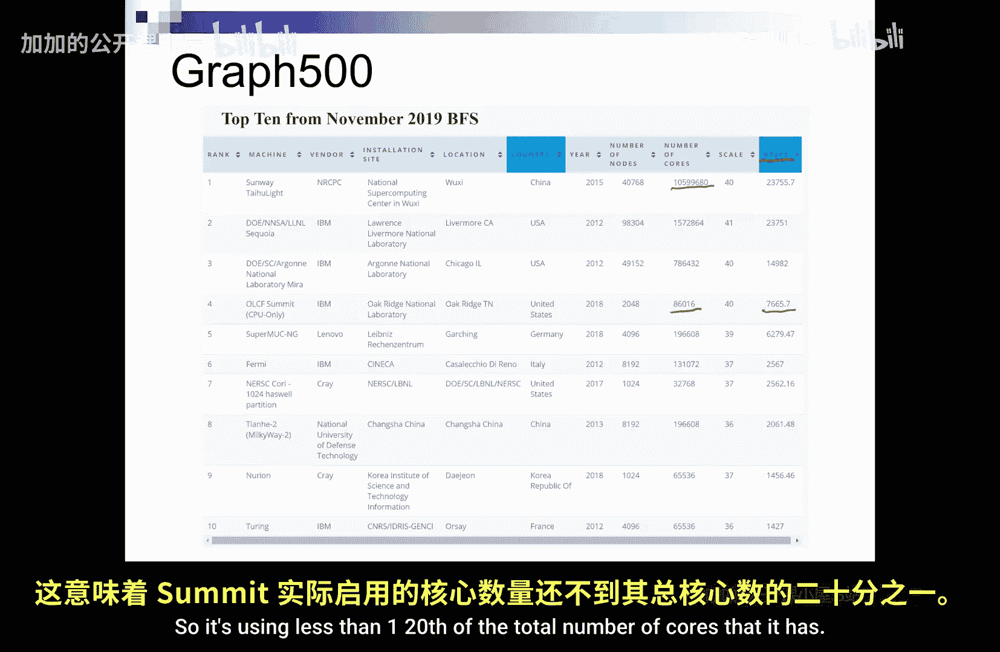

每个节点拥有64 GB内存，使用PCIe 3.0 x16接口，每个节点性能约为3.4万亿次浮点运算每秒。

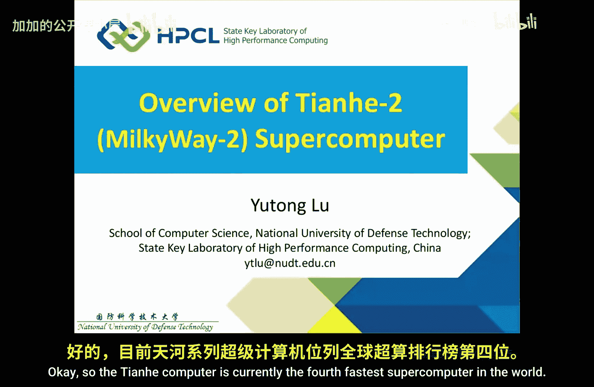

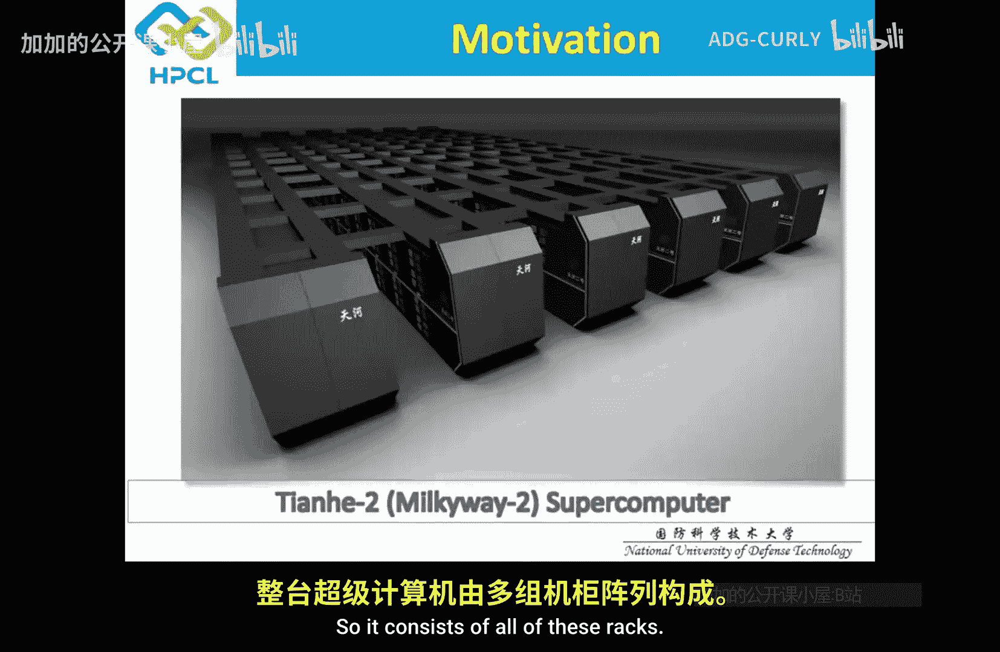

互连网络基于一种称为胖树拓扑的结构。有13个机柜用于互连，每个机柜使用胖树拓扑，拥有576个端口，并采用专有的通信协议。

编程这台计算机涉及多个层次：底层是系统环境，包括操作系统、并行文件系统和资源调度器；之上是编程环境，支持MPI、OpenMP等框架，以及调试工具、编译器和性能分析器；最上层是应用环境，运行实际的应用；此外还有容错管理和整体管理环境。

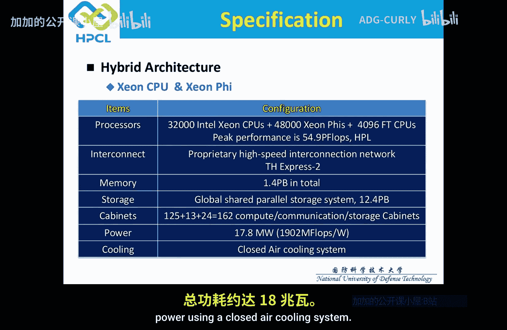

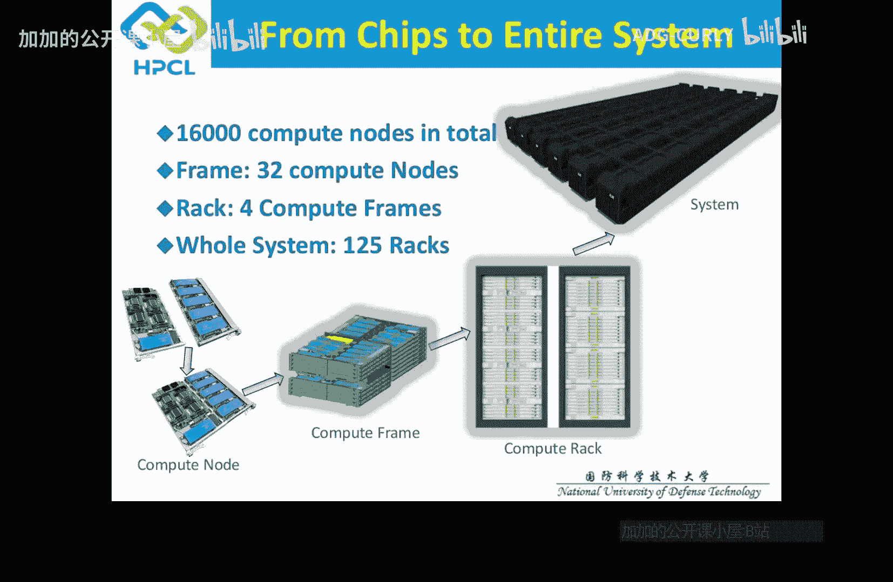

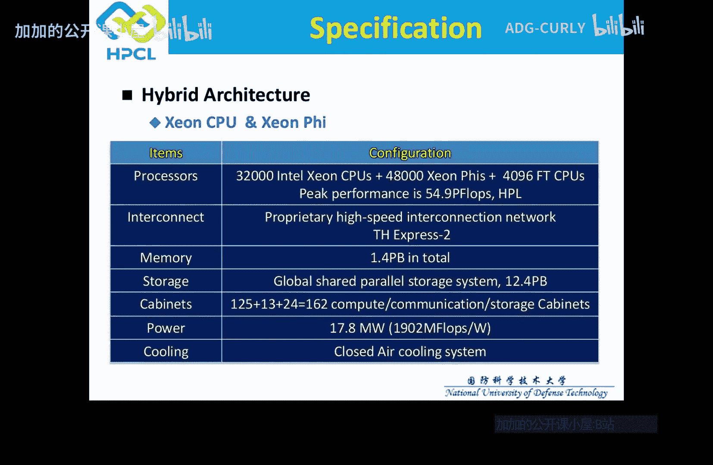

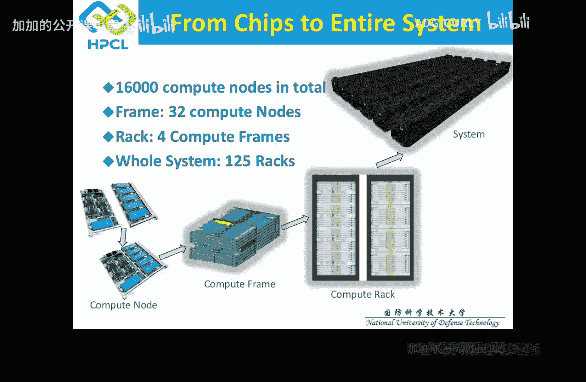

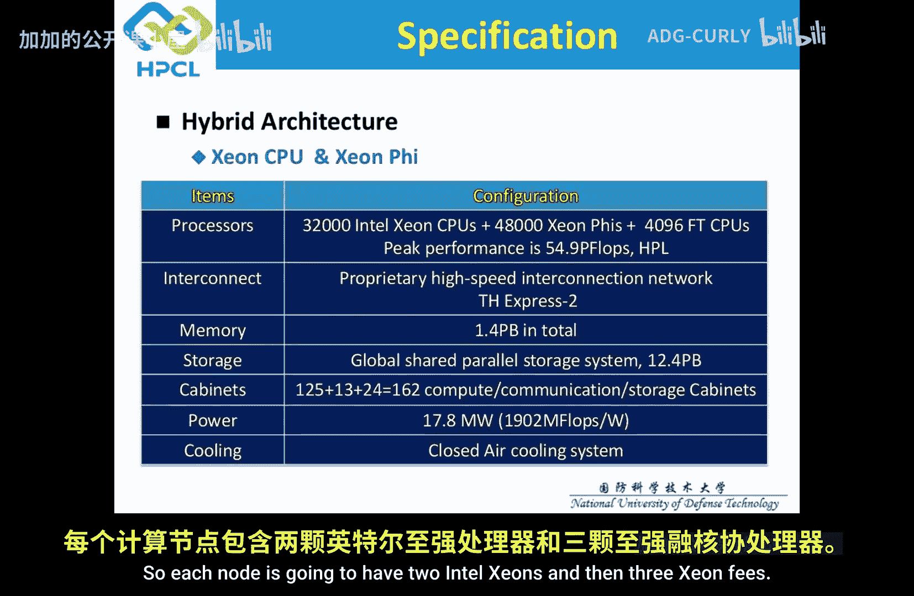

操作系统是Kylin Linux的一个版本，资源管理系统负责任务调度和功耗跟踪。

在这台系统上运行的一个成功应用是大规模浅水模拟，该模拟使用了4000个节点（占计算机总节点的四分之一），模拟了全球水流，涉及超过2000亿个未知数，这是一个令人印象深刻的成就。

## 教材与结束语

最后，我想提一下本课程可以使用的教材。这些教材不是必需的，因为课程计划涵盖的所有材料都将在讲义和视频中提供，但如果你想要更详细地了解某些主题的参考资料，我可以推荐以下教材。之所以列出多本教材，是因为实际上没有一本教科书能非常深入地涵盖并行计算的所有方面。

1.  《并行计算导论》（Grama, Gupta, Karypis, Kumar）
2.  《并行编程导论》（Pacheco）
3.  《大规模并行处理器编程》（Kirk, Hwu）
4.  《CUDA by Example》

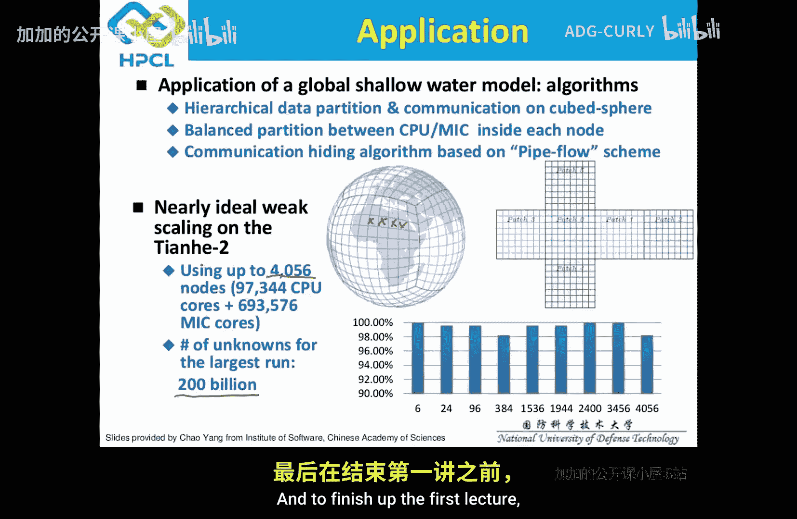

其中一些书籍可以在线获取。如果你确实无法访问这些书籍，可以来找我，但再次强调，这些书籍对课程并非严格必要，只是供感兴趣的同学参考。

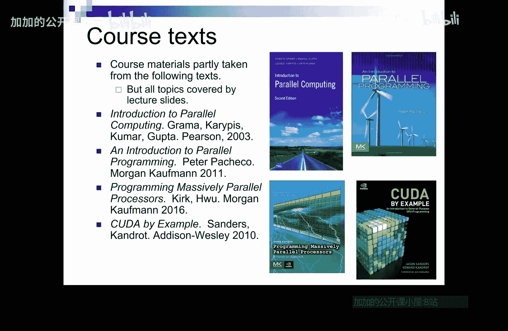

本节课中，我们一起学习了并行计算课程的基本信息、并行计算的核心概念与重要性、并行硬件与软件的概述、面临的挑战、课程大纲、并行计算的历史与现状，并通过天河二号的案例了解了超级计算机的设计。在接下来的课程中，我们将深入探讨这些主题的各个方面。