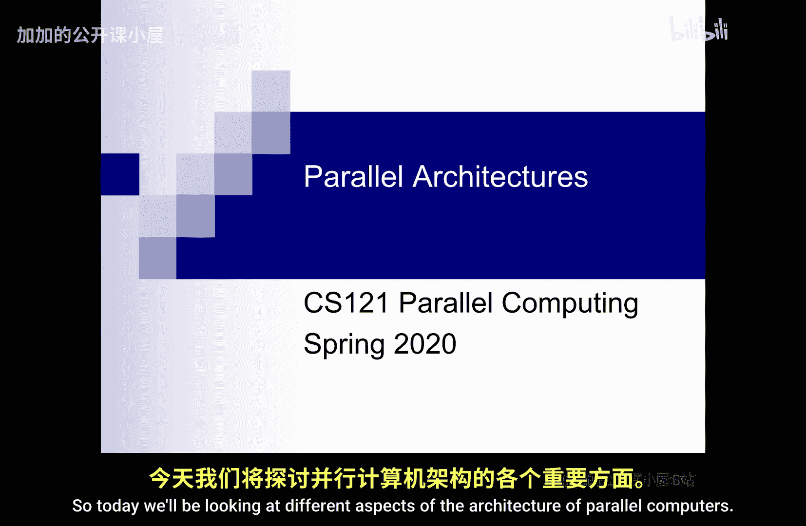
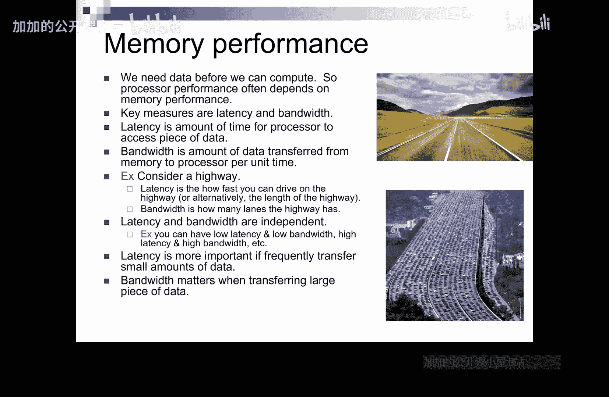
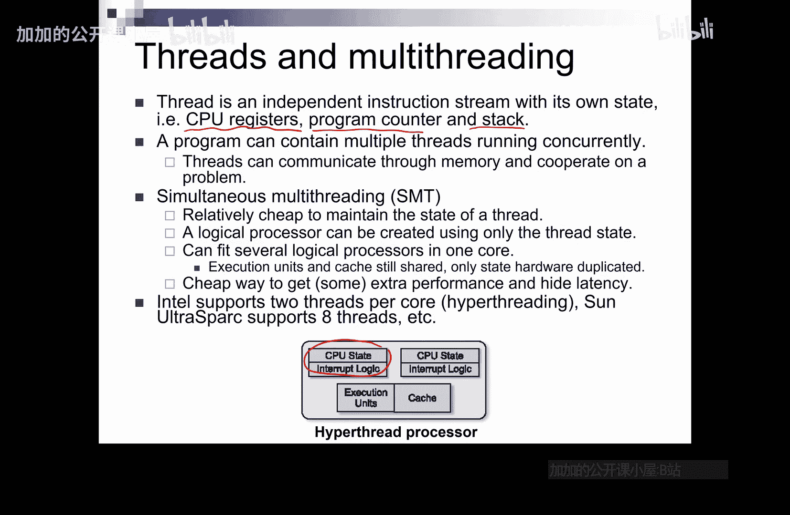
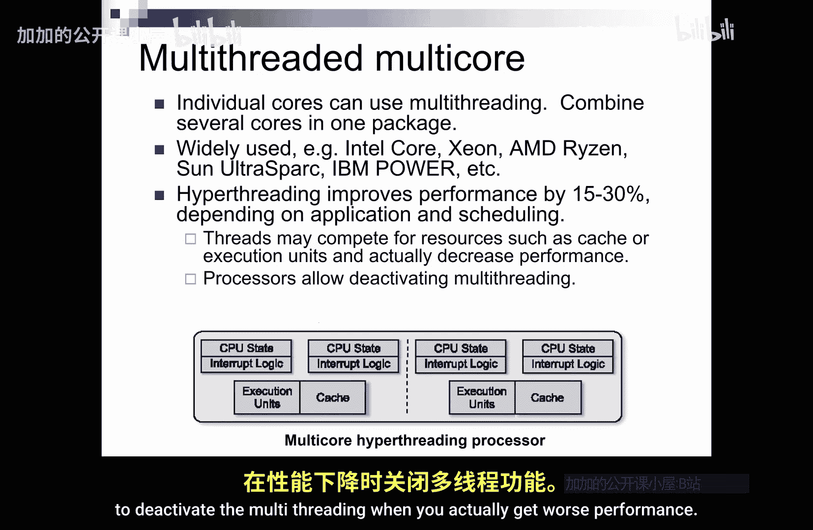
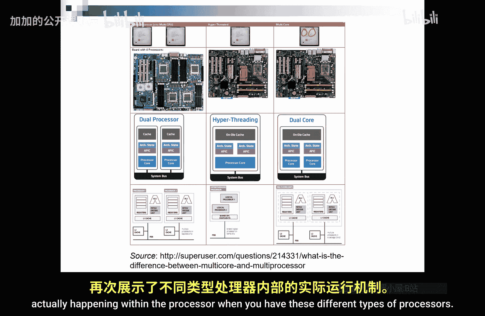
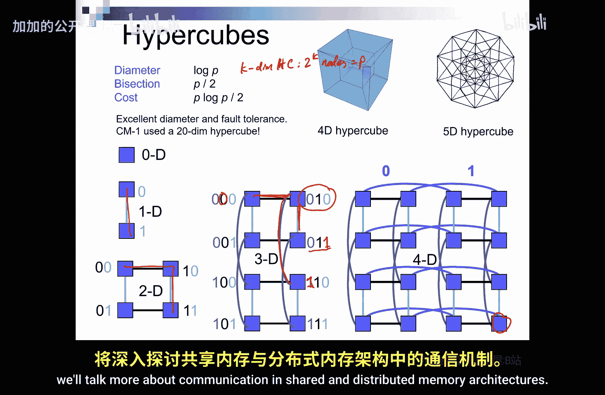

# 上海科技大学【中英⚡并行计算｜CS121 2020 Parallel computing】 p02 P2 Architecture -BV1VqypBaEaP_p2-

嗯。Hello and welcome to the second lecture of parallel Computing。

So today we'll be looking at different aspects of the architecture of parallel computers。

So remember from the previous lecture that in a parallel computer。

 we actually have parallelism at multiple different levels。So for example。

 we can start with a single processor core and we'll see that even within a single core。

 we can find parallelism。Now we can also combine multiple cores together so that they form a parallel processor with multiple cores executing simultaneously。

We can take multiple processors and combine them into a medium scale shared memory parallel computer。

Or we can take a large number of these processor cores and combine them into a larger scale distributed memory system。

And so today we'll be looking at parallelism within these various different levels of the parallelism hierarchy。

Okay， so let's start with a single processor and let's see what kind of parallelism we can find even within this single processor。

So the reason that you can find parallelism within a single core is that when you execute an instruction。

 this actually consists of multiple sub steps。So for example， in order to execute an instruction。

 you first of all， need to fetch the instruction。And then you need to decode the instruction。

Okay so here for example on the right we have a diagram of a sample processor so in order to execute an instruction we need to first fetch the instruction right and then we need to decode it to figure out what the instruction is and then the instruction might require us to load some data so therefore we need to have a separate unit on this processor to load the data once we have the data in the processor we need to execute it so for example we might be doing a floating point operation or an integer operation。

And then after you execute the instruction， you need to write the result back to memory。Okay。

 so and all of this parallelism， right so we have these multiple steps that need to be done。

 all of this is implicit within just the single instruction itself。Okay。

 so this is why this type of parallelism， where you take an instruction and break it into multiple pieces。

 this is called implicit parallelism。And the way we use implicitellaism to。

To improve performance is through a process called pipelining。Okay。

 so pipelining is going to take that instruction and break it into all these sub stepss。

And then it's going to execute the substeps in a pipeline。

And the way this works is that if you have let's say five stages in your pipeline。

 then at every time step， you can be doing up to five things at the same time。

And so therefore you can get up to five times faster performance。Okay。

 so let's go through an example of this so here on the right we have a five stage pipeline。

 so the steps of the pipeline are the instruction fetch， the instruction Decode。

 the execute the memory operation and the right back。Okay， now。Now time here is going horizontally。

 so on the first time step， we're going to take the first instruction and then fetch it okay。

 so that's going to use the instruction fetch unit。Now on the second time step。

 you need to decode the first instruction， so this is going to use a different unit on the processor。

 the decode unit。嗯。RightAnd since we're now using the Decode unit。

 the instruction fetch unit is now free， so therefore we can use this instruction fetch unit to fetch the second instruction。

So therefore at the second time step， we're actually doing two things at the same time。

 we're decoding instruction1 and then fetching instruction two。

We can continue on the third time step， so by the third time step。

 we've decoded the first instruction， so now we can execute it。

And since we're executing the first instruction， then now the Decode unit is free。

 and so we can use it to decode the second instruction。

 which we've already fetched in the previous timet。

And then also we can now use the instruction fetchch unit， which is now free in the third time step。

 and we can use that to fetch the third instruction。Okay。

 so now we're doing three things simultaneously in the third time step。Okay。

 so if you continue this way， then you see that eventually you're going to fill up all of these stages of your pipeline right so since we have a five stage pipeline。

 then after five steps we will have filled up all of the different functional units in our pipeline。

And so we will be doing five things at the same time。And if we just continue with this process。

 then since you're doing five units of work at the same time。

 you're processing five different instructions at the same time。

 then you can get a five times speed up。Okay， so this is for a simple five stage pipeline。

 modern processors have even more stages in them， so they break an instruction into even finer substep。

 so for example， 10 to 20 stages。Now there is a complication with pipelining。

 which is that if your code branches， then you need to guess how to fill the pipeline。

And if you make a mistake in this guess so if you have a what's called a branch misrediction。

 then you actually have to flush your entire pipeline okay so if we for example。

 if we have a branch mis predictiondiction at let's say at this time step。

 then we actually have to flush all of the instructions。

 we have to flush all of these from the from the pipeline。And so and it turns out that code。

 most code branches have branches， let's say every five instructions， okay。

 so every five instructions we need to make one of these guesses and if we make the incorrect guess。

 then we have to flush our pipeline and we lose all of our parallelism。

And so we want to make sure that we have pretty accurate predictions for how the branches will go。

 and so that's why when you have pipelining， you want to combine that with accurate branch prediction。

Okay， so this is one type of sorry one type of parallelism。

 which is pipeline parallelism within the processor， okay。

 another type of implicit parallelism is superscalealar parallelism。

Okay so here what's happening is that now in the pipeline parallelism for each of these substeps of the instruction。

 we only have one functional unit for that substep so we have one instruction fetch unit。

 one instruction decocode and so on now when you go to superscalealar parallelism we could actually have multiple multiple ones of these functional units。

 so for example you could have like say two instruction fetch units。

 two instruction decocode units and so on。Okay and now even if you're executing a straight mind piece of code right so the code itself might not seem to have any parallelism in it。

 but because you have multiple functional units， multiple copies of each functional unit。

 then now you can actually execute multiple instructions at the same time。Okay。

 so to give an example of this， let's look at this piece of code over here okay so what this is actually doing is it's adding up four numbers okay so suppose we have four numbers I'm just going to draw them by circles。

And they're located at different memory addresses， so for example， 1000 or 1004。

 1008 and 1012 so for example， this value is located at address 1000， 004， 008 and 1012。Okay。

 so now we simply want to add up these four numbers。

And the way this piece of code is going to do that is that it's going to load this value into the value at At 1000 into the first register。

 it's going to load this value into the second register， okay。

And then next it's going to add the value from 1004 to the first register。

 so basically what's happening is this is getting loaded into Reg 1。

 this is getting loaded into register 2 right and then on the third time step we're going to add these two values together and then on the fourth time step we're going to take the value at 1012 and we're going to add it to the value from 1008 which is in register 2。

Okay。And then lastly， we're going to add up these two values。

 the values in register one and register2。And you see that now we've added together all four numbers right because R1 at after the third time step。

 R1 is the sum of the first two numbers， R2 is the sum of the next two numbers。

 and then after step five， we have that we've added together all of the four numbers。Okay。

 and then we can store the results somewhere。Okay， so this is the code that we're trying to execute and if we have a superscalealar processor。

 we can actually execute this in parallel and so this execution will combine both superscalealar parallelism and pipeline parallelism so this is being shown in part B of this diagram okay so what's happening is that suppose we have two instruction fetch units then we can fetch the instruction load R1 and load R2 simultaneously in the first time step。

Okay， in the second time step， we're going to decode these instructions。But now。

Since our instruction fetch units are free， we can use them to fetch the second instruction。

 the add instructions。Okay， and then yeah， and then the third stage would be to fetch the operas。

 right， the values of these instructions。And at the third time step for the next two instructions。

 we can。We can decode the instructions。Okay， so you see that this execution over here。

 it's a combination of this pipeline parallelism， right it's pipeline parallelism because for example。

 at the third time step we're using both the opera and fetch units and we're using the instruction decocode units and we're using the instruction fetch units so we're making use of all these different types of units within the processor。

And it's also using superscalealar parallelism because at each time step。

 we're making use of both instruction fetch units or both instruction decocode units。Okay。

 so this way we get two types of parallelism and even more speed up。Okay。

 now when you execute code in a superscalear processor。

 the execution has to respect the data dependencies and data dependency just means that if you have one instruction that uses the results from a previous instruction。

 then you have to execute the previous instruction first before you execute the other instruction。

Okay， so one example of this would be the second piece of code over here now this piece of code actually does the same thing as the first piece of code in the sense that it is also adding together these four values at 100。

004 and these different addresses。However， it's doing these in a different order。

Okay and because it's doing these instructions in a different order。

 there are a lot more dependencies in the second code。And because there are more dependencies。

 there's actually less parallelism。Okay， because if you want to。

Because whenever you have dependencies， then you have to execute all of the earlier instructions before the later instructions。

 so you cannot execute those pairs of instructions in parallel so you get less parallelism。

 the more dependencies you have。Okay so why do we have dependencies well the reason is that so in the second piece of code over here。

 the first thing we do is we load in the values into the first register and then you're going to add the data from this address 1004 into the first register but notice that you have to do instruction 1 before you do instruction 2 because here we're trying to add the value at 1004 to the value at 1000 so you have to make sure that you first load the value at 1000 into Reg 1 before you can do the second instruction。

And likewise， you have to do the third instruction after the second instruction。

 right you have to add this value at 1004 into R1 before you can add the value from 1008。Okay。

 so here all of the instructions are dependent on each other， right，  one， two， three， four， five。

 you have to do them in that order。Now on the other hand， if you look at the first piece of code。

 we actually have a lot of independent instructions， so for example these two instructions。

 one and two， right， they're independent from each other because you know it doesn't matter whether we do R1 first or R2 first。

 right they don't affect each other。And also these two instructions。

 three and four are independent from each other， right because In  three is doing this edition over here。

And instruction4 is doing this edition over here。And these two additions are also independent from each other。

Right the only dependency is， for example， we have to do one after three sorry let me indicate that this way okay so I'm sorry you have to do three after one okay so there is a dependency over here and likewise there is a dependency you have to do four after two。

Okay， but again there's no dependency between one， two or three， four。

 you can do them in either order。And so the first instruction stream has more parallelism than the second one and because it's got so it's got less dependencies and so therefore more parallelism。

 and so therefore we can get better performance on the。On the first instruction stream。

 then on the second instruction stream。Okay， now there's actually yet another way to run this code so for example。

 here， right？Again， the third code piece of code is doing the same thing。

 but it's again ordering the instructions in a different order。

 so here instead of loading both R1 and R2 right we first load R1 and then add it okay so there is a dependency from one to2。

But likewise， there's a dependency from three to four。嗯。Okay， however。

 when you execute the third piece of code， you notice that there is still no dependency between one and three。

 and so you can execute one and three in parallel and you can also execute two and4 in parallel。Okay。

 so we still have parallelism in the third example。However。

 the parallelism in the third example is harder to find than the parallelism in the first example。

 the first example， you look at these two instructions which are consecutive and you can realize that they're independent。

Okay， here instead， the independent instructions are not consecutive， right。

 you have to look ahead after the first instruction。

 you have to look ahead to the third instruction to find the independent instruction。Okay。

 so if we want to be able to execute the third code in parallel， right。

 we need to have special hardware in the processor to look ahead in the instruction stream， right。

 and we also need to reorder the instruction stream because we need to execute one in three together。

 right， even though even though one in three are our。

Are written at following each other in the instruction stream。

 we have to be able to reorder this instruction stream so that they can execute together。Okay。

 so basically the upshot is that if we use pipelining and superscalealar parallelism。

 we can get much better performance， but in order to make use of this these of these tools。

 you need to add extra things into your hardware to detect when you can actually use superscalealar parallelism or pipeline parallelism。

Oh okay， and then another part about this is that here you see that when you have multiple functional units and multiple copies of those units。

 you want to make full use of all of those units you don't want those units to go to waste okay and one way you can think about how much you're making use of those units is through a diagram of this sort。

 okay so here we basically have time going in the y direction。

 okay so we're looking at four different clock cycles。And suppose you have two different adders。

Okay so what this is showing is that in the fourth time unit or sorry in the fifth time unit。

 we're making use of both adders， so we don't have any waste at this time step。However。

 in the six time unit， we're only using one of these adders， so we have a wasted resource over here。

And then in fact， for the fourth and seventh time unit we have no instruction to execute in these adders right so maybe at those time steps we're actually fetching the instructions so we also have a wasted time unit over there and so our goal is to actually have as little waste as possible and so we actually want to fill up all of these adders as much as possible and makes that maximizes our performance。

Okay， so I'll talk about one last type of parallelism， which is the L IW parallelism Oh right。

 so here you know， the first part of this is just summarizing the。

is summarizing what we talked about on the previous slide。

 so you have a resource dependency when multiple instructions are going to use the same hardware unit so if we want to do let's say four different additions and we only have two different adders right then we have a resource dependency。

And。And a branch dependency is when you have a code that can take different paths depending on a conditional statement。

 right like if x is larger than zero， you do one thing， if x is less than zero。

 you do something else。And then waste is going to occur when you have no instruction to execute in a clock cycle。

Okay， so the final type of implicit parallellism is a VLIW parallellism。

 so this stands for very long instruction word。Okay。

 so this is basically going to find instructions that we can execute in parallel。

 but it looks for these at compile time。Okay， so superscalear parallelism also executes instructions in parallel。

 but it finds these instructions at runtime。And VIW finds the parallelizable instructions at compile time。

Okay， so there's both pros and cons to via IW， so the pro is that because you're doing this compile type。

 right， then your compiler can actually use very sophisticated algorithms to try to find as many parallelizable instructions as possible。

However， the con for VIW is that because you're doing this at compile time。

 you don't know what's happening at the runtime and so there might be parallelism available at the runtime that you cannot predict at compile time。

Because we don't know how the instructions are branched and what kind of hashe misses we have。

 and we might be so if you use compile time parallelism。

 you might actually miss some instructions which could be executed in parallel。Okay。

 so so this is basically the type of parallelism that we have in a single processor Okay so next I'm going to talk about memory performance okay so this is also a very important component of overall performance because of course you need to get data before you can do computation on it okay so therefore the performance of your processor often depends on how quickly you can actually get data。

嗯。Now when you look at memory performance， the two key metrics are latency and bandwidth。Okay。

 so latency is basically the amount of time for a processor to access a piece of data。Okay。

 and then bandwidth is the amount of data that you can transfer from the memory to the processor in each unit of time。

So to make this more clear， let's use an analogy， okay so suppose you're driving on the highway。

 then the latency would basically correspond to how quickly you're driving on the highway。Okay。

 so the faster you drive on the highway， the faster you get from your starting point to the end point。

So this car that you're driving， this corresponds to the data， so the faster you drive。

 the faster you can send data from the source to the destination。Okay，Alternativelyly。

 you can say that the latency corresponds to how long the highway is， if it's a shorter highway。

 then of course you can get from the start to the finish faster。Okay。

 so that's latency is sort of the speed of this okay and the bandwidth， on the other hand。

 corresponds to how many lanes does your highway have？

Okay so maybe you're on a highway where you can only drive very slowly， but if this highway has many。

 many lanes， then in each unit of time， many cars are actually passing through this highway。Okay。

 so now these two different ways of measuring memory performance are actually independent from each other。

 okay in the sense that you could have processors which have。

 let's say low latency and low bandwidth， right you could have processors with high latency and high bandwidth right you know how well the memory system performs in terms of latency is independent from how well it performs in terms of bandwidth。

So of course， the ideal situation would be that if you have a memory system which is both low latency and high bandwidth。

 that's the best possible situation and the worst situation would be high latency and low bandwidth。

Now。These two metrics are actually important， some of them are important in different scenarios。

 so for example， latency is more important if you need to do lots of transfers of small amounts of data and this is because since you're transferring just a small amount of data right you don't really care about the bandwidth because bandwidth lets you transfer a large amount of data at the same time。

 but this is not where we're after here okay however since we're doing frequent transfers。

 you want to make sure that each of those transfers is very fast。And so here latency matters more。

And on the other hand， if you're transferring a large amount of data。

 then the bandwidth matters more because you don't really care how quickly the first piece of data goes from the start to the destination。

 what you care about is once the data starts arriving。

 like how much data can you get per unit time and this is what bandwidth measures。

Okay， so now let's talk about the。The CPU memory cap gap。 Okay， So as I said， processors。

Your processor can only compute as fast as the memory system supports it。

 but the problem is that nowadays you have processors which run much faster than the memory can actually transfer data。

So what this plot shows is that if you look at the performance of the processor versus the memory over time。

 then processors have gotten much， much faster， they've actually gotten thousands of times faster over the past few decades。

On the other hand， memory， it's also improved in performance but not nearly as quickly。

And so therefore， there's this gap between the processor and the memory。

 and this gap just keeps growing larger with time。And this can have a major detrimental effect on your performance okay so for example。

 suppose you have a processor which can do 100 gigablobs of performance of computational performance okay however your memory bandwidth is only 20 gigabytes per second let's say you have a latency of 100 nanoseconds。

🤧Now， because you have。20 gigabytes per second of bandwidth right then。

Then each floating point value is going to take you4 bytes and so therefore in each second you can only transfer 5 billion floating point values so even though you can do 100 billion floating point operations。

 you can only transfer 5 billion of these values， and so therefore you're going to be limited by your memory bandwidth to only5 gigablops。

 only 1/20th of your actual processor performance。Okay。

 so now what do we do about this right we've built this very powerful processor and yet we're only getting 120 of the maximum performance。

Well， the way to solve this problem is through this thing called the memory hierarchy okay so in a computer we have different types of memory okay so we could have。

 for example， we have a secondary memory which is your hard disk okay you have the main memory which is your RAM and then you have these things called caches right you could have a level two cache level1 cache and then finally you have registers within the processor itself。

OkayNow there's a tradeoff between these different types of memory in terms of how big they are and how fast they are so typically the bigger a type of memory。

 the slower it is okay so for example， we're talking about the hard disk right so these numbers are kind of old so nowadays you might have a hard disk which is several terabytes in size but to get any data off of that hard disk you need something like tens of milliseconds to be able to find the data on the hard disk。

Now， once you move to main memory， right， you might have several gigabytes of main memory。

 but to access any piece of data on the main memory。

 it usually takes you several hundred nanoseconds。Okay now as you move up or down the hierarchy right so eventually we get to registers and registers are very small okay we only have maybe a few hundred bytes worth of registers。

 however they're incredibly fast okay so each register access might only take you a single nanosecond okay so that would be hundreds of times faster than memory access。

We also have things like caches so the caches could be several tens of kilobytes or several megabytes。

 but these things are also much faster， maybe100 times faster than memory。Okay。

 so in order to get around this CPU memory gap that we talked about。

 okay we're going to make use of this memory hierarchy。

 and so we're basically going to try to store as much data。

 as much useful data as possible into the fastest levels of this hierarchy。Okay so to do that。

 the main thing we're going to make use of are these caches that we have okay so the caches are they basically sit between the main memory and the processor itself。

So the cache， it's a small piece of memory， but it's very fast。

 and built the reason it's fast is because it lies directly on the CPU die itself。So for example。

 here we have a picture of a processor right so we have a processing course over here and we have cash sitting directly on this processor。

Okay， and so because the data doesn't need to travel far to get from the processor to get from these cores to the cache。

 this is what makes the cache fast。Okay， so the cache has low latency and high bandwidth。

Okay and this helps us overcome our bandwidth limitations so what we'll do is whenever we access data right we first check so the first processor first check whether that data is in the cache okay if it's in the cache。

 then it can get that data directly from the cache and have very small latency。

Okay now sometimes the data is not in the cache， so in that case the processor is going to have to get it from memory okay once it goes to memory。

 it's going to take several hundred nanoseconds and so it's going to be like1 hundred times slower than if the data were in the cache。

Okay， now when do caches work well， well we know that the cache is small right it might be you know a few dozen kilobytes at most it might be a few megabytes okay so we know that we can't store all of the data that we need in the cache。

Right and so there are certain situations if we need a huge amount of memory。

 then the caches might not work so well， okay so we want to find situations where the caches are actually going to help us and this is where locality in your code comes into play。

Okay， so there are two types of locality， there's temper locality and spatial locality。Okay。

 so temporal locality， so let's look at this diagram over here， okay。

 so the diagram is showing basically time on the x axis and then on the y axis。

 it's showing which memory locations are we accessing。Okay， so for example， if we look at this。

Part of the plot over here right we're accessing address something like 80。

000 right and then after that we're going to access a very nearby memory location right so yeah so this set of aes over here execute or sorry our accessing data from around the address 80。

000 now temporal locality means that after you make these aes， then if you look further in time。

 you're going to access this data again。Okay， right， and then in fact， you know。

 if you so for the same set of memory addresseses right these addresses from about 80。

000 to whatever this is 81，000 let's say， okay， we're accessing these items over and over。Okay。

 so maybe you're iterating through this array over and over okay the same part of the array over and over okay now since you're only using a small amount of data over here。

 now this is where cache and can help you because you can store this data in the cache okay so this might be just a thousand values so this is going to fit into your cache right because you have several kilobytes of cache。

 let's say okay and now you can access that data over and over from the cache and you can do that very quickly right oops none of these aes these subsequent aes need to go to memory in order to get the data。

Okay， so that's temporal locality， is that you have a small set of data that you access over and over and you can do that from the cache。

Another situation where the cache can help you is where you have spatial locality okay so this is where the data that you access are sort of consecutive to each other okay so you can see for example here right we're making a bunch of data accesses and the addresses are basically one after another right they're consecutive。

Okay and this and when you have a cache， this is also useful because each time you load data into the cache。

 you're not loading just a single value okay you're actually going to load a cache line consisting of multiple consecutive values okay so for example on the first time you access the cache。

 maybe you load you know all of these consecutive values okay so the next time you access and so after you've loaded all of these values。

 then you see that all of these aes right they can all read their values from the cache。Okay。

 it's only when you get to let's say this piece of data okay so this is no longer in the cache。

 and so you have to load it into the cache right， so let's say that this load happens over here。

 but again when you load you don't just load one value， you load multiple values。

so that means that the following aes again can get their data from the cache。Okay。

 so whenever you have these two types of locality in your code。

 then the cache can actually help you get much better performance。Okay。

 so let's actually look at some concrete numbers to see how much ca can help Okay， so to do this。

 we need to look at the cash hit rate。Okay so this is basically the percentage of your data accesses that you actually can get from the cache。

 so whatever you do a data access， that data is either in the cache or it's not right so the cache hit rate is what percent of the time is the data you're looking for in the cache。

Now， this catch hit rate， you can think of this as a function of how large your cache is。

So the bigger your cash then the more likely your data is going to be in the cache and the higher your cash hit rate will be okay so you can look at this as a function and so here I've plotted this as so I plotted the cash hit rate as a function of the size of your cache。

and you can see that this function is increasing， however， it's increasing in a concave way， okay。

 meaning that there says diminishing returns， so this is saying that let's say if you double the size of your cash you are going to improve your cash hit rate。

 but not by twice as much， if you double your cash， you might improve your cash hit rate only by。

 let's say 50%。Okay。😊，Yeah， so it's a concave function of the cache size。Now yeah。

 also the processors have several layers of caches right the L1 L2 L3 and so on right so each layer is going to be so the smaller layers right the ones that have less storage right they're going to be faster so the L1s are faster than the L2s which are faster than the L3s。

And sometimes so we saw that the situations where cache has help you is when you have locality in your code okay so what if your code does not have locality。

 well， then you should redesign your algorithm so that it has greater locality okay that can significantly improve your performance。

Okay， so let's see how much you can actually improve the performance， so let's do an example here。

 suppose you've got a 1 gigahHtz processor and suppose it's got 100 nanoseds of latency to the main memory。

Um and so let's say that each time you you want to get a word from from memory， right。

 you need to make a one round trip， which is going to take you 100 nanoseconds。Okay。Yeah。

 and let's say that you do one one floating point operation for each memory word that you fetch okay。

 so now。Since you have a 100 nanosecond latency， then this means that you can only transfer 10 million words per second。

Because each word takes you 100 nanoiseseconds。Okay。

 so that means that and since you're only doing one math operation per word， right。

 this means that you're only going to get 10 megaflbs。Okay。

 even though you could potentially be doing a billion flops， you're only doing 10 million flops。Okay。

 now suppose you add a cache this to this processor。

 okay and now suppose the cache has five nanoseconds of latency okay and furthermore。

 suppose you have an 80% cash hit rate。Okay then on average。

 the latency you incur per word is that 80% of the time。

 we're going to take five nanoseconds to fetch this word because we can get it from cache。

And then 20% of the time we miss in the cache， and then we have to go out to memory。

 and that's going to cost us 100 nanoiseseconds。Okay， so therefore， on average。

 memory sorry each word is going to take us 24 nanoseconds to fetch。Okay。

 so instead of always taking 100 nanoseds， we're now taking 24 nanoseconds and so that means that in one second you can actually fetch 42 million words okay so you can get 42 megaflbs of performance。

so that's like four times better than if you don't have the catch。In in fact。

 if you have a higher cash hit rate so let's say that you have a 90% cash hit rate。

 well then 90% of the time you're using5 nanoseconds and then 10% of the time you're using 100 nanoseconds for the axis。

So on average， your're。Your latency is going to be 14 nanoiseseconds。

 and so therefore you can get about 70 megaflbs of performance， okay。

 so seven times the performance just by having this cache。

Okay yeah so this shows why it's so crucial for processors to have this cache right and in fact。

 if we go back to the previous slide， then you can see that on a processor。

 you actually devote a large chunk of your processor space of its physical space to the cache because it's so useful for improving performance。

Okay， so let's talk so now we've talked about sort of the performance of single processor。

 now let's look at how to combine multiple processors into a larger computer so we're looking at the next level in the parallelism hierarchy。

So we're going to look at different processor architectures so the simplest processor architecture is just a single core processor。

Okay， so so what is the core？Well， a core is an independent execution unit okay and it can run one or more threads。

 so the core is basically going to have it needs to have a memory controller。

It needs to be able to fetch and decode instructions， it needs to execute the instructions。

 it needs registers， which is the CPU state over here。

 this is basically the registers to store the partial executions and the core has some cash to improve performance。

Okay， so the most basic architecture is just you have a single core in your processor。

Now we can actually combine these different cores in different caches in different ways to form different types of processors。

Okay so here I'll look at two different types of processors。

 the first one is called the multiprocess okay so here we again have one core per processor。

 but we have several we have two processors over here。Okay。

And the way the processors communicate with each other。

 because we need them to work together so they need to do communication。

 well they need to go through memory in order to communicate with each other because these two processors don't have any direct links to each other。

Okay another way to combine these cores is using a multi corere processor so this is different from a multipro because in a multi corere processor。

 you only have one chip。Okay， but the chip has multiple cores on it。Okay so each core。

 so each of these things is a core right so we have one core over here and we have another core over here each of these can it's like sort of a complete processing unit it's got its own execution unit。

 its own state and so on however the two cores， the thing that they share is that because they're on the same processor。

 they can actually share their L2 and L3 caches。Okay， and they can actually communicate。

 the two cores can communicate with each other through this shared cache。

Another benefit to the shared cash is that it increases the cash utilization。

Okay so if you have a cache and if one core doesn't need all the space on that cache。

 then the cache is not being fully utilized， whereas if you add multiple cores onto the same processor。

 then you can make better use of that cache。However。

 you have to be careful because if each of these cores actually needs to use a lot of cache space。

 then when you put them together and you share their cache。

 you're actually going to cause conflicts between these two processors。

 you're going to cause thrashing。Okay， so sometimes sharing the cache can improve performance。

 but sometimes it can also hurt performance。Now you can have threads on these two cores that run simultaneously and because because the cores share the cache。

 then they can communicate very quickly with each other。Through the cache。

And multi cores are very popular nowadays because they' well they're first of all cheap to manufacture right because you only need to manufacture one chip as opposed to multiple chips okay and there's also a lot less waste on the multicore because you know for the multiprocesor right if you have。

Yeah， if you have a program which doesn't， for example， use up this entire cache。

 well then you've got all this space sitting on the processor which is unused， right。

 whereas in the multicore case， you they share the cache and so they can make better use of that。

Okay way that another architecture is the hyperthread architecture okay so first of all what is a thread well a thread is an independent instruction stream okay so that means that you know you can execute a thread is basically you take a program and you execute it and you need to keep track of where you are in the program execution okay so therefore you need something like a program counter to keep track of where you are and you also need to have let's say registers to keep track of the state of the computation。

 but as long as you know the state and the program counter。

 then you know what's happening with that thread。So hyperthread processor basically is going to run multiple threads on the same processor okay so in order to run multiple threads。

 you need to keep track of multiple thread states okay so each thread needs to have its own set of registers and its own program counter in stack。

And now a program can run multiple threads simultaneously and because these threads are running on the same processor。

 then they can communicate either through the memory or through the cache and they can cooperate on a problem。

Okay so so the terminology for this is a simultaneous multithreading and the advantage of building this SMT processor is that when you want to run multiple threads notice that you don't have to duplicate the execution units or the cache you just have to duplicate these CPU states and the CPU state is very very cheap because it just consists of some registers the counter and the stack so it's very cheap to replicate these。

嗯。Yeah， and so therefore we're going to call each of these things over here。

 we're going to call this a logical processor， okay and you can actually put several logical processors onto the same core right and you don't need to duplicate most of the hardware。

 you only need to duplicate a subset a cheap subset of this hardware。

And so this is a pretty easy way to get some extra performance on this processor so for example。

 if in your execution units， let's say that you have a floating point unit that can do floating point operations in an integer unit。

So if you only run one thread， then you're only going to make use of one of those units at a time。

 whereas if you run multiple threads， then you can use both units right so you can potentially double your performance。

Now in practice， you're not going to double your performance because for example。

 what if both threads want to make use of the floating point unit。

 then they're going to conflict with each other。Okay， so in practice。

 you don't double your performance， but you usually get some sort of extra performance。

So different vendors implement this SMT idea in different ways， so for example。

 Intel has an implementation called hyperthreading。

 they can basically run two threads per core okay on the other hand。

 a Sun can actually run eight threads on a core。

Okay， now we talked about multi coreres and we talked about hyper threadreading and you can actually combine these。

 okay， so you can have a multi core hyper threadreaded processor。

Okay so here in this picture here we're showing two different cores right so we know it's a core because it's got an execution unit and a cache right and then here it's a second core with its own execution unit and cash。

And this is being hyperthreaded because we have different CPU states which are reserved for each thread。

Okay， so on this processor， we can actually run four threats at the same time。

And this architecture is actually widely used in practice。

 so if you look at most commercial processors， like this Intel Zion processors， the MDA processors。

 IBM processors， all of these are going to combine both multi cores and multi threadreading on each core。

Okay， and in practice， so I said that when you do this hyper threading or multithreading you get better performance。

 so in practice you might get something like let's say 15 to 30% better performance。

 courses depends on your application and on how you schedule the threats。Okay。

 so sometimes when you run several threads concurrently。

 you could actually have worse performance than if you just run a single thread and this happens。

 for example， when the threads compete for resources。

 like if they need to compete for the cache and if this happens。

 then you can detect this through code profiling and the processors usually allow you to deactivate the multithreading when you actually get worse performance。

Okay all right， so this is sort of a picture which sort of shows all of the different architectures that we talked about okay so for example here up top we have a board which allows you to have four processors each of these squares has a processor the next diagram we have let's say a hyperthed processor so it's got a single core but this core can run several threads at the same time next we could have in maybe a multi corere processor so this is a single processor but there could be let's say multiple cores in here。

Okay。Yeah， so yeah， in the diagrams below just sort of show again what is actually happening within the processor when you have these different types of processors。

Okay， so the the final type of。Architecture I'll talk about our GPUs and sometimes they're called GPGUs。

 meaning general purpose graphics processing units。

We're going to have a pretty sizable portion of the course devoted to GPUs。

 so I'll talk about these in much more detail later。

 but right now I just want to introduce the basic concepts of GPUs。Okay。

 so the GPUs are actually massively parallel in the sense that they actually have thousands of processing cores unlike these multi corere processors。

 which only might have a few dozen processor cores， the GPUs have thousands of processing cores。

And so for example， in this diagram below right here。

 every one of these green squares is supposed to represent a core。Okay and the course。

 so even though we have， let's say thousands of cores， we're going to package these cores together。

 we're going to combine some of these cores into what's called a streaming multiprocessor。

So for example， we could combine 32 of these cores into a streaming multiprocessor。

 and then a GPU would consist of several dozen SMs， each of which has 32 cores。

So each of these SMs can run， let's say 32 threads simultaneously or in fact it can run more than 32 threads。

 but only 32 simultaneously and all of these cores。

 ideally all of them are doing the same instruction if they do different instructions。

 then as we'll see later， we actually get a performance hit。Okay。

 so even though we only have a few thousand cores， on GPUs。

 it's going to turn out that you can run tens of thousands of threads， okay。

 so each core is actually running multiple threads right and when we get to the GPU portion of the course。

 I'll talk about why this is needed to get good performance on the GPU。

Okay so we talked about how to classify processors in terms of their cores and how the cores are arranged on the processor so next I want to talk about this thing called Flint Taxonomy。

 which is a different way of classifying processors。Okay。

 and this classification is based on the instructions that the processors are executing in parallel。

Okay， so this taxonomy basically has four different types of processors okay so the first type is called SISD。

 so this stands for single instruction， single data so the single instruction basically means that you have a single processor which is doing one instruction at a time on a single piece of data。

And so this is just a conventional sequential processor。So next you have something called SIMD。

 single instruction， multiple data Okay so here you again you're doing a single instruction。

 let's say an add instruction， but you're doing this on multiple pieces of data at the same time。

Okay， so I'll show you an example of this later。So this is a very popular type of architecture。

 this SIMD。Next， you could have MIISD， okay， so this would be multiple instruction， single data。

So this is not a very common architecture that you see。

 but you could argue that pipelining is somehow a form of MIISSD。

 because in pipelining you do multiple ones of these substeps on the same piece of data。

And then lastly， you have MIMD， which is multiple instruction， multiple data。

 and that is the most general form of the processor。

And then depending on the type of hardware that you're running。

 you would try to use different types of these processors。Okay。

 so let me first talk about so the SISD is not very interesting because it's just a sequential processor。

 so let me start by talking about the SIMD processors。Okay， so for the SIMD processors。

 we have multiple pieces of data that we're processing。

 but you're using the same instruction on all of the data。Okay， so。

So the way to draw we can draw a diagram for that where we have a global control unit so this is getting an instruction from memory and then it's sending the same instruction to all of the processing units right so each of these processing units is going to execute the same instruction but on a different piece of data。

And the processing units are executing synchronously。

 meaning they do the instruction at the same time。Okay so one example of where SIMD is useful is suppose we're trying to add two arrays okay then if you do this in a sequential fashion right so here we have an array A with four values。

 array B with four values and you just want to add them together to get an array C with four values so if you do the sequentially then we're just going to add the first value from A and B and then the second value and so on on the other hand if you have an SMD processor then here what we want to do is you want to do the same instruction the add instruction but you want to do it on multiple pieces of data at the same time so you can use an SMD operation for that and in fact when you do that you can do all four of these adds in a single instruction okay so you can do it four times faster then the scalar example。

So SIMD processors are actually very popular today okay it turns out that there are many programs which make use of this SIMD paradigm。

 so for example if you I showed you that when you add together vectors you're going to use SIMD well many other types of linear algebra operations for example。

 matrix multiplication they can also make use of SIMD and and many machine learning algorithms are based on basically matrix multiplication and so these SIMD processors are very useful for machine learning。

And they're also useful for things like computer graphics or for video。

Another nice thing about SMMD processors is that they're very cheap to implement because you only have the single global control unit here so this control unit is fairly complicated because it needs to fetch instructions。

 decode them to do branch prediction and many other things， however。

' because all of the processing units are doing the same instruction。

 you don't need to duplicate this in your processor， you can just have one of these things。Okay。

 and so examples of SIMD processors would be things like GPUs okay well they actually use something called SIMT。

 but it's very similar to SIMD you also have these for example。

 the AVX instructions in Intel processors right and so those are SD operations and the IBM cell processor also has SIMD processors。

 the SPUs。And in fact， if you look at the very early generation supercomputers。

 they were basically just a very large SIMD processor。

 so those processor sorry those computers could actually do the same instruction on thousands of bits at the same time so they had very wide lanes。

 whereas for modern SIMD we're not going to operate on thousands of pieces of data at the same time。

 we might operate on something like four to， let's say， 32 pieces of data at the same time。

Now SIMDs do have their drawbacks so for example， SIMD requires that the processors execute the same instruction or sorry we perform the same instruction on multiple pieces of data but what if you want to perform different instructions on different data you can still do that on an SIMD processor but it's less efficient because you need to have basically you need to deactivate some of your processors when you're doing different instructions so in this example here what we're doing is we're looking at so we have let's say four processors over here and each of them is looking at a value B and if it's zero then the processor is going to do one thing and otherwise it'll do a different instruction so in this example over here for the four processors the first processor and the fourth processor are going to。

Satisfy the B equals 0 condition。 Okay so on the first time step。

 both of them get to do this C equals a instruction。However。

 the other two processors of P1 and P2 over here since their B is not equal to0。

 they're not going to do the c equals a instruction。

 so therefore on the first time step since we require all processors to do the same instruction then we just have to deactivate P1 and P2 over here they don't do anything in the first time step。

And in the second time step， right？We're going to do this C equals a divided by B operation。

 which will be done by P1 and P2， but at that time point we're going to deactivate the P0 and3。Okay。

 so even though we have four processors， all the steps we can't do all of the instructions in one step。

 we need to take two steps because we need to deactivate some of the processors。

Okay so this situation where you have different instructions done by different processors。

 this is called branch or instruction divergence。Okay。

 and so here we have two way divergence because we have two different branches that we can take。

 but if you have k different branches that the processors need to take。

 then instead of taking two time stepss， you would need to take k different time stepss。Okay。

 so SIMD processors are not good when you have this instruction divergence。

 and sometimes when you have code which is heavily data dependent。

 you will have lots of branching and in those situations you may not want to use SIMD processors。

Another situation where SMIMD doesn't work well is when the different processors have are very imbalanced in terms of their load okay so if you have。

 let's say processor 0 has a lot of things to do okay whereas the other processors only have a few things to do。

 then basically P1 p2p3 will be idle for a lot of the time。

 whereas P0 needs to execute for a long time。Okay， and these imbalanced workloads show up in things like graph algorithms or sparse linear algebra algorithms。

Okay so that's SIMD so next let's talk about multiple instruction multiple data so this is basically a general purposepo multiprocessor system because you can do different instruction on different pieces of data so the way to look at that is that you have multiple processors right so here we have four processors Each of them has execution units and control units get to get their instructions Okay and so all of these can be doing different instructions。

Yeah simultaneously。Now， it turns out that if you look at most processors in use。

 there's somehow a combination of MIMD and SIMD。Okay， so for example。

 if you look at the Xon processor， so each of these processors has multiple cores。Right。

 so each core can do its own instruction， so therefore these different cores represent multiple instructions on multiple pieces of data。

However， within each core， they also implement the SIMD instructions， for example。

 the ADX instructions。Okay， so altogether this ZM processor is a combination of MIMD on the courses and then SIMD on the AVX instructions。

Another example is a supercomputer okay so these often contain general purpose processors。

 for example Zion processors right so those would be the MIMD component of the supercomputer but they also have a bunch of these co processors。

 for example， GPUs right and GPUs are basically SIMD processors so the supercomputer also is a mixture of MIMD and SIMD。

Okay so that's all about the processors， so next let's talk about how the processors are connected to each other and how the processors communicate with each other。

 so this is going to be through an interconnection network between the processors。Okay。

 so whatever the processors need to do some sort of cooperation or share their data。

 they need to transmit this data on the interconnection network。

Now there are different ways to build this network， so for example。

 it can be built using either links or switches。Okay。

 so the difference is that the links are a fixed connection between two processor Okay。

 so for example， over here we have a bunch of links which are fixed connections between these different processors。

 the squares。And on the other hand， these switches right they allow the data to actually travel in different directions。

 so here in the example on the right， if you have a piece of data that's like flowing into this switch over here then the data can either go to this processor or it can continue on in this direction。

So if you build a network from links， then the structure of the network is static。

 because it doesn't allow you to move the data in different directions。

Whereas if you build your network based on switches。

 then you can actually route the data between the processors。And when you build these switches。

 you also need to add other components like buffers and you might want to do some sort of broadcast on these switches or multicast。

 so the switches get much more complicated than the links。And in fact。

 if you want to build a switch which has a certain degree。

 meaning so the degree is basically how many incoming ports there are and how many outgoing ports there are。

 then the number of wires you need for that switch is going to be quadratic it's basically the product of the number of input ports and the number of output ports right so for example if you have a situation where you have let's say three input ports and then four output ports then in principle you need to have wires between all of the inputs and all of the outputs so this is going to be the product of the number of inputs and outputs。

Okay， so now using the links and the switches， we can build basically there are two large classes of memory architectures for parallel computers。

So the first class is the shared memory architecture and for the shared memory。

 we have a single memory address space for all the processors。

And this basically means that any address can be accessed by any processor because all of the memory is in a single address space。

And the advantage to this is that it makes a program much easier to write about to write and to reason about because you don't have to think about say multiple copies of a data item there's only a single data item and it's always in the single memory address space。

Now， in practice， when you actually implement one of these shared memory architectures。

 even though logically all of the memory is together in one address space。

 you can actually implement it physically using multiple memory blockss。Okay。

 and then so each memory address would actually be located in different blockss。

 would be located in one of these blockss， and the operating system would take care of finding which block of data of memory has the data。

Now so the advantage of shared memory is that it's easier to write programs for them。

 but the disadvantage is that they do not scale to very large sizes。

And the reason is that because all of the processors need to access the same logical piece of memory。

 then the processors need to be connected to each other through the communication network and it's very hard to build a large communication network which can connect all of these processors and so in practice。

 the shared memory architectures are going to be limited to let's say a few hundred processors。

Now you can improve the size of these shared memory architectures somewhat by adding caches to the processors but when you do that you also need to add a cache coherence protocol and the cache coherence is going to incur a cost on its own so next lecture will talk about ways to do cache coherence and so even when you add caches to these shared memory architectures you're still limited to let's say a few hundred processors on the system。

Okay， so for the shared memory architecture， even though all of the processors can access this single memory address space。

 it doesn't mean that all of the aes have the same cost。

Okay so there are two types of shared memory architectures。

 there's the uniform memory axis and the nonun memory axis。

 so the uniform memory access would be in this example。

 we have all of the processors are basically the same distance away from the memory and so each of them can access the memory using the same amount of time。

And for the non uniform memory axis， right， then the processors are at different distances away from different pieces of memory。

So each of these processors can access any of these pieces of memory。

 so there's a single address space， but the address is physically located at a different distance。

So for example， it's faster for CPU0 to access memory from this first memory bank than from let's say the third memory bank。

 because it's got a larger distance to travel。Okay， so the next major architecture。

 major memory architecture is distributed memory architecture okay so here instead of all of the processors having a single logical address space。

 each processor has its own memory space。And it can only directly access its own memory。However。

 and this is illustrated in this figure over here where we have let's say， four different processors。

 and each has its own piece of memory over here。So now what if you want the first processors to access memory from the second processor。

 well then this has to be done by going through the interconnection network and in fact the first processor needs to send a message to the second processor and needs to first locate where the memory it wants to access is at and then needs send and then it needs to send a message to that processor。

And so for this reason， this is also called a message passing architecture。

And so the disadvantage of these distributed or message passing architectures is that now the programmer needs to keep track of where the data is。

So previously for the shared memory architecture， if you want to access a variable， let's say x。

 well it's always going to be located in that single address space。

 so the programmer doesn't need to think about where x is。

But now if you're in the distributed memory architecture and you want to get x， you first of all。

 have to figure out which processor has X。 so it makes it much harder for the programmer。However。

 the advantage to distributed memory architecture is that because the processors don't need to share a common piece of memory。

 then now you can build much larger systems because these systems。

 each of these processors is more isolated from the other processors。

 it only needs to directly access memory from its own processor。

And you can connect a large number of these processors through a network。Now， in practice。

 most computers are a combination， most large scale parallel computers are a combination of distributed memory and shared memory。

Okay so for example， if you look at a supercomputer then at a high level it's going to have a distributed memory system right it has many of these of these let's say cabinets or nodes so each of these cabinets or nodes has its own memory。

But within the cabinet or the node， you might have a shared memory architecture。Okay。

 so at the high level， it's going to be distributed memory and at the lower level it's going to be shared memory。

Now， there is another type of。Of memory architecture called a network of workstations so these things became popular back in the 90s and basically build all you need to do to build one of these network of workstations is you just get a bunch of workstations and you get some network cards and then you hook them up so it's very cheap to build one of these systems。

🤧う。And when you build this thing， you can get pretty high performance and the cost is very low。

Another advantage to this is that。So as you get faster processors。

 you can actually swap out the current processors， the current slower processors。

 as you get access to faster processors。Okay， and it's also easy to modify the software on this。

On this NOW system。And so examples of these would be things like a Baywof cluster。

Or you have these things called Se at home or folding at home， okay。

 so these are huge distributed systems。Consisting of thousands or even millions of computers and they're connected just by。

Are eitherer very cheap networking equipment or sometimes just through the internet。Okay。

 so now let's look at some specific architectures for the communication systems okay so the first architecture is the bus architecture so this is most this is simplest memory architecture and here what you have is you have multiple processors right and all of them are connected onto this memory bus。

 the single memory bus。Okay， and in order to do communication。

 a processor needs to get access to this bus and once it gets access。

 then all of the other processors cannot use the bus okay so the processor needs exclusive access。

OkayAnd so in order to do communication， you need to do some sort of conflict resolution between the processors。

 because if all of them want to communicate， then you have to pick an ordering for these processors to do the communication because only one of them can use the busts at a time。

Now， the advantage of the bus is that it's very simple to build the bus。

 because you just need basically to connect the processors in a line。

But the disadvantage is that it's got very limited bandwidth。

 all the processors are connected on the same communication medium so this medium becomes a bottleneck。

You can add some caches to these processors to lessen some of this memory traffic because once you have the cache。

 then if the data that a processor needs is sitting in the cache。

 then it doesn't need to go through the bus anymore right it can just go read from the cache however even with these caches。

 you're not going to be able to build very large busbased systems。

 you might scale to something like a few dozen processors but that's it and these buses are usually used for the shared memory type architecture。

Okay， so next you can build a crossbar architecture okay so this is built using switches and this is more of a highend shared memory architecture and the way this works is that so here we have a bunch of these crossbars so each crossbar allows communication either in the horizontal direction so the data can flow in this direction or if the switch is set right。

 then what's going to happen is the data can actually flow vertically。Okay。

 so by setting these switches in different ways， we can achieve different communication patterns。

And in fact， this crossbar is non blocking in the sense that it allows all of the processors to communicate with each other simultaneously。

Okay， so for example， if we have P processors over here and then。

And then let's say be memory banks over here， right we can actually implement any memory access pattern。

 so for example， we can have an access pattern like this。Right。😊，Okay。

 so this is where PI is going to access memory bank I Okay， alternative。

 if you set the switches in a different way， right， you could also implement。A memory pattern。

 access pattern like this。Right。Okay， so basically the。

 the memory bank that one processor accesses does not prevent other processors from accessing other banks。

Okay， so these crossbar can achieve much higher bandwidth than the bus。

 because we can have all of these simultaneous aes on the crossbar as opposed to just the bus where you only have one axis at a time。

But of course， it's quite expensive to build one of these systems。

 especially if there are many processors and many member banks。So。Yeah。

 so these systems are more scalable than the buses， but they're usually still limited to， let's say。

 a few hundred processors。Now， both the bus and the crossbar are one stage networks， meaning that。

The message sorry， the data going but between the， let's say the processor in the memory， right。

 it just goes through a single stage， it's not routed anywhere。

Now you could actually add and because it's a single stage network。

 then it's limited in its bandwidth and scalability。

Now you can actually improve the performance by adding some routing to the data。

 and here you can build a multistage or multihb network where the messages are going to go through several other processors in order to get to their destination。

Okay， so you can think of these processors as a graph basically okay so here for example。

 you have six processors and in order to send messages between the processors。

 you might have to traverse several links。看。😊，Now we want to look at the performance of these multihb networks and there are several ways to do this。

 one is by looking at the diameter of the network， so the diameter is the distance between the farthest pair of processors in the network。

Okay so for example， here， the diameter of this network would be two because the farthest pair of processors would be。

 for example， this pair， this processor and that processor， it needs to go through two hos。Okay。

 so the more hops you need to go through to send the message then the longer it takes to send that message right and so that's going to increase your latency。

 so therefore we want multihop networks with small diameter。

Okay another way to measure the performance of the network is using the bisection width of the network okay so this is basically saying that suppose we cut this network in half okay so we have a network here with six processors suppose we put three processors on one side and three on the other okay then how much communication can there be between these two halves right so suppose we cut the processors in half like this okay right so we have you know these three processors are on one side and the others are on the other side。

Now， the amount of communication， the maximum amount of communication that these two halves can do with each other is basically going to be equal to the sum of the capacities on the edges that are cut。

Okay， so here we have a bunch of communication links， each of them。

 let's say has a capacity which can be different so here by splitting the processors in this way。

 we're cutting these three links which have a combined capacity of four。Okay。

 so the bise width of of a network is。It's basically the minimum capacity。

that you achieve when you split these processors into two halves， into almost equal hals。Okay。

 so now we want a bisection width to be as large as possible。

 because if we have a small bisection width， then that means that processors on one side can't really communicate with processors on the other side because there's not much bandwidth between these two sides。

Okay， so we want to maximize the bisection width。Yeah， so again， we want to for diameter。

 you want this to be as small as possible， and for bisection width， you want this to be large。Okay。

 another way that you can look at these networks is in terms of their cost to build a network okay so for example。

 if you have a processor with sorry a network with many links in it。

 then it costs you more to build that network okay so one way to measure cost is just how many links are in the network。

Okay， so now let's let's look at several different types of。Of processor network topologies。

 and let's compare these topologies in terms of these metrics like diameter or bisection width。

So the first topology is just a linear array so suppose that you have P processors and each processor is connected to its neighbors in this line。

 then the diameter of this topology is just going to be p minus1 because it takes you p minus1 hops to give from the first processor to the Pth processor。

Okay， the bisection width is now if you split this network in half right how much communication bandwidth you have between the two halves。

 well if you chop this network in half like this right then there's only one communication link between these two halves and so the bisection width is very small it's only one。

And the cost of this network is p minus1 because we need p minus1 links in this network。

So this linear array， this 1D topology is not very good because it's got a very high diameter。

 if you have a large number of processors， you have a very large latency。

It's got a very low bisection width because you can't do much communication between the two halves of the network。

But it's got a cheap cost， so that's the one advantage that it has。

Now you can add one additional link to the linear array and you can get a ring right。

 so here you just connect the first processor with the last processor。Okay， when you do this。

You're going to improve your diameter because now if you have P processors。

 then the diameter becomes basically P over 2。Okay。

 you also improve the bisection width because now you need to cut two links in order to split the network in half right so the bisection width goes from one to two。

Okay， the cost is still small because we just added one more link， so now the cost is P。

Now you can go from the one dimensional array to a two dimensional array， okay。

 so the two dimensional array is usually called a 2D mesh。Okay。

 so for the 2D mesh the diameter improves a lot right so if we have P processors in this 2D mesh。

 okay， so if their P processors overall like 16 processors over here。Then basically。

 the dimensions of this mesh is going to be square root P by square root P。

And so therefore the diameter of this network is what is the farthest pair of nodes in this network。

 what's basically these nodes at the corners of the network and the distance between them is what we have to go all the way up and all the way across so that's basically going to be root P plus root P so it's something like two times root P minus2。

Okay， so we've gone from this diameter of P in the 1 d array to a diameter of2 times root P in this 2D array。

 okay， so much better。And the bisection width is also pretty good for these networks because if you want to split this network in half。

 then what you need to do is you basically need to cut across the network。O。

 so now how many edges do you need to cut or you need to cut square root P edges， right。

 You need to cut all of these edges。Okay， so again。

 compared to the 1D topology which has a bisection width of one。

 right now we have a much higher bisection width and we can do more communication between the two halves。

And the cost hasn't increased too much right so the cost is basically you see that every node or sorry every processor basically you can sort of associate two links with that processor and some of these processors at the edge。

 well you only associate one link with those processors。So if you do a bit of math。

 you can see that the total number of links in this 2D mesh is something like 2 times p minus2 times root P。

Okay， so now you can actually just like we could go from the linear array to a ring by adding one additional edge between the first node and the very last node。

Now for the 2D mesh， we can do that for every row and every column so for each of the rows。

 we're going to take the first node and connect it to the last node so that's going to form a ring for this row right and we do that for every row。

And then you do the same thing for the columns， okay， so every column is also a ring。

And when you do that you're going to improve the diameter okays so basically now instead of the farthest two nodes being these corner nodes right so now these corner nodes actually are very close to each other right they're connected just by two hos okay so now the farthest nodes are the nodes which are basically in the center okay and those from the corner nodes。

 those need to take root P minus1 hos。Okay and also by adding these links from the first to the last node。

 you also improve the bisection width because now if you want to cut the network， right？

🤧You see that basically for each of these nodes in a row， you need to cut two edges。Okay。

 so you basically double your bisection width。And the cost。

 there's just a minimal increase in the cost， right because you just need to add all of these links on the rows and on the columns。

And so that's you just have two times root P number of these links。Okay。

 so you can go one step farther right so we've gone from 1D linear arrays to 2D meshes。

And you can also move to a 3D mesh， right that's the next natural thing to do。And when you do that。

 you're going to decrease your diameter again。Okay。

Because now if there are P processors in this 3D mesh。

Then the dimensions of the mesh are going its going to be root sorry。

 it's going to be the cube root of P。by the cube root of P by the cube root of P， okay。

 so this is also going to be the cube root of P over here。Okay。

 and the farthest pair of nodes are again， the node at the corners。

But now the distance you need to travel is you need to go all the way across all the way up and all the way through this network。

 so that's basically something like three times the cube root of P。

And also you also improve the bisection width because now if you want to cut this network in half。

 what you need to do is basically you need to cut out like a face of this network so if you imagine taking that middle face and you cut out like all of the links that cross that face。

Okay， you need to cut all of those in order to bisect the network。Okay， well。

 how many nodes are on that face， well this face is going to be root P by root P large。

 so therefore the number of nodes on that face is going to be the cube root of p squared。Okay。

 and then the cost to build this network well basically you can see that every node here basically has three edges right it's got an edge in the x direction in this y direction and in the Z direction right every node has basically three edges except for these corner nodes okay so if you do the math。

 you're going to see that the cost is basically three times P。

Okay so we can even take this mesh concept farther。

 so there is this computer built by Fujitsu called DK Comp and what they have is this network called the Tofu Network。

 so this actually stands for Taurus Fusion okay so this is basically a 60 grid。

So the way they get a 60 grid even though we live in 3D space is that so they construct this topology hierarchically where at the high level we have a 3 dimensional grid like this in the XYz directions however。

 for each of these little nodes over here， if you zoom in on that node。

 then this node over here is in itself a 3D network。Okay， so here we've zoomed， oops。

Right so here well let's look on the bottom okay so this is easier to see。

 so here we've zoomed in on this node okay and you see that this node itself right so each one of these little balls over each one of these little balls okay this when you zoom in is also another three dimensions okay because we have this orange a dimension over here right？

Okay， you've got this B dimension， which is a taus over here。

 it's a taus because know it's a ring like this and then you have the C dimension over here。Okay。

 so it's basically， it's one of these three dimensional little structures right within another three dimensional structure。

 so altogether it's going to be a 60 mesh。Okay more topologies okay。

 so next we have the tree topology okay so here we have a binary tree topology where each node basically is connected to to two children nodes。

And then you have these leaf notes which are not connected to any children。

So now the great thing about the tree topology is that the diameter is very low。

 because if we have P processors over here， then what is the height of this tree？Well。

 because it's a complete binary tree， then the height of the tree。

 the height over here is basically log P。If we have P P nodes in total。

 then the height is going to be log P。And so therefore。

 the diameter of this network is just so the farthest pair of nodes。

 the farthest distance they have to travel is all the way up the tree and all the way down the tree。

 so that's basically two times log P。Okay， so it's got a very small diameter， these trees。

But the problem is that it has a very low bisection width。So it's not possible for so for example。

 if you cut the tree like this， then there's very little communication bandwidth between this half of the tree and the other half。

 because all of the messages have to go through the single link。Okay。

 so to improve on that situation， we have something called a fat tree。 Okay。

 so basically the so the factory tree is still going to be a tree。

But the observation is that as you move up the tree right so for example。

 if we look at the left half of these nodes over here。

 then you have many nodes over here which want to communicate with many nodes on the right and in order to do that。

 we're not just going to have a single edge over here， we're actually going to have many， many edges。

Okay， so in fact， the way you build this factory is that each time you move up the tree you double the number of edges between a child node and its parent okay so here you have two edges。

 if you move up another layer you have four edges and then you have eight edges over here。O。

So now since you have eight edges over here and you only have eight nodes over here。

 then now each node can have its own dedicated communication edge。

So basically the fat tree has a much better bisection width compared to the regular tree， in fact。

 the bisection width is going to be P over 2。Okay， the diameter doesn't change because we we're still in a tree。

 so the farthest two nodes are still the ones at the leaves。

Okay the cost of the tree of this fat tree does increase because as you go up the tree you need to add more and more edges so basically each layer of this tree okay there are basically p edges at every layer of the tree right yeah so here you have like what do we have like 16 edges and then on the next layer you you have eight of these squares right but then you have two edges between them so that's another 16 edges so in total you have log P levels right so the height of this tree is log P right oops？

毛皮。So the cost per layer is p， p edges per layer， so altogether you basically have a cost of something like p times log p divided by 2。

Okay， I'm almost finished over here。 So the last architecture we'll talk about are these hypercube architectures。

 Okay， so for the hyper cubes。So so the way that we built these hypercuubs is recursively， okay。

 so we're going to start with so we have hypercuubs of different dimensions and we start with zero dimensional hypercuubs。

Okay， so zero dimensional hypercube is just a single node。

So once you have the zero dimensional hypercubee， you can recursively build a one dimensional hypercube。

So what you do is you take a copy of the zero dimensional hypercube， which is a single node。

And then you make another copy。And then you connect them。Okay， so that's going to be a 1D hypercue。

 okay， it's basically a line。Now once you have a 1D hypercube， you can make a 2D hypercube。

 so the way that you can do that is you take two copies of these 1D hypercuubs and then you connect the corresponding corresponding nodes。

Okay， so now we can also label the nodes in the 2D hypercube okay so the way you label them is that you start from the 1D labeling right so the 1D labeling is going to we label these node 0 and1 okay now when you move to 2D right we're going to make two copies of this 1D hypercue so if the first copy we're going to prefix this0 and the 1 with a0。

Okay， and then for the second copy， we're going to prefix it with a one over here。Okay。

 so this assigns a unique label to every node in the network， right。

 it's basically a two bit binary number。Okay， so now we want to move to 3D hypercus right so the way we do that is we're basically going to take two copies of the 2D hypercube now for the first copy we're going to prefix all of these labels by 0 right so we have 0000 and then for the other copy were going to prefix all of the labels with one。

Okay， and then we're going to connect the corresponding edges right so we're going to connect the 000 with the 100。

 okay we're going to connect the 001 with the 101 and so on。

And so that's going to form a 3D hypercubee。😊，And if you continue this process， I'll do one more。

So let's draw a 40 hypercube。So we need to take two copies of the 3D hypercue。For the first copy。

 we're going to prefix all of the labels with zero， and for the other copy， we prefix it with one。

And then we connect all of the corresponding corresponding nodes。Okay。

 so you basically you can keep going with this process。

So you can form a five yeah you keep going with this process and eventually if you if you form a hypercube with P processors。

 okay， then it turns out that the diameter of this hypercube is going to be。Is going to be a log P。

Okay， because for example， if you look at the 4D hypercube， right， each time you move up a dimension。

 you double the number of processors because in order to form the 4D hypercube。

 we took two copies of the 3D hypercube。So in general， for the K dimensional hypercube。Hypercube。

 let me just preview that HC， right， we're going to have2 to the K nodes。

In this K dimensional hyper cubee。So therefore， if p is your number of nodes。

 then this2 to the K is equal to p， and so therefore the dimension of the hypercube is equal to log of P。

And you can see that the dimension of the hypercube is equal to the diameter of the hypercube right so for example in the 1D hypercube right dimension is1 and the diameter is1 in the 2D hypercube the diameter is2 right in the 3D hypercube the diameter is going from 000 to 111 and so that's going to take you let's see it's going to take you1 to three steps like that right and in the four dimensionmenal hypercube you need to go what is it1 to。

Let's see three， four， okay， to get these between the most extreme points。Okay。

 so the diameter is actually very low right， because even if you have P processors。

 even if you have a million processors， the diameter is only log of a million， which is 20。

Okay now the other great thing about the hypercube is that the bisection width is very good okay because if you want to disconnect the processors right half the processors。

 well then you're going to need to like cut across these edges right and how many edges are there well there are four processors on top and four on the bottom and you connect the corresponding pairs。

 so there are four edges that you need to cut。For the 4D hypercu， you need to cut eight edges。Okay。

 so in general， when you have P processors， you need to cut P over two edges， okay。

 so that's a very large bisection width。And finally， the cost of the hypercube。

 it's not too large because basically each hypercubee， if you're in K dimensions。

 then each node needs to connect and needs to have one edge for each dimension。

Okay so for example in the 3D hypercu right so we have one edge in this dimension right so this dimension go is is this the third digit over here okay so we have one edge to go in the third digit。

 we have one edge to go in the second digit over here right and then we have one edge for this final dimension which is to go from this zero to this one。

Okay， so in a hypercube， every node is connected to other nodes which so if you have a node which you has a certain label in the hyperCe。

 then what other node is connected to， it's connected to every other node whose label differs in one bit from this node。

Okay so for example， if we have this node right， then this is connected to every other node which differs in exactly one bit from this node right so for example。

 011 differs in one bit in a single bit so therefore we have a connection over here right the 000 differs in the second bit so we have a connection over here。

And the 110 differs in the first bit， and so we have a connection over here。Okay。

 so we have one connection per digit of each node。Okay and since we have in a k dimensional hypercube we have k digits and we have2 to the k nodes then the total cost is going to be k times2 to the k right and so this 2 to the K over here is P and K over here is log p so basically the cost is this divided by 2。

Okay so sorry let me erase this over here yeah so the hypercuubs have very good diameter and also very good fault tolerance and bisection width and it's actually possible to construct very high dimensional hypercubes so for example this cr CM1 computer its connection network was actually based on a 20 dimensional hypercube so this is quite remarkable。

Okay， so it's very hard to visualize a 20 dimensional hypercbe。

 but you can actually make some nice pictures for the four dimensional or five dimensional hypercuubs。

 they look something like this。Okay， all right， so this is all that we're going to talk about in the second lecture in the next lecture we'll talk more about communication in shared and distributed memory architectures。

Okay， so see you next time。