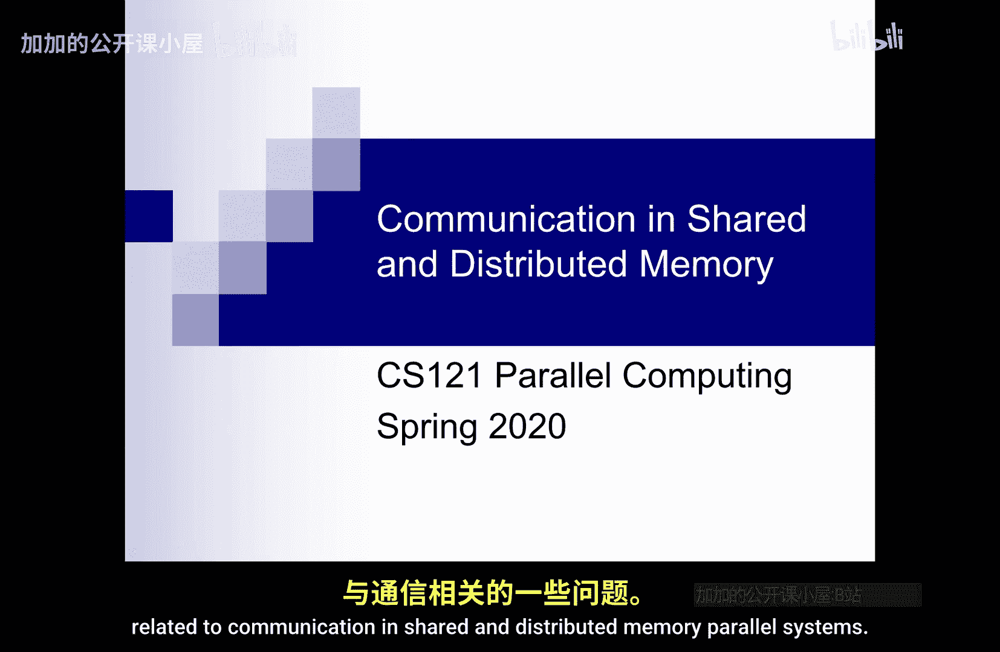
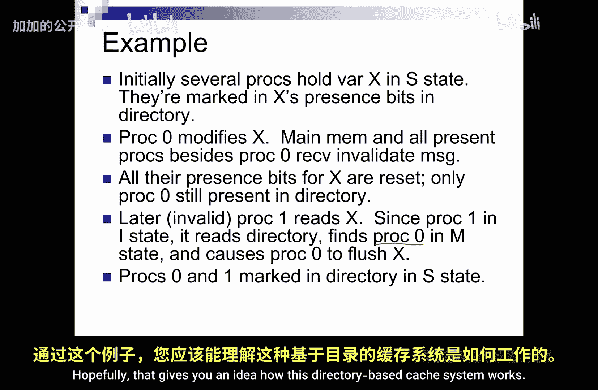
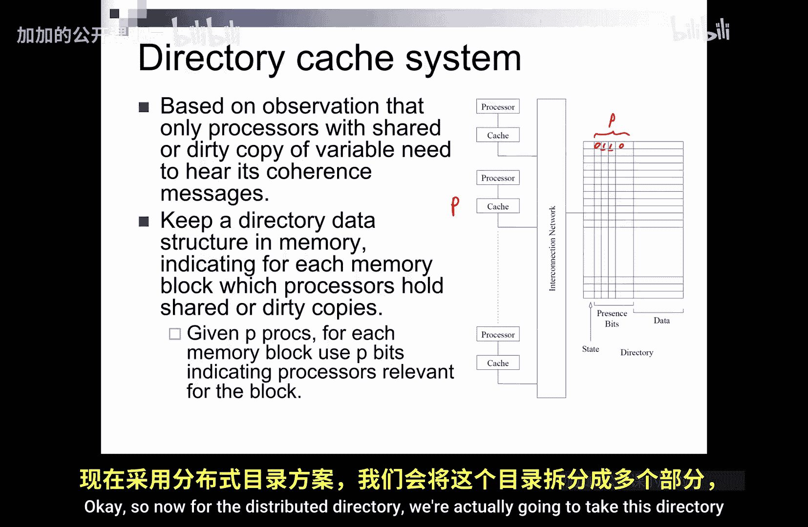
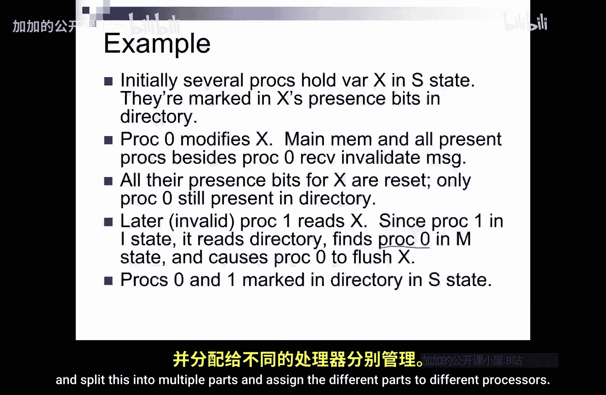
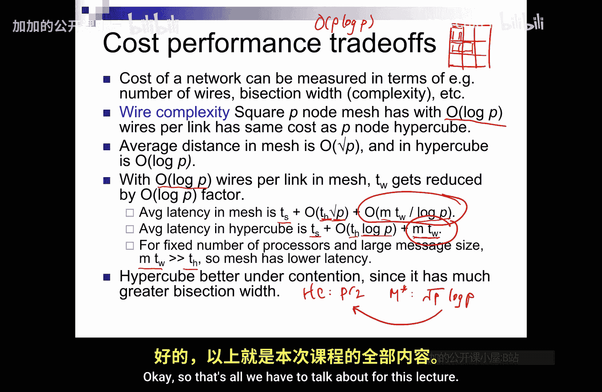

# 上海科技大学【中英⚡并行计算｜CS121 2020 Parallel computing】 p03 P3 Communication -BV1VqypBaEaP_p3-

Hello， welcome to lecture three in parallel Computing。

So today we'll be talking about some problems related to communication in shared and distributed memory parallel systems。

So the first problem we'll look at is the cache coherence problem。

So remember that caches play an important part in making communication systems more efficient。

So in a shared memory system， we know that there's only supposed to be one logical copy of each variable。

However， if several processes want to access the variable。

 then each of them can store a copy of the variable in their cache。And this way。

 when they access the variable， they can simply read it from their cache。

 which is much faster than accessing the variable from main memory。

 and so this improves the efficiency of the memory system。But the problem is that。

If one of the processors modifies the variable。Then the other processors have to be made aware of the change to the variable's value。

And since the variable is stored in multiple caches。

 then each time a some processor modifies the variable。

 the caches have to be made consistent with each other or coherent through some sort of procedure。

And so this is the cache coherence problem， how do we make multiple caches coherent with each other？

Okay， so there are different types of protocols to implement cash coherence。

And there are two main types， the invalidate type protocol and the update type。

So invalidate basically means that when one process modifies a variable。

 then all of the other cached copies of the variable are declared to be invalid。So for example。

 if we look at the diagram on the left， so suppose that on the left hand side we have a variable x。

 which is stored in memory and it's also in the caches of two processors。Okay。

 now suppose P0 modifies the value of x， right， so he changes it from one to three。

Then we're going to make the other two copies at processoror one and also in the main memory。

 be declared to be invalid。🤧嗯。And now if another processor wants to access this invalid variable then so there's only one process with a valid copy of the variable right so in the example it's going to be p0 so if some other process wants to access the variable then p0 first of all needs to write the value back to memory and then the other process can read this value back from memory right so if P1 wants to access x then we first have p0 write the value of 3 back to memory right and then P1 can read the value of 3 from memory。

The other type of cache coherence protocol is update the update protocol so here when one process modifies a variable。

 it's going to write the new value of the variable to all of the other caches and the memory。Okay。

 so here， if p0 changes the value of x to3， then it's going to write this new value to P1 and to memory。

So now there's a tradeoff that's being made by the invalidate and the update protocol in terms of communication versus speed。

Okay， so so basically the tradeoff is that if the other variables don't read the variable too much sorry if the other processes don't read the variable too much。

 then if you look at the update protocol， it actually updates all of the variables。

 all of the other processors， even though they're not reading this variable。Okay。

 so the update protocol is actually wasting a lot of communication。On the other hand。

 if the other processes do read the variable， then if you use the invalidate protocol。

Then in order for P1 to read the value of x。It actually has to wait for P0 to write the value to memory and then P1 needs to read it from memory。

 so this takes additional time。Okay， so basically， if the other processes do not read the variable much。

 then you don't want to use the update protocol because it's Wast and communication， right。

 you would rather use the invalidate protocol。But if the other processes read the variable a lot。

 then you don't want to use the invalid protocol because that's slower than the update protocol。

Now in practice since both of these protocols actually have to perform some communication operations and usually our bandwidth is quite limited okay so in order to conserve bandwidth。

 okay， we usually go with the invalidate protocol right because for the update protocol you actually have to send this data to all of the other processes and the memory and this takes more bandwidth。

Okay， so now we're going to look at a specific cache coherence protocol called the MSI protocol。

 so this is an invalidation based coherency protocol， and it's a simpler protocol。

 but it's the basis for more complex and higher performance protocols such as MESI and MOEI。Okay。

 so the way this works is that and the reason it's called the MSI protocolcol is that each variable can be in three different states。

 either the M state， which means modified or the S shared state or the I invalid state。

And whenever a process performs in action， for example， a read or write operation。

 it's going to cause a state change to the variable。

And then it's also going to cause coherence messages to be sent to the main memory and all the other processors。

And I'll show you exactly how this works in a few slides。Okay， well。

 so before I show you the actual protocol， let's talk some more about these different states that we have。

So first of all the s the shared state， okay， so what this means is that if a variable is in the shared state。

 then it's actually in multiple caches at this time。Okay。

 and this variable has the same value in all of these caches。In fact。

 the variabless value has not changed since the last time each processor read X read the variable from memory。

 so all of the copies of this variable are up to date。And because the values are up to date， right。

 then the processors can simply read the value of x from their own caches。

So this is why x is called a shared， we say that it's in the shared state。

 because it can be safely shared between all of the processors。Okay， so next the modified state。

 okay， and this is also called the dirty state。So what this means is that a processor， let's say P。

 has changed its cached value of this variable x。Okay， so x has been modified by P。

 and now x is dirty。And so because P modified x， it has to tell all of the other processors that their currently cached value of x is now out of date and therefore invalid。

Now P itself has an up to date value of x， so it can read and write to x in its own cache。Okay。

 further， when p is eventually done with x right， when p evicts x。

 then because p is the only processor with the newest value for x。

 it has to write back or flush this newest value of x back to main memory so that other processors can see the new value of x。

🤧。And lastly， we have the invalid state okay so this means that so if a processor is in the invalid state for this variable x。

 it means that some other variable a processor has changed x's value okay so therefore this processor's value for x is out of date。

And now， if this processor wants to read the value of x， it has to go to main memory。

Okay now the main memory value of x could also be out of date and so therefore when this process wants to read X。

 it will cause whichever processor has the current value of x it'll cost that processor to write the current value of x back to memory。

 and then this processor can read this new value from x from memory。Okay。

 so now the processor which has the current newest value for x。

 that processor would be in the M state， because that processor， as we said over here。

 that processor changed the cache value of x。So this processor P that changed the cache value of x has the newest value for x。

Okay， so let's do an example of this， so suppose that we have two variables x and y okay。

 so initially they're in the they have values5 and 12， and they're both in the dirty state。Okay。

 now suppose you have a processor zero， which wants to read X。Okay， so if it reads x。

 then now the state of x is going to be so first of all it'll read the value of5 for x。

 and now the state of x is going to become shared。At processor zero， okay。

 and also in the main memory。Now likewise， if processor sorry processor 1 wants to read why。

 it will get the value of 12 for y and the state of y will become shared in both processor 1 and the main memory。

Okay， so now suppose processor0 tries to increment x okay so then at processor 0 x will become6 right and furthermore its going to x is going to go into the dirty or modified state right remember that the D state is the same as the modified state。

Okay， however， in main memory， the value of x is still five。

So therefore this value is invalid so therefore the main value sorry the main memory value for x is now invalid and the main memory goes into state I for the variable x。

Okay， likewise， if you increment y， right， then processor 1 now has a dirty value for y。

 and the old value for y in the main memory is now invalid。Okay。

 now suppose processor zero now reads y okay， so it will read why， so when this happens。

 since the main memory knows that it has an invalid copy of y。

It will cause whichever processor has the dirty copy of y so that's going to be processor one right it will make processor one flush the newest value of y back to main memory okay so then this is why y now has a value of 13 in main memory right and then the main memory will send that value of 13 to processor 0 which is trying to read why。

Okay， and now all of the processors now have the value newest value for y。

 and they all go into the shared state。Okay likewise， if processor 1 tries to read x。

 then it's going to cause processor0 to flush the newest value of x to main memory and then that value gets sent to processor 1。

 and then after that all of the processors have the newest value for x and they all go into the shared state。

Okay so we can kind of continue with this example， so for example， if processor 0 modifies x again。

 then processor 0 will be the only processor with the modified or dirty version of x which has the correct value 19 and all of the other values will be out of date and so all of the other processors will have invalid copies of x right so we can just sort of repeat this process。

All right， so now let me tell you how the actual protocol goes。

So we can express this protocol using a state machine， okay， so the way that so we have this diagram。

 which I took from online。And the way this diagram works is that you notice that。

You have these pairs of pairs of things okay so you have these AB pairs okay so what this is representing is that the first part is a input request okay and the next so this is basically something that a processor wants to do。

And the second part right is the consequence of that input， okay。

 it's something which happens as a result of that input。Okay and in addition。

 we have these two types of messages which are being sent okay so the messages that the processors send are shown in black and the processor sorry and the messages that is being sent on the bus or sorry by the bus is shown in blue。

Okay， now we have these different types of messages， so for example， the PR read， the PRRD。

 okay so this stands for processor read， so this is a read request by a processor。

The processor write request right like over here， this means that a processor wants to write a value。

Okay， so the the flush。Action means that a processor writes back the newest value of the data to memory。

Okay， the bus read X， right this action over here， okay。

 so this means that you want to get a copy of the variable with the intent to modify that variable。

And the bus read means that you want to get a copy of the variable。

 but you don't plan to modify the variable。Okay， so now we have this state diagram overall state diagram okay so this is by the way。

 this diagram is being applied to just one variable okay so of course we have many variables overall。

 and so if we are using cache coherency on all of these variables。

 then each variable runs one of these state machines。Okay。

 and these states refer to states of the processors。

 right so each processor for this variable can either be in the MS or I states。

Okay now let's look at some so I'm not going to go through all the different parts of the state machine。

 but let's look at some examples， example actions from the state machine okay so for the first example。

 let's assume that the variable is currently shared okay so this means that currently all of the processors have the correct up to date value for the variable。

Now， suppose that some processor wants to write a new value for the variable。Okay。

 so afterwards the variable， only this processor that writes the new value will have the correct value for the variable all of the other processors should now have invalid copies of the variable。

Okay， so now to implement this， what we do is that the processor that does the right。

It's first of all going to generate a processor write message。

So all currently the variable is being shared， so the writing process is actually in the shared state。

 but because it wants to do a right， it's going to generate a processor write message。Okay。

 and then this is going to cause a bus read exclusive message to get sent on the bus。

You see that this is the action that we want to take。

 and this is the consequence or the output that happens as a result of this input request。O now呃。

What's going to happen is that。呃。Right， so each process。Okay， so so the process that does the right。

 he is going to go into the modified state because he's the only one with the newest value for the variable and all of the other processes。

 they receive this bus read exclusive action and they receive this on the bus and once they get this message they now go into the invalid state because their value for the variable is now out of date。

Okay， so again， the writing process goes into the modified state。

 and the writing process also sends this bus message out。

 which causes all of the other processes to go into the invalid state。

Okay so that was the first example， the next example is that suppose the variable is currently in the dirty state。

 okay， so it was last modified by some process which is now currently in the M state。Okay。

 so this means that whichever process， so let's say that this process is called P， okay。

 so then process P has the newest value for the variable。Now suppose you have some other process。

 let's call him Q， okay， so suppose Q wants to read this value for the variable。

So Q is going to be in the invalid state， because p has the latest value for the variable。

 so Q has an invalid value for the variable。So in order for Q to read this variable。

 so Q is currently in the invalid state， so to read the variable it's going to generate a process read message and this is going to cause a bus read message to get sent onto the bus。

Okay， now the process which currently has the newest value for the variable right。

 that's going to be in the M state and that's going to receive this bus read message and once it receives this bus read message over here。

 it's going to take its current value， which is the modified value for the variable。

 and it's going to flush it out to memory。Okay， and then after that。

 this modified process will go into the shared state。Okay， and。Right， and then the invalid process。

 right， it's also going to go into the shared state。So basically， again。

 what happened is that this process has an out of date value。

Out of date copy of the value and this process has the up to date copy right so this process wants to read。

 so it sends out this message which causes this process to take the current value and put the value into memory。

And now this invalid process can read this newest version of the value from memory。So after that。

 it goes into the shared state and this modified process also goes into the shared state。Okay。

 one more example， suppose we have a process in the M state okay and suppose that so it's in the M state。

 so it's the only process with the up to date copy of the variable and suppose that this process wants to read or write to the variable then it's going to generate these process reader and process write messages。

However， because this process already has an up to date copy of the variable。

 then it doesn't need to send any messages onto the bus okay so here we see that there's no bus traffic and instead the process can simply read its own cached copy of the variable or it can write a new value to the variable but whatever it does。

 it doesn't need to tell any other processes about it。Okay， so this， in fact。

 this is a situation where you get a lot of savings from having the cash， okay。

 because here this process can simply read from its own private cache。

 it doesn't need to communicate with anyone else。Right， so this is where。

This operation can happen very quickly。Okay， so that is the MSI。ACash coherency protocol。So next。

 we're going to look at how do you actually implement this protocol in different types of hardware systems。

Okay， so the。So the first type of system that you can implement MSI in is called the Snoopy Ca system and this is actually sort of the simplest system in which you can implement MSI。

So so the Snoopy cache is usually set up on either a bus or a ring， okay。

 and the reason we do that is so that all of the processors are connected to this bus or ring。

And any message that gets sent on the bus will be heard by all of the other processors。

So in particular， whenever we send any coherency messages or coherency data。

 all of the processors will automatically get that information from the bus。

 okay and they will respond。Yeah， so the correctness of the protocol on the bus depends on the fact that the messages are being broadcast on the bus and all the processes hear all of the messages。

嗯。Okay， so so now again， we want to check that in certain cases we can actually get improved performance okay and so the best case when you have a cache is if only one process tries to modify that variable okay and none of the other processes are trying to access the variable。

 then this process will be in the modified state and when it modifies the variable。

 it doesn't need to send any data onto the bus okay because all of its aes are done to the cache and there's no coherence traffic and so in that case we get good performance。

However， the other case is that if we have several processes and they're all trying to modify the variable。

 okay then each time one of the processes modifies the variable。

 and then if you look at the next process which tries to modify the variable right。

 then that process is going to cause the first process to flush this newest memory。

 this new value out to memory。Okay， and so all of these flushes and all of coherency。

 all of these bus messages are going to get sent onto the Interconnect。

 and so you're going to have a lot of traffic on the interconnect and the bus will become a performance bottleneck。

Okay， so the cache is going to work well if only one process tries to modify the variable。

 but you're going to get clogged up on the bus if many processes are making concurrent modifications。

Okay， so to deal with this communication bottleneck。

 people have tried implementing caches on different types of caches， so for example。

 the directory cache system Okay， so here the observation is that。

when you make changes to a variable， the only other processes which care about the change and which need to know about the change are the processors that have this variable in the shared state or in the dirty state。

Because for other processes， if they're not sharing this variable， then of course。

 they don't care what happens to this variable。Okay so therefore for this directory cache system。

 the idea is to keep track of which processors have a shared or dirty copy of the variable and then when you modify the variable。

 you only notify those processes。And the way you know which processes have a shared or dirty copy is by storing these processes in a directory type structure。

Okay， so if you look at the system， what we have are we have a bunch of processes with caches。

 they talk through a network。And then furthermore on you have this directory data structure。

 which is going to store which processes have。Have copies of each variable Okay。

 so we have different variables over here right so each of these rows is a different memory address。

And for each of these memory addresses， we have these things called presence bits okay so if we have let's say we have P processors。

 okay， then we're going to have P presence bits， okay so one bit for each processor。

And the bit is simply indicating whether a particular processor has a copy of this variable in the shared or dirty state so all of these values here are zero or1。

Okay， and if it's zero， then basically that means that this processor doesn't care about the variable because it doesn't have a copy of the variable。

So when you change the variable， you only need to notify the processors that have the variable in the shared state sorry that half their presence being shared。

That half their presence bit being set， which implies that they have a shared copy of the variable。

Okay， so。All right， so yeah so let's do an example of how this works all right so suppose we currently have several processes that have a variable x in the shared state okay then these processes would have their presence bit be set in the directory right so they would be marked in the directory。

Now supposed to process zero modifies x so now process0 needs to notify all of the processes that have x in the shared state。

Okay， and the way it does that is that process zero is going to go into the directory。

 it's going to look up which processes are in the shared state。

 and it's going to send those processes invalidate messages。

And then after that process zero is going to go into the modified state right and then since all of the other processes which used to be in the shared state。

 since now they're invalid they would have their presence bit for x be set to0 so they no longer care about x because they have an invalid copy of x and only process zero would still be present in the directory for variable x。

Okay， now suppose later some other process， let's say process1 right it tries to read x now we know that process1 is in the invalid state right because process X is in the modified state。

 so all of the other processes have to be in the invalid state so because process one is in the invalid state。

 it's going to go read the directory。It's going to find the only process which has its presence bit for x being set。

 and that's going to be process zero。It'll find process  zero in the modified state and now process1 will make process0 flush its value of x to the memory。

 and then process one can get the newest value for x。 and then after that。

 process 0 and 1 will both be marked in the directory to be in the shared state for x。Okay。

 so hopefully that gives you an idea how this directory based cache system works。

 so I'll just say a few more things about it so the first thing is that this directory。

Right so we need to keep track of all of these bits and these things are actually stored in the memory itself okay。

 so the data is stored in the memory and the presence bits are stored along with the data。

 so also in memory。So therefore， because it's being stored in memory。

 then all of the coherency traffic needs cross needs to access the memory， okay。

 so we have this big bottleneck at the memory because all of the processors are constantly trying to access the memory in order to read the directory。

So that's one problem and the other problem is that the directory itself needs to be quite large okay so if we have let's say m memory blocks。

 okay MP processors， right， then since you need a bit for each memory block and each processor。

 then in total the directory needs to have size m times P。Okay， so yeah， so these two problems。

 one is that the directory is big and the other problem is that it causes this bottleneck at the main memory。

Okay， so now we want to improve the performance of the directory okay and we can do that by using a distributed directory right so previously we had a centralized directory because all of the processors access this single directory。

Okay， so now for the distributed directory， we're actually going to take this directory and split this into multiple parts and assign the different parts to different processors。

Okay， so each processor is now going to have a part of this directory。

 it's going to have a part of the memory and it's going to have all of the presence bit for that chunk of memory it's responsible for。

Okay， so now if a processor needs to read some information from the directory。

 then regarding a certain variable， then the first thing is the processor is going to figure out which other processor has that variable。

 and then it's only going to access the directory for that processor， which has the variable。

So we no longer have a centralized bottleneck， we distribute the directory accesses to a bunch of different processors。

Okay， now I want to say just one more thing about sharing， which is that sorry about caches。

 which is that you have this issue called false sharing。

So so the problem is that when you transfer data from the cache sorry when you transfer it from main memory to the cache。

 okay you don't transfer like single bytes at a time。

 you transfer large chunks of memory and these are called either cache lines or blocks。

And so for example， for the L1 cache， a typical size for the cache line would be something like 64 to 128 bits。

Okay， now within these 64 to 128 bits right you have multiple words of memory okay， so for example。

 suppose that we transfer something from memory to cache right we're going to transfer。

 let's say eight different words of memory from memory to cache。Okay。😊。

And now you could have two different processors that are reading completely different memory locations right so for example。

 this processor one over here is reading the third memory location and processor two is reading location5 so they are different locations in memory。

 however they lie in the same block of memory。Okay， so therefore。

 when processor one reads data item3， it's going to take all of these items。

 this entire block from main memory to its cache。And likewise。

 processor two is going to take the same block， okay， from memory to the cache。

And now if processoror one modifies its variable， okay， so it's actually modifying the third word。

 then it needs to update this entire cache block。Okay， and when it does that。

 this is actually going to cause processoror2s cache line to also be invalidated。Okay。

 even though processor  two is reading a different memory location。

 right it's reading memory location 5 and processor one is modifying location3。

So they're different memory locations， but they lie in the same cache block。So therefore。

 processor one's axis is going to cause processor2's cache line to be invalidated。Okay。

 and so this is why it's called false sharing， right。

 it looks like these two processors are sharing the same cacheline， but in fact。

 in reality they're not sharing the same memory address that's being accessed。But nevertheless。

 whenever one processor modifies a cache line， it's going to invalidate the other processor's cache line and cause a lot of memory coherence traffic。

Okay， so this was going to hurt our performance。And so so we need to do something about this and the thing we're going to do is we can try to have the data okay so basically this means that we're going to somehow rearrange this data so that if two processors access different memory locations。

 then we want to make it so that they do not lie in the same cache line okay so for example。

 if somehow so let's say that this is a different cache line down here okay so if we can somehow restructured this data so that this value lies in the second cache line then processor one and processor two would no longer access the same cache line and so they would no longer invalidate each other。

Okay， so sometimes it's possible to pad your code to achieve this purpose and sometimes it's not okay。

 so it depends on the program that you're running。Okay。

 so we talked about caches and the next thing I'll talk about is how do we measure the cost of communication？

And we're first going to consider cost in the message passing setting and then we' located it in the shared memory setting。

Okay， so the cost basically， so suppose we want to transfer a message of size M from one node to the other。

Okay so there are several components to this cost， so the first component is there's a startup time to do this message transfer okay we're going to call the startup time T sub S so this includes things like in order to send a message right you have to prepare a message header maybe you need to do some error correction add some error correction to this message。

You might need to run a routing protocol to figure out how you're going to send this message。

 you need to interface with a router and many other things。Okay， but for the message。

 we only do this once for the message okay， no matter how far the message goes。

 you just need to do this once。Okay， now the next part to the cost is that the message could actually go through multiple hos。

 it can go through several processes before it gets to its destination。

And so for each hop we could have a per hop time， so whenever it gets to an intermediate router。

 then that intermediate router needs to determine the next hop and that's going to take some time for this intermediate router。

 and so we're going to call this the per hop time given by T subub H。

And then also it's going to take us time to transfer this message so we'll call this time T subW。

 and this is related to the amount of bandwidth on the links that we're sending。Okay。

 so basically if the bandwidth is R， meaning that we can send r words per minute per second。

 then the per word transfer time between the source and destination is going to be1 divided by R。

Okay， so now we're going to look at several different routing protocols and look at their costs。

 okay， so the first protocol is the simplest protocol， which is store and forward。

so if the message needs to transit through several intermediate processors。

 then each of these intermediate notes is going to in the storm forward protocol。

 each of these intermediate notes is going to wait to receive the entire message before forwarding it to the next hop。

Okay， so if a message needs to go from p0 to P3 and it's going to go through P1 and P2。 Okay。

 then P 0 is going to send this entire message and P。Right。

 so P0 is going to wait to receive this entire message before it forwards it to the next link。

 P1 and P1 is also going to wait to receive the entire message before forwarding to P2 and so on。

Okay， so therefore， let's look at the cost for this storm forward routing， okay？So。

So the amount of time right so that we spend at each process so this amount of time over here。

 this is since you're sending a message of size M right and it takes you Tw amount of time to send each word of the message。

 then just to send the message， we're going to take time M times Tw。And furthermore。

 we're going to spend an additional T sub H time at each hop so therefore for each hop。

 we're going to spend a total of MTW plus TH time。And if there are all different hubs between the source and the destination。

Then the total time is going to be t sub S plus L times the per edge cost per link cost。

Now usually this TH time， it's going to be small compared to this M times TW time。

 okay so we can basically we can just sort of ignore this term over here until so we can simplify the previous expression to be the startup time plus the number of hops that we go through times the message size times the per word time to transfer a message。

Okay， so next let's look at something called packet routing okay so the difference between packet routing and stor forward is that for packet routing you're not going to wait until you receive the entire message before forwarding to the next hop okay so instead you're going to take the message and break it into a bunch of small packets and then you're going to send these packets。

And as soon as you receive a packet， then you can forward the packet to the next hop on the path。

Okay， so in fact， because you do this forwarding of every packet。

 then we're basically sending the messages through a pipeline。Okay。

 so what's happening is that at the first time step， P0 gets the first packet。

 and then it's going to forward the packet to P1。RightSo in the second time step。

 P1 is going to get the first packet and P0 is going to get。

Is going to get the second packet and then it's also going to afford the second packet to P1 and P1 is going to forward the first packet to P2。

Okay， so therefore at the third time step， right P0 has the third packet， P1 has a second packet。

 and P2 has the first packet。Okay， so we keep sending in this pipeline fashion。是。Okay。

 so this is going to make the sending be much faster than with storm forward okay so that's one advantage packet routing Another advantage is that we can let different packets take different routes。

Okay， so this is good because sometimes a route might get congested。So if it gets congested。

 then we can let other packets take less congested routes， okay。

 so this is going to improve overall performance。Another benefit to packet routing is that we can do error correction on each of the packets instead of the entire message。

 and this makes it easier to do the error correction and lets us tolerate higher error rates。Okay。

 there are some downsides to packet routing， which is that since you now break one message into multiple packets。

 you need to pay overhead for each of the packets， so you need to do things like store the routing info and then store some error correction so overall your overhead for all of the packet is going to be larger when you do packet routing。

Okay， so now let's look at the amount of time that packet routing takes， okay。

 so I claim that the total time is going to be equal to T the startup time plus c per hop time times the number of hops plus the per word time times the number of words。

Okay， so now if you compare this expression to the previous expression。

 okay so the previous expression for stored and forward right。

 so that was basically equal to oops so that was basically equal to T the startup time plus the number of hops times the message size times the per word time。

Okay， so if you compare these two things， right， you see that the storm forward。Oops。Forward。

Hass this extra term of L over here okay so when all the other terms are small。

 okay so that we can basically ignore the startup time and ignore the per hop time okay then stor forward is basically going to be L times slower than packet routing。

Okay， so now let's see why packet routing has this this time complexity okay。

 so the way that you can see this is that let's first of all follow the first packet okay。

 when does the first packet get to the destination？Well。In order to get to the destination。

 we need to pay the startup time right we're going to pay TH time per。

per link that this first packet goes through。And then let's assume that the packet only has a size of one so therefore the time to transfer this packet because it has a size of one。

 then the time is just going to be Tw。So therefore by this time， TS plus T times L plus Tw， right。

 then the first packet will have arrived at the destination。And now once the first packet arrives。

 okay all of these subsequent n minus one packets， you see that they arrive one after another okay。

 in fact， you get one new packet every TW time right because every TW time you can transfer one packet of size1。

Okay， so therefore， the total amount of time this is going to take is the time for the first packet to arrive plus m minus1 times tw。

Okay， and if you simplify this， then you get that all of the packets are going to arrive at the destination in this amount of time。

Okay， so the next type of routing is called cut through routing or cut through switching。Okay。

 so this is basically similar to packet routing but it's been optimized for parallel computers okay so packet routing works both for parallel computers and it also works in more general networks。

 for example， the internet。And cutro routing has been optimized for parallel computers。

 and basically the optimization is that instead of letting different packets take different paths。

All of the packets are going to take the same path。Okay， and because they all take the same path。

 then we don't need to have as much routing information。So。Yeah。

 so the way this works in practice is that we have these things called Fs。

 which stands for flow control digits， and they're very small， they' let's say 32 bytes。

 and they're being transferred at a very high rate。Okay。

 so now we're going to send many of these flips between the source and the destination and the first F。

 okay， so this is going to be the header F。This is going to be allocated some path by the switches and the routers that we go through。

Okay， and all of the remaining flips that we send， okay， so those are going to have the data in them。

But they're all going to follow the same path as the initial header F。Okay。

 so that way we don't have to do switching and routing on all of the other flips。

 like we only need to do switching once。And then also we can do a simpler type of error correction。

 we can do it for the whole message instead of for each packet。

Now we can improve the performance even more if we have some high priority splits okay so for example some messages might be very important like transferring cache lines we want to do that as quickly as possible so in order to support these higher priority messages。

 what we can do is have multiple lanes of communication okay and some of the lanes have higher priority than other lanes。

Yes。Okay， so some other names for this cut through switching are things like virtual cut through。

 and this is also related to something called Warhole routing。Okay， so。Yeah， okay， so。嗯。Okay。

 so now let's put all this stuff together into an overall cost model。Okay。

 so we said that the total amount of communication time depends on the amount of data M that you're transferring and the number of hops L that you go through however。

 we basically want to ignore this L parameter over here and the reason for doing that is first of all the programmer doesn't have any control over L so L。

 the number of hops that you go through right this depends on how your processes and your processess are mapped to each other so we'll see more about this processor process matching mapping later on but but this processes is basically something the programmer cannot control。

And because they can't control this mapping， then they can't control how many hos a message is going to go through。

Okay， and in fact， in many routing systems， they do something called randomized two step routing。

 okay， and they do that in order to minimize congestion。

And so the way this works is that if you want to send a message from a start node to a destination。

 you first send it to a random location。and then you have a random location。

 send it to the destination。And the idea is that because you're sending to a random location。

 then you minimize your chance of causing congestion right so for example。

 if you have a very congested path over here between the source and destination。

 then because I'm going through a random intermediary。

 right then I have a good chance of avoiding this congested path over here。Okay。

 but if you do randomize two step routing， then again。

 you lose control over how many hops the message is going to go through。

 right because you don't know who the intermediary is。Okay。

 and the final reason for ignoring L is simply that this per hop time that we pay for each hop。

 right， this TH time。This is usually quite small compared to the startup time or the total time to send the message especially if you send a large message so these are all good reasons that we can simply ignore L。

And so once you ignore L， then now you can simplify your communication time to simply be the startup time TS plus the time to transfer the message。

 which is the message size times the per byte time。Okay。

 now now this expression here is assuming that the network is uncongested。

 and that means that for each link， we're only sending one message of size M through the link。

However， you could have network congestion， meaning that for a certain link。

 you might be sending multiple messages over the link so if you're sending C messages let's say over the link and each of those has size M。

 then now the time to send all of the messages is going to be TS plus the congestion times the message size。

Okay， so as an example of this， suppose you have a mesh with P processors。

 so the size of the mesh is going to be root P by root P。

And suppose all of the processors are randomly communicating with each other。

So because they're doing random communication， so here we have， let's say。

 a mesh of processors and they're doing random communication with each other。

Then if you cut this network at some point， then basically you might have like half of the processors are trying to communicate with processes in the other half。

Okay， so you have basically half your processors over here and you have the other half over here and across this by section。

 across this cut that you made， right， you could have up to order P communications。

And now so you have order P communications， however。

 if you look at the number of links between the two halves。

 right so in fact let me switch to a different color over here。

 let's try blue over here right so if you look at the number of links okay。

Well since you have a root P by root P grid， right。

 then the number of links is just going to be root P right so we computed that last time from the last lecture and you're trying to send let me switch back to red here。

Okay， so we're trying to send order P messages across root P links。

 and so therefore one of the links will have at least P divided by root P。

 which is equal to root P messages。Okay， so there's going to be some link， let's say this link， okay。

 it's going to be carrying root P messages instead of a single message。Okay。

 so the congestion on this link is going to be root P。Okay。

 so therefore if you plug this back into our formula for the total communication time。

 the C here is going to be root P， so therefore the communication time is going to be the startup time plus root P times M times TW。

Okay， so this is an example where you can see that congestion is going to substantially increase your communication time。

Okay， so now let's move to the shared memory to cost communication costs and the shared memory model。

So when you do this， you actually face a few issues okay so the first issue is that so basically communication time in this setting is much less predictable than in the network setting okay and one of the reasons is that well in the shared memory setting。

 the memory layout is determined by the operating system and so the programmer doesn't have any control over this and therefore the programmer doesn't have control over how many local versus remote memory aes they're making。

So remember that in these shared memory systems， they typically have this pneumma architecture。

 nonuniform memory access architecture， so that means that certain data pieces of data are faster to access than other pieces of data okay but because you have no control over how the data is laid out。

 you really don't know how many nearby data items you're accessing versus far away data items。Okay。

 so this is going to cause unpredictability in the communication cost。

Other sources of unpredictability are things like cash thrashing， right。

So your cash hit rate depends on who you're sharing your cache with in the shared memory setting and this in turn depends on the scheduler and process allocation so if you happen to share with another processor that that doesn't need much cash then you have the cash to yourself and so you can make a lot of fastes through the cache so you're making a lot of fast aes whereas if you share the cache with another processor which uses up a large chunk of the cache then you will have just a small part of the cache and you will have a lot of cache misses and now you need to go out to memory much more often。

And so this depends on the scheduling， which is unpredictable， yeah。

And then other issues that you face are things like coherency traffic or how much locality you have in your code or how much false sharing。

 all of these things are application dependent and in fact they can change at runtime。

 so this causes a lot of unpredictability in the communication cost in the shared memory setting。

Okay， so now modlo this unpredictability， we're still going to say that the total communication time is still going to involve these two parts。

 which is that it's going to be the startup time times the total time to transfer the amount of data that you want to transfer。

Okay， so despite this unpredictability。We're going to have the same overall formula for communication costs in the shared memory setting and the distributed memory setting。

However， the difference in the shared memory setting is that both of these values， TS and TW。

 they're going to be much smaller in the shared memory setting than the distributed memory。

Architecture。Okay， just because the shared memory system is usually much smaller than the distributed memory system。

 so your data doesn't have to travel as far， so it's easier to start up a data transfer and it's also faster to transfer all the data。

🤧咳咳咳。Okay， so so the next thing we're going to look at is how do you do routing in these networks Okay so in fact we've seen different types of networks such as meshes or hypercubes or trees right so so if you're in one of these networks。

 how do you send a message between two processes？Okay。

 so we need a routing algorithm which is going to select a path between the two communicating processes。

And we want some properties for these routes right so we want the routes to be as short as possible。

 we also want the routes to be uncongested， okay so we don't want multiple messages to use the same route and then also we need to be able to compute these routes so we have to make sure that the routing algorithm itself doesn't have too high of a cost。

Okay，However， there are tradeoffs to these properties that we want okay， so for example。

 if if you try to get a very short route， then these short routes might be more congested。

So for example， if you have a bunch of processes like these。

 then if you're trying to communicate in as short a way as if you're trying to make the routes as short as possible。

 then maybe you could have paths like these。Okay， but now all of these paths are going to use this intermediate link which is going to become congested so instead of doing that。

 you could perhaps have you know different pairs of processors take slightly longer routes。

 but which are less congested。Okay， so there's this trade off。

 there's this sort of antagonism between how short your route is versus how congested it is。Okay。

And also we could consider different ways of computing the route。

 so if you use a deterministic algorithm， then this basically means that for a fixed source and a fixed destination。

 we're always going to use the same path。OkayNow this is going to be much this is easier to compute。

 right because it's always going to be a fixed path between the source and the destination。

On the other hand， because we're using a fixed path， you might have congestion on this path。Okay。

 so instead of doing a deterministic routing， you could do something more adaptive where you try to look for the congestion and then you route around the congestion。

Okay，Now this is going to decrease your congestion。

 but these adaptive paths are harder to compute because you have to go look for where the congestion is and then somehow avoid that。

Okay， so this is the trade off between congestion and having paths which are easy to compute。Okay。

 so those are general properties of routing algorithms。

 so now let's look at some specific routing algorithms Okay so the first one we're going to look at is a dimension and EQ routing。

Okay so dimension routing basically means that if we're in a k dimensional mesh right where k could be you know 1。

2，3 or whatever value right then we're going to order the dimensions in some order okay so if we're in let's say three dimensions okay so then we have an X Y and z dimension dimensions so we're going order these in some fashion either X。

 Y z or z Yx or something but we're going to fix the order and then when you route messages。

 you're always going to send the messages in this through the dimensions in this fixed order okay so you always for example。

 route in the x direction first and then y and then z。Okay， I mean。

 you could use a different path which goes Z Yx， okay， but if you're doing dimension routing。

 you don't do that， you always go in the same order of the dimensions。Okay， now E cube routing， okay。

 so this is basically a routing protocol for hypercus， which does dimension routing。

Okay so I'll give you an example of this， but let me describe this first。

 so suppose you have a source and destination node okay now were first of all。

 so since we're in a hypercue these nodes can be represented using binary numbers right so we're first of all going to use the binary representations of the source and the destination。

And the next we're going to compute a routing， which is computed by taking the XO of the binary representation of the source and the destination。

ok。😊，And this is going to go from。Yeah， and then we're going to take this route R right。

 and then we're going to do dimension routing on this route R， okay。

And then we're going to go in the order from the least significant digit to the most significant digit right and each time you have a one bit in the R。

 you're going to route in that dimension and if you have a zero bit。

 you don't need to do the routing in that dimension。Okay。

 so let me show you an example of this okay so suppose we're doing a three dimensional routing sorry routing in a three dimensional hypercube okay so let's say that the source is going to be this node 010 over here and we're trying to route to the destination 111 okay so the first thing is we're going to compute the xor of the source and the destination right so we're going to do 010 right xor 111 right and so this is going to equal 101。

Okay， and now we're going to do and this is equal to our R over here。

So now we're going to do dimension routing on this 101 okay so and we're going to go from the least significant digit to the most significant okay so every time we have a one bit oops right every time we have a one bit we're going to move in that dimension。

Okay， so we have a one bit in the first digit。so that means that we're going to go from 010 to 011 because r has a one bit in the first digit okay so you're going to go from 010 to 011 and then we have a0 in the second in the second bit second digit so therefore you don't need to do anything for that dimension。

Okay， and then finally， for the third dimension， you have another one。

 and so therefore in the third dimension， we also need to go from 011 to 111。Okay。

So we basically made two moves and these two moves correspond to where the ones are in the XO between the source and the destination。

Okay now one reason EQbe and dimension routing is used is because it can prevent deadlocks okay so let me show you a situation where if you don't use dimension and EQbe routing you get a deadlock when you send okay so now consider the situation where you have four processors and know there are these communication edges between these processors。

Now if you don't and suppose what's happening is that we want to send a message from a to C okay and you want to send so basically you want to send a message from from a to C like this right and you want to send a message from D to B。

 so you also want to send a message like this right you want to send a message from C to A like that and then you want to send a message from B to D。

Okay， so we're passing these messages in a ring basically， right。

 we're passing them two hops in a ring。Now， if you don't use dimension routing。

 okay then what can happen is that when you try to send from a to C。

 we're going to go in the x direction first right so from A to D and then you go in the y direction from D to C。

Okay， when you send from D to B right， then since we're not using dimension routing。

 then we're going to go in the y direction first right and then the X direction okay from C to a。

 you again go in the x direction first and the y direction。And then from B to D。

 we're going to go Y direction and the next direction。Okay， now this is going to cause a deadlock。

 okay， because what's going to happen is。Once you start doing that。

 so let me try to clear out this figure a bit right so then A's packet is going to end up on this link right because a is going from in the X direction first right and D's packet is going to end up on this link。

🎼Right and then C's packet is going to be over here， right and then。

And then B's packet is going to be over here。Okay， and now once this happens。

 then we have a deadlock okay， because B's packet so for example。

 A's packet needs to travel this through this link over here， this link right in order to get to see。

But this link is already occupied by D。Right and so A's packet can't go anywhere likewise D's packet needs to go to B right so it needs to get onto this link but again it can't do that because this link is currently occupied by another packet right by C's packet okay C's packet can't move because it wants to go over here but it's already been occupied by B and B can't move Okay so in fact everybody is stuck right and this is because we used we did not use dimension routing。

Okay， now on the other hand， if you do use dimension routing， okay， so with dimension routing。

 suppose you first go in the x direction and then you go in the Y direction。

Then what would happen is that let's see race list right so in order for a to send to C you go in the x direction first and then the Y direction。

 okay so you go ADC。And for D to send to B then actually it's also going to go in the X direction first。

 so it's going to go D A B。Instead of DCB， it's going to go DAB。Okay。

 so C is going to go to B first and then to A， and then B is going to go in the x direction first。

 so it's going to go BCD right instead of B A， it's going to go BD。Okay。

 so then what's going to happen is so A is going to send a message on this link and then D also wants to send a message on this link。

 but because there's already a message， then sorry D's message is going to get stuck in D。Okay。

 and likewise， C is going to send a message onto this link， right and then。

And then B also wants to send a message onto that link， but it's already occupied。

 so therefore B's message is going to get stuck， okay， so this is a first time step。Okay。

 on the next time step， A's message is going to travel to this other edge， okay， right。

 so let's let's erase this over here and C's message is going to end up on this edge。

Okay now once this happens， thens then D's message right previously it couldn't go onto this edge。

 but now it can right so now it can go onto this edge and B's message can go onto this edge right so this is the situation at the second time step。

At the third time step， C's message has already reached A right and A's message has already reached C。

And then B's message can now travel over here and then D's message can now travel over here and then on the fourth time step。

 all of the messages will reach their destination。Okay。

 so what you see is that if you use dimension routing， then you won't have deadlock。Okay。

 so the last thing we're going to talk about is process to processor mappings。Okay。

 so to understand this， we have to think about the difference between logical communication patterns versus physical communication patterns。

So for example。😊，Suppose that in your program you have a grid of processes okay so in this group。

 so this basically means that every process has an ID which is given by two numbers。

 right the x and Y coordinate right and then each process needs to communicate with its neighbors in the x and Y directions。

So this is the logical communication pattern， because it's determined by the program。

On the other hand， you could have a physical communication pattern which is determined by the hardware that you're actually running on Okay。

 so suppose that you have this grid of processors okay and these processors are physically connected in a grid right so we have 16 processors and processor number six is physically connected right by some link to processors2 and5 and 7 and 10。

Okay so that's going to be the physical connection and then here right this is going to be the logical connection between the processes so this is a physical processor connection and this is logical process connection。

Okay， now when you run your program， okay， so when you run this logical communication pattern on top of your hardware。

 you need to map these processes to the processors。Okay。

 so this is where this process process or mapping comes from。

And you can do the mapping in different ways， and some mappings can get you good performance。

 but poor mappings can cause communication bottlenecks and can hurt your performance。

Okay so for example， if we have a grid of if we have a logical communication pattern which is a grid and then if we have a physical communication network which is also a grid。

 then of course the most natural mapping is just to map this grid onto the other grid just like I'm showing infi C over here so and if you do this。

 then you don't have any communication bottlenecks。

 because for example this process B over here it wants to talk to its neighbors neighboring processes。

 for example， process A and process C and process A has been mapped onto Pro1 and process C has been mapped onto Pro3。

 so therefore B can directly talk to A and C just by going over a single link。

And also there's only one route using this， for example， this link over here。

 and so there's no congestion。Okay so this is a very good mapping。

 which doesn't have congestion or bottlenecks。On the other hand， if you use a very unnatural mapping。

 okay， so for example， this mapping over here。😊，So you know of course in practice you would never use this because if you have two grids。

 then of course you would simply map the grids onto each other but just as an illustration。

 suppose you use the mapping D over here， then this is going to cause a lot of communication bottlenecks okay so for example。

 if you look at a process， let' let's say G over here so G needs to communicate with processes C F H and K。

But let's look at where these are located。So G is mapped to this processor 15 over here。

 but in order to talk to process H so H has been mapped to processor2。

 so therefore for G to talk to H， it needs to go through four hops like this right sorry。

Okay and then to talk to processor F well okay so F is located right next to G so it can just go through one hop to talk to K where is K located。

 okay so K is located over here right so it actually needs to traverse five hops just to get to K right and then C is it takes two hops to get to C。

Okay， so instead of taking one， so if you look at this mapping， right。

 then for G to talk to any of its neighbors takes only one hop， whereas for this mapping。

 it takes up to five hops。Okay further， if you look at all of the paths that exist between the neighbors that exist between neighboring processes then that's what's being shown in these dotted lines over here。

 okay so these are all of the paths that occur between neighbors and now you see that there's a lot of congestion on certain paths okay so for example on this so this is actually one physical link between one and five。

between processors one and five， however， there are five different paths shown by these dotted lines。

 there are five different paths that use a single edge。Okay。

 so there's a congestion of five on this edge。And likewise。

 there are other congested edges like for example， this edge from  two to three is also congested。

 from 8 to 12 is also congested。Okay， so these paths are both long and they're congested。

So this is a bad process to processor mapping。Okay。

 so what we want to look at are how do you determine a good process to processor mapping for different types of topologies？

So here our topologies are the same， they're both grids， so it's easy to do the mapping。

But if you have a different topology， then how do we do this mapping？Okay。

 so just to make this a bit more formal， what we have are。

 so we want to find a mapping between these set of processes， which is represented by a graph。

 to the set of processors， which is represented by a different graph R。Okay。

 so we need that each process P maps to a processor in R。

Okay and also we're going to take the edges in the graph P and we're going to map them to the shortest paths in R。

Okay， so remember that every process in P maps to some processor in R given by F of P so we're going to find the shortest path between F of P1 and F of P2。

And we're going to take the edge from P1 to P2 and map it onto this shortest path。Okay。

 now once you have this mapping F right so this is given by this function， F over here right。

 so now we can look at the how good this mapping is。

So two things we're going to look at are the congestion of the mapping right。

 so this is the maximum number of routing paths that cross one edge in the physical network R。Okay。

 so for example， on the previous example， you had five different paths that crossed the edge 15。

 so the congestion was5。The other thing is dilation okay so here you're going to look at the maximum length of a route between two neighboring processes right so for example we saw that in the previous example you have process G and K which are neighbors in the process graph right but after the mapping F then now they have a path of length 5 so therefore the dilation here is going to be5。

Okay and the final value that you can look at is this thing called expansion。

 which is how many processes， the number of processes divided by the number of processors。

OkayNow for simplicity， we're going to assume that we have the same number of processes as processors。

 Okay， so our expansion is always going to be one。Okay。

 so now we want to look at some specific mappings between different topologies。

 so the first one is going to be mapping from the line to the hypercube。Okay。

 so suppose you have a K dimensional hypercubee right then that has2 to the K number of nodes okay。

 so we're going to take a line of the same size and map it into the hypercube。

And the way we're going to do that is using something called a gray code。Okay。

 so gray code is basically a K digit gray code is going to be an ordering of all of the K digit binary numbers。

And the ordering has a property that if you take two consecutive values。

 they only differ in a single digit。All right。So the way you can construct a gray code is you can use a very nice recursive construction。

So first of all， so in order to construct a k digit gray code。

 we're going to assume inductively that you can construct a K minus1 digit gray code。

And let's call that k minus1 digit gray code g sub k minus1。Okay。

Now to make your k dig G a gray code， you're going to take g sub k minus1 and you're going to prepen it with0 okay。

 so you're going to put zeros in front of all of the values in this G sub k minus1。

and then you're going to take another copy of G sub k minus1。

 but you're going to reverse the ordering for all of the values。

 and then you're also going to prepen all the values with one。And then lastly。

 you're going to concatenate these two copies。Okay。

 so let me show you an example of how this works Okay so suppose you try to construct a three digit gray code okay and assume that you've already constructed a two digit gray code So here you have a two digit gray code and you can see that it has this gray code property meaning that consecutive values only differ in one bit right so for example。

 these two values only differ in the first bit right these two values only differ in the second bit and then these two values again differ in the first bit。

So consecutive values only differ in one bit。And so this is a two digit gray code。

 and we're going to use this to construct a three digit gray code。And the way you do this is you're。

 first of all， going to take a copy of the two de degree code。

And you're going to prepend all of the values with zero。😡，Okay。

 so now you have a bunch of three digit values。Okay， and next。

 you're going to take another copy of the two digit gray code。And you're going to reverse it Okay。

 so instead of going in this order on。Instead of going in this order， right。

 we're going to go in this order。Okay so you take all of the values in this reverse order and then you put them down here and you prepen all of the values with one。

Okay， and then finally， your three digit gray code is simply the concatenation of these four values and these four values。

Okay， so so it's a simple exercise to figure out why this is a correct3 digit gray code。Okay。

 so you can think about that。But once we know how to construct these gray codes。

 okay then in order to map a line onto a hypercube。

 we're going to make use of the gray code and what we're going to do is take node I in the line okay so we have a line of two to the K node。

 we're going to take the i node in the line and then map it using this gray code to to G of I for a K digit gray code。

Okay so more concretely suppose you have eight processors in a line right and so then the gray code mapping is that0 so here we've constructed the gray code right and then if you just convert these to decimal numbers right then the ordering of the gray code is going to be zero and then one and then this is three over here and this is two right and then we have6。

7，54。Okay， so then now we're just going to take the Ith node in the ring and map it to G of I okay。

 so for example0 gets mapped to 0， one gets mapped to1， two gets mapped to3， three gets mapped to2。

 four to6， five to seven， and so on。Okay， so this is how we're going to map between the line and the hypercue。

And if you do this sort of explicitly for these eight processors。

 you're going to see that this is how the mapping goes。

 okay so we just follow these lines and this is how this is the ordering for the mapping。Okay。

 so now let's see how good this mapping is right， so we want to look at the congestion and dilation of this mapping。

Okay， now in terms of dilation， right， so what we know is that suppose you have two neighbors in the line。

 suppose you have notes I and I plus1。Then when you map them into the gray code。

 we know that they get mapped to G of I and G of I plus1。

And because of the property of the gray code， we know that these two consecutive values in the gray code differ in only one bit。

Right so for example， if you take processors， let's say3 and4 well3 gets mapped to node 2 and 4 gets mapped to node node 6 in the hyper cubebe and the binary representation of2 is going to be 010 and the binary representation of6 is 110。

Okay， so therefore these two numbers differ in only one bit。And because they differ in only one bit。

 then we know that these two processors are actually connected in the hypercue because for example。

 we have 010 over here and 110 over here。And in fact。

 010 is connected to every other node which differs in only one bit from 010。

 so it's connected to this processor， it's connected to this processor because this one only differs in the second bit and it's also connected to this processor because this guy only differs in the first bit over here。

Okay， so now we know that for two neighboring processes in the line。

 they will get mapped to neighboring processes in the hypercue。Okay。

 so therefore the dilation of this mapping right， so that's how far an individual edge from the line gets stretched onto the hypercube。

 okay， the dilation is just one。Okay， the edges do not get stretched at all。

Okay so next we're going to look at the congestion okay and here the congestion is also going to be one right so that's the best possible congestion and the reason it's going to be one is because if you look at any hypercube edge right how many edges from the line graph are going to map to this hypercube edge right so for example if you look at this hypercube edge over here there's only only going to be one edge from the line graph that maps onto this？

And so therefore， the congestion for this edge and in fact。

 for every edge on the hypercue is also going to be one。Okay。

 so next we're going to reverse what we did， so instead of mapping from a line to a hypercube。

 we're going to map from a hypercue to a line。Okay。

Now the way we're going to do this is that to map from the line to the hypercube。

 we use the gray code which is given by this function I'm sorry this should be a k over here。

 which was given by this function G sub K of I right and so to do the reverse mapping from the hypercube to the line。

 we're just going to use the inverse of this mapping okay。

 so we're going to use the inverse of this function。Okay， so now now we have the mapping。

 now let's look at how good this mapping is， so first of all let's look at the congestion of the mapping。

Okay， now。Remember that from the previous lecture that if you look at the bise width of a K dimensional hyper cube。

 that's going to be 2 to the K minus1。Okay， so for example。

 the bisection width of this three dimensional hypercube。

 we're going to end up cutting four edges because if you imagine if you make a cut like this then we're going to cut all of these edges from the top to the bottom。

はい。Now， on the other hand， if you look at the。If you look at the bisection width of the line。

 okay right， if you look at the bisection width of the line， if you have many nodes over here， right。

 well that's just going to be one right because if you bicycl this line， you cut only a single edge。

Okay， so therefore， if you look at let's say the top half of the nodes in the hypercube and how they cross into the bottom half of the nodes。

 right well there are two to the k minus1 connections from the top half to the bottom half in the hypercube but for the line graph。

 there's just one edge。Okay， so therefore all of these messages from the top half to the bottom half。

 they all have to traverse a single edge in the line graph。Okay， so therefore。

 the congestion is going to be 2 to the k minus1 because you have this number of messages that need to cross from the top to the bottom。

 and they all need to go through this middle edge over here in the line graph。

Okay and the dilation of this mapping is also going to be order of 2 to the K okay so for example。

 if you look at the node0 at the node 2 to the K minus1 you can see that these nodes are going to be connected in the hypercube however to get to them in the line this is going to take a path of length2 to the K minus1 so for example in order to get from 0 to node 4 over here they're directly connected in the hypercue but you need to take this long path in the line graph。

Okay， so the dilation is also going to be large， it's going to be 2 to the k minus1。Okay。

 so that was for a one dimensional line， okay， so what about a two dimensional mesh， okay。

 so let's try to map a two dimensional mesh into a hyper cubebe。Okay。

 so so suppose that you have a mesh which has a size 2 to the r times2 the2 to the s okay so maybe you have a mesh like this。

 okay， so you have2 to the R rows， let's say right and2 to the S columns。Okay。

 so then in total you have2 to the r plus S number of nodes in this mesh and so we're going to try to map this into an r plus S dimensional hypercue。

 which also has the same number of nodes。And the way we're going to do this mapping is that we're just going to combine two copies of the line to hypercube mapping。

Okay， because you can think of the mesh as simply， well。

 it actually is just the two dimensional generalization of lines。Okay。

 so since we know how to map lines into the hyperce。

 then we can just take that same mapping and use it to map the mesh into the hypercbe。Okay。

 so in particular， if you have a node in the mesh given by IJ right so it's in the i throw and J column right then what we're going to do is what you want to map this first part right into。

Into basically an R dimensional sub hyperpercube sub hyperper cubebe out of this entire large hypercube。

 okay， and the way you can do that is you're going to take I and then apply this R digit gray code R I。

And then you take the second coordinate and then you map it into this second sub hyperpercuube out of the overall hypercue。

 and the way to do that is to use the S digit gray code on J。Okay so let's do an example of this。

 so for example， if you have a mesh which is two to the one by two squared。

 then we're going to map the first coordinate onto a one digit hyper gray code。

So zero is going to get map to zero and one's going to get map to one and then we do that for every column。

Okay。And now for the rows， right， we're going to use a two digit gray code for the rows so that gray code is given over here。

 right it's going to be 00，01，1，1， and then 10。Okay。

 and so this is how we're going to map this mesh into the hypercbe。Okay， and when you do that。

 if you draw that out， you're going to get something like this。Okay if you had a 4 by4 mesh。

 then for let's see the columns， so those are given by two digit values and so use we would map those into a two digit gray code and then for the rows。

 we would also map those into a two digit gray code。Okay。

 now the claim is that the dilation and the congestion are both one for this mapping。Okay。

 and the reason is that basically we can look at each coordinate。

 the x coordinate or the y coordinate， we can look at those separately okay。

 so if you look at two neighbors in the mesh， okay。

 they're either going to differ in their X coordinate or the Y coordinate right。

 but they're not going to differ in both。So if they differ， for example， in the Y coordinate。

 then we just need to compare we're basically going to compare G sub S of J and then g sub S of J plus 1。

Right， and then we know that these two things are going to differ in only one bit because of the property of the gray code and because they only differ in one bit。

 they'll be connected to each other in the hypercube。Okay。

 so anything that's connected in the mesh is also going to be connected in the hypercue directly connected。

 so therefore the dilation is one。Okay， and likewise for the x direction， okay。

 if they're directly connected in the mesh in the X direction。

 and they are going to be directly connected in the hypercbe。Okay。

 so that's why the dilation is one and the congestion is also one because if you look at any edge in the hypercue。

 then it's not hard to see that there's just one edge from the mesh。

 which is going to map onto that edge of the hypercue。So therefore， the congestion is one。B。Yeah。

 okay， so。So something else that you can note is that the different columns and rows of the mesh。

 okay they're going to map onto sub hyperpercus of this overall hypercube and they're going to map onto different sub hyperpercuubs。

Okay so now again we're going to reverse this mapping and go from the hypercue to the 2D mesh so what we'll try to do is we're going to go from a log p dimensional hypercube into a root P by root P mesh so now this log p dimensional hypercube right so the number of processors in this hypercube is going to be P and there are also P nodes in this mesh。

Okay and now for simplicity， we're going to assume that this root P here is a power of2 okay。

 and so therefore if you take a log of root P， then you're going to get an integer and we're going to let Q be equal to the log of root P。

Okay， and the log of root p is also equal to the log of p divided by 2。Right。Okay。

 now to do this mapping， we're going to consider either fixing。 Okay， so so we have。

So we have let's for concrete let sake say that log p is something like let's say log ps equals 8 then Q here is going to equal 4。

 it's basically half of the number of digits so because log P equals 8。

 then every node in this eight dimensional hypercue can be represented by eight digit binary number。

And so Q is basically half the number of digits of these numbers。

 so it's going to be a four digit binary number。And now let's consider I'm fixing either the first or the last Q digits of the nodes in the hyperCe。

Okay， and when you do that， you're going to get another Q dimensional hyper cubebe。

Okay so as an example， I suppose you take a fourdial hypercue okay and let's consider fixing the last two digits so you can fix it to any value so let's say we fix it to 10 then all of the other nodes in this hypercube which have their last two digits equal to 10 so they are four such nodes and you can see that these four nodes actually form a hypercue。

Okay so they form a twodial sub hyperpercue and the reason they form a hypercube is because for example you can see that 00 is connected to 0101 is because they only differ in one digit they only differ in this digit over here right 01 is connected to11 right so what else do we have we have000 is connected to 01 and so on okay so you can see that these four nodes are actually a sub hyperpercube out of this larger four dimensional hypercue。

Okay， so now the way we're going to use this is for each Q digit binary number。Okay。

 for each such number R， we're going to map the hypercube that you get from fixing the lastq digits。

Okay， to this value R。Okay， and you're going to map this sub hyperper cubebe onto row R of the mesh。

Okay， and so we're taking a sub hyperpercube， we're mapping it onto a row and a row of the mesh is just a line。

So therefore， the way you're going to do the mapping is using our previous hypercbe to line mapping。

Okay。Right， and so the number of nodes that you're going to be mapping is basically so in this sub hyperper cubebe。

 right， we're going to have。How many we're going to have two to the Q number of nodes in the sub hyperper cubebe。

 and so this is going to be equal to if you look at this expression over here。

 2 to the Q is equal to root P。Okay， so we're taking a sub hypercube of size root P。

 and we're mapping it onto the root P nodes。In this row of the mesh。Okay。

 now if you go back to the previous。Mapping that we had。

 we saw that when you map K nodes from a hypercue onto K nodes of a line。

 the congestion and the dilation are both 2 to the k minus1。Okay， so therefore， in this case。

 since you're mapping root P nodes of the hypercue onto root P nodes of the line。

 the congestion is going to be root P over2。Okay now this is how you map the values from the hypercube which have the fixed which have a fixed final Q digits and the other type of nodes from the hypercube you consider are where you fix the first Q digits okay if you fix the first Q digits。

 you're also going to get and then you vary the last Q digits。

 okay then you're also going to get a sub hyperpercube and for this sub hyperper cubebe you're going to map it onto column R of the mesh。

Okay， so we're going to fix the first Q digits to R and then vary the remaining digits。

 and you're going to take those nodes from the hyper cubebe and map it onto column R of the mesh。

Okay， and the congestion there is also going to be root P over2。Okay。

 and now the mappings onto the rows and the columns are independent right。

 and so overall the congestion is going to be root P over 2。Okay， so just a few more of these。

 so now let's consider mapping the line to the mesh。Okay， well， to do this， it's pretty easy。

 you just take this line and you map it in a zigzag pattern to the mesh。Okay。

 and you can see that the congestion and the dilation are both one。Right。Okay。

 now what about the reverse map， what if you want to a map map， a mesh to align？So again。

 we're just going to reverse the mapping from the line to the mesh。Okay。

 so if you want to versus mapping， then the way you can visualize this is that you can imagine taking this line and then stretching it out okay so imagine that this line is a piece of string okay and you pull this side to the left and then you pull this side。

 let's say you pull it to the right okay and then all of these other edges on the mesh are going to get stretched。

and they're going to get stretched in this fashion that we've shown on the right over here。Okay。

 so you can convince in yourself that if you stretch out this line， this thick black line。

 then the mesh is going to get stretched out in this fashion。Okay。

 so now you can look at the congestion of the mapping once you do the stretching right so basically the congestion I claim is going to be root P。

Okay， and the reason is， so the congestion is given by you know， if you look at a edge of the line。

 right， how many edges from the mesh are going to cross the single edge from the line？Okay。

 and if you look at this figure over here， you can see that it's going to be root P。

And the way to see this is that for example， if you consider this edge over here well then how many edges from the mesh have to cross this line right well here's an edge from the mesh that's got to cross this line right because in order to get from this node to this node。

 we're going to have to take this path in the line。Okay。

 now this edge is also going to cross this line right because we're going to take this path right and this is going to cross the line and then this is going to cross the line。

Okay， so therefore you see that there are going to be root P edges from the mesh that are going to cross every single line。

Or sorry， not every single line， but for example， this line right。

 they're going to cross root P edges from the mesh are going to cross that line。

 and so the congestion there is going to be root P。Okay。

 and the dilation I claim is going to be two times root p minus1 and so for example。

 the way to see that is if you look at the first node in a row and the last node in the next row。

 then two nodes they're directly connected in the mesh。

 but when you take a path in the line graph the length of that path is going to be two times root P minus1。

是。Okay， all right， so those are all of the processor to sorry。

 process to processor mappings that we're going to consider。Okay， so before we finish。

 the final thing we want to look at is some additional trade offs in the cost performance。

Okay so so now the way you can measure the cost of a network is in terms of well different parameters。

 for example， the number of wires that it uses or the bisection width and other parameters so now we're going to look at one particular parameter。

 which is the wire complexity of the network so this is basically how many edges are in the network。

Now， if you take a mesh again with P nodes， okay， now so we're going to take a P node mesh。Um。

 but what we're going to do is we're going to add additional edges between every pair of nodes。Okay。

 oops。And in fact， what we're going to do is we're going to add， let's say， order of log P wires。

 okay， we're going to add order of log P additional edges for every edge。

 for every existing edge in the mesh。Okay， then we have then since the mesh itself has basically ordered P edges。

 and then we're going to take every edge and then multiply by factor of log P。

 then in total the mesh is going to have a p times log p number of edges。Okay， and if you recall。

 the hypercube with P nodes also has p times log p number of total edges。Okay。

 so now we want to compare the cost。In this sort of augmented mesh with these additional edges versus a cost in a hypercube。

Okay， so we know that they have the same number of edges。Right。

 so they have the same wire complexity， but let's look at their costs in using different metrics。

 like for example， the average distance。Okay， well。

 the average distance between two nodes in a mesh right is going to be order root P。

Even though we've added all these additional edges， they're not going to make the diameter sorry。

 they're not going to reduce the distance between any pair of nodes。

 because any path that you took before， you would still have to take the same path in the mesh。Okay。

 so we still have that the average distance between two nodes in the mesh is going to be root P。Okay。

 whereas in the hypercbe， we know that the average distance is going to be log P。Okay。

 so in this sense， the hypercub is still better than the mesh。Okay。

 but now let's look at the time to transfer messages in this augmented mesh versus a hypercute okay now because you've increased a number of wires to log P for every link in the mesh right。

 then you basically you reduce the congestion on the edge by a factor of log P okay。

So therefore the amount of time to send a message， the average amount of time to send a message is going to be the startup time plus this is going to be the average distance between two nodes。

 times to per hop time plus know in a normal mesh it takes you n times tw amount of time to send n messages but if you multiply the number of wires by log P。

 then you're going to reduce this time by a factor of log P。

Okay now if you compare that to a hypercube okay so the hypercue the amount of time to send the message is going to be the startup time plus the per hop time times the number of hops on average times m times tw right and this is because in the hypercube we still only have one edge between every pair of nodes so that's how much time so this n times tw how much time it takes to send m messages sorry M words on that single edge。

Okay so now let's consider a case where you fix a number of processors and you're trying to send a large message okay so large message means that m times tw。

 let's say is going to be much much larger than TH in this case you see that this term is going to dominate right these two terms from the mesh and the hypercube are going to dominate and you see that the hypercube is going to work faster than the I'm sorry the mesh is going to work faster than the hypercue by a factor of log P。

Okay， so this augmented mesh has lower latency when you're sending a lot of messages。However。

 the hypercue is still better under contention okay because the hypercube has a much higher bisection width right remember that the hypercube has a bisection width of so the hypercube the bisection width is going to be p divided by 2 whereas for the augmented mesh so let's write that M star so for normal mesh bisection bandwidth is root P and now since you make every edge log p times bigger you're going to multiply this by a log p but this is still going to be much less than the bisection width of the hypercube。

Okay， so。Yeah， so this is a way to sort of compare different architectures by sort of keeping certain costs the same and then comparing other costs。

Okay， so that's all we have to talk about for this lecture， see you all next time。

