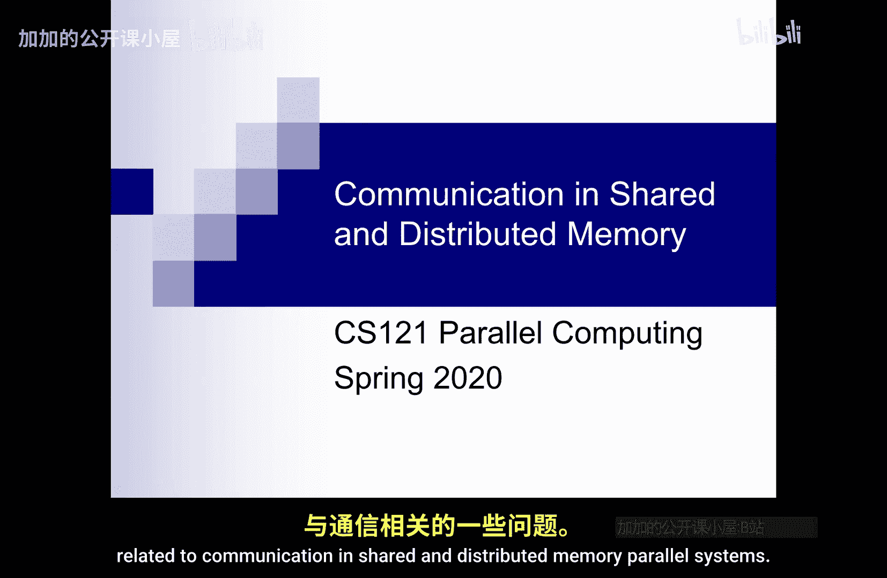
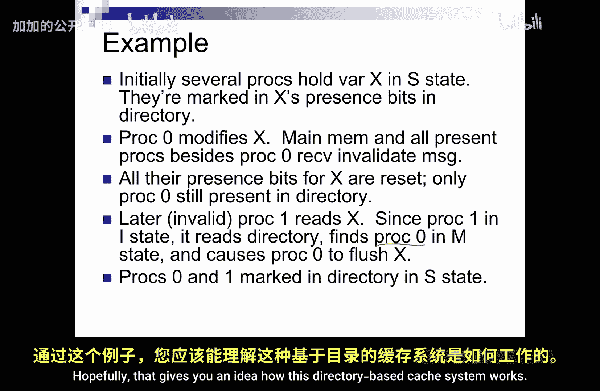
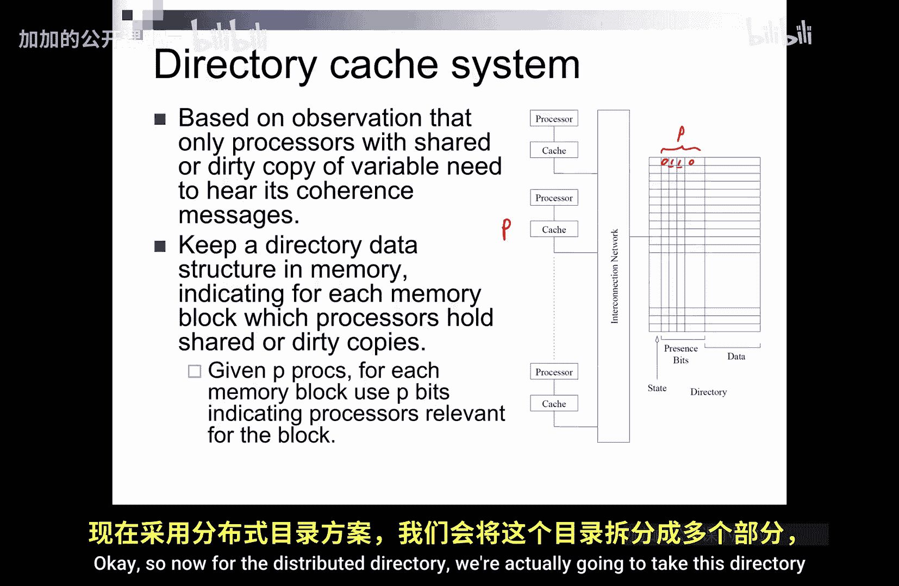
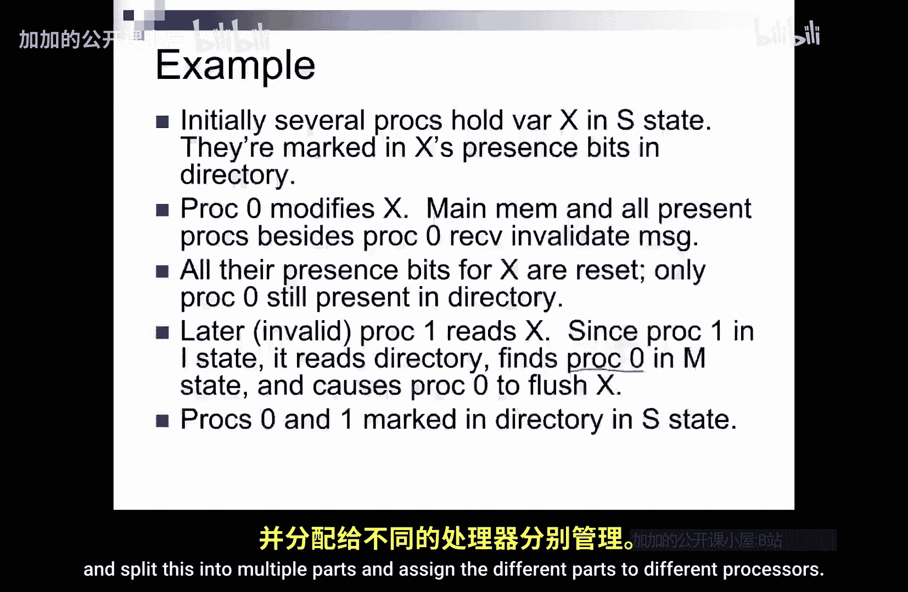
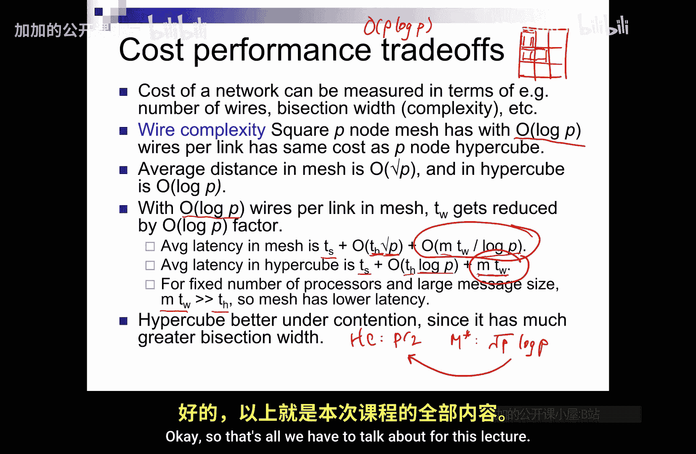

# 并行计算：第3讲：通信问题与协议

在本节课中，我们将要学习并行系统中，特别是共享内存和分布式内存系统中的通信问题。我们将探讨缓存一致性问题、不同的缓存一致性协议、通信成本模型、路由算法以及进程到处理器的映射策略。

## 缓存一致性问题 🧠

上一节我们介绍了并行计算的基本概念，本节中我们来看看通信中的核心挑战之一：缓存一致性问题。

在共享内存系统中，每个变量在逻辑上应该只有一个副本。然而，当多个进程需要访问同一个变量时，每个进程都可以在自己的缓存中存储该变量的一个副本。这样，当它们访问该变量时，可以直接从自己的缓存中读取，这比从主内存访问要快得多，从而提高了内存系统的效率。

但是，问题在于，如果其中一个处理器修改了该变量，那么其他处理器必须知道该变量值的变化。由于该变量存储在多个缓存中，每次某个处理器修改该变量时，缓存必须通过某种过程相互保持一致或一致。这就是缓存一致性问题：如何使多个缓存相互保持一致？

## 缓存一致性协议 🔄

以下是两种主要的缓存一致性协议类型：

*   **失效协议**：当一个进程修改变量时，该变量的所有其他缓存副本都被声明为无效。例如，如果处理器P0将变量x的值从1修改为3，那么处理器P1和主内存中的副本将被标记为无效。如果另一个处理器（如P1）想要访问这个无效变量，那么拥有有效副本的处理器（P0）首先需要将值写回内存，然后其他处理器才能从内存中读取这个新值。
*   **更新协议**：当一个进程修改变量时，它会将变量的新值写入所有其他缓存和内存。例如，如果P0将x的值改为3，它会将这个新值写入P1的缓存和主内存。

失效协议和更新协议在通信与速度之间做出了权衡。如果其他进程不频繁读取该变量，更新协议会浪费大量通信，因为即使其他处理器不读取，它也会更新所有处理器。此时，失效协议更优。反之，如果其他进程频繁读取该变量，失效协议会更慢，因为读取进程需要等待写入进程将值写回内存，然后再从内存读取。此时，更新协议更优。

在实践中，由于两种协议都需要执行一些通信操作，而带宽通常是有限的，为了节省带宽，通常选择使用失效协议。

## MSI协议详解 🧩

上一节我们介绍了两种基本的缓存一致性协议，本节中我们来看看一个具体的、基于失效的协议：MSI协议。它是一个较简单的协议，但也是更复杂、高性能协议（如MESI和MOESI）的基础。

MSI协议之所以得名，是因为每个变量可以处于三种不同的状态：**M**（已修改）、**S**（共享）或**I**（无效）。每当一个进程执行一个操作（例如读或写）时，都会导致变量的状态改变，并引发一致性消息发送到主内存和其他处理器。

以下是这三种状态的含义：

*   **共享状态**：如果一个变量处于共享状态，那么它同时存在于多个缓存中。该变量在所有缓存中的值都相同，并且自每个处理器上次从内存读取该变量以来，其值没有改变。因此，所有副本都是最新的，处理器可以直接从自己的缓存中读取该值。
*   **已修改状态**：也称为脏状态。这意味着某个处理器（例如P）已经修改了其缓存中该变量x的值。因为P修改了x，它必须告诉所有其他处理器，它们当前缓存的x值现在已经过时，因此无效。P自己拥有x的最新值，因此可以在自己的缓存中读取和写入x。最终，当P不再需要x时（例如，当x被逐出缓存时），由于P是唯一拥有x最新值的处理器，它必须将x的最新值写回或刷新到主内存，以便其他处理器可以看到新值。
*   **无效状态**：这意味着某个其他处理器已经更改了x的值，因此该处理器的x值已过时。如果这个处理器想要读取x的值，它必须去主内存读取。主内存中的x值也可能已过时，因此当这个进程想要读取x时，会导致当前拥有x值的处理器将当前值写回内存，然后这个处理器才能从内存中读取这个新值。

**状态机与操作示例**

该协议可以用状态机来表示。状态机应用于每个变量，状态指的是处理器对该变量的状态。状态转换由处理器的读写请求触发，并伴随着在总线上发送的一致性消息。

以下是几个操作示例：

1.  **变量当前为共享状态，某个处理器要写入新值**：写入处理器会生成一个“处理器写”消息，这会导致一个“总线读独占”消息在总线上发送。写入处理器进入已修改状态，而所有其他处理器接收到总线读独占消息后，进入无效状态。
2.  **变量当前为脏状态（被某个处理器P修改），另一个处理器Q要读取该值**：Q处于无效状态。为了读取变量，Q生成一个“处理器读”消息，导致一个“总线读”消息在总线上发送。处于已修改状态的处理器P接收到此消息后，将其当前修改的值刷新到内存，然后P进入共享状态。同时，Q也从内存读取到最新值，并进入共享状态。
3.  **一个处理器处于已修改状态，它要读取或写入该变量**：由于该处理器已经拥有该变量的最新副本，它可以直接读取自己的缓存副本或写入新值，无需向总线发送任何消息。这种情况下，缓存带来了很大的性能提升。

## 协议实现：监听缓存与目录缓存 🏗️

上一节我们详细了解了MSI协议的状态转换，本节中我们来看看如何在不同的硬件系统中实现这个协议。

*   **监听缓存系统**：这是实现MSI的最简单系统。它通常设置在总线或环上，所有处理器都连接到这个总线或环。任何在总线上发送的消息都会被所有其他处理器“听到”。协议的正确性依赖于消息在总线上广播且所有进程都能听到所有消息。最佳情况是只有一个进程试图修改变量，且没有其他进程试图访问该变量。此时，该进程处于已修改状态，修改变量时无需向总线发送任何数据，因此性能很好。然而，如果有多个进程都试图并发修改变量，每次修改都会导致刷新和总线消息，互联总线会成为性能瓶颈。
*   **目录缓存系统**：为了解决通信瓶颈，人们尝试了目录缓存系统。其核心思想是，当修改变量时，唯一关心并需要知道这一变化的，是那些拥有该变量共享或脏副本的处理器。目录数据结构用于跟踪哪些处理器拥有每个变量的共享或脏副本。对于每个内存地址（变量），有一组存在位，每个处理器对应一位。如果位被设置，表示该处理器拥有该变量的共享或脏副本。当修改变量时，只需通知那些存在位被设置的处理器。目录本身存储在内存中，这可能导致内存访问成为瓶颈，且目录大小与内存块数乘以处理器数成正比，可能非常庞大。
*   **分布式目录**：为了提高目录的性能，可以使用分布式目录。将目录分割成多个部分，分配给不同的处理器。每个处理器负责一部分内存及其对应的存在位。当处理器需要读取目录信息时，它首先确定哪个处理器拥有该变量，然后只访问那个处理器的目录部分。这样就避免了集中式的瓶颈。

## 伪共享问题与通信成本测量 ⚠️

在缓存中，从主内存传输数据到缓存时，不是以单个字节为单位，而是以较大的内存块（称为缓存行或块）为单位。典型的L1缓存行大小可能是64到128位。在一个缓存行内，可能有多个内存字。

伪共享问题发生在两个处理器访问完全不同的内存位置，但这些位置恰好位于同一个缓存行中。例如，处理器1读取内存位置3，处理器2读取内存位置5。当处理器1修改位置3时，它需要更新整个缓存行。这会导致处理器2的缓存行也被无效化，即使处理器2访问的是不同的内存地址。这会产生大量内存一致性流量，损害性能。解决方法之一是尝试通过数据填充或重新排列数据，使被不同处理器频繁访问的变量不在同一个缓存行中。

接下来，我们看看如何测量通信成本。首先考虑消息传递环境下的成本。

假设我们要将大小为M的消息从一个节点传输到另一个节点，成本包括以下几个部分：
*   **启动时间**：用 \( T_s \) 表示，包括准备消息头、添加纠错码、运行路由协议等。无论消息传输多远，只需执行一次。
*   **每跳时间**：用 \( T_h \) 表示，消息可能经过多个中间路由器，每个中间路由器确定下一跳需要时间。
*   **传输时间**：用 \( T_w \) 表示，与链路上的带宽有关。如果带宽为R（每秒可传输R个字），则每字的传输时间为 \( 1/R \)。

## 路由算法：存储转发、分组与直通 🛣️

以下是几种不同的路由协议及其成本：

*   **存储转发路由**：如果消息需要经过多个中间处理器，每个中间节点都会等待接收到整个消息后，才将其转发到下一跳。总时间约为 \( T_s + L \times (M \times T_w) \)，其中L是跳数。每跳时间 \( T_h \) 通常较小，可以忽略。
*   **分组路由**：与存储转发不同，分组路由不会等到接收整个消息才转发。它将消息分解成许多小分组，一旦收到分组就立即转发。这实际上是通过流水线发送消息。分组路由更快，允许不同分组走不同路由以避免拥塞，并且可以对每个分组进行纠错。缺点是每个分组都需要开销（如路由信息和纠错码）。总时间约为 \( T_s + L \times T_h + M \times T_w \)。当启动时间和每跳时间较小时，存储转发比分组路由慢L倍。
*   **直通路由/直通交换**：这是针对并行计算机优化的分组路由。所有分组走相同路径，因此不需要为每个分组存储大量路由信息。它使用称为“流控制数字”的小数据单元进行高速传输。第一个flit（头flit）由交换机和路由器分配路径，后续所有flit都遵循相同的路径。这样可以简化交换和路由，并对整个消息进行纠错。还可以通过设置多个优先级的通信通道来支持高优先级消息。其他名称包括虚拟直通和虫孔路由。

## 整体成本模型与拥塞分析 📊

综合以上内容，我们可以得到一个整体通信成本模型。总通信时间取决于传输的数据量M和经过的跳数L。然而，我们通常忽略L参数，原因如下：
1.  程序员无法控制L（跳数），这取决于进程到处理器的映射。
2.  许多路由系统使用随机化两步路由来最小化拥塞，这进一步使程序员无法控制跳数。
3.  每跳时间 \( T_h \) 通常远小于启动时间或发送消息的总时间，尤其是对于大消息。

因此，通信时间可以简化为 \( T_s + M \times T_w \)。这个表达式假设网络无拥塞。如果存在拥塞，假设某条链路上有C条大小为M的消息，则发送所有消息的时间约为 \( T_s + C \times M \times T_w \)。

**拥塞示例**：假设有一个P个处理器的网格（大小为 \( \sqrt{P} \times \sqrt{P} \)），所有处理器随机相互通信。如果对网络进行切割，一半处理器试图与另一半通信，则可能有O(P)次通信需要穿过 \( O(\sqrt{P}) \) 条链路。因此，某条链路的拥塞至少为 \( \sqrt{P} \)。通信时间变为 \( T_s + \sqrt{P} \times M \times T_w \)，拥塞显著增加了通信时间。

## 共享内存通信成本与路由算法属性 🧵

现在，我们转向共享内存模型中的通信成本。在这个设置中，通信时间更难以预测，原因包括：
1.  内存布局由操作系统决定，程序员无法控制，因此无法控制本地与远程内存访问的比例。
2.  缓存命中率取决于与谁共享缓存，这又取决于调度器和进程分配，具有不可预测性。
3.  一致性流量、代码局部性、伪共享等问题都是应用相关的，并且可能在运行时变化。

尽管存在这种不可预测性，总通信时间仍然包含启动时间和数据传输时间两部分，即 \( T_s + M \times T_w \)。然而，在共享内存系统中，\( T_s \) 和 \( T_w \) 的值通常比分布式内存架构中小得多，因为共享内存系统通常更小，数据传输距离更短。

接下来，我们看看在这些网络中如何进行路由。我们需要一个路由算法来选择两个通信进程之间的路径。我们希望路由具有以下属性：
*   **路径尽可能短**。
*   **路径无拥塞**。
*   **路由算法本身的计算成本不能太高**。

但这些属性之间存在权衡。例如，追求非常短的路径可能导致这些路径更拥塞。此外，我们可以考虑不同的路由计算方式：
*   **确定性路由**：对于固定的源和目的地，总是使用相同的路径。这更容易计算，但可能导致该路径上的拥塞。
*   **自适应路由**：尝试根据拥塞情况绕行。这可以减少拥塞，但计算路径更困难。

## 具体路由算法：维序路由与E立方路由 🧮

让我们看一些具体的路由算法。

*   **维序路由**：在一个k维网格中，我们以某种顺序固定维度（例如X、Y、Z）。路由消息时，总是按照这个固定的维度顺序发送（例如先X方向，再Y方向，再Z方向）。
*   **E立方路由**：这是超立方体中的一种维序路由协议。源节点和目的节点用二进制数表示。计算路由R为源和目的二进制表示的异或。然后对R进行维序路由，从最低有效位到最高有效位，每当R中某位为1时，就在该维度上路由。

**示例**：在三维超立方体中，从源010路由到目的111。计算异或：010 XOR 111 = 101（即R）。从最低位开始：第一位是1，从010移动到011；第二位是0，不动；第三位是1，从011移动到111。

使用维序和E立方路由可以防止死锁。如果不使用维序路由，在某些环形通信模式下可能导致所有消息相互等待，形成死锁。而使用维序路由（例如先X后Y），可以确保消息有序传递，避免死锁。

## 进程到处理器映射 📍

要理解进程到处理器映射，需要区分逻辑通信模式和物理通信模式。
*   **逻辑通信模式**：由程序决定。例如，程序中可能有一个进程网格，每个进程需要与其在X和Y方向上的邻居通信。
*   **物理通信模式**：由实际运行的硬件决定。例如，处理器可能物理连接成一个网格。

运行程序时，需要将进程映射到处理器上。映射方式不同，性能也不同。好的映射可以获得良好性能，而差的映射会导致通信瓶颈。

**示例**：
*   **自然映射**：如果逻辑网格映射到物理网格上，每个进程的邻居都映射到相邻的物理处理器上，则通信只需单跳，没有拥塞，性能好。
*   **非自然映射**：如果使用混乱的映射，进程可能需要多跳才能与逻辑邻居通信，并且某些物理链路上可能有多个逻辑通信路径穿过，导致高拥塞和长延迟，性能差。

**形式化定义**：我们有一个进程图P和一个处理器图R。映射函数f将每个进程p映射到处理器f(p)。将P中的边映射到R中f(p1)和f(p2)之间的最短路径上。评估映射质量的指标包括：
*   **拥塞**：穿过物理网络R中一条边的路由路径的最大数量。
*   **扩张**：映射后路径的最大长度（即两个在P中相邻的进程在R中的最短路径长度）。
*   **扩展**：进程数除以处理器数（通常假设相等，扩展为1）。

## 具体映射示例 🔀

以下是一些具体拓扑之间的映射示例：

1.  **线到超立方体的映射（使用格雷码）**：
    *   **格雷码**：一种K位二进制数的排列，使得连续的两个数仅在一位上不同。可以通过递归方式构造。
    *   **映射方法**：将线中的第i个节点映射到K位格雷码G(i)。由于格雷码的性质，线上相邻的节点被映射到超立方体中仅一位不同的节点上，即它们在超立方体中是直接相连的。
    *   **质量**：扩张为1（最佳），拥塞也为1（最佳）。

2.  **超立方体到线的映射（格雷码的逆）**：
    *   **映射方法**：使用线到超立方体映射的逆函数。
    *   **质量**：由于超立方体的二分宽度为 \( 2^{K-1} \)，而线的二分宽度为1，所有从上半部分到下半部分的消息都必须经过线中间的那条边，因此拥塞为 \( 2^{K-1} \)。扩张也为 \( O(2^K) \)。

3.  **网格到超立方体的映射**：
    *   **映射方法**：将网格视为线的二维推广。对于一个 \( 2^R \times 2^S \) 的网格，将其映射到 \( R+S \) 维超立方体。网格节点 (i, j) 被映射为 \( (G_R(i), G_S(j)) \)，其中 \( G_R \) 和 \( G_S \) 分别是R位和S位格雷码。
    *   **质量**：由于网格中相邻的节点要么X坐标不同，要么Y坐标不同，而格雷码保证相邻坐标映射后仅一位不同，因此它们在超立方体中也是直接相连的。扩张为1，拥塞也为1。

4.  **超立方体到网格的映射**：
    *   **映射方法**：对于一个 \( \log P \) 维超立方体（P个节点）映射到 \( \sqrt{P} \times \sqrt{P} \) 网格。设 \( Q = \log \sqrt{P} = (\log P)/2 \)。将超立方体节点二进制表示的前Q位或后Q位固定，会得到一个Q维子超立方体。将这个子超立方体映射到网格的一行或一列（使用超立方体到线的映射）。
    *   **质量**：由于超立方体到线的映射拥塞为 \( \sqrt{P}/2 \)，而行和列的映射是独立的，因此整体拥塞为 \( \sqrt{P}/2 \)。

5.  **线到网格的映射（锯齿形映射）**：
    *   **映射方法**：将线以锯齿形模式映射到网格上。
    *   **质量**：扩张为1，拥塞为1。

6.  **网格到线的映射（锯齿形映射的逆）**：
    *   **映射方法**：逆转线到网格的锯齿形映射。可以想象将网格拉伸成一条线。
    *   **质量**：拥塞为 \( \sqrt{P} \)，扩张为 \( 2\sqrt{P} - 1 \)。

## 成本性能权衡与总结 ⚖️

最后，我们看看成本性能方面的一些额外权衡。衡量网络成本的参数包括连线复杂度（网络中的边数）、二分宽度等。

考虑一个具有P个节点的网格。我们为网格中的每条边添加 \( O(\log P) \) 条额外的边，那么总边数变为 \( O(P \log P) \)。一个具有P个节点的超立方体也有 \( O(P \log P) \) 条边。因此，它们在连线复杂度上成本相同。

*   **平均距离**：在增强网格中，节点间的平均距离仍然是 \( O(\sqrt{P}) \)，而超立方体是 \( O(\log P) \)。在这方面，超立方体更优。
*   **消息传输时间**：在增强网格中，由于每条链路的连线数增加了 \( \log P \) 倍，拥塞减少了 \( \log P \) 倍。发送消息的平均时间约为 \( T_s + \sqrt{P} \times T_h + (M \times T_w)/\log P \)。在超立方体中，时间约为 \( T_s + \log P \times T_h + M \times T_w \)。
    *   当发送大消息（\( M \times T_w \) 远大于 \( T_h \)）时，增强网格比超立方体快 \( \log P \) 倍。
    *   然而，在拥塞情况下，超立方体仍然更优，因为它的二分宽度（\( P/2 \)）远大于增强网格的二分带宽（\( \sqrt{P} \log P \)）。

这是一种通过保持某些成本相同来比较不同架构的方法。

## 总结 📝

本节课中我们一起学习了并行计算中的核心通信问题。我们从**缓存一致性**问题出发，探讨了**失效**和**更新**两种基本协议，并深入分析了**MSI协议**的状态机。接着，我们了解了协议在**监听缓存**和**目录缓存**系统中的实现，以及**伪共享**的挑战。在通信成本方面，我们建立了包含启动时间、每跳时间和传输时间的模型，并比较了**存储转发**、**分组路由**和**直通路由**的优劣。我们还讨论了**拥塞**的影响以及共享内存模型中成本的不确定性。对于路由算法，我们强调了路径长度、拥塞和计算复杂度之间的权衡，并介绍了**维序路由**和**E立方路由**。最后，我们深入探讨了**进程到处理器映射**的重要性，通过**格雷码**等具体方法展示了如何在**线**、**网格**和**超立方体**等拓扑之间进行高效映射，并分析了映射的**拥塞**和**扩张**指标。课程以不同网络架构间的**成本性能权衡**分析作为结束，为我们理解和设计高效并行系统提供了坚实的基础。