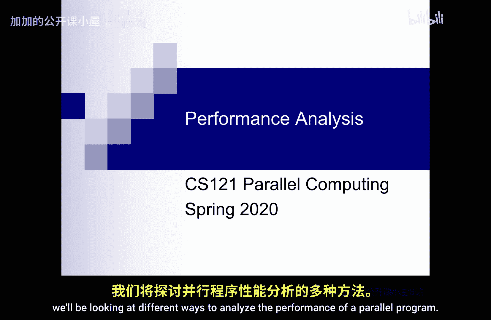
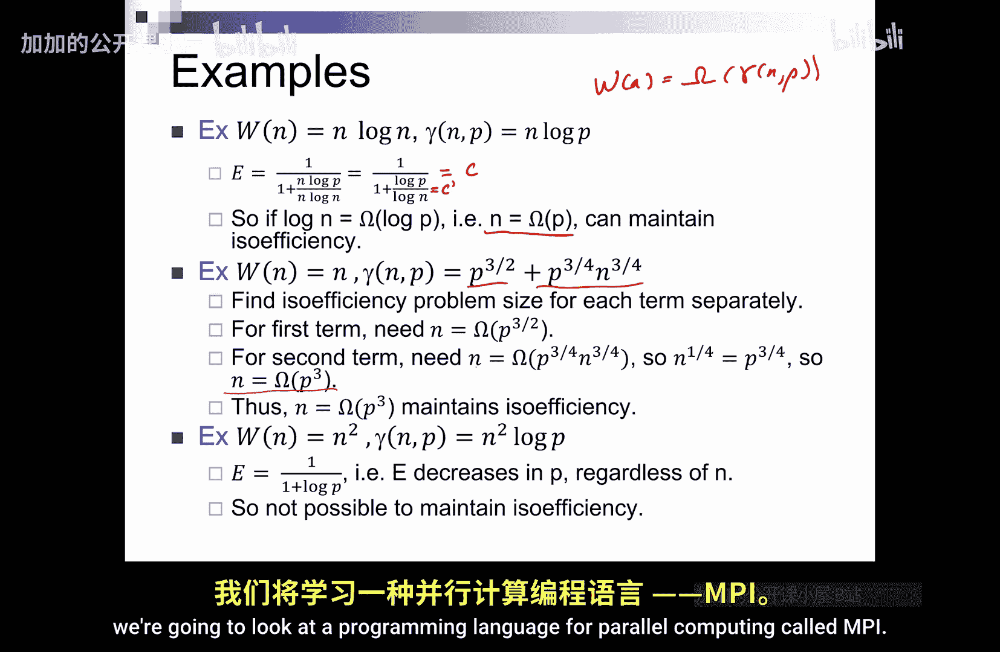

# 上海科技大学【中英⚡并行计算｜CS121 2020 Parallel computing】 p04 P4 Performance analysis -BV1VqypBaEaP_p4-

。Hello and welcome to Lecture 4 of parallel computinguting。

So today we'll be looking at different ways to analyze the performance of a parallel program。

So when we talk about performance， we're usually talking about the speed of the program。

So if you take a program and you run it on one processor and then you compare that time to running the same program。

 but using K processors right， then ideally you want the program to run k times faster。

Okay so so if we look at this picture right then different things can happen as you change the number of processors you're using to run the program so we could have the program runs so if we're using K processors right we could have that the program runs k times faster right we could have that the program runs somewhat faster but less than k times faster so this is called subline speedup and sometimes you can even have a situation where the program using K processors it runs more than k times faster so this is called superlinear speed up。

Okay， now in practice， usually we do not get super linear speed up or even linear speed up。

 usually we get subline speed up。Okay， so。In fact， if we look at the second plot below this。

 so this is showing some actual data from running some application on Amazon cloud computing。

Okay so now here the X axis is showing how many different processors we're using or how many different nodes we're using right so this is the amount of parallelism that we're using okay and then the Y axis is showing the amount of speed up that we're getting okay and this dotted line over here represents exactly linear speed up。

Okay， so now you see that initially as you increase the number of processors。

 we do indeed get super linear speed up okay and this is true until we hit about 40 processors but once we rather 40 nodes but once we hit 40 nodes than as we add more nodes。

 we're not getting any better performance。In fact， once you go past something like 50 nodes。

 if you look at the performance， it is actually decreasing as you add more processors so the program is actually slowing down as you add more processors once you go past 50 nodes。

Okay， so。So basically today we want to understand this type of behavior right。

 how do we characterize the amount of speedup that a program is getting and how do we understand the reasons for the speedup so to do this we want to identify things like performance bottlenecks which impede our speedup。

Okay， and then we also want to compare different algorithms that solve the same problem。

 and we want to compare them in terms of their efficiency and the speed up that we get from them。

Okay now for this analysis， we'll try to be as abstract as possible because if we try to take into account too many details about the hardware architecture。

 for example， then we have an analysis which is only specific to a particular type of hardware so it doesn't generalize to parallel computing in general so we'll try to make our models capture essential properties about the behavior of the program。

 but nevertheless we'll try to ignore as many details as possible to generalize our analysis。

And in addition to this， we're going to be using asymptotic analysis。

 meaning that we consider the behavior of the program as we increase the problem size okay so we don't look at very small problem sizes because in those regions certain you know behaviors that are non-general could be occurring right certain sort of bizarre behaviors could be occurring right so we want to look at more general behaviors and so we'll look at the problem as we increase the problem size to very large sizes。

Okay， so let's first define some terminology okay so we're trying to measure the amount of speed up that a program is getting as you increase a number of processors so let's fix a problem X okay and let's say that we have a parallel algorithm A which can solve X。

Okay， now we're going to define T sub S to be the minimum amount of time to solve x using one processor。

Okay， so this is basically the time for the best sequential algorithm for solving X。Okay。

 the best possible the sorry， the smallest possible time for solving X on one processor。Okay。

 now T1 is going to be。The amount of time that algorithm A takes to solve X using one processor。Okay。

 so now a is a parallel algorithm so we can use different numbers of processors Okay。

 now if we use just one processor for a right， then we're basically looking at the sequential running time of a。

Okay， now we know that T1 is going to be at least as large as TS because TS is the fastest possible time to solve the problem sequentially right and then T1 is the sequential time that algorithm A takes so T1 is going to be at least as large as TS。

OkayNext we're going to define TP okay， so this is the amount of time that algorithm A takes to solve X using P processors Okay。

 so this is like the parallel running time of a when we're using P processors。Okay， so next。

 want to find several ways of measuring speed up。Okay， yeah。

 so the first measure for speed up is called absolute speedup。 Okay。

 we're going to write this S star sub P。And so this is going to be this is going to be defined as TS divided by TP so what this is capturing is that TS is time for the best sequential algorithm and TP is the time for algorithm A using P processors。

So we're basically comparing algorithm A with the best sequential algorithm when we have P processors for A。

Now the problem with this absolute speedup is that we usually don't know what TS is right so for many problems。

 we don't know what the best sequential algorithm is okay so instead we can use another measure called relative speedup okay and this is also called scalability。

So this is denoted as S sub P， and this is defined as T1 divided by TP so this means that we're comparing the time to solve X using one processor for algorithm A versus when you have P processors。

Okay so in general， this SP is going to be a number that's larger than one right because T1。

 when you only have one processor it's going to take you a long time to solve this problem。

 presumably whereas if you have P processors， it takes you less time so T1 is going to be larger than TP in general and so the reason we call this relative speed up is that we're comparing a with itself but we're varying the number of processors that we're using。

Okay， now we're mostly going to be focusing on scalability or this relative speedup in this lecture。

 okay， because again we don't really know what TS is。

 so it's hard to compute what the absolute speedup is。Okay。

 next we have something called a work okay， so work is going to be equal to the number of processors you're using times the amount of time that those processors run for。

Okay， so this is basically sort of the total amount of computation that was consumed by these P processors。

Okay， because。We have P processors。They each run for T subP amount of time。

 so the total amount of computation that they did in this TP amount of time is equal to the work。

Now we have this property that p times Tp or the amount of work is going to be at least T sub S。Okay。

 and this is because T subS is the amount of work that the best possible algorithm does to solve this problem right I mean it's a running time of the best sequential algorithm right but because the sequential algorithm is using just one processor then the running time of that algorithm is equal to the amount of work that it's doing。

Okay， now W subP is the amount of work that our Powow algorithm A is doing。

OkayAnd so this the amount of work that a does has to be at least as large as the amount of work that the best possible algorithm does Okay。

 so we have WP larger than at least equal to T sub S。Okay， and lastly， we have this。呃。Sorry， lastly。

 we have this expression for efficiency。 Okay， so efficiency is going to be defined as the speed up divided by P and。

Yeah， and so usually this is going to be a number less lesson one okay。

 so so if we go back to the plot on the previous page right， if we're in the linear regime right。

 then in that case the efficiency is going to be exactly equal to one okay。

 because the amount of speed up that you get is exactly equal to the number processors you're using。

if you're in the sublinear regime right so if you're down here。

 then the speed up you're getting is going to be less than the number of processors you're using。

 so that's going to be a term less than one。And if you're in the superline region。

 then your speed up is I'm sorry， then your efficiency so when you have linear speed up。

 you have exactly efficiency equal to one for linear sublinear speedup。

 you have efficiency less than one and for superline speed up， you have efficiency larger than one。

Okay。Yeah， so usually we have efficiency less than one and this is because whenever you parallelize right if you have multiple processors。

 you're going to pay some overhead for having all of those processors okay so we'll see more about that overhead later but because of this overhead you're not going to get exactly perfect speed up you won't get linear speed up youll get subline speed up but as we saw with the Amazon example right it is possible in some cases to get super linear speed up okay so so in fact you can think about what are the reasons that you can be getting super linear speed up right？

So that's quite an interesting exercise。Okay， so let's talk about these overheads。

So linear scalability basically means that you know the speedup that you're getting is exactly proportional to the number processors that you're using。

 okay and as I said， this is hard to achieve of speedup because of overheads。

OkaySo what are these overheads， well if we're using multiple processors。

 then of course the processors need to communicate with each other and they also need to synchronize with each other okay so all of that incurs a cost so we talked about communication cost last time we saw that this is actually quite a substantial cost in terms of the overall running time。

Okay another source of overhead is that when you parallelize right ideally you want to have all the processors be working all the time but that's usually not possible to achieve so when you take this a large problem and you break it up into multiple small pieces right sometimes some pieces are larger than other pieces and so the processors which are solving those larger pieces are going to take more time than the ones solving the smaller pieces okay so basically you have a load imbalance between the processors okay and when that happens you're going to have some processors they're going to finish their small pieces very quickly and then they won't have anything to do okay so that's another type of overhead。

Okay， and then another source of overhead is that when， when you do a a parallel computation， right。

 sometimes you're gonna find that。So the processes need to communicate。

 that sometimes you find that this communication cost is so high that instead of having one process。

 let's say， compute something and then communicate that result to another process。

 you would rather have the other process just redo the computation。

Okay so sometimes it's actually faster for you to redo the computation so for example。

 if you have two processes and the first one does a very simple computation right let's say it adds two numbers so that's a very fast computation right now if the second process needs to know that sum right then you have two choices either you can have the first process do the sum and then transfer that sum communicate it to the second process right or you could just have the second process compute the sum by itself。

And because it's such a simple thing that you're doing， just computing on sum。

 it's probably cheaper for the second process just to redo that computation。

But if you redo computation in this way， then you're actually increasing the total amount of work that you're doing right because previously you're doing one edition and now you're doing two additions。

 okay so you increase the overall amount of work that you're doing and that's another source of overhead。

Okay， another source of overhead is that so we wanted to compare with the best sequential algorithm。

 but sometimes the best sequential algorithm is actually not parallelizable。

Okay so so if that's the case， then instead of trying to take the best sequential algorithm。

 but you're not able to parallellyze that in order to reduce the running time。

 you would rather take a suboptimal algorithm， which does more work than the best sequential algorithm。

 however， the suboptimal algorithm might be more parallellyizable than the sequential algorithm。

Okay so a good example of this would be something like if you're suppose you're trying to compute shortest paths okay。

 well there different algorithms， so the most efficient sequential algorithm that we have currently is Dyextras algorithm Okay。

 so Dyextras algorithm basically does linear work right so Dyextra diytras algorithm。

 we can actually sort of write out the amount of work。嗯。

It does basically order M plus and log in n amount of work。Okay。

 where M is a number of edges in the graph and then n is a number of nodes。However。

 this algorithm is not parallelizable。Okay， or we don't have very good ways of parallelzizing diyketra's algorithm。

Okay now alternatively， you can take some other algorithm for solving shortest paths， for example。

 the Belman Ford algorithm okay now this algorithm is actually much less efficient in the sequential setting okay because it does like order m times n amount of work okay so it's much slower than diicrous in the sequential setting however。

 this algorithm is highly parallelizable it's actually very easy to parallelize Belllman Ford okay so depending on the situation that you're in。

 you might actually choose to run Belman Ford in a parallel setting instead of diicts okay even though Belman For does more work overall。

Okay， so that's another source of overhead。Okay， so now we're going to talk about several different models or several different ways of measuring the performance of a parallel program and the reason we have several different ways of measuring this performance is because none of these models。

 none of these performance analysis models perfectly captures parallel performance they all make some assumptions the about the program so they're all suited they're all best suited towards certain situations and there's no one general model that covers all situations。

So depending on the actual program that you're trying to analyze。

 you might want to use different ones of the models that we'll talk about。Okay。

 so now I'm going to present the first model for the analysis， which is the Dg model。Okay。

 so the Dg model basically tries to look at a computation as a graph。Okay， so in fact。

 it's a directed ascyclla graph that's why it's called the Dg model okay so what we're going to do is we're going to look at all the computation and the communication in this that we're doing in this program and to represent this as a graph。

 we're going to create a bunch of nodes okay so each node is going to represent one part of the overall computation that we're doing。

Okay， further， we're going to make edges between the nodes， directed edges。

 and the directed edge basically means that for example。

 if one node points to another right like here one points to two。

 then this means that you have to do the task associated with one before you do the task associated with two so these edges are giving the precedence relation between these tasks。

so again， we take a big computation， and then we break it up into a bunch of small tasks and then we put in edges to represent the precede relation between the tasks。

そ。Okay。Yeah， so this is saying what I'm saying oh and then furthermore we can have weights on these nodes and we also can have weights on the edges okay and soop yeah so the weights basically represent the the size of each task or maybe a size of a communication of communication okay so so if we put a weight of let's say five right so this might mean that you have to do sort of five units of computation right and here you could have a weight of two right so here task2 is somehow smaller than task one。

And then we can also have weights on the edges， so for example， if after you do taskask one。

 you need to communicate some data to task two so in that case there's a precedent relation between one and two and furthermore to do that communication you might have to incur some sort of cost so maybe you put a cost of let's say three on here because that's the cost。

All right， so。So that's the model some other things are because this is a Dg model right so it's a directed acyclic graph okay so we don't want to have cycles okay so this basically means that the computation has to finish eventually because you can go from like sort of the top node which doesn't have any incoming edges right and then if you keep following these outgoing edges eventually you get to another node which also doesn't have any outgoing edges okay so that's sort of like the end of your computation。

Okay， now， now we want to find something called the critical path this in this stag， okay。

 so the critical path is basically the longest path in this graph。So if we do an example over here。

 so let's say that we take this red da over here and suppose that all of the nodes have the same size okay so suppose they all have size1 for simplicity and suppose that all of these edges let's say they have a cost of zero so in that case the critical path is simply the longest directed path in this graph so that would be something like maybe this one right I'm not really sure but I think that that looks like the longest longest path and so that would be the critical path and so the reason we're interested in the critical path is because basically as we'll see on the next slide。

 a computation has to take at least as much time as the length of the critical path no matter how many parallel processors you use。

Okay right and so the reason for that is thatop maybe I should just keep this right so if you look at this critical path right you have to do all of these tasks in sequence because of these precede's relations between these tasks you have to do one before you do three before you do five and so on so no matter how many processors you have you have to finish one before you start three and you have to finish three before you start five and so on so no matter how many processors you have the amount of time they have to run for is going to be at least equal to the length of this critical path。

Okay， yeah， so。Ohh， what's this？All right， so for some reason， I can't you brace list。Okay。

 so now let's maybe look some more at this D。Let's see yeah I guess I'll do this on on this slide Okay so here what we have is a computation well we actually have three computations okay。

 the red green and blue computations and we've broken each of them into a dag okay and then on the bottom over here right here we're looking at how would you actually execute these dags on a parallel computer okay so in this setting we have four processors okay CPUs one through four。

And what we're doing is we're assigning these tasks okay these red。

 green and blue tasks to these processors okay so for example。

 initially you assign now when you do these dags right you have to start with a node that doesn't have any incoming edges right so we have to start with the red green and blue nodes number one so first of all。

 we're going to assign those to our processors so you basically you give T1， the red T1 to CPU3。

 the blue T1 to CPU2 and so on。Okay， and this T1 has some size okay so the size of T1。

 the red T1 or sorry let's go for the green one because it's easy to see okay so for the green T1 right it's got some size like this right and so it needs to run for a certain amount of time on CPU2。

And then once you're done with the green T1 then now you can run the green node2 okay so now you can so after you're done with the green green 1。

 you can run the green2 and then after you're done with the green 2 right then you actually have two tasks available to you okay you can either run3 or you can run the green 4 now in this case right for this example we're choosing to run T4 first。

You don't have to run T4 first and then actually we're going to assign T3 to a different processor and we can do this because there's no precedence relation between three and 4 so therefore you can run three and4 concurrently if there were an arrow。

 let's say between3 to4 then you would have to do three first before you do four。

But because there's no arrow， we can actually do both of these concurrently。

Okay now in this example they're not doing three and4 concurrently， but you actually could。

 for example， you could do T3 and T4 at the same time。

 so for example you could switch maybe the order of this blue node right and the green node okay so that way you would be doing the green4 and green3 at the same time。

Okay， so so basically the way that we can schedule these dags onto an actual CPU okay is that we take these nodes right and then we have to whenever you want to process a node。

 you have to make sure that all of the ancestors of that node have already been processed right so all of the preceding tasks are done。

 but if that happens， then you can take a node and then you can assign it to any CPU which is free。

Okay， yeah， and so this is how you go from these three diggs to this actual schedule that that is shown below。

Okay， and then the total amount of running time for this program， okay。

 is basically the time when all of these processes have finished。Okay， so this takes about 140 steps。

Okay。Al so something else that you can see is that here you have a lot of white region regions and these are indicating times when a processor is not doing anything so this is in fact some of this overhead I talked about and this is coming about because of load imbalance right so you basically you see that you know CPUs 12 and 3 are doing a lot more work than CPU 4 right CPU4 is idO for a lot of time。

Okay， so all right， so now let's look at how we can use this Dma model to say something about the speedups that we can try to get。

Okay， so yeah， so we need to define some more values。

 so first let' let's see be the sum of all of the node and edge weights in G。

Okay so remember that we said the nodes and the edges could have weights on them。

 C is just going to be the sum of everything now C basically represents the total amount of work that you need to do for the dag right because the work is either going to be computation so that would be the weights for for the nodes and or it's going to be communication and that's going to be the weights on the edges and if you sum all of that then you get the total amount of work that you're doing for the computation。

Okay， now D is going to be the length of this critical path that we talked about okay。

 so for example， D is going to be this the length of this okay。

 it's going to be the sum of the weight of all of the the nodes and edges on this path。

We're going to pick the path where the sum is the largest and that's going to be our critical path。

Okay， so then TP is going to be like before， it's going to be the time taken by P processors to execute this this entire problem to solve this entire problem Okay so that's the parallel running time。

Okay， and then T infinity is going to be the minimum amount of time it takes to execute G using an arbitrary number of processors Okay。

 so let's say that you have an infinite number of processors Okay how fast can you solve this problem TP is when you have P processors T infinity is when you have as many processors as you want。

Okay， so we're going to assume that when you have P processors。

 each processor can do one unit of work per time step。

Now if you have processors with different speeds， then you can just sort of renormalize all those processors and this analysis would still work。

Okay， now we can say two things about how much time these parallel processors are going to take okay so the first thing we can say。

 and this is called the work law， so this is saying that P times TP is going to be at least C。

Okay so what this means is that now remember that p times Tp is the amount of work that these processors are doing in this computation right so the processors are going to take Tp amount of time to solve the problem and then since you have P processors and they each do one unit of work per time step then p times Tp is the total amount of time。

 I'm sorry it's a total amount of work that they've done by time TP。Okay。

 and this has to be at least as large as C。Because C is the total amount of work that exists in the problem right so if you want to solve the problem you have to at least do all the work in the problem。

😡，And the amount of work that you're doing in TP time is just p times TP。

 and so this has to be at least as large as C。So now this could actually be p times Tp can be larger than C okay when you have overhead。

 when you have， for example， idol time， p times TP can be larger than the minimum amount of work but it's got to be at least as large。

Okay， so because of the work law， then if you just divide both sides by P。

 you get that the parallel running time has to be at least equal to the size of this task。

 okay to C divided by the number of processors。Okay。

 so now this is a lower bound on the parallel running time Okay。

 it's saying that no matter what algorithm you use， okay as long as you're using just P processors。

 then your running time is going to be at least C divided by P。Okay， so next we have this span law。

 Okay， so this one is saying that this T infinity is going to be at least as large as D。

And so what this means is that no matter what algorithm you use and no matter how many processors you have。

 you could have an infinite number of processors， okay。

 your running time is going to be at least as large as the length of your critical path。Okay。

And and the reason for this is just what I said previously。

 which is that because this is a critical path and all of the nodes are dependent on the preceding nodes in this critical path。

 then no matter how you assign your processors， you have to do the nodes on this critical path in order。

Okay， one after another， you have to wait for the previous ones to finish before you can start the next one。

 Okay， so the time that you need to solve the tasks on this critical path is going to be D。

No matter how many processors you have。Okay， so therefore we have this the span law。

Okay so that's basically the Dg model okay it's to take a computation and then form a da out of it and then once you have this then you get these two lower bounds。

 the work law which says that your parallel law running time has to be at least c divided by P and then the span law which says that your parallel law running time has to be at least as large as D。

Because of course we have that T of P is going to be at least as large as T of infinity。

 which is going to be at least as large as D。Okay， so we get these two useful lower bounds。

 two lower bounds， and it turns out that oftentimes are quite useful for sort of evaluating the performance of our algorithm。

Okay， so next I'm going to move on to a different way of measuring performance。

 and this is called AmMDA's law。So this AmTOS law gives you an upper bound on the maximum speed up that your program can achieve。

O。And the way it works is that suppose you let T1 be the running time of the program。

 so you have some parallel program for solving some problem and you let T1 be the time to run the program when you just have one processor。

Now， also， we're going to assume that part of this program is inherently sequential， okay。

 so no matter what you do， you cannot parallelize a part of this program。Okay。

 so there are some things which are sequential right so for example。

You know this ditrous algorithm okay so this is hard to parallelize and there's some things that you just have to do sequentially okay so we assume that you have f fraction of this program that you have to do sequentially okay so so since T1 is your overall running time and you have f fraction which is sequential then the total amount of work which is sequential is going to be f times t1。

Okay， and the remaining work in the program right everything that's not sequential。

 we're going to assume is perfectly parallelizable okay so the remaining work is going to be one minus a fraction。

 the sequential fraction times t1， we're going to assume that work is completely parallelizable。Okay。

 so now let's look at the running time， so T1 is a running time on using one processor。

 okay now assume you have P processors， what is the running time？So when you have P processors。

 the sequential part， okay it doesn't care how many processors you have。

 you have to do that sequentially， so the running part for the sequential time is going to be the same both in the sequential version and the parallel version。

 it's going to be F times t1。Okay the parallel part。

 okay this can be parallelzized okay so here you have a1 minus f times t1 amount of work and when you have p processors it's going to go p times faster because I'm here for Amdo's law。

 we're going to assume that you have a perfect linear speed up for the parallel part and you have no speed up for the sequential part。

Okay， so then the total running time for P processors right it's just the sum of the sequential part and the parallel part。

 okay， so it's going to be f times t1 for the sequential part plus1 minus f times t1 divided by P for the parallel law part。

And this is our parallel running time TP。Okay， so now let's look at the okay so this picture actually gives you another way to look at this AmDs law。

 okay so what it's saying is that you know when you run this program on one processor。

 you have a sequential part and a parallelizzable part。And when you switch to multiple processors。

 the sequential part takes the same amount of time as before， because it's sequential。

 but the parallelizable part， if you have many processors， right。

 then you can divide this among your processors。And then you can run all of these parts in parallel and here you do get a speed up and then the total running time in the parallel setting would be the sum of these two parts。

Okay， so that's like sort of a proof of Amd's law。Okay now once we know the parallel running time t sub P now we can look at the speedup that we get sorry the relative speedup so this is computed by comparing T sub P with t sub1 so you do T sub1 divided by so here you have the expression for t sub p and then if you simplify if you divide out by t1。

 you get that your speedup is basically equal to this expression1 divided by f plus something。Okay。

 so now let's look at the speed up expression okay so what you see is that if you increase P okay。

 then this term here is going to get smaller however， no matter how small it gets right。

 this term here， this F term okay， this is not changing。Okay。

 so therefore your speed up here is always going to be at least it's going to be less than one divided by F。

Right， because。Because you know this term here is always going to be non negative so no matter how many。

 how many processors you're using， this speed up is going to be less than one divided by F。

Okay so this is an upper bound on the speed up that you get， no matter how many processors you use。

Okay now now let let's take this expression from AmD's law for the speedup and let's look at what happens when we use some actual numbers for the for f so this expression is in terms of this sequential fraction this f over here right so let's try some actual values for f and see how much speedup we're going to get so in this plot right on the x axis we have a different numbers of processors so this is actually increasing exponentially from one to 2 to4 and so on going up to like 65。

000 processors。And then on the Y axis， we're looking at the speed up that you get using that number of processors。

And so we have these different lines here and they represent different values for F。

Okay so for example， this blue line over here so this is saying that the sequential portion of your program is going to be half of your program okay so half of your program cannot be parallellyzed and the other half can be parallellyzed okay the red line is saying that 75% of your program can be parallelzed so there's 25% that sequential right and then here there's 10% that sequential and then here there's 5% that' sequential。

Okay。Now what you see is that basically remember that AmDA's law says that S of P。

 the speed up you get with the processors， no matter how many processors you have is going to be at least as large as F。

 but  one divided by F。Okay， so therefore for this 50% thing over here， right。

 we have F equals1 half and so this I'm sorry， this is less than or equal to。Okay。

 so we have that for this 50% sequential part over here。

 your speed up is never going to be more than two。Okay。

 so here you see that no matter how many processors you use， right， you could use 60，000 processors。

 but your speed up is not more than two。Okay， for the red line we have that the sequential part is going to be one fourth and so your speed up is never more than4 okay。

 it's always going to be less than4。And then even for this green line right so here you have 90% 95% of your program is parallelzizable right。

 there's only 5% that's sequential and yet you see that we can never get more than 20 x speed up and then you know even if you use let's say  a thousand00 processors over here okay you're getting something like 19 times speed up。

Okay， so you have 1 thousand processors， but you get less than 20 x feet up。

Yeah so basically if you just look at these plots over here。

 you kind of you become very pessimistic and you start to think that you know in fact there's no point building these large parallel computers right because even if I have thousands and thousands of processors right if I have a program which is quite parallellyizable right let's say it's 95% parallelizable but then even if I use thousands of processors。

 I won't get more than 20 x speed up okay so why should I bother building these large computers。

Okay but this is somehow not quite correct right because we know that you know it does make sense to build these large computers because in practice we actually give very large speedups on problems so why is it that AmD's law predicts that we cannot get large speedups and yet in practice we do observe large speedups okay so this indicates that there's something incomplete or something not quite right about AmD's law。

Okay so next we're going to look at another law right so this is another way of looking at parallel law performance and this is somehow probably closer to reality in Amdo's law okay so this is called Gustason's law。

So this basically tries to explain why real parallel systems usually get good speedups so we can get 1000 x speedups or 10。

000 x speedups， unlike what OMd's law predicts。Okay。

 so the reason Guabson's law is different from Amd's law is that it makes a different assumption。

 Okay， Amd's law assumes that we have a fixed problem size。

 Okay so we have a fixed problem consisting of a sequential part and a parallel part。

And then the only thing that you vary is a number of processors that you use right so you fix the problem。

 but then you increase the number of processors and then you look at your speed up and then it gives an upper bound on that speed up。

However， in practice， this is usually not what happens。

 okay because when you increase your number of processors， you usually do not fix your problem size。

 instead you increase the problem size as you increase the number of processors。Okay， so for example。

 if let's say that we're trying to do a weather simulation， if you only have a few processors。

 then you're going to be satisfied with just a coar grade model for the simulation you're not going to try to do a very complex simulation。

However， as I give you more processors， then of course you want to make good use of those processors and you can do that by solving a more detailed simulation。

Okay so you're going to make the simulation more complicated。

 so you're actually increasing the problem size because you have a more complex simulation。

OkaySo in practice， instead of keeping the same problem size as you increase the number of processors。

 you increase the problem size as you increase the number of processors。

And so Goosetsson's law tries to capture this， okay。

 tries to capture this phenomenon of increasing problem sized。In fact。

 it's going to say that this larger problem， we're going to call this the scaled problem。

And Guoussin's law is going to say that we choose the size of the scaled problem so that the parallel running time stays the same as the sequential running time。

Okay， of the original problem。Okay， so let me sort of explain this in a more clear way。嗯。

Now actually let me try to motivate this a bit before I get to the equations okay so I'll show you some equations to capture this precisely。

 but let me just motivate this a bit more so Guoseovson's law is basically assuming that as you increase the number of processors。

 the sequential work， the total amount of sequential work in the big problem with more processors versus the unskilled problem with just a single processor it's going to assume that the amount of sequential work is the same。

Okay so one example of this would be so you know let's go back to this weather prediction problem right so what is the sequential work for this problem right it could be something like initialization okay。

 so maybe we need to set up some data structures or something like that okay but the amount of initialization doesn't really depend on how many processors you have okay。

So therefore， the amount of sequential work is the same for both the unsscaleed problem using one processor and the scaled problem using many processors。

Okay now in practice you can look at the specific problem that you're the program that you're actually executing and you can look at whether this assumption is reasonable or not Okay。

 you can look at whether your sequential work is the same in your scaled or unsscaleed problems okay if it actually is the same then you should apply Gustason's law but if you have a problem where the amount of sequential work actually changes as you increase a problem size。

 then。Then Guus's law is not a good fit。Okay now Goseces's law assumes the sequential work stays the same。

 but of course， the parallel work is going to increase as you increase the number of processors so for the weather simulation。

 the parallel work would be the actual simulation itself okay and so that's of course you're going to do a larger simulation as you have more processors so the parallel work will actually increase。

Okay， so now let's actually get to Guoseovson's law。

 So what it's saying is that I suppose you have P processors。 Okay， now the amount of let's see。Okay。

 so so let's do it this way Okay， so when you had one processor right the amount of sequential work is going to be the sequential fraction times the sequential running time。

 so the sequential work is going to be F times t1。O。Now given P processors。

 we want to choose the amount of parallel work so that the parallel running time is equal to the sequential running time。

So how do we do that， Well suppose we choose the amount of parallel work P to be this expression。

 okay， the number of processors times 1 minus f times t1。Okay。

 then what is the parallel running time going to be， well。

 it's going to be the sequential running time plus the parallel the amount of parallel work。

Divided by the number of parallel processors， P。Okay， so if you simplify this expression。

 you simply get that this is equal to T1。So this is saying that the parallel running time on the larger problem equals the sequential running time for the original problem。

Okay， which is the assumption that Guose Abson's law assumes。Okay。

 so now once we know how much parallel work we have to do， right。

 now we can look at the speed up that we're getting。Okay。

 because the size of the scale problem right is going to be the sequential part plus the amount of parallel work。

 the amount of parallel work again is this much。Okay。

 now if you try to solve the scaled problem on a sequential processor， okay。

 how much time is it going to take， well it just takes exactly you know the sum of these two quantities。

 because this is the size of your scaled problem and if you only have one processor。

 then your running time is exactly equal to your problem size。Okay， so for the scaled problem， right。

 the sequential running time， which we denote by t prime of 1 is going to be this expression over here。

And now what about the speed up that we're getting？Okay。

 the speed up is basically comparing the sequential running time。

 this t prime of1 to the parallel running time what we know the parallel running time is Tp over here。

 this is equal to T1。Okay and the sequential running time is equal to this expression。

 which is also something in terms of t1 so now you do the math right and then you cancel everything and you get that this scaled speed up for goose substance law is going to be equal to p minus p minus1 times f。

O。So now if you want to take a more pictorial look at this， then。Then what's happening is that。Yeah。

 so here in the scale problem， if you look at the running time on a parallel processor。

 you have the sequential portion and then the parallel portion is going to take this amount of time to run。

whereas on a sequential processor， the running time is going to be the sequential portion plus p times this part over here。

 because you only have one processor whereas here you have P processors。Okay。

 and the scaled speedup ratio is basically comparing the length of this sequential running time。

 the T prime sub1 with this T of P T sub P。Okay， so now let's compare Guosesson's law and AmD's law okay so usually Guosesson's law is going to predict much higher speedups than Amdo's law so let's do some examples so suppose you have a program which is 5% sequential okay and let's say that you have 50 processors。

So then AmDs law is going to say that your speedup is going to be one divided by your sequential fraction plus your parallel fraction divided by your number of processors okay so this comes out to about 14 x speed up。

Okay whereas Guousus's law is going to say that this expression over here is equal to p minus p minus 1 times f。

And if you plug this in， you're going to get that you have almost 48 times speedup for Goose substances law。

 whereas you only have about 14 time speedup for Omd's law。Okay。

 so AmMT's law is usually called another term for this is called strong scaling。

Okay so this is where you fix the problem size and you increase the number of processors so this is called strong scaling。

And goodose substances's law is called weak scaling， and here is where you increase the problem size。

 so that the running time with the larger number of processors is the same as before。

Okay so so which law should you use right Amdo's law or Gooseas law okay so sometimes you shouldn't use either law okay because both of these laws make these assumptions Amdo's law assumes that you have the sequential portion which is completely unparallelyizable and then you have this other portion which is perfectly parallellyizable is that valid this might not be a valid assumption gooseces law assumes that you make your problem much larger and the sequential portion always stays the same this could also be invalid so so which law you use depends on the situation if you're closer to Amdo's laws assumptions。

 then Amdo's law is going to give a pretty good prediction but sometimes you might need to go with a gooseces law and sometimes if you have a problem which neither assumption captures you have to go with something else。

Okay， so now let let's look at some some additional。Ways of measuring performance。

 which can capture properties that neither Amnda's law nor Gu substance law captures。Now。

 one problem with Amds and Gustain's laws is that neither of them capture this issue of overhead。

Okay， so overhead is different from the sequential part of the execution right so overhead is this increasing cost that you have to pay as you increase parallelism。

Okay， so this comes from things like communication or synchronization。

 right it's different from the sequential portion right and Omla's law and Gu systems laws do not say anything about the overhead。

Okay so in order to capture the effects of overhead。

 then we can consider something called the CAp flat metric so this is intended to capture the overhead and it does it using empirical observations about the running time of the algorithm。

Okay， so the way this works is that given a program right。

 so let's let T1 be the running time of the program using one processor okay now this includes so this T1 time includes two parts。

 it includes TR which is the parallelizable part。Okay， and it includes this part TQ。

 which is both the sequential portion of the program plus the overhead that we need to pay for parallelizing。

Okay so now we want to look at this sort of serial fraction。

 which is defined as this TQ which is like this extra cost that you have to pay right it's the nonparleizable part of the computation right we want to look at TQ divided by the overall running time we're going to call this E okay now we don't really know what E is so in Amdo's law we assume that we could somehow we knew how much of the program was actually was actually sequential but here for the CAt flat metric we don't assume that we know E rather we assume that you can do some experiments right you can actually run the program and then you can use those running times to determine E。

Okay， so let's sort of some do some equations over here。

 so if we do if we set TP to be the running time using P processors okay then。

This is going to be equal to well again we have this overhead plus sequential part over here this TQ and then for the parallelizable part this is going to be TR right so that's how much is parallelizable divided by P which is the number of processors we're using。

Okay and so this is going to be equal to so tq is equal to t1 times e because e is defined as tq divided by t1 and then this other part is whatever is not part of the overhead or sequential part that part is going to be belong to tR so this is a t1 times 1 minus e divided by P。

Okay， so now if you look at the speed up that you get right speed up is going to be Tp divided by T1 okay well this is actually one divided by the speed up okay so this comes out to be equal to this expression E plus1 minus e divided by P and this is equal to1 divided by your speed up。

Okay， now you do some more simplification and you get that this E， right。

 the sequential part plus the overhead is equal to this expression over here。Okay。

 now this expression， let's look at these terms， okay， so we have this SP term， right。

 this is the actual speed up that you're getting with P processors。

And you can determine this just by running your program with P processors。Okay， and then， of course。

 you know P， right， So using both of these quantities， you can compute E。Okay， so now let's do that。

 Okay， so we have this expression for E over here。And suppose you have a program where if you run this program and vary the number of processors。

 you're going to use two， three or more processors and then you measure the speed up as you use these different numbers of processors。

Okay， then you can just plug in this SP value into this E expression to get the value for E。Okay。

 so if you do that， you're going to see that the evalue are going to be something like you， 0。07，0。

075 and so on。Okay， so in this example， the E values are actually increasing。Okay。

 now remember that these evalue include both the sequential portion and the overhead。

So the fact that this is increasing is saying that the overhead for the program is increasing。

As you increase the number of processors。Okay， so you're paying more and more overhead as you increase the number of processors。

Now if you go with a different example right so again here we increase the number of processors from 2 to 8 right and suppose that now we measure a different set of speedups okay suppose you measure speedups of 1。

82 2。5 and so on right again you can plug these SP values into the E expression and then you're going to compute these evalue right and then all of these values here are equal to 0。

1。Okay， so then this indicates that for this program， right the overhead you're paying。

 which is included in this e value， right， this is not increasing as you increase the number of processors。

Okay， so therefore this program down here， right， this is somehow a more scalable program than the first program because you don't pay increasing overhead as you increase your number of processors。

So eventually if the overhead for the first program keeps increasing。

 we're going to get less and less speed up as you increase the number of processors， whereas here。

 you can basically because the overhead is the same。

 you can get better speed up as you increase processor count。Okay。Now。

 one problem with this CAt flat metric is that you notice here that we're only varying one quantity。

 we're varying the number of processors， but there's another quantity that you can vary for a parallel program。

 which is the size of the problem。Okay， so and when we do that。

 we can actually capture more accurate information about the problem about the speed up okay。

 so next we're going to look at a way to measure the efficiency of a program by both varying the number of processors and the problem size。

Okay， so to do that before we do that， I just want to remind you about these about this notation that we have for computing asymptotic efficiency。

 Okay， so remember that asymptotic efficiency basically means that we want to measure。

 We want to compare the size of the sizes of two functions。 Okay。

 and you want to do that as the size of the argument increases， right。

 so we have these five operators or sort of5。Ws of comparing right so you say that F the function f is big O of G。

 and this basically means that f is not bigger than G okay so the formal definition would be that as you make n very large right then this quotient over here is bounded we also have that f can be big omega of G and this basically means that f is at least as large as G。

And then we have these other expressions over here。

 f is theta of G means that f is equal to G intuitively means that f is equal to G。

 and then little O means that f is strictly less than G and then little omega means that f is strictly larger than G。

So this is our notation for comparing the sizes of two functions。Okay。

 so now we're going to look at this measure called isO efficiency。 Okay。

 so this is a way to sort of balance the overhead。That we have from parallellyzing so for ISO efficiency。

 we're trying to maintain the same efficiency for a program as we increase the number of processors。

And the way we can maintain the same efficiency is that we can increase the problem size。Okay。

 so unlike the CAp flap metric here， we both increase the problem size， sorry。

 the number of processors and the problem size。Okay。

 so the way we're going to do this is that suppose you have a problem of size n， okay。

 so this is the problem size and suppose you're using P processors。Okay。

 so now let's let W of N be the amount of useful work that's being done by the processors Okay。

 so this is all the work that does not include the overhead。

So the total amount of work done by the program includes both the useful work and the overhead that you're paying from parallelzizing so WN is just the useful work that we're doing。

And then this gamma thing， this gamma is the amount of overhead that we're paying from parallellyyzizing。

And this gamma is a function of both the problem size and the number processors。Okay， so。Yeah。

 and so both W and gamma are going to increase as you increase the problem size and the number processors。

AndNow the efficiency basically measures the amount of useful work that we do divided by the total amount of work you do okay。

 so the total work is the useful work plus the overhead。So if you simplify this。

 this is going to be one divided by one plus the overhead divided by the useful work。

Now for ISO efficiency， our goal is to maintain the same efficiency as we increase the number of processors。

Okay and how can we do this well this overhead here is increasing as you increase the number of processors。

 but if we can increase w also okay then perhaps we can keep this fraction here the same we can keep gamma divided by W the same okay as you increase P if you increase w at the same time。

 then maybe you can keep this fraction here the same， and if that happens。

 then we can maintain the same efficiency。Okay， so what we need to look at is the relative rate of increase of w versus gamma。

Okay， so let's first look at this qualitatively and then we'll give some actual numerical examples。

Okay， so now first of all， suppose you have a problem and you increase the number of processors。

 but you keep the problem size the same。Okay， then usually the overhead that you pay increase is going to increase faster than the work that you're doing okay because in fact。

 the work you're doing is going to stay the same if n stays constant。

 but as you increase the number of processors， you're going to increase the overhead。Okay。

 because for example， you might have to do more communication or synchronization between the processors。

Okay， and because we know that the efficiency right is equal to。

To one divided by one plus the overhead， which is a function of both problem size and number processors divided by the useful work that we're doing right then as sorry。

So if this increases， but this stays the same， then our efficiency is going to decrease。Okay。

 so this is what's being shown on the left over here， right this is for a fixed problem size。

 a fixed W right as you increase the number of processors。

 your efficiency decreases because your overhead increases。Okay， now on the other hand。

 we can increase the problem size， but we can keep the same number of processors。Okay， in that case。

 the amount of useful work is going to increase。And the overhead might also increase。

 but usually W increases faster than gamma。O。😊，And if w increases faster than gamma， right。

 then you see that this fraction over here right is actually going to。

Dis fraction is going to decrease， and so your efficiency is actually going to increase。Okay。

 so this is what's being shown on the right over here， So here you fix the number of processors。

But you increase W and this is going to improve your efficiency。Now for ISO efficiency。

 what we want to do is to both increase the number of processors and increase W。

 but to do this in a way that they balance each other so that we can maintain the same efficiency so we don't want our efficiency to decrease and we also don't need it to increase so by increasing both P and W at the same time。

 we can maintain the same efficiency。Okay， so that's what isO efficiencyfi is。

So now let's do some actual examples for this， so suppose we have a problem where the amount of work as a function of problem size is equal to n times log n and the overhead is going to be n times log P so this is our assumption for the problem。

Then what we see is that the efficiency is going to be equal to one over one plus the overhead divided by the work right so if you simplify that you get this expression right so now we want this to be a constant。

Okay， for iso efficiencyency， and so that means that we want this to be some sort of constant Okay。

 so in order for this thing to be a constant， right。

 then we need log N to increase at least as fast as log P。

You need the denominator to be at least as large as the increase at least as quickly as the numerator。

 so as you increase P， you also need to increase n。Okay， so how do we do this Well。

 if log n is omega of log p， then that just means that n is omega of p okay so as long as we increase n at the same rate as we increase the number of processors。

 then we can maintain iso efficiencyency。Okay， let's do another example now here。

 suppose that the amount of work is just n right and suppose the overhead is going to be this expression。

 okay， this complicated expression。Now here， if you want to have ISO efficiency。

 then again you need a w， you need w of n to be omega of this overhead term。Okay。

 and since we have two parts for this overhead term， we're just going to do this separately。

 so we need w of n to be omega of the first term， okay omega of p to the three/ halves。Okay。

 and then we also need WM W of N， which is equal to n， right。

 we need this to be omega of the second term。Okay， so now here you need to simplify things a bit right。

 so you get that you know n to the one quarter is equal to p to the three quarters。

 and so this implies that n needs to be omega of p cubed。

And the first term only needs n to be omega of p to the three/2 so this term here is going to dominate so we see that as long as you have n is omega of P to the third power。

 then you can maintain the same efficiency。Okay， so one final example here。

 so suppose you have mega the amount of work is n squared right。

 and the amount of overhead is going to be n squared times log P。Okay。

 so now if you look at the is efficiencyfiency expression or sorry the efficiency expression。

 you get that the efficiency is equal to one divided by1 plus the work divided by the overhead。

 and that's going to be log P。Okay so you see that here as you increase P。

 the efficiency is always going to decrease okay no matter how you increase the problem size。

 you can't keep up with the rate of increase of the overhead and that's basically because the overhead here is equal to n squared log p whereas the work is just equal to n squared okay so the overhead is always larger than the work so therefore as you increase p。

 your efficiency is always going to decrease。Okay， so in general。

 whether you can maintain is efficiencyency depends on the sizes of these two functions。Okay。

 so that's the end of this lecture and next time we're going to look at a programming language for parallel computing called MPI okay。

 so talk to you next time。

