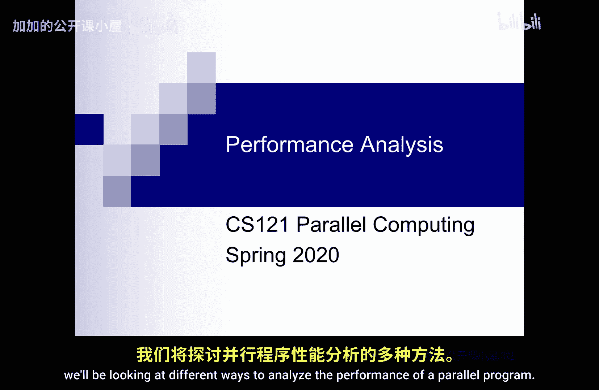
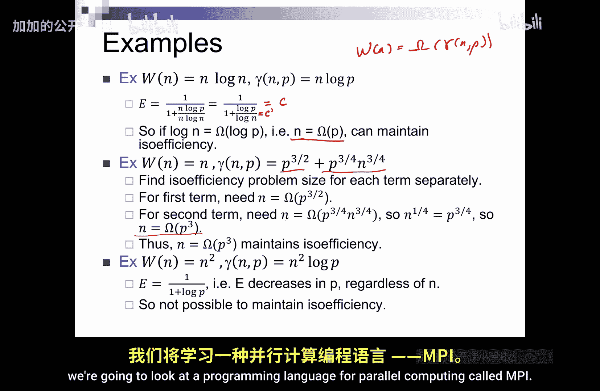

# 并行计算：第4讲：性能分析 📊



在本节课中，我们将学习如何分析并行程序的性能。我们将探讨不同的性能模型和度量方法，以理解程序在增加处理器数量时能获得多少加速，以及影响加速效果的各种因素。

## 性能与加速比

当我们谈论性能时，通常指的是程序的速度。如果你在一个处理器上运行一个程序，然后将该时间与使用K个处理器运行同一程序的时间进行比较，理想情况下，你希望程序运行速度快K倍。

根据加速效果，可以分为三种情况：
*   **线性加速**：程序运行速度正好是K倍。
*   **次线性加速**：程序运行速度有所提升，但小于K倍。
*   **超线性加速**：程序运行速度超过K倍。

在实践中，我们通常得到的是次线性加速，很少能获得线性或超线性加速。

## 性能度量术语

为了量化性能，我们首先定义一些术语。假设我们有一个问题X和一个可以解决X的并行算法A。

*   **T_S**：使用一个处理器解决X所需的最短时间（即最佳串行算法的时间）。
*   **T_1**：算法A使用一个处理器解决X所需的时间。
*   **T_P**：算法A使用P个处理器解决X所需的时间（并行运行时间）。

显然，`T_1 >= T_S`，因为T_S是最佳串行时间。

以下是几种衡量加速比的方式：

### 绝对加速比与相对加速比

*   **绝对加速比 (S*_P)**：定义为 `T_S / T_P`。它比较了使用P个处理器的算法A与最佳串行算法。但问题在于，我们通常不知道T_S。
*   **相对加速比/可扩展性 (S_P)**：定义为 `T_1 / T_P`。它比较了算法A自身在使用1个处理器和使用P个处理器时的表现。这是我们本讲主要关注的度量。

### 工作量与效率

*   **工作量 (W_P)**：定义为 `P * T_P`。它代表了P个处理器在T_P时间内完成的总计算量。工作量至少为T_S，即 `W_P >= T_S`。
*   **效率 (E_P)**：定义为 `S_P / P`。它衡量了处理器的利用程度。
    *   线性加速时，效率为1。
    *   次线性加速时，效率小于1。
    *   超线性加速时，效率大于1。

通常效率小于1，因为并行化会带来开销。

## 并行开销的来源

为什么难以达到线性加速？主要是因为并行化引入了多种开销：

1.  **通信开销**：处理器之间需要交换数据。
2.  **同步开销**：处理器之间需要协调步骤。
3.  **负载不均衡**：任务被分割后，各处理器的工作量可能不同，导致一些处理器空闲等待。
4.  **额外计算**：有时重新计算比通信传递结果更便宜，但这增加了总工作量。
5.  **算法选择**：最优的串行算法可能难以并行化，因此可能需要选择更容易并行但总工作量更大的算法（例如，在最短路径问题中，可能选择Bellman-Ford算法而非Dijkstra算法）。

## 性能分析模型

没有一个模型能完美捕捉所有并行程序的性能。我们将介绍几种模型，每种适用于不同的情况。

### DAG模型

DAG模型将计算表示为一个**有向无环图**。
*   **节点**：代表一个计算任务，节点上的权重代表计算量。
*   **有向边**：代表任务间的依赖关系（前驱关系），边上的权重代表通信开销。

在这个模型中，有两个关键概念：
*   **总工作量 (C)**：图中所有节点和边权重的总和。
*   **关键路径长度 (D)**：图中最长的路径（按权重求和）的长度。它代表了必须串行执行的部分。

根据DAG模型，我们可以得到两个重要的下界（定律）：

1.  **工作量定律**：`P * T_P >= C`。这意味着并行运行时间至少为 `T_P >= C / P`。
2.  **跨度定律**：`T_P >= T_∞ >= D`。其中T_∞是使用无限多处理器时的最短时间。这意味着无论有多少处理器，运行时间至少是关键路径的长度D。

### Amdahl定律（强可扩展性）

Amdahl定律假设程序由两部分组成：
*   一个**不可并行化的串行部分**，占总时间的比例记为 `f`。
*   一个**可完美并行化的部分**，占总时间的比例为 `1 - f`。

在固定问题规模的前提下，使用P个处理器时的运行时间 `T_P` 和加速比 `S_P` 为：
```
T_P = f * T_1 + (1 - f) * T_1 / P
S_P = T_1 / T_P = 1 / (f + (1-f)/P)
```
Amdahl定律给出了加速比的上限：`S_P <= 1 / f`。即使使用无穷多的处理器，加速比也不会超过 `1/f`。这解释了为什么即使并行化大部分代码，加速比也可能受限（例如，f=5%时，最大加速比不超过20倍）。

### Gustafson定律（弱可扩展性）

Gustafson定律对现实情况更乐观。它假设随着处理器数量P增加，**问题规模也相应增加**，使得并行运行时间 `T_P` 保持与单处理器运行原问题的时间 `T_1` 相同。

在该定律下，**缩放后的加速比**为：
```
S‘_P = P - (P - 1) * f
```
其中f仍是串行部分在原问题中的比例。Gustafson定律预测的加速比通常远高于Amdahl定律。它反映了在实际中，我们更倾向于用更多的处理器去解决更大的问题，而不仅仅是更快地解决固定大小的问题。

### 选择哪个模型？

*   **Amdahl定律（强扩展）**：适用于问题规模固定，仅增加处理器数量的场景。
*   **Gustafson定律（弱扩展）**：适用于问题规模随处理器数量线性增长，以保持运行时间恒定的场景。
选择取决于程序的实际使用模式。两者都未显式建模开销。

### Karp-Flatt度量

为了实证地度量包含串行部分和开销在内的“非并行部分”，可以使用Karp-Flatt度量。定义 `e` 为串行部分与开销之和占总时间 `T_1` 的比例。

通过实验测量不同处理器数P下的实际加速比 `S_P`，可以反推出 `e`：
```
e = (1/S_P - 1/P) / (1 - 1/P)
```
如果 `e` 随着P增加而增大，说明开销在增长，可扩展性不佳。如果 `e` 基本不变，说明程序具有良好的可扩展性。

### 等效率度量

等效率分析同时考虑处理器数量P和问题规模N。它旨在回答：为了在增加处理器时**保持效率不变**，问题规模需要以多快的速度增长？

定义：
*   `W(N)`：有用工作量，是问题规模N的函数。
*   `Γ(N, P)`：并行开销，是N和P的函数。

效率 `E` 可表示为：
```
E = 1 / (1 + Γ(N, P) / W(N))
```
为了保持E恒定，当P增加时，需要增加N，使得 `W(N)` 的增长速度至少与 `Γ(N, P)` 的增长速度一样快。`W(N)` 相对于 `Γ(N, P)` 的增长要求定义了问题的**可扩展性**。

**示例**：
1.  若 `W(N) = N log N`, `Γ(N, P) = N log P`，则需要 `N` 与 `P` 成比例增长（`N = Ω(P)`）以维持效率。
2.  若 `W(N) = N^2`, `Γ(N, P) = N^2 log P`，则无论N如何增长，效率都会随P增加而下降，因为开销与有用工作量同阶且带有附加因子。

## 总结



本节课我们一起学习了并行程序性能分析的核心概念与方法。我们首先定义了加速比、工作量、效率等基本术语，并探讨了导致次线性加速的各种开销。接着，我们介绍了多种性能分析模型：DAG模型提供了基于任务依赖的理论下界；Amdahl定律描述了固定问题规模下的加速上限；Gustafson定律则解释了通过扩大问题规模可能获得更高加速的原因；Karp-Flatt度量提供了一种实证评估串行部分与开销的方法；最后，等效率分析帮助我们理解如何通过调整问题规模来维持并行效率。这些工具共同为我们理解和优化并行程序性能提供了坚实的基础。