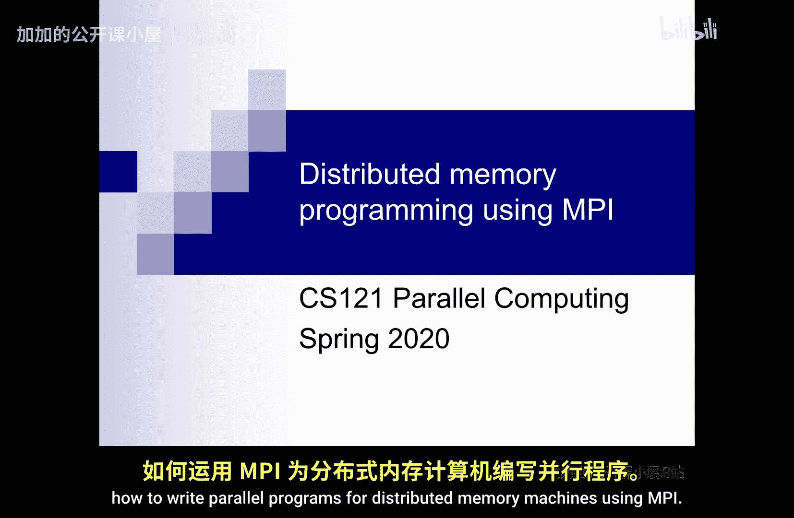
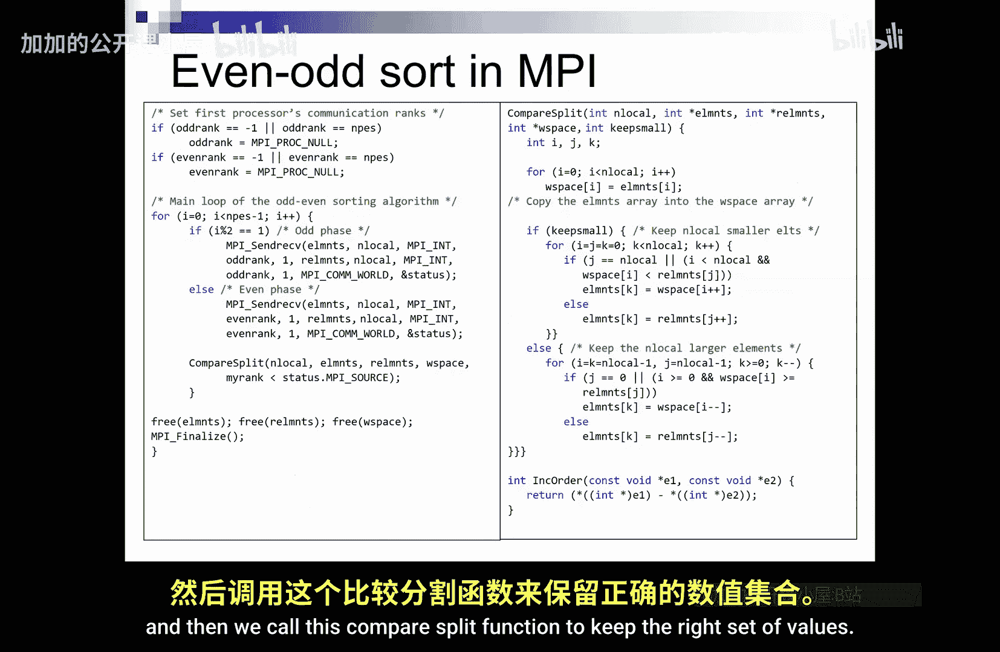

# 上海科技大学【中英⚡并行计算｜CS121 2020 Parallel computing】 p05 P5 MPI part 1 -BV1VqypBaEaP_p5-

Yeah。Hello， welcome to Le5 of parallel Computing。So today we're going to talk about how to write parallel programs for distributed memory machines using MPI。

So first of all， let me remind you about the distributive memory architecture。

So if we look at the diagram on the left over here。

 then the distributed memory architecture is that we have a number of different processors。

 right these PE things。And each of the processors has its own memory， which it can access。However。

 if a processor wants to access memory from a different processor。

 then the processor needs to send a message over a network。

And the other processor receiving that message will get the data from its own memory and then send it back to the initial processor。

Okay， so this is called distributed memory processing。

So I want to also look at the diagram on the right。

 so here what we have is a combination of a distributed memory architecture and a shared memory architecture okay so what's happening over here is that we have these nodes and each of these nodes has multiple CPUs in them and the node has a piece of memory and all of the CPUs in a node can access any piece of memory from this chunk of memory。

However， if a CPU from one node wants to access memory from a different node。

 then again it needs to send a message over a network。

 and then the receiving processor will fetch that memory and then send it back to the first processor。

Okay， so this would be a and then within each one of these nodes。

 what we have is a shared memory situation， okay because all of the processors within a node can access any piece of memory in its own chunk of memory。

Okay， so within a node， we have shared memory， but across different nodes。

 we have distributed memory。And so today we're going to talk about how to program these distributed memory machines。

So basically the language we're going to use is just standard C or C++ or forT and so these languages don't actually support distributed memory operations and so therefore to do these operations。

 we're going to have a library for doing the distributed memory communication。

And so there are actually a number of different libraries that one can use。

 but the most standard one， the one that's used by far the most is called MPI。

 which stands for message Pass Inter。Okay so this library was developed by academics and industry back in the 90s okay so back in the early or before the early 90s。

 there were a number of different competing methods for doing distributed memory programming。

 so it was quite a messy situation because all of these different programs written using the different libraries were not compatible with each other。

Okay， so eventually people got together and said that they wanted to standardize this process。

 they wanted to have one library that everybody would use for doing distributive memory processing。

Okay， and so。So there are several goals that they had in mind when they developed this MPI so first of all they wanted MPI to be as portable as possible across different architectures。

So of course， when you implement MPI on different architectures。

 you have to take into account the special characteristics of that architecture。

 but at least they wanted people to be able to write the same code and for that code to compile on different architectures。

Okay， they also wanted to make MPI as efficient as possible yeah。

 so they added various functionalities for efficiency。

 and they wanted to make MPI a very general and flexible library so that you can write basically any type of distributed memory program that you want。

Okay， so there are several versions of MPI， so the first version lasted from basically the mid-90s up until about 2008 okay and then since then they've been updating MPI。

 so MPI version 2 came out in 2008 and MPI version 3 came out just a few years ago in 2015。

Okay so MPI is actually an interface right so it's a library with a bunch of functions that you can call and the MPI specification is about the functions that you have to support in the library but it's not about how to implement these functions okay and so different vendors when they implement MPI。

 they will tailor the implementation to their own hardware to make it as efficient as possible。

However， all of the vendors， as long as they support MPI。

 they support the same programming interface so that a program that you write for MPI really is portable because you can take the same code and compile it on different types of hardware。

Okay， so there are a couple of flavors of MPI which are pretty popular。

 so one of them is called MPICH， so this is made by Argonne National Laboratory and another MPI implementation is called Open MPI。

Okay and there are also commercial implementations from these various hardware vendors like Intel。

 Microsoft， and so on。Okay， so what does an MPI program look like so there are basically four types of functions that exist in the MPI interface okay so the first type of function is for process creation。

So。Yeah， so this is basically just to start up your program， okay。

 so we need various functions to initialize the program。

The most important functions in MPI are the ones that let you do these distributed memory operations right so remember that these operations are basically sending and receiving messages from remote processes okay so the most important functions in MPI are all about how do you send and receive messages from other processes。

And there are two main types of these communication functions。

 so there are the point to point functions and there are collective communication functions。

So point to point just means that you're sending or receiving messages between two particular processes。

 okay， so it's going from one process， one point to another process。On the other hand。

 the collective communication means that you're actually doing communication among a group of processes。

 so for example you might be broadcasting to a group of processes okay。

 so this would be a collective communication。So in the rest of this lecture。

 we're going to be looking at different types of point to point and collective communication functions。

Okay， so yeah， so I just want to stress again that in order for processes to get data from other processes。

 there's no way for a process to directly read data from another process okay it has to be done through sending and receiving messages and so you know you could write and this is sort of this is in contrast to the shared memory programming model where all of the processes share a common chunk of memory right and then any process in order to access this memory it can just do a normal read or write operation so a shared memory program basically looks just like a traditional C program right in order to read some memory you just you can read and write memory using the normal C assignment and read operators。

Okay now having said that， the newer versions of MPI do want to support both program distributed memory programming model and they also want to make it easier to write shared memory style programs okay so the newer versions of MPI that have come out within the last 10 years or so they have some partial support for shared memory programming it's still not quite the same as actually doing shared memory programming。

 but it makes it easier to write this style of programs but predominantly when people use MPI it's to do these message passing type programs。

Okay so now the third type of functions for MPI are you can define data types and MPI new data types。

 so MPI supports all of the basic data types like floats and ins and CAs and so on。

 but you can also define new data types， okay so there are functions for doing that。

And the final type of function for MPI are the ones that so you can use them to create these things called communication groups。

 okay so communication group is basically it's a set of processes that that can communicate with each other okay so whenever you do communication within an MPI。

 you have to specify which group you're communicating with okay and the groups are useful as a way of organizing the communication within an MPI。

And then so there are functions in MPI to create these different communication groups and to structure them in some way and there are also ways for you to sort of specify like a topology on this group okay so for example you might say that a group of processes。

 they have a mesh type topology okay and once you specify this topology then NPI can do some optimizations in terms of its communication。

Okay， so now we're going to talk about these different types of functions and we're going to start with the process creation functions。

Okay， so the。All right， so before we do that， we actually have to talk about what is the process model for MPI Okay。

 so MPI uses a model called SPMD， which stands for single program multiple data。

So what that basically means is that for an MPI program， of course， it's a parallel program。

 so you're going to run this on multiple processors。However。

 all of the processors they're going to be running the same piece of code。

Okay so in this figure on the right over here we have a piece of code in the source file right and then we compile it right。

 and then so this produces one executable and then in order to run your program in parallel。

 you send the same executable to all the different processes。Okay。Yeah。

 so we have a single program running on different processors。

But of course you don't want all of the processors to do exactly the same thing right that would be just duplicating the same work over and over。

 so you want them to run the same program， but you want them to operate on different pieces of data so that's why it's called multiple data and the way that you can have these programs work on different pieces of data is that all of the processes have an ID or each of the processes has an ID and then within your program your MPI program you can specify that different processes will do different things based on their ID。

Now I just want to mention that SPMD is actually very different from something we've seen earlier。

 which is SIMD okay so remember that SIMD stands for single instruction。

 multiple data okay now the SIMD is basically this is more of a hardware architecture and what it's saying is that you have multiple processing unit but they're doing exactly the same instruction at the same time point okay so in SIMD。

 all of the processors are synchronized with each other and they're doing exactly the same instruction。

Okay in NPI， the programs I'm sorry， the processes are running the same program right。

 but there's no synchronization， there's no implicit synchronization between the processors okay。

 so one processor can be at one point in the program and another processor can be at a completely different another point in the program Okay so even though they're running the same piece of code。

 there's no synchronization between them so this is very different from SIMD。

Okay now when you have a processor， so that processor can actually run multiple processes okay so let's say that you have let's say 10 processors and then  20 MPI processes okay。

 so you could actually put two of these processes onto each processor。Now usually when you run MPI。

 you don't really do this， okay， usually you you run the same number of processes as you have processors or as you have cores。

 okay， so if you have 10 cores or 10 processor， you're only going to run 10 processes。

 one per core or process。Now sometimes and the reason for doing this。

 the reason for not putting too many processes onto the same processor is that you would get resource contention if you run many processes on the same processor。

 but sometimes if you have processes which do very little amounts of work then in those cases you might actually want to put several processes onto the same processor。

 just so that you can fully utilize that processor。

Okay now there's this issue of how do you map processes to processors right so this is something that we talked about a few lectures ago and in MPI the programmer doesn't really have any control over which processes give map to which processor source。

Okay， so next let's actually look at how to create processes in MPI。Okay。

 so the first thing you need to do is if you want to use MPI。

 you have to include the MPI header library， okay。And then next， in order to start your program。

 your MPI program， you need to call the function MPI in。And then after you're done using MPI。

 you need to call MPI finalize。Okay， so now here's an example， a simple example program。

 it's basically a hello world program in MTI。Okay， so the first thing we do is we include the MPI header right。

And then now we have these two variables here， so the first one is the number of processes and the second one is the rank of the process。

Now the rank of the process， remember that we said we want different processes to do different things based on their ID。

 so the rank of the process is basically their ID。Okay and the ID is simply a number between0 to the number of processes right so if you have eight processes。

 then the ranks of these processes are just numbers between 0 to seven。Okay。

 and every process has a different rank。Okay， now if you want to run MPI。

 the first thing you need to do is call MPI innet， okay and you call these with your arguments。

All right， so next， so in this Ho row program， all we want to do is we want to figure out how many processes there are right。

 and then we want each process to print out its rank。

And so what we do is we call this function called MPI comm size。

So now what this come is is that I mentioned earlier that let's see where where was this okay， yeah。

 so if we look over here right， so in order to do communication you have to specify a group of processes that you want to communicate with okay and this group of processes is called a communicator。

Okay now when MPI starts up right by default， there's going to be MPI will build you a default communicator right and that's going to consist of all of the processes that you started。

 your MPI programmed with Okay so if you start the program with。

 let's say eight processes right then your default communicator is going to have those eight processes in them。

And the default communicator is going to be called MPIcom world。

Okay so therefore what this line is doing MPI Com size。

 right what you're saying is tell me how many processes are in this communicator MPI Com world。Okay。

 and then store that in the variable N pes right so pe is going to be the number of processes that you're running with。

And now MPIcom rank right this is going to tell you so remember that we're running this program on multiple processes right so each process when it does this command over here。

 when it calls this function， right this is going to get that process's own rank。Okay。

 so if you call this with eight processes right， and if I'm process number five。

 then my rank is going to become five over here。Okay， and again。

 you need to call this with MPIcom World because you need to say。

 which group of processes am I looking for my rank within？Okay so if you have multiple communicators。

 then the same process could actually have different ranks in the different communicators。

 so here we're just looking at the default communicator that MPI creates when you call MPI innet。

Okay， so then once you get your rank and your MP and your number of processes， right。

 you simply say that so from process， so whatever your rank is。

 you say from this process out of the total number of processes， you say hello world。

And then after that， we're going to close our MPI program by calling MPI finalize。

Okay so that's the basic grow program and if you want to run this program okay then after you install MPI。

 you can just type something like MPI run and then you could have a host file here which tells you who are all of the processors that you're allowed to access okay it's basically on your network right you have multiple computers and you can list those computers in the hostt file and then that will run the MPI program on those computers as long as you have permission to them。

Okay， and then this MP thing here specifies how many processes you want to create。OkaySo for example。

 you want to create you might want to run eight processes and thiss my progue right so this is just the program that you created over here。

And then when you run this。😊，🤧What's going to happen is on the host that you run this command from。

 right， you're gonna to see these messages being printed out these from process something out of something hello world Okay and the total number of messages you see is just how many processes you started So if you start eight processes。

 you're going to see eight of these messages okay so they're basically going to say like from process zero out of8 hello world from process one out of eight。

 hello world and so on。Okay， however， the messages don't have to appear in the order 0，1，2。

3 and so on。 They don't have to appear in the order of the rank Okay and this is because once you start these processes。

 then as I said， there's no synchronization between the processes Okay so some of them can run fast and some of them can run slow so the fast ones are going to be the ones that print out the the the print have message first Okay so you could you could very well see something like you know from process5 out of8 hello world and then maybe from process two out of8 hello world or something。

 Okay， so there's no order no particular order on the。On how these messages get printed out。

Okay so that is so I talked about the SPMD model， which is the single process model that MPI uses Now before I go on。

 I just want to mention that there is another model which can be used for distributed memory programming and that's the MPMD model okay so this just stands for multiple multiple programs。

 multiple data right SPMD a single program and this is multiple program okay so this just means that you have multiple processes but each one of the processes runs a different program。

Okay， and the way these MPMD programs usually work is that they take something called a master slave approach。

 Okay， so that means that in the beginning， you just have one process Okay。

 and this is the master process Okay， so the process is just executing by itself。Okay。

 and at some point， maybe the process finds that it's got a lot of work to do。

 so it wants to do this work in parallel。So at that point。

 it caused a spawn operation which creates other processes。 Okay。

 so those are the slave processes and the slave processes are going to help the master do the work。

Okay， so and so this is in contrast to the oh right。

 and the code that the Slate processes run right the program that they run can be different from the master Pro program okay so that's why it's called multi programgram。

And then also so that's one difference from MPI or the SPM MD model and the other difference is that with MPI you start all of your processes at the beginning okay so if you want eight processes then from the outset you have eight processes on the other hand for the MPMD model right we said that initially you start with one processes and then at some point when you want more helper processes to help you do some work right you can spawn more processes so the number of processes can vary over time and the processes are created dynamically。

Okay so then you're going to pay some overhead for creating these processes okay on the other hand。

 the MPMD model might somehow be kind of a more natural way to program things and there are libraries that support the MPMD programming model so for example post something called PVM okay so that's one way to program in this model。

Okay， but as I said， MPI is by far the most popular way to do distributedtributive memory programming。

 and so we'll be focusing on MPI。Okay， now。Al right。

 so this kind of summarizes what I said earlier about the types of different MPI program types of MPI functions okay so actually MPI has many。

 many functions， it's got hundreds of functions however。

 if you want to write a efficient and very general MPI program。

 you actually don't need to know all of the functions right it suffice us to note just a pretty small subset of these functions and that takes you a long way in terms of writing programs。

OkayAnd these functions yeah， so we have functions that help initialize the program right we have functions for for doing point to point communication so these are like send and receive functions okay we have these collective communication functions so that's where you communicate with a group of processes right you can either do broadcast to them or you can do these operations called scatter or gather or all to all reduce scan barrier we're going to talk about all of those later。

Okay you have ways of creating new data types， okay so these are called derived data types。

 so you have things like contiguous or index orstruct or vector and other data types。

 and then you have ways of creating and structuring communicators and also defining virtual topologies。

Okay so we're not going to go through all of these functions right so I'll show you examples of each type of function。

 but we're not going to go through all of them because there are many， many of them。

 so if you want a very complete look， then you can just look at the documentation for MPI for example。

 at this URL。Okay， so let's talk a bit more about communicators。Okay， so communicators。

So another name for them is communication domain。Okay。

 so it's just a set of processes that can communicate with each other。Okay。

 and when you write a program， you can actually have multiple communicators right so you can take your processes and break them into multiple groups right。

 and then each group can communicate with each other。

 but one process can actually lie in several groups at the same time。And again。

 the reason that we want to have these communicators is to help organize our communication Okay。

 so yeah， so like to give you an example， suppose we have， let's say a grid of processes。Oh， okay。

 so sorry， what what's okay， all right。So suppose we have a grid of processes like this okay so let me just draw a grid of processes right then you might want to define a communicator which first of all includes all of the processes so that could be one communicator okay but then you might also want to define a communicator which maybe for each row right of processes so we have four processes here maybe you want those to be another communicator because sometimes you don't want to communicate with all of the processes in in the mesh you just want to talk to to processes in your row okay so you can create multiple communicators like this right？

And then sometimes you might want to talk to you know what let me switch to a different color。

 this is kind of hard to see here， just give me a second。All right。

 so we could have the row communicators， right？And then maybe sometimes you want to talk to processes in your column okay so then you can define some column communicators also right。

 so you see that by having these communicators it makes your communication much more organized because when you just want to talk to your column you can just use your column communicator and not the entire communicator。

Okay so communicators have a type which is MPICO and then whenever you do a communication。

 any type of communication， whether it's a point to point or collective or anything。

 you have to specify a communicator okay and then when you call MPI Innet right this automatically creates a communicator for you。

 a default communicator which is called MPIcom world。Okay， so the communicators have sizes， okay。

 so if you take a communicator right and then if you call MPI comm size。

 then you get back the size of that communicator in size in the variable size。Okay。

 and then within each communicator each process within the communicator has a rank。

 okay and so if your communicator has 100 processes。

 then your rank is going to be a number from 0 to 99。OkayAnd again， the rank。

 the reason it's useful is because it lets you differentiate between different processes and so that way different processes can do different things Okay so even though everybody's running the same program。

 they do different things based on their rank。Okay so next let's see how we can actually send messages okay so that's the most basic operation in MPI is just to send a message okay to do that we're going to call this function MPI sendend okay so this has a bunch of arguments let's see what these arguments are so first of all the data that you want to send so you're going to give a pointer to this data and the data is going to be stored in this in this address buff okay so starting from this address buff right this is the data that you plan to send。

Okay， and then you need to say how many data items you're sending Okay。

 so this count is so for example， if you're sending let's say ins， right， you're sending 10 of them。

 then your count is 10。You need to specify the type of data you're sending Okay now you need to give the MPI data type。

 which is so MPI has built in data types for all of the the classic data types I you know CAs and ins and so on right so you can give。

One of these data types， or if you're trying to send if you've defined your own data type and you're trying to send something with your own data type。

 then you can also put that type over here。Okay， now since we're sending right。

 we need to say where we're sending to okay， so this destination is the rank of the process within our communicator so we have a communicator that we're sending to right and then we have to know the rank of the process within this communicator that you want to send to。

O。😊，And the final thing is that you have this tag here yeah and the tag is used to differentiate between multiple messages that you send to the same destination okay。

 so if I send you 10 messages right， then I'm going to tag them so that you can tell which one is which。

Okay， and then between a pair of processes， all the messages that are sent sent received between this pair。

 and they they're processed in FIFO order， okay so the first message that I send is going to be the first message you receive。

Okay so next so we talked about how to send messages next we look at how to receive messages So here you're going to call the MPI receive function okay and again this has a number of arguments and so what these arguments are is so this buffer is again this is a pointer to a memory location and this is where you're going to store the data that you receive so you have to preallocate this buffer to store the data and you need to say what type of data you expect to get so that's the type over here and then how many of these data types you plan to get So if you're going to get like 10 ins right you need to say 10 and then MPI ins over here you also need to know who you're receiving from okay so the source so the source a process in in this communicator comm you need to give the rank of that source within this communicator。

Okay， and because the source can be sending multiple messages to you， right。

 you need to you should specify the tag of the message that you plan to receive。

Okay now sometimes you can give this value here MPI any tag， okay。

 so this says that I'm going to receive a message from the source and I don't care what the tag is。

Okay，However， if you give a specific tag here， if you give like a tag of two， right。

 then that means that you're only going to receive a message with the tag2。Okay。Oh。

 and the source here I forgot to say that you can also here you can specify MPI any source， okay。

 so this means that you don't really care who you're going to get the message from。

 you'll take the message from anyone。Okay， and the final thing is we have this MPI status over here okay and the status is useful when we're using these wild cards like MPI any source and MPI any tag okay because you know when you get a message even if you called MPI receive with MPI any source okay so you're willing to take the message from any process okay but then after you receive that message。

 you still want to know which process that came from。Okay so if you use the MPI any source。

 then when you go look in the status， then one of these fields in the status will tell you the actual source that you got the message from。

And then if you used MPI any tag， one of the fields in the MPI status will tell you the tag of the message that you got。

Okay now if you have two cents which both match or receive okay so for example。

 you call MPI any source right and then you have two processes that both send to you okay so they both match what this receive requires then you could have only one of the send complete okay and the other send is just lost。

Okay， so now let's do an example with send and receive。 Okay， so in this example。

 so we start by calling MPI index and then we find out how many the size of our communicator and are rank Okay。

 so for this example， let's assume that we only have two processes Okay。

 so so the number of tasks here is going to be two Okay。

 so so the processes are going to have ranks 0 and1 Okay and all we want to do is we want the。

Let's see the zero sense to one。 Okay， yeah， so we want a task zero to send a message to one。

 and then it's going to receive a return message。Okay。

 so zero is going to send first and then receive later。Okay。

 and then task one or process one is going to receive first and then send after that。

Okay so then what we have here is if my rank is zero。

 then I'm going to call MPI send right I'm going to send just a care right a single care which is being stored over here right I'm going set the destination to be the node with rank one so here I define my destination to be one right I define some sort of tag let's see yeah so tag is one here。

 it doesn't really matter and then I specify that you know this destination is in this MP comm world。

Okay， so that lets me send this care， which I suppose is x and then I'm going to receive a message from from the same let's see the same source。

Right， then I'm going to receive a message from process process one， Okay。

 so I send and receive from process one。And then if my rank is actually one， right。

 then I'm going to set my destination and source to be process zero。

 then I'm going to first of all receive a message from process zero。

 and then I'll send a message to process zero。Okay， and then lastly。

 I'm going to print out so both processes are going to print out that they received some number of characters from the other process。

Okay yeah， so that's how we use the send and receive functions now we need to be careful about using these functions though okay and the reason is that the MPI send function is blocking okay so what this means is that after you call MPI send right so now you plan to send this message okay and that's going to take a certain amount of time and this function is blocking meaning that until the send succeeds。

Okay then the process I call the MPI send is just blocked。

 right it stopped the process stops after it calls MPI send until MPI sendend finishes。Okay。Yeah。

 and the reason this function is blocking is to ensure that the data is correctly sent okay because remember that in MPI the processes are not synchronized with each other。

 so if I'm sending you a message right maybe you're not ready to receive that message yet okay so I need to wait so if I want to send you a message then I start my send。

 but then I need to wait until you're ready to receive that message in order to make sure that you don't lose a message。

Okay， if I just send you the message， right， if I sort of like mail you a letter right， and I don't。

 I don't care where you're maybe you're on vacation or something。 Okay。

 then that letter can get lost。 Okay， so what I need to do is I need to make sure that you're ready to receive that message before I can be sure that。

Before I can finish my function call。Okay， so now the amount of time that MPI spends blocking depends on whether your implementation of MPI has something called a hardware sendend buffer。

 okay， so hardware sendend buffer is just it's like a location in memory in your processor's memory or in your processor's memory where you're going to store the messages that you want to send out。

So if there is such a buffer， then MPI send is just going to wait until the data is copied from this MPI program into the buffer once it's been copied into the buffer。

 then I know that my message is stored safely in the buffer and so now my MPI send can return。Okay。

 and later on， MPI can actually take the data from the buffer and once the receiver is ready。

 it'll send the data to the receiver。But in any case， as long as my data is in the buffer。

 I know it's not going to get lost， and so MPI send can return after that。However。

 sometimes your MPI implementation， it might not have a hardware buffer。

 okay if it doesn't have a buffer， then the sender actually has to wait until the receiver is ready。

 okay until the receive has actually occurred and then the sender gets some sort of notification。是。

Yeah， so。Okay， so MPI send is going to block either just for a short time until the data is copied into the buffer or for a long time until the receiver is ready okay on the other hand。

 MPI receive is always going to block okay because if I call MPI receive that means that I want to receive a piece of data from somebody and until I get that piece of data。

 I'm just going to keep waiting okay so MPI receive is going to keep blocking。

Now sometimes you want to do nonblocking communication because you know if your program gets stuck after calling an MPI send。

 then you can't do anything anymore so instead you want to just say that okay I want to send out a message but then as soon as I but then as soon as I specify this。

 then after that I want to continue with doing some other work。

And so the way that this can happen is that。Yeah， so if we have the hardware buffer， right。

 then the process can continue with the computation。From processor。Yeah， okay。

 so if we have this hardware buffer， then as soon as I call one of these send receive functions。

 then I can continue with my computation while the data is being transferred from my process buffer into this hardware buffer。

However， when I do this， so I'm transferring the data from my processes buffer to the hardware buffer。

 I have to make sure that I don't modify the data in my process buffer because if I modify it。

 then the transfer process can get corrupted。Okay。And so I need to wait until I've completely transferred data from my process buffer to the hardware buffer。

 so I need some way to detect when this transfer is complete。

Okay so there are functions that help me do this。Yeah。

 so so these are so now I have these are non blocklocking communication functions Okay so these functions are we use them in a similar way to MPI send and receive。

 However the name is just we add an I in front of it Okay so MPI I send。

And MPI I receive so these functions can return immediately after being called。

 they're not going to block。But we need to know when these operations complete because until they've finished。

 I can't modify the data in these buffers。Okay so in order to know when the operation has completed。

 I have this function called MPI test so the MPI test is going to take an MPI request object and the request object corresponds to one of these calls to MPI send I send or MPI I receive and the MPI test is going to tell me when this send receive has finished。

So now when you call MPI Iendend， you actually have to include the request and same for I receive and then later on to see whether this send to receive has finished。

 I'm going to call MPI test with that request。Right。

 and then I can also wait so maybe I need to keep waiting until this sender receive has finished。

 so here I can call MPI Wait using the MPI request and this is going to make the process wait until the sendend or receive has successfully copied over the data。

Okay now when we use these send and receive functions another thing we have to be careful about is deadlock okay so I'll give you some example so first of all a deadlock just means that all of the processes in your system are stuck at some point right nobody can do anything okay no processes can take the next step okay so this means that all the processes are waiting for each other and everybody is stuck so my program is completely frozen so this is for something a very bad thing so we want to make sure to avoid deadlocks。

Okay， so let me give you some examples of when deadlocks can occur。Okay so the first example is。

 so here I have a program where I'm doing two cents， and and another process。

 the one with rank one is doing two receives。Okay， however， for my sense。

 now these arguments so this argument over here， so sorry let me switch to red。

So this argument is actually the tag for the message I'm sending， okay。

 so I'm first of all sending a message with tag 1 and then a message with tag2。

And then this tool over here is saying that this rank one process wants to receive a message with tag2。

 and then it wants to receive a message with tag1。Okay， so now this program can block if。

If we don't have any buffering okay and the reason is that if we don't have any buffering。

 then what I call this send right， so I'm trying to send a message with tag1。

 but there's no corresponding receive to get that message okay so the rank one process is going to be blocked at the send over here and the rank2 process is going to be blocked at this receive over here because the rank zero process needs to finish the T 1 send before it does the tag 2 send。

But this MPI， this rank1 process is waiting for the rank tooth message。

 but that's not being sent because the rank zero process is stuck sending the T1 message。

So if there is no buffering， then it's possible that the processes will deadlock waiting for each other。

Okay if there is a buffer though， then probably there will not be a deadlock because if there's a buffer。

 then both of these messages okay can be placed into the buffer and both of them will be sent so even though I'm placing the TG 1 message first and then tagG2。

 both of them go in the buffer and are sent out， so eventually the rank1 process will receive both the TG1 and tag2 messages。

Okay， so now in order to fix this， it's very easy， all I need to do is make sure that I send and receive in the same order of the tags。

 Okay， so if I send tag one first right， then I should try to receive then the other processor try to receive tag1 first and then I'll send tag2 and then he receives tag2。

Okay so that's one example， another example is where suppose we have several processes and they're connected in a ring okay and what we're trying to do is each process I in the ring is trying to send to the next process I+1 and it wants to receive a message from the previous process。

Okay， so then a simple way to write this program would be that so I'm going to send a message so let's say I'm going to send 10 integers to the next process right with rank my so I'm going to take my rank right and then add one so that's the next process and I take this modo of the total number of processes。

And then I receive from the previous process， so my rank minus1 modulo and MP。Okay。

 now this is also going to。嗯。Yeah okay， so if we have buffering okay。

 then again both the send and the received can complete and we probably don't have deadlock however if we if you don't have buffering right then。

The problem is that we have these processes right so here this process is doing a send。

 so let's write this as send0， this process one is doing a send， let's call that send1， send2。

 and then send3。Okay， so all the processes are doing send because that's the first operation they do okay however。

 none of these sends can actually complete right because the only way for a send to complete if you don't have buffering is for the corresponding received to happen。

Okay， but right now， all of the processes are stuck on their scent。Because nobody is doing receive。

 so none of these sends can finish， so everybody is stuck on their send。Okay。

 so now we have a deadlock。Okay， so then how do you fix this right。

 so how can you allow processes to send in a ring but without deadlock？Okay。

 so the way that you can do that is instead of everybody sending first and then receiving what we're going to do is we're basically going to have half of the processes send first and then the other half of the processes receive first so basically we're going to have process zero。

 let's say it's going to send first but then process one is going to receive first and then process two is going to send first。

 but then process three is going to receive first。Okay。

 so the way we write this is I'm going to look at my rank， okay， if my rank if I have an even rank。

 then I'm going to send first right and I'm going to send to my my the next process and then I'll receive after that。

OkayAnd on the other hand， if I have an odd rank， then I'm going to receive first and then I'll send。

Okay， so this way， again， p0 is going to send first and P1 is going to receive so then P0 can finish its send and then P1 can finish its receive。

And likewise， P2 is going to send first and3 is going to receive first， okay。

 so P2 and P3 can also finish their first steps。And then after they finish their first steps， right。

 then we can have。Then we can have P1 send right and then P0 is going to receive or sorry P2 is going to receive right。

 so then P1 is going to send right So then we're going to have S1 over here and then P2 is going to receive right and then P3 is going to send。

And then P0 is going to rec。Okay so after you do all of this。

 then you still have that every process sends to the next process and receives from the previous process。

 but you don't have a dead log because you split the send and the receive into two different orders。

Okay now this program does get rid of deadlock but it's kind of a tedious program right you have to think about how to write this program and then here we have a simple ring topology。

 if you had a more complicated topology， then it's also more complicated to write a deadlock free algorithm like this。

Okay， so instead， it would be nice to have an automatic way to make sure that we don't block or sorry。

 we don't deadlock when we do these sends。Okay and the way we can do this is to call a function which can both send and receive at the same time。

Okay， so it's basically one function that combines MPI send and MPI receive。Okay。

 and there are a lot of arguments in this function。

 but they're basically what you expect if you want to combine the send and receive functions Okay。

 so I'm not going to go through all of them。I'll just show you。

How you can write the previous program where you try to send in a ring。

 how you can write that using this MPI send receive function and not have any deadlock。Okay， so the。

Yeah， so then all you need to do is just say that I'm going to call MPI send Re and then I'm going to specify who I send to first。

 so I send to the next node and my rank plus one and then I receive from the previous node and my rank minus1。

O。诶。Yeah， and then this is going to execute both ascend and receive together。

 and so there will not be a deadlock on the ring。Okay。

 so now let's sort of use all of these functions in a more interesting algorithm Okay so let's try to put all this stuff together and see if we can actually successfully use it to solve a problem in parallel so the problem we're going to look at is this thing called even odd sort so so this is a sorting algorithm and the way it works is that if we have n processes then we're going work in end phases so for simplicity let's first assume that each process has a single number so we have n numbers we're going to work in end phases so we have these even and the odd phases and in even odd phases we do different things。

So in the even phases， right we're going to pair up the processes in this way right so basically so the first process pairs with a second right we're going to pair the one。

 two processes， the 3，4， the five，6 and so on we're going to pair these processes and then。

After you pair them each process has a number and we're just going make sure that these two numbers are ordered correctly okay so our goal is to sort the numbers in increasing order okay so for the first pair of processes right we see that they're actually out of order right two is less than three so we're going to swap them okay you're going to have the first two processes swap their values processes three and4 right they're actually in the right order okay because three is less than8 right five。

 six are in the right order and then for one are in the wrong order so they have to swap。Okay。

 so that's the first phase。Okay now in the second phase， we're again going to pair processes。

 but we're going to pair the other set of processes Okay， so previously we paired processes  one。

 two and then three，4 and so on right in the even phases we're going to pair the processes 2，3。

 right，4， five，6，7， and so on。Okay， and then after you pair the processes again you try to take the pair of numbers that they have and then put them in the right order okay。

 so for example， this eight and the5 they're out of order so they need to get swapped to 5。

8 okay and the61 R is going to get swapped to 16。Okay， so that's the even phase Okay。

 so next we go to phase 3， which again is an odd phase Okay， so for the odd phase， again。

 we're going to go back to the pairing between processes 1，2，3，4，5，6， and so on。

OkayAnd after you pair the processes， you're going to make sure that their values are in the right order Okay。

 so for example， you swap the8 and the1 and the6 and the four here。

So then you just keep switching between the phases between these even and odd phases right then for the different phases the processes pair themselves in different ways。

 they either pair with the previous process or with the next process depending on the phase。

And once they pair with the process， they are going to。

Swaap their values if the values are out of order。Okay。

 so this was for the simple version of the algorithm where。

Where each process only has one value okay so now you could have a more general version where each process has multiple values okay so suppose for example process A has four values and B also has four values okay so then here instead of swapping the values between a and B what you want is you want you want to take all of these values。

 all eight values okay and you want to give the smaller four of these eight values to a right and you want to give the larger half of the values to B。

Okay， so what's going to happen is A and B are going to swap are going to send each other their values okay so A is going to get b's values and B is going to get A's values okay and then now you're going to combine all of these values and you're going to merge them together and then a is going to take the smaller half of those merged values and then B is going to take the larger half。

Okay， so if you do this， then what you can show is that if you have n processes。

 and then if you run n rounds of this even odd sort。

 then afterwards you're going to have all of the values be sorted。

Okay and and this is it's not a very efficient sorting algorithm。

 but it's a highly parallel one right and the reason is that in each of these phases you see that all you need to do is pair up these processes and then different pairs of processes can be working in parallel right so for example the three2 pair is going to work in parallel with the 38 pair and the 56 and the41。

Okay， so it's a highly parallel algorithm。Okay so so we're going to try to write this algorithm in NPI okay so yeah so this code looks a bit complicated but it's actually doing some pretty simple things so we have a bunch of variables here so I'm not going to talk too much about them until we get to them so we have things you know like elements or received elements and so on okay so I'll talk about these as we get to them so the program is going to start with the initialization part we're going to call the comm size and the comm rank。

Okay， we're going to mallic enough space to store all of our elements。

And then we're going to just initialize elements randomly and then we're going to sort the we're going to sort the each process starts out with some number of elements okay so let's say that you start out with 10 elements okay so you're going to generate 10 random elements and you're just going to sort your own 10 elements but of course you're not sorting other people's elements yet okay so our goal is to eventually sort everybody's elements together。

Okay， now now here we're going to compute something called even rank and odd rank and even rank Okay。

 so this is basically saying that in the even phases right so if we look at this diagram here right then in the odd phases right a process can either pair with the next process right or。

It compare with the previous process right so here we have processes 1，2，3， no sorry。

 I guess the ranks are going to be01，2 three，4， right？Yeah。

 so the ranks start with zero right so here if I'm in an odd phase and if my rank is even。

 then I'm going to pair with the next process。Okay， but if my rank is odd。

 then I'm going to pair with the previous process。Okay， and then in the even phases， right。

 then if my rank is odd here， I'm going to pair with the next process right and if my rank is even right like this guy has a rank of two。

 then he's going to pair with the previous process。Okay。

 so the process that I pair with depends both on the phase that we're in and also whether my rank is even or odd。

Okay， so these computations here are basically just to keep track of these things。Okay， right。

 And then this is to to sort of。Yeah so this is to take care of communication between the first and the final processes right so for example you know the first process over here right if you're in the even phase。

 you don't actually communicate with anyone okay， so it's just a corner case that we need to take care of。

Okay now here this is actually the main loop for the algorithm okay and what it's saying is that we're going to run a total of n phases if we have m processes we need to run for n phases and then if we're in an odd phase then we're going to so we want to swap these elements between a pairs of processes so to do that we need to do both send and receive and we saw that unless you do this carefully you could get a deadlock and so the way we avoid the deadlock is to use this function MP send receive this is going to guarantee that we don't deadlock so MP send receive but we need to know who we're sending to and so since my rank here is odd then I'm going to send and receive with my odd rank and if my rank is and sorry if I'm in an even phase then I'm going to send and receive with the even rank。

Okay， so then this is going to do the communication between the pairs of processes。

 but after you do that communication， you need to do this sort of merging process。

 right because in general you could have multiple values and you need to merge these。Okay。

 so the so the final part of this is to to call this function called compare split。 Okay。

 so this compare split function is basically going to。It's going do something like merge sort。 Okay。

 so I'm not going to go through this in too much detail。

 but you can look at this and basically what you're doing is you know if you have two sorted lists like this。

 right， then you you know that you can combine these into one big sorted list with all of the numbers right so that's basically what you're do in merge sort at every every layer of recursion。

 Okay， so we're going to combine this into one big list and then if you're if you're like the the sort of the left process Okay。

 the smaller of the two processes then you're going to take the。Where is it okay。

 then you're going to keep the smaller elements okay， if you're on the if you're the left process。

 you're going to keep the smaller elements and if you're the right process， okay。

 then you're going to keep the larger elements。Okay， so then yeah， so we do n phases of this。

 each phase is we send and receive between the right pair of processors。

 and then we call this compare split function to keep the right set of values。

