# 上海科技大学【中英⚡并行计算｜CS121 2020 Parallel computing】 p06 P6 MPI part 2 -BV1VqypBaEaP_p6-

All right， so next let's talk about collective communication in NPI so again。

 collective communication are these routines where you can do communication between groups of processes。

So there's several types of collective communication one is the first one is one to many okay so here you have one process which is communicating with many other processes so one example would be a broadcast okay so you have one process that sends a message to a bunch of other processes and there's something similar to this which is called scatter okay so we'll talk about all of these in detail later。

There's also many to one okay so instead of broadcasting a message right。

 maybe you could have a process get messages from all of the other processes okay。

 so that's many to one。And then you can also have many to many communication where basically all of the processes talk to each other。

Okay， so one way that you can implement collective communication is of course。

 you can just do a bunch of point to point communications okay so for example。

 if you want to do a broadcast right， then you can simply have the broadcasting process just send messages to every other process。

Okay but is much but this is not efficient because that single process would have to do a lot of work there's actually much more efficient ways of doing these collective communications instead of just doing individual point to point routines。

Okay right， I should mention that these collectives they are always blocking operations in MPI versions 1 and 2。

 but in MPI3， they've managed to implement non blocklocking collective operations。

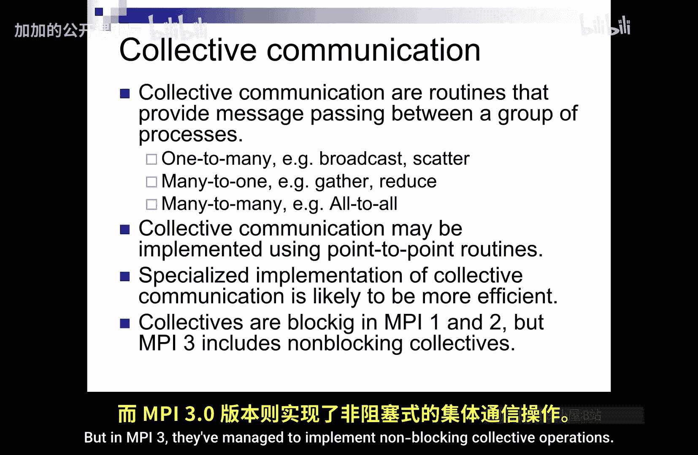

Okay， so now let's talk about the different types of collective communication primitives。啊。Okay。

 so the。Okay， so just as with the point to point communication。

 we need to specify the communicator or the group of processes that we're communicating with。Okay。

 now we're going to look at so these are the different collective communication primitives we're going to look at okay。

 so the first one is is broadcast so in order to describe these different operations it's good that we use this sort of visual representation Okay so if we look on on the right over here。

So what we have is so here I've drawn a grid and what we have is suppose you have P processes okay so there are p rows in this grid and there are also P columns so the rows represents different processes and the column represents data from different processes so the way to think about a broadcast operation is that suppose one process。

 let's say the first process has a piece of data okay then if you do a broadcast then the result of that is that all of the other processes will have that same piece of data。

Okay， now that's the broadcast。The next operation we're going to look at is called let's see okay so they have the reduce over here。

 I think I'll talk about the reduce and the all reduce and scanned operations later okay so right now I'm just going to go with this visual aid and I'll talk about the functions that are available in this diagram。

Okay so so next the next function to look at is the scatter operation so here the scatter operation is something similar to a broadcast but the difference is that here。

 so the similarity is that again you have one process right let's say P0 over here and that process is sending data to all of the other processes。

Okay， but the difference is that for scatter。This process has a different piece of data for every other process。

So if we have six processes， then this first process has six different pieces of data that it wants to send to the five other processes。

Okay， and if you look at broadcast， so here we're sending the same piece of data to all of the other processes。

Okay， so that's the difference between scatter and broadcast。

Now the gather operation okay this is exactly the opposite of scatter。

 so here what happens is that all of the processes they start with their own piece of data okay and you want to collect or gather all of this data at some particular process let's say P P0 okay so all of these six processes they each start with their own piece of data and then if you do a gather then you end up with P0 having all of these six pieces of data by itself。

Okay， now you can also do something called an allga， okay。

 so here allga is just basically every process is going to do a gather。

so the way to see this is that， again， we start out with each process having a piece of data like this now if you do a gather on process  zero right。

 then process  zero is going to end up with all these six pieces of data。Okay， but for the allga。

 actually every process is going to do a gather， okay。

 so every process is going to end up with these six pieces of data。Okay。

Right okay and the next thing to talk about is this all to all operation okay so all to all operation is basically it's something like every process wants to do a scatter okay。

 so imagine that so here you have a process right if this process does a scatter。

 then what's going to happen is that these different pieces of a data are going to end up on the different processes。

Now imagine that at the same time P1 also wants to do a scatter。

 then what's going to happen is that all of these B pieces of data are going to end up on these different processes。

And so for the all to all， we have every process is doing a scatter， essentially。Okay， so。

 so then we end up with。With each process， so if you have M processes。

 then each process is going to collect M pieces of data， one from each other process。Okay。

 right so these are the operations that we have all right so now I'm going to talk about these operations in some more detail and see how we actually use them in MPI。

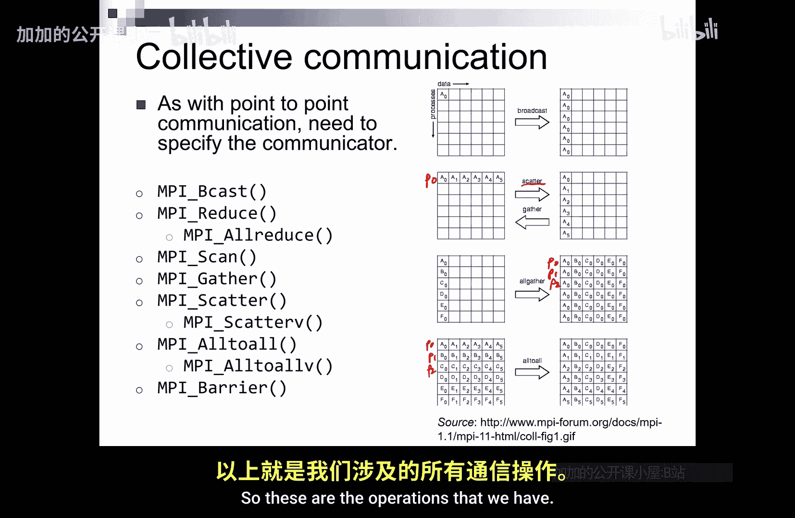

Okay， so the first operation is the broadcast operation。

 so the way we use this is that we have to say what data we're trying to broadcast okay。

 so then we're going to give a buffer which is going to contain the data that we want to broadcast right and all of the data in this buffer has to have the same type。

Okay， which is this MPI data type here， and then we have count copies of this data。So for example。

 if I want to broadcast a vector with 10 values， then let's say 10 floating point values right。

 then my buffer is going to have those 10 floating point values here my type is going to be MPI float and my count is going to be 10。

K。And then my communicator is the group that I'm going to broadcast to。Okay， and lastly。

 the source is which process is doing the broadcast？Okay， now。

Okay now remember that MPI is this SPMD model okay so that means that every program I sorry yes。

 every process runs the same program Okay so here we're trying to do a broadcast from a source node right so let's say that node is node zero okay so then node zero is going to call this line in its program。

But because every process is running the same program。

 then all of the other processes will also be calling MPI broadcast。

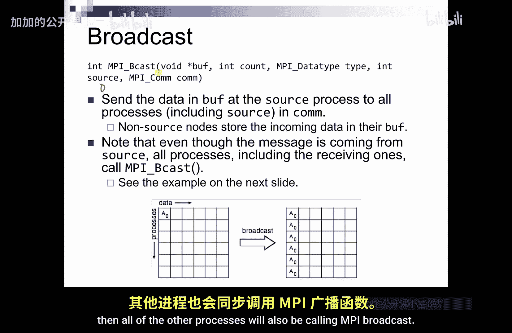

Okay， so now。What's going to happen is， okay， so let let's do this with an example。 Okay。

 so here the example is that let's say that we have a root node， which is a node 0。 Okay。

 the node with rank 0， okay and。Yeah， and the root node wants to broadcast the value of one to all of the other processes okay so then this is our code for doing that Okay。

 so we're going to call this MPI broadcast over here with this value of one right and the source of the broadcast is going to be the root node zero。

But since we're in the SPMD model on all of the other processes， including the non root processes。

 they're also going to be executing the exact same code。Okay。

 so all of the other processes are also going to execute this line over here。

 MPI broadcast with the root being zero。Okay， so now that might look kind of weird right because for broadcast。

 there's this asymmetry between the processes， right you have one process which is sending the messages to the other processes and everybody else should be receiving。

However， when you run this in the SPMD model， it seems like everybody is broadcasting because everybody runs this line runs this command over here so the way this is actually working is that since we're calling MPI broadcast with this particular route then you in our case the root to zero right？

Then if my rank is actually， let's say my rank is actually。Equal to something like two okay。

 then when when I call this MPI broadcast， my rank over here is because my rank is two。

 when I call this function， I am not the root and so therefore I'm actually going to do a receive。

OkaySo so even though all the processes are calling the same function。

 they do different things depending on whether they're the root or not， if they're the root， right。

 then when they call this MP broadcast， they're actually going to do the broadcast。

But if they're not the root， right， if my rank is two， for example， right。

 then what I call this MPI broadcast， this is actually going to cause me to receive a value from the root。

Okay， yeah， so just keep that in mind， it does look a bit strange the first time that you see it。

 but just remember that many of these collective operations， okay， not just broadcast。

 but many of them。Half this property that know the data is coming from a particular process。

 and when you call this collective operation， then if you're the sending process。

 you actually do the send， but if you're any other process。

 then when you call that collective operation， you actually receive data。Yeah， so let's see。Yeah。

 so this just sort of says what I was explaining， so all of the other processes okay。

 including non-root processes， they're also going to call the MPI broadcast， okay。

 but because the rank is not equal to the route， then instead of sending they're going to receive。

So another way to think of this is that the MPI broadcast is actually saying。

 I will participate in a broadcast。And then what I do when I participate depends on my rank if I'm the root。

 then when I participate， I'm going to send and if I'm not the root， then when I participate。

 I'm going to receive。Okay， and again， many collective operations work like this。 Okay。

 they do different things depending on your rank。

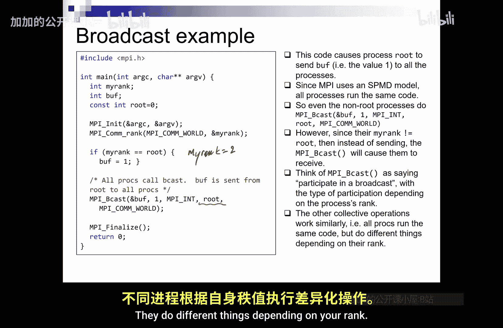

Okay， so next we have this operation called reduce okay so basically reduce let's just go with this example over here so reduce what what's going to happen is that suppose every process has some data okay so every process in my communicator starts out with in this example they have an array over here so what I want to do with reduce is to basically collect all this data at a single node。

And when I collect this data， I can choose to process the data in different ways okay。

 so here maybe I want to sum all the data。Okay so every process has a vector and when I call this MPI reduce with the sum function。

 then I'm going to add up the values from all of the different processes okay in their vectors so for example when I call this MP sum reduce here right the first value I get is 18 and 18 is equal to this5 plus the2 plus the 7 plus the4 okay so this is what gets me the 18 right so let's just check that right phi plus2 is 7 7 plus 7 plus 4 is 18 yeah and then。

The second value here which is 14 right so this is coming from summing up all of the second values in the vectors that the processes have okay so you do one plus 3 plus 8 what is is 12 plus 2 is 14。

Okay yeah， so this reduce is taking data from all of the other processes and processing this data and collecting this data in some way Okay so in this example we're going to sum up all of the data but in fact we can do different operations on the data okay so for example we can maybe multiply the data instead of summing them if we wanted to multiply the data then what we would get is the the first component would be 5 times2 which is 1070。

 I guess we would have a 280 over here if we did a product product。Okay。

 and the other one is going to be whatever， whatever it is， okay， I guess 48。Okay。

 and there's some other operations that you can do。 for example， you can do the max or the min。 Okay。

 now if you do the max， then what you're doing is you're you're gonna produce two numbers。

 The first number is the max of the first。Entry in all of these vectors Okay so it's going to be the max of 5 and 2 and7 and4。

 so it'll be7 Okay， so if we did max over here right the first entry is going to be 7 and the other entry is going to be the max of 1。

3，8 and 2 and so the second entry would be 8。Okay if you did min right。

 then I guess you would be getting something like what do we have， we would be getting two。

 right that's the first min and two and one， okay if you did min。Okay。

 so that is the reduce operation， right we're going to take values from all of the other processes and then combine them。

And if the other processes have a vector of values。

 then we're going to also produce a vector of values。Okay。

 so the signature for this function is basically。Yeah。

 so we're going to have a send buffer and a receive buffer at account and a data type okay so the count on the data type is just you know what kind of values are we sending here so here there are going to be integer values and then the count is going to be two because each process is sending two values。

Okay， and the operation， this is going to be one of these on either Min or Mac or sum or product or other types of operations。

Okay， now here the target target is which process is receiving all of these values right because we're reducing all of these values onto some particular process Okay。

 so here the target is going to be process zero。Right and the send buffer。

 so every process which is not the target， okay， well actually it also includes the target。

 but every process is going to have a buffer and it's going to have a send buffer and the data for the reduce is coming from all of these different send buffers。

Okay so these things over here they're the send buffers at the different processes。

 each process is going to have a send buffer and then the reduce buffer is only the target node needs to have a reduced buffer okay because only he's going to collect all of this data。

Okay， now I want to mention that again， all of the processes are going to call this reduce function okay。

 both so you know in this reduce process  zero of course calls the reduced function to collect all of this data。

 okay， but the other processes one， two and three are also calling the reduce function。

But the difference is in how they behave， so in process zero， when because he's the target。

 then he's actually going to collect a bunch of data from the other processes and then add them up the other non targetar processes when they do the reduce。

 they're just going to send their value to the target process。Okay。

 so this is just like the broadcast where everybody does the same function。

 but the actual procedure you go through depends on whether you're the target or not。Oh， right。Yeah。

 so I just want to mention that so one of these functions is not so obvious so this MPI max lo location okay so this LOC stands for location。

 so this is actually going to return a pair of values and pair so this is basically doing a max of all the values okay but it's going to tell you where the max came from for example if we do a max lo over here then the first value the first max value is going to be7 and this is coming from process 3 sorrys this is a bit nice over here so this is going to say sorry the seven2 it's going to say that the max value in the first coordinate is is a7 and process2 has this value of7 and then for the second coordinate we would have eight2 okay because the max and the second coordinate is going to be8 and it's again going to come from process2。

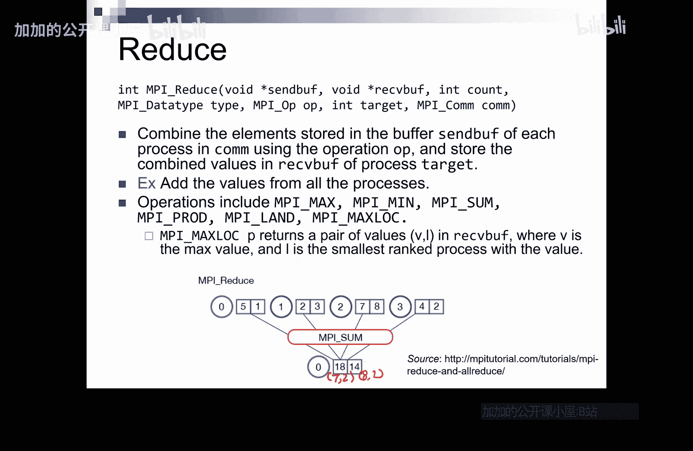

Okay， so that's the reduce function where we reduce onto one particular target process。

 the all reduce function is very similar except for we're going to reduce these values onto every process。

So therefore' need target you don't need to specify a target process anymore。

 you just need to specify what is the data you're sending and every process needs to now allocate a receive buffer to take all this data from。

Okay， so now if you compare this picture with the previous picture right。

 they're the exact same thing except for in the previous for reduce。

 only process0 received these sum values， whereas for the all reduce。

 all of the processes receive these sum values。

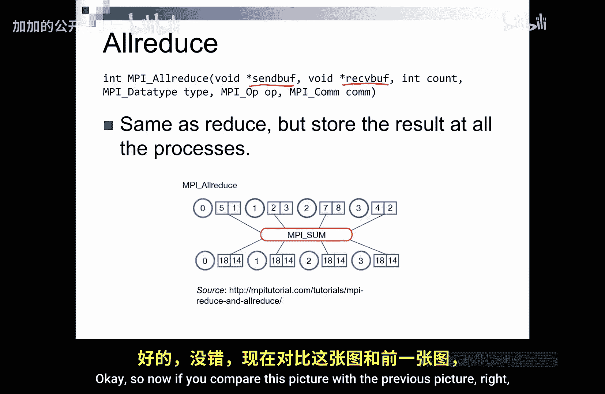

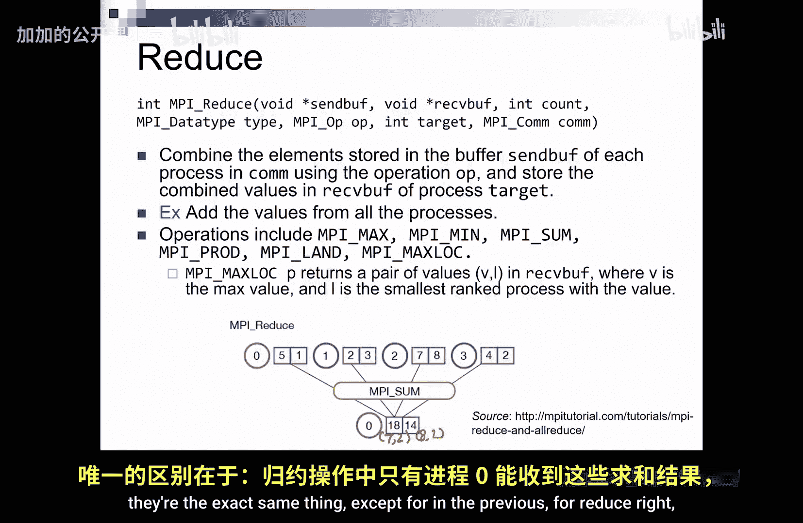

Okay， so the next operation is called scan okay so scan again。

 let me just show you an example of what it does， Okay。

 so scan every process begins with a value or a vector of values。Okay。

 and then what happens is that what these processes have ranks， right。

 So we're going to order the processes according to their rank， right。

 And now the I process is going to get。Okay， well there are different types of scan operations。

 but let's say that we're doing the MPI sum scan， okay， so if we're doing the sum scan。

 then the process with rank I is going to get the sum of the first i values。Okay， so for example。

 this process over here， right， if you're doing MPI sum。

 then he's going to get the sum of the first value， which is just one。

OkayThe second process is actually going to get the sum of the first two values Okay。

 so one plus two is three right the third process gets the sum of the first three values。

 so that's6 and then the fourth process sums all of these values so he gets a 10。Okay。

 so this operation is called SC。Okay。And again you don't have to use some here。

 you could use something like let's say you can use a product okay。

 so proD right in that case the first process would get one right。

 the second process would get the product of the first two values so that's two right the third process would get the product of the first three values so that's again six and the fourth process would get the product of all four values which is going to be 24。

Okay， and the operation that you can use， you can use any of the produce operations。

 so you can use some product， max min all of these operations。

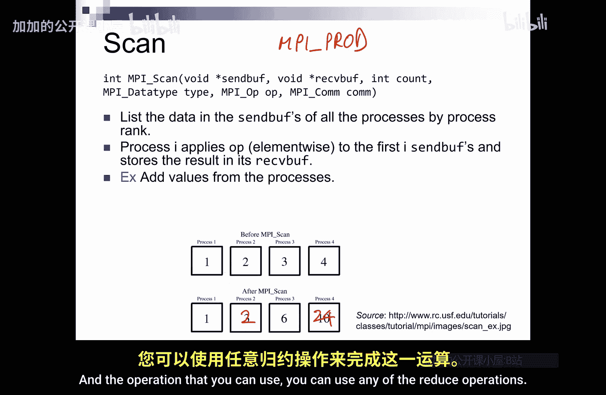

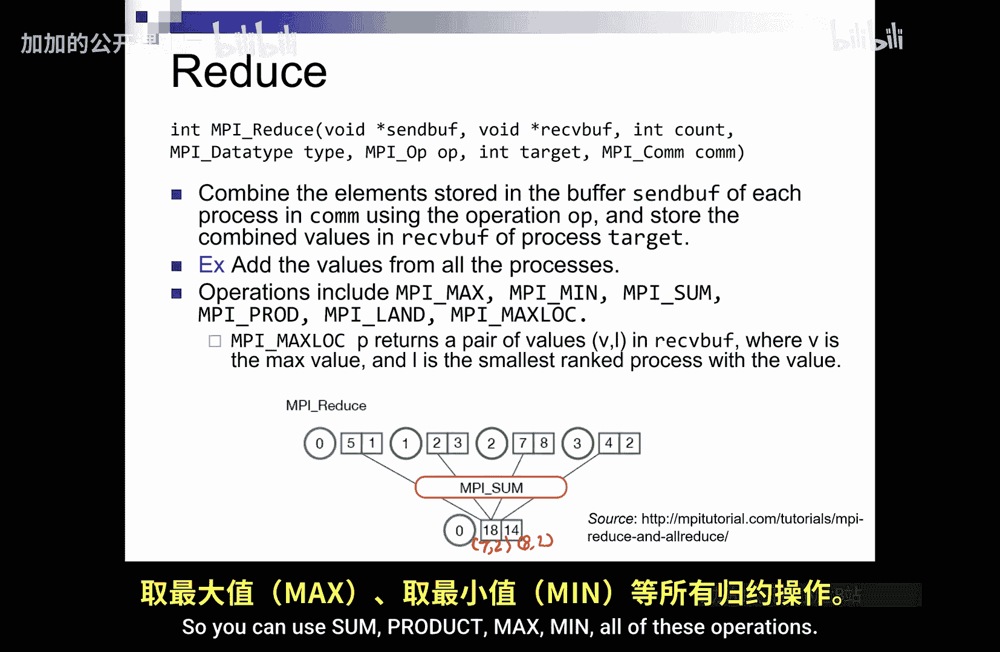

Okay。Yeah right and so every process needs to have a buffer containing the data that it's going to use in the scanned operation and it also has to have a buffer to receive all this information so in this example over here every process just has one data value so therefore this buffer so therefore this count here is going to be one and the send buffer and receive buffers are only to be are only going to have one value in them but you could also send or receive a vector of values。

Okay so in that case you would have a larger account and then each one of these things would be a vector of values。

Okay now when you do this scan operation you're often doing the sum operation and so in that case this operation is also called a prefix sum okay so the reason it's called prefix sum is basically because you're taking a prefix of these processes and you're adding them right like so for example the third process here he's taking a length three prefix of all of these values and he's adding them right this process over here right he's taking a length2 prefix and he's adding them okay so this is why it's called prefix sum。

Okay。And this is actually this scan or prefix sum operation， this is actually a very。

 very widely used operation so we're going to see a lot more usage of this operation later。

 okay so it's kind of surprising how useful this operation is okay so we're going to see this a lot more later on。

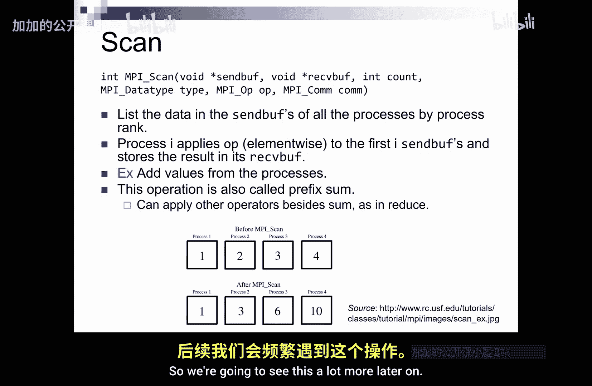

Okay， next we have the gather operation， so the gather operation is it' basically imagine that every process has a piece of data。

 okay， and now we want to gather all of this data onto one particular process， the target process。

Okay， so when you call Ga， if you're the target process。

 then you're collecting data from all of the other processes， okay， and if you're not the target。

 then you're sending data to the target。Okay， now， now if you're the。

Let's see if you're not the target okay， then you're going to send a certain number of data items Okay。

 so that that's what the send count is So imagine that you're sending two items Okay。

 then your send buffer would have two items of a certain data type。

OkayNow the difference is that the receive process right he's going to receive two items from each other process。

 so if there are， let's say eight other processes， right。

 then this receive process would actually get  16 values。Okay so basically in general。

 if we have a communicator with k processes in it so suppose that this comm has k processes and if each of these processes has a cent buffer of size t。

 then the target will need to receive k times t items。Okay。

 so therefore the target needs to allocate a receive buffer of size k times t。

Okay now there's a very similar operation to gather。

 which is all gather okay so this simply means that every process is going to do a gather okay so when the first process does a gather right he gets the data from all the other processes and then every process does that。

 so that's all gather。

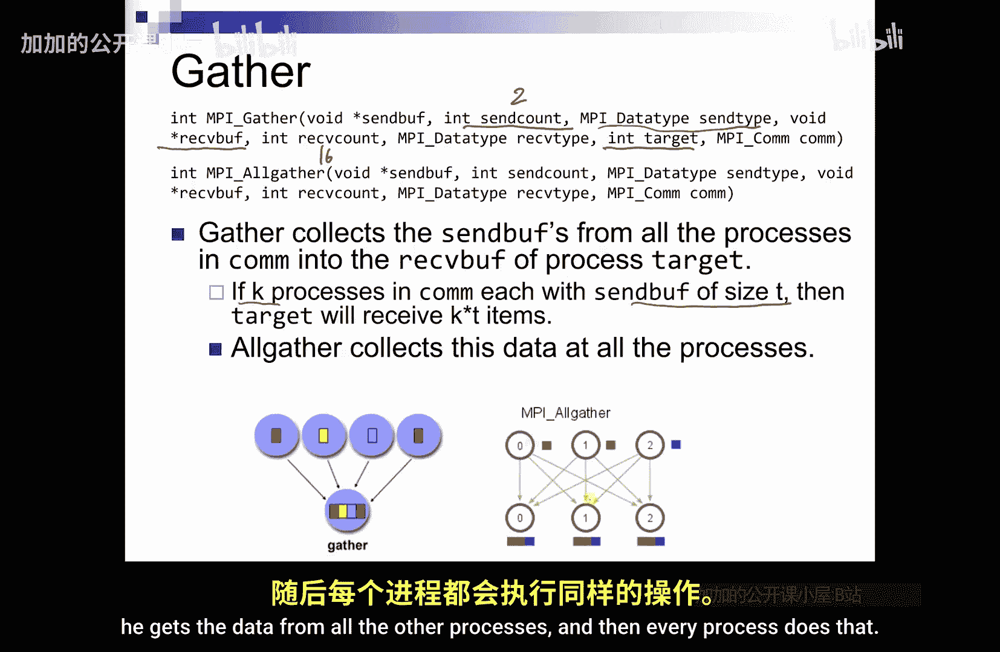

Okay， so the next operation is a scatter。 Okay， so scatter。Let's see yeah。

 so scatter is basically the reverse of gather okay。

 so gather is everybody has let's say k items and I'm going to collect all of these items and end up with k times t items Okay。

 scatter is the opposite here I start out with k times t items right or case a number of other processes and I send t items to every other processes。

Okay， so in fact I have an array of data like this right， and I'm going to send T items。

 I'm going to send the first T items to the first process。

 the next T items to the next process and so on。Okay， so the interface for scatter is like this。

 Okay， so I have this send buffer over here， right and。

Let's see so send buffer send at I receive count okay right and then every process is going to receive receive count number of items from me okay so suppose we have let's say K equals let's say we have eight processes right and then suppose my send count or sorry my receive count right let's say that this is equal to to two okay so every process is going to receive two values from me okay so that means that my send count right I have to be sending out。

Two times 8， which is 16 values。Okay， so my send buffer is going to have 16 values and all of the other processes are going to have a received buffer of size2。

Okay， so now the scatter is going the data is coming out of a source right。

 and then all of the nonsource processes will be receiving and the source will be sending。Okay。

 now when you do a scatter operation， all of the nonsource processes will receive the same number of items okay so if there are eight processes。

 every one of them is going to receive two items from me。Okay。

 but what if I want to send different numbers of values to different processes， Okay， so maybe。

You know lets let's pick a smaller number here， let's say that k equals4 okay now what if I want to send something like let's say for the first process right I want to send him three values for the next process。

 I want to send them one value， and then I want to send the next process two values and then maybe four values over here。

Okay， then in order to do that， I'm going to use this operation called MPI scatter V。Okay。

 so the scatter V operation lets me specify how many values I send to each other process。Okay。

 now when I do the scatter V， I'm going to have。Let's see I'm going to have this vector over here okay and this vector is specifying how many values I'm sending to each each other process okay so basically this vector I'm just going to write this 3。

1，2，4， I'm going to place this in a vector right and this tells me how many values I'm sending to the other processes。

Okay， now in total， I am sending what is this 4 plus2 plus4， so it's going to be 10 values， okay。

 so therefore my send buffer right has to have 10 values in it。Okay。

 now there's this other parameter displacements， okay。

 so this displacement tells me where the data is actually located in my send buffer。

Okay so imagine that I'm sending data over here right so I'm going to send 10 pieces of data right so we have let me just draw this out。

 we have two oops。We have two， three， four，5，6， seven， eight，9，10， well， that's a bit too long。

 I guess。呃。Right so is that right one，2，3，4，5，6，7， eight，910， Okay， all right。

 so this displacement right it's going to tell me so what I want to do is I want to send let's see。

 how do I represent this。Okay， I want to send three data items to the first process right。

 and then I want to send one item to the next process， let me move this a bit，31，2，4 right？1，2。

4 right want to send two data two items to the next process and then four to the final process。 Okay。

 so the displacement is just telling me where the data I'm sending starts。 Okay。

 so the data I'm sending to the first process starts at index 0 over here right the data I'm sending to the。

To the second process starts at index 3。let me sort of clear this up a little bit okay the data I'm sending to the second process starts at index 3 the data I'm sending to the third process starts at index 4 and the data I'm sending to the final process starts at index 6。

O。😊，All right， so in fact， how do I compute these indices Okay well the way to compute them is that the first index is always going to be zero because I'm going to start at the beginning of my this is my send buffer over here I'm going to start at the beginning of that the next displacement is just going to be I'm going to take this vector of how many values I'm sending and I'm going to do a prefix sum on this so actually it's an exclusive prefixt sum so what that means is that the next value is just going to be this value3 over here the next value after that is going to be the sum of these two values because I'm sending three values to the first guy and then one value to the next one so the next displacement is3 plus one and then the next and then the displacement after that is going to be the sum of the first three values so that's going to be 3 plus1 plus two is6。

Okay。so this is how you compute these displacements over here。Okay so in fact。

 we've already seen a use of prefix sum so I mentioned that prefix sum is useful and already even just to do the scatter V operation。

 we would want to use a prefix sum of course we would compute this prefix sum locally right it would be the source node itself。

 which is doing a prefix sum on its send counts。we're not going to do unless you have a very。

 very large number of values that you're sending out。

 we're going to try to compute the prefix sum in parallel。

 we're just going to compute it by ourselves， the source。嗯。All right。

 and then when you're doing the scatter V for all of the receiving processes right so all of the non-source processes right so since they're receiving values。

 then they don't really care about the first four arguments because those are just about how to send the values and that's only relevant to the source process。

😊。

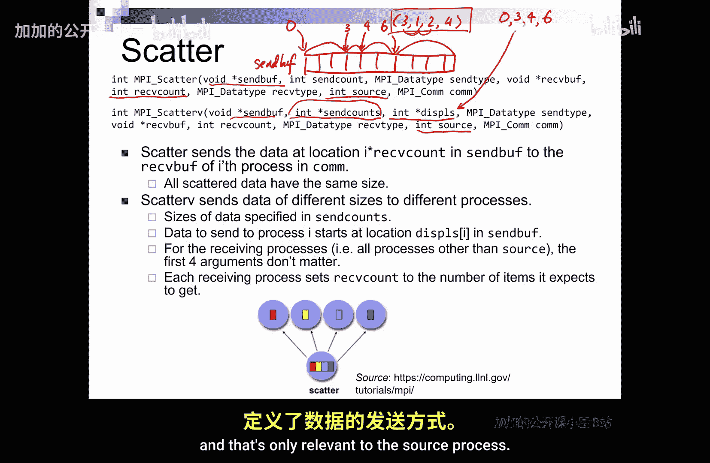

Okay， so thats that's scatter V next we have this all to all operation okay。

 so all to all remember this is basically every node is doing a scatter。

You you can think of it that way okay so for example this process zero over here right if it does a scatter right then it's going to take this row of values and it's going to distribute them along all of the processes right so it's going to take this row and convert it to basically a column in this sort of matrix representation that we have okay and process one is going to take its row of values right and then distribute them along the column of processes。

O。Yeah so so that is how all to all works so the arguments are that we need to have a send buffer right so the send buffer would be all of these values over here right that's our send buffer right we need to say how many values we're sending and what type we're sending right and then also since the processes are all kind of be receiving data right then we also need a receive buffer over here okay we need to know how many values we're receiving。

Okay， so that's all to all。The next operation is going to be MPI all to all V okay so all to all V is so just as with scatter you could try to send different numbers of values to different processes right so with scatter right you can send different numbers of values to different processes with all to all V。

 it's again like a scatter for each process and you're sending different numbers of values to different processes。

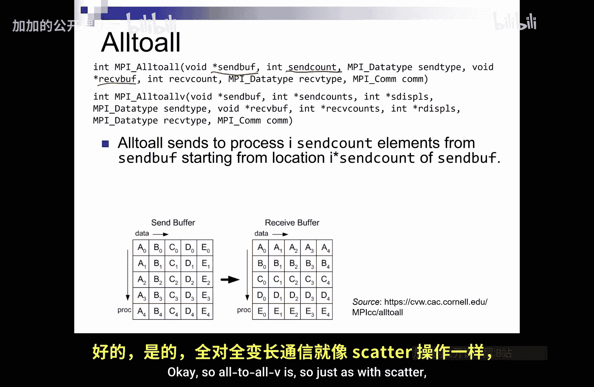

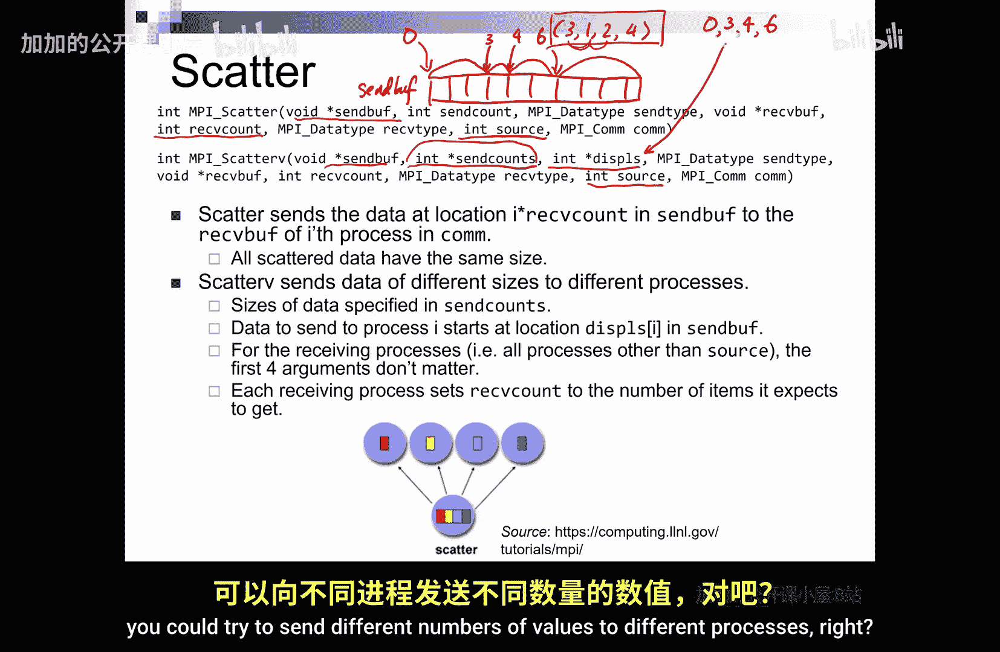

With the all to all， everybody sends the same number of values to each other process。

Okay with the al to all V， right， I can have this displacement vector sorry this vector of send counts。

 and this specifies how many values I want to scatter to each other process。Okay。

 and this thing over here， the displacements， right， so this is again。

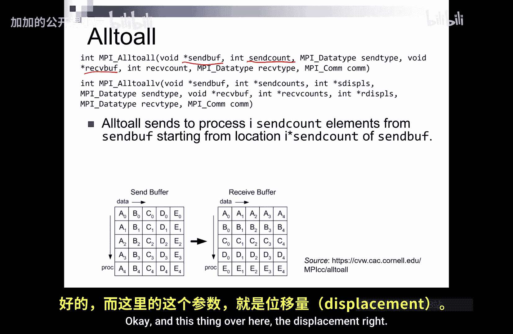

One of these vectors that keeps track of where the data is starting in the vector that I'm sending to other processes。

Okay， and again， to compute that， you can be using this prefix sum operation。

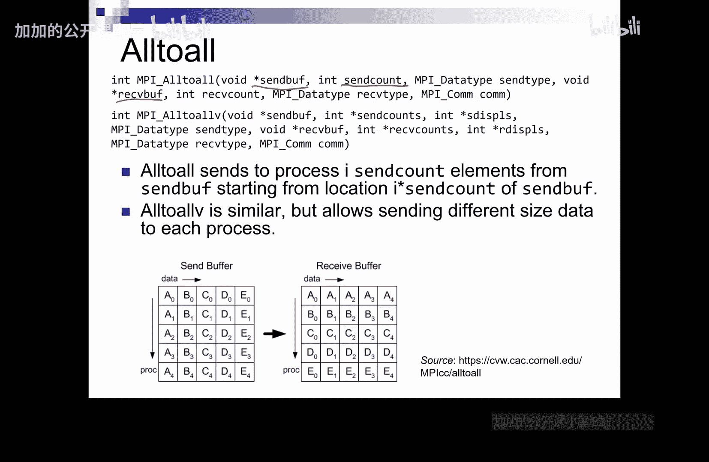

Okay so next let's talk about the barrier operation okay so the barrier operation is a way to synchronize all of the processes in a communicator okay and what I mean by synchronize is that the barrier is going to make sure that all of the processes encounter this barrier before they do any operations pass the barrier。

Okay so if you imagine that you know we have this MPI program right so we have some code over here and then at some point we're going to call the MPI barrier operation right and then after that we have some more code okay so if you put a barrier then this means that all of the processes in your communicator right they're all executing this code right so。

And they're all going to wait until all of the processes in the communicator hit this line in the code before they do anything past that line of code。

Okay so here's like a visual representation， so suppose that you know we have this barrier at some line of code okay now maybe process 0 is the fastest process。

 so it's the first to reach the barrier and then after that processes one and three reach the barrier and then process  two reaches the barrier。

Okay so when they reach the barrier， these processes are going to wait at the barrier。

 okay they're not going to do any code that goes past the barrier。

 they're going to wait at this barrier operation until all of the processes have hit the barrier。

Okay， and then after that， they're allowed to go past the barrier and they're allowed to do these operations after the barrier。

Okay， so this is a way for all of the processes to synchronize with each other。

Now when you use a barrier operation， you have to be careful because you have to make sure that all of the threads will eventually hit the barrier okay so for example。

 I'm suppose you have suppose that thread2 here it hasn't hit the barrier yet but suppose somehow it crashed so in that case would never hit the barrier right so you know so this process two crashed so it doesn't exist over here then these other processes01 and3 are going to be waiting at the barrier forever right because these guys can only go on when everybody reaches the barrier but because process2 crashed it's never going to reach the barrier okay so all of these other processes are blocked forever。

So if you use a barrier， you need to be careful about these situations where some processes may never reach the barrier。

 that would be very bad。Okay another thing is that you can actually use multiple barriers okay so so the way you can do that is suppose let's draw this timeline over here right suppose you have a barrier over here okay so that means that you're going to wait until all of the processes hit this barrier before you go on past a barrier okay now after the first barrier you could have another barrier okay so what that would mean is that all of the processes would now have to having trouble erasing this。

Okay， all right， so all the， all of the processes would have to hit the second barrier before they can go past the second barrier。

Okay so therefore the processes are going to be sort of operating in phases okay so o what I mean by that is although the processes will be doing this part of the code first okay and then they won't be able to do anything in the next they won't be able to do the next chunk of code until everybody has done this chunk of code。

OkayNow once everybody is done the first chunk of code。

 the next all the processes are going to do the next chunk of code。

But none of them can do the third chunk of code until all of them have finished the second chunk of code。

Okay， so you can think of the barriers as breaking the code into these phases， right。

 And the phases have to be done in the same order by all of the。

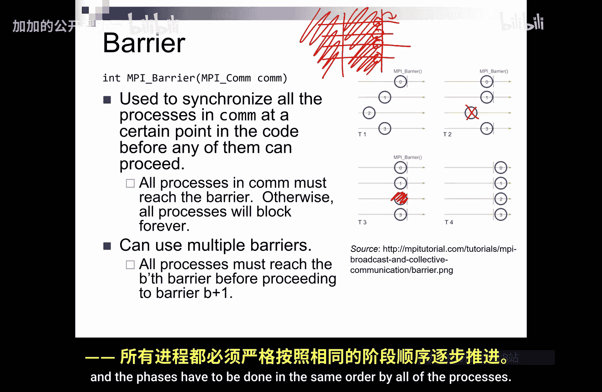

By all of the processes。Okay so that's basically all of the collective operations that I want to talk about and now I want to show you how we can make use of these operations to actually solve a problem so the problem we're going to solve is something involving matrices so I'm first going to talk about how matrices are stored when you do parallel computing okay so so I'm going to assume here that these are dense matrices and that just means that when you have a matrix basically most of the values are nonzero if you have a dense matrix the other type of matrix is a sparse matrix where many of the values are zeros if many of the values are zeros then you don't actually have to store all of those zero values so when you have a sparse matrix you have lots of different special storage formats for these sparse matrices which can make the operation more efficient it can use less space and you can compute faster。

But if you have a dense matrix， then basically you have to just store all of the values。

 because almost all the values are non zeros。Okay， so anyways。

 now we're going to do some linear algebra on these dense matrices。In fact。

 linear algebra is one of the main applications for parallel computing because many problems can be solved by linear algebra and also linear algebra is very suited to parallel computing。

So it's one of the big applications。Okay， so now if we're working with a matrix in a distributed setting。

 then we don't want to have each process store the entire matrix because the matrix can be quite large so instead we want to break up the matrix and then divide it among the processes okay so there are different ways of dividing the matrix two simple ways are to either break up the matrix in terms of its rows or its columns。

Okay so that's going to be called row or column striping okay so for example。

 if we break up the sorry let me go back so if we break up the matrix in terms of its columns right so then we have a columnwise block stripping or striping I think it's called striping not stripping I guess you could call it stripping also yeah so we have these these columns which are these strips okay or stripes whichever one。

And then you can also do the row wise block stripping where you break the thing into columns。

 I'm sorry， into rows， and you assign different sets of rows to different processes。

Okay now I want to mention that okay so each process is going to get a subset of either the rows or columns but we still have to organize the data from the subset in some manner right so for example in the row stripping right this process p0 it's got the first four rows。

 but how are these rows represented in p0's memory so they're usually represented in row major format okay especially if we're working with C right so C stores matrices in row major format。

And what that means is that we're going to store the first row of data and then followed by the second row。

 followed by the third row and so on。Okay， so this is why it's called row major format。Okay。Now。

 if we're using this column striping。Right we're still going to store things in row major format okay so what's going to happen is we're going to store these first four values。

 so p0 is going to store the first four values followed by the next four values and in this fashion so you have the sort of zigzag pattern for how you store the values。

Okay so that's for storing the matrix now what is the problem that we're trying to solve in parallel so the problem we're trying to solve is we want to take a matrix and multiply it by a vector and just to make the problem a bit more complicated。

 we're going to assume that the matrix is actually stored in the columnwise format。

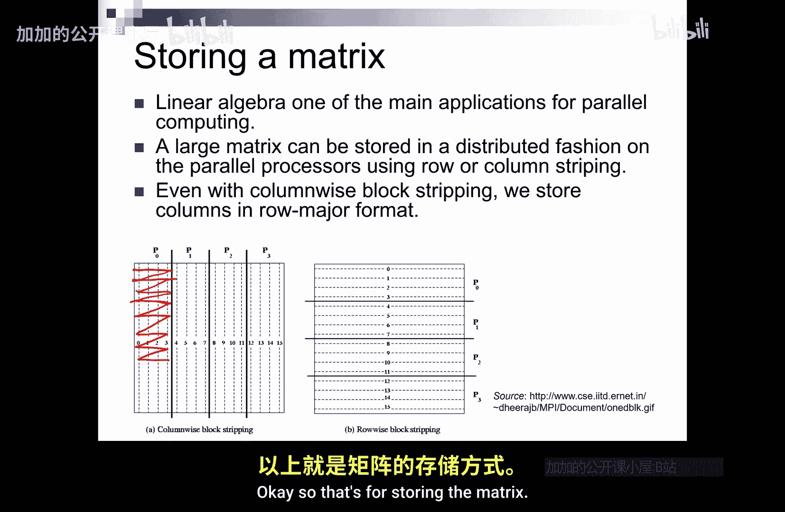

Okay so for example here， let's say we have six processes so then each process has some subset of the columns of the matrix of the matrix A。

 and then there's another vector x that we're given and our goal is to compute the product of a and x okay so call that y。

Okay， so now let's say that a is an m by M matrix， and then x is going to be an m by1 vector。

 and let's say that you have P processes。Okay， so in that case。

 we are going to have n rows over here， and then each process is going to have n divided by P columns。

OfOf the matrix， okay？Now we're also going to assume that each process has n divided by P values of the vector。

Okay， so each process doesn't have the entire vector， it's only got a certain part of the vector。

 right？Okay， so now given this format， how do we do the matrix vector multiplication well what we need to do is so here there are many the first process has many rows。

 right each of these rows has n divided by P values。

And the first process also has n divided by p values of x so then what we want to do is we want to take these n divided by p values from the first row and then multiply by the n divided by P values from x。

We want to do the dot product of that。Okay， and the do product will so the do product just means that you know if we're going to take a bunch of values。

 so if you want to do the do product of like 1，2，3 with let's say， I don't know3 to1。

 let's say right okay then you're just going to do these you're going to do like one times1 times3 plus two times2 plus three times1 okay you're just going to match up these values one by one。

 you're going to multiply them and then you add them mo。Okay so to compute yeah。

 so this blue process， the first process is going to do the dot product of the first row with these values of x okay so that's going to end up producing a single value okay that's going to combine everything into like a single value let's just sort of draw it as I don't know like an x over here okay or let me not call it x because I've already got this x over here let me call this V okay。

Or let's take V1， okay。And then this first process it's going to take the next， the second row。

 and then multiply it again， it's going to take this second row over here。

 and again it's going to compute the dot product with this part of x that it's got and that's going to produce another value V2。

Okay， right， and then it's going to take the third row and dot product with these values of x。

 and that's going to produce B3 and so on。Okay， right， so basically in the end。

we're going to end up the first process is going to end up with n different values。Okay。

 now the second process is going to do the same thing Okay。

 it's going to take its first row of n divide by p values and it's going to multiply it by these green values of x over here okay and that's going to produce a value So let's call that thing W okay W1 and then it's going to take the second row and again。

 dot product with these x values right and let's say that this is going to produce a value W2。

And then W3， and then so on， and it's eventually going to end up with n values。

Okay now the third product sorry third process does the same thing。

 so it's going to take its first row multiply by these yellow values over here。

 and let's say that it gets a value of U1， and then it also gets U2， U3， and then so on。Okay。

 and then everybody basically does this。Okay， so now after all of the processes have done this。

 oh I'm sorry， let me keep this around， okay。嗯。ButYou know what let me erase this okay。

 so what I want to say now is that every process after it does this， right。

 then we're going to get since we have P processes， we're going to end up with P of these values。

Okay， now what we want to do is I think I'm going to have to switch to a different color here that is not red。

 so let's just go with。With bluelu over here， okay。

 so what we want to do are we want to compute these values right like y1。

 y2 and then and then so on up to yn。Okay， so what is y1 okay。

 so y1 is actually equal to this entire row， right， multiplied by this entire vector x。Okay。

 now how do we get y1， what what we can do is now if you look at these individual values， the V1。

 the W1 and the U1， Okay， so each of these is part of this row， right。

 So each of these is part of the overall value of y1。Okay。

 so then what we want to do is we actually want to add up all of these values over here。

 the V1 plus the w1 plus the U1 plus all of the first row values from all the processes and when you add them up。

 then that sum equals y1。Okay， now what about y2， Well Y2 is we're going to take all of the second row values。

 right， the V2， the W2， the U2 and so on， all of the second row values from all of the different processes and then you're going to add them up and then that gets you y2 and same from y3。

 you take all the third row values the V3， W3 and so on。 and that the sum of those is y3。Okay。

 so this is the algorithm， right， so the algorithm is that。Let's see okay。

 so the algorithm is that first， all the processes are going to do dot products right of their rows with the portion of x that they have Okay。

 that's going to produce all of these V1 v2 v3 values or W1 W2 and so on。Okay， and then after that。

 we need to add up all of these V1W1 U1 or V2W2 U2s。Okay。

 now this addition process okay we actually have a very good tool in MPI for doing this and this is the reduce function Okay。

 so if you if you think back to so I guess I can actually go back a few slides。

 so we have this function called reduce。

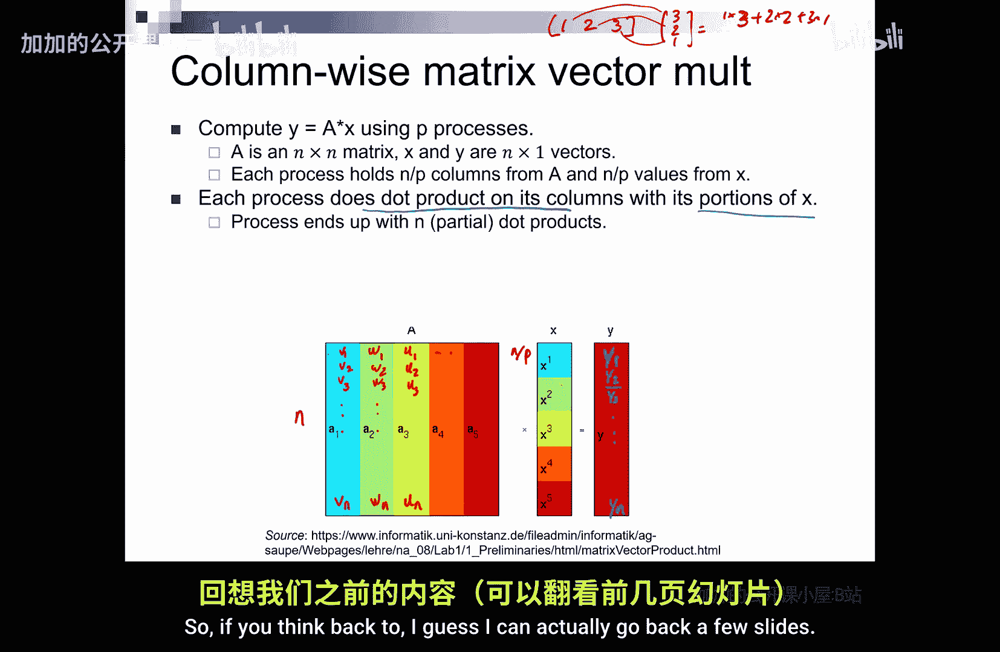

And the reduced function is perfectly made to do this because the reduce is going to take values from all of the different processes and just add them up and that's exactly what we want to do when we compute this matrix vector product here we want to do a reduce on all of the first row values。

 and then we also reduce on all of the second row values， the third row values and so on。

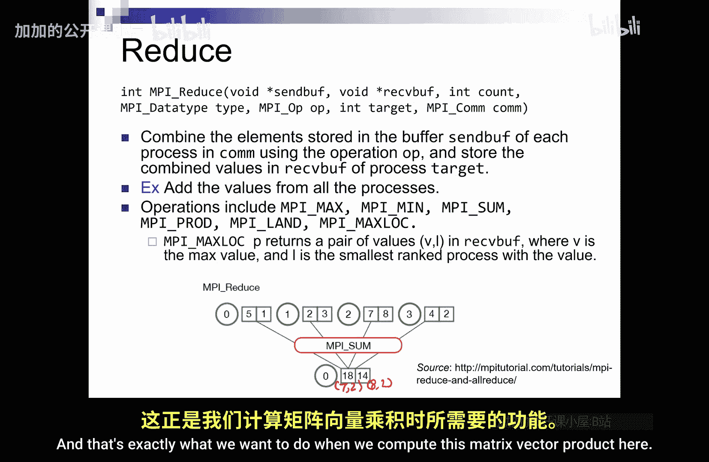

Okay， so reduce is perfect for that。Okay， and the next。Oh。

 so when you do this reduce right all of the values get accumulated onto one particular process okay so because you have to produce onto one particular process okay so that process is going to end up so whoever we reduce onto that process is going to end up with this entire vector why。

Okay however， in the end， we don't want just one process to have entire this entire solution vector right we want all of the processes to have portions of y so then what we're going to do is after we reduce onto the single process then that process is next going to chop up y so it has all of y but it's going to break it into these different parts and then it's going to scatter these different parts to the different processes okay so for example。

 this part goes to process zero， this part goes to process one process2 and so on okay so it's going to use a scatter operation to do that。

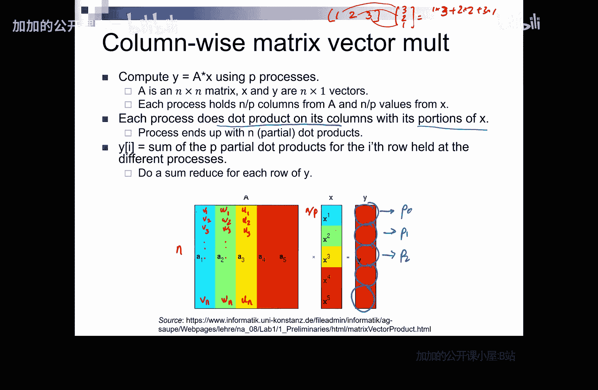

Okay， so now let's try to put all of this together into into some code。 Okay。

 so here we have the program for doing this so。Right。

 so what is happening is so now remember that the first thing that you need to do is each process is going to compute these dot products right it's going to take it all of its rows oops right and then these partial rows and then dot product with this partial part with this part of X that it's got so that's what's happening in this part of the code it's computing all of these it's computing n of these partial partial dot products。

Okay， so the next thing is that we have to take all of these partial doubt products and add them together right so we said that that was the reduce operation。

Okay。And we're going to reduce all of these values onto， let's say process 0。 Okay。

 we can pick any process。 Let's pick process 0。 Okay。

 so the values that we reduce are these partial values， the partial wises， right。

 and then we are going to。Yeah， we're going to collect all of these values onto process0。

 and he's going to store it in FY。Okay， and then the final thing to do is that now process zero has all of the y values right and he wants to distribute different portions of of these y values to different processes so therefore the process zero。

 he's going to do a scatter operation of these y values right and he's going to give n local values to each process okay what is n local n local is defined as the total number of values defined by the number of processes right so if you have like 100 values and and five processes right every process should get 20 values okay so n local would be 20。

Okay so you do the scatter operation from process zero。

 and now everybody gets their correct portion of y。Okay yeah。

 so this is how you can do this linear algebra operation using these collective operations the reduce and the scatter。

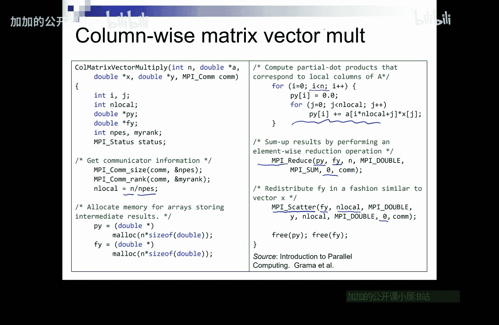

Okay now in the final part of this lecture I'm going to talk about these other types of operations that you have in MPI which are the data type operations and the operations on communicators so let's first talk about how would you define new data types in MPI right so MPI comes with like basic data types like you know ins and doubles and floats and so on right but if you want more but if you want to define like let's say a structure of these you can actually do that in MPI。

So we do there are four main types of these derived data structures in MPI， okay。

 so they're called contiguous vector indexed andstruct。Okay。

 so in order to define one of these types， so you're going to define a data type right so I'll show you how you can create the definition of these various data types and then after you've created after you've defined the data type。

 you're going to commit the data type right you're going to tell MPI that I want this kind of data type okay so you're going to use MPI commit for that。

Okay， some other operations you have are， if you call this MPI type extent。

 you get the size of that data type， like how many bytes it uses okay and then you can call MPI free to free this。

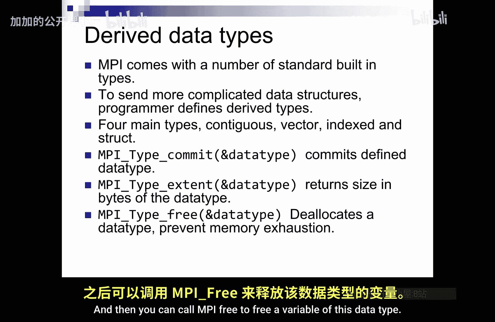

To free a variable of this data type。

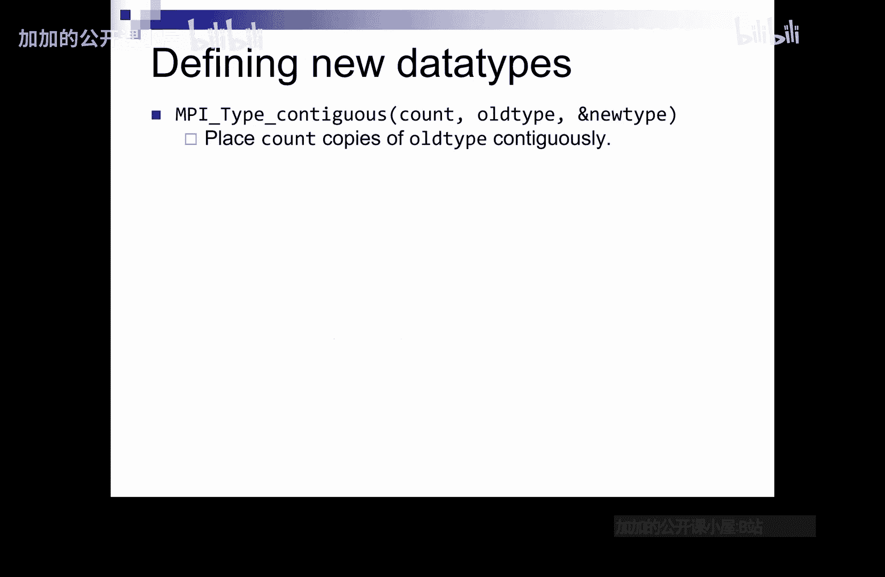

Okay， so now let's look at how to create these different data types right so we have four types of contiguous vector index andstruct right。

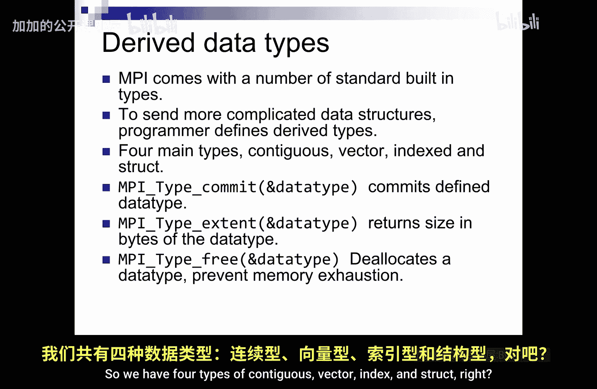

Contiguous is pretty simple。 It's just taking so you start out with some basic data type。

 let's say floats okay now suppose you want to define a new data type which has four floats Okay so then we're just going to place a four float contiguous to each other So that means that we put one right after the other and then you can define a new data type。

 let's call that float4 right and so to do this， you just set O type to be float or MP float and then you set count to be4 because you want four of them and then the new type you can define just give a name to it。

 let's say float4。Okay， so that's how you use MPI contiguous。

Now these other types okay so they're actually kind of more complicated so instead of reading through you know this function definition for you right let me just show you examples of how to do this so the MPI vector data type so basically what's happening over here is that usually the way you use this vector data type is that if you have a matrix okay then maybe you want to select certain parts of this matrix so for example you might want a subcolumn of this matrix or sorry just a column of the matrix or maybe you want to row out of this matrix so maybe you want to put so here let's say that you want this entire column of values you want to put all of those into astruct so you want tostruct corresponding to a column of a matrix and easy way to do that would be using this MPI type vector thing。

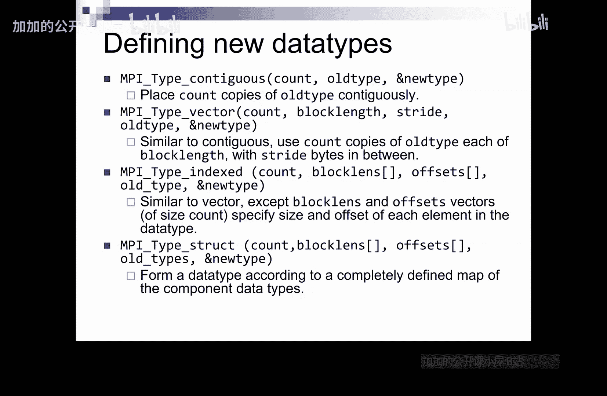

Okay， so how do you use this， So here what you need to say is that when you use this。

 so let me go to red again。Yeah， so。🤧So when you use this MPI type vector。

 you're going to say that I'm going to make a vector of size so here I want a column of size4 right so my size here is going to be4 right so here size is defined right what are these other arguments。

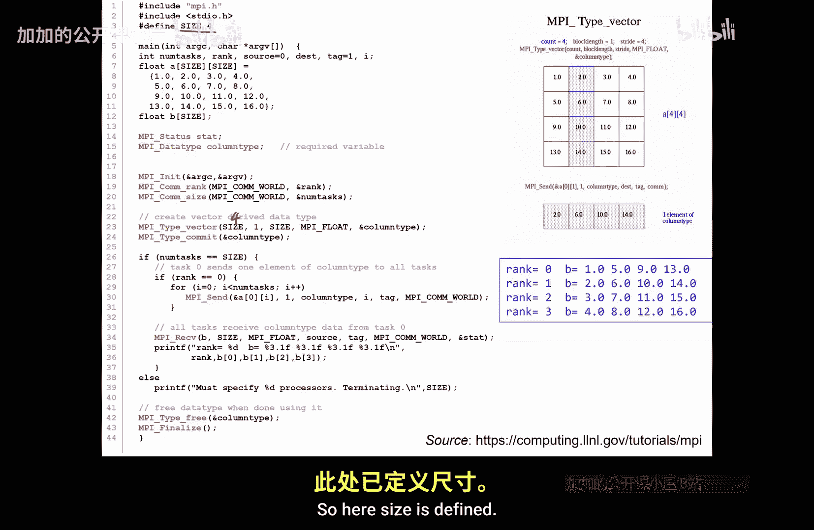

Oh， okay， right。 So the next argument is this block length argument。 Okay。

 and so what this is saying is。

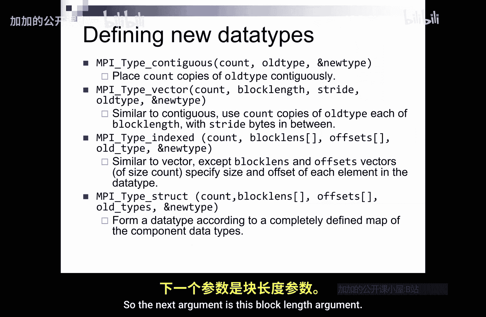

Now from from this matrix right I want to take so here my block is one。

 so this means that I want to take one value at a time from the matrix okay if my block length for two。

 I would be taking two consecutive values from the matrix but here my block length is one and then the next argument over here is stride okay so stride means that so here my stride is4 so this means that I want to take every fourth value okay so I'm taking this value and and then I skip three spaces and I take the next fourth value okay know remember that this matrix is stored in row major format okay inside in memory so if I take this value the two and then I skip three values my stride is4 so I'm gonna to skip three values and take the next fourth value。

Okay， so since every row here has four values。Then that's going to take me to the。To the same column。

 but in the next row， the six。And then again， I'm going to skip three values and take the next fourth value。

 so again this is going to be in the same column， but the next row。

So this four tells me that every time I take a value， the next value I want is going to be。

 I need to skip ahead by four spaces。有。Okay， and the values that I have all of these values are floats。

Okay。😊，Because all of these values in the matrix here are floats。Okay， and then lastly。

 I'm going to give a name to this data type that I defined right。

 so I'm trying to take a column of values so therefore I'm going to name this column type。

Okay so this MPI type vector here is going to define one of these column types and it says that again we have four different values in this column type each how do we get these values well what we do is we start somewhere and then you're going to take one value from the starting location and then you skip ahead for four floats and then you take the next value and then again you skip ahead four floats and you just keep doing that and you do that a total of four times because we have a size of four。

Okay， so this defines the MPI column type and then we're going to commit this type okay。

 so this is going to tell MPI that I want to have this type。Okay， now。

Now let's see how we actually use this column type。

So we're going to have a program where initially the rank zero process。

 he's going to have this entire matrix， okay？And we want the rank zero process to send the different columns to the other processes so he's going to send he's going to send the first column okay to the first process。

 he's going to send the second column to the second process right third to the third process and so on so this is what we want to achieve with this with this program Okay so how do we do that。

 well， since we define this column type right the only thing we need to specify is this column type needs to start at a location Okay。

 so if we start at this value， then we're going to take this column Okay， if we start this value。

 then we're going to take this column right So what we do over here is that。

Since you want to send the Ithe column to the Ithe process right。

 then the starting point for the Ith process is going to be the in the first row we're going to take the I value okay so this is a0 I right and then from there we're going to build a column type okay so for example for the first process right we're going to start with a00 and build a column type and that's the first column right for the second process you're going to start with a two and build a column and so on。

Okay， and then after that， you're going to use MPI send to send this entire column of four values。

 to the other processes。Okay， and then if if my rank is not zero right。

 then I'm going to be receiving values from the from the rank zero process Okay。

 so and when I receive something。I'm going to say that I'm going to receive four floats， okay。

 because each column has four floats。And then after that， I'm just going to print out my rank。

 each process print out its rank and the values it receives。

Okay so now if you run this program what's going to happen is the first process is going to receive the first column of values right so 1。

5，9 and 13 and it's going to print those out right the second process is going to receive the second column right 26。

10 and 14， print that out， and so on。Okay， so again。

 the vector data type lets you sort of build these。

Either columns or other collections of these strideed data in a very simple way。

 so here the stride is four right so four and then four and then four。

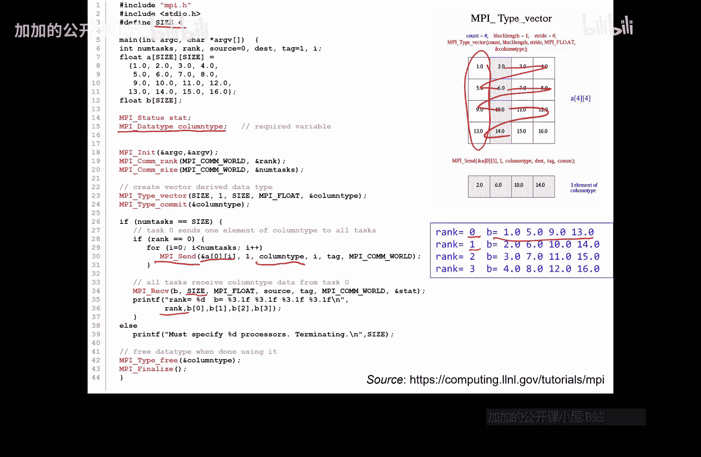

Okay so that is the vector data type now let's talk about so let's see so we also have this index data type。

 this is actually quite similar to vector except for here for the vector。

 the stride is the same for every value in the vector whereas for the indexed。

 you could have different strides for different different values and those different strides are given by this offset。

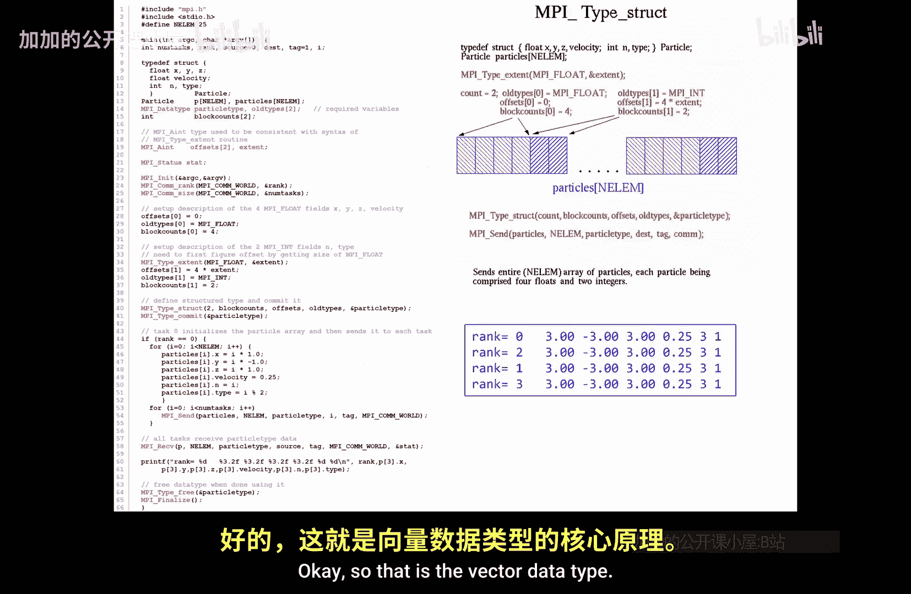

Okay so I'm not going to talk too much about that because it's similar to the vector type。

 I'm going to show you how to use the final data type which is struck okay so Str lets you build a general structure okay so you know that we have thesestructs in C。

 which is just base a general data type。

And so for MPI， if you want tostruct， then you're going to。Create them using this typestruct， okay？

So for the example here。Thestruct that we're going to have is going to have six values in it okay so for the first four values。

 therere going to be floats and then we're going to have two more ins okay so four floats and two ends。

So we wanted to find such a data type， and we're going to call this data type a particle because this is supposed to capture some information about a particle。

Okay。So in order to define this right， what we have to tell MPI is we have to tell it the type of each of these locations in the struct okay now so the first part of the struct is going to be four floats okay so we're going to say that the first part of the struct is going to be floats the offset which is like the starting location for the float is going to be zero and we're going to have four of them。

Okay。😊，So next we want to have two ins right， so then what we tell MPI is that the next set of items are going to be ins。

Okay， so the first set of items are going to be floats and the next set of items are going to be ins。

What is the starting point for these ins， well it's going to be four times the size of a float because we have four floats initially so therefore it's going to be four times the extent and extent is going to be the size of a float so here we call extent to get the size of a float。

Okay， and then how many ints are we going to have， what we're going to have to， okay。

 so we're going to specify the two over here。Okay， so in in our code， this is what we write。 Okay。

 so the offset for the floats are going they're going to start at 0， right， We have these floats。

 We have four of them， right， and then。And then next we're going to tell MPI about the ins so then we're going to say that the ints are going to start out at four times the size of the float。

 there are going to be MPI ins and we have two of them。Okay， so now we've built this matrix or sorry。

 these are three vectors， the offsets， the old types and the block counts。

🤧Now we can call MPI typestruct with these counts， the offsets and the types， right。

 and that is going to create。A new type， which we're going to call particle type。Okay。

 and after creating that， we're going to commit it。Okay。

 now the final thing is to use this type and the way we're going to use it is we're going to create a bunch of particles。

And then for each particle， we're going to initialize these floating point values and the integer values。

Okay， so the way we initialize it is that for the we're going to create N El is going to be 25 over here。

 Okay，25。 So we're going to create 25 particles。 And for the I particle。

 the X coordinate is going to be the。Is going to be i times1 right Y is going to be i times negative 1 and so on。

 Okay so we're we're going initialize 25 of these guys right and then we're going to send these particles okay。

 these 25 particles right we're going to send them to oh I guess we're going to send them to all of the other processes Okay Yeah so every process is going to be receiving 25 of these particles Okay。

 so every other process receives these 25 particles and the final thing is we're going to have all of the processes print out the information for the third particle that they receive Okay so。

Yeah， so for the。So for the third particle they're going to receive all of these values are going to be i equals 3 so it's going to be3 and then negative 3 and then 3 and then 0。

25 and then this is going to be a 3 over here and then3 modulo2 is going to be a 1 so every process is going to print out this array of values。

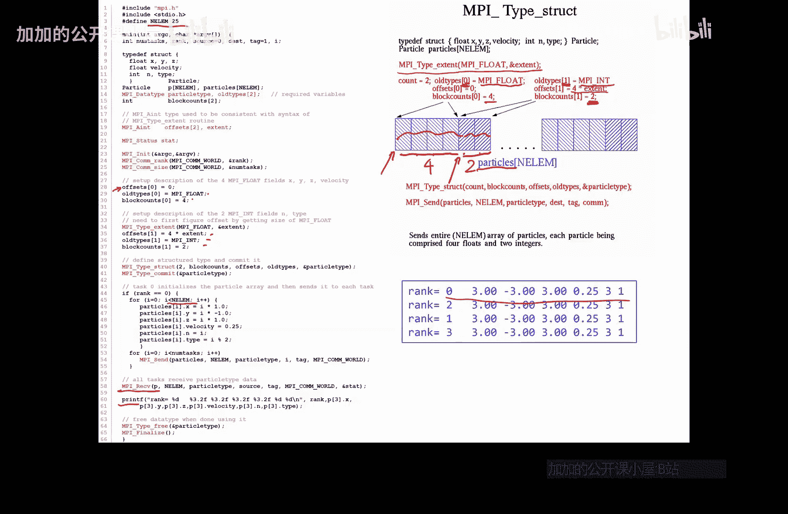

🤧Okay， all right so all right so next I want to move on to talking about communicators okay so for communicators so you know we start out when you start your MPI program you start out with this default communicator the MPI Com world okay but you can build your own communicators and so here I'm going show you an example of doing that where we're going to take the MPIcom world and we're actually going to break it into two parts okay so suppose that our MPIcom world actually has eight processes。

So now we're going to create two communicators each with four processes。

 okay so we're going to take the first four processes from MPI Comor， put them into one communicator。

 and then the other four， we're going to put them into a different communicator。Okay。

 so the way we do that is that。We're going to have this communicator on where is it defined。

Let's see okay。So the new group， this is what I'm looking for。Let's see okay right here we go Okay。

 so for the new group okay， so this is a group of processes okay。

 so we're going to create two groups right so we're going to have two new groups Okay。

 the first new group is going to have processes with ranks01，2。

3 in the original communicator and the other group is going to have processes with ranks 4，5，6。

7 from the original communicator。Okay， so what we're going to say is that。

Each process zero up to seven is going to compare its rank with with this is going to be four over here okay we have eight processes divided by two is four and if it's less than four。

 then it's going to use the first set of ranks and it's going to get included into the new group and otherwise it's going to use a second set of ranks and get included into the new group so this is going to split our processes into two groups based on the ranks。

And then we're going to create a new communicator this new communicator based on these groups of processes。

Okay。And then each process is going to to do an all reduce within its group。 Okay。

 and the all reduce value is going to be based on。Either ranks one or ranks two。

Okay so if you're in the first group， then when you do the over and so here we're doing a sum overd。

 then we're going to be adding up 012，3 okay so that's going to be 6 right and if you're in the second group then when you do the overd you're going to be adding up these values and so this is going be it's going to be 22 over here okay the sum of these four values。

Okay， and then finally， you're going to print out your old rank and your new rank。

 okay and you're also going to print out this all reduce value that you have right you're going to print out your receive buffer value。

Okay， so what's going to happen is if you run this， you could get an output maybe like this。 Okay。

 so here you see that。You know， the process is  zero，1， two， three oops。

If the processes with old ranks 0123， right， their new ranks are again0123 right and the value that they receive is the sum of 01。

2，3， so that's going to be 6。Okay， and these other processes the processes four， five，6， and seven。

 right， so since they go into a new communicator with only four processes。

 their new ranks are going to be1，01，2 and3。Okay， but the value that they receive was the sum of their old ranks。

 which is 22， so they're going to receive these 22 values。Okay。

 so this shows you how to create new communicators。Based on processes from previous communicators。

Okay so I'm going to do one more example with something called virtual topologies okay so what this does is so when you have a communicator of processes。

 you just think of these processes as a set， you don't think of them as being organized in any way。

 there's no sort of topology associated with these processes but sometimes you might want to take these processes and you might want to say that while these processes should actually be organized in a mesh topology for example。

 okay or maybe some other type of topology， maybe a hypercutbe topology okay。And。嗯。

Yeah so the reason you want to do this is that maybe so for example this set of processes in the communicator。

 okay maybe they communicate based on a mesh pattern okay so you have a bunch of processes right and maybe their communication pattern is not just arbitrary right like for example this process would never directly talk with this process right it would only talk with its neighbors in that case you want to in that case you can actually tell MPI about the communication topology of your processes。

And if you tell MPI about this topology， then what MPI can can do is to try to map this process topology onto the actual physical processor topology。

 Okay， so remember that a few lectures ago， we talked about how to map the process topology onto processor topologies。

 Okay， so。Initially， if you just have a communicator。

 then MPI doesn't know anything about your process topology so these virtual topologies are a way to inform MPI about your process topology and once you inform MPI。

 then it can try its best to map these in a good way onto the actual physical processor or topology。

Okay， all right。Yeah， okay， and the way that we can do this is that there are two main types of topologies in MPI。

 either these meshes or。So there's something very similar to mesh， which is the Taurus。

 so Taurus just means that you connect the first and last processes on each row。哦。Okay， yeah。

 so those are the tos。Or you could have a graph topology Okay so those are the two main types and to create those types of topologies in MPI you have these so to create these horses。

 you use the MPI Cartesian create okay or card create Okay and then for the graph it's more complicated。

 but you have this。You have this graph creation thingme okay。

 so I'm not going to go through the graph creation process。

 it's kind of complicated and if you're interested you can look that up in the MPI documentation。

So all I'm going to do is just show you an example of creating a mesh topology。

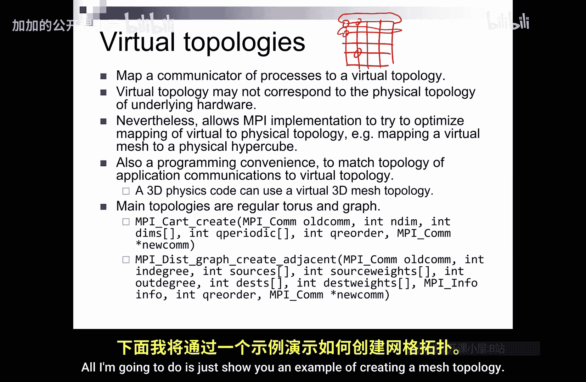

Okay， so so the way this works is that suppose you have 16 processes。

 okay now you want to tell MPI that these processes are organized in a4 by4 mesh。Okay。

 and so the way you can do that is。So we have 16 processes over here right so we're going to say that these are organized in a4 by4 mesh right and here you can use this MPI Cartesian create function right to say that have a twodimensal topology because it's a two dimensional mesh the dimensions of the mesh are4 by4 are over here we have four by4 right The period basically means that are these topologies are they taruss or are they just lines so if it's a taurus then the first node is connected to the last node so here we do not have taruss in both the x and y directions so we set these periods to be zero here to say that this is not periodic right。

Right， and then yeah， and then you call this MPI Car create and this is going to create this is going to place your 16 processes into a 4 by four two dimensional mesh。

Okay， now we want to check that this mesh works correctly and so what we're going to do here is that we're actually going to call these we're first of all。

 going to get our coordinate oops our coordinate within this mesh， okay。

 so the coordinate is just like an IJ coordinate right like which row and which column you're in okay。

 so it's two values。Okay， and then after that， we're going to call we want to find out for each process。

 what is the process above and below that process， Okay， so for example， for process 5。

 the process above it， right， the next process is going to be。🤧It's going to be nine。

 right the down process is9 and the up process is one。

And you also want to find out which processes are to the left and the right。

 and this so the left process is four and the right one is6。So to do this。

 you can use this MPI Cartesian shift operation Okay so this Cartesian shift so first of all it needs a communicator。

 so we have our Cartesian communicator over here right so this first argument over sorry the second argument is the is the dimension that we're talking about Okay so zero means the x dimension one means the y dimension。

Or sorry，0 means the the y dimension， apparently。 Okay， so0 means the y dimension。

 and this one here is the x dimension。 right， so this one is saying that， you know。

 I want to go one I want to take one hop either from either towards somebody or from somebody Okay。

 so if I take one hop towards somebody right in the y direction， then for example， if I'm5 over here。

 if I take one hop towards somebody， I'm gonna to get to9。 Okay， so the guy let's see。 So。

This is correct， say。No I guess if I take one hop towards somebody I'm going to get to one okay so I went in the wrong direction okay so this is my up neighbor okay and then my down neighbor。

 how do I find who's below me well here this final argument over here is would who can take one hop and get to me okay so I'm number I'm node five over here so who can take one hop and end up at five well that would be nine right so9 can take one hop and end up at five okay so that's my down neighbor。

Okay， and to get the left and the right neighbors， again， I have this one hop thing over here。

 And so the first one is saying that。嗯。I think I got these reversed。

 I guess it doesn't matter that much， I mean you can look up the details， but I think the first one。

 you know， the left one is on hoops。

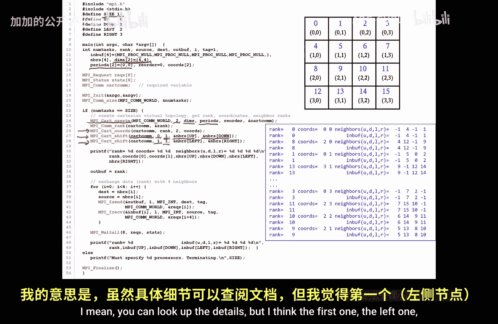

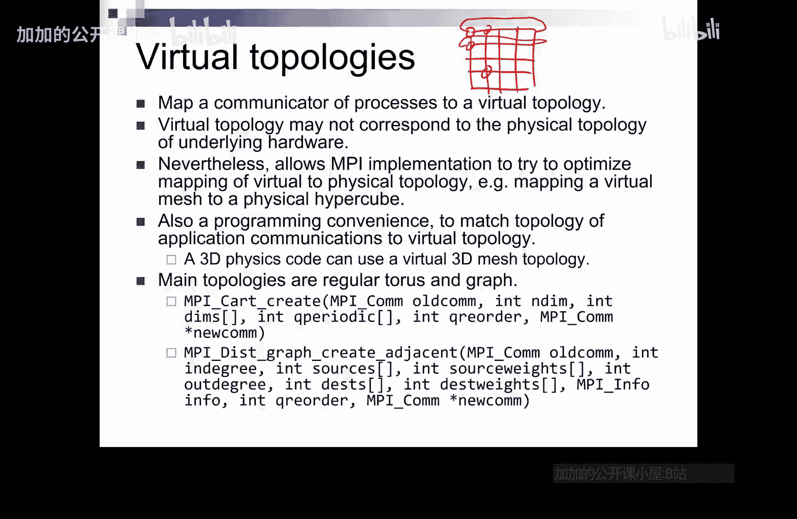

Is going to be who can take one hop and get to five okay so that would be four okay so four is my left neighbor right and then my right neighbor is who would I get to if I took one hop right so I'm five if I take one hop I get to six。

Okay so that and every process does all of this， so then every process can find out it's up down left and right neighbors。

And the final thing is for the processes to print this out。Yeah， okay so if you run this program。

 then basically what's going to happen is all the processes are going to print out all their neighbors and their coordinates okay so for example if your process zero right your coordinate is going to be0 zero over here and your neighbors so are going to be well you have a down neighbor for right。

 and then you have a right neighbor one right but you don't have a left neighbor and you don't have an up neighbor okay so in this program when you don't have one of these you know the values here are going to be negative one。

Okay， now if you're some other process， let's say if you process whats 10， okay。

 so if you process 10 over here right， so then your coordinates are going to be 2。

2 right and then your up up down left， right neighbors are going to be six up 14 down and then nine and then 11。

O。😊，So this is how you use these topology creation operators。

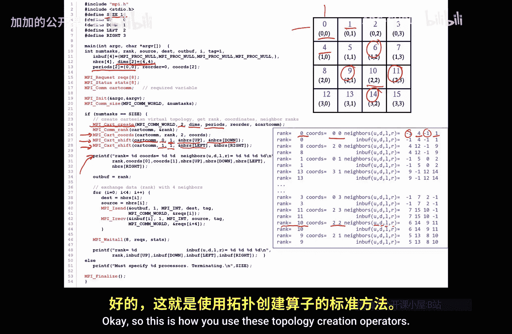

Okay right， so we're almost done here so the final thing I want to say about MPI is that so all of the functions I've described exist in MPI 1 and MPI1 is actually very powerful and you can use that to write many programs however。

 there are newer versions of MPI like there's MP2 and3 and so not going to talk too much about them。

 but basically what MPI2 did was that it allows for dynamic process creation so remember that initially I set that MPI as soon as you start the program。

 you have to start all of your processes MPI actually allows you to start new processes during the execution of your program。

Okay it also MPI lets you do collectives across different communicators in MPI1。

 I think you can only do collectives within each communicator so MPI2 also improved input output okay so if you need to read from disk。

 you can now do that in parallel okay and MPI to add of this thing called one sided communication Okay so so MPI1 is basically two sided communication because if I want to get a value from somebody right or sorry let's say I want to send a value to somebody Okay then I'm going to do a send and the other process needs to do a receive Okay so we need to coordinate with each other it's a twosided process。

Okay， but for MPI2， you can actually do one sided communication。 Okay。

 meaning that I could just try to send you a value and you don't need to be expecting that value。

 Okay， you can just receive the value， even though。

You don't need to know a priori that I'm planning to send you this value。O。

And then MPI3 sort of improved on MPI2， so now it made the collective operations non blocklocking。

 it also allows multi threadreading and then it improved some of the one sided communications。Okay。

 so this is all I have to say about MPI and the next time we're going to look at how to actually implement these collective operations so I mentioned that one simple way to implement them implement them would just be as a bunch of individual point to point operations but this is not an efficient way to implement these things。

 so next time we're going to see how to implement these collectives in a more parallel and in a more efficient manner。

Okay， so see you guys next time。

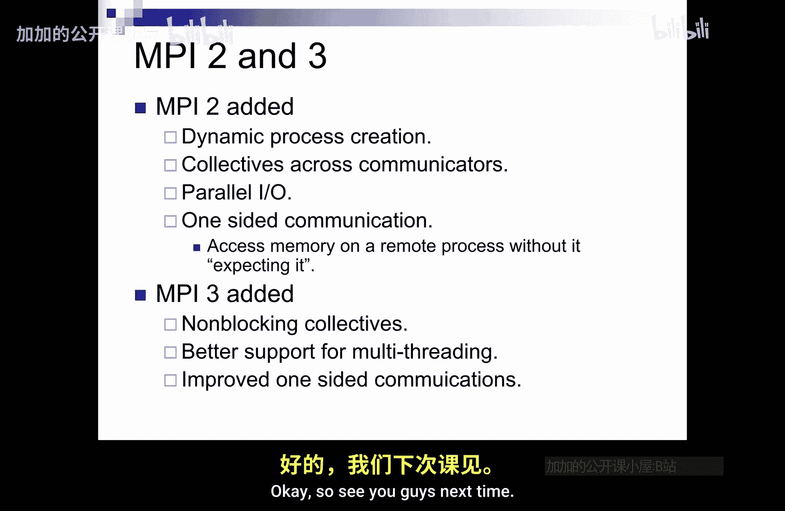