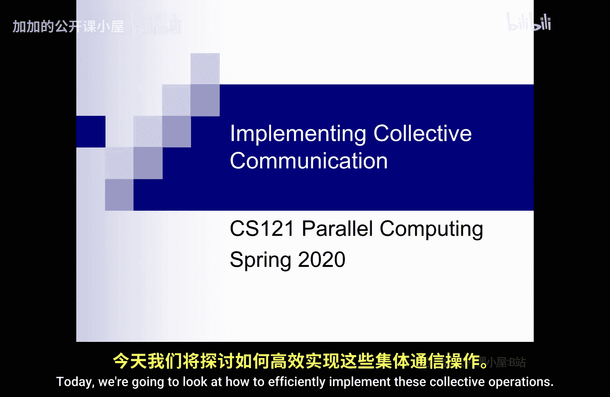
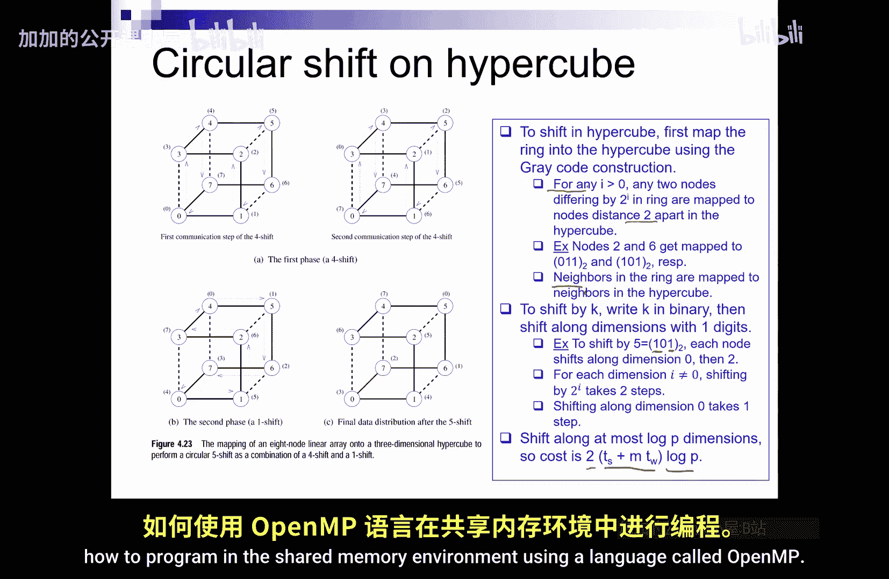

# 上海科技大学【中英⚡并行计算｜CS121 2020 Parallel computing】 p07 P7 Collectives implementation -BV1VqypBaEaP_p7-

Hello， welcome to lecture 7 of Para computinguting。So in the last lecture。

 we looked at how to use the collective communication operations in MPI to solve certain problems。

Okay， so today we're going to look at how to efficiently implement these collective operations。

So now we know these operations are used in many parallel algorithms because many of these algorithms require communication between groups of processors。

Now there are different ways to implement these collective operations， for example。

 you can implement them as simply by doing many point to point communications， okay。

But it turns out that there are often more efficient methods to implement these operations by using parallelism。

 okay， so we have parallel communication algorithms which work faster。Now， first of all。

 before we talk about these algorithms， we're going to define a cost model for communication。

 and this is going to go back to the model that we talked about a few lectures ago。

Where we talked about communication in networks and so there we said that in order to send a message of size M okay there are basically two parts to this cost so first you have to do some startup operations before you can send a message and this has time TS okay and next for each word that you send right let's say that you pay a cost of TW time okay so it takes you TW amount of time to send a word and if we want to send M words then the time is just n times this。

Okay， now notice that in this cost， we're ignoring the distance that the message travels and the reason is that even though for each hop the message goes through。

 we do have to pay a latency cost of， let's say TH。

This value TH is usually small compared to the TS and the n times TW terms。And so therefore。

 we're going to ignore the TH terms。Okay also if we have contention when we're doing the sending okay so if the contention is C。

 then that means that there are C processes trying to send through the same link okay so if each of these processes tries to send M words right then the time for all of these sends is now going to be basically this expression over here。

Okay， so we'll look at how to implement these collectives but this depends on the type of communication architecture that you have okay so for example。

 the amount of time to do these operations in a ring network versus a mesh versus a hypercube may be different okay so we're going to look at these operations and we're going to look at their cost in various communication architectures。

And the operations we're going to look at include these ones， okay。

 the broadcast and reduction operations， we're also going to look at all to all broadcast and reduction okay we have all reduce。

 prefix some， scatter and gather and we also have all to all scatter and reduce and then we're going to look at a circular shift。

Okay， so we're going to start out with the broadcast algorithm on a ring so here what we're trying to do is suppose one process in the ring okay so suppose you have a ring of P processes and one process starts out with the value and it just wants to give this value to all of the other processes。

Okay， so of course one way to do this is just this process。

 let's say process zero can just send individual messages to all of the other processes。

 so if there are P other processes， then this would basically take p minus1 amount of time。

So this is quite slow and the reason is that this kind of broadcast is basically doing a sequential type algorithm。

 because process zero is doing all of the work。Okay so instead we want to have a parallel algorithm for doing the broadcast and the way we can parallelize this is that we're going to have process zero。

 send the message to other processes， and once these other processes get the message。

 then they can help process zero do the broadcast。Okay so the way this is going to work is if we're on a ring of size p right。

 then we're first of all going to send the message a distance of p over 2 okay so halfway around the ring okay so this means that so let's say that initially process zero has the value then in the first time step he's going to send the process to sorry the value to process4。

Okay， so the way we indicate that is with this dotted line over here。

 and the one indicates that this is the first step of the algorithm。Okay， so after the first step。

 right process4 also has the value。Okay， so now we have somebody else to help process zero do the broadcast。

Okay， so next， we're going to send the message again。

 but now there are two processes that can send the message， right zero and4。

And the distance that we send is going to be half of the previous distance。

 so the first time we sent a distance of p over 2， and so this time we're going to send a distance of P over 4。

So that means that zero is going to send to two so now two is going to have the message and4 is going to send to6。

 and so6 has the message。Okay， so you see that there are these two dotted lines marked by the two。

 indicating that this is our second step。Okay， so now after the second step。

 you have four processes that have the message。Okay， so then。

So then we're going to do one more step where all of these four processes are going to help send the message and the distance that they send the message is again going to be half of the previous distance right so previously you sent a distance of two and now we just send a distance of one。

Okay， so by doing this， you see that all of the processes one， three， five。

 and seven will get the message。Okay， so now we've successfully broadcast the message。

Okay so that is how we do the broadcast so next we want to do a reduction okay so reduction what we're trying to do here is that so we have a ring and suppose every process in the ring has initially some value okay and now we want to take all of these values and reduce them onto let's say process zero okay so reduce means to just add up all of the values so we're going to do a sum reduction here。

嗯。Okay， now if you think about it， the broadcasts and the reduction are kind of opposites of each other right so broadcast we're trying to send the value to everybody else and reduction we're trying to collect values from everybody else。

Okay， so because these two operations are opposites of each other。

 then the way we're going to do the reduction is in fact we're just going to reverse all of the communication that happens in the broadcast。

Okay so now remember the final step of so the final step of the broadcast is going to become the first step of the reduction and remember in the final step of the broadcast right you had four processes that sent messages a distance of one so we're going to take these four messages that are marked by the three and we're just going to reverse them and make these into the first step of our reduction algorithm。

Okay， so when you do this， so for example， seven is going to send a message to six and when six gets that message。

It's just going to add its own value to sevenths value okay so the way I'm going to indicate that is so six is going to basically add its value to seventh value okay and four is going to get a value from five so it's going to add those together right two is going to get a value from three which it adds and then zero gets a value from one。

Okay， so that's step number one。And now for the next step。

 now we're going to send the message a distance of two， okay。

 so six is going to send to4 and three is going to send to I'm sorry， two is going to send to zero。

And when this happens，4 is going to add the value it gets， which is6 plus 7。

 because6 now has a sum of 6 and 7， so it's going to send that sum to4 and4 is going to add it to its own sum。

Okay and likewise， two is going to send to0， so then zero is going to end up with the sum of the values from0 to3。

So that's going to be the second step and the final step is that we're going to send the value a distance of four。

Right， so then。Yeah， so then four is going to send its value to0 and 4 is going to send the sum of four。

 five， six， and7 okay， and when zero gets that， it's going to add in all of those values。😊。

And then zero is going to end up with a sum of all eight values。Okay。

 so though that is the broadcast and reduction algorithms。Okay。

 so next we're going to look at the cost， the time complexity for running this algorithm。So the cost。

 so if you have P processors， then the number of steps that you have to take is that when you think about the broadcast algorithm。

 each time you double the number of processes that have the value。Okay so therefore。

 after log P steps， all P processors have the value， and then we can finish。Okay。

 so these algorithms run for log P number of steps。And in each step。

 you could have several processes send messages， but they're all sending in parallel。

 and all of the messages are size M because for example， in the broadcast。

 the only message you send is a process zero's value， which has size M， let's assume。

And likewise in the reduction algorithm， the only thing you're sending are the sums of the values that you received right so that's just so you can represent that sum by a single value of size M。

Okay so in total we're taking log P steps each time you're sending a message of size M。

 therefore and the time to send that message is just ts plus m times tw and you multiply that by the number of steps and this is your total time complexity。

Okay， so that is broadcast on a ring， so next let's move to broadcast on a mesh on a two dimensional mesh。

Okay， so the way we're going to do this is just like a mesh generalizes a ring right。

 then we're basically so a mesh is just like a two dimensional ring。

 okay so therefore we're going to apply the ring algorithm on the mesh。

 but we're going to apply it in both dimensions。Okay， so concretely。

 what I mean by that is if you want to broadcast， okay， then first of all。

 we're going to broadcast on the row。Okay so so initially zero has the value and it's first of all going broadcast on its row okay and to do that right it needs to send the message halfway across the row in the first step okay so in step10 is going to send to eight so now both0 and8 half the value and then on the second step both0 and the8 are going to send simultaneously a distance of one so then after that we draw these a bit nicer so I can't really put my hand flatly on my computer so anyways so you have a0 and you have4 okay and then 12 okay so all of these。

So all of these。Half the value now okay okay， so now this entire first row has the value okay。

 and now we can use now we're going to broadcast along the columns okay。

 since everybody every node in the first row has the value。

 then we can have all of these processes and the first row broadcast on their columns in parallel。

Okay， and the way the broadcast works is。Since we have four nodes on each column。

 then they're first going to send the。The value a distance of two right so in the third time step we're going to all four nodes are going to send the values a distance of two right so then2。

6， 10 and then 14 are going to have these values and then finally on the fourth step right everyone's going to send the value a distance of one。

Okay， and then after that， you see that all of the nodes have the value。Okay。

 so the mesh algorithm is basically you do several copies of the broadcast algorithm on the brain。

All right， so so then what is the cost of doing this well previously we saw that the cost for broadcasting on the ring is this involves log P where P is the number of processes that are taking part in this broadcast now for the mesh algorithm the first thing we needed to do was to broadcast along the first row so the number of processes we have is going to be so this is going to be if we have P processes in total。

 then the mesh has size root P by root P。So therefore to broadcast along the first row， right。

 this is going to take log of root P number of steps and this is equal to log p divided by two number of steps and then after that we were going to broadcast on the columns and this also takes log of root P steps so again that's going to be log p divided by2。

Okay， and each of these broadcasts， sorry， each time you send a message。

 it takes you times TS plus n times Tw。and you do this for log p divided by two steps along the rows and then log p divided by 2 along the columns。

 right so altogether you add these and then the total time you get is going to be this expression over here。

Okay， and and this turns out to be actually the same amount of time as broadcasting on a ring， right。

 It's T S plus m times CW times log P。Yeah。Okay， so next。

 we're going to look at broadcast on a hypercue。Okay， so on hyperCe。

 we're going to take the same approach basically， meaning that we try to parallelize this broadcast operation by recruiting other processes to help node zero do the broadcast。

Okay， so the way we're going to recruit processes is that a hypercube。

 you can very naturally think of this， you can decompose the hypercube in a hierarchical way right because remember the way that we built the hypercube was that you kept on taking lower dimensional hypercus right you took a pair of lower dimensional hypercubes and you connected them okay so now if you want to split the hypercube you can just disconnect these two lower dimensional hypercus。

Okay， so what we're going to do is initially node zero has the value right。

 and now we want to basically decompose this problem by saying that we want zero to broadcast to all of the nodes。

 okay but that's equivalent to zero broadcasting on this forward phase and then zero also broadcasting on the back phase。

Okay， so now how do we get zero to broadcast onto the back face while we have zero。

 send the value to its neighbor in the back phase， which is four。Okay， so in the first time step。

 right0 is going to send to four。And now once this happens， right。

 then basically you've broken this problem into two parts， one on the front face。

 and then one on the back face。Okay， all right。 so now we continue with this and。

And so on the front face， we again want to break the problem into two halves。

 so you want to break these four nodes into two halves consisting of these two nodes and then these two nodes。

And likewise， on the back phase， you want to do the same thing。

 you want to break these four nodes into these two lower dimensional hypercubes。Okay。

 so then how do you do that， well all you need to do is have zero， send its value to2。Okay。

And four is going to send the value to6。Okay， so then after this happens。

 then zero doesn't need to worry about broadcasting two nodes on the top half anymore。

 right it can just focus on broadcasting to nodes in the bottom half and likewise four can focus on the bottom half and six is going to take care of the top half。

Okay， and so in the final step， you have all these processes broadcast to the other half of their little of their smaller hypercube。

 Okay， so two broadcast two cents to three and then。0 to one， four to five， and six to seven。Okay。

 and then after this happens。All of the processes half the value。Okay。

 so now let's look at the cost for doing this。 So again there are going to be log piece steps right because。

If you have P processes， then the hypercube basically has log P dimensions right and you notice that we had to do one broadcast for every dimension right so yeah。

 so therefore the total number of steps is log P for each step you had to send a message of size M so that takes you this TS plus MTtW time and so again the broadcast time is going to be this term okay it's the same as for broadcasting on the mesh and on the ring。

Okay， so next， we're going to look at the problem of all to all broadcast on the rain。

OkaySo all to all broadcast， what I mean by this is that every process wants to do a broadcast okay so zero。

 for example， process zero has a value and it wants to send this value to all the other processes likewise process one has a value and it wants to send that to all the other processes so every process starts with a value which it's a single value and it wants to send that single value to all of the other processes。

Okay， so the way that we can do this is that。Now the way that zero can broadcast is you can imagine that zero can take its message and just send it all the way around the ring okay just sort of pass the message all the way around the ring。

 just node by node it can pass its message around the ring so that would take p minus1 steps because there are P nodes in the ring and likewise node one if it wants to do a broadcast right it can also take its message and also pass it all the way around the ring。

Okay， and node two can pass its message all the way around the ring and so on。Okay。

 so the way this algorithm is going to work is that we're going to have all of the processes do this sort of pastor message around the ring。

And it turns out that all of them can do this passing process simultaneously。Okay and in parallel。

 okay， and the reason is that for example， when zero wants to pass its message around the ring。

 right， it's first going to send to one。Sorry， it's first going to send to one， right？And likewise。

 when one wants to pass its message around the ring。

 it's going to first send to two okay and then two' is going to send to three and so on okay so you see that the first step of all of these broadcasts they're going to use different links okay zero is going to use the link between zero and1 and one is going to use the link between one and2 and so on。

Okay， so all of these message sending these messages， all them。

 none of them conflict with each other。Okay， now on the next step。

 zero's message is then going to go from one to two right and one message is going to go from two to three and two's message is going to go from three to 4。

Okay， so then again， these messages are not going to conflict with each other because they're being sent on different edges。

Okay， and so so therefore you can see that what we'll do is we'll just have all of the processes send their messages in P minus1 steps around the ring and none of these steps conflict with each other because at every time step we're going to be using。

Completely different edges。Okay and so this is illustrated in this picture over here where let's see yeah。

 so these values these are like the ones over here are indicating that this is step one of the process okay and then the values and the parentheses are indicating which value is being sent okay so for example this zero means that in step 1。

 process zero is sending its value to process1 okay and also in process step 1。

 process1 is sending its value to process2， which is sending its value to 3 and so on。Okay。

 and now also these numbers in the parentheses at the node， okay。

 so these are indicating which values a node has already received。

So initially every node just has its own value， so initially it only has its own value。

But after you take one step， right， then for example， one has received zero's value。

 two has received one's value， threes received two's value and so on。Okay。

 and then on the second step， what value are we passing well on the first step。

 so for example zero's value went to1， so on the second step， zero's value is going from one to2。

And one's value is going from two to three and so on。Okay， so we just do this。

 we keep doing this for P minus1 steps。And eventually。

 all of the processes are going to end up with all the values。

Okay and in each time step the amount of time or sorry in each communication step。

 the amount of time we take is this TS plus MTW term and we're going to take p minus1 steps so that is the total amount of time okay it's basically linear in the number of processes。

Okay， so next we're going to look at all to all broadcasts on a Tourus， okay。

 so Tourus is just it's a 2D mesh except for the first and the last processes in each row column are connected。

Okay， so。Yeah， so let's see。Okay so to do this broadcast right what we're going to do is we're first going to broadcast all the notes are going to broadcast along are going to do all to all broadcast okay on the rows so for example。

 the first row of processes which are012， they're going to do all to all broadcast if they do all to all broadcast then after this right they're all of these processes we'll get all of the values from the first row so for example zero is going to have value 012 one is also going to have value 02 and so on。

Okay and also we're going to have the processes in the second row also do all to all broadcast。

 so they're all going to end up with values 3，4，5 okay and then the processes on the third row。

 they all do the all to all broadcast， so they all get values 6，7，8。Okay。

 so now we've successfully broadcast along the rows。

 and then the next thing to do is to broadcast along the columns。Okay。

 so now if you broadcast if you do all to all broadcast along the columns， right。

 then that means that for example， the values over here on the first column。

 all of these are going to end up at zero right。Yeah。

 so basically if you do all to all broadcasts on the first column， right。

 then all of the processes will have all nine values。Okay， and likewise。

 all the processes on the second column will have all nine values and same for the third column。

Okay so that's the algorithm is to basically to do two phases of all to all broadcast parallel and each phase does multiple all to alls in parallel。

Okay， so now the cost okay， so the cost is well the first stage right so if you have a if you have P processes in this tous。

 then again it's going to be a root P by root P tous right So we saw that if you want to do all to all broadcast among。

 let's say K processes， it takes you time proportional to K Okay so here we only want to do broadcast along a row of root P processes。

 So therefore the cost is going to be this this expression times root P minus1。Okay。

 so that's the first stage to do all of these row to row broadcasts sorry the row wise all to all broadcasts。

Okay， and then next you need to do the column wise broadcast。However。

 when you do the columnwise broadcast right you are actually sending these messages of size root p minus1 okay so for example。

0 wants to broadcast not just one value but all three values to its column okay three is also broadcasting three values and six is broadcasting three values okay so in general we're actually sending root P values right because we're taking all of the values from the first from each row and they root p of values and then you do the broadcast。

Okay， so therefore， the messages actually have size M times root P。And to do the broadcast again。

 since you're broadcasting on the column and there are root P nodes on the column。

 then the number of steps this takes is going to be root P minus1 times the amount of time for each send which is this m times root p times tw。

Okay， so then now you multiply everything out and you simplify and you get that the the overall。

Broadcast time is something like M times Tw times P minus1。Okay， plus this other term over here。Okay。

 so now next， let's talk about all to all broadcast and also reduce on the hyperCbe。Okay。

 so on the hyper cubebe。What we're going to do is。Yeah so we're going to do so the hypercube of P processes has log P dimensions okay so we're going to solve the problem along each dimension one by one okay so it's basically going to take log P steps so now in each step right we're going to pick one of these dimensions that we haven't processed yet right and we're just going to exchange all of the data along that dimension。

Okay， so in fact， we're going to go in the dimension so well we know that all of these processes can be represented by binary numbers okay with log p digits okay so we're basically so the dimensions that we have we're going to go in the dimensions of the digits okay from the least significant digit to the most significant digit。

Okay so first of all we're going to go in the ones digit right so for example zero is going to broadcast one and two is going to broadcast sorry zero is going to exchange with one and two is going to exchange with three right so you see that all of these exchanges are between processes whose ID differs by one。

Okay， and then in the next step， we're gonna to go in the。

Dmenion corresponding to the second most significant digit right so then  zero and  two are going to do exchanges one and3。

4 and 6 and 5 and 7， so you notice that all of these IDs differ by two。Okay and in the third phase。

 we're going to go with the third digit， so all the exchanges are between processes whose IDs differ by four。

Okay， and then if we had more dimensions， the IDs would differ by 8， 16， and so on。

 so they keep doubling。Okay now when you do these exchanges。

 all you're going to do is each process is going to take all the data that it currently has。

 and send it to the other process to exchange it with the other process。So for example。

 initially each process only has its own value right so when they do these exchanges they're just going to collect both of these values so then zero is going to end up with values011 is also going to end up with01 so4 and5 to their exchange so they both get the values4。

5 and so on。Okay， and then next we wanted to do exchanges between like the zero two processes， one。

 three， four，6， and so on。So for example， when0 and2 do the exchange theyre they're going to collect all of their values okay so two is going to get these01 values right and then 0 is going to get the two three values from two okay and then afterwards both processes are going to have all four values。

Okay， and likewise。When three and four do their exchange。

 they're also going to have the first four values。Okay， six and seven are sorry， four， six。

 and then five， seven， they're all going to end up with the values 4567。Okay。

 and then on the final step， right we're going to do exchanges in the dimension corresponding to the highest significant digit。

 and then after you do that， you see that all of these processes are going to have all eight values。

Okay， so that's the algorithm， the number of steps you take is equal to the number of dimensions。

 which is log P。Okay and now in the I step right you see that the size of the messages that we're sending keeps increasing right in fact it doubles every time right so initially you had you're sending messages of size 1 right and the next you're going to send messages of size 2 and then four and then eight and so on okay so in the I step you send messages of size2 to the I。

Okay， so therefore the total number of。The total cost would be that so we have log P stages。

 but the stages have different costs okay， so the I stage has a cost of2 to the i minus1 times Tw times m plus TS。

Okay， so if you add this up， then this is a geometric series and the sum of this。

Its going to come out to this value over here。Okay， so that is the all to all broadcast on a hyperCe。

And then the all to all reduce， okay， so this is actually going to so all to all reduce means that every node starts with a value and at the end you want to have every node node the sum of all of the values。

Okay and to do this you can do this by just having all of the nodes broadcast all the values okay so if you do an all to all broadcast okay then you can get the answer for the all to all reduce by doing the all to all broadcast okay however。

 when you do the all to all broadcast when you get a value from another node right you can just add that value to your own value you don't need to keep your own value and the other nodes value separate right you can just add them together because in the end you just want to add together all the values。

Okay， so for example， here， when 0 and 1 do their message message exchange right in the auto all broadcast。

 they each had to keep two different values， right，0 and1。 Okay。

 But if we're trying to do the reduce， then you don't have to keep both values， you can just。

 you can just do 0 plus one oops。Okay， you can do these zero plus one。And the0 plus1 over here。

 and two， for example， would add its own value， two three is value， okay。

 and three would do the same thing。Okay， so now on the next step。

 when you do the exchange between 0 and 2， right， you don't need to send two values， okay。

 you don't need to send0 and one separately， you just send the sum of0 and 1。And likewise。

 two is just going to send the sum of2 and 3 to0。 Okay， so you're sending just a single value。

Okay so you're still going to go through log piece stages。

 but now you don't have this issue that the messages keep getting getting larger， okay。

 the message that you're sending is always just going to be one value。

 which is equal to the sum of all of these values that you've received so far。

Okay so therefore the cost is going to be， we have logP stages and in each stage you just send one value and so the amount of time that you take is going to be this。

 which is a lot less than the cost to do the all to all broadcast。

Okay so so next we're going to look at how to do prefix sum on the hypercube Okay so remember that the prefix sum operation was if you have a bunch of processes。

 let's say you know your have processes 1，2，3，4 right and so they're going to start with some values so suppose that process one starts so the values are down here it's got a value of let's say three initially this has a value of1。

 this has five and this has let's say3 right so then the prefix sum is the I process should get the sum of the first i values。

Okay， so then the prefix sum is going to be that the first process is just going to get the sum of the first value。

 which is three the second process is going to get the sum of the first two values， which is4。

Third process gets a sum of first three values， and that's going to be nine。

 and then the fourth process gets 12。Okay， so that's what we want to have happen。Okay。

 so now to do the prefix sum right， so this is illustrated in this figure over here and what we have is that each process is going to maintain two values and the values are shown both in the parentheses and then in the brackets。

Okay， so so the values in the bracket are actually the prefix sum that the partial prefix sum that this process has computed right so the process is supposed to end up with a prefix sum Okay so it's going to build up towards that。

 So it's going to have sort of a subset of the prefix sum as it executes the algorithm。Okay。

And then the value in the parentheses， this is supposed to be the sum of all of the values that the process has received so far。

Okay케이。Now I should point out that there are some mistakes in this figure okay there are a few mistakes so for example in let's see in figure B right this6 value over here okay the one in the parentheses so this should actually be be6 plus7 okay so this should actually be 6 plus7 here and another example is let's see so so in figure C right this4 five。

6 over here right so this should actually include the seven also。O。All right， so it's kind of bad。

 but let me write this four， five， six， oops， seven， okay？Right， and there are a few other mistakes。

 but basically the the figure is correct。 Okay， and so now let's see what these figures are showing。

 So the way this algorithm works is that。So this is going to be similar to the all to all broadcast algorithm in the sense that we're going to work in these different dimensions。

 okay we're going to go through all of the log P dimensions one by one and we're going to go through them in the order of least significant digit to the most significant digit for the IDs of the processes。

Okay， so the least significant digit would be this direction where all of the processes differ by one。

Okay， and then the second most significant digit would be where they were all of the processes that communicate where their IDs differ by two and then the final dimension。

 so their IDs are going to differ by four。Okay， so we're going to go through the dimensions in this order。

Okay， and for each dimension that that we process， what's going to happen is the processes in that dimension are going to exchange their values。

 however。呃。Sorry， actually the process is going to when you do an exchange between these two processes。

 they're both going to send this sum value that they have okay。

 so remember the sum values are the ones in the parentheses。Okay。

 so six and seven do an exchange right， so maybe let's go for for a different one over here。 Okay。

 so when four and five。嗯。So which one should I Okay so how about this one Okay so for example here when 0 and 2 do an exchange okay so then  two is going to send the sum of2 and3 the sum of two's value and three's value right and then0 is going to send the sum01 over here。

O。Yeah， so they don't send the values in the brackets so the bracket values are the prefixt sum values they don't send those okay instead they send the values in the parentheses which are the sum values。

 the sum of all the values that they've seen so far okay so you see that after this exchange for example。

 right then zero is going to end up with the sum is going to be now the sum of the first four values okay and then likewise for two he's going to get the sum of the first four values。

Okay， now what about these prefix sum values so the way the prefix sum values are going to be modified is that if a process gets so the process is a process is going to receive some sum values okay now if these sum values correspond to values from processes with lower IDs。

Okay， then this process is going to add those sum values into its own prefix sum。Okay。

 so as an example， when two gets a message from zero， okay。

 so the value it gets from zero is going to be the sum of processes with lower IDs than two。Okay。

 so then two is going to add these values into its own prefix sum。 Okay。

 so two is going to take its current prefix sum and then oops， and then add。Add0 and1 to this， Okay。

 and then it's going to end up with this prefix sum over here。OkayOn the other hand。

 when you're receiving this sum value and these sum values come from processes with larger ID than yourself okay。

 then you don't add those into your prefix sum right because if you have a certain ID then your prefix sum should only include values from lower ID processes。

So for example， when zero it's going to get this sum of two and3 from process2 but because two and3 have higher ID than0 then zero is not going to add two and3 into its prefix sum。

 so therefore it's going to keep its prefix sum at0。Okay。😊，Yeah， so。Okay。

 so then that's how this algorithm works and。Okay， so so the reason that this algorithm works correctly okay is because well basically if you look at this sum part over here okay so what's going to happen is after you run this process this algorithm for a certain number of steps right then then each of the processes would have computed part of its prefix sum okay so for example at the start of this step right then the processes in let's say the back phase okay so that's like4567 right they've already computed part of their prefix sum so for example four right it's computed just you know a single value from its prefix sum okay five has two of these values。

 six has three values and then seven has four of these values。

Now you notice that the only values missing from the prefix sums of these four processes from 456，7。

 the only values missing are the sums from 01，23。Okay， because if you add the values from 01。

23 to these prefix sums， right， then these become the correct values。Okay， so now in the third step。

 we actually do this exchange between the front phase。

 between the 0123 processes and the 4567 processes and the value that front face is sending is exactly the sum of 01。

2 and3。Okay， so in effect， all of these processes in the front face， half the sum of 0123。

 so all of them are going to send the sum of 0123 their partner in the back face and their partner is going to add in this value to their current prefix sum and they're going to end up with the correct prefix sum。

Okay yeah so that's why this is working correctly and in terms of the cost for doing this right so what we have is that each time use so we have a log p steps because there are log p dimensions and for each step are you're sending just a single value right because you're just sending these sum values over here okay so therefore to send that sum value it just takes you this TS plus n times Tw time and then you do this for log p steps。

Okay。So next we're going to look at the scatter and gather operations okay so for the scatter operation and we're going to do this on a hypercue okay so for the scatter operation what we want to do is now we're going to assume that process zero starts with some values but it has a different value for each process so it wants to send these different values to the different processes so in fact it starts with eight values and it wants to send value 1 to process  one value2 to process 2 and so on。

Okay， so the way we're going to do this is again， we're going to parallelize and we're going to have。

So in the first step， zero is going to split the problem in half， okay。

 so the current problem is to send eight values， so it's going to split this in half。

And then zero is only going to have to send four values。

 and it's going to give the other half of the problem to another process to help it。So in particular。

 we're going to split the values into the first four values and the next four values。

 and then you're going to take the second half of the problem and you're going to pass it to process4。

 right？And then now you've basically split the problem in two because a0 can just focus on doing the scatter in the front hypercue whereas four can focus on doing scatter in the back hypercube so 4 gets the values 4567。

 and now it's responsible for scattering these values to the processes 4567。Okay。

 and then zero just keeps the value 01，2，3， and it's going to scatter these to the processes 01，2，3。

Okay， so that's the first step。On the next step， we're going to split the problem again so then zero is going to just keep half of the values the first half。

 and it's going to send the other half of the values to another process to process2 okay。

So then after this step，0 is going to still have the values 01。

 and then two is going to have the values 23， and then two is responsible for doing the scatter in this little hypercubee。

 zero is responsible for this hypercubee and then six is going to take care of this and then four does that one。

And then in the final step， that of course， you just have all of these processes，  zero2，46。

 they're just going to send to their partner。Okay， so now the cost for doing this， right？

So here the messages that you send in different phases have different sizes because for example。

 in the first phase right zero is sending four messages to process 4 in the second phase zero is sending two messages to process two and then four is sending two messages to process6。

Okay， so the size of the messages keeps decreasing over time okay the first message has size p over2 right where p and number processes and then on the next phase they have size p over 4 and then p over 8 and so on。

Okay， so so therefore the total cost to do this is we have a log P phases right and in each phase the size of the message that you're sending is actually。

Is going to be like this right it actually should be something like log p minus I but anyways some works out to be the same and so if you add this up then you get this expression over here。

Okay。So that's for the scatter operation for the gather operation that's just exactly the opposite of scatter for the gather imagine that imagine that you start in this state and then now you just reverse all of the steps for four scatter so instead four sending to five in the scatter5 cents to41 sense to zero so then after one step you're in this configuration and then on the next step we're going to send we're going to reverse all of these edges and and then you're going to end up in this configuration and then finally you're going4 is going to send2 to1 and then you're going to end up here and now you've finished your gather so gather is just exactly the opposite of scatter and so therefore it also has the same cost。

Okay， so next we're going to do this thing called all to all personalized all to all personalized broadcast okay so what this means is so now so this is different from the all to all broadcast okay this is all to all personalized broadcast so in all to all broadcast each node has a value and it wants to send that single value to all of the other processes right so all the other processes get the same value from one particular process。

OkayNow in all to all personalized， what's going to happen is each process has a different value that it wants to send to all of the other processes。

Not the same value， but different values to all the other processes。

 and all processes want to send these different values to all the other processes。Okay。

 so that's the all to all personalized problem。Okay。😊，Al so so to see how this is going to work。

 so we're first going to do this on a ring。 Okay so on the ring in the first time step， right。

 so0 has messages that it wants to send to all the other processes and the way we we're going to represent that is we're going to write these things in the curly braces So 0。

1 is the message that 0 wants to send to one02 is a message that 0 wants to send to2 right and so on and then here one。

2 is a message that one wants to send to2 Okay and then one also wants to send a message to 3 to4 to 5 and to 0 Okay so10 is a message that one has for zero。

Okay， so so if you if you look at these these。Dotted arrows， which are marked by the one Okay。

 so now these are the messages that you send in the first step。Okay， so in fact。

 zero is going to send six messages or sorry five messages in the first step。

 one is also going to send five messages in the first step。Okay。

 so every process is going to send to the next process in the first step of the algorithm。

 and it's going to send p minus1 messages。Okay， now in the next step right so that's going to be given by these lines marked two over here right so this is for step number two and this is for step number two。

 two and two， right？What's going to happen is that well in step one zero sent a message to one okay so now one has the message that zero wants to send so one can just keep that okay。

 it doesn't need to pass that on anymore likewise one sent a message to two and two can just keep that message it doesn't need to send that to anyone else。

Okay， so therefore on the second time step。Let's see so zero has received these messages from5 right so five has messages for0。

1，2，3，4， 0，1，2，3，4 right0 is going to keep the message from5 okay but it's going to pass the other messages on the other processes so therefore on the second time step。

 zero is going to send the messages from five to one to two to three to4。

Okay one is going to pass is going to keep the message that zero sent to one okay so it's going to keep this message。

 but it's going to pass the other messages from0 to2 and0 to3 and so on。

 it's going to pass those on onwards to process two process two is going to send the messages that one is sending to zero one is sending to five and so on so basically in every time step right you receive some messages for yourself right and then you're going to keep that message and then pass the remaining messages on to the next node。

Okay， so then。Yeah， so then altogether， this is if you have P processes。

 it's going to take you p minus1 steps， because in every step you go one edge along the ring。Okay。

 and。Yeah， and the cost of this is that each time， so in the first time step。

 you're sending p minus1 messages in the second time you send。

 it's going to be p minus two messages because you keep one of the messages that was destined for you okay in the third time step you send p minus p minus3 messages and so on。

Okay， so in general， in the I time step， you send p minus I messages。

Okay and so the I time step takes the time for the I time step is like this and then we need to sum this up for all P P minus1 steps so and so the sum is basically we're going to end up with something which is quadratic in P。

O。All right， so next we're going to talk about all to all personalized on the Taurus， okay。

 so again a Taurrus is just a mesh where the personalized processes are connected。Okay， so。Okay。

 so the way this works is that so initially each process has a message for all the other processes。

 okay so zero initially has a message for well for itself， but also for1，2，3，4，5 and so on。

 okay one has a message for process zero for process  one，2。

3 and so on okay so every process initially has a message for all the other processes。

Now we're going to do this algorithm in two phases so in the first phase。

Let's see in the first phase， we're going to do all to all personalized on the rows。Okay。

 and then in the second phase， we're going to do all to all personalized on the columns。Okay。

 now what data are we going to send in the first phase so we know that we're doing all to all personalized on the rows。

 but what we want to do， what we want to accomplish in the first phase is that we want to get all of the data that we need to send in the second phase in the first phase okay so we want the first phase to。

Produce for each process all of the data that it needs to send in the second phase。Okay。

 so what is the data that each process needs to send in the second phase okay in the second phase we're doing all to all broadcasts in the columns okay so therefore each process needs to get all of the values that are going to be sent to the other processes in its column。

Okay， at the end of the first phase。Okay so for example， zero after the first phase。

 zero needs to get values that are being sent to the processes 0。

3 and 6 so you see that zero has gotten all of the values that anybody in its row wants to send to either zero or to 3 or to6。

Okay so you take the processes on zeros row which are 012， and all of the messages from 0。

1 or 2 that is destined for 0，3 or6， you want zero to collect all of that data by the end of the first phase。

Okay likewise， for let's say node three over here right。

 so it wants to collect all of the data from the nodes in its row right which are destined for its column okay。

 so it's going to take all the data from three，4， and5， which are destined for either zero，3 or6。

Okay， and then six is going to take all of the values from either six or seven or eight。

 which is destined for0，3 or6。Okay， so yeah， so that's what you want to accomplish and。

So you're going to do that by doing an all to all personalized broadcast， first of all， on the rows。

 okay， so in the first phase you do all to all personalized broadcast on the rows。

And then after that， you're going to do all to all personalized broadcast on the columns。Okay。

 because。Yeah。Okay， so then the cost for doing this is that。Let's see。Okay。

 so we're going to be sending。Okay， so the amount of data that you're sending right when you do the all to all personalized on the rows。

 so you're sending M times p amount of data because you have different messages for each other process。

 okay so that's m times P amount of data and you're sending this to root P number processes。Okay， so。

Yeah， so that's for the first phase and then for the second phase。

 you're also sending m times p amount of data and you're sending this to root P processes again。

Right， so it should be I think it I should have the two out here okay so yeah。

 so the two is not over here okay yeah， so then the total amount of time this is is taking is basically it's going to be this expression over here the TS plusmp times Tw right times we know that the amount of time to do to do all to all personalized broadcast to k processes so from this thing over here we know that the cost is going to be just multiply by k right so here we're broadcasting to root P processes so we're going to multiply this by root P and then you need to do two phases of this for the rows and the columns so that's where the two comes from。

Okay， so next we're going to do all to all broadcast on the hyperCbe Okay so for the hypercu。

So each node is going to start with values that it wants to send to all the other nodes on the hyperCbe。

And the way we're going to do this is that we're again going to do these exchanges along the different dimensions and the order that we visit the dimensions is just the order of the digits of the binary representation of the nodes。

Okay so we first go with the one digit right so here what we want to do is well zero has values for all eight nodes for all eight processes now what it wants to do when it exchanges values with one is it wants to take the values that are intended for this phase so one lies in this phase right so now zero wants to take all the values which are intended for that phase。

And it wants to give it to one。Okay， likewise， one wants to take all the values。

 so one has values for every process， and in particular it has values intended for this phase。Okay。

 so one is going to take all those values then pass it on to zero。Okay。

 so the same thing between two and three， okay so two is going to take all of the values intended for three's phase and give it to three and three is going to take all the values intended for two's phase and give it to two。

Okay， so you see that after you do this， then by the time we start the second step。

 you see that each process， for example， process one over here。

 it's got all of the values intended for its phase， 1357。

 which either come from itself or from process0。Okay， likewise。

 process0 has all the values for its phase 024，6， either from itself or from process one。

Okay and the same thing for all of the other processes right so now again we've isolated we've basically cut this problem in half okay so now we have the left face and the right face so we cut this problem in half like this right and now we can just focus on doing allto all personalized broadcast in the smaller hypercube right in the left hypercue and in parallel we can do on all all personalized on the right hypercue。

Okay so the way that you so let's go one more step right so on the next step right we're going to be exchanging in this direction。

 the direction for the second most significant digit and what you want to do is that you see that currently one has values intended for both15 and also 37。

So one wants to take all of the values intended for this 37 phase and give it to three。Okay。

 and three wants to take all of the values intended for the 15 phase and give it to one。Okay。

 so basically three is going to give so。Let's see okay so one is going to give these values right。

 which are intended for the 37 phase， it's going to give those to three and three is going to take all of these values oops。

Which are intended for the 15 phase and give it to one。Okay， and yeah。

 and similarly for five and seven， and then zero two and 4， six。Okay， so then after you do that。

 you've again decomposed the problem into two parts。Okay。

 so then we just we keep doing this and so the total number of steps we take is log P right and in each step you have to send half the data right so for example in the first step right zero have to send half of the data the data for this phase right so half the processes are in that phase so you have to send。

Half the data in each step。Okay， so then so the amount of data is going to be just p divided by 2 in each step。

 and then we have log P steps。Okay so the total time is going to be this value over here。Okay。

 so basically the cost over here is something like， so if we treat all these values as constants。

 then the cost is something like on the order of P log P。Okay。

 so now let's look at how good this is okay so let's think about this。

 so each process is going to receive p minus1 pieces of data from the other P minus1 processes。

So yeah， so each process receives this amount of data。

RightAnd how far did this data have to travel well on average。

 you're going to receive data from since you're receiving data from all of the other processes。

 right， then the average distance that the。The data has to travel is basically log p divided by 2 because the diameter。

 farth node the farthest distance that you would receive a message from is log P so the average distance that you receive a message from is going to be log P divided by 2。

Okay so you receive p minus1 pieces of data and the data traveled a average distance of log p divided by 2。

 so the total amount of communication which is equal to the size of the data that you received times how many edges it have to go through so the product of these two things is p times log p is on the order of p times log P。

Okay， now we know that。The number of。Let's see so the number of edges sorry。

 the number of links in the hypercube is also p times log P so therefore a lower bound on the communication cost is going to be the total amount the total volume of the communication that you're doing right divided by the number of edges so this is going to be m times p minus1。

Okay， so。Yeah， whereas the amount of time that we spent is basically M times p times log P。

whereasas for the lower bound， the minimum amount of time you should be spending is something like m times p so you see that this cost over here is basically a factor of log P larger than the optimal cost。

Okay， so this is saying that this algorithm that we have currently is not optimal。Okay。

 so let's see if we can improve on this algorithm。Okay。

 so we're going to look at a different algorithm for all to all personalized broadcast on the hyperCbe。

Okay， and so here。So in the previous algorithm， we took log piece steps。

 so you just took a few steps， but for each step you had to send a lot of data。

 you had to send half the data。Okay now here instead we're going to use a different algorithm which is going to take many more steps。

 in fact it's going to take p minus1 steps， but in each step each node is only going to send one piece of data。

And we're going to see that this algorithm is going to be more efficient and in fact。

 it's going to meet the lower bound on the communication。

So what we're going to do is we're going to run for p minus1 steps okay and in the J step。

 every process is going to send to somebody else， okay every process I is going to send to another another process。

 so which process is it going to send to well process I is going to send its data to process I x or J？

Okay， so for example。If you look at let's say step 7， okay， so step 7。

 the J is going to be equal to if you write j in binary， right， so 7 equals 1，1，1 os。In binary。

So that means that each I is going to be sending to I X or 111。Okay。

 so it's going to flip all its bits， basically。Okay， so that means that for example，0， right。

0 x or 111 is going to be 7， okay， so zero is going to send to seven。Okay1 x or 111 is going to be 6。

 okay， so one's going to send to6， two is going to send to five， and so on。Okay。

 so that's in the seventh step， right， in the sixth step， right。

 we would be on I would be sending to I x or 110。Okay so for example two right would be sending to so 2 is going to be 010 right and if you x or this with 110 you're going to get what do we get。

 we get 100 okay right so then two would be sending to four okay so two is going to send to four like that。

Okay， and then。What do we have we have， let's say for example， three right。

3 would be sending 011 right x or 110 would be equal to what we have here， 101 oops。Okay， 101。

 which is5， okay， so then three would be sending to five like that。Okay。All right。

 now also when you do the sending， okay so for example。

 when one sorry when zero tries to send to seven， okay or when one tries to send to6， okay。

 so we're going to make sure to use the EQ routing。Okay so remember that the EQ routing。

 so we talked about this when we talked about communication。

 so the EQ routing in a hypercube is that we're going to order the dimensions in some way。

 so let's say from least significant digit， least most significant digit to the most significant digit right we're going to order the dimensions in this order and then we're always going to send the messages along these dimensions okay in that order。

Okay so for example， if we order them like X， Y， Z， all right。

 we're always going to send in the order X， Y Z， send in you can't send in。

 let's say a direction Y first and then send in X。Okay， so we're going to use this。EQ ordering。

 and then every process is going to send to someone else。Okay。

 now it turns out that because there there are so many edges in this hypercube。

 it's going to turn out that in each time step， when I needs to send to the X or of J right then so so in each each time step we actually have P messages which are being sent right simultaneously but because there' are so many edges in the hypercue。

 all of these P messages can be sent without any congestion。

Mean that each edge will only be used twice once in each direction。

 we're not going to have any edges where many， many processes are trying to use that edge at the same time。

Okay， and since on each。Since each process is only sending one message right。

 and then each edge is only being used for two messages right so one message in each direction。

 then the amount of time to send those messages on each edge is just going to be two times m times Tw。

O。So therefore the total amount of time is maybe there should be like a two over here。

 okay because we're sending two messages per edge， okay so the congestion on each edge sorry is two okay。

And then。Yeah， so we can do all P sends so each time step involves p sends right。

 and we can do all p sends concurrently and the total amount of time to do all P sends is just this expression over here。

Okay and since you need to run p minus1 phases then the total amount of time is going to be the product of these two things okay so this is going to come out to M times tw times p minus1 basically so now if you compare that to the lower bound on the cost so the lower bound on the cost what's this thing over here？

Okay， so this shows that the。This new algorithm based on the XO routing。

 but based on sending to your exR， this is within a factor of two of the optimal cost。

And so this is actually better than the first all to all personalized hypercue。Algorithm that we had。

Okay。All right， so next， we're going to move on to the final problem。

 which is how to do a circular shift。so a circular shift。

 what we're trying to do is if you're trying to shift by k values， then every process。

 so process I should send its value to process I plus k。However， because it's a circular shift。

 then if I plus k is actually larger than the number of processes。

 then the message should actually end up at I plus k modo P， P is your number of processes。Okay。

 so for example， suppose you want to do a circular shift by5 Okay。

 so what that means is that zero's message should end up at5 Okay， so so for example。

 here five has the message from zero okay ones message should end up at6 right two message should end up at7 and so on Okay now if you take one of these。

Processes like 14。 Okay， if you shift by5， then you need to go 1，2，3，4， and 5。 Okay， so so this is 1。

2，3，4，5 processes。 So therefore14's message should end up at 3。Okay。

 so that's what a circular shift is， okay， so you just you pass your message forward by K steps for some K。

Okay， so now the question is how do you do this in a mesh and what we're going to do is well。

Okay so to do this circular shift， we're going to shift both in the x and the y directions okay so if you shift in the x direction right so if you shift by one in the x direction。

 then you're basically then you're shifting the message by just a distance of one so if you do a shift in the x direction。

 then zero's message gets to1 one goes to two and so on so this represents a shift of by one。

Now on the other hand， if you shift in the y direction。

 okay then zero's message is going to end up at4 and fourth message is going to end up at 8 and so on。

 so this is actually a shift by4。So in fact， if you have a mesh， which is root P by root P。

RightThen each time you shift in the y direction， you're actually shifting by root P。Okay。

 so now if you want to do a total shift of k， then what you can do is you can do K divided by root P shifts in the y direction。

 Okay you do the floor of k divided by by root P shifts in the y direction。

 and so this is going to move you basically K divided by root P times root P right。

 that's going to move you this number of steps。And then this is not quite equal to K yet because you're doing this floor operation。

 and so you need to add to this K modo。Root P。Okay， and this is going to be equal to K。Okay。

 so this is how we're going to do the shifts， Okay。

 were going to do some we're going to do this number of shifts along the y direction and then we're going to do this number of shifts along the x direction。

Okay， so now。So let's。First consider shifting along the x direction， okay， so as an example。

 suppose you're trying to shift by5 and you're shifting on a4 by4 mesh。Okay。

 so this means that you need to do a shift of1 along the y direction。

 which actually moves you a distance of4， and then you also need to do a shift by1 on the x direction。

 and so in total you're moving 4 plus 1 equals 5。Okay， now when you do the shift on the x direction。

 okay so if you do the shift on the x direction， then imagine that there's sort of this little ring over here right and then you sort of you just shift everything by one along the ring okay then what's going to happen is that zero is going to move to1。

 one's going to move to two2 to three and then three is going to move to zero。Okay。

 so then after the shift， you have that three moves to zero。Okay， so now everything is okay。

 except that three should not be at zero， right， because you want to actually move three to four。

Okay， and likewise， when you ship it if you ship by one on the second。

Second row right then you actually have seven is going to move to four， but you don't want that。

 you want7 to move to8 right and likewise， you want 11 to move to 12 and you want 12 to moved sorry and you want。

You want 15 to move to zero okay so you see that here everything all of these values here are off by one okay。

 you want three to actually move up one and you want seven to move up one and so on okay you want something like this。

Okay so therefore， after you do the shift on the x direction。

 you need to do another shift on the Y direction just to move the three to the right place， the 3，7。

 11 and 15 to the right places。Okay， so then after that shift， right then。You know。

 after you do a shift by one on the X direction and then also another shift in the first column right。

 then we actually have moved everything over by one right so zero has moved to one， one moved to two。

 two moved to three and three moved to four over here right and so on， everything has moved by one。

Okay， all right， so this is our shift in the x direction， right。

 we just need to do one shift in the x direction， right？

And then after that we're going to do another shift in the y direction okay so every row sorry every column is going to do a shift right and then after you do that right we're going to end up at this configuration over here okay so here everything 15 is going to move up one row right so that corresponds to actually a shift of four right and the three is going to move up by one row which also corresponds to a shift of four and so on。

Okay， yeah， so the algorithm is to first shift along the x dimension， okay however for each x shift。

 right you need to do one of these you need to do another shift on the first column to compensate for the fact that this final value over here you know should actually move up one row。

And then after you've done all the shifts in the x direction。

 then you can shift along the Y direction。Okay， now you notice that the total number of shifts that you need to do in either direction。

 either x or y is root P right because know the size of this grid is simply root P by root P so at most you can be doing root P shifts in the x direction and then root P in the y direction。

And each shift， you know we can do all the shifts along all the rows or all the columns simultaneously because all the shifts are using different edges。

 there's no congestion when we do a single shift in the x or y direction。Okay。

 so each of the shifts cost you TS plus m times Tw time because there's no congestion。Okay。

 and since you're going to shift at most root P times in the x direction and the y direction。

 then the total time is going to be this okay， it's going to be two times the same times root P。Okay。

 so one final algorithm， which is how to do a circular shift on a hypercube。Okay。

 so what we're going to do here is that。嗯。Yeah， so we're going to use so remember that from an earlier lecture。

 we had a mapping from a ring into a hypercue and the way we did the mapping was using these gray codes right so remember the gray code where so a K digit gray code is just it's an ordering of all of the K digit binary numbers such that consecutive numbers differ in only one digit。

Okay， right so that's a gray code and we have this recursive construction for the gray codes。Okay。

 now when you map this onto and the way that you map a。

A ring onto a gray code is that for the I node on the ring you just compute the gray code number sorry if you have let's say two to the gay processes。

 then we're going to map this onto a K dimensional hypercue right and you're going to take the I process from the ring and you're going to map this onto the I value in the K digit gray code。

Right so if you want to look this up， you can go back to one of the earlier lectures where we we actually covered this in more detail okay。

 but anyways， we have this mapping from the ring to the hypercube and。

And this mapping has some properties okay so for example。

 one property is that so you can try to check these properties or try to prove these properties okay。

 they're not hard to prove so one property is that if you take any I larger than zero okay then any two nodes which differ by two to the I value in the ring right they're going to be map two nodes which are distance2 apart in the hypercube。

Okay， so for example， if you take two nodes two and6 in the ring right。

 so they differ by a power of two right， They differ by4 Okay。

 and and node  two is going to get mapped to so if we have8 processes。

 then node  two is going to get mapped to 0，1，1 in the。

in the hypercube based on the gray code ordering and6 gets mapped to 101 and now these two two nodes in the hypercube right they differ in two digits right in the most significant and in the first and second digits and so their distance is going to be two in the hypercubee。

Okay， and it turns out that this holds for any I larger than zero， okay。

 if two nodes differ by 2 to the I， then they're going to differ by a distance of  two after being mapped to be hypercue。

Okay， the other property is that if you have neighbors in the rain， okay。

 then there are going to be mapped to neighbors in the hypercube。Okay。

 because remember the the main property about the。About the gray code ordering is that if you take two consecutive values in the gray code。

 they only differ by one digit， so if they only differ by one digit。

 then these two numbers are going to be neighbors in the hypercube。Okay。

 so we have these two properties， okay， this property over here and this property。Okay。

 so now we're going to use these properties to see how to do a shift operation。

 so suppose you're trying to do a shift by k okay， then first of all we're going to write K out in binary。

Okay， and then we're going to shift in the。We're going to shift in along the dimensions with the one digits。

Okay， so as an example， suppose you're trying to shift by 5， so then you write this in binary。

 which is 101 right and the dimensions with the one digits are the zero dimension and dimension 2。

So then we're going to do a shift of one， and then we're also going to shift in the two dimension。

 which corresponds to a shift by four。Okay， so then altogether， we've shifted by five。ok。

So so in each dimension which is different from zero okay so for example in this dimension in dimension 2 okay if we want to shift by2 to the I then by this property over here right when you want to move from when you want to move every node up by 4 by  two squared。

 then you only need to then the distance you need to travel in the hypercue is just two。

Because for example， if you want to move two to six。

 you just need to travel from this node 011 to 101。Okay， so that's a distance of two。Okay。

 so every time you have one of these dimensions different from zero。

 and if you have a one in that dimension， then you only need to take two steps。Okay。

 and then we also need to shift in this zero dimension and here you only need to take one step。

 okay by this property over here。Okay， so therefore the total number of steps that you need to take is that while we have at most we need to shift along all of the dimensions right so there are log p dimensions。

 so at most all of these things are once right so that we need to shift in every dimension so their log P dimensions shifting in each dimension other than the first one is going to take us two steps right and then shifting the final dimension just takes you one step。

So altogether， this is going to take you two times。

Right and when you shift right you're just going to move there's no congestion for the shift right and so you can do the shift in this amount of time and then in total you need to shift log p times for log p digits。

Okay， so the total amount of time is this expression over here。Okay。

 so that's all we have for how to implement these collective operations。

Okay so the next time we're going to talk about how to program in the shared memory environment using a language called OpenN so see you all next time。

