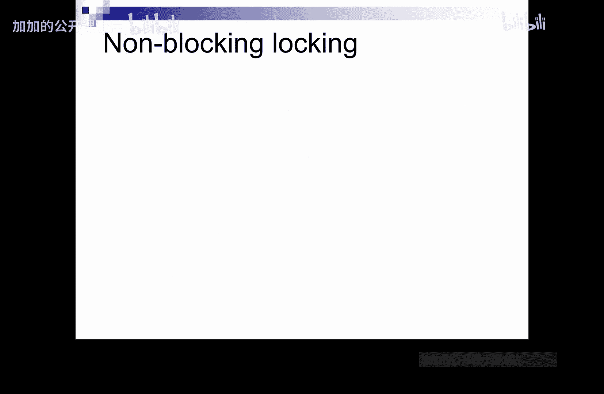
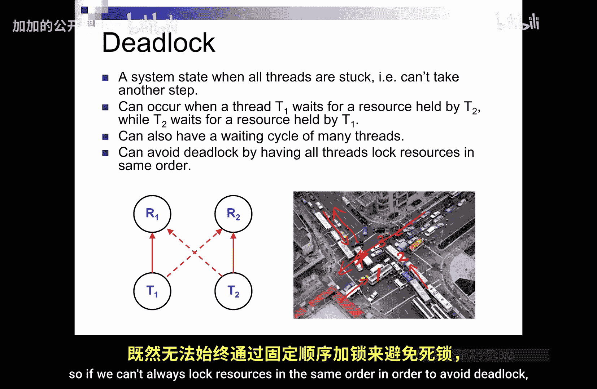
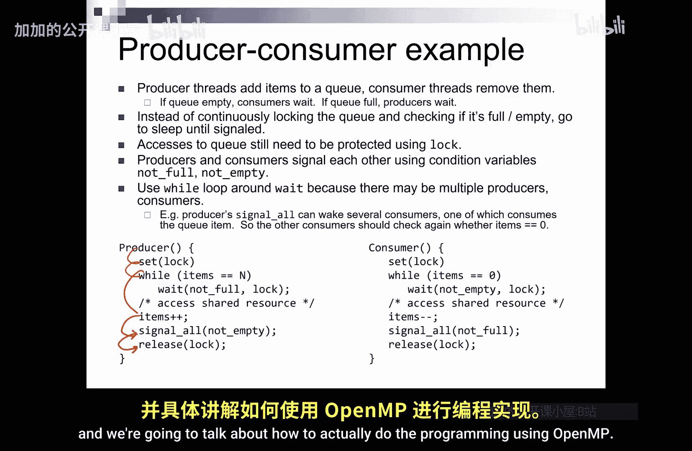

# 上海科技大学【中英⚡并行计算｜CS121 2020 Parallel computing】 p08 P8 OpenMP part 1 -BV1VqypBaEaP_p8-

Yeah。Welcome back。So today we're going to look at how to write parallel programs in shared memory systems。

 and we're going to use something called Open MP。

Okay， so let's first recall the shared memory architecture so here we have a bunch of parallel processors right and all the processors are connected to a common piece of memory。

Okay so there's a single address space， and this means that whenever one process can access a variable。

 then all of the other processes can also see the variable。

Okay so this is in contrast to the distributed memory architecture that we talked about for MPI where there you actually break the memory into different pieces and then different processes can just see their own piece of memory and if they want to access another piece of memory then they need to send a message to the appropriate processor right so here we don't need to send any messages because every process can see every every memory location。

Okay and the main advantage of doing shared memory programming is that it's more convenient and it's easier to write than distributed memory programs and that's because for example。

 when we did MPI we saw that whenever you want to get a piece of data you actually need to coordinate between two processes because you need to send a piece of data and the receiver also needs to receive that piece of data if you don't have that coordination then the processes are going to block right and then your program doesn't work。

And also you have to keep track of where the data is you as the programmer。

 for shared memory programming， it's much simpler because all the data is there accessible to all the processes。

Another advantage to shared memory processors is that because everything is sort of so the shared memory systems tend to be of a smaller scale than distributed memory processors sorry distributed memory systems for distributed memory you could have a gigantic system with thousands or even millions of cores whereas for the shared memory systems usually you have far less processors you might have a few dozen maybe up to a few hundred but because you have fewer processors then they're usually sort of more directly connected to each other and so you have higher bandwidth between these processors so you can often achieve higher performance per processor at least on these shared memory processors overall you still get better you get greater aggregate performance on a large distributed memory processor but if you look at the amount of performance per。

Prosor then it would be higher on or it's often higher on shared memory processors。Okay。

 now a downside to doing shared memory programming is that the programmer needs to be careful about different types of bugs。

 especially concurrency bugs， okay and so we're going to talk about that somewhat today and then for the next lecture we'll get into even more details about these concurrency bugs。

Okay so let's look at some different ways of writing shared memory programs okay so the first way is use to directly use threads okay so this is done for example in the Pths library or the Java programming language okay so here the programmer takes a big program and he breaks it into little pieces each of which is a thread and then these threads can execute in parallel and the threads can also access shared data。

So。The advantage to doing this is that it's a very general way of writing a parallel program。

 you can basically do anything you want。However， because it's so general， then the。

Then the programmer needs to be responsible for many things， right， he needs to manage everything。

 for example， synchronization between threads， creating or destroying threads。

 so it's a lot of work for the programmer。Okay another way to write shared memory programs is using like a specific parallel programming language okay a language specifically designed for parallel programming okay now this can be a good option because you can get good control over your threads and you can get good performance but the problem there is that you would have to do for example。

 design a new compiler for this language okay so there's a lot of work that goes into writing a new programming language right and also programmers have to learn about the new language so that's also hard。

Okay so a third option is to use something called compiler directives so for example。

 openM uses compiler directives and in fact this is the most popular option right now and the main reason is that these compiler directives are just basically you just write a normal sequential program。

 let's say in C or fortran or something and the compiler directives are just little annotations okay very simple annotations that tell the program when you want to do certain things in parallel so really the programmer doesn't need to learn all that much in order to write parallel programs。

And you can also get very good performance and also the compilers。

 it's somehow easier to design a compiler for something using compiler directives than for a completely new parallel programming language。

 for example。Okay。Now， even though the programmer is using just these simple directives to control the parallelism underneath everything right underneath the hood。

 the program is still running using threads but the difference is that the threads are being managed automatically by the runtime system。

 the programmer doesn't need to worry about that。Okay so yeah。

 so these compiler directives are very easy to write as you'll see。

 you do lose some flexibility right so it's not as general as for example。

 using threads okay but basically in most situations you can do what you need to do。Okay， yeah。

 and there's also less changes required to the compiler。

And this is by far the most popular option for writing shared memory programs nowadays。

Okay now before we get into openmp I want to just talk about the difference between processes and threads Okay so so we can parallelize either using multiple parallel processes or multiple parallel threads so then what is the difference between processes and threads well for example。

 MP is going to have multiple parallel processes so each process is a separate program So what that means is that the program has all of these components shown down here。

 it's got a it's got code， of course， it's got a stack and it's got a heap so he is like the memory that this program is using and the thing about and if you run several processes at the same time then they don't have access to each other's heap if you have a different program that program can only access its own he it can't access the he from some other。

バ？So therefore， if you want these programs to share data。

 you're somehow going to have to transfer the data from the heEAP of one program to another program's heEAP okay。

 so for example， in MPI， this is done using these send and receive functions。

Now for threads right so threads is what openmp uses okay so in OpenP you don't have multiple parallel processes。

 you have multiple parallel threads and the difference with the thread is that all the threads run within one process so you have multiple threads within one process and they're executing different portions of this piece of code okay so so the threads can do different things because they can be at different portions of the code。

And the thread they also have their own memory in the sense that the thread has its own stack right so the stack is going to keep track of like the automatic variables and the function cause that each thread has made so different threads can be can be called into different functions so they have different stacks。

However， the threads do share something， which is that they since they' running within one process。

 all the threads can access the， the he memory from that process。Okay and so in this way。

 this is how different threads can share the memory because they can all access this heap。

 and if I write to the heap and you read from the heap。

 then we've managed to communicate with each other。Okay， so yeah。

 so just remember that this is how you do the shared memory in the operating system。Okay。

 so now we're going to talk about how we'll talk about the thread model for openmp so there are other thread models。

 but for openmp， this is based on the the fork join model so so the for join model is we start with one single thread called the master thread and it's going to do a bunch of work until eventually it gets to some point where it realizes that you know's there's a lot of work that that can be done in parallel so in the beginning。

 the master thread is going to do some type of sequential work for example it might read some files or it might initialize some data structures or something like that but at some point。

 maybe it gets to like a big computation and then at that point it wants to parallelize the work Okay so then at that point it's going to create a bunch of parallel tasks and then these tasks can be。

Can be assigned to multiple parallel threats。So you could have more tasks than threads or you could have more threats and tasks or whatever。

 but in any case you have several tasks here eventually these parallel tasks they manage to finish the work that needs to be done and then the tasks join back together and then you end up with one thread again so that one thread is going to execute some more and then maybe later on and again gets to a spot where it needs to have some parallelism and it's again going to fork into multiple ones of these parallel threads so the process is that we keep forking into multiple threads and then eventually when the parallel work gets done the threads join back together into a single thread。

Okay， yeah， so。Okay， so next。Oh okay so I want to mention that so it possible so the master thread can forkcal these slave threads right。

 but it's also possible for the slave threads themselves to sort of recursively create more threads okay so for example over here right we have the master thread creates two threads right and then these two slave threads can create even more threads。

And then these sort of subthreads here， when they join。

 they join back into one of these slave threads and then eventually the two slave threads join back into the master thread。

Okay， and then so here whenever you create a thread。

 eventually the thread finishes and then joins back together with all of the forked threads but you don't have to do that。

 you could create these detached threads that just sort of execute on their own and they don't do a join when they terminate。

Okay so this for joint model actually can capture many types of parallelism that we care about in practice so for example。

 if you consider the merge sort algorithm right so remember the way that merge sort works is on we're trying to sort all of these numbers over here and then you just so this is an array of numbers you split the array into two parts and then you recursively sort each part and then you keep splitting until the arrays get small enough and then you sort that small array and then later on you merge these sorted arrays back together and in the end you get that everything is sorted。

So if you want to run this type of algorithm in the for join model。

 then initially right we would have a master thread right so maybe that master thread like sort of reads the。

Reads this array from a file or something right so it does some sort of sequential work and then now when the master thread wants to start sorting these numbers right so now there's parallelism involved so the master thread can actually fork off to another thread okay so maybe the master thread continues over here so let's say this is the master thread right and then he's going to fork off a slave thread。

Okay。Right and then the slave thread as we said， can recursively fork off more threads so then for example this slave thread here can maybe so because this array here is。

 let's say too large for the slave thread to sort by himself right he can again fork another thread so the slave thread takes half of the array right and then he forks a thread and then that takes another half of the array so that's slave number two right and then the master thread here。

 he can also subdivide the work right so he can take let's say half the array and then he can give another the other half to let's say a third slave thread and then you just keep。

You keep forking off threads as long as you need to so maybe here once we're down to like a race of size2。

 then the slaves can just sort them themselves okay so we're not going to do any forking over here but then eventually after the slaves have sorted their own sub array then they need to merge back together so here you have S2 is going to join back together with S1 so and then here the S3 thread is going to join back together with the master thread and then here you have that we have S2 here and then you have S1 and then you have the master thread and then you have S3 and they're doing a join here and then here you have the first slave thread is going to join back with the master thread okay and then after that we're done with the computation and so the master thread can just keep continuing。

Okay， so this for join model can actually capture a lot of different types of parallelism。

 so even though it's not the only model for parallelism， it's a very useful model。Okay。

 so next we're going to talk about executing some things that we need to be aware of when we execute shared memory programs Okay。

 so the first thing is that we need to think about you know how are these threads actually working together physically what is happening so physically if you just have a single thread and then you have a program。

 then so the program is just you know a bunch of lines of code right so the single thread is just going to go through these lines of code one by one by one right now sometimes it can loop。

 of course， right basically it's just's executing these the instructions exactly in the order that the program was written。

Okay now when you a multi when you have multiple threads， then what's going to happen is。

 for example here we have two threads， okay so each thread has a sequence of instructions that it wants to execute。

 but when you execute these two threads together right physically what's going to happen is that these two instruction streams need to get interleaved somehow right。

Because for example， this might happen at you know time time step。

 let's say you know time equals one second okay right and maybe this instruction happens at time equals let's say 1。

5 seconds right and then this might happen at time equals let's say three seconds right this happens at time equals like like let's say 3。

5 seconds or something so then physically what's going to happen is that this instruction happens first and then this one because it happens at 1。

5 right this and then this one and then that one。O。Now of course。

 there's no fixed order that these instructions happen in okay they can actually interleave in any order okay so for example。

 maybe this this instruction actually happens at three seconds okay and then this one over here right maybe it happens at two seconds so in that case we would do do this one first and then that one and then this one and then this one。

Okay， but in any case， there's some sort of actual interleaving which happens when you execute these two threads together。

 okay so this is one possible interleaving and there are many other possible interleavings。

So now the fact that the threats their execution is interleaved with each other。

 okay this can actually cause lots of problems because if the correct- so sometimes if you don't write a correct program。

 then depending on which interleaving you have， the program might actually have a bug。

 it could be that the program works fine in some interleavings。

 but if you change it to a different interleaving then the program behaves incorrectly。

So if there is such a situation， then we say that there's a race condition for this program because the correctness of the program depends on the interleading that occurs。

And since we we as a programmer have no control， the programmer， the user。

 so usually we have no control over what interleavings are actually going to occur then if the program actually misbehaves under some interleavings。

 then that program is incorrect we can't use that program because if you give this to a user and then you happen to get those bad interleaving。

 then your program is going to do something incorrect。Okay， so yeah， so in fact。

 writing correct programs， correct concurrent programs that work for all interleavings， okay。

 this is actually quite challenging and in fact it's one of the main challenges to writing shared memory programs。

Okay， so let's see what kind of errors can actually occur what kind of race conditions can actually occur Okay so I'm going to give a simple example here。

 So usually these errors occur when the different threads act as a shared piece of memory okay if they're all accessing completely different pieces of memory and the threads are not interacting with each other。

 then there's basically no way for one thread to interfere with another thread okay so in that case nothing bad can really happen right as long as the individual threads are working correctly then if they don't interact with each other then nothing bad can happen the only the only time when bad things happen is when they interact by sharing pieces of data。

Okay， so now so the example we have is suppose you have two threads which are doing something very simple。

 they just take a value right and then they incremented okay so both threads are sharing a value x okay and they both want to increment the value so for example。

 if the value starts at zero right， then if both threads are incremented then x should become 2 at the end。

Okay， but let's look at what happens if you run these two threads concurrently， okay。Okay。

 so then the problem here is that when you run these two threads concurrently。

 even though the only thing we want to do is to increment to increment the variable。

 this actually involves multiple substeps。 the increment doesn't just happen atomically there are several steps that we need to do So the first step is that so so the variable is going to be stored in memory somewhere。

 and so in order to incremented， we first need to read the variable from memory into the register that a thread is using sorry the register for the processor that a thread is using so thread one and thread2 they each have some registers for doing their computations。

 So thread one is first going to load x from memory into its register lets let's write this as like R1 here So it's going to load this into register1 and then。

So let's say that x initially was equal to zero， okay？嗯。Right。

You know what I'll do this a bit later okay yeah so yeah so first we load X into the registers and then next we are we're going to increment x in the register okay and then finally you write back the value of x from the register back to memory。

And threadh2 is going to do the same thing it also loads x from memory into threadh2's register。

 it increments it in its own register and then writes it back to memory。Okay。

 so now since you know each thread is doing several instructions。

 they can be interleaved in some arbitrary order okay so suppose that we have this thing on the right as the interleaving okay then what's going to happen is that so now let's look at what the value of x is going to be at the end if we have this interleaving。

Okay so with this interleaving， so the first thing we do is thread1 right so that's thread1 is indicated by these black operations and thread2 is indicated by these blue operations。

So thread one is first of all going to load x into its register  one。

 let's say right so if x initially was equal to0， then now we have register 1 is equal to0。Okay。

 and then it's going to increment x， so now register 1 is going to be equal to1 it's going increment x in its registers。

 So now r 1 equals 1 right and then and the next suppose at this point， threat2 does its operation。

 its first operation so then now threat2 is going to load x into its register R2。

 let's say right so then now we have now at this point x is still equal to0 in the memory。

Because here what we've done what thread1 has done is just to increment the value of x in thread1's register in the memory x is still0。

 so therefore when thread2 loads x， it's going to set its register to be equal to 0。OkayNext。

 let's say we go back to thread1， so that's going to store the data from R1 back into the memory。

 so now x equals1。Okay， all right， the next we go back to thread2 and he's going to increment the value of x in his register。

 so now we have r2 equals 1 and then he's going to write back the value of r2 to the memory and so x is at the end going to equal1 okay because r2 thread2 is writing back the value 1。

Okay， so we see that at the end of all this， right so the value of x is 1。Okay。

 but this is incorrect because intuitively what we wanted to happen was that since you have two threads doing two increments。

 we wanted the value of x to be equal to 2 at the end。Okay。

 so this is an example of a race condition where the program behaves incorrectly in certain interleavings。

Okay， so then how how do we deal with this situation well so if we're using a library with some routines。

 with some prewritten routines then we say that a routine is threadsa if it can be called from multiple threads at the same time。

 and not produce any bugs okay so basically this routine should not have any race conditions in them。

Okay， if it doesn't have any race conditions， it's a threats safe routine。Okay so for example。

 many IO routines are written so that they're threadsafe so for example。

 if you do something like a print app okay you do print appss from two different threads if the print apps are not threads safe。

 then the message being printed can be sort of garbled can be mixed in together but if the print app is threadsa then you're going to see a complete message。

 complete messages being printed by each thread， you're not going to get the different outputs to be garbled with each other。

Okay but there are certain routines that you have to be careful about that are not written to be threadsa okay so those routines can only be correctly used by one thread at a time okay so for example there' are some random number generators that are only going to produce really good random numbers if they're only being used by one thread at a time if you if you have several threads all calling the random random number generator at the same time right then you could get outputs which are not really random。

Okay。Yeah， so so as I said usually these race conditions are going to occur well they only occur if we have accesses to shared variables so whenever we have multiple threads accessing like let's say a shared data structure。

 okay then we have to be very careful about how we write these programs so the way that we can write a program which can work correctly even with multiple threads。

 so one way is to use something called a critical section okay so there are other ways also and I'll talk about those in later lectures but today we're going to see how to use critical sections to ensure the correctness of these programs。

So a critical section is it's a piece of code that can only be executed by one thread at a time。Okay。

 so because this code is only being executed by one thread。

 then that thread can make multiple changes to the data without being interrupted by any other thread as long as the code is in a critical section。

 there's only one thread that can be executing that code nobody else can touch that code in the meantime。

Okay， so yeah， so this is also called mutual exclusion。

 right because the different threats exclude each other， mutually exclude each other。Okay。

 so there are many ways to use critical sections， so for example。

 the Java has these synchronized statements and they implement critical sections。

 and many other programming languages and operating systems also have ways for the programmer to use critical sections。

Okay so the critical section helps you avoid the raise condition bugs that we saw okay so for example know we were trying to increment a value okay so that consisted of several several operations now if we put all of these operations into a critical section so that would mean that you know these three operations would have to happen so if one thread wass doing these operations then it won't be interrupted by any other thread right it'll do either the thread will do all three operations or it won't do any of those operations right it's not like the thread can do let's say two of these operations and then suddenly get interrupted by some other thread。

Okay， so now if this piece of code was actually in a critical section。

 then when you run these two threads together， what are the interleavings that you could get okay so for example you could get this type of interleaving right where thread2 does everything does this entire piece of code and then thread one does this entire piece of code。

Now in that case we actually get that the value of x is correct at the end because here you load x。

 you increment it to1， and then you store one， and then so here thread1 is going to read one。

 read x as1 and then he's going to increment it and then that store two back into x。

so and then even if you have thread1 go first， okay。

 so if these black operations happen first and then the blue ones。

 you would still have x equal2 at the end。So as long as all three operations happen together without interruption from any other threads。

 then the program is going to work correctly。So yeah。

 so this is how we achieve correctness in concurrent programs is by putting。

Certain blocks of code in these critical sections so that we can go from like one。

 so if before you start the critical section， suppose the program is in a correct state then because you can execute the entire critical section by yourself。

 then afterwards the program transitions to another correct state。Okay。

 so then the program always stays in states。Okay。So。Right。

 so so locks are so locks are a way for ensuring mutual exclusion Okay。

 so the way locks work is that。Before a thread enters a critical section it sets the lock and then it unsets the lock after it leaves a critical section so now these locks have certain properties so the property is that know if the lock is open then a thread can set the lock okay and then the lock becomes locked okay but if a thread tries to set tries to use the lock and the lock is already locked right then the thread won't be able to do anything it'll just block okay it'll have to wait until the lock is unset。

O。Yeah， so therefore， if you have a lock which protects this critical section。

 then only the first threat to set the lock right actually can successfully set the lock and then it can go execute the critical section。

The second and all the later threads that come， they're going to find the lock is already locked and so they need to block at the lock so they're going to wait at the lock and they won't be able to do the code in the critical section。

So this way， there's only one thread doing the critical section at a time。

Yeah right and then the first thread to come that actually set the log right then eventually let's say it finishes all the operations in the critical section and then it unets the log and at that point all of these waiting threads then can all of them can compete with each other to try to set the lock again。

So one of those competing threads will actually successfully set the lock and then that thread can do the critical section。

 the other threads that don't manage to set the lock。

 they're going to block again so they're going to wait again at the lock。Yeah。

 so this would be like the piece of code that you would have okay so before you do this critical section that so here is what where you want to ensure that only one thread is doing this at a time right so you have multiple threads that are going to come to this lock they all try to lock right so but only one of them will succeed and then go into the critical section okay so the other guys are just going to be blocked here okay and then eventually this guy is going to finish and he's going to uns the lock and once the lock is unset right then these two weighting threads can again compete to get the lock one of them gets the lock。

 let's say let's say the third thread over here and then he can go into the critical section but then thread2 is again blocked。

Okay， so this way， we always just had one thread at a time in the critical section。Okay。

 so next we're going talk about so when you use locks。

 So this is a way to ensure the correctness of your program。

 Okay but you've got to be careful about how you use the logs because if you don't use them the right way。

 then one bad thing that can happen is your system can deadlock okay so then all of the threads will be blocked so of course。

 you don't want that， you want to so the purpose of the lock is to make sure that one thread gets to make progress while the other threads are blocked Okay but when you have a deadlock。

 everybody is blocked。 So then your program is just stuck forever。

So then when can you get what kind of situations lead to deadlocks。

 one example is if a thread needs multiple resources。

 so let's say that you have two threads over here T1 T2 and they both want to lock two resources。

Now if T1 locks r1 first and then T2 locks r2 then because T1 needs two resources。

 T1 will try to lock r2 but T1 won't be able to get R2 because T2 has already locked R2 so therefore T1 is going to block。

Likewise， T2， after it gets R2， it also wants to get r1 but T2 can never lock r1 because T1 has already locked R1。

 so therefore T2 is also going to block， it's also going to wait。

Okay so now you see that both T1 and T2 are going to end up waiting forever okay because both of them have one of the resources that they need right。

 but they can't get the other one， so they need to just keep waiting for the other one。

 but the other resource never gets never becomes available。

Okay so yeah so we can so here is an example where we have a cycle of two threads where they wait for common resources okay so you could actually have examples where you can have a cycles of more than two threads okay so for example this traffic situation here。

 this is also an example of deadlock because you see that none of the cars can move this entire intersection is blocked and basically you can think of this in terms of threads and resources so for example you can think of these roads as being resources okay so maybe you have like one resource here right so to get across this road you actually need two resources if you're going in this direction you need two resources you need to get through this intersection and this one okay now if you want to proceed in this direction you also need two resources。

 you need to get resource number two and also you need to go through let's see。If redraw this。

 you need to get through this part over here。Okay， and then if you're coming from this direction。

 right， you need to get resource number three and also there's a resource over here。

Okay and then finally if you're coming from up top here right you need to get resources four and one okay so now you see what what's happened is that each of these so you can think of these four directions of travel as being four threads right so each of the four threads has gotten one resource but it needs two resources but it'll never get the second resource because that's already been been taken by somebody else okay so now these guys are just stuck over here。

Okay so now if you get one of these stuck situations okay basically the only thing you can do is you got to make somebody back up okay you got to basically reset the system so for example here right some of the cars are going to need to like reverse okay like if these guys reverse right then that's going to clear up this lane of traffic and so then these guys can go and then the other lanes can go okay but you need to reset the system somehow if you ever get into a deadlock。

So of course it would be better just to avoid deadlocks in the first place okay so now one way that you can avoid deadlocks is if you have these two resources。

 then the problem here was that t1 locked R1 first and then T2 locked R2 and then after T2 locked R2 it try to get R1 but by that point it's already too late because R1's been taken by T1 so instead you should one way to avoid deadlock is for all the threads to lock the resources in the same order so instead of locking T2 R2 first both T1 and T2 should try to lock R1 first。

Okay， if they both try to lock r1 first， then what's going to happen is so T2 does not try to lock R2。

 okay， it tries to lock R1。So since both1 and T2 are trying to lock R1。

 only one of the most succeed and the other one will wait。

Okay so let's suppose that T1 succeeded okay so then T1 gets r1 and now T1 can go get r2 right because that's not been taken by anyone yet。

 so then T1 can go get R2 and then once once it's got both resources it can go do its operation。

Okay and then eventually T1 is going to finish its operation and then it's going to release both R1 and R2。

 okay， so it's going to release both R1 and it's going to release R2， right？And at that point。

 T2 can get r1， and then it can also get r2， and then that way T2 can proceed。Okay。

 so if we ensure that the threads lock the resources in the same order。

 then these problems won't happen。Okay now in practice。

 it's not that easy to ensure threads lock resources in the same order because for example。

 one problem is that maybe a thread doesn't know which resources it needs at the beginning so maybe initially let's say T1 knows that it needs initially let's suppose that T1 knows it needs R1 right and then T2 knows it needs R2 but at the beginning。

 maybe T1 doesn't know it it needs R2 and T2 doesn't know it needs R1。Okay， so then in that case。

 T1 is going to lock R1， T2 is going to lock R2， but then later on if they try to lock the other resource。

 again， they'll be stuck。Yeah， so so。Yeah， so the reason this lock and resources in the same order。

 the reason this doesn't always solve the problem is because for example。

 you might not even know which resources you need so you can't get them in the right order。

Okay so therefore another so if we can't always lock resources in the same order in order to avoid deadlock then something else we can do to avoid deadlock is that we can use these non blocklocking locking primitives so basically these primitives or these functions try to get a lock。

 but if they fail to get the lock， then they're not going to block the thread okay。

 then the thread can still go do something else okay so the way this works is that suppose you have this non blocking。

Function called test lock。 Okay， so test lock is that we try to get the this so the lock here is called muttex。

 Okay， so we try to get this on muttex lock if we get it right So if if flag is let's say if flag is zero okay then this means that we actually manage to get the lock right。

 so then then we can go into the critical section and do all this stuff Okay and after we're done with the critical section。

 we can we can uns the lock。However， if the lock has already been taken by somebody else。

 then the flag is going to be one okay in that case we're going to go into this else part。

 but we're not going the thread is not going to just block at this function here and it's going to jump into this else part and it can do more stuff down here。

Okay so this means that the thread is at it's not stuck trying to get the lock。Okay， yeah。

 so that's how this works。Let's see。Right， so then if the thread so this thread wanted to get the lock and it called test lock and it failed to get the lock right so jumped into the else part right so then later on the thread can maybe go back to this test lock and try to get the lock again so maybe at that point whoever was in the critical section is already finished and he release the lock and now the thread can actually get the lock this time so the thread just keeps of keeps coming back and trying to get the lock if it if it fails to get the lock。

 that's not really a problem the thread will not become stuck it'll just go do something else。Okay。

 so。So next we're going to talk about the performance implications of using critical sections Okay so sometimes you have to use critical sections in order to make make sure your code works correctly so safety first we need to make sure the code is safe and works correctly however you don't want to overuse critical sections because if you use a lot of critical sections。

 then yeah it's true that your code works correctly but it might also perform very poorly and the reason is that when you use a critical section you're actually going to serialize your code so the reason is that if you have a critical section here then only one thread can can run this critical section at a time so if you have several threads that all need to go through this critical section then they have to go through the critical section sequentially one after another you see that there's no。

Paalism whatsoever in the critical section。Okay， so therefore。

 if you make a very large critical section， then it's easy to ensure your code is correct in that case because everything is in the critical section。

 but because everything is in the critical section， you don't have any parallelism。Okay， so。Yeah。

 so so you do need to use critical sections， but you want to make them sort of as small as possible to ensure that your program is correct and as long as your program is correct。

 you want to make them you don't want to make these any larger。

Okay so so next we're going to talk about condition variables so these variables are used with critical sections right so the idea is that sometimes you should only execute a critical section when a specific condition occurs so I'll give you an example of that later。

 but in these situations we want to use a condition variable。

So the way this works is that a thread is going to get a lock for a critical section but it should only execute that critical section when the condition occurs so after the thread gets the lock for the critical section。

 it's going to call the condition variable and then if the condition is true。

 then the threat can go do the critical section。But if the condition is false。

 then the threat should wait until the condition becomes true。Okay。

 and now when the thread is waiting right， you don't want the thread to keep the lock because if it's keeping the lock。

 then that's blocking all the other threads from potentially using the critical section Okay so when the thread is waiting right it's actually going to go go to sleep and then it's going to release the lock。

Okay so and it does both of these things atomically， so by going to sleep。

 that just means that the thread is going to just stop and not do anything okay because the thread is waiting for the condition to become true right so it's got nothing to do before the condition becomes true。

Okay， and in fact， you could have several threads which are all waiting for this condition right so in that case we can put all of these guys into a queue okay so we can just have some way of keeping track of all of these waiting threads。

Okay， now eventually let's say that this condition becomes true okay， so at that point。

 we're going to have a signal occur okay， so the signal is going to tell all of these waitinging threads that now the condition has become true okay so now since we have this condition holding all of the threads are going to wake up right and after they wake up。

 they try to reacquire the lock。Okay， and of course， since you're competing for a lock。

 then only one of the threads can succeed。Okay now the reason we use a condition variable is that this is more efficient than continuously testing a lock to see when the condition gets met right so if the condition is false right now。

 then I might as well just go to sleep and wait for the condition to be true instead of me testing over and over whether this condition is true。

Okay， so to use these condition variables we have a few functions so we have this weight function。

 so this is called by a thread which currently has the lock and now he wants to check whether this condition is true and if it's false。

 then he's going to go to sleep。Okay， so the signal function is going to signal that a condition has become true。

Okay， and then once the signal occurs， then all the threads waiting on that condition， they wake up。

 right， and then they try to reacquire the lock。Okay。

 so this yeah so the signal maybe just signals one thread to wake up。

 but we can actually signal multiple threads to wake up or actually all threads to wake up using signal all。

Okay， so let's do an example of using these condition variables。

 So this is going to be the producer consumer example。

 Okay so what's happening here is that we have these a bunch of consumer threads and a bunch of producer threads and then they all access this queue now so the producer threads are going to put stuff into the queue。

 put items into the queue and the consumer threads remove items from the queue so they just keep doing this。

However， if the queue is currently empty， then the consumer threads have nothing to remove okay。

 so then the consumer threads have to wait。Okay， so if you're a consumer thread and you try to take something。

 then the condition is that the queue has to be non empty。If the queuees are empty。

 then you have to wait。Okay and on the other hand， this queue has a capacity right let's say you can put 100 things into the Q okay so if the queue's already full if it's already got 100 items。

 then the producers have to wait So if your producer thread then your condition is that the queue in order for you to put something into the queue the condition is that the queue is is not full if it's currently full。

 then you have to wait until the queue becomes nonfold again。

Okay so so one way you can implement you can solve this problem is that the producers and the consumers so whenever they access this queue then because the queue is being shared between multiple threats。

 the threats need to lock the queue but if you lock the queue。

 to solve this producer consumer problem， what you can do is you lock the queue。

 you check if it's empty or full if you're the producer， you check that the queue is not full。

 if you're the consumer， you check it's not empty but if your condition fails。

 then you can unlock the queue but then later on you have to come back and recheck that condition so in fact you have to check this condition over and over and each time you check it you have to try to get the lock again and this is actually an expensive process to acquire the lock so this process of getting the lock checking the condition。

And then releasing the lock and then doing that over and over， this is actually very inefficient。

Okay， so a more efficient way to do this would be the following。 Okay。

 so so here we have the code for the producer threads and the consumer threads。 Okay。

 so let's just briefly go through this。 So the producer thread is。

So he's trying to place items into the queue okay so because it's a shared queue。

 then he needs to first lock the queue in order to get access to it so he sets the lock and then now he checks whether the number of items in the queue is equal to n。

 which is like the maximum number of items you can put in there if it's less than n then the queue is not full then the producer can just increase the number of items and then he's also going to send a signal to all the consumer threads that because he's put an item into the queue then this queue is not empty he's going to signal all the consumers about this and then after that he's done so he's put his items in there or put his item in there and then signaled all the consumers So now he's done and he can release the lock。

Okay， on the other hand， if when the producer was trying to put an item into the Q。

 the Q was already full， okay so items equals n right then the producer needs to wait in order to put his item into the Q okay he needs to wait until this signal that the Q is not full anymore。

Okay， so he's waiting on the signal。And when he's waiting right so currently the producer has the lock on the queue so nobody else can access the queue at all okay so now if the producer keeps this lock on the queue okay then because the queue is full right now and because nobody else can access the queue because this producer has has a lock then you know nobody can ever take anything out of the queue and so the queue will always be full。

So that means that the producer will be waiting there forever。Okay， so therefore。

 the producer has to give up the lock to the queue。

in order for other threads to go take something out of the queue。

 and then only after other threads have taken something out of the queue。

 can this producer put his item into the queue？Okay。

 so this is why the producer has to make sure that when he's waiting for this not full signal。

 he has to give up the lock， he has to release the lock over here。Okay， so that's the producer's。

Actions and now for the consumer it's sort of like the opposite of this so the consumer to get to access the lock right so the consumer is trying to take something out of the queue okay and to do this he's got to first lock the queue right and then he checks whether the Q is empty or not okay so if items equals0 then the Q is empty。

OkayNow if items is not zero right so items will be larger than zero。

 then the consumer can go over here and he can just take an item out okay he decrements the number of items and then now since he's taken one item out。

 he can send a signal that the queue is not full anymore。Okay， so for example。

 remember that these producer threads were waiting for the signal to happen okay so this consumer thread has been very nice。

 he's taken an item out of the queue， so now we know the queue is not full anymore and the consumer is going to signal any potentially waiting producers about the situation。

And then the consumer is done and he can release a lock。Okay however， if this consumer。

 when he was trying to take some items out， if the queue was already empty at that point。

 then the consumer needs to wait until the queue becomes non empty。And to do that， again。

 the consumer also needs to give up the lock because if the consumer holds。

 so the consumer currently at this point， he has the lock because in order to get to this point he had to set the lock。

Now， if the consumer just keeps the lock at this point， then。

Then the queue will stay empty forever because nobody can can access the queue in order to put something in so then the consumer is going to be waiting here forever Okay。

 so the consumer needs to give up the lock to release the lock and then wait for the。

Wait for the NMT signal。Okay， so。Yeah， so so now let's go through one possible execution for this。

 So suppose you so what could happen is。Yeah， so let's say that we have a over here， right。

 a queue like this， right， And then suppose the queue is currently empty。 Okay。

 so then we have we have a consumer thread waiting at the queue， right。

 He's waiting for this queue to become non empty but but it's currently empty So this consumer thread needs to wait Okay。

 and then。Right， so the way this consumer threat executed was that he first set the lock right。

 he checked whether the queue is empty， it is empty right so gives he gives up the lock Okay so now when the consumer one is waiting。

 the lock is actually free。Okay so now because the lock is free。

 you could have another consumer come over here right so he also sets the lock。

 he also checks whether it's empty or not， it is empty so then this consumer too is also going to start waiting and when he waits he's going to release the lock。

Okay so then later you could have a producer thread come right and then this guy is going put so then he's going try to set the lock so the lock is currently free because both C1 and C2 have released the lock so P so P1 can get access to the lock He can like stick an item in here so the producer comes。

 he sets the lock， checks whether it's full or not。

 It's not full because there's nothing in the queue So then he goes over here。

 adds an item and then he sends the signal。Okay， he's so this signal is going to sort of alert these two guys。

 oops。Right so currently the C1 and C2， right， they're like sleeping Okay， so they're like know。

 they're sleeping okay， like sort of like z's like that， Okay， but once P1 sense this signal， right。

 then these guys are going to like wake up okay。When they wake up， they try to reacquire this lock。

Okay now currently P1 has the log okay so both these C1 and C2 cannot acquire the lock yet but after P1 sends a signal。

 he's going to release the log so now the lock is free and then P1。

 let's say goes away after this and now C1 and C2， they're both trying to acquire the log now let's say let's say that C1 gets the log so then he gets the the lock right so I'm going to circle him right and then C2。

 because he doesn't get the lock right then。Then he's going to be blocked。Okay so C1 gets the lock。

 he's going to go over here sorry so C1 wakes up， he gets the lock and now C1 is actually in this part of his execution right now okay so he part he's in the while loop okay so after he gets the lock。

 he's actually going to go back to the beginning of this while loop he's going to check whether items equals zero again okay so currently there's one item in there。

 so actually items equals1 so therefore C1 can go over here and he can take he can decrement items。

Okay， and then he's going to send his signal of not full， and then he releases the lock。Okay。

 so after he releases a lock， remember that C2 here was still blocked trying to get the lock。

Right so because after C1 and C2 waked up， right they were both trying to get the lock。 Okay。

 C1 got the lock， but C2 was blocked， right， trying to get the lock Okay。

 so now C2 has managed to get the lock because C1 released it Okay， so now C2 has managed to。Oops。

 right， so C1 has actually taken the item out。 Yeah， sorry， I forgot to say that。

 So now C2 gets the lock。Right but notice that C2 is still here in his code so even though he got the lock because he is here in the code。

 then before he goes on he needs to go back to the beginning of this while statement so he needs to check whether items equals zero again。

And in fact， right now， items again is equal to zero， okay， because C1 took out the only item right。

 so now items， the number of items is zero again。Okay and because it's zero。

 then unfortunately C2 is going to have to go back to sleep okay。

 he's going to have to wait until the not empty signal happens again。And when he goes to sleep。

 he's going to give up his lock。Okay， so by the way。

 on this example shows you why here we need to have a。嗯。Yeah。

 we need to have a while statement here okays you know if you write this code。

 you might think that okay all I need to do is just have an if statement here and check whether the number of items is equal to zero okay but this is not sufficient because oops because if you just have an if statement over here then after these waitinging threads wake up right they're not going to recheck whether items equal zero again okay so so after C1 and C2 wake up they're both just going to try to take an item。

Okay， which would be incorrect right because only C1 should be able to take the items item right C2 needs to wait again。

や。Okay so that is the example of how to use condition variables。

 so next we're going to see how to use how all these concepts come up and we're going to talk about how to actually do the programming using OpenM。

