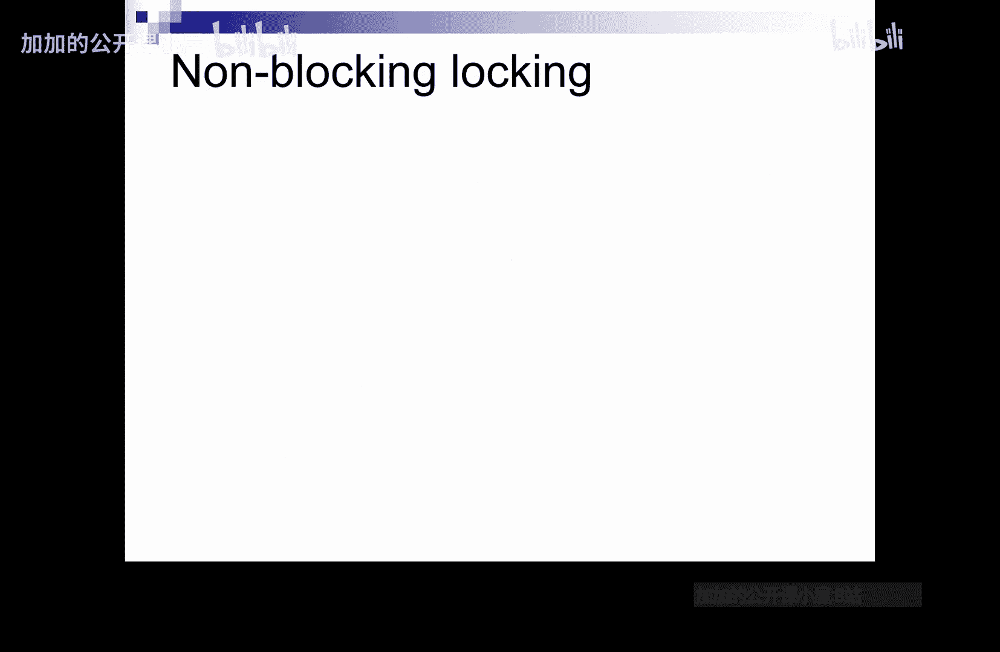
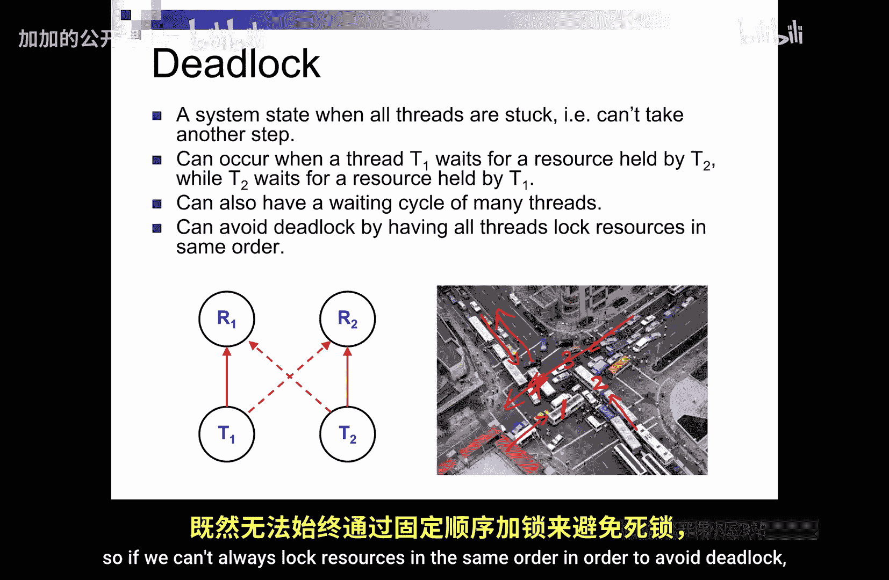
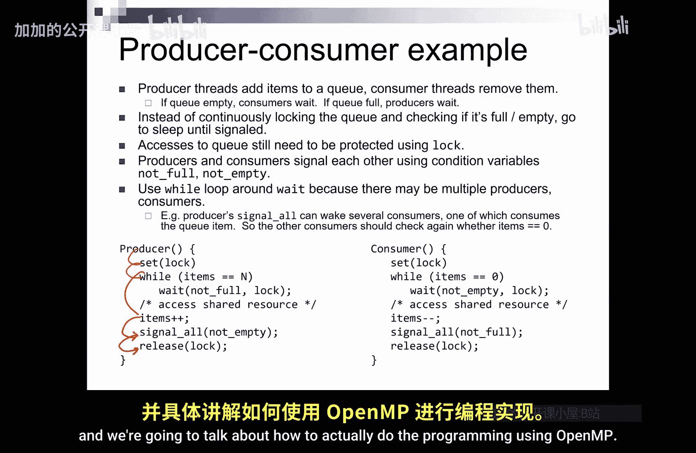

# 并行计算：08：OpenMP 第一部分

在本节课中，我们将学习如何在共享内存系统中编写并行程序，并重点介绍一种名为 OpenMP 的流行工具。

## 概述：共享内存架构

上一节我们介绍了分布式内存编程（如MPI）。本节中，我们来看看共享内存架构。

在共享内存架构中，多个处理器连接到一个公共的内存模块。这意味着存在一个单一的地址空间。当一个进程可以访问一个变量时，所有其他进程也都能看到这个变量。

这与MPI的分布式内存架构形成对比。在分布式内存中，内存被分割成不同的部分，不同进程只能看到自己的那部分内存。如果它们想访问其他部分的内存，则需要向相应的处理器发送消息。而在共享内存中，我们不需要发送任何消息，因为每个进程都能看到每一个内存位置。

## 共享内存编程的优势与挑战

共享内存编程的主要优势是它比分布式内存程序更方便、更容易编写。例如，在使用MPI时，每当你想获取一段数据，实际上需要在两个进程之间进行协调，因为发送方需要发送数据，接收方也需要接收数据。如果没有这种协调，进程就会阻塞，程序就无法工作。此外，程序员还需要跟踪数据的位置。

对于共享内存编程，情况则简单得多，因为所有数据对所有进程都是可访问的。

共享内存系统的另一个优势是，由于所有处理器都紧密连接，它们之间的带宽通常更高。因此，每个处理器通常能实现更高的性能。当然，大型分布式内存系统在总体性能上可能更强，但就单个处理器的性能而言，共享内存系统往往更高。

然而，共享内存编程的一个缺点是程序员需要小心不同类型的错误，特别是并发错误。我们今天会讨论一些，并在下一讲中更详细地探讨这些并发错误。

## 共享内存编程的实现方式

以下是编写共享内存程序的几种不同方式。

### 直接使用线程

第一种方式是直接使用线程，例如通过Pthreads库或Java编程语言。程序员将一个大型程序分解成多个小片段，每个片段是一个线程，这些线程可以并行执行并访问共享数据。

这种方式的优势在于它是一种非常通用的并行编程方式，基本上可以实现任何功能。然而，正因为其通用性，程序员需要负责很多事情，例如线程间的同步、线程的创建和销毁，这对程序员来说工作量很大。

### 使用特定的并行编程语言

第二种方式是使用专门为并行编程设计的语言。这是一个不错的选择，因为你可以很好地控制线程并获得良好的性能。但问题在于，例如，你需要为这种语言设计新的编译器。编写一门新语言需要大量工作，而且程序员也需要学习这门新语言，这也很困难。

### 使用编译器指令

第三种方式是使用编译器指令，例如OpenMP就使用编译器指令。事实上，这是目前最流行的选择。主要原因是这些编译器指令基本上只是在正常的顺序程序（比如用C或Fortran编写）中添加一些小注解。这些简单的注解告诉程序何时希望以并行方式执行某些操作。因此，程序员不需要学习太多新知识就能编写并行程序。

你还可以获得非常好的性能。而且，为使用编译器指令的程序设计编译器，比为全新的并行编程语言设计编译器要容易一些。

尽管程序员只使用这些简单的指令来控制并行性，但在底层，程序仍然使用线程运行。不同之处在于，线程是由运行时系统自动管理的，程序员无需担心。

这些编译器指令非常容易编写，但也会失去一些灵活性，不如直接使用线程那样通用。但在大多数情况下，你可以完成所需的任务。此外，对编译器的改动要求也更少。这是目前编写共享内存程序最流行的方式。

## 进程与线程的区别

在深入OpenMP之前，我们需要谈谈进程和线程的区别。

我们可以使用多个并行进程或多个并行线程来实现并行化。那么，进程和线程有什么区别呢？例如，MPI使用多个并行进程。每个进程都是一个独立的程序，这意味着它具有这里显示的所有组件：代码、栈和堆。堆是这个程序使用的内存。如果同时运行多个进程，它们无法访问彼此的堆。如果一个程序想要访问另一个程序的堆，就必须以某种方式将数据从一个程序的堆传输到另一个程序的堆。例如，在MPI中，这是通过发送和接收函数完成的。

而线程是OpenMP使用的。在OpenMP中，你没有多个并行进程，而是在一个进程内有多个并行线程。线程之间的区别在于，所有线程都在一个进程内运行，它们执行这段代码的不同部分。因此，线程可以做不同的事情，因为它们可能位于代码的不同部分。

线程也有自己的内存，即每个线程有自己的栈。栈用于跟踪每个线程的自动变量和函数调用。不同的线程可能调用不同的函数，因此它们有不同的栈。

然而，线程共享一些东西：由于它们在一个进程内运行，所有线程都可以访问该进程的堆内存。通过这种方式，不同的线程可以共享内存，因为它们都可以访问这个堆。如果我写入堆，你从堆中读取，我们就成功地进行了通信。

请记住，这是在操作系统中实现共享内存的方式。

## OpenMP的线程模型：Fork-Join模型

现在我们来谈谈OpenMP的线程模型。OpenMP基于Fork-Join模型。

Fork-Join模型是这样工作的：我们从一个称为主线程的单个线程开始。它执行一系列工作，直到到达某个点，意识到有很多工作可以并行完成。在开始时，主线程可能执行一些顺序工作，例如读取文件或初始化数据结构。但在某个时刻，例如遇到一个大型计算时，它希望将工作并行化。

此时，它将创建一系列并行任务，这些任务可以分配给多个并行线程。任务数量可以多于或少于线程数量。最终，这些并行任务完成所需的工作，然后任务重新汇合，再次变成一个线程。这个线程继续执行，可能在稍后再次遇到需要并行化的地方，再次分叉成多个并行线程。这个过程不断重复：分叉成多个线程，当并行工作完成后，线程再汇合成单个线程。

主线程可以分叉出这些从属线程，从属线程本身也可以递归地创建更多线程。例如，主线程创建两个线程，然后这两个从属线程可以创建更多子线程。当这些子线程汇合时，它们汇合回其中一个从属线程，最终这两个从属线程再汇合回主线程。

每当创建一个线程，最终该线程完成并与其他分叉的线程汇合。但也可以创建分离的线程，它们独立执行，终止时不进行汇合。

这种Fork-Join模型实际上可以捕获我们在实践中关心的许多类型的并行性。例如，考虑归并排序算法。归并排序的工作原理是：我们试图对这里的所有数字进行排序，将一个数组分成两部分，然后递归地对每一部分进行排序，不断分割直到数组足够小，然后对那个小数组进行排序，最后将这些已排序的数组合并回来，最终得到完全排序的数组。

如果想在Fork-Join模型中运行这种算法，那么最初会有一个主线程。也许主线程从文件中读取这个数组，执行一些顺序工作。然后，当主线程想要开始对这些数字排序时，就涉及到了并行性。主线程可以分叉出另一个线程。例如，主线程继续在这里工作，然后它分叉出一个从属线程。

正如我们所说，从属线程可以递归地分叉出更多线程。例如，这里的从属线程可能因为这个数组对它来说太大而无法独自排序，它可以再次分叉另一个线程。从属线程取数组的一半，然后分叉一个线程处理另一半。同时，主线程也可以细分工作，例如取数组的一半，将另一半交给第三个从属线程。只要需要，就不断分叉线程。也许当数组大小减少到2时，从属线程可以自己排序，不再进行分叉。

最终，在从属线程排序完自己的子数组后，它们需要合并回来。例如，S2线程将汇合回S1线程，S3线程将汇合回主线程。然后，第一个从属线程汇合回主线程。之后，计算完成，主线程可以继续执行。

因此，Fork-Join模型实际上可以捕获许多不同类型的并行性。尽管它不是唯一的并行模型，但它是一个非常实用的模型。

## 共享内存程序执行的注意事项

接下来，我们将讨论执行共享内存程序时需要注意的一些事项。

第一件事是，我们需要思考这些线程实际上是如何在物理上协同工作的。如果只有一个线程和一个程序，那么程序只是一系列代码行，单个线程将按顺序逐行执行这些代码。当然，有时会有循环，但基本上它是严格按照程序编写的顺序执行指令。

当你有多个线程时，情况就不同了。例如，这里有两个线程，每个线程都有自己想要执行的一系列指令。但当同时执行这两个线程时，物理上发生的是这两个指令流需要以某种方式交错执行。例如，这个指令可能发生在时间 t=1 秒，另一个指令发生在 t=1.5 秒，下一个发生在 t=3 秒，再下一个发生在 t=3.5 秒。那么物理上发生的是：这个指令先执行，然后是那个（在1.5秒），接着是这个，最后是那个。

当然，这些指令发生的顺序并不固定，它们实际上可以以任何顺序交错。例如，也许这个指令实际上发生在3秒，而那个指令发生在2秒。那样的话，我们会先执行这个，然后那个，接着这个，最后那个。

无论如何，当同时执行这两个线程时，会发生某种实际的交错。这是一种可能的交错，还有许多其他可能的交错。

现在，线程执行相互交错的事实实际上可能导致许多问题。因为有时如果你编写的程序不正确，那么根据发生的交错，程序可能实际上存在错误。可能程序在某些交错下工作正常，但如果切换到不同的交错，程序行为就会不正确。

如果存在这种情况，那么我们说这个程序存在竞态条件，因为程序的正确性取决于发生的交错。

由于我们作为程序员通常无法控制实际会发生哪种交错，如果程序在某些交错下行为异常，那么该程序就是不正确的，我们不能使用它。因为如果你把它交给用户，而恰好遇到了那些不好的交错，你的程序就会做出不正确的事情。

因此，编写在所有交错下都能正常工作的正确并发程序实际上相当具有挑战性，事实上，这是编写共享内存程序的主要挑战之一。

## 竞态条件示例

让我们看看实际上会发生什么样的错误，什么样的竞态条件会发生。这里给出一个简单的例子。

通常，这些错误发生在不同线程操作共享内存时。如果它们都访问完全不同的内存区域，并且线程之间不交互，那么一个线程基本上无法干扰另一个线程。只要各个线程工作正确，如果它们不相互交互，就不会发生坏事。只有当它们通过共享数据交互时，坏事才会发生。

现在，我们的例子是：假设有两个线程正在做一件非常简单的事情，它们只是获取一个值然后递增它。两个线程共享一个值 x，它们都想递增这个值。例如，如果值从0开始，那么如果两个线程都递增，x 最终应该变为2。

但是，让我们看看如果同时运行这两个线程会发生什么。问题在于，当你同时运行这两个线程时，即使我们只想做递增变量这一件事，这实际上涉及多个子步骤。递增并不是原子发生的，我们需要做几个步骤。

第一步是，变量存储在内存中的某个位置。为了递增它，我们首先需要将变量从内存读入线程使用的寄存器中（实际上是处理器使用的寄存器）。线程1和线程2各自有一些寄存器用于计算。线程1首先将 x 从内存加载到它的寄存器中，我们称之为 R1。假设 x 初始等于0。

接下来，我们将在寄存器中递增 x，然后将 x 的值从寄存器写回内存。线程2将做同样的事情：它也将 x 从内存加载到线程2的寄存器中，在自己的寄存器中递增它，然后写回内存。

由于每个线程都在执行多个指令，它们可以以某种任意顺序交错。假设右边是交错顺序。那么，如果发生这种交错，最终 x 的值会是多少呢？

在这种交错下，首先执行的是线程1（用黑色操作表示），线程2用蓝色操作表示。

线程1首先将 x 加载到它的寄存器 R1 中。如果 x 初始为0，那么现在 R1 等于0。然后它递增 x，现在 R1 将等于1（它在自己的寄存器中递增 x）。所以现在 R1 = 1。

假设此时，线程2执行其第一个操作。线程2将 x 加载到它的寄存器 R2 中。此时，内存中的 x 仍然是0，因为线程1所做的只是在它的寄存器中递增 x 的值，内存中的 x 仍然是0。因此，当线程2加载 x 时，它会将其寄存器设置为0。

接下来，假设我们回到线程1，它将把数据从 R1 存储回内存，所以现在 x = 1。

然后我们回到线程2，它将在其寄存器中递增 x 的值，所以现在 R2 = 1。然后它将 R2 的值写回内存，所以最终 x 将等于1，因为线程2写回了值1。

我们看到，在所有这些操作之后，x 的值是1。但这是不正确的，因为直观上我们希望的是，既然有两个线程执行了两次递增，我们希望 x 的最终值等于2。

这是一个竞态条件的例子，程序在某些交错下行为不正确。

## 线程安全与临界区

那么我们如何处理这种情况呢？如果我们使用一个包含一些预写例程的库，我们说一个例程是线程安全的，如果它可以同时从多个线程调用而不产生任何错误。基本上，这个例程不应该有任何竞态条件。

如果没有竞态条件，它就是一个线程安全的例程。例如，许多I/O例程被编写成线程安全的。例如，如果你从两个不同的线程进行打印操作，如果打印操作不是线程安全的，那么打印出来的消息可能会混乱、混合在一起。但如果打印操作是线程安全的，你将看到每个线程打印出完整的消息，不同的输出不会相互混淆。

但有些例程你必须小心，它们没有被写成线程安全的。这些例程一次只能被一个线程正确使用。例如，有些随机数生成器只有在一次只被一个线程使用时才能产生真正好的随机数。如果你有几个线程同时调用随机数生成器，你可能会得到并不真正随机的输出。

正如我所说，通常这些竞态条件只会在我们访问共享变量时发生。每当我们有多个线程访问共享数据结构时，我们必须非常小心如何编写这些程序。

编写一个即使在多线程下也能正确工作的程序，一种方法是使用称为临界区的东西。还有其他方法，我将在后面的讲座中讨论，但今天我们将看看如何使用临界区来确保程序的正确性。

临界区是一段一次只能由一个线程执行的代码。因为这段代码只由一个线程执行，所以只要代码在临界区内，该线程就可以对数据进行多次更改，而不会被任何其他线程中断。在临界区内，只有一个线程可以执行该代码，其他线程在此期间都不能接触该代码。

这也称为互斥，因为不同的线程相互排斥。有许多使用临界区的方法，例如，Java有同步语句来实现临界区，许多其他编程语言和操作系统也为程序员提供了使用临界区的方法。

临界区帮助你避免我们看到的竞态条件错误。例如，我们试图递增一个值，这由几个操作组成。如果我们将所有这些操作放入一个临界区，那就意味着如果一个线程正在执行这些操作，它不会被任何其他线程中断。线程要么执行所有三个操作，要么一个都不执行。不会出现线程执行了两个操作然后突然被其他线程中断的情况。

现在，如果这段代码确实在一个临界区内，那么当你同时运行这两个线程时，可能会得到什么样的交错呢？例如，你可能得到这种类型的交错：线程2执行完整个代码块，然后线程1执行整个代码块。

在这种情况下，我们实际上得到了正确的 x 最终值，因为这里你加载 x，递增到1，然后存储1。然后线程1将读取 x 为1，递增它，然后将2存储回 x。即使线程1先执行，只要所有三个操作一起发生，不被其他线程中断，程序就会正确工作。

因此，我们通过在临界区中放置某些代码块来确保并发程序的正确性。这样，如果你在开始临界区之前程序处于正确状态，那么由于你可以自己执行整个临界区，之后程序会转换到另一个正确状态。程序始终保持在正确状态。

## 锁与互斥

锁是确保互斥的一种方式。锁的工作原理是：在线程进入临界区之前，它设置锁，然后在离开临界区后解锁。这些锁具有某些属性：如果锁是打开的，线程可以设置锁，然后锁变为锁定状态。但如果线程试图使用锁而锁已经被锁定，那么线程将无法做任何事情，它会阻塞，必须等待锁被解锁。

因此，如果你有一个保护临界区的锁，那么只有第一个成功设置锁的线程可以进入并执行临界区。第二个及之后到来的线程会发现锁已经被锁定，因此它们需要在锁处阻塞等待，无法执行临界区内的代码。这样，一次只有一个线程在执行临界区。

第一个到来的成功设置锁的线程最终完成临界区内的所有操作后，会解锁。此时，所有等待的线程可以相互竞争，再次尝试设置锁。其中一个竞争线程将成功设置锁，然后该线程可以执行临界区。其他未能设置锁的线程将再次阻塞，在锁处等待。

这就像你可能会有的代码片段：在执行临界区之前，你想确保一次只有一个线程执行这里，所以多个线程会来到这个锁，它们都尝试锁定，但只有一个会成功并进入临界区。其他线程将在这里被阻塞。最终，这个线程完成并解锁。一旦锁被解锁，这两个等待的线程可以再次竞争获取锁，假设第三个线程获取了锁，然后它可以进入临界区，但线程2再次被阻塞。

这样，我们始终一次只有一个线程在临界区内。

## 死锁

接下来我们谈谈使用锁时需要注意的问题。这是确保程序正确性的一种方式，但你必须小心如何使用锁，因为如果使用不当，系统可能会发生死锁。那样所有线程都会被阻塞。当然，你不希望这样。锁的目的是确保一个线程能够取得进展，而其他线程被阻塞。但当发生死锁时，所有线程都被阻塞，你的程序将永远卡住。

那么，什么情况会导致死锁呢？一个例子是线程需要多个资源。假设这里有两个线程 T1 和 T2，它们都想锁定两个资源。

如果 T1 先锁定 R1，然后 T2 锁定 R2，那么因为 T1 需要两个资源，T1 会尝试锁定 R2，但 T1 无法获取 R2，因为 T2 已经锁定了 R2，因此 T1 将阻塞。同样，T2 在获取 R2 后，也想获取 R1，但 T2 永远无法锁定 R1，因为 T1 已经锁定了 R1，因此 T2 也将阻塞等待。

现在你看到，T1 和 T2 最终都将永远等待，因为它们各自持有了一个所需的资源，但无法获取另一个，所以它们只能一直等待另一个资源，而另一个资源永远不会变得可用。

这是一个两个线程因等待公共资源而形成循环的例子。实际上，你可能会有超过两个线程形成循环的例子。例如，这里的交通情况也是死锁的一个例子，因为没有一辆车可以移动，整个十字路口被阻塞。基本上，你可以从线程和资源的角度来思考这个问题。例如，你可以把这些道路看作资源。要穿过这条道路，你可能需要两个资源。如果你想朝这个方向前进，也需要两个资源。如果你从那个方向来，也需要两个资源。如果你从上面来，也需要两个资源。现在，你可以把这四个行驶方向看作四个线程。每个线程都获得了一个资源，但需要两个资源，而它永远无法获得第二个资源，因为第二个资源已经被别人占用了。所以这些线程就卡在这里了。

如果你遇到这种卡住的情况，基本上唯一能做的就是让某些线程回退，基本上就是重置系统。例如，这里有些车需要倒车，如果它们倒车，就会清理出这条车道，然后这些车可以走，其他车道的车也可以走。但如果你遇到死锁，就需要以某种方式重置系统。

当然，最好从一开始就避免死锁。避免死锁的一种方法是，如果你有这两个资源，这里的问题是 T1 先锁定了 R1，然后 T2 锁定了 R2，之后 T2 试图获取 R1，但那时已经太晚了，因为 R1 已经被 T1 占用了。相反，避免死锁的一种方法是让所有线程以相同的顺序锁定资源。所以，T1 和 T2 都应该先尝试锁定 R1，而不是 T2 先锁定 R2。

如果它们都先尝试锁定 R1，那么会发生什么？T2 不会尝试锁定 R2，它会尝试锁定 R1。由于 T1 和 T2 都试图锁定 R1，只有一个会成功，另一个将等待。

假设 T1 成功了，那么 T1 获取了 R1，现在 T1 可以去获取 R2，因为 R2 还没有被任何人占用。然后 T1 可以获取 R2，一旦它获得了两个资源，它就可以执行其操作。

最终，T1 完成其操作，然后它将释放 R1 和 R2。此时，T2 可以获取 R1，然后也可以获取 R2，这样 T2 就可以继续执行。

如果我们确保线程以相同的顺序锁定资源，那么这些问题就不会发生。但在实践中，确保线程以相同顺序锁定资源并不那么容易，因为例如，一个线程可能一开始并不知道它需要哪些资源。也许最初 T1 知道它需要 R1，T2 知道它需要 R2，但一开始 T1 不知道它需要 R2，T2 不知道它需要 R1。那样的话，T1 将锁定 R1，T2 将锁定 R2，但如果后来它们试图锁定另一个资源，又会卡住。

因此，以相同顺序锁定资源并不总能解决问题，因为你甚至可能不知道需要哪些资源，所以无法以正确的顺序获取它们。

## 非阻塞锁原语

因此，如果我们不能总是以相同的顺序锁定资源来避免死锁，那么我们可以做的另一件事是使用非阻塞锁原语。基本上，这些原语或函数尝试获取锁，但如果获取锁失败，它们不会阻塞线程，线程仍然可以做其他事情。

其工作原理是：假设你有一个名为 `test_lock` 的非阻塞函数。我们尝试获取这个互斥锁。如果我们获取成功，即标志 flag 为0，那么我们实际上成功获取了锁，然后我们可以进入临界区并执行所有操作。完成临界区后，我们可以解锁。

然而，如果锁已经被别人占用，那么标志 flag 将为1。在这种情况下，我们将进入 else 部分，但线程不会在这个函数处阻塞，它会跳转到 else 部分，并可以在下面做更多事情。

这意味着线程不会卡在试图获取锁上。如果线程想要获取锁，它调用了 `test_lock` 但获取失败，跳转到 else 部分，那么稍后线程可以回到这个 `test_lock` 并再次尝试获取锁。也许到那时，在临界区内的线程已经完成并释放了锁，现在这个线程可以实际获取锁了。线程只是不断回来尝试获取锁，如果失败，那也不是大问题，线程不会卡住，它会去做其他事情。

## 使用临界区的性能影响

接下来，我们将讨论使用临界区的性能影响。有时你必须使用临界区来确保代码正确工作，安全第一，我们需要确保代码安全且正确工作。然而，你不想过度使用临界区，因为如果你使用很多临界区，那么你的代码确实能正确工作，但性能可能非常差。原因是，当你使用临界区时，你实际上是在串行化你的代码。因为如果你这里有一个临界区，那么一次只能有一个线程可以运行这个临界区。如果你有几个线程都需要通过这个临界区，那么它们必须一个接一个地顺序通过临界区。你看，在临界区内没有任何并行性。

因此，如果你创建一个非常大的临界区，那么很容易确保代码正确，因为所有东西都在临界区内。但也正因为所有东西都在临界区内，你就没有任何并行性。所以，你确实需要使用临界区，但你想让它们尽可能小，以确保程序正确。只要程序正确，你就不想让它们变得更大。

## 条件变量

接下来我们谈谈条件变量。这些变量与临界区一起使用。其思想是，有时只有在特定条件发生时，才应该执行临界区。我稍后会给你一个例子，但在这些情况下，我们想使用条件变量。

其工作原理是：线程将获取临界区的锁，但它应该只在条件发生时执行该临界区。在线程获取了临界区的锁之后，它将调用条件变量。如果条件为真，那么线程可以进入临界区。但如果条件为假，那么线程应该等待，直到条件变为真。

当线程等待时，你不想让线程持有锁，因为如果它持有锁，就会阻塞所有其他线程可能使用临界区。所以当线程等待时，它实际上会进入睡眠状态，然后释放锁。它原子性地完成这两件事。进入睡眠状态意味着线程将停止不做任何事情，因为它在等待条件变为真，在条件变为真之前它无事可做。

事实上，你可能有几个线程都在等待这个条件。那样的话，我们可以把所有这些线程放入一个队列，以某种方式跟踪所有这些等待的线程。

最终，假设这个条件变为真。那时，将发生一个信号。这个信号将告诉所有等待的线程，现在条件已经变为真。既然条件成立，所有线程都将唤醒。唤醒后，它们尝试重新获取锁。当然，由于要竞争锁，只有一个线程能成功。

我们使用条件变量的原因是，这比不断测试锁以查看条件是否满足更高效。如果条件当前为假，那么我不如直接进入睡眠状态，等待条件变为真，而不是一遍又一遍地测试这个条件是否为真。

要使用这些条件变量，我们有几个函数。我们有 `wait` 函数，由当前持有锁的线程调用，它想检查这个条件是否为真。如果为假，它将进入睡眠。`signal` 函数用于发出条件已变为真的信号。一旦信号发生，所有等待该条件的线程都会唤醒，然后它们尝试重新获取锁。信号可能只唤醒一个线程，但我们实际上可以使用 `signal_all` 唤醒多个线程或所有线程。

## 条件变量示例：生产者-消费者问题

让我们看一个使用条件变量的例子：生产者-消费者问题。

这里的情况是：我们有一批消费者线程和一批生产者线程，它们都访问这个队列。生产者线程将物品放入队列，消费者线程从队列中移除物品，它们不断这样做。

然而，如果队列当前为空，那么消费者线程没有东西可移除，因此消费者线程必须等待。如果你是消费者线程并尝试取东西，条件是队列必须非空。如果队列为空，你必须等待。另一方面，这个队列有容量，假设你最多可以放100件物品到队列中。如果队列已满，已经有100件物品，那么生产者必须等待。如果你是生产者线程，那么你放入物品的条件是队列未满。如果当前已满，你必须等待直到队列再次未满。

解决这个问题的一种方法是，生产者和消费者在访问队列时，因为队列在多个线程间共享，线程需要锁定队列。但如果你锁定队列，为了解决这个生产者-消费者问题，你可以锁定队列，检查它是否为空或满。如果你是生产者，检查队列是否未满；如果你是消费者，检查队列是否非空。但如果你的条件不满足，那么你可以解锁队列，但稍后你必须回来重新检查条件。实际上，你必须一遍又一遍地检查这个条件，每次检查时都必须再次尝试获取锁。获取锁、检查条件、然后释放锁，再重复这个过程，实际上效率非常低。

更高效的做法如下：这里是生产者线程和消费者线程的代码。我们简要过一遍。

生产者线程试图将物品放入队列。因为这是一个共享队列，它需要先锁定队列以获取访问权限。它设置锁，然后检查队列中的物品数量是否等于 n（即最大容量）。如果小于 n，队列未满，那么生产者可以增加物品数量，然后它会向所有消费者线程发送一个信号，因为它向队列中放入了一个物品，所以队列非空。之后它完成操作，释放锁。

另一方面，如果生产者在尝试放入物品时，队列已满（物品数等于 n），那么生产者需要等待才能放入物品。它需要等待队列未满的信号。当它等待时，当前生产者持有队列的锁，其他线程都无法访问队列。如果生产者保持对队列的锁，因为队列现在已满，并且由于其他线程无法访问队列，那么永远没有人能从队列中取出东西，队列将永远满着。这意味着生产者将永远等待在那里。因此，生产者必须放弃对队列的锁，以便其他线程可以从队列中取出东西。只有在其他线程从队列中取出东西后，这个生产者才能将其物品放入队列。这就是为什么生产者在等待“未满”信号时，必须释放锁。

消费者的行为与此相反。消费者要访问锁，它试图从队列中取出东西。为此，它必须先锁定队列，然后检查队列是否为空。如果物品数等于0，队列为空。如果物品数不为0（大于0），那么消费者可以到这里，取出一个物品，减少物品数量。既然它取出了一个物品，它可以发送一个信号，表明队列不再满。例如，记住这些生产者线程正在等待信号发生。这个消费者线程很好，它从队列中取出了一个物品，所以现在我们知道队列不再满了，消费者将向任何可能正在等待的生产者发出情况信号。然后消费者完成并释放锁。

然而，如果这个消费者在尝试取出物品时，队列已经为空，那么消费者需要等待直到队列变为非空。同样，消费者也需要放弃锁，因为如果消费者此时持有锁，那么队列将永远为空，因为没有人可以访问队列来放入东西，那么消费者将永远等待在这里。所以消费者需要释放锁，然后等待“非空”信号。

现在让我们看一个可能的执行过程。假设这里有一个队列，当前为空。那么有一个消费者线程在队列处等待，它等待队列变为非空，但当前为空，所以这个消费者线程需要等待。

这个消费者线程的执行方式是：它先设置锁，检查队列是否为空，是空的，所以它放弃锁。现在当消费者1等待时，锁实际上是空闲的。因为锁空闲，可能有另一个消费者过来，它也设置锁，也检查是否为空，是空的，所以消费者2也开始等待，当它等待时，它会释放锁。

后来，可能有一个生产者线程过来，它会尝试设置锁。锁当前是空闲的，因为C1和C2都释放了锁，所以P1可以获取锁。它可以放入一个物品。生产者过来，设置锁，检查是否已满，未满，因为队列中什么都没有。然后它到这里，添加一个物品，然后发送信号。这个信号将提醒这两个线程。

当前C1和C2正在睡眠。一旦P1发出这个信号，这些线程将唤醒。当它们唤醒时，它们尝试重新获取这个锁。当前P1持有锁，所以C1和C2还无法获取锁。但在P1发送信号后，它将释放锁。现在锁空闲了，假设P1之后离开。现在C1和C2都试图获取锁。假设C1获取了锁，那么它获得了锁，而C2因为没获取到锁，将被阻塞。

C1获取锁后，将执行到这里。它在while循环中。获取锁后，它将返回到while循环的开头，再次检查物品数是否等于0。当前队列中有一个物品，所以物品数等于1，因此C1可以到这里，它可以减少物品数。然后它将发送它的“未满”信号，然后释放锁。

在它释放锁后，记住C2在这里仍然被阻塞，试图获取锁。因为在C1和C2唤醒后，它们都试图获取锁。C1获取了锁，但C2被阻塞了。现在C2设法获取了锁，因为C1释放了它。

但请注意，C2仍然在它的代码中的这个位置。即使它获取了锁，因为在代码的这个位置，在继续之前，它需要返回到while语句的开头，所以它需要再次检查物品数是否等于0。事实上，现在物品数又等于0了，因为C1取出了唯一的物品。因为物品数为0，不幸的是，C2将不得不再次进入睡眠，它必须等待直到再次发生“非空”信号。当它进入睡眠时，它将放弃它的锁。

顺便说一下，这个例子向你展示了为什么这里需要一个while语句。如果你编写这段代码，你可能认为只需要一个if语句在这里检查物品数是否等于0，但这不够。因为如果你这里只有一个if语句，那么在这些等待的线程唤醒后，它们不会重新检查物品数是否等于0。在C1和C2唤醒后，它们都只会尝试取一个物品，这将是不正确的，因为只有C1应该能取出物品，C2需要再次等待。

这就是如何使用条件变量的例子。

## 总结

本节课中，我们一起学习了共享内存编程的基础概念，特别是OpenMP的实现方式。我们探讨了进程与线程的区别，深入了解了OpenMP基于的Fork-Join线程模型。我们分析了共享内存程序中可能出现的竞态条件及其危害，并学习了如何使用临界区和锁来确保程序的正确性。我们还讨论了死锁问题及其避免方法，以及条件变量在生产者-消费者等同步问题中的应用。这些概念是理解和使用OpenMP进行高效并行编程的基础。在接下来的课程中，我们将具体学习如何使用OpenMP指令来编写实际的并行程序。