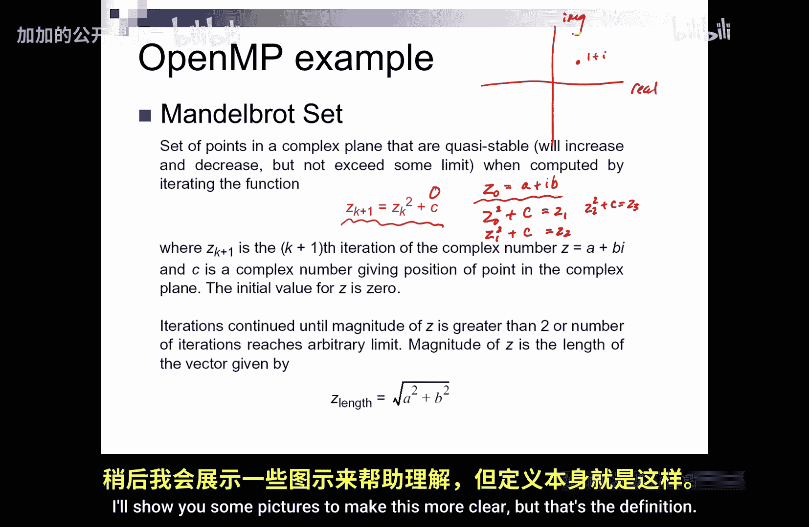
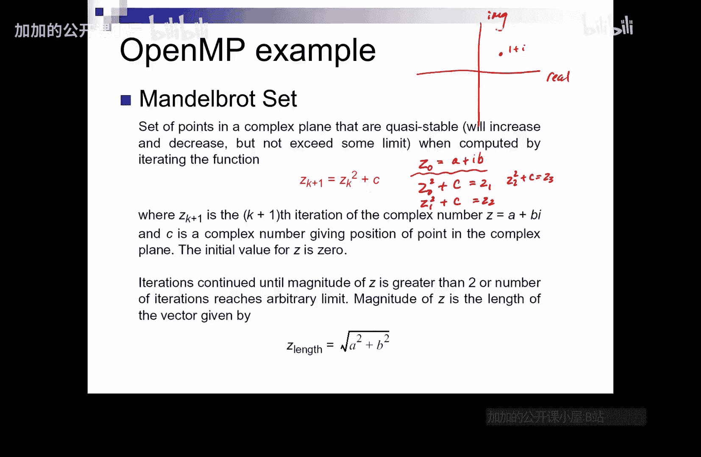
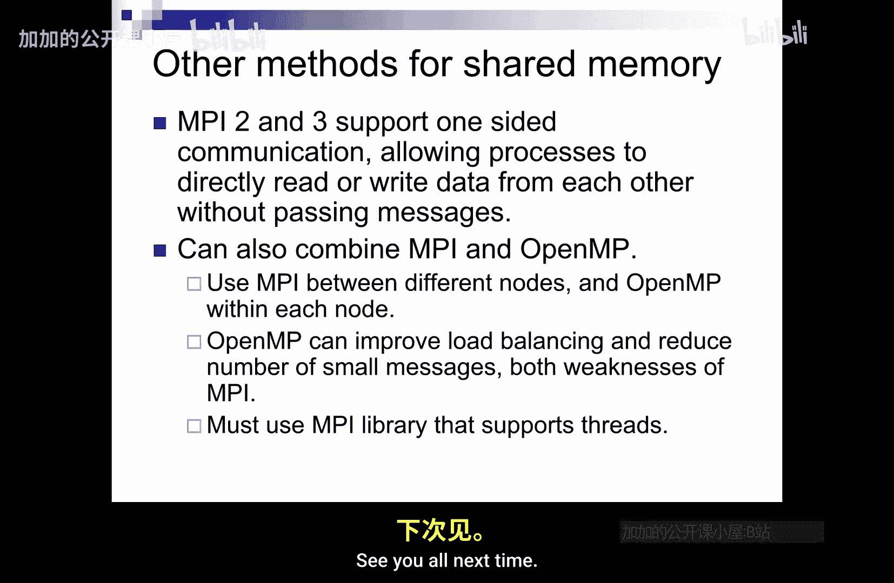

# 上海科技大学【中英⚡并行计算｜CS121 2020 Parallel computing】 p09 P9 OpenMP part 2 -BV1VqypBaEaP_p9-

Okay， so now let's see how to use Open MP to write shared memory programs。Okay。

 so open MP is an open standard okay so that means that it defines what openM includes。

 features that it includes， but it doesn't specify an implementation and so there are actually multiple implementations of open MP by different vendors。

And you can use OpenM with either C or C++ or Forran。

So openM is based on these things called compiler directives okay so they're basically so basically let's say that you use OpenM with C so then you just write a normal C program and then you add these little extra keywords or little annotations okay and these annotations tell the program how to do the parallelism。

Okay。So so the nice thing about this process of just using these compiler directives is that if you write an openmp program with these directives and you give it to an openmp compatible compiler right then of course that compiler is going to spit you out some parallel code that code that can run in parallel but you can also take these openmp programs with the compiler directives and if you give it to just a normal sequential compiler right that doesn't know anything about openmp then that program can still compile that program is still correct to the。

To the noncompatible compiler。Okay， so then。Oh right。

 and then there are several open MP compilers available， for example。

 one good one is the one from Intel。Okay so so now because you can write these you can just incrementally add these directives to a program right and then the program is always going to be correct both to openmp compilers and just normal sequential compilers so because of this then you can add parallelism to your program incrementally right so for example。

 if you have a big long program， maybe you don't have enough time right now to make everything parallel okay so you can just take certain parts of it and make that parallel to start out with maybe you can take some of the big loops and make those parallel okay and then later on you can add more parallelism as you get more time。

Okay， so that's a nice way to transition from， you know， if you have a sequential program right now。

 it's a nice way to transition， transition it to a。A parallel program。Okay， so yeah。

 so as I mentioned earlier， OpenM still uses threads underneath however。

 the programmer doesn't need to manage the threads by himself right the OpenM system is going to do that but because you don't actually have explicit control over the threads。

 then you can't quite do as many things as you can with things like Java or P threads but for most tasks OpenM is entirely capable of solving those。

Okay， so open MP is based on threads and it uses this fork join model that we talked about right so again。

 that's where you have a master thread at the beginning right and then when you have parallel work So in openM these parallel sections are called parallel regions and these regions are executed by a team of threads。

Okay， and and here the compiler is going to take care of creating these parallel regions Okay。

 so it's going to create the threads at the beginning of the parallel region。

 and then at the end it's going to destroy the threads Okay so the programmer doesn't need to worry about that。

Okay， so if you want to so we're going to go through some of the main features of OpenM。

 but if you want to get more details， you can go to this website。Okay。

 so the first thing to talk about is how do we do these parallel regions right because that's where the parallelism occurs Okay so in order to to start a parallel region。

 right， we want to make sure that we have many parallel threads because initially you just have one master thread and when you get to a parallel region。

 you need to create a bunch of a team of threads So the way that you create a team of threads is using this compiler directive。

 this this parallel compiler directive Okay so what you write is simply so you add this line to your program。

 you add this pragma OM parallel and then once you do that， then this creates a。

A team of threads and the team of threads will now execute the next block of code so the block of code is enclosed in these curly braces and whatever code is in here will be executed by the team of threads that's created。

And then at the end of this block of code， so at the end of the parallel region。

 the threads are going to do a join。And then that means that you go back to having just a single master thread。

Okay， so how many threads do you have， So this is not specified。 Okay。

 but when you actually run your program， then。You have some ways of controlling this so for example you can use a number of threads clause after your parallel directive so that's a suggestion to to the runtime system how many threads you want you can also call this function OMP set number of threads and then if you want to check how many threads you currently have there's this environment variable OMP number of threads and the recommendation is that you use one thread per processor or core but sometimes you can use more if the threads are really lightweight and they're not doing too much。

 you can have multiple threads per core。Okay so once you start that team of threads then they're all going to be executing this code in the following blog。

 but of course you don't want all the threads to do the same thing in that piece of code because in that case you would be just repeatedly you be doing redundant work you don't want everybody to do exactly the same thing。

So in order for the threads to do different things。

 you can have them do different things based on their thread ID。

 so this is just like in MPI where all of the processes run the same program but you can get them to do different things based on their process ID so here it's the same concept。

Now another way that you can get threats to do different things in this parallel region is to use these work sharing constructs okay。

 so there are a few of these and I'll go through these in more detail later。Yeah。

 and then these parallel regions can actually be nested。 Okay， so we looked at how， you know。

 forks can sorry， how slave threats can fork off more slave threats， right。

 So that that's an example ofing nested parallelism。Okay。

 so here's an example of using these parallel regions， so we have this。

So if you add this stuff to your program right then here when you write the Pgma OMP parallel。

 you're saying that I want several threads okay so then the runtime system will create multiple threads over here this statement over here about private so we'll talk more about this later but this is basically defining which variables are shared or not shared okay so this private means that each thread will have a variable called I am and then also MP right and then these variables are not shared between the threads。

Okay so the threads can share variables because we're in a shared memory setting。

 but in this case we don't want the different threads to share these variables。

 so we declare them to be private。Okay， so then following this this pragma 1p parallel， right。

 then you have your parallel region and this parallel region。

 all the threads that you create will execute this parallel region here。

So so what they're going to do is first of all， they're going to account how many threads there are right so this is kind of like that hello world example for MPI right where you look up how many processes are in your communicator so here we have a function OMP get number of threads that tells you how many threads were started up and then also the threads have thread IDs so if you started let's say k threads then the thread Is are going to be numbers from0 to k minus1 So every thread will have a different thread ID and this is how you make the threads do different things or this is one way you can have them do different things。

Okay， and then next， so we basically we're going to do a hello world again。

 so we're going to have the threads just say hello， okay。

 so it' going it's going to print out its own thread ID and then it's going to say how many total threats there are。

Okay， and so all of the threads in the parallel region are going to run this code。Okay， so。Yeah。

 so suppose you have let's say four threads right then you would be getting four of these messages however。

 the messages can come out in some arbitrary order right because the threats are executing at different speeds and they're not synchronized with each other Okay so you could you could get maybe hello from thread3 first and then maybe thread zero and then one and then two Okay so the order is actually arbitrary。

Okay， so next let's see how thread can share some work Okay， so yeah。

 so so oftentimes you don't want threads to all do all of the work in the parallel region。

 right you want them to you want to take the parallel region and divide that work into different chunks and give different chunks to different threads。

Okay so that's work sharing and one way you can do work so one example of work sharing would be suppose you have a big for loop in your parallel region。

Okay then you probably don't want all the threads to do all the iterations of the for loop right but let's say you have 100 iterations and you have five threads okay you don't want all five threads to each do 100 iterations right maybe you want each thread to do 20 iterations。

Okay， so the way you can take this for loop and you can break up the for loop among your different threads is that once you're in a parallel region。

 okay， you can write this pragma OMP4。And now this is going to take this for loop and then break it up among all the threads that you created。

Okay， so different threads will do different iterations of this。Okay。

 so yeah so how do you know which threads are going to do which iterations Well this is controlled by this thing called a schedule clause Okay。

 so I'll show you more details about this later。Now this pragma OMP4 okay so this doesn't start a team of threads Okay。

 so you have to use this pragma O4 within a parallel region after you've already created a bunch of parallel threads Okay this just tellso openmp how to break up the work it doesn't start any threads。

It's the outside enclosing pragma OMP parallel， that's the directive that actually starts the threads。

Okay， something else is that when you have this parallel for loop。

 so you have multiple threads and they're each doing some iterations of this for loop。

So now there's actually an implicit barrier at the end of this for loop okay so let's say that you have 100 iterations okay so and let's say you have five threads okay so some of the threads might finish all the iterations that they're responsible for。

 they might finish that very quickly okay but then after they finish。

 they're just going to wait at the end of this for loop okay so they're basically going to wait over here okay because there's an implicit barrier over here。

Okay，And the thread is going to wait until all of the other threads doing the other iterations have also finished their iterations。

Okay， so then after all 100 iterations have film finished， right。

 then the threads can go on to whatevers after this for loop。Okay。

 so this barrier is there automatically， you don't even have to specify the barrier。

And but if you don't want there to be a barrier， right， if you want to say that okay。

 whichever threat finishes its iterations first， it can just go on to do whatever comes afterwards。

 right then you can put a no weight clause okay， so that removes the barrier。Okay。

 so now I'm going to talk about these schedule clauses。

 so the schedule clause is basically how you control which threads do which iterations of the for loop。

Right， so there are different they are different types of schedules。

 so the first schedule is the static schedule。 Okay so the static schedule has this optional chunk parameter。

 now if you don't use the chunk parameter if you just say if you get rid of this So you just say you know schedule static like that then what's gonna to happen is basically it's gonna take let's say you have a bunch of iterations like this。

 Okay so these are like a bunch of iterations let's say like one to 100 then if you have let's say four threads。

 it's just gonna break these100 iterations evenly among your threads so each thread gets 25 iterations like this。

 Okay， so thread one gets iterations 1 to 25 right。

 thread2 gets you know26 to to 50 and then 51 to 75 and then so on。Okay， so you know， if it's not。

 if you can't exactly break it evenly， if it's like 101 iterations or something right。

 then one of these threads will get an extra iteration， okay。

 but basically it's going to break it as evenly as possible。

If you just have schedule static like that without the chunk， okay。Now。

 if you have the chunk parameter， it's going to do something different it's going to do it somewhat differently。

 so the chunk is going to say that it's going to give a chunk number of iterations to each thread。

Okay， and then it's gonna do that in a round robin order。 So for example。

 what's going to happen is suppose the chunk here is 10。 Okay and suppose again。

 you have four threads。 Okay so then thread1 is going to get iterations 1 to 10 so that's thread1 and then thread2 is going to get the next chunk of10 iterations So 11 to 20 is going to thread2。

 thread3 is going get the next chunk21 to 30 thread 4 is going to get the next chunk。

 which is 31 to to 40 And then since we're going round Robin。

 we're gonna we're gonna go back to thread1 Okay， so then thread1 is going to get 41 to to 50。Okay。

And then thread， I'm sorry， and this is thread one。

Okay and then thread2 will get the next 10 iterations， 51 to 60 right so okay。

 so I'm not drawing this right， but right yeah， so then you just you keep going in the order of the threads 1。

2，3，4，1，2，3，4 and then for each thread you give it the next 10 iterations Okay if your chunk is 10。

Okay， so but again， if you don't have a chunk， then you're not going to go through these threads multiple times。

 you just go through them once， and then each one of them gets， let's say。

 a quarter of the iterations。Okay。Yeah， so there's also this dynamic schedule。

 which also has an optional chunk parameter。Yeah， so each time a thread。Okay。

 so then here for the static schedule， you assign all of the iterations at the beginning right so as soon as you start the for loop。

 you know exactly which threads are assigned which iterations okay so that's why it's called static right because it's assigned at the very beginning。

For the dynamic schedule you first assign one so if you don't have this chunk parameter then by default。

 you're just going to assign one iteration per thread okay so then if you have four threads right thread one gets iteration one thread two gets iteration2 right thread3 gets iteration three。

 thread4 gets iteration4 and then after that you're just going to let the threads run and then one of them is going to finish its iteration right so yeah so let's actually write those okay。

Thread4 right so initially it oops  one，2，3，4 okay and then let's say that thread2 finishes first okay so at that point it's going to get a new it's going to get the next next iteration okay which is oops which is number five okay it's only going to get one iteration if you don't have the chunk over here right if you just write write it like this then you give one iteration at a time to the to the thread。

Okay and then let's say3 finishes its third iteration， it'll get number six。Okay。

 but then let's say that somehow threat2 is very very fast okay so before so thread1 is currently processing iteration1。

 thread4 is doing four right， but before either T1 or T4 can finish。

 let's say thread2 has already finished the fifth iteration okay。

 then it's going to get the next iteration8 or7 rather。Okay。

 and then maybe T1 finishes and then it's going to get the next iteration， which is8。Okay。

 so just so for the dynamic schedule， you assign the iterations to the thread。

 but whoever finishes their assigned iterations first， he's going to grab more iterations。

and the number of iterations he grabs is given by this chunk parameter， so by default。

 he's going to grab one new iteration okay， but if you set chunk to be like 10。

 then he's going to grab 10 iterations。O。So。Yeah， so so there's some overhead to doing this right because you know you have to now keep track of which threads are finished with their iterations and then you have to assign them new iterations okay but the benefit of doing this dynamic schedule is that suppose the iterations have different sizes okay so like some of the iterations let's say somehow are very cheap to do okay and some of them are more expensive so actually towards the end we'll see an example where you have a four loop but some of the iterations of the for loop are a lot more expensive than the others okay so in that case then for example。

 if if T1 got a very expensive iteration right so let's sort of mark that with a circle okay so if this is very expensive then T1 might need to spend a lot of time on this iteration。

Okay， but then maybe T2 got a very cheap iteration right。

 so it can finish its iteration very quickly and then it'll get the next one and then the next one and then the next one。

Okay， right， so basically for the dynamic schedule。

 whoever finishes first because they had less work to do， they're going to grab more work。

Okay so this achieves better load balancing because if you don't use a dynamic schedule。

 if you use something like a static schedule right， then then maybe you're gonna to sign thread1。

 let's say 25 iterations but maybe those 25 iterations are all very expensive。

 So then thread1 is going have to run for a long， long time。

 Okay maybe thread2 got another 25 iterations， but those are somehow very cheap。

 So then it's going to run very quickly Okay and then after thread2 finishes。

 it's just going to stop's it's not going to do anything anymore。 Okay。

 so now you're wasting a lot of cycles that thread2 could be doing something useful。

So when you have sort of imbalanced iterations， some iterations take more time than others then you might want to use a dynamic schedule。

Okay' you do pay some overhead for doing that right so if all the iterations have the same size you don't want to use the dynamic schedule because you want to avoid that overhead。

 but if the iterations are really invalidbalanced， okay then the dynamic schedule can improve load balancing and get you better performance。

Okay now there's this a guided schedule this is kind of like a dynamic scheduling except for the you don't always grab the same number of iterations each time okay it's for a dynamic schedule you always grab by default you just grab one iteration but you could take like you know if your chunk is 10 youll take 10 iterations each time Now for guided you can actually take different numbers of iterations each time you grab something so in the beginning you take a lot of iterations okay and then as you keep grabbing more and more iterations each time the number of iterations you grab decreases。

Okay， so so this still helps you to do load balancing。

 but now there's less overhead to doing the schedule because now you don't need to grab chunks as many times because you know initially you grab a really large chunk and then you keep grabbing smaller chunks so you don't have to as many times as you would with a dynamic schedule。

Yeah and then you can check the type of schedule that you're currently using using this variable openM schedule。

Okay， so。Okay， so let's see an example of this so here so what happens is in an openmp program。

 the main thing that you parallelize like the most frequent thing that you parallelize are these four loops because usually that's where most most of the work in a program is being done in four loops right so if you want to improve the performance。

 you want to parallelize these four loops so because you frequently need to parallelize four loops。

 then you can actually combine the parallel directive with the with a parallel for directive so remember that previously we said in order to use a parallel for you first of all。

 have to go into a parallel region to do that， you need to call pragma O parallel once you're inside the region。

 you again need to call pragma OM4。Okay but to make it more convenient。

 you can actually combine the parallel region with a parallel 4。 So if you write this。

 the pragma OMP parallel4 okay this is both going to take you into a parallel region with multiple threads。

And it's going to let you do a for loop in that parallel region。Okay， so this is just。

 it's sort of syntactically like a convenience， okay， it just combines both operations together。Okay。

 so this statement is going to again it's going to create a bunch of parallel threads and it's going to split the for loop between those threads and here we're using a static schedule meaning that each thread is going to get the same number of iterations。

Okay and this is reasonable because you can see that all of these iterations have basically the same cost okay。

 so by giving the same number of iterations to each thread， we actually achieve good load balancing。

Okay now there are several restrictions to how you use the parallel forces。

 so first of all the number of iterations like this n over here。

 okay so this is not allowed to change so like you can't just modify n within your for loop。Okay。

 and also the loop increment， right So here we're incrementing I by one each time。

 this also needs to be fixed。 Okay And then furthermore， within the loop。

 you can't just exit the loop prematurely。 Okay， you can't call a break or something in there Okay so basically the the reason for all of these for making these restrictions is so that we know how many how many iterations are going to be executing in total Okay because for example。

 these schedule clauses right They need to they need to know how many iterations you're executing in order to。

In order to do the load balancing and the iteration assignment。Okay。

 so so now I'm just going so there are several different ways that you can write the parallel for。

 so I'm just going to summarize them all over here Okay so first of all you can just do a sequential for loop Okay so here that you don't have any parallelism right so you just have a normal for loop like this。

Okay， you can also， first of all create your parallel region using pragma OMP parallel and then you can do the work sharing within that parallel region using pragma OMP4。

Okay， so this is going to share the。It's gonna split the iterations of the for loop between the threads。

 but you can also split them manually。 okay so like if you have so here you're just looking at how many iterations you're doing right you're doing n iterations and then you have let's say end threads that's how many threads you have right so then you can manually let's say you want to give the same number of iterations each thread okay then you can manually compute which iterations each thread should have and then you can just and then if you write this then what's going happen is when you go into this parallel region here。

 you create a bunch of threads let's say you create four threads for simplicity Okay so each of those threads is going compute its own start and end。

Start and end indices okay and then each thread is going to do this for loop over here。

 but different threads will have different start and end indices。

 and so that means that different threads will be doing different parts of parallel for loop of this for loop。

So that's the manual way to do a parallel for loop and you don't want to use this。

 you definitely don't want to do this manually。诶。😊，Okay。

 so here is where you combine the parallel sorry the pragma MP parallel with the pragma OM4， okay。

 you can combine them together into one statement。And then finally this is not what you want to do if you do something like this。

 then what's going to happen is here you create a bunch of threads。

 let's say four threads right and then here this for loop is iterating over from zero up to n and now when you have four threads。

 all four threads are going to do all of the iterations from zero to n。Okay。

 so you're doing basically four times as much work right you're duplicating the work four times okay that's not what you want to do okay you want to have each thread do one quarter of the iterations right so yeah so these three methods okay this one right or this one this is actually kind of the preferred one right or you can use that or you know for some reason you want to do this manually you could in principle use this also right but you don't want to use this one。

Okay， so there are other types of work sharing that you can do right so you can divide a for loop。

 but there are other types of work that you can try to do in parallel one of them is the sections okay so。

Yeah， so sections， if we look at this code over here。

 what's happening is so again we need to be in a parallel region。

 so we need to first call pragma OMP parallel right this starts a bunch of threads now within this parallel region if you start a sections right a sections construct right with pragma OMP sections then here you can define multiple chunks of work。

So each section is basically a chunk of work okay and then now the threads that you started in your parallel region will be assigned to different chunks of work so each thread can be assigned to any number of chunks of work okay so maybe some thread doesn't get any chunk of work and some thread might get many of these different sections but each section here represents some work to do and then you know you've started some number of threads over here and they're going to be mapped somehow to these different sections。

Yeah。Now in this sections work sharing construct， there's also an implicit barrier at the end okay so there's so if some thread finishes all its sections first。

 it's going to wait at the end of this sections construct okay it's going to wait until all of the threads have finished all the sections and then after that all the threads will go on to the stuff after sections。

If you don't want that barrier， again， you can usually no weight。

Okay now sometimes you're in a parallel section， but you don't want all the threads to do an operation。

 you just want one thread to do an operation okay right for example。

 if you're writing a file okay maybe you don't want you don't need all the threads to write the file multiple times you just want one thread to do it okay so to do that you can use this single construct okay so just write pragma O single and then whatever stuff is in here。

 that's only going to be done by one thread okay and that's not necessarily the master thread。Right。

 okay， and。Yeah， and so even though this is being done by one thread。

 there's still a barrier that's implicit here unless you use no weight， okay。

 so that means that even though only one thread is executing here。

 the other threads are waiting at the end of this single statement over here。Okay。

 now for the single construct you you don't I don't think you can control which thread is actually doing the the stuff。

 Okay， but if for some reason you need the master thread to do that stuff right。

 then you can call this master construct。 So this is again going be done just by by a single thread namely the master thread and all of the。

Oh so there's no implicit barrier， okay， so then the master thread will do this stuff。

 but the other threads will go on to the subsequent stuff without waiting for the master to finish。

Okay， so now we're going to talk about the so openM。

 we can share memory so now let's see how we can actually share memory。

 okay so there are various commands for sharing the memory。Okay， so so first of all。

 we can have both shared variables and private variables， okay。

 so the shared variables are can be read and assigned by any thread。

 but also threads can have private variables which only they can read and modify。

So most variables are shared by default， okay so for example。

 global variables or static variables are shared by default and also threads that the master sorry variables that the master thread declares are shared by default。

But there are also variables that are that are private by default okay so for example。

 if you have a parallel4， then there's an index variable now those index variables are private by default because if you have multiple threads and they're all doing this parallel4 right then of course you don't want them to use the same index because the different threads are doing different iterations of this parallel4 so therefore each thread needs to have its own index into the for loop。

🤧。Okay， also if you have a stack variables， Okay， so if your threads。

 if these parallel threads call functions right， then that's going to create stack variables。

 So those are also going to be private by default Okay so whichever thread calls a function。

 and if that function creates a bunch of stack variables。

 then those stack variables are private to the calling thread。Okay。

 and also automatic variables in the functions， which you call in a parallel region are also private by default。

Okay， so now you can also control which whether variables are shared or private okay so the way you can do that is using these shared or shared or private constructs okay so you write shared and then you give a list of variables and then those who become shared between the threads okay if you write private with the variables。

 they become private。嗯。Okay， and then you can also make the shared variables by default。

 shared or private。Okay so here's an example of controlling the sharing of variables。

 so suppose you have this variable x right initially it's 5， and then we start a parallel region。

 but here before we start the region you say that x is private。Okay。

 so this means that in this parallel region， you have multiple threads。

 but now each of them will have its own copy of x。Okay。

 so so here each thread is going to get its thread ID and then set x to be the thread ID Okay and then but this is its own private copy of x Okay。

 so that means that every thread will have a different value of x okay。

 and then it's going to print out that value over here。

And then at the end of this parallel section right then x goes back to being shared okay so x was shared initially because it's a global variable here and then it became private once you enter the parallel section right but then after you exit x of the parallel region it becomes shared again so then here right you're going to say that the shared x is equal to5 again。

Okay。Yeah， yeah， so this is summarized over here。Okay。

 now you have ways of of setting the initial very initial value of a variable。 Okay。

 so you can use this thing called first private。 Okay， so first private means that if you have。

Like a shared variable right， but then when you go into a parallel region it becomes private。

 then what is the initial value of that private variable so if you use first private。

 then the initial value of that variable is whatever value it had in the outside region before you enter the parallel region。

O。And then also， when you exit the parallel region， you might want to set。呃啊。

might want to take a variable which is private in the parallel region。

 and then you want that value to be adopted by the shared version of the variable outside the parallel region。

Okay， and you can do that using last private。Okay， so as an example of this， right。

 So suppose you have a shared variable temp here， which is initially equal to 2。 Okay。

 now you start a parallel region and you say first private temp。 Okay。

 and you say you also say last private temp。 Okay， so then what this is going to do is。嗯。All right。

 and then within this parallel region you're doing a let's see a for loop here。

Right okay so then here every thread has its own private copy of T okay but because you call this first private here right and because temp was equal to two outside of the parallel region then the initial value for this temp is going to be2 so then here you're going to increment this two right and then sorry you're going to increment temp starting from two so then you're going to end up with some value of temp which is which is more than two。

And then here， when you call last private， this is saying that whatever value of temp you ended up with。

 this becomes the new value of temp after you exit this parallel region。Okay。

 so then here when we print the value of temp， we're definitely going to print something larger than two。

Because temp here was initialized to two， it got incremented some number of times。

 and then after you exit the parallel region， whatever the final value for temp。

 that becomes the new a shared value for temp。Okay now there are these things called reduction variables so this is important so sometimes when you have multiple threads right you want them to access a common piece of data。

 so for example， you might have a like a counter so you have a bunch of threads and they each check。

 let's say a data stream to see how many times something occurs each time they see it occurs。

 they want to increment the counter so now this counter needs to be shared between the threads and so we saw that if you just if you just have a normal shared variable and you have a bunch of threads modifying this variable concurrently。

 then you can have these race conditions where the variable ends up with incorrect values。

And we saw that one way to prevent this was to whenever you want to access the variable。

 you include the variable in a critical section， you wrap it up in a critical section okay， however。

Yeah， so， so maybe here we have an example。 Okay， so suppose you have a。嗯。

So this example down here right， so suppose you have a parallel4 where what we're trying to do is we have this array A okay。

 and you want to sum up all of the values in this array。

Okay into a variable X now one way to do this is what we're going to start a parallel section here and then so this is a parallel4 right so then different threads will be assigned different iterations of this。

 so they'll be assigned different parts of a and then they'll be reading this value of a and adding it to X adding it into X。

But because this x is being shared by different threads。

 we need to make sure that the different threads don't sort of collide with each other and so one way to do this is using this critical section to put a critical section around the axis to X now this will make sure that x does get the correct value end up with the correct value right which is equal to the sum of all of the array values okay so this code is correct but it's going to perform very poorly。

Because all of the threads keep calling this critical section so this is a very expensive operation to try to take a look in order to enter the critical section。

Okay so this code is going to perform very poorly okay probably much more poorly than if you just did this entire for loop sequentially okay so here we're trying to get some extra speed by parallellyzing。

 but because you make so many calls to the critical section。

 you're probably going to hurt your performance by a lot。

So instead what we can do is we can use this parallel4 reduction so here we have a parallel4 and we say that certain variables are reduction variables。

And also you have to specify how you're doing the reduction。

 so here we're saying that we want to add things into the very value of x okay。

sorry here you're saying that well okay so let me go through this first okay so what's going to happen over here is when you have this when you have this reduction thing。

 this is going to make multiple copies of x each thread is going to end up with one copy of x okay so if you have let's say four threads。

 you're actually going to create four copies of x and each thread will have its own copy of X okay own private copy of x。

And so now when the thread goes to execute this parallel4。

 the thread is assigned some iterations of this overall for loop and it's going to add all of the values from the array into its own private copy of x。

Okay so now there's no collision between the different threads for accessing X because each of them has a private copy。

Okay， so unlike here where all of the threads share the same copy。

 and so therefore you need to protect this copy with a critical section。

 so here even though you know we're calling this variable X for all the different threads。

 it's actually a different variable for each thread。Okay。

 so therefore the thread can just add these values of a into its copy and there won't be any race condition with the other threads。

Okay， so at the end of this process， after a threat has gone through all of its iterations right so it was assigned some of the iterations of the for loop and after it's done with all those iterations。

 itll have its value of x will be the sum of the parts of a that it was assigned。Okay。

 so then each of the threads is going to end up with part of this overall sum of a。

And now this reduction plus means that you want to take these private copies of eggs and then add them all together。

And then when you add these all together， you get the sum for all of the elements of A。

Because these elements of a were divided among the threads in some way were partition among the threads every array element went to one of the threads and then each of the threads took all the parts of a。

 it was assigned and added them together into its private copy of X。Okay， and then finally。

 have because this x is a reduction variable， we're going to take all of those private copies of x and add them together。

 and that gets us the overall sum of x。🤧And now this piece of code is also correct because it adds up all the values of x of a right。

It's going to be much more efficient than this other piece of code over here because here we don't need to use anything about critical sections。

 right these are just regular additions right un'protected by anything。

 so these are going to go very fast。🤧呃，O。All right。

 so next so we just saw that we needed to one way to protect variables so here know this is not a good approach。

 but sometimes you do need to use critical sections okay here you can get away with using a reduction variable and that's much more efficient but sometimes you do need to use critical sections and the way you can use them is just with the pragma OMP critical okay and then you can write and then whatever piece of code goes after this critical that is only going to be done by one thread at a time。

Okay， so now you can also give yeah， so you can also give a name to this critical section to identify it okay。

 if you don't give a name， then they default to having the same name。

Now in addition to critical sections， you can also have locks okay in openM。

 so the way you access these locks is through these various functions， okay。

 you can initialize the lock， set the lock， unset the lock， atest it， and then destroy the lock。Okay。

 so then here the argument to the lock is a memory location。O。Now。

 what is the difference between a critical section and a lock。

 The difference is that a critical section is saying that a piece of code can only be accessed by one thread at a time okay。

 whereas a lock。Here the argument to the lock is a memory location okay so the lock is protecting the data to make sure that only one thread is modifying the data at a time the critical section is protecting a section of code so to give an example of how these are different。

 suppose you have suppose you have a function which inserts into a hash table。Okay。

 so if you use a critical section around this hash function。

 then that means that only one thread can call the hash function at a time。

So that means only one thread can insert into the hash table at a time， okay。

 but maybe this isn't what you want because you know， if you have a。

 let's say a hash table like this， right？If the different threads are inserting into different locations。

 right so if you have a thread one is inserting here and thread two is inserting here。

 there's no problem having both of these run in parallel。But if you use a critical section。

 then either T1 can insert or T2， but you cannot run these in parallel。Okay。

 now what you do want to protect with this hash table is that you don't want T1 and T2 to write to the same location at a time。

Okay， so what you can do is you can put a lock around these memory locations so that will prevent different threads from writing to the same location at the same time。

 but it does allow different threads to write to different locations because different locations each location has a different lock so after T1 locks this location。

 it doesn't prevent T2 from locking this location。Okay so yeah。

 so openM also has barriers right so we've talked about barriers that's basically where you have if you put the barrier。

 if you write this pragma MP barrier somewhere in your code。

 that means that so this has to occur in a parallel section but if you write this in a parallel section。

 that means that all of the threads are going to wait to get to that line of code before any of them proceed past that line of code。

Okay， so we have some additional synchronization constructs。

 so for example here we have these atomic constructs。Let's see。Yeah。

 so then only so when you write this prag MP atomic right。

 then only one thread can execute this statement at a time。 Okay。

 so these atomic operations are are just simple are they're limited to being simple operations like maybe increment or max or test and set or something okay so。

Yeah， but however， so when you do one of these atomic operations。

 so let's say you're doing atomic increment okay then when multiple threads call these atomic increments。

 you can be sure that each of the increments will be done by itself will be done mutually exclusively okay so if you do let's say 10 increments you're guaranteed that the value increases by 10。

RightWhereas if you just do it without any protection around the increment。

 then you don't know how much the value is going to increase by so basically the atomic operations are like a critical section。

 Okay they protect this piece of code over here。 However。

 they're limited because you're only allowed to do these a few operations like increment or max or a few other operations。

 so they're bad because they're limited， but they're very good because these operations will be done in hardware。

 So this is going to be very fast so if you put the increment inside of a critical section。

 then it's going to take you a long time to do that increment。But if you do an atomic increment。

 then because it's done in hardware， it's actually very， very fast。Okay。

 so the last type of or sorry so one other type of synchronization construct is this flush command okay so here if you do pragma MP P flush right what's going to happen is you give a list of variables over here and these variables will be now written from the the buffer of a processor into the cache or memory and once that happens。

 then all of the other processors will see the latest value of these variables so the flush is basically a away for you to make sure that other threads。

 see the same value for the variable that you have。

Okay so so the reason this is needed is because when one thread。

 so let's say you have a thread operating on this core， okay so when it's modifying variables。

 these variables might be stored in these buffers for efficiency purposes okay these buffers can be accessed very quickly but when they're in these buffers。

 then the variables are not visible， the values of the variables are not visible to any other threads in a different core。

Okay， so you might have modified these values here and nobody knows about your modifications。

OkayAnd that's bad because now it seems like now there are multiple copies of this variable。

 there should only be one copy of a variable in a shared memory setting。

 but if the variable is stored in the buffer， then different processors could have different values for this variable。

Okay， so in order to make sure that all the processor sorry all the threads have the same value for the variable。

 you need to take this variable and flush it out from these buffers into either the cache or the memory。

If you flush it out into memory， then the other threads can definitely see the value and if you flush it out to cache then because you usually have a cache coherency protocol running。

 then the cache coherency protocol is going to basically send the latest value to all of the other processors that are accessing this variable。

Okay。Okay， so so next we have these things called ordered statements so the ordered statements basically they so you use these ordered statements inside a parallel4s okay so what's going to happen is the ordered statement lets you do part of this parallel4 in parallel。

 but once you get to the ordered part of the parallel4。

 then these will be done exactly in the order of the iterations。Okay， so for example。

 in this example over here， right， if you have this parallel4， then this stuff up here。

 if we have multiple threads， then this stuff up here will be done by multiple threads in parallel。

However， for the ordered part over here， these will always be done in the order of the iterations like so the iterations are going from0 to n right and so the increments will always so the increments and decrements to S and T will be always done in the order01。

2 and so on。Okay， so basically the reason we use this is so that here we can still get some parallelism because here。

 since we're not inside the ordered statement we can do multiple things in parallel。

 but here you might have some things that for some reason you have to do these in the loop order okay so this ordered statement lets you combine parallelism with something that you have to do in loop order。

Okay， so when you use these ordered statements， you typically want to use a static schedule with a small chunk size and the reason is that so here we can consider two examples。

 Okay so suppose you have a four loop with let's say nine iterations and three threads so now if you do if you use a static schedule。

 but you don't specify the chunk size， then every thread will get basically you have three threads。

 so they're going to get three iterations one third of the iterations And yeah。

 so thread zero will get the first three iterations and then thread one the next three and then so on so now let's see what happens when you go execute this。

For loop and suppose it's got an ordered statement in there okay then since we need to execute this ordered statement exactly in the loop order。

 then what's going to happen is that there's a little part of this for loop right so these this part over here so this corresponds to this part which can be done in parallel across all the different threads。

However， the ordered part that's what these circles are。

 these have to be done in order right and because thread0 has the first three iterations you have to let thread0 do the first three iterations and then only after thread0 has finished its third iteration can you have thread1 do its three iterations and then only after thread1 finishes can you have thread2 do something。

Okay， so basically we've sequential， so if you use a static schedule right then you basically have sequentialized this entire computation because you see that over here both thread2 and threads1 and2 are not doing anything they're waiting for thread zero to finish with its ordered iterations。

Okay however， if you use a difference schedule， if you use for example static with a small chunk size。

 let's say of one right then what's going to happen is remember for the static schedule with a chunk size of one we're going to assign one iteration at a time to the thread in round robin order okay so this means that thread zero gets assigned the first iteration and then you assign one iteration to thread one and then one iteration to thread2 and then you go round roin so you give three to0 iteration4 to two and then so on okay so we assign the iterations this way right。

Now what happens is now if you execute this fourth statement with the ordered statement this loop with the ordered statement。

 you see that well again， we have this part which corresponds to this part which can be done in parallel you see that this is being done in parallel across the three threads and then you have to wait for the。

For the first iteration to finish right so that's what's happening over here but as soon as the first iteration finishes okay so here oops you have the two threads their id link because they're waiting for the first iteration to finish but as soon as that iteration finishes。

 thread one can now do its iteration for this ordered part and then after that thread2 can do its third iteration。

Right can do and then in the meantime right the threads can go back to doing this parallel stuff Okay so here we have more parallel stuff that's being done right yeah。

 and then after you do the parallel stuff you again get to the ordered part right so again you have to wait for iteration three to finish before you do four before you do five but here you see that there's a lot less waiting right you see that there's a lot more parallelism when you do the。

When you do this static schedule with small chunk size compared to just the normal static schedule。

Okay， so。All right so so next we have a few functions that we can call to find out some conditions about the runtime environment。

 so for example these functions can get can tell us the number of threads or set the number of threads you can also do that you can control how many threads you have and you can also have a find out its thread ID。

Okay， you can find out how many processors you have because it might be like a multi core multi processorces system。

And then you can find out whether you're currently in an active region or not， yeah。

 and then you can even dynamically adjust the number of thread in a parallel region。Okay。

 so so that basically describes the how we use openmp。

 So now I want to give an example of actually doing a problem using using openmp actually computing something using openmp。

 So the problem we're going look at is how to compute the Mandobro set so so basically the Mandobro set is its so we're gonna to look at all of the complex numbers。

 Okay so imagine that you draw the complex actually maybe I should draw differently。

 So imagine that you draw the complex plane。 Okay so here you have all of the real numbers and then here you have the imaginary numbers。

 so let me just write this as real and then here you have the imaginary numbers。 Okay so for example。

 this value here might be something like you know one plus I okay so what does Mandobro set is it's a subset of this complex plane。

 so it consists of some。Some of these points so some of these points are in the man broad set and the other ones are not okay so then the way it's defined is that we're going to take you're going to take a complex value like this and you're going to keep iterating that value through a function like this okay so you youm sorry you take this function and then you keep iterating this function and the initial value of the function is going to be some some number from your complex plane okay so what this function is is that。

嗯。But let's see it。Yeah， so initially you're going to set Z。

're going to set so you're going to set z0 to be some complex number okay so something like a plus i times B okay and then you're going to square this z right so you're going to square this Z0 and then you're going to add some constant C over here okay so the C is some other complex number okay so that gets you a new number which you're going to call z1。

Okay and then you're going to take z1 and you're going to squared again and you're going to add c to it okay and that gets you z2 right and then you do it again you get Z3 right so you do Z2 squared plus C and then you get Z3 and then you just keep doing this okay。

Now what you're looking for is eventually you're looking at sort of limit the limiting value of these z's okay so imagine that you do this iteration like an infinite number of times now one thing that can happen is if you do this an infinite number of times。

 then maybe the z' keep getting larger and larger， so the z values go off to infinity。Okay。

 if they go off to infinity， then you say the value is not in the Mandobro set。🤧Okay， however。

 for certain initial values of Z0。These values might stay finite。Okay so for example。

 if you're C here， so let's set a value for C okay so let let's like0 over here okay and let's say that your initial value here was also let's say it's1 okay it's just equal to1 plus0 times I so then if you keep squaring this right this does not grow to infinity it just stays at1。

Okay， so if after you keep iterating these values， if the limiting value of z is finite。

 then you say that this initial value of z is in the Manelbro set。Okay。

 so that's how we define this man broad set， so I'll show you some pictures to make this more clear okay。

 but that's the definition and。

Okay so so let's go with the picture first okay yeah so here we have this beautiful picture。

 so this is the mandabro set okay so what this is saying is basically all of the points。

 all of these black points these are points of the complex plane such that if you iterate this function z squared plus C。

 even if you do this in infinite number of times these values do not diverge to infinity。🤧Okay。

However， for these other colored values over here， these values， if you iterate them many times。

 they do diverge to infinity。Okay， so this is， so if you look at this， for example。

 if you pick a point over here， okay， this is a very large point right。

 let's say it's something like you know2 plus two times I Okay well if you take two plus two times I and you keep squaring it and then adding some value to that right then you know then this value is going to get larger and larger and it's going to blow up and go off to infinity Okay。

 so that's why you know this point is not。In the manda broad set okay whereas know this point here right this might be the zero point okay so if you take0 and you keep squaring it。

 right it's not going to blow up and go off to infinity and so this is in the mandabro set。

Okay so what's really interesting about this figure is that the set of points which are in the Manbro set versus not in the set right they have this incredibly intricate pattern right like for example you know here you know these points they are in the set。

 but if you just move a little bit then they're outside the set now okay so there's a huge amount of detail to to these points so you can't really see this on this figure but you know these little arms that are shooting off of the circles right so these arms have a very。

 very detailed structures okay and the sort of incredible thing is that even if you were to zoom in on one of these arms okay they would still have more detail。

So， in fact， you can keep zooming in over and over onto any region of the Mandobro set。

 and you would never see that this this region becomes like smooth eventually， right。

 meaning that yeah， so so the region would always show more and more detail。 Okay。

 so so let me illustrate that with this movie over here。 Okay。

 so this movie is initially we're very far away from the Mandobro set。

 And what we're gonna do as I play this movie is we're gonna zoom in onto the Mandobro set。 Okay。

 so here you see the scale of the zooming。 Okay， so you see that we're we're zooming in onto the Mandobro set。

 And。

We're zooming in on these little arms over here。 and you see that we're gonna see more and more detail appear。

 Okay， so you see that even as you zoom in， you see more of these little circle things。 Okay In fact。

 this manbro set is a fractal， meaning that you see the same pattern basically appear over and over。

 but it's not exactly the same pattern。 Okay， it looks similar， but it's somewhat different。 Okay。

 so here as you zoom in， right， it's it's incredible。 I mean， you have this spiral。

 and there's just more and more detail in the spiral。 Okay， no matter how you zoom in。

 you never get to a region which is like either completely black or completely completely light。

 Okay， right so so here we've zoomed in， you can see this is already we've zoomed in by a factor of 10 to the 10。

 so 10 billion times。 and yet we still see more。

More patterns in this Okay， so I think how long is this video。

 I think that there are a few more interesting features which so let's let this run a bit longer because I think at some point a very cool thing starts to happen。

If I remember correctly。All right， so let's wait for a bit more of this。嗯。

Okay right so you see all these patterns and you kind of see that these patterns are similar to the patterns that we've seen before at higher resolutions right but they're not exactly the same okay so things do kind of repeat and yet they're different okay so now here's the incredible thing that happens okay so remember the initial shape that we started with which was the circle thing that this sort of heart shaped thing okay so now we've zoomed in by a factor of 10 to the 20th okay and somehow miraculously right this shape has reappeared。

O。And if you were to zoom in by another 10 to the 20th， then I don't know about this。

 but I think the shape can reappear again。O。😊，So anyways。

 I find this to be very cool and so this is the Mandabro set and what's even more amazing about this is that all of it is defined by this incredibly simple expression over here okay so you just start with a complex value you keep iterating that complex value over and over and if it diverges it's in the Mandabro set and if it。

I'm sorry if it diverggees， it's outside the man where Ro said， if it does not diverge。

 it's in the set。

Okay now you notice that there are these colors here okay so strictly speaking of values either in the set or not in the set right so we should actually have a black and white figure so the colors are actually indicating how quickly a value diverges so somehow these colors are set to correspond to how quickly a value diverges okay so that makes the picture look a bit nicer。

Okay， so now it's actually very easy to construct the Mandobro set， okay。

 we can write a simple function to compute the Mandobro set。

 so what we're doing over here is that given a particular pixel C we're seeing we're just going to iterate the starting value multiple times and we're going to see if it diverges or not and the number of times we're going to iterate is we're just going to iterate this 256 times okay and the criteria we're saying is that if after 256 iterations if this point if this complex value is sufficiently large then we're going to say that it's going to diverge。

But if it's small， right， if it's if the length of this complex value is less than 4， right。

 then we're going to say that。We're going to assume that the value does not diverge now we could be wrong because even so we're iterating this 256 times it could be that after 256 iterations the value has not diverged yet but if you iterate this a few more times then it does diverge so this is possible but for simplicity we're fixing the number of iterations and then we're checking the size of this value at the end of this and if the size is less than four here then we're going assume that it does not diverge and now these computations all they're doing is they're just computing they're doing this calculation over here so this calculation remember z these are complex values do so we're going to split the z into the real and the complex part and now if you want to square z the real part becomes a squared minus b squared so the current value of z let's say is a。

plus B okay so if you want to square this， the real part is a squared minus b squared。

 the complex part is2 times A B right and then we need to add this to C。And then。

And then it's known that if the magnitude of this Z。

 okay so this is a complex number in the complex plane。

 so if the magnitude which is the distance away from the origin， if this is ever larger than two。

 then this value definitely will diverge okay if it's less than 2。

 then it's not guaranteed that it will converge， but if after 256 iterations。

 it still is the magnitude is less than 2， then we assume it does converge。

 and then we say that it belongs to the manbro set。Okay， so that's the computation for computing。

 whether one value C converges or diverges。And when you compute the Manbro set you need to know this information for all the values in the complex plane right so then what we do is we just divide this plane into a bunch of pixels and for each pixel we've run this calculation over here。

And so all of the pixels are completely all the computations are completely independent from each other right so therefore we can run all of them in parallel now the only question is if we have a bunch of parallel threads。

 how many pixels do we assign to each thread？So one simple way is using a static assignment right so a static assignment would be so we're going to iterate through all of these pixels in a double for loop right so this is iterating through all of the rows right and and the other one is iterating through all the columns now we can parallelize this we're going to parallelize just the outer for loop so we're going to parallelze all the rows of the plane。

And we can use just a basic static schedule。Now if this happens， if we use a basic static schedule。

 this is actually not efficient okay and the reason is that if you look at the Manarbro set。

 okay so what's happening is if you use a static schedule。

 then maybe thread one is responsible for let's say these iteration these rows over here and thread two might have these rows thread3 these rows let's say four and then five okay oops。

Okay， now the thing is that thread1， because it's taking care of these rows。

 these values here very are very large okay so if you run this calculation here。

 then after just a few iterations， you're going to see that these lengths are going to exceed four and so you can already stop the for loop sorry the while loop。

Okay so therefore each of these pixels over here， though you just run the wild loop for a few iterations。

 so they're very quick。Okay so all of these computations just take a little bit of time to do。

Okay now over here， if you look at T3 okay so it's responsible for these this part of the plane okay and for example。

 for these values right so these values don't diverge so even after you iterate them 256 times they still don't diverge so that means that T3 has to run these all of these values as to iterate all of them for 256 times whereas t1 over here can iterate all of these values just for a few times。

Okay， so that means that T1 is going to run much faster than T3。Okay， if you assign T1。

 these rows and T3， these rows， then T1 is going to finish a lot faster than T3。

 and so you have a lot of load imbalance。Okay so that's not efficient because we have load imbalance。

 and so in order to make things more efficient， we're going to static not use a default static schedule。

 we can for example， use a static schedule with a chunk of one。Okay。

 so if you use a static schedule of with a chunk of one， then what's going to happen is。

You're going to say that so this top row here let's say that gets assigned to thread one right and then this gets assigned to thread 2。

3，4 right and let's say you have four threads so then you're gonna to go roundrobin and so you're going to assign these in this order so then in this way you see that thread one it's assigned some of these easy easy rows right but it's also assigned some of these hard rows these hard rows where you have to run for a long time so basically the amount of work for each thread you can see that each thread is assigned some of the easy rows in some of the hard rows so the work is much more balanced if you use the the cyclic assignment。

Okay， or you can use the dynamic assignment， or you can use a guided assignment， okay。

 but all of these will achieve much better load balancing than just using the default static assignment。

Okay so so the final thing I want to say is now there are a few other ways to do shared memory programming。

 so there are these things called PgaAS languages， which people have been looking at for the last few years so they're not they're not very popular right now so not many people are using them but there is a hope that somehow they have a better performance properties than OpenM so they're still being researched and perhaps in the future will start using them so therefore to finish up I just want to mention a few of these languages so PgaAS stands for partition global address space so basically。

The idea is that we're going to treat so in shared memory programming all the processes or all the threads can access this entire chunk of memory okay but that doesn't mean that the memory is all stored at one location and all threads have uniform access to all chunks of memory right I mean you know a thread might be able to access some pieces of the memory faster than other pieces even though it can access everything。

 some aes are faster than others so then the idea for PAS is to take this entire chunk of memory and then put and then sort of bind each thread with the memory that it can access most quickly。

Okay， so there's some subset of the memory space that each thread can access most quickly。

 and so we want to take the entire address space and partition it and sort of give。Each thread。

 the part of the memory that it has the fastest access to the thread is still allowed to access the other parts of memory。

 but it will usually try to do its operations in the chunk of the memory that it's been assigned where it can operate the fastest。

Okay so yeah so that's a basic idea for basic motivation for PgaAS languages so there's no sort of no language that people have agreed to use for no single language that people have agreed to use for PGAS because it's still sort of at the research stage。

 so there's several several different PAS languages like unified parallel C or coarray Fortran。

 global race and so on， okay。So in some sense， these languages are actually quite similar to open MP because they're also based on。

 they're mostly based on parallelzizing loops。 Okay， but the difference is that in open MP。

 the threads don't really have any idea。 Don't really differentiate between different parts of the memory space。

 They don't differentiate between the parts they can access quickly versus the slow parts。

 whereas in P gas， right， this is the thing that you add。 Okay。

 threads treat different parts of the memory space differently。Okay。

 so there are also a few other asynchronous PgaAS languages like X10 and Chapel， and so here。

 for example， a parent thread can spawn and sync and join with a child threads。Okay， yeah， so again。

 they're not widely being used right now， but there is hope for them in the future。Okay。

 so we have this global address space that all the threads can access。

 and then it's divided into partitions。 And each thread has what's called an affinity to a partition。

 Okay， so for example， if we we look at the。Let's see。 Okay。

 so let let's actually go back all the way to the beginning of this。

Of this lecture right so physically what happens is you might have a CPU right it might have some memory which is local to it okay and then this memory is local to the second CPU and so on okay so the affinity of the memory to the CPU is just whatever memory is local to a CPUs that's the memory that has affinity to that CPU。

Okay， so now let's go back to this。Right， okay， right。Yeah。

 so the memories partition so that you sort of you have this affinity between the processors and the memory。

Yeah， and so this PgaAS languages， they basically capture data locality because each thread is aware of how far away the data is from it。

 okay， whether it's in its local memory in which case it's sort of fast and nearby。

 or whether it's in some other some other processor's memory in which case it's slower。

Okay so it supports all the basic functions that you need like private or shared data and then dynamic memory allocation and all that okay so they're pretty complete languages。

 but performance currently is not that good so the whole point of PgaAS languages was to get better performance。

 but currently you still need to to sort of tweak these languages or tune your code a lot before you can get really good performance。

Okay， so yeah， so oftentimes in parallel computing you need to process arrays okay， so in PgaAS。

 you can also partition the arrays across the different threads okay so that way you can make sure that the part of the array assigned to a thread right that thread has very quick axis to that array because that array is stored in the thread's local memory。

Okay， so as an example of this。You know， suppose we have four threads。

 okay then in one of these PAS languages， the unified parallel C， right。

 we have this way of distributing an array。So if you if you allocate the array like this， right？

 So then what's happening here is that we have a 4 by4 array， right， So threads is four here。

 And then we're going to split this into based on chunks of three。 Okay， so what's happening is that。

We have four threads so initially we allocate three of these array values to the first thread right and then we allocate the next three to the next thread so we're going a000102 and then when you get to03 right you actually give that to the next thread right so we're going row by row over here right。

And then so the next value after a03 is going to be a10 because we have four values per row right so these three values go on thread1 and then after that the next value after a11 is going to be a12 and so the next three values go to thread2 the next three values go to thread3 and then the final sorry the next after after a23 we have a30 and then the next three values go to thread 0 and the final value goes to to thread1 so this is like one way that you can partition the partition matrix on array among multiple threads and then you would be choosing so you as a programmer get to choose this parameter over here based on the size of the array and based on how many threads you have so you would try to choose a way to partition the array so that each thread is assigned。

Part of the array that is stored in its local memory so that it has fast access to that part。Okay。

 so so UPC， you can also parallelize four loops， right just like you can in。

In openM yeah so here you initialize a for loop you have you have a test。

 this is how to update the loop variable right and then you have this affinity so this affinity is going to control which threads execute which iterations of the loop so then here you have an example of a for loop。

Yeah， so you can basically do all the things that you have in。In OKM。

 so you have barrier synchronization and logs， and then you also have memory fences and then there are even sort of relaxed memory models。

Okay so and then finally there are another few methods that you can do shared memory programming。

 so I mentioned when we talked about MPI that the newer versions of MPI MPI2 and 3 they actually support these one sided communication okay so this means that instead of you know instead of one process sending a value in another process receiving right you can actually just directly sort of write a value to some other process without having to pass these messages so that's kind of like doing shared memory programming。

And something else is that so usually we think of MPI for distributed memory programming and openmp for shared memory but there's no reason that they're exclusive to each other and in fact in many parallel computers you have these nodes of processors which all do share a common block of memory so within each node it makes sense to run openM however。

 you could also connect many of these nodes over a network and so for communication between different nodes since different nodes cannot directly access each other's memory it makes sense to use MPI for communication between nodes so basically you can use a combination of MPI and openM。

Okay， and then newer versions of MPI even support threads so that even within MPI itself。

 you can do shared memory。She have been programming。Okay， so this is all we have to say。

 all I have to say about OpenM， see you all next time。

