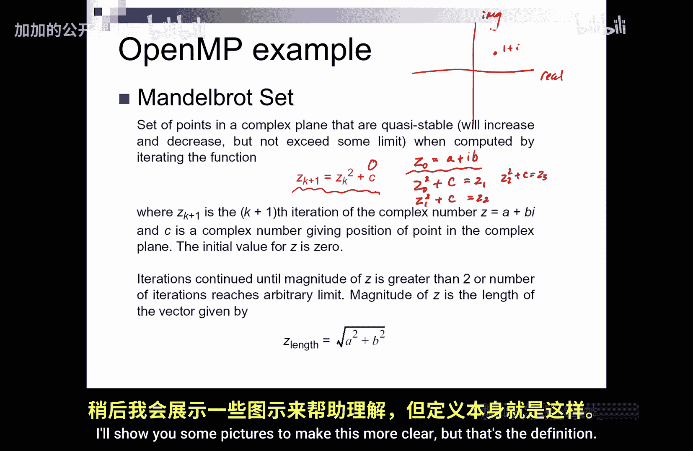
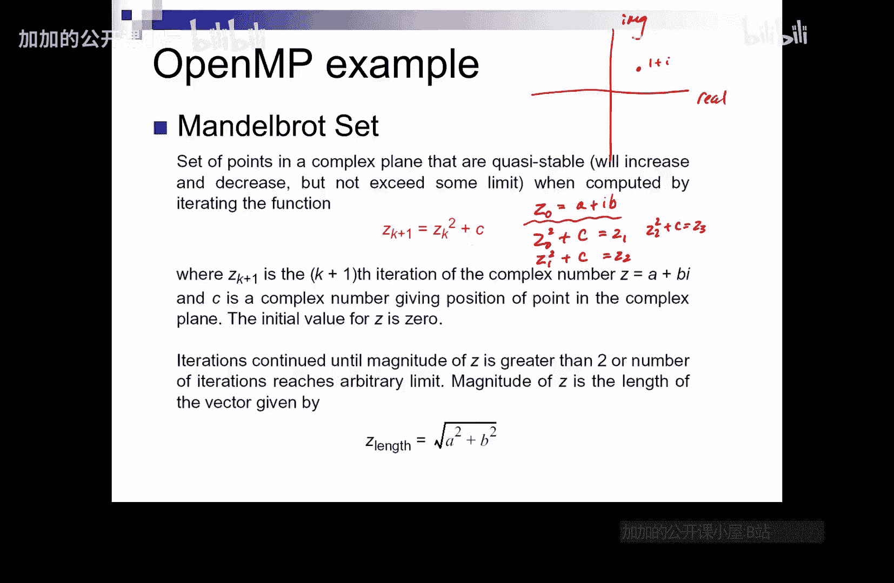
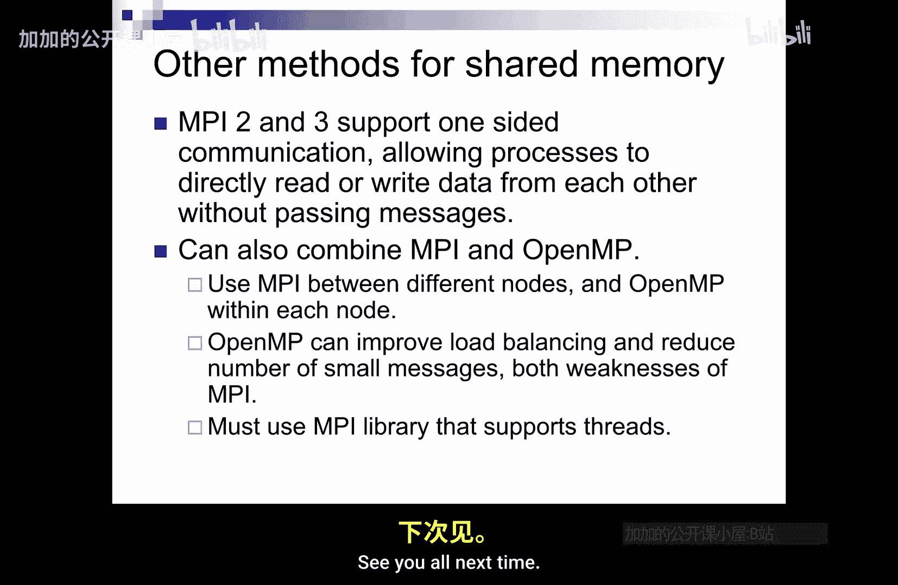

# 并行计算：P9：OpenMP 第二部分 🚀

在本节课中，我们将深入学习 OpenMP 编程模型的核心概念，包括并行区域、工作共享、变量共享与私有化、同步机制，并通过曼德博集合的计算实例来展示如何应用这些概念解决实际问题。

## 概述

OpenMP 是一个基于共享内存的并行编程标准，它通过编译器指令（Compiler Directives）来指导编译器生成并行代码。其核心思想是“增量并行化”，允许程序员在现有串行代码的基础上逐步添加并行指令，从而平滑地过渡到并行程序。OpenMP 采用“Fork-Join”执行模型，由主线程在并行区域开始时创建一组工作线程，在区域结束时同步并合并。

---

## 并行区域与线程创建

上一节我们介绍了 OpenMP 的基本概念，本节中我们来看看如何创建并行区域。

OpenMP 程序始于一个主线程。要创建并行区域，需要使用 `#pragma omp parallel` 指令。该指令会创建一个线程团队，团队中的所有线程将共同执行紧随其后的代码块（用花括号 `{}` 括起）。在并行区域结束时，所有线程会进行同步（Join），程序恢复为仅由主线程执行。

线程的数量默认由系统决定，但程序员可以通过多种方式控制：
*   使用 `num_threads` 子句：`#pragma omp parallel num_threads(4)`
*   调用函数：`omp_set_num_threads(4)`
*   设置环境变量：`OMP_NUM_THREADS=4`

通常建议每个处理器核心使用一个线程，但对于轻量级任务，也可以设置多个线程。

以下是一个简单的“Hello World”示例，展示了并行区域的基本用法：

```c
#include <omp.h>
#include <stdio.h>

int main() {
    #pragma omp parallel private(iam, np)
    {
        int np = omp_get_num_threads(); // 获取总线程数
        int iam = omp_get_thread_num(); // 获取当前线程ID
        printf("Hello from thread %d out of %d\n", iam, np);
    }
    return 0;
}
```

在这个例子中，`iam` 和 `np` 被声明为 `private`，意味着每个线程都拥有自己独立的副本。所有线程都会执行打印语句，但由于线程执行速度不同，输出顺序是任意的。

---

## 工作共享构造

在并行区域内，我们通常不希望所有线程执行完全相同的任务，而是希望将工作划分给不同的线程。OpenMP 提供了多种工作共享构造来实现这一点。

### 并行循环

最常见的场景是并行化一个 `for` 循环。可以使用 `#pragma omp for` 指令将循环的迭代划分给线程团队中的各个线程。**注意**：`#pragma omp for` 本身并不创建线程，它必须位于一个由 `#pragma omp parallel` 创建的并行区域内。

为了方便，OpenMP 提供了 `#pragma omp parallel for` 指令，它将创建并行区域和划分循环迭代两个步骤合并。

```c
#pragma omp parallel for
for (int i = 0; i < n; i++) {
    a[i] = b[i] + c[i];
}
```

默认情况下，在并行 `for` 循环的末尾存在一个隐式屏障（Barrier），所有线程必须在此处等待其他线程完成其迭代后才能继续执行后续代码。可以使用 `nowait` 子句移除这个屏障。

### 调度策略

`schedule` 子句用于控制如何将循环迭代分配给线程。以下是几种主要的调度策略：

*   **静态调度**：`schedule(static [, chunk])`
    *   在循环开始前就将迭代块分配给线程。
    *   若不指定 `chunk`，则迭代被尽可能均匀地分配给每个线程。
    *   若指定 `chunk`，则按轮询（Round-Robin）方式，每次分配给线程 `chunk` 个迭代。
*   **动态调度**：`schedule(dynamic [, chunk])`
    *   迭代在运行时动态分配。线程完成当前分配的迭代后，会请求并获得下一批迭代（默认为1个，或由 `chunk` 指定）。
    *   适用于迭代计算量不均衡的情况，能实现更好的负载均衡，但存在调度开销。
*   **引导调度**：`schedule(guided [, chunk])`
    *   类似于动态调度，但每次分配的迭代块大小会逐渐减小。开始时分配大块，后期分配小块。
    *   能在负载均衡和调度开销之间取得折衷。

选择调度策略时，需权衡负载均衡和调度开销。对于计算量均匀的循环，静态调度是高效的选择；对于计算量差异大的循环，动态或引导调度可能更优。

### 其他工作共享构造

除了循环，OpenMP 还支持其他工作共享方式：

*   **Sections**：`#pragma omp sections` 可以将不同的、独立的代码块（Section）分配给不同的线程执行。
*   **Single**：`#pragma omp single` 指定紧随其后的代码块仅由一个线程（不一定是主线程）执行一次。
*   **Master**：`#pragma omp master` 指定紧随其后的代码块仅由主线程执行，且此处没有隐式屏障。

---

## 数据共享与私有化

在共享内存环境中，线程可以访问相同的变量。OpenMP 通过数据共享属性来控制变量的可见性。

*   **共享变量**：默认情况下，全局变量、静态变量以及在并行区域外声明的变量是共享的。
*   **私有变量**：默认情况下，循环索引变量、函数内的局部（栈）变量以及并行区域内声明的自动变量是私有的。

程序员可以使用 `shared` 和 `private` 子句显式控制变量的共享属性：

```c
int x = 5;
#pragma omp parallel private(x)
{
    int tid = omp_get_thread_num();
    x = tid; // 每个线程修改自己的私有副本x
    printf("Thread %d: x = %d\n", tid, x);
}
printf("After parallel region: x = %d\n", x); // 输出 5
```

此外，还有两个有用的子句：
*   **firstprivate**：私有变量在进入并行区域时，使用并行区域外该变量的值进行初始化。
*   **lastprivate**：在并行区域结束时，将最后一次循环迭代（对于循环）或某个线程（对于 sections）中私有变量的值，赋给并行区域外的共享变量。

### 归约操作

归约（Reduction）是一种常见且重要的并行模式，例如求和、求最大值等。如果简单地使用临界区（Critical Section）保护共享变量，性能会非常差。

OpenMP 提供了 `reduction` 子句来高效地实现归约操作：

```c
int sum = 0;
#pragma omp parallel for reduction(+:sum)
for (int i = 0; i < n; i++) {
    sum += a[i]; // 每个线程操作自己的私有sum副本
}
// 循环结束后，所有线程的私有sum副本通过加法归约，结果存入共享变量sum
```

其工作原理是：为每个线程创建归约变量的私有副本。每个线程计算自己那部分数据的局部结果。在并行区域结束时，将所有线程的局部结果按照指定的操作符（如 `+`, `*`, `max`, `min` 等）合并，得到最终结果。这种方式避免了使用临界区带来的巨大开销。

---

## 同步机制



当多个线程访问共享资源时，需要同步机制来避免竞态条件（Race Condition）。

*   **临界区**：`#pragma omp critical` 确保其后的代码块在同一时刻只能被一个线程执行。可以为临界区命名以保护不同的资源。
*   **原子操作**：`#pragma omp atomic` 用于保护简单的内存更新操作（如 `x++`, `x = max(x, y)`）。原子操作通常由硬件直接支持，速度远快于临界区。
*   **锁**：OpenMP 提供了一组锁函数（`omp_init_lock`, `omp_set_lock`, `omp_unset_lock`, `omp_test_lock`, `omp_destroy_lock`），提供了更细粒度的数据保护能力。锁保护的是数据，而临界区保护的是代码段。
*   **屏障**：`#pragma omp barrier` 强制所有线程在此点同步，确保所有线程都执行到此位置后才能继续。
*   **Flush**：`#pragma omp flush (list)` 确保指定变量的修改对所有线程可见。它强制将线程缓存中的变量值写回内存，并使其对其他处理器核心可见。这对于弱内存一致性模型很重要。


---


## 实战案例：计算曼德博集合



曼德博集合是复平面上的一组分形点集，其定义基于一个简单的迭代公式：对于复常数 `c`，从 `z = 0` 开始，反复计算 `z = z*z + c`。如果迭代无限次后 `z` 的模长不发散（有界），则 `c` 属于曼德博集合。


在实际计算中，我们设定一个最大迭代次数（如256）。对于图像中的每个像素（对应一个复数值 `c`），进行迭代。如果在达到最大迭代次数前 `z` 的模长超过2（发散阈值），则停止迭代，并根据发散速度赋予颜色；如果迭代至最大次数模长仍小于2，则视为属于集合，通常涂为黑色。

计算每个像素的过程是完全独立的，因此非常适合并行化。我们可以将图像的行或像素分配给不同线程。

**负载均衡问题**：曼德博集合的计算量分布极不均匀。集合边界附近的点需要大量迭代才能判断是否发散，而远离集合的点很快就能判断为发散。如果使用默认的静态调度（将连续的行块分配给线程），会导致线程间负载严重不均衡。

**解决方案**：使用能实现更好负载均衡的调度策略。
*   **静态调度（小块）**：`schedule(static, 1)` 以轮询方式每次分配一行，使每个线程都能混合处理计算量“轻”和“重”的行。
*   **动态调度**：`schedule(dynamic)` 让先完成工作的线程动态获取新任务，能更好地适应不可预测的计算负载。

通过选择合适的调度策略，可以显著提高并行效率。

---

## 其他共享内存编程模型

除了 OpenMP，还有其他共享内存编程模型值得了解：

*   **PGAS 语言**：分区全局地址空间语言（如 Unified Parallel C, Coarray Fortran）将全局地址空间进行逻辑分区，使线程能感知数据的“远近”（本地访问快，远程访问慢），旨在更好地利用数据局部性。它们目前多处于研究阶段。
*   **MPI + OpenMP 混合编程**：在现代集群中，节点内是共享内存（适合 OpenMP），节点间是分布式内存（适合 MPI）。混合编程模型结合两者优势，在节点内使用 OpenMP 进行细粒度并行，在节点间使用 MPI 进行通信，是解决大规模科学计算问题的常用方法。新版本的 MPI 标准也加强了对线程的支持。

---

## 总结



本节课我们一起深入学习了 OpenMP 并行编程。我们从创建并行区域和线程团队开始，探讨了如何通过工作共享构造（如 `parallel for`, `sections`）将任务分配给线程。我们理解了数据共享与私有化的规则，并掌握了使用 `reduction` 子句高效处理归约操作的方法。此外，我们还学习了临界区、原子操作、锁和屏障等同步机制，以确保多线程程序的正确性。最后，通过曼德博集合的计算实例，我们看到了如何将 OpenMP 应用于实际问题，并体会到负载均衡和调度策略对性能的关键影响。OpenMP 以其增量并行化和相对简单的编程模型，成为共享内存并行编程的重要工具。