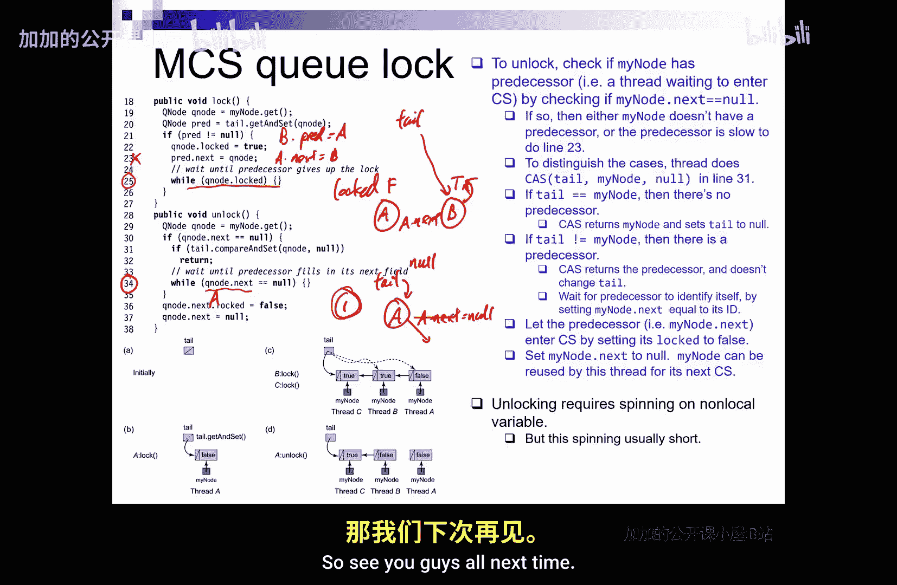

# 上海科技大学【中英⚡并行计算｜CS121 2020 Parallel computing】 p10 P10 Synchronization -BV1VqypBaEaP_p10-

Welcome back。So today we're going to look in more detail at shared memory synchronization。

So we're basically going to focus on the bugs that can occur in shared memory programming。

 and so these are called concurrency bugs。So what we saw last time was that if you have multiple concurrent threads and they're accessing shared pieces of data。

 then if you don't do any synchronization on those aes。

 then you could have bugs occurring so we saw this example where two threads tried to increment a value but depending on how the threads execute the value only gets incremented once it should be incremented twice。

So basically these bugs occur because when you have multiple concurrent threads。

 the threads can be interleaved， their execution can be interleaved in any order okay because you really don't have any control over the speed of execution of the threads right so that's up to the runtime environment and happens whatever happens during runtime so sometimes you could get these interleadings that cause your code to crash。

And the reason this is hard to deal with the reason it's hard to eliminate concurrency bugs is that usually our method for eliminating bugs is just to do a lot of testing but for these concurrency bugs since they depend on the interleaving they basically occur random times because you can run the code multiple times and each time a different interleaving could occur and so sometimes you might see the bug and sometimes you don't and in fact during the testing stage of creating your program you might never see the bug because the bug can be quite rare。

But once you deploy this to users， then they're going to keep using your program and probably if there's a bug out there。

 then eventually one day they're going to hit on it and the program will crash or even do something worse。

Okay and also it's hard for people to anticipate what kind of bugs could be in the program okay because these bugs occur as the result of interactions between many different threads right and people have a hard time keeping track of you know all the ways that a bunch of different things can possibly interact right there's an exponential number of ways that they can interact and just people aren't they aren't used to thinking about that and sometimes they're not even capable of thinking of thinking about that。

Okay so today we're going to look at some ways to deal with concurrency bugs right so before that I just want to mention that so this is not just a hypothetical problem that these bugs can occur so they've actually occurred in practice and have had serious consequences so for example there was a machine which output radiation to treat cancer patients called Theic25 and this one had a concurrency bug and this led to the device outputting too much radiation and this actually killed several patients。

Okay there was another bug where for the first launch of the American Space shuttle there was a concurrency bug in the avionic software and so this is discovered like right before the actual first launch right and so they had to abort the first launch okay so these problems definitely occur in practice and in fact nowadays they are going to occur more and more in practice because we have more and more programs which are parallel or which are concurrent okay so previously right we mostly had。

Single processors right at least most most users they would only be encountering single processors single threaded programs right but nowadays basically everything is multi-threaded or multiprocessor and so we need to have programs that take advantage of this for performance reasons。

 but those programs are much more likely to encounter these concurrency bugs okay so we have to have some way to deal with this。

Okay so there are a number of different ways of dealing with this。

 so I'll go through a few of the main ones， so the first one that so this is something we talked about last time is these things called critical sections or locks okay so remember the critical section is basically so both critical sections and locks only let one thread。

Sor of do something at a time okay so the difference between the critical section and lock is that for the critical section。

 you're saying there's some block of code that your critical section which only one thread can access at a time whereas for the lock。

 that's more about protecting a single piece of data so that there's only one thread modifying the data at a time。

But basically， the idea is that there's some sort of resource。

 either the code or the data that you only allow one modification， one thread to modify at a time。

And so in fact， a more general term for this would be mutual exclusion。

 okay because if you have multiple threads， then they mutually exclude each other。

 you can only have one thread doing this action at a time。Okay， so these critical sections and locks。

 they can be very effective for resolving concurrency bugs okay because if you suspect that there's some sort of sequence of actions in your program that you suspect something that would happen if multiple threads ran concurrently。

 then you can just put critical section around that block of code and so that would eliminate the problem in most cases and it's also easy to use because you can just using a few keywords。

 you can define your critical section。However， you don't want to overuse these things because they can also cause a number of problems so for example they cause contention between the threads because if you have a block of code and you put a critical section on it then when multiple threads run your program they need to contend to have access to that critical section and the threads that do not get into the critical section。

 they would have to wait and so that serializes your code it causes it to go from a parallel code to sequential code so you can lose performance sometimes you can lose a huge amount of performance by adding too many critical sections。

Okay so when you use these things you need to decide how much stuff to put into a critical section or a log because yeah。

 as I said， if you put too much， you're going to lose your parallelism and your code won't perform okay but if you put too little。

 then maybe it's not enough and so you haven't actually sufficiently protected your code and you haven't eliminated the concurrency bug。

So it's kind of hard to judge how much you need to use them。Okay。

 another some other issues with these are that if you have several processes right and so we saw last time that we had an example with two processes trying to get two resources。

 locks on two resources right and if they don't do it the right way。

 then they can actually deadlock meaning that they're both just stuck forever okay so when you try to get multiple locks。

 you need to have some way of regimenting these processes so that they don't deadlock。

Another problem is called a priority inversion， so this is where a low priority thread acquires a lock before a high priority thread okay so in that case the low priority thread will get to run but the high priority thread needs to wait okay and that's not what we want because we actually want the high priority thread to run okay but because of locks。

 you can actually get this priority inversion。Now the thing is that you people have recognized these problems for a long time and they have various ways of dealing with them some more effective than others。

 but locks today are still the most popular way of doing。Of doing concurrency programming。

 concurrent programming， okay， and eliminating these concurrency bugs。

And so that's why today we're going to be looking closer at locks and in particular we're going to look at how to efficiently implement locks okay because right now we've been talking about locks at an abstract level。

 we just said that somehow the system provides for us this capability of ensuring mutual exclusion okay we haven't talked about well how does the system do that right and can it do it efficiently。

Okay so we're going to talk about that later but first let's look at another way that we have of eliminating these bugs。

 which is called transactional memory okay so here what's going to happen is that we have a block of code and we're going to define this as a transaction and that basically means that this code is either going to execute atomically so we're going to execute all of the steps of this code and we're not going to get interference during this execution from any other threat right so either we do this atically or we don't do it at all。

Okay， it's all or nothing， if we do it right， then we're guaranteed that no other threats are interfering with us as we execute。

Okay， so so the way that transactional memory works is that the transactional memory system is going to keep track of all of the reads and write which are done by the transaction okay so so the only way that threats can interfere are that you know so the threads are doing read and write operations okay so ifre if they're only doing reads right then the state of the system is not being modified and so we don't have any interference between the threads the only way we can get interference is if some of the threads modify the state right and then maybe the other threads are not aware of that modification and that would cause problems okay so therefore we want to keep track of which reads and writes are happening in the transaction and。

And so the threats are reading and writing to different memory locations。

 but if there is a memory location where several concurrent threads both read and write to that location。

Okay then we could potentially have a bug。And in that case。

 the transactional memory system is going to abort all of the transactions except for one。

 it's only going to let one of those transactions that access this common memory location proceed。

Okay all the other ones get abted。Okay and also when you abort a thread。

 you're going to undo all the changes it made okay so because the transaction can consist of multiple actions。

 so you could have you know two threads that have done a number of different actions and then they both try to access a common memory location and then you have to abort one of the threads。

 but then you also have to undo all of the previous actions it did。Okay。

 now if you have two concurrent transactions and they access completely different memory locations。

 then there's no way for them to cause problems for each other that you won't have any concurrency bugs。

Okay so in that case， you can actually let both transactions commit， okay。

 they both can do all their actions。Okay， so therefore the nice thing about this transactional memory is that it prevents bugs when you need it to。

 but it lets you havecur parallelism when it's possible。

 okay so what I mean by that is if there is a conflict if you have to concurren transactions and they read and write to the same memory location then potentially there's a bug。

 and then our transactional memory system detect that bug and prevents this happening by boarding the other transactions。

Okay on the other hand， if we're in a situation where there can be no bug happening because the transactions are accessing different memory locations。

 then all the transactions can commit and in that case we have parallelism okay and good performance。

Okay， so that's why people think that transactional memory is a promising piece of technology。

And in terms of where it is currently right so do we have transactional memory in the systems that we use well so there are actually two types of transactional memory so there's a hardware transactional memory and software transactional memory okay so hardware transactional memory is actually being handled in the processor okay and there are commercial processors that implement some sort of hardware transactional memory like you have processors from Intel and Sun and IBM that have capabilities for transactional memory。

However， there are also limits to what they can do because they're working in hardware okay so for example。

 remember that the transactional memory needs to keep track of which reads and rights are being done right and so therefore you have to have if you're doing this in hardware you have to have some hardware that that's actually keeping track of this stuff and there's a limit to how much hardware you can devote to keeping track of these reads and write so therefore hardware transactional memory has a limit on the size of the transaction that it can handle okay so maybe it can handle transactions with a few hundred expressions but not more than that。

And then also others limits on the types of transactions it can handle okay， however。

 because it's being done in hardware， then it's usually quite fast， okay so you get good performance。

 but you can't handle all types of transactions。啊。So on the other hand you can do this in software and there it becomes a lot more flexible because。

 for example， to keep track of the reads and brights。

 you can just sort of store that in the memory of the processor for the processor so then you can deal with much larger transactions however because you're doing this in software of course it's going to be a lot slower so you'll get so currently the software transactional memory systems usually obtain pretty poor performance。

 usually it's almost it's unacceptable so people are currently not using these too much。Okay。

 so there's critical sections， there's transactional memory and then lastly if you want to have a correct code。

 then you can just try to write correct code okay try to write correct concurrent code but this is really hard okay it's hard for everyone basically okay especially for programmers who are on a deadline you know they can't write really large pieces of concurrent code and be sure that there are no bugs okay in fact even pretty simple concurrent programs that are both correct and efficient okay even these would qualify as sort of research as research level material and you can get these types of algorithms published。

Okay so so therefore transactional memory is not ready for prime time and just sort of forcing people to write their own concurrent code is not really a practical solution。

 so therefore we're still going to go back to the old solution of critical sections and logs okay so we're going to focus on this problem so both critical sections and logs achieve this property called mutual exclusion okay so then we're going to talk about mutual exclusion。

So mutual exclusion there are basically a few properties that a mutual exclusion algorithm needs to satisfy so let's talk about these so the first all right so what we're trying to do is we have let's say n concurrent processes okay so that means that they're running at the same time and they could be running at different speeds from each other okay and they want to obtain some sort of resource which we're going to call a critical section okay so it's just some abstract resource it could be a piece of code。

 it could be a memory location but it's just some abstract thing。

Okay so then what we need the critical sorry the mutual exclusion algorithm to achieve is first of all we want the mutual exclusion property okay so that's the first property here。

 which is that we do not have two processes in the critical section at the same time。Okay。

 so that's the basic property here。And then second， so this first property is a safety property。

 because if we don't satisfy it， then our code can potentially do something bad。

 so that's like a violation of safety。Okay but but we also want to make sure that our system makes progress okay。

 for example， one way that we can satisfy the mutual exclusion property is that we just stop all the threads。

 okay， none of them nobody can do anything then of course we're all safe right but that's useless because we're not actually doing anything productive。

So therefore， we need a progress property。And so there are different progress properties that you can define。

 so one progress property is called deadlock freedom okay so this just says that your system does not deadlock。

 right， meaning that you don't have a situation where everybody is stuck。

Okay so another way to say this is that if we have several processes that want to enter the critical section。

 then at least one of them will succeed eventually in some amount of time。Okay。I mean。

 these guys need to do some sort of coordination so they're going to run some algorithm。

 so it takes some time for one of them to get into the critical section but eventually after some amount of time。

 if you have multiple processes that want to enter the critical section。

 then one of them gets to enter。and likewise， if you just have one process that wants enter the critical section。

 then of course， that process will also get to enter。Okay。

 but at least we're not going to have everybody being stuck。Okay。

 so now you can ask for even more than that， okay， so you can require a stronger progress property。

 which is weight freedom。So this one says that if several processes want to enter the critical section。

 then every process gets to enter in some finite amount of time。Okay。

 so the deadlock freedom is just you know there might be one process that can enter okay and that process maybe can enter multiple times in fact。

 because it can enter the critical section and then come back again and then enter again okay so that would be fine that that's fine for deadlock freedom okay but in weight freedom。

 you want to make sure that eventually everybody gets a chance to enter the critical section。Okay。

 so like maybe so let's illustrate this with an example。

 So suppose you have let's say three processes， Okay，1，2，3， right now。

So here are the processes now if you just satisfy deadlock freedom。

 so let's say all three processes want to enter the critical section okay so if you want to satisfy deadlock freedom。

 then maybe the first time process one enters a critical section but then afterwards so then he's going to do his stuff and then exit the critical section。

But then maybe afterwards， process one wants to enter the critical section again so maybe it's like this process is like taking some items out of a cube。

 okay so it got into the critical section， took the item out。

 but then now the thread keeps running and maybe it wants to take out a second item。Okay。

 so then in that case one is going to come back and again one is going to compete with processes two and three to enter the critical section。

 and so if we just have deadlock freedom， then maybe one could win again。Okay。

 and then after the second time， one again going to come back， okay。

 but then this time maybe two wins， two gets to go into the critical section。

Okay and then and then two is going to come back for a second time and then now we have one two and three competing and let's say one wins again and the next time two wins again and then so on okay but the problem is that three right process three。

 he wants to enter the critical section but he never wins right because you have processes one and two who keep entering。

So now our system overall is making progress， we're not deadlocked because threats one and two are entering the critical section。

However， we don't have weight freedom because process three never gets to enter， for weight freedom。

 we require that every process eventually gets to enter。Okay， so if we want weight freedom。

 then maybe here， right instead of process two succeeding。

 we need process three to actually at least succeed once。Okay。

 we're not asking for strict fairness right， we're not asking that one。

 two and three succeed the same number of times right。

 but at least if three has been waiting for a long， long time。

 he's got to at least eventually get one chance to go into the critical section。Okay。

 so that's weight freedom。OkayNow it's usually much easier so any mutual exclusion algorithm has to satisfy the first property。

 the mut text property， this one over here， because if you don't satisfy that。

 then the algorithm is useless， it's not doing anything。Okay。

 and the algorithm has to satisfy some sort of progress property right because otherwise you could just nobody can make any progress okay but usually it's much easier to satisfy the deadlock freedom property than the weight freedom property okay meaning that you can write very efficient algorithms at satisfy deadlock freedom。

 but if you require the algorithm to be weight free then the algorithm must be much more expensive okay and oftentimes it's not really worth the cost to write such an expensive algorithm okay so therefore usually we just we're satisfied with just having a。

An algorithm that's deadlock free。Okay and also even if you have a deadlock free algorithm。

 oftentimes in practice， it works as a weightfree algorithm。

 okay meaning that even if your algorithm is just is only guaranteed to be a deadlock free if you have the situation with like you three threads it's very unlikely that in your executions that youd only have two threads always winning over and over okay because know the actual execution depends on a bunch of sort of random factors like how the threads are interleaved and so on so even though there could be interleavings where three is always locked out forever and never gets in those are unlikely to happen especially if you run for a long time so therefore if you just take a simple efficient deadlock free algorithm pretty much you're guaranteed that eventually everybody gets into the critical section。

Okay so yeah so what we're going to do is try to implement these mutual exclusion algorithms。

 okay so we're going to look at how to implement these and the type of algorithm that we have depends on what kind of operations your hardware supports so for example all processors support read and write operations but they could support additional synchronization operations in hardware okay so for example we have things called test and set or compare and swapwa okay so many processors support these options。

 not necessarily all processors and there are other functions like know loadlink store conditional there are some processors that support this and many others that do not support it okay and maybe even like multiword compare and swapwa we could there might be hardware that supports this operation but definitely not all hardware supports it。

so if you have these additional operations it makes it easier and more efficient to write mutual exclusion algorithms。

 so therefore we're going to look at different types of algorithms based on what operations they actually use。

Okay， so before that， let me first talk about these two synchronization primitives test and set and compare and swap okay so for test and set。

 so what we have here is so we apply test and set on a boolean variable x so this test and set basically tells us if。

If x is true or not， okay， so suppose that x is initially false， okay。

 then if you do test and set right， you get back a response which is false because currently x is false。

And furthermore， x gets set to true。Okay， so this test set does two things。

 it tells you x is current value， and it sets x to true。Okay， and it does both steps autoomically。

Okay so there are two steps happening， you can do this with a read and write operation you can try to do this with a read and write right so you can just read X right and then you can set x to true but if you do it that way。

 then those two steps are not guaranteed to be atomic。Okay， the test and set。

 it'll do both steps atomically without interruption from other threats。Okay。

 and it turns out that this is very useful。Okay， so again， if x is currently false， right。

 then our response is false and x gets set to true。And if x is currently true， right。

 then the response we get from test and set is true and x doesn't change， x stays true。看。😊，All right。

 so there's something similar to。To test and set， which is get and set Okay so oh sorry。

 so there should be like a value here。 Okay， so yeah， so there are two arguments。

 So there's the variable and then there's a value Okay so get and test get and set is generalizes test and set because for test and set X is a boolean variable right。

' either true or false or for get and set， X can have any value。 let's say it's an integer。

 Okay and what get and set does is that it gets the current value of x and then sets it to a new value V。

O。So for example， if x is currently zero right， and then v is 5。

 then if you do get and set of x and 5， then we get back the response0， the current value。

 and then x also becomes 5。And both these happen atomically。Okay。

 so next we have this Comp swap operation okay so here we have a variable x and then two values。

 v and v prime so the compare swap is going to test if x is currently equal to V。Okay。

 if it's currently equal to v， then x gets set to a new value， v prime。

But if x is not currently equal to V， then x doesn't change。

Okay and also it returns x' as current value。Okay， so for example， suppose x equals oops。

Let's say five right now right and if you do compare and swap of x and then5 and then 10 right。

 then we get back the response 10 right so then how do we say this so then we get back。Oops。

You write that， get back。5 because the current value of x is 5， and then x now is equal to 10。

Okay however， if you do compare and swap of x and then 6 and then 10， right。

 then nothings going to happen because we're going to compare the current value of x which is 5 to6。

 right they're not equal， so therefore we do not set x to 10 okay so we still get back x oops get back。

5 and then x continues to equal 5。Okay， and again， all these steps are happening atomically。

 both the comparison of x to the value v and then potentially setting it to v prime。

 those steps happen atomically。Okay。Yeah， and it turns out that if you have。

 especially the Comp swap operation， if you have Comp swap。

 you can actually implement sort of any algorithm， any concurrent algorithm。For Tes and set。

 it's actually not sufficient to implement certain algorithms， but once you have compare and swap。

 you can implement any algorithm。And but we're only interested in the mutualric solution algorithms。

 and it turns out that using either Comp swapwab or test set， we can implement mutual solution。Okay。

Now something else that we need to be aware of， we won't worry too much about this。

 but there's also this issue of processor's memory model so memory model means a processor can can have either a strong or weak memory models and the processor can also do things like reorder instructions so previously I think in one of the very early lectures we saw an example where if a processor can reorder certain instructions then it can get more parallelism and higher performance so real processors do reorder instructions but if your processor does that it can actually break many lock algorithms meaning the lock algorithm works correctly if you don't reorder anything。

 but once you allow reordering then the algorithm can fail。Okay。

 so most log algorithms assume a sequentially consistent memory model。

 so that just means that if you have like a process that you know it's supposed to do a sequence of steps。

 right let's one， two，3 then those steps do not get reordered during the actual execution。

They can get interleaved any way you want with other processes。

 but they're not going to get reordered。Okay so now we know what mutual exclusion is now let's try to implement mutual exclusion okay so we're going to start with a simple example and in fact this example this algorithm does not even work correctly but it illustrates the basic concept and then we can modify this a bit to have a correct algorithm so what we're going to do is we just to start out with we just want to implement to process mutual exclusion mutual exclusion and we want to just use basic read and write operations。

Okay， so then the way this works is if you have two processes that want to get into a critical section。

 right， then they basically have to be aware of each other so that they don't go into the critical section at the same time so you need some way for the two processes to notify each other。

Okay and the way this is going to happen is that we're going to have these shared variables。

 these flags that the processes have， so two processes and each one is going to have a flag If the flag is true right。

 then this tells the other process that I want to enter so I've got a flag if I raise my flag。

 it tells the other guy I want to enter the critical section and the other guy has a flag also if he raises his flag。

 then I know that he wants to enter also。Okay， so the algorithm is very simple。

 all you do is if you want to get into the critical section right so then to do that you call the lock function。

 right I want the lock meaning I want to get into the critical section。Okay， and when I do this。

 I just raise my flag， okay， I tell the other guy I'm trying to get in。Okay。

 and now to prevent both of us from getting in right， so to satisfy mutual exclusion。

 I'm just going to say that， okay， if I see the other guy's flag is up， right。

 I'm going to wait for him。Okay， as long as as his flag is up， I'm going to keep waiting。

So I have this wild loop over here， right？So if he raises his flag for a long time。

 then I'm going to wait for a long time。O。All right。

 so that's the lock algorithm and then the unlocklock algorithm is just that this means that I'm done using the critical section。

 and then now I'm just going to lower my flag because I don't need this anymore。Okay， yeah。

 so so that's the algorithm。 Alright， And it turns out that this is partially correct。

 This algorithm。 Okay， so this does satisfy mutual exclusion。 Okay， so， for example。Yeah。

 so to show this， suppose you have two threads A and B okay so then one of them is going to so if they want to get into the the critical section right they're going to call the lock algorithm and so they're both going to do line 7。

Okay， and then one of them is going to do line seven first。

Because you they have an interleaved execution， but one of them is going to do line 7 first And so let's just suppose a does line 7 first so a does line 7 right so here you have processes A and B right so A does line 7 and then maybe later on B does line 7 okay and and then we don't really know what a does but we know that eventually B is going to do line number8 but when B does line number8 right he's going to see that oh okay when a did number line 7 right a set its flag to be true。

So B is going to see that right because B is going to read oh。

 I forgot to say this but basically here you have two variables。

 so I is like myself okay so if I'm thread one， then I is1。

 if I'm thread2 then I is2 and then J is the other guy。Okay。

 so here I'm setting my own flag to be true。And I'm checking the other guy's flag。Okay。

 so now in our example， right， B would check A's flag and see that it's true。

 right because A's already done line7。And so therefore， B is going to wait。O。So therefore。

 definitely if a wants to get into the critical section。

 B is not going to also go into the critical section。If8 deadline 7 first。Okay。

 so and so always we're going to have one of these processes iss going to do line7 first。

 and so the other guide will be waiting and so therefore we don't have both processes in the critical section and so therefore we satisfy mutual exclusion。

Okay，However， this algorithm is not going to make progress in certain cases。 Okay。

 it's not deadlock free。 Okay， it's definitely not weight free， but it's not even deadlock free。

 Okay， and the reason is basically if you have two processes that both want to get into the critical section right。

 then they can end up waiting for each other。 Okay so for example。

 suppose you let's go back to this execution。 Okay so then a does line 7， B does line 7 right。

 And then we have let's say B does line 8。 and then a does line 8。 Okay。

 so this is like time you know， going down over here yeah。Allright。

 but then B is going to see that A wants to go in to the critical section and B is going to be waiting at line 8 okay so he's going to spin at his line 8 right and then likewise a is going to see that oh okay B has already indicated he wants to go into the critical section so a is going to spin at his line 8。

🎼Okay， and now both of them are just going to spin forever because neither of them， well， you know。

 you see that there's they're stuck at， they're stuck at this line8 over here， right。

 so they can never。Yeah， so they can never get into the critical section， okay？

So this is basically like the situation where you know you have two people who are too polite with each other okay so let's say that you and I are both trying to go through a door okay so then if I'm polite to you。

 if I see that you're trying to go through， I'll let you go first I'll wait for you okay but if you're also very polite you're going to wait for me okay so then if we're too polite we're just going to end up waiting forever for each other okay and that's what's happening with this algorithm。

Okay， so so now we need to we're going to see how to modify this algorithm a little bit so that we get progress okay so of course we still have mutual exclusion property。

 but we also now have progress so this new algorithm is called Peterson's algorithm so again this is for only for two processes okay and it's basically the the same as the。

The previous algorithm， but so we still have these flags， Okay。

 so if I want to get into the critical section， I'm still going to raise my flag Okay。

 but now we have this additional thing called a victim okay。

 so victim is going to be one of the processes。and what happens is that if I want to get into the critical section。

 I'm going to call lock， so then I raise my flag in line 8 over here。

 and then I set victim to be myself。Okay， and what this is trying to do is saying that。

I'm going to wait for you okay， victim is like the guy who does not get into the critical section right so and then a victim equalsI means that I am sort of going to volunteer not to go into the critical section。

Okay， but if you want to go into the critical section。

 you also volunteer not to go into the critical section。O。

So it seems like the previous problem that could occur， right。

 this deadlock problem could occur again with Peterson's but the reason it doesn't occur is because this victim here right is shared by both of us okay so we write to the same victim variable。

That's different from the flag where each of us has a different flag right I've got my flag。

 you've got your flag， okay， so we have two flags， okay， but there's only one victim variable。

 okay it's being shared by both of us。Okay， so yeah。

 so it's kind of like imagine we have a common whiteboard or a blackboard that we can write to Okay。

 so if I want to go through this door right， if I want the resource。

 I'm going to write my name on on here Okay， meaning that I'm going to be waiting for you okay。

 but then。If you also want to go in right， then you're going to erase my name right and then write your name。

 okay， so now you're going you're going to wait。Okay， so that's what line9 here is doing。Okay。

 and then line 10， okay， so then how do we decide who goes in right。

 We're gonna to again look for the other guy's flag Okay。

 now if the other guy's flag is raised so he wants to go into the critical section。

 okay and victim equals I meaning I'm going wait for I'm going to wait Okay。

 victim equals I means I'm going to wait for the other guy okay， then I will actually wait。Okay。

 so if I see you want to go in and the victim is myself， then I'll wait。Okay。

 but if I see either your flag is false。 Okay， so you so you you're not trying to get into the critical section。

 Okay， right， then I'm not going wait for you。 Okay， Or if I see your flag is up。

 but you volunteer to be the victim。Okay， so if a victim is not equal to I。

 it's equal to the other guy J， then I'm also not going to wait， okay。

 because you volunteer to be the victim so I'm going to go through。Okay， so that's the algorithm。Now。

Let's check that it's it still works correctly or actually it works more correctly because now we have all the properties right。

 so first of all， we check that its satisfies mutual exclusion so。

So now let's look at line9 over here right now whichever let's say that process I is the process that did line9 last okay so both processes are going to do line9。

 one of them is going to do it last okay so therefore they've already done line8 right so they've both set their flags to be true。

Okay， so therefore， since I does9 last， right then the final value of victim is going to be equal to I。

 plus， since the other guy J has set his flag， then when I gets to line 10。

 he's going to have both conditions satisfied， so he's going to wait1 for the other process。Okay。

 so definitely I is not also going to go into the critical section， okay。

 so we cannot have both processes in the critical section， so therefore we have mutual exclusion。

Now next we need to make sure that we now have a deadlock free algorithm okay and here the reason is that the only way you can have deadlock is if both processes are waiting right and the only place where you wait is is line 10 over here okay so we just need to check that you cannot have both processes waiting at line 10。

RightNow you see that none of the other lines involve any sort of while loop so there you just you do an instruction and then you're done with it the only way you can be stuck is if you're somehow stuck at line 10 over here okay in the while loop。

But the reason you cannot have both threads be stuck is because if you look at the thread that did line9 last。

 okay， that guy set。呃。Okay， so so that guy set victim to be himself， okay。

 so only that guy can have both conditions be true， right。

 can have victim be equal to himself and see the other guy's flag。Okay。

 the other guy who did line9 first right then you know he could he might see the other guys flag up。

 but victim will not equal himself because he did line9 first and then the other guy did my line 9 so then。

The other guy switched the victim to the other guy。O。Yeah， so。

So that's why this algorithm is deadlock free and this algorithm is also a weight free， actually。

 okay。And so even though this only works for two processes。

 you can actually sort of connect many copies of this。

 you can put many copies of this algorithm together in order to get an M process neutral exclusion algorithm。

Okay。All right。Okay so next we're going to look at something called Laport's algorithm。

 okay so Laport's famous bakery algorithm， so this is another mutual exclusion algorithm and this is designed for M processes。

 not just two processes。All right， so the reason it's called the bakery algorithm is because it involves this ticketing process。

 which is kind of like how you go to a bakery and to figure out who gets the bread first right everybody takes a ticket okay and then you get served in the order that you take your tickets。

Okay， so in fact。This code has， you can look at the code as having two， two parts。 Okay。

 so the first part is called the doorway part and this is where you get a ticket Okay at a bakery and then the other part is a waiting part Okay so that's after you get the ticket now you got to wait for some for them to call your ticket。

And we can show that the doorway part， right everybody finishes the doorway code in a bounded number of steps。

 okay？Because basically because there's no while loop in the doorway， okay。

 the only while loop is in the waitings part。And this bakery algorithm has this nice first come first serve property。

 So what it's saying is that if one process I finishes its doorway section okay so the doorway section is some a few lines of code。

 So if it finishes all those lines of code before another process J even starts the algorithm。Okay。

 then I will definitely enter the critical section before J。Okay。

 so that's this first come first serve property Now if it happens that both I and J are running their doorway sections of the code concurrently right then we don't know who's who's going to go into the critical section first but if I comes really well before Jake comes right like if I'm completely inside the bakery and I got my ticket okay and then somebody else comes okay then that guy's not going to get his stuff ahead of me。

Okay， so because of this first come first serve property。

 then you can show this algorithm is actually a weightfr and process algorithm。

 okay because we said that every process eventually finishes its doorway section because there's no while loops in there okay and then after that know after I finish my doorway then the only threats which can go ahead of me in the critical section are the ones that are also in the doorway right now。

Okay， if somebody is not in the doorway right now， right。

 then he is going to be one of these J guys who starts his algorithm after I finish my doorway。Okay。

 and then by the first come first serve property， he's going to enter after me。Okay。

 so the only guys that can enter before me are the guys concurrent with me right and there's only a finite number of those and so therefore I'm never going to have to wait forever。

 I just have to wait for my concurrent threads to finish。Okay。

 so let's look at this land port algorithm。So here we again have these flags right so now since you have n threads right we have n flags okay one flag per process。

 so again the flag is just to tell the other processes that I want to go into the critical section now you additionally you have this thing called a label okay so label is just a number okay。

Right and then initially all our flags are false and the labels are zero okay so now basically what's going to happen is I'm going to do two things to get into the critical section。

 I'm going to raise my flag so people know I'm here right and then I'm going to get a label and the label kind of corresponds to my ticket okay and the smaller my label right the earlier my ticket is the faster I get in。

Okay so so the place where so here I 13， I set my flag right and then label。

 I need my label So if I see a bunch of other threads are already waiting in the doorway so they've all got their ticket Okay so it's no fair if I take a smaller ticket right so I should take a larger ticket right so what I'm going to do is I'm going to read everybody else's label。

 right I'm going to take the max of those values and then I'll add one Okay so I take a ticket that's larger than everybody else's ticket。

O。嗯。Allright， so then next in line 15 over here， I'm going to decide whether I can get into the critical section。

 I'm going to look for two things。 right， I'm going to check all the other processes。

 Okay so there are n other processes I need to know how large n is so a priori。

 let's say I know that at most is 100 other processes so then I'm going to check all of those other processes and if I see any other processes K such that K is trying to get in right so this flag is up and K has a smaller label than I do。

Then I'm going to wait。😡，O。So now let's talk about this label a bit， so this label here。

 this thing over here， okay， this is a number， and now potentially you could have two threads that get the same label。

Okay so for example suppose the labels right now are you know so process one has a label of like let's say two right process2 has a label of let's say three right and then process 3 has a label of let's say1 okay right so if I'm process 4。

 I'm going to come and read these three labels and then I'm going to pick4 as my label okay so this is like P1 P2 P3。

 P4 okay。Now it's possible that another process P5 comes okay at basically the same time as P4。

 and he also reads these labels 2，3 and 1 right and in that case he's also going to set his label to B4。

Okay， so now P4 and P5 have a tie in their labels。 Okay， so this is kind of a problem。 Okay。

 so to deal with this， it's a problem because here we need to we need to compare these labels。 Okay。

 so the way we deal with this is we're going make not just compare the labels the numbers。

 we're going compare a pair。 consisting of both the label and the process I So for example。

 here right， label if K is 4， then the label here is going be 4。

4 right is label is 4 and is process I is4。 whereas for process 5 right， is label。

 let's say is' going to be 4，5。Okay， right because his label is four， right。

 but his process ID is  five。So so if you make these pairs okay with a label and the process ID。

 and then you compare these pairs lexographically， meaning that you know you first compare the first digit right you know if this label here we' like a three right then no matter what oops。

 this is going to be less than something that starts with a four okay right。🤧I'm sorry。Alright， so。

 but if you start with a four over here， okay， then。Then if you have a tie。

 you now compare the second digit and so you can never get a tie in both digits because all the threads have different labels。

 okay。All right， so yeah， so then the condition to whether you enter the critical section is you check if there's anybody else who is flag is up and he's got a smaller label。

 if there is， you wait for that guy， if nobody is like that， then you go into the critical section。

Okay， yeah， so sorry I didn't show all this stuff， but yeah， but this stuff。

 this these words just say what I was describing。Okay so now we're going to show that we're going to show this algorithm is correct so first we're going to show the deadlock free property so the reason this is deadlock free is because at any point if you compare all the labels of all the processes so these labels can be totally ordered so meaning that you never get a tie between two labels as we saw so therefore there's some minimum label。

Okay， at any time you know these processes all have some labels。

 but there's a minimum label among these okay if there's a minimum label。

 then when that guy with a minimum label when he does line 15 over here he can't he's not going to see anybody else with a smaller label because he's got the minimum so therefore the guy with a minimum label definitely will not wait at line 15。

Okay， so then at least that guy can get into the critical section。Okay。

 this algorithm next we want to show you it has this first Con serve property right so in fact I forgot to define these so I said that these two blocks of code right so there's the doorway part right and then there's the waiting part okay so this is actually the doorway here and this is the waiting part so now we're claiming that if some thread I finishes its doorway before another thread J starts the lock operation then I will get into the critical section before J that's the first con first serve property。

And the reason this is true is because if I has finished its doorway section then I has obtained a label and he's written that label to his array of label to the overall array of labels now you get this process J that starts up right so after this J starts up and so when J does line 14 he's going to end up reading I's label I's already written his label。

And so Jay's going to readI's label。And then he's going to choose a bigger label， okay。

 so Jay's label is always going to be larger than I's label。Okay。So therefore。

 J cannot get into the critical section before I， because when J does line 15 over here。

 right he's going to。嗯。Yeah， he's going to see that I's label is less in it because I has already raised its flag and then I's got a smaller label so J cannot supersede I。

Okay so next we need to show this satisfies mutual exclusion right so to do this that suppose for contradiction we violate mutual exclusion so that both I and J are in the critical section and now let's just suppose without loss of generality that label that J has a larger label one of them has a larger label。

 let's say J。so then when J does line 15 over here right so we're assuming that J is in the critical section okay so when J did line 15 right then you know J looked at whether I satisfies this condition right and then so J must have seen that either I's flag is equal to0 right either I's flag is equal to0 right or I's label is larger than Js。

Okay， because if both I' flag equals 1 and I's label is less than J's， right。

 then J would wait at 15 and he would not go into the critical section。O。

Now it's impossible for I's label to be larger than J's because we've already assumed that J has a larger label and I's label can only increase。

 it never decreases over time so once J's label gets yeah。

And then the other possibility is that I's flag is equal to zero right I has not but I wants to get into the critical section okay and he hasn't done line 3 sorry。

Oh okay， right， so then the other possibility is that I I flag is0， but in that case。

 I must not have done line 13 yet， okay， because if I did line 13， its flag would be true。

So therefore I is going to do line 13 afterwards and then he's also going to do line 14 afterwards and when I does line 14。

 he's going to see that。He's going to read Jay's label right because I here in line 14。

 he reads everybody's labels， okay， he's going to read Jay's label and then he's going to set his label I is going to set his label to be larger than J。

which again contradicts this assumption that J has a larger label。Okay。

 so that shows that this algorithm is satisfies matrix exclusion and because it's first come first serve。

 it's also going to be weight free， okay so if it's weight free， it's definitely deadlock free also。

Okay， so so those are the。Algorithms we're going to look at based only on read and write operations Okay so now we're going to look at some algorithms that use other operations such as test and set or compare and swap okay so。

Yeah， and it turns out that you know， if we allow these operations， right。

 then we can actually get very simple algorithms， okay？嗯。Okay。

 so so the first basic algorithm is this TAS log algorithm okay so what's going to happen is that there's a variable called state okay and this is being shared by all the all the processes So all processes see this variable There's only one such variable state okay they all see this variable and initially state is equal to false okay so state is just a boolean variable initially it's false。

And now very simply， if you want to get into the critical section， right。

 then you try to set state to be true。And furthermore， you read state's current value。

 and if it's false， then you get the critical section。If it's true。

 then you don't get it and you have to wait。Okay， so that's the entire algorithm over here。 Okay。

 so you do this get and set operation and you try to set state to be true。Okay。

 so basically what happens is so you have state right， So this is the state variable。 Okay。

 initially it's falses。 Okay， and then let's say you have some process one comes right。

 He wants to get the the lock So then he does line4 Okay， and that's going to set state to be。

To be true。And then。Furthermore， because you get and set。

 so get- so P gets the current value of state， which is false。

 and then the value of state becomes true after the statement。Okay， so P1 is going to see that okay。

 he can go into into the critical section because here you only wait while state is true okay and P1 saw that state was false so P1 can finish its lock operation and and get the lock。

Okay， now later on， you have another process P2， okay， so P2， he's going to do his get and set。

 right， but now state has already become true。So therefore， when P2 does his getting set。

 he's going to see true。Okay， and also state continues to be true， okay。

 because you do this get them set here。But because P2 saw that state as true。

 then he's going to wait at this line four here。Okay， likewise， if you have a P3， right？

Then he's going to do his get un set and then he's going to see that state is still true。

 so he's going to wait。Okay， so so only the first process that comes can actually so this guy， okay。

 he can get into the critical section， the other guys are all going to wait。Okay。

 now eventually P1 is going to finish his critical section。 Okay。

 and then he's going to unlock the lock。 So then he's going to set this state to be。Let's see。

 is there a way I can do this， I don't oh。Don't suppose yeah， so what I want to do is like。は。Okay。

 so。Allright， so anyways I want to continue with this timeline。 So so just let let's do it like this。

 Okay， so let's continue with this timeline。 Okay， so like time is going in this direction， right。

 so this happens first and then this happens and then this happens。 Okay。

 so what I want to show is I want to show some more values of state。 Okay， so now after P1 finishes。

 right， P1 is going to set。He once going to do an action and he's going to do this。

 he's going to set a state to be false。Okay now P2 and P3 they're still stuck at this4 over here however。

 as soon as P1 sets state to be false， then the next time they do this operation right one of them will now see so now let's say P3 takes a next step okay so P2 and P3 they're both spinning at 4 and let's say that P3 happened to spin a bit faster and he took the next step so then he would see that oh right now state is now false。

And then now P3 gets to go into the critical section。Okay， but P2 has to but when he does that。

 he's going to set state to be true and now。P2 does his get in set and he's going to see state being true again。

 Okay， so then P2 would have to keep waiting。Okay， so that's the entire procedure okay。

 so you have a bunch of processes come， they want to get the log right whoever so the log is currently set to false okay。

 whoever does the get inside set first one of them is going to be first okay whoever is first。

 right he gets a false value back and he sets the log to true。So he gets in the critical section。

The other threads all get the value true back， so they wait。Eventually the guy with a lock。

 he finishes， he sets state to be false right and then these waiting guys are still doing the get in set and then whoever does the get in set first then he's going to see state being false and he's going to get in okay and the other guys keep waiting。

🤧Okay， so that's the entire algorithm and。You can see that obviously it's going to satisfy mutual exclusion because there's only one thread that can see state equals false right whoever does the get inside first。

 only he sees state being false。 Okay， as soon as this first thread does the get in。

 then get in atomically becomes true。 This is where you need this amissity property。 Okay。

 get is previously false， but atomically gets set to true。

And then all the later processes that do their get set， they see it being true， so they wait。

So therefore we have mutual exclusion。And we have deadlock freedom because when the lock is open right when it's false。

 right then one of the threads will be the first to do the get in set and so he'll get in then so we always have at least one thread getting the lock。

Okay。Now this is not weightfr because you could have one thread coming in over and over and then he always is the first one to do the get and set right because you basically have this race to do the get and set between all these waiting processes okay so you could always have one process one of these guys being the first okay so he gets in over and over and the other guys have to wait forever。

Okay， so next now this T log it's correct， but it doesn't perform well。

 Okay and the reason it doesn't perform well is because these get and set operations。

 Okay these are when you implement this in a shared memory system right you need some you definitely want to have cache coherency for efficiency purposes but the get and set is always implement it in a way that causes cache coherency traffic。

 every time you call this function Okay and now the problem is that if you have a bunch of threads。

 I want to compete for the critical section right they're all calling this function Okay so so they're all competing with each other。

 So they send a huge amount of。Of cache coherency messages okay and in fact。

 the more threads you have right so here's a plot of the situation， the more threats you have。

 the more messages cache coherency messages they send and the slower this algorithm becomes。

OkayNow the ideal lock would be that regardless of how many threats there are to get into the critical section。

 it takes the same amount of time so maybe one microsecond okay I can get in it doesn't matter if there's one thread or 100 threads it's always going to take me one microsecond okay for TS lock right the more threats are R it's eventually going to take a huge amount of time if this really performs poorly。

So then next we're going to look at a slight modification called TTAS log okay so TAS is test and set。

 TTAS is a test test and set。O。And so the way this works is that basically the previous TAS lock algorithm did a spin on this get and set operation。

 which caused cache coherency traffic over and over。

 so this TTAS lock right it is not going to spin on the test and set right rather it's going to spin on a regular read variable right it's going to repeatedly read a variable。

However， if you repeatedly read a variable， then you can cache that variable in your cache and then as long as the read variable doesn't change value。

 you don't cause any additional cache coherency traffic。Okay the TTAS variable sorry。

 the get and set variable， whether or not the variable changes value。

 it's always going to cause cache coherency traffic， the read。

 the get operation only causes traffic when the variable changes value。Okay， so the state value。

 just like previously， it was representing whether the lock is currently locked or not。

 okay so if it's currently locked right then state equals true。

 so if I just keep spinning on this state then it continues to be true。

 so there's no cache coherency traffic。Okay right， so this algorithm is basically checking it's reading the state。

 okay， is it true or not， if it's true， I wait okay now eventually whoever is in the critical section he's going to unlock。

 he's going to set state to be false。Okay， at that point。

 the cache coherency hardware is going to inform the weighting processes that state is now false。

 so when I do the get， I'm going to read false。Okay， as soon as I read false。

 then I go on to line6 over here。and I try to be the first one to set state to be true I do the atomic get and set if I am the first one。

 then I can enter the critical section if I'm not the first one right so。If I'm not the first one。

 then I have to go back to waiting over here。But again， when I wait， I only read， okay。

 so that doesn't cause too much cash coherency。So if you look at the performance of the TTAS log。

 okay， it's going to be better than TAS log， but it's not ideal still because you know because there's still cache coherency traffic happening and the more threats there are the more traffic there is okay because the threats still need to be able to get the current value of。

of state right so we need the cache hardware to do that right and plus when state becomes false right then we're all going to compete to try to set state to be true and that also causes sort of a conflict between it causes many messages to be sent on the communication substrate so so the performance still is going to degrade with a number of threats。

Okay， so so next we're going to look at something called a back off base lock。 Okay。

 this is so this back off thing is very similar to let's see instead。Yeah， so it's very。

 very similar to the previous TTS algorithm right so if you look at this part here。

 it's very similar right the only difference is we have this backoff operation over here so the idea over here is that you know if I'm trying to get the lock right so I do this get and set operation if I fail。

 then that means that there must be somebody else who wants to get the lock。And furthermore。

 suppose I fail multiple times okay so I try this once right I fail。

 that means somebody else got in right and then I keep waiting okay and later on this state becomes false and I try this a line9 again maybe I wait sorry maybe I fail again okay and suppose I fail multiple times then what does that mean that means there are many other threats competing with me。

RightSo if there are many other threats competing with me。

 then maybe I should just like lay off a bit and not compete so hard Okay because you know。

 I'm not gonna if I just compete with these guys， only one of us is going to win and we're just going cause a lot of problems。

 a lot of cash coherency traffic in the meantime。 so instead if I see there's a bunch of other guys waiting。

 I'm going go somewhere else。 it's like if there's a restaurant I'm trying to get into right there's 100 people waiting。

 I'm not gonna wait right， I'm gonna go somewhere else and then maybe later I'm going come back so later when I come back。

 there's only know two people left then I'll wait。So that's what this back off means okay it means I'm going to go if I fail multiple times at this line9 over here okay then each time I fail。

 I'm going to go away and I'll keep going away for longer amounts of time because the more times I fail the more this indicates that lots of people are waiting and so I don't want to compete with these guys。

 I just want to go somewhere else and then come back later。Okay so the amount of time that I wait。

 I'm going to wait for a random amount of time because you know if a bunch of guys are competing and you know if they back off but they back off for the same amount of time。

 then they're all going to come back at the same time so I don't want to back off for the same amount of time。

 I'm going to back off for a random amount of time between this min delay here and this max delay。

Okay， so that's what's happening with all of these back off functions over here。 Okay。

 I'm going to choose a random back off between the between the the min and the max values Okay。

 and furthermore， I'm going to。I'm going to increase my my。

Maximum delay value each time I fail to get the thread to get the lock。Okay。

So that's the basic algorithm so it works correctly， just like the previous CTS algorithm。

 it works correctly because the only change was that I end up waiting for a while instead of just purely spinning at this8 over here which is kind of a waste of time I'm going to go away and then back off a little bit。

Okay， so this is right so so you know this back off idea is actually used in many contention resolution algorithms。

 for example， in ethernet right we have we need contention resolution because only one you know one process can send on the ethernet at a time and so therefore if I see a lot of。

Contenion on the medium right， then I'm going to go wait a little bit and the amount of time that I wait keeps increasing the times the more contention there is Okay。

 so for Ethernet， we also have this exponential back off process。

But there's a question how long to wait because if I wait for too short of a period of time then there might be then after I come back。

 there could still be a bunch of guys competing so then I'm gonna be I'm going have to wait again so I don't want to wait for a very short amount of time but if I wait for a long amount of time so for example if I go to a restaurant and I see there's only one person in line but then I go wait for like two hours then of course I wait for too long because that guy probably got a seat it after five minutes so I should only have waited for five minutes and in fact know in these algorithms you don't know how many other threats are competing with you because the only thing you know is that okay I did let's get un and I didn't get it so that means that somebody is competing with me but I have no idea how many people are competing with me so I really have no sort of great way of setting this backoff period so so in fact looking for the。

Back off policy， you know people are still researching how to do this， different。

 there are many different ways of doing this。Yeah。Okay。

 so next we're going to look at a different class of algorithms called Q logs。 Okay。

 so we'll look at several Q logs。 The first one is Anderson's Q log。 Okay。

 so basically what the Q log， that the basic idea is that we're going to form a Q like this。 Okay。

 Q processes， right。And then the first guy in the so this is like。

 let's say P1 and let's say P4 here and then P3 and then P2 so the processes are somehow so I'll tell you how they get into a queue So different algorithms have different mechanisms for building this Q。

 but basically in the end， you can think of these threads as being in a queue so they lined up and then only the guy in the front of the queue gets into the critical section so he can get into the Cs the other guys they' are just spinning so these little circle things indicate that they're spinning now eventually this P1 is gonna finish with this critical section so then when he finishes then he'll let this guy go in the next guy waiting but P3 and P2 keep waiting。

Okay so there's different ways to implement this concept of this Q lock。 So the Anderson's algorithm。

 the way he implements it is that he implements the Q as an array like this Okay so so this is basically the Q here so this is like the head of the Q right so initially so we have this a circular array okay and Anderson's algorithm requires that you know how many processes want to use the critical section So you have to have an upper bound so suppose in our example we have at most eight processes that want this critical section then you use an array of size 8。

 a circular array and then。In this array， all the values in the array are boolet。

 so there are the truer falses and there's at most there's one true value。Actually。

 let's see actually there's always exactly one true value。

 and the true value is basically the head of the Q and the true value indicates that whoever is at that position okay can go into the queue。

So what's happening is all of the threads are competing to get a location in this array。Okay。

And if you get a location and the value in your location is false。

 then you're not at the head of the queue and you have to wait。

And but if you get a location and it's true， right。

 then you're at the head of the queue and you can go in to the critical section。Okay， and then later。

 so suppose I'm at the head of the queue。 Okay， so in this example。Here。

 this is the true part of the this is the only true value in the Q right。

 So this thread A here here is in the critical section Okay and all these other guys right they get a location。

In this array and also they're always going to get a consecutive chunk of locations okay so like the queue starts over here and it's not like you can have this position and then skip some positions and so on okay it's always you're going to have like consecutive positions being occupied okay but these other threads which want to get into the critical section they are reading their Boolean variable and as long as that's false then they keep waiting。

Okay， now eventually this guy in the critical section。

 he is done right he finishes okay at that point he wants to he's going to leave the critical section and he wants the next guy in the queue to be able to get in right like for example。

 if if P4 here right if he finishes right then he's going to go away and then he's going to let P3 go。

Okay， so to achieve that。you simply you set this flag to be false right and then this thread。

 he's going to set his next flag to be true。Okay， and then now thread B sees that oh， okay。

 my flag has now become true， I am now at the head of the Q and I can go into the critical section。

Okay， and then eventually when this guy so now let's say he's in the CS right so this guy's done right now B is in the CS right eventually he is he finishes right then he's going to set his flag back to be false and he's going to set the next one to be true。

Okay， so whoever's waiting after B can now get it， okay。

Now the next thing we should talk about is so I said that all the threats need to get a position in the Q right and furthermore these positions need to be consecutive right like what we're going occupy indices 2。

3，4，5，6 right we don't want to occupy indices like two and 4 and6 and so on so the way you get these you get a position is that there's something called a tail okay so is that illustrated here right okay so here we have the tail so there's this variable here tail right and that's pointing at the end of the Q。

Okay， so now if I want to get into the Q， if I'm thread C for example。

 right so I want to put myself in the queue so I can get into the critical section eventually。

 then I'm going to do this get an increment on the tail。

And get an increment is going to get the current value of tail， which is  four。

 so I'm going to say that I now get position4。And atomically it's going to set tail。

 it's going to increment tail okay this get an increment is another atomic operation。

 it's going to set tail 25 atomically， so I get four and tail becomes five atomically。O。All right。

 and then since we have a circular Q over here， if tail gets to be8， right。

 then we're going to take this modo the size， which is eight。

 and so then tail will actually become zero。Okay so yeah， so again there are two parts。

 when I want to get the lock， I first of all get a position by doing get an increment on tail。

 so this puts me at the end of the queue right and then I just wait for my I wait on my slot I keep reading my slot over and over okay if my slot ever becomes true right then I can go into the critical section。

And there's always one slot that is true， okay， and that slot， whichever thread is in that slot。

 right， then once he's done with his critical section， he's going to set the next slot to be true。

Okay， and that's being done over here。Okay， right， so。Yeah。

 so this algorithm actually performs very well okay because the only expensive part is this while loop over here。

 there's line 19 over here but herem just so I'm doing a spin but here I'm reading a variable I'm reading my flag over and over so we said that the wreaths do not cause much coherency traffic because I can cache this variable of flag of slot。

And then eventually the guy in front of me right eventually he's going to set my flag to be true right at that point there's sort of one time point where there's some coherency traffic but it's quite minimized so this I understand algorithm performs well now the one downside to this is that here we have to have a bound an upper bound on how many threats there are。

Okay， so next week we're going to look at the CLH algorithm。

 so this is named after three guys Craig Hagerson and Land and this is not going to require a a bound on the number of processes Okay。

 it's again going to be a Q log algorithm okay so again we're going to be building a queue but we're going to build a queue in a different way Okay so so basically。

Let's see where should I draw this see where I have room Okay so I have room over here right so I'm going to draw my Q over here right so this is also going to have a tail variable right and the tail variable is going to point at the current tail of of the Q so again the head of the Q is the guy in the critical section and then once he's done。

 he's going to let the next guy go in and to build the Q we also need to know who is at the end of the Q okay so that we can append to the Q。

Okay， so this tail。 So when you do your log algorithm， the first thing is。

The first thing is you're going to allocate a new node right so suppose I to get want to get the lock。

 I'm going to make a new node right and then I'll set the tail to be myself okay in line 23 over here I'll set the tail to be myself and then also so I do this get and set value so the get and set before I do line 23 okay tail was pointing over here。

When I do line 23， my pre is going to be set to the current value of tail。

 so my pre will actually be set to the current tailops。Let me label these things。 Okay。

 so this is a thread A， this is B， and this is C。 Okay。

 so the C dot pre is now going to be equal to B。 Okay， and furthermore。

 tail is going to get set to node C here。O。And then。Right， okay。

 and then I'm going then I'm going to see whether my predecessor is is locked or not。 Okay。

 so initially all the threads are going to lock themselves。 Okay， so so initially。Let's see yeah。

 so so here we have this so every thread has'm sorry。

 every node has a field called locked okay and this is currently locked and this is locked and when I start my operation I'm going to preemptively lock myself。

Okay， and then C here is going to keep spinning and then he's going to keep reading this variable。

 this locked parameter from B okay as long as that's true， I keep spinning on 25。

Okay now B is doing the same thing except for B dot pre is pointing at a。

 so B is reading A's locked variable， right B is looking over here and C is looking over here。Okay。

 now A is in the critical section。And eventually he's going to finish and he's going to set his log to false。

 Okay， so this guy becomes false eventually。Okay， at that point， then B， right。

 B was trying to B was reading this and then B is gonna see okay， so now it's false。

 Now I can get the lock。 Okay， so so once A is done， then B B can get the log。Okay。

 and then B eventually is going to do his unlocked and he's going to set his thing to be false here and then C was reading that right C it's now unlocked and he gets it。

Okay so that's the CLH algorithm， okay， so we have some examples here， yeah。

 and the text just says like what I was illustrating okay。So。So let's actually go back here。

 let's say that this is still true okay so there's one last thing I want to talk about which is the efficiency of this algorithm。

 so this algorithm is actually very efficient in most architectures。

 okay because all I'm doing over here is the only sort of spin operation。

 the only operation I do over and over is this read operation because I'm just reading my predecessor's locked variable。

Now if I have a cache right then what's going to happen is I'm going to sort of pull this value into my it that way okay so how do I draw this okay so suppose C got like a little cache here okay right so if I have if C has a cache he's going to pull this true value into his cache okay and then when he does the spin on 25 right C just sort of keeps reading this this cache thing okay and that's very fast because it's local。

And then eventually B once he finishes， he's going to set this to be false and then so then the false value gets broadcast to seize cache so that's sort of only one instance where there's message traffic so it's efficient。

Okay， the problem is what if you're in an architecture。

 So there are some architectures where C doesn't have a cache。 Okay， if C doesn't have a cache。

 then the only way for C to read this。This B dot locked right he's got to read B dot locked Okay so this then he would actually have to go to B's processor to read that value right so B could be on a different processor So in order to read this right that would be every time I read this I would have to incur。

Remote memory aes， and in that case， that's going to be slow。O。So yeah。

 so CLH usually works quite well。Because algorithm- sorry， most architectures have caches。

 but if unfortunately we don't have cache， then it won't work well。

So then the final algorithm we're going to look at is the MCS log。

 so this is a famous log by this guy Melacrommi and then Scott。

So then this algorithm is going to sort of remove this problem that the CLH lock had right which was remote spinning okay so instead what's going happen is so it's still going to be a Q lock okay let's see where do I have some room okay so I'll draw over here right maybe I'll draw this okay I'll draw this over here right and then。

Let's see。 Okay， so we're still going to have this locked。Pararameter over here right。

 and then so this is going to be a， this is going to be B， right then。So this is。

True so this is gonna be false。 The first guy is false and the second guy is true。 Okay， right。Okay。

 right。 And then this is a pre dot next。Right， and then we have a tail。Which is pointing over here。

 right， and then we have a next。Oh， sorry， no， no， no that this is wrong。Oh， okay， right。 So sorry。

 the the main difference， Okay， between MC S and。And the previous one CLH okay， is that CLH， right。

 you see that so this is the head of the Q， right？Okay and this is the tail and then the weight direction is towards the head like C is waiting for B okay。

 there's another guy over here D right then the tail would be on D right and then D would be waiting for C okay so you're waiting you're looking towards the head of the Q。

Okay， now for the。For the MCS log right， you don't look for the head of the queue rather you see that these arrows are reversed。

 so the arrow goes from the head to the tail okay because here you have a dot next。嗯。Sorry。

 let me make this a bit nicer so here we have the head of the Q over here and then this is a dot next okay so a is saying okay。

 the next guy after me in the Q is C and let's make another one to be more general so here you have sorry is B and then here you have B dot next。

Okay， and the tail is pointing at C， and then his locked is true。 Okay。

 so this is what's happening in the MCs log。 Okay， so the MCs lock is that。And now。

 instead of B spinning on A's locked variable， okay B is actually spinning on his own locked variable and C is spinning on his own locked variable。

Okay， so if you spin on your own locked variable and the spin is over here。

 okay you see that so B is for example， is spinning on his own locked variable if you spin on your own locked variable。

 then regardless of whether there's a cache or not。

 you're not going to cause cache coherency traffic。Okay， so MCS lock works well， even in the。

In the no cache case。Okay， now so let's talk some more about how this queue is built up so you have right so initially。

Let's let's go through the process where we add a new node to the Q okay so currently our queue just has A and B right now supposed to node C comess okay so then we have a node C over here okay so first of all he's going to do this line here。

 which is going to get the current value of tail which is B right and set it to the new node which is C。

Okay， and the pre is now going to be so C dot pre， Okay， C dot pre。Now is equal啊。Is equal to B。O。

And now what and so pre is not equal to null right because there is somebody in the Q and so now what C is going to do is it's going to set it's locked to be true here okay and it's going to see that okay。

 my predecessor right sorry sorry So so the tail now also switches to C and C thatt pre equals B。

 And now this line says that okay， my C's predecessor is B and B' is next okay is going to be C。O。

And then then C here is going to do line 25 and he's going to spin on his own variable。Okay。😊。

Now this other case where if pre equals null， okay so that means that you're at the head of the Q okay。

 so then if you're at the head of the queue， then you don't have any predecessor so you don't need to do this stuff from 22 to 25。

If you're at the head of the queue， you can also just go into the critical section。

 don't wait at line 25。Okay so that is the in queue procedure the DQ procedure is something like now what you want to have happen is suppose a has finished so a is currently in the critical section。

 it's finished so then what a wants to do is he wants to now free up B now Y is B not free because right now B is now free because he's reading his own is unlock over here and it's true so B is stuck at this point so therefore what a wants to do is just set this to be false。

Okay， so how does a know what to set to false so a knows because a looks at its next field and it C that。

 oh， okay， it's B after me， okay， if it's B following me， I'm going to set his flag to be false。

O now嗯。Where is that happening Okay， so that is happening at the unlock So so here you know we would have A B the node right so he checks if the next is null okay so it's not null right because the next is equal to B and so he sets Bs locked to be false。

Okay， and then after that a just sort of a goes away， okay， so A A goes away。

 I don't want to draw this because I still need this figure okay， but AA sets this next to be null。

All right。Um。Sorry。哦。Okay， so next。Now let me illustrate this condition over here， okay。

 because this is kind of a more complicated condition。So。

Yeah I should actually draw this over here okay， so let me illustrate this condition over here so we have a again right he has a locked field right which is currently false and then we have a B here right and then we have a tail。

Okay so tail right and then this is his lock is true and what else do we have？Yeah， okay。

 now one complicated thing that can happen is that you could get a Q node next equals so here let's say Q node is a right so a wants to accept the critical section Okay。

 so sorry let me just。Need to do this other thing。Right。

So a wants to exit the critical section and suppose he's his Q node is null okay so that can mean two different things okay one thing is one possibility is that there's just nobody else around okay so imagine that you know you don't actually have this B okay imagine it's just a okay right and then he he doesn't have a next you know there's only one guy in the Q A himself so there's nobody next okay so that's one possibility the other possibility okay which is why you have all this code from line 30 to what to 34 okay the other possibility is that there is a node B that is currently in the queue okay。

However， B， remember that B here， he wants to set his so B's pre。Equals a， Okay。

 so here he wants to set A's next。Equal B， right， that that's what B wants to do。 Okay。

 but suppose B is has only done done line 22， but he has not done line 23 yet。Okay。

 then A doesn't have a next。Okay， so B B is eventually going to set A's next to be equal to B。Okay。

 but currently A's next is equal to no， okay， A's next， this is a dot next。

This is currently equal to null。Okay， so so therefore a needs to distinguish between these two cases where a is the first case is a is truly alone。

 okay， so a's next is no。O。Okay， and the other case is that there is somebody else in the Q B。

 but B has not done line 23 yet。Okay now the reason a has to distinguish between these two cases is so this is let's say the first case right and this is the second case in the first case。

 a can just go away because nobody else is waiting for him okay in the second case A actually has to wait for B to notify a about B's presence A has to find out about B because B is going be waiting on this this true flag over here and the only guy that can reset the true flag to be false the only guy is B's next node sorry is the only guy who can un B's flag okay is a so if a does not find out about B。

 B is going to be stuck forever A must find out about B。

So now how does a distinguish between these two scenarios right number one and number two， okay。

 so he does it through this line line 31 over here， okay， because in line 31。Okay。

 if you're in the first case， then the is going to be first case， there's only one node in the Q。

 so the tail is going to equal a。Okay，In the second case， there are other node in the Q。

 so tail does not equal a okay， there could I even be like a third node over here and the tail actually equals C。

 okay， but definitely tail does not equal a。So therefore a is going to do this line over here。

 he's going to compare the current value of tail with himself right so Qn here is a right and if it's equal to a。

 then we are in case number one here and then the tail can just be set to null and a can just return。

But when a compares the tail and if this comparison set fails。

 then this means that the tail is not equal to a， so we are in the second case over here right and then a has to wait for B to set its next pointer okay right so currently it's next pointer is pointing and nu a has to wait for B to set the next pointer to B。

Okay in other words， A has to wait for B to eventually do this line 23 here。

 B is currently at line 22 and B will eventually do line 23 okay but a needs to wait for B to do line 23 because A the only thing A knows is that he is not the only node in the queue He doesn't know who's behind him in the queue Okay it's only B that knows that a is front A is in front of me A does not know that B is behind a but B knows that a is in front of B。

Okay， so that's why a here needs to wait for。For B to set A dot next。Okay， yeah。

 so that explains this part over here。 Right， Okay， so this。All right。

 now this algorithm is going to work well even without a cache because again， the spinning， okay。

 so now let me clean this up。Okay， so so there's actually two places where you spin okay there's line 34 and there's line 25 okay so now you might spin a line 25 for a long time。

 okay line 25 is this spin over here where you're waiting for somebody in front of you in the queue to free you to go into the queue。

To go into the critical section， okay and this could take a long time because there could be many guys in front of me okay。

 but when I do this long wait over here， this is again reading to my local variables which are cached。

Okay， the other place where you could be waiting is that remember， you have the situation where。

Here a was suppose a doesn't A dot next was not set yet Okay。

 so B still has not executed this line 23 yet Okay， so then a needs to wait over here。嗯。Oh。

 so this is also a local weight wait until predecessor Q node dot next equals null。okay， all right。

 so this is also a local weight， so that's not a problem okay。

 because here I'm also waiting on A dot next Okay， so anyways。

 so this algorithm works better would work well in all cases。Okay。

 so this is all we have to say the about the synchronization algorithms。

 there are actually many other。Mric solution algorithms。 Okay。

 so this is like a big topic topic of research。 and it's quite interesting and。Yeah。

 so next time we are going to move on to a new topic which is GPU programming。Okay。

 so guys see you guys all next time。

