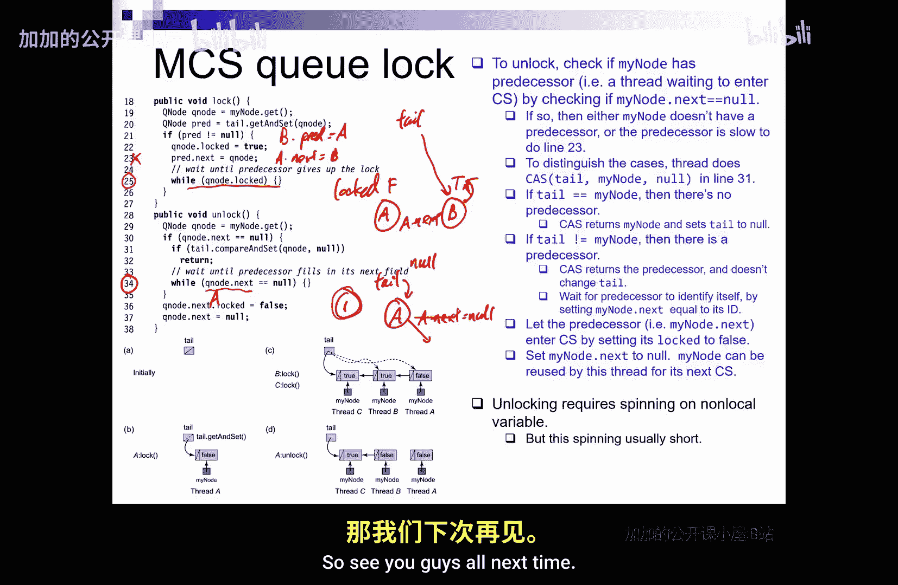

# 并行计算：第10讲：共享内存同步 🧵

在本节课中，我们将要学习共享内存编程中的同步问题。我们将探讨当多个并发线程访问共享数据时可能出现的错误，并学习如何使用不同的同步机制来避免这些错误，特别是互斥锁的实现。

## 概述

在共享内存编程中，多个线程可以同时访问和修改相同的内存位置。如果没有适当的同步机制，线程执行的交错顺序可能导致程序出现难以预测和复现的错误，即并发错误。本节课我们将深入探讨这些错误，并学习如何使用互斥锁、事务内存等机制来确保程序的正确性。

## 并发错误

上一节我们介绍了共享内存的基本概念，本节中我们来看看并发错误的具体表现和成因。

当多个并发线程访问共享数据且未进行任何同步时，就可能出现错误。例如，两个线程试图递增同一个值，但由于线程执行的交错顺序，该值可能只被递增了一次，而不是预期的两次。

这些错误之所以发生，是因为多个并发线程的执行可以以任意顺序交错进行。运行时环境控制着线程的执行速度，因此我们无法预测确切的交错顺序。有时，某些交错顺序会导致代码崩溃。

消除并发错误之所以困难，原因如下：
*   **测试的局限性**：我们通常通过大量测试来消除错误。但对于并发错误，由于它们依赖于执行交错，因此是随机出现的。代码可能运行多次都正常，但某一次特定的交错就会触发错误。在开发测试阶段，可能永远无法发现某些罕见的错误。
*   **难以预测**：这些错误是多个线程交互的结果。人们很难追踪和理解众多事物之间所有可能的交互方式，因为交互方式的数量是指数级的。人们通常不习惯，甚至无法思考如此复杂的交互。

并发错误并非只是理论问题，它们在现实中已造成严重后果。例如，Therac-25放射治疗设备因并发错误导致过量辐射，造成多名患者死亡。又如，美国航天飞机首次发射前，在其航空电子软件中发现了并发错误，导致发射被迫中止。

如今，随着多线程和多处理器程序的普及，并发错误将越来越常见。为了性能，我们需要编写并行程序，但这些程序更容易遇到并发错误，因此我们必须找到应对方法。

## 处理并发错误的方法

上一节我们了解了并发错误的危害，本节中我们来看看几种主要的应对策略。

以下是处理并发错误的几种主要方法：

### 1. 临界区与锁

第一种方法是使用临界区或锁。我们上次课讨论过这个概念。

临界区和锁的核心思想是，只允许一个线程在某一时刻访问某个资源（一段代码或一个数据）。更通用的术语是**互斥**，即多个线程相互排斥，同一时间只能有一个线程执行特定操作。

临界区和锁能有效解决并发错误。如果你怀疑代码中的某个操作序列在多个线程并发执行时会出现问题，只需在该代码块周围加上临界区，在大多数情况下就能消除问题。它们也易于使用，只需几个关键字即可定义临界区。

然而，不应过度使用临界区和锁，因为它们也会带来问题：
*   **线程争用**：如果在一个代码块上设置了临界区，多个线程运行时需要竞争访问权。未获得访问权的线程必须等待，这会使代码从并行变为串行，导致性能下降。过多的临界区可能导致性能大幅损失。
*   **死锁**：当多个进程试图获取多个资源的锁时，如果方式不当，可能导致死锁，即所有进程永远卡住。
*   **优先级反转**：低优先级线程可能先于高优先级线程获得锁，导致高优先级线程被迫等待，这与我们的期望相反。

尽管存在这些问题，但由于人们已认识到这些问题并找到了各种解决方法（效果不一），锁至今仍是并发编程中最流行的方式。因此，本节课我们将更深入地研究锁，特别是如何高效地实现锁。

### 2. 事务内存

另一种消除错误的方法是**事务内存**。

其基本思想是，将一段代码定义为一个**事务**。这意味着这段代码要么原子性地全部执行，并且在执行过程中不受任何其他线程的干扰；要么完全不执行（“要么全做，要么全不做”）。如果执行，则保证在执行期间没有其他线程干扰。

事务内存系统会跟踪事务中的所有读写操作。线程之间产生干扰的唯一途径是通过读写操作修改系统状态。如果多个并发线程都读写同一个内存位置，就可能产生错误。此时，事务内存系统将中止除一个之外的所有事务，只允许其中一个访问该公共内存位置的事务继续执行。当中止一个线程时，必须撤销它所做的所有更改。

如果两个并发事务访问完全不同的内存位置，则它们不可能相互造成问题，也不会产生并发错误。在这种情况下，两个事务都可以提交。

事务内存的优点在于，它能在需要时防止错误，同时在可能时允许并发并行，从而获得良好性能。因此，人们认为事务内存是一项有前景的技术。

目前，事务内存有两种类型：
*   **硬件事务内存**：由处理器处理。Intel、Sun和IBM等公司的商用处理器已实现某种形式的硬件事务内存。但由于在硬件中实现，它存在限制。例如，硬件需要跟踪读写操作，而能用于跟踪的硬件资源有限，因此硬件事务内存能处理的事务大小有限（可能只能处理几百条指令的事务）。不过，由于在硬件中实现，它通常速度很快。
*   **软件事务内存**：在软件中实现，因此灵活得多。例如，可以将读写跟踪信息存储在处理器内存中，从而处理大得多的事务。然而，由于在软件中实现，它通常速度很慢，目前性能往往难以接受，因此使用不多。

### 3. 编写正确的并发代码

最后，你可以尝试直接编写正确的并发代码。但这非常困难，尤其是对于有工期压力的程序员来说，很难确保大型并发代码中没有错误。事实上，即使是编写既正确又高效的简单并发程序，也足以作为研究课题发表论文。

因此，事务内存尚未成熟，而强制人们编写自己的并发代码也不是实际的解决方案。所以，我们仍需回到临界区和锁这个旧方案上。我们将重点关注这个问题。

## 互斥

临界区和锁都实现了一种称为**互斥**的属性。接下来我们讨论互斥。

互斥算法需要满足几个属性。假设有n个并发进程，它们可能以不同的速度运行，并且希望获取某种称为临界区的资源（可以是一段代码或一个内存位置）。

互斥算法需要满足以下属性：
1.  **互斥属性**：这是安全性属性。不能有两个进程同时处于临界区中。如果不满足，代码可能会做坏事，违反了安全性。
2.  **进展属性**：我们需要确保系统能取得进展。例如，满足互斥属性的一种方法是停止所有线程，但这毫无用处，因为我们没有做任何有生产力的事情。因此，我们需要进展属性。

进展属性有不同的定义：
*   **无死锁**：系统不会死锁，即不会出现所有进程都卡住的情况。换句话说，如果有多个进程想要进入临界区，那么至少有一个进程最终会在某个时间内成功进入。同样，如果只有一个进程想进入，它当然也能进入。
*   **无饥饿**：这是一个更强的进展属性。它要求，如果有多个进程想要进入临界区，那么每个进程都能在有限时间内进入。无死锁只要求至少有一个进程能进入，并且该进程可能多次进入。而无饥饿要求最终每个进程都有机会进入临界区。

通常，满足无死锁属性比满足无饥饿属性容易得多。这意味着你可以编写出非常高效且满足无死锁的算法，但如果要求算法无饥饿，则算法必须昂贵得多，而且通常不值得为此付出高昂代价。因此，通常我们只满足于拥有一个无死锁的算法。

此外，即使你有一个无死锁算法，在实践中它通常也能像无饥饿算法一样工作。因为实际执行取决于许多随机因素（如线程如何交错等），所以尽管可能存在某些线程永远被锁定的交错情况，但这些情况不太可能发生，尤其是长时间运行时。因此，如果你采用一个简单高效的无死锁算法，几乎可以保证最终每个人都能进入临界区。

接下来，我们将尝试实现这些互斥算法。我们将研究如何实现它们，而算法的类型取决于硬件支持的操作。例如，所有处理器都支持读写操作，但有些处理器还支持额外的硬件同步操作，如测试并设置或比较并交换。拥有这些额外操作可以更轻松、更高效地编写互斥算法。因此，我们将根据实际使用的操作来研究不同类型的算法。

在此之前，我们先介绍两个同步原语：测试并设置和比较并交换。

*   **测试并设置**：应用于一个布尔变量`x`。它告诉我们`x`当前是否为真。假设`x`初始为假，执行测试并设置会返回响应`false`（因为当前`x`为假），同时将`x`原子性地设置为`true`。如果`x`当前为真，则返回响应`true`，且`x`保持不变（仍为`true`）。测试并设置原子性地完成这两个步骤（读取当前值并设置新值）。
*   **比较并交换**：操作一个变量`x`和两个值`v`和`v‘`。比较并交换会测试`x`当前是否等于`v`。如果相等，则将`x`原子性地设置为新值`v‘`；如果不相等，则`x`不变。同时，它返回`x`的当前值。所有这些步骤都是原子性发生的。

事实证明，如果你有比较并交换操作，实际上可以实现任何并发算法。对于测试并设置，它不足以实现某些算法，但一旦有了比较并交换，你就可以实现任何算法。不过，我们只对互斥算法感兴趣，而使用比较并交换或测试并设置都可以实现互斥。

另外，我们还需要注意处理器的内存模型问题（这里不过多讨论）。内存模型意味着处理器可以有强内存模型或弱内存模型，并且处理器可以重排指令。真正的处理器会重排指令，但如果你的处理器这样做，实际上可能会破坏许多锁算法。大多数锁算法假设顺序一致的内存模型，这意味着如果一个进程应该执行一系列步骤（如1、2、3），那么在实际执行中这些步骤不会被打乱顺序。它们可以以任何方式与其他进程的步骤交错，但不会在自身内部被重排。

## 互斥算法的实现

现在我们已经了解了什么是互斥，接下来尝试实现互斥算法。我们将从一个简单的例子开始，这个算法甚至不能正确工作，但它说明了基本概念，然后我们可以稍作修改以得到一个正确的算法。

首先，我们只想实现两个进程的互斥，并且只使用基本的读写操作。

其工作原理是，如果有两个进程想要进入临界区，它们基本上需要知道彼此的存在，以免同时进入。我们需要某种方式让两个进程相互通知。

实现方式是使用这些共享变量——标志。两个进程，每个都有一个标志。如果标志为真，则告诉另一个进程“我想进入”。我举起我的标志，告诉对方我想进入临界区；对方也有一个标志，如果他举起标志，我就知道他也想进入。

算法非常简单：
1.  如果你想进入临界区，就调用锁函数。这意味着我想获得锁，进入临界区。我只需举起我的标志，告诉对方我正在尝试进入。
2.  为了防止我们俩同时进入，为了满足互斥，我会说：如果我看到对方的标志举起了，我就等待他。只要他的标志举着，我就继续等待（这是一个循环）。
3.  解锁算法是：这意味着我完成了临界区的使用，然后我只需放下我的标志，因为我不再需要它了。

事实证明，这个算法部分正确。它满足互斥。例如，假设有两个线程A和B，它们都想进入临界区，都会调用锁算法，执行第7行。其中一个会先执行第7行。假设A先执行第7行，A将其标志设置为真。后来B执行第7行，然后B执行第8行。当B执行第8行时，它会检查A的标志，发现其为真（因为A已经执行了第7行），因此B会等待。所以，如果A想进入临界区，B不会也进入。总是会有一个进程先执行第7行，另一个进程会等待，因此我们不会有两个进程同时处于临界区，从而满足互斥。

然而，在某些情况下，这个算法无法取得进展。它不是无死锁的，甚至不是无饥饿的。原因基本上是，如果两个进程都想进入临界区，它们最终可能会互相等待。例如，假设A执行第7行，B执行第7行，然后B执行第8行，接着A执行第8行。B会看到A想进入临界区，B将在其第8行循环等待。同样，A会看到B已经表示想进入临界区，A将在其第8行循环等待。现在，它们都将永远循环下去，因为它们都卡在第8行，永远无法进入临界区。

这就像两个人过于礼貌的情况。假设你和我都想通过一扇门。如果我对你礼貌，看到你试图通过，我会让你先走，我会等你。但如果你也很礼貌，你也会等我。如果我们都太礼貌，最终将永远等待对方。这正是这个算法中发生的情况。

现在，我们需要看看如何稍微修改这个算法，以便取得进展。当然，我们仍然保持互斥属性，但现在我们还要有进展。这个新算法称为**Peterson算法**。同样，它仅适用于两个进程。

它基本上与之前的算法相同，我们仍然有这些标志。如果我想进入临界区，我仍然会举起我的标志。但现在我们多了一个叫做“受害者”的东西。受害者将是其中一个进程。

其工作原理是：如果我想进入临界区，我会调用锁，然后在第8行举起我的标志，并在第9行将受害者设置为我自已。这试图表达的是：“我会等你”。受害者就像那个不能进入临界区的人。`victim = I`意味着我自愿不进入临界区。但如果你也想进入临界区，你也自愿不进入临界区。

看起来之前可能发生的死锁问题在Peterson算法中可能再次发生，但之所以没有发生，是因为这里的受害者是由我们俩共享的。我们写入同一个受害者变量。这与标志不同，标志是每人一个，我们有两个标志，但只有一个受害者变量，它由我们俩共享。

这就像我们有一个共同的白板或黑板可以写字。如果我想通过这扇门（获得资源），我会把我的名字写在上面，意味着我会等你。但如果你也想进入，你会擦掉我的名字，然后写上你的名字，现在你愿意等待。这就是第9行所做的。

然后第10行，我们如何决定谁进入？我们再次检查对方的标志。如果对方的标志举起了（他想进入临界区），并且`victim == I`（意味着我要等待），那么我实际上会等待。如果我看到你想进入并且受害者是我自己，那么我就等待。但是，如果我看到要么你的标志是假的（你不想进入临界区），那么我就不等你；或者我看到你的标志举起了，但你自愿成为受害者（`victim`不等于`I`，而是等于另一个进程`J`），那么我也不等待，因为你自愿成为受害者，所以我会通过。

现在检查它是否仍然正确工作（实际上它工作得更正确了，因为现在我们拥有了所有属性）：
1.  **互斥**：看第9行，无论哪个进程最后执行第9行，假设进程`I`是最后执行第9行的进程。两个进程都会执行第9行，其中一个会最后执行。因此，它们都已经执行了第8行，都将自己的标志设置为真。由于`I`最后执行第9行，受害者的最终值将等于`I`。而且，由于另一个进程`J`已经设置了他的标志，当`I`执行到第10行时，他将满足两个条件，因此他会等待另一个进程。所以，`I`肯定不会也进入临界区。因此，我们不能有两个进程同时处于临界区，满足互斥。
2.  **无死锁**：唯一可能死锁的方式是两个进程都在等待，而唯一等待的地方是第10行。我们需要检查不能有两个进程同时在第10行等待。原因在于，查看最后执行第9行的那个线程，他设置受害者为他自己，所以只有那个线程能同时满足两个条件（受害者等于他自己，并且看到对方的标志举起）。另一个先执行第9行的线程，他可能看到对方的标志举起，但受害者不会等于他自己，因为他先执行第9行，然后另一个线程执行了我的第9行，所以另一个线程将受害者切换为另一个人。因此，这个算法是无死锁的，实际上也是无饥饿的。

尽管这只适用于两个进程，但实际上你可以将许多个这样的算法副本连接起来，以获得一个n进程的互斥算法。

接下来，我们将看一个叫做**Lamport算法**（著名的面包店算法）的算法。这是另一个互斥算法，专为n个进程设计，而不仅仅是两个进程。

它之所以被称为面包店算法，是因为它涉及一个取票过程，就像你去面包店时，为了决定谁先得到面包，每个人都取一张票，然后按照取票的顺序接受服务。

实际上，这段代码可以看作有两个部分：
1.  **门口部分**：在这里你取票（在面包店）。
2.  **等待部分**：取票后，你需要等待叫到你的票号。

我们可以证明，门口部分每个人都在有限步数内完成，因为门口没有循环，唯一的循环在等待部分。

这个面包店算法有一个很好的**先到先服务**属性。意思是，如果一个进程`I`先完成其门口部分（门口部分是一些代码行），在另一个进程`J`甚至还没开始算法之前，那么`I`肯定会在`J`之前进入临界区。如果`I`和`J`同时运行它们的门口部分代码，那么我们不知道谁会先进入临界区。但如果`I`确实在`J`之前到来，就像`I`已经完全进入面包店并拿到了票，然后另一个人`J`才来，那么那个人`J`不会排在我前面。

由于这个先到先服务属性，你可以证明这个算法实际上是一个无饥饿的n进程算法。因为每个进程最终都会完成其门口部分（那里没有循环），之后，只有那些现在也在门口的线程才能在我之前进入临界区。如果现在有人不在门口，那么他将是那些在我完成门口之后才开始算法的`J`之一。根据先到先服务属性，他将在我之后进入。因此，只有与我并发的线程才能在我之前进入，而这些线程的数量是有限的，所以我永远不必无限期等待，只需要等待我的并发线程完成即可。

让我们看看这个Lamport算法。我们再次有这些标志，现在由于有n个线程，我们有n个标志，每个进程一个。标志只是为了告诉其他进程我想进入临界区。此外，你还有这个叫做“标签”的东西，标签只是一个数字。

初始时，所有标志都是假，标签都是零。基本上，为了进入临界区，我要做两件事：举起我的标志让人们知道我在这里，然后获取一个标签。标签对应于我的票号，标签越小，我的票越早，我就越快进入。

在代码中：
*   第13行：我设置我的标志。
*   第14行：我需要我的标签。如果我看到一堆其他线程已经在门口等待（它们都已经拿到了票），那么我取一个更小的票是不公平的，我应该取一个更大的票。所以，我要做的是读取所有其他人的标签，取这些值的最大值，然后加一。这样，我拿到的票就比所有人的票号都大。
*   第15行：接下来，我决定是否可以进入临界区。我会检查两件事：检查所有其他进程（我知道最多有100个其他进程，所以我会检查所有那些其他进程）。如果我发现任何其他进程`K`正在尝试进入（其标志为真）并且`K`的标签比我小，那么我就等待。

现在谈谈这个标签。标签是一个数字， potentially 两个线程可能获得相同的标签。例如，假设当前的标签是：进程1标签为2，进程2标签为3，进程3标签为1。如果我是进程4，我来读取这三个标签，然后我会选择4作为我的标签。现在，有可能另一个进程5基本上与进程4同时到来，他也读取这些标签2、3和1，那么他也会将他的标签设置为4。现在，进程4和进程5的标签出现了平局。这是一个问题，因为我们需要比较这些标签。

为了解决这个问题，我们不仅仅比较标签数字，而是比较一个由标签和进程ID组成的**对**。例如，对于进程4，标签是4，进程ID是4，所以对是`(4,4)`。对于进程5，标签是4，进程ID是5，所以对是`(4,5)`。如果你用字典序比较这些对（首先比较第一个数字，如果第一个数字相同再比较第二个数字），那么你永远不会在两个数字上都出现平局，因为所有线程都有不同的ID。

因此，进入临界区的条件是：检查是否有任何其他进程的标志为真并且他的标签（或标签-进程ID对）比我的小。如果有，我就等待那个人；如果没有这样的人，那么我就进入临界区。

现在我们要证明这个算法是正确的：
1.  **无死锁**：原因是，在任何时间点，如果你比较所有进程的所有标签，这些标签是可以完全排序的（永远不会有两个标签相同），因此存在一个最小标签。在任何时候，这些进程都有一些标签，但其中有一个最小标签。当那个拥有最小标签的进程执行第15行时，他不会看到任何标签比他更小的人（因为他拥有最小标签），因此拥有最小标签的进程肯定不会在第15行等待。所以，至少那个人可以进入临界区。
2.  **先到先服务属性**：我们声称，如果某个线程`I`先完成其门口部分，在另一个线程`J`开始锁操作之前，那么`I`将在`J`之前进入临界区。原因是，如果`I`已经完成了其门口部分，那么`I`已经获得了一个标签，并且他已经将该标签写入他的标签数组（全局标签数组）。现在进程`J`启动，当`J`执行第14行时，他最终会读取`I`的标签（`I`已经写入了他的标签）。然后`J`将选择一个更大的标签，所以`J`的标签总是大于`I`的标签。因此，`J`不能在`I`之前进入临界区，因为当`J`执行第15行时，他会看到`I`的标志已经举起并且`I`的标签更小，所以`J`不能超越`I`。
3.  **互斥**：为了证明，假设违反互斥，即`I`和`J`都在临界区中。不失一般性，假设`J`的标签更大。当`J`执行第15行时（假设`J`在临界区），那么`J`一定检查过`I`是否满足条件。`J`一定看到要么`I`的标志等于0，要么`I`的标签大于`J`的。因为如果`I`的标志等于1并且`I`的标签小于`J`的，那么`J`会在第15行等待，不会进入临界区。现在，`I`的标签大于`J`的标签是不可能的，因为我们已经假设`J`的标签更大，并且`I`的标签只会增加，永远不会随时间减少。另一种可能性是`I`的标志等于0，但`I`想进入临界区，并且他还没有执行第13行。因为如果`I`执行了第13行，他的标志就会为真。因此，`I`将在之后执行第13行，然后他也会在之后执行第14行。当`I`执行第14行时，他会读取`J`的标签（他在第14行读取所有人的标签），然后`I`会将他的标签设置为比`J`更大，这又与`J`有更大标签的假设矛盾。因此，该算法满足互斥。由于它是先到先服务的，所以也是无饥饿的；如果它是无饥饿的，那肯定也是无死锁的。

以上是我们仅基于读写操作要看的算法。现在，我们将看一些使用其他操作（如测试并设置或比较并交换）的算法。事实证明，如果我们允许这些操作，实际上可以得到非常简单的算法。

第一个基本算法是**TAS锁算法**（测试并设置锁）。其工作原理是，有一个名为`state`的变量，由所有进程共享。所有进程都看到这个变量，只有一个这样的变量`state`。`state`只是一个布尔变量，初始为假。

非常简单，如果你想进入临界区，那么你尝试将`state`设置为真。此外，你读取`state`的当前值，如果它是假，那么你获得临界区；如果它是真，那么你没有获得，必须等待。这就是整个算法。

你执行这个获取并设置操作，尝试将`state`设置为真。基本上，发生的情况是：初始`state`为假。假设进程1来了，他想获得锁，然后他执行第4行，这将把`state`设置为真。此外，因为获取并设置，所以进程1获取`state`的当前值（假），然后在该语句之后`state`的值变为真。进程1将看到他可以进入临界区，因为这里只在`state`为真时等待，而进程1看到`state`为假，所以进程1可以完成其锁操作并获得锁。

后来，你有另一个进程2，他将执行他的获取并设置，但现在`state`已经变为真。因此，当进程2执行他的获取并设置时，他将看到真，并且`state`继续为真。但因为进程2看到`state`为真，所以他将在第4行等待。同样，如果有一个进程3，他将执行他的获取并设置，然后他将看到`state`仍然为真，所以他也会等待。所以，只有第一个到来的进程可以获得临界区，其他人都将等待。

最终，进程1将完成他的临界区，然后他将解锁锁，将`state`设置为假。此时进程2和进程3仍然卡在第4行，但是一旦进程1将`state`设置为假，下一次他们执行这个操作时，其中一个（比如进程3碰巧执行得快一点，执行了下一步）将看到现在`state`为假，然后进程3可以进入临界区。但当进程3这样做时，他会将`state`设置为真，现在进程2执行他的获取并设置，他将再次看到`state`为真，所以进程2必须继续等待。

整个过程是：有一堆进程到来，他们想获得锁，锁当前设置为假。谁先执行获取并设置操作，谁就是第一个，他得到假值返回，并将锁设置为真，他进入临界区。其他线程都得到真值返回，所以他们等待。最终，拥有锁的线程完成，他将`state`设置为假，然后这些等待的线程仍在执行获取并设置，谁先执行获取并设置，谁就会看到`state`为假，他将进入，其他线程继续等待。

你可以看到，它显然满足互斥，因为只有一个线程能看到`state`等于假（谁先执行获取并设置，谁就看到`state`为假）。一旦第一个线程执行获取并设置，`state`就原子性地变为真（这里需要原子性属性）。然后所有后来的进程执行他们的获取并设置时，都会看到它为真，所以他们等待。因此，我们实现了互斥。

我们也有无死锁，因为当锁打开时（为假），会有一个线程第一个执行获取并设置，所以他会进入。因此，我们总是至少有一个线程获得锁。

这不是无饥饿的，因为可能有一个线程一次又一次地到来，并且他总是第一个执行获取并设置，因为基本上所有这些等待进程之间都在竞争执行获取并设置。可能总是有一个进程是第一个，所以他一次又一次地进入，而其他进程必须永远等待。

接下来，这个TAS锁是正确的，但性能不好。性能不好的原因是这些获取并设置操作。在共享内存系统中实现时，为了效率，你肯定希望拥有缓存一致性，但获取并设置的实现方式总是会导致缓存一致性流量。问题是，如果你有一堆线程竞争临界区，他们都在调用这个函数，所以他们都在相互竞争，发送大量的缓存一致性消息。事实上，线程越多，发送的缓存一致性消息就越多，这个算法就越慢。

理想的锁应该是，无论有多少线程想要进入临界区，所需的时间都相同（比如一微秒）。对于TAS锁，线程越多，最终将花费大量时间，性能确实很差。

接下来，我们将看一个稍作修改的版本，称为**TTAS锁**（测试-测试并设置锁）。TAS是测试并设置，TTAS是测试-测试并设置。

其工作原理是，之前的TAS锁算法在获取并设置操作上自旋，这反复导致缓存一致性流量。而TTAS锁不会在测试并设置上自旋，而是在一个常规的读变量上自旋，它会反复读取一个变量。

然而，如果你反复读取一个变量，你可以将该变量缓存到你的缓存中，然后只要该读变量的值不变，你就不会引起任何额外的缓存一致性流量。获取并设置变量无论值是否改变，总是会引起缓存一致性流量；而读操作只在变量值改变时才会引起流量。

`state`值就像之前一样，表示锁当前是否被锁定。如果当前被锁定，则`state`等于真。如果我只是在这个`state`上自旋，那么它继续保持为真，所以没有缓存一致性流量。这个算法基本上是检查（读取）`state`，是真还是假？如果是真，我就等待。最终，在临界区中的那个线程将解锁，将`state`设置为假。在那一刻，缓存一致性硬件将通知等待进程`state`现在为假。当我执行读操作时，我将读到假。一旦我读到假，我就继续执行第6行，并尝试成为第一个将`state`设置为真的人。我执行原子性的获取并设置。如果我是第一个，那么我可以进入临界区；如果我不是第一个，那么我必须回到这里的等待。但同样，当我等待时，我只进行读取，所以不会引起太多缓存一致性流量。

如果你看TTAS锁的性能，它会比TAS锁好，但仍然不理想，因为仍然有缓存一致性流量发生，而且线程越多，流量就越多，因为线程仍然需要能够获取`state`的当前值，缓存硬件需要做这个工作。另外，当`state`变为假时，我们都会竞争尝试将`state`设置为真，这也会在通信基础上引起许多消息发送。因此，性能仍然会随着线程数量的增加而下降。

接下来，我们将看一种叫做**基于退避的锁**。这个退避机制与之前的TTS算法非常相似。如果你看这部分，非常相似，唯一的区别是我们这里有一个退避操作。其思想是，如果我试图获取锁，我执行这个获取并设置操作，如果我失败了，那意味着一定有其他人也想获取锁。此外，假设我多次失败，我尝试一次，失败了，意味着别人进入了，然后我继续等待，后来`state`变为假，我再次尝试第9行，也许我又失败了。假设我多次失败，那意味着有许多其他线程在与我竞争。

如果有很多其他线程与我竞争，那么也许我应该退让一点，不要那么拼命竞争。因为如果我仅仅与这些家伙竞争，只有我们中的一个会赢，同时我们会引起很多问题，引起很多缓存一致性流量。相反，如果我看到有一堆其他人在等待，我会去别的地方。就像如果我试图进入一家餐厅，有100个人在等，我不会等，我会去别的地方，然后也许稍后再回来。后来当我回来时，可能只剩下两个人了，那时我再等。这就是退避的意思。意味着如果我多次在第9行失败，那么每次失败，我都会离开，并且我会离开更长的时间，因为我失败的次数越多，就越表明有很多人在等待，所以我不想与这些人竞争，我只想去别的地方，然后稍后再回来。

我等待的时间将是随机的一段时间，因为如果一群人在竞争，并且他们都退避，但如果他们退避相同的时间，那么他们都会在同一时间回来。所以我不想退避相同的时间，我会在最小延迟和最大延迟之间随机选择一个退避时间。此外，每次我未能获取锁时，我都会增加我的最大延迟值。

这就是基本算法。它正确工作，就像之前的TTS算法一样，因为唯一的改变是，我最终等待一段时间，而不是纯粹在第8行自旋（这有点浪费时间），我会离开然后退避一会儿。

这个退避思想实际上用于许多争用解决算法中。例如，在以太网中，我们需要争用解决，因为一次只能有一个进程在以太网上发送。因此，如果我看到介质上有很多争用，那么我会等待一会儿，并且我等待的时间随着争用次数的增加而增加。对于以太网，我们也有这个指数退避过程。

但有一个问题：等待多长时间？因为如果我等待的时间太短，那么当我回来时，可能仍然有一群人在竞争，那么我将不得不再次等待。所以我不想等待非常短的时间。但是，如果我等待很长时间，例如我去一家餐厅，看到只有一个人在排队，然后我等了两个小时，那我当然等得太久了，因为那个人可能五分钟后就有座位了，所以我应该只等五分钟。事实上，在这些算法中，你不知道有多少其他线程在与你竞争，因为你只知道：我执行了获取并设置，但没有得到，这意味着有人与我竞争，但我完全不知道有多少人与我竞争。所以我真的没有很好的方法来设置这个退避周期。事实上，寻找退避策略，人们仍在研究如何做到这一点，有很多不同的方法。

接下来，我们将看另一类算法，称为**队列锁**。我们将看几个队列锁。第一个是**Anderson的队列锁**。

基本思想是，我们将形成一个队列。进程以某种方式排队（不同的算法有不同的构建队列机制）。基本上，最终你可以把这些线程想象成在一个队列中，它们排成一队，只有队首的线程可以进入临界区，他可以进入CS，其他线程只是在自旋（这些小圆圈表示它们在自旋）。最终，这个队首的进程P1将完成临界区，然后当他完成时，他会让下一个等待的线程进入，但P3和P2继续等待。

有不同的方法来实现这个队列锁的概念。Anderson算法实现队列的方式是，他将队列实现为一个数组。这基本上就是队列，这是队列的头部。初始时，我们有一个环形数组。Anderson算法要求你知道有多少进程想使用临界区，必须有一个上限。假设在我们的例子中，最多有8个进程想要这个临界区，那么你使用一个大小为8的环形数组。在这个数组中，所有的值都是布尔值（真或假），并且最多有一个真值（实际上总是恰好有一个真值）。真值基本上是队列的头部，真值表示在该位置的人可以进入队列。

发生的情况是，所有线程都在竞争获取这个数组中的一个位置。如果你获得一个位置并且该位置的值是假，那么你不在队列头部，必须等待。但如果你获得一个位置并且它是真，那么你在队列头部，可以进入临界区。后来，假设我在队列头部，在这个例子中，这是队列中唯一的真值部分，这个线程A在临界区中。所有其他家伙，他们获得数组中的一个位置，并且他们总是会获得连续的一串位置（队列从这里开始，你不能跳过一些位置等等）。这些其他想要进入临界区的线程，他们正在读取他们的布尔变量，只要那是假，他们就继续等待。

最终，临界区中的这个线程完成了，他想要离开临界区，并且他希望队列中的下一个线程能够进入。例如，如果P4完成，那么他将离开，然后他将让P3进入。为了实现这一点，你只需将这个标志设置为假，然后这个线程，他将设置他的下一个标志为真。然后线程B看到：哦，我的标志现在变成了真，我现在在队列头部，我可以进入临界区了。最终，当这个线程（现在B在CS中）完成时，他将把他的标志设置回假，并将下一个标志设置为真。因此，在B之后等待的人现在可以获得它。

接下来我们应该讨论的是，所有线程都需要在队列中获得一个位置，而且这些位置需要是连续的（比如占据索引2、3、4、5、6，我们不希望占据索引2、4、6等等）。获取位置的方式是，有一个叫做`tail`的东西，它指向队列的末尾。现在，如果我想进入队列（比如我是线程C），我想把自己放入队列，以便最终能进入临界区，那么我将对这个`tail`执行获取并递增操作。获取并递增将获取`tail`的当前值（比如4），所以我现在获得位置4。并且原子性地，它将设置`tail`，它将原子性地将`tail`递增到5。因为我们这里有一个环形队列，如果`tail`达到8，那么我们将取模大小（8），所以`tail`实际上会变成0。

所以，再次强调，有两个部分：当我想获取锁时，我首先通过对`tail`执行获取并递增来获得一个位置，这把我放在队列的末尾。然后我只是等待我的时隙，我一遍又一遍地读取我的时隙。如果我的时隙变为真，那么我可以进入临界区。总是有一个时隙为真，无论哪个线程在那个时隙中，一旦他完成临界区，他将把下一个时隙设置为真。

这个算法实际上性能很好，因为唯一昂贵的部分是这里的while循环（第19行），但这里我只是自旋，我一遍又一遍地读取我的标志。我们说过，读操作不会引起太多一致性流量，因为我可以缓存这个`flags[slot]`变量。然后最终我前面的那个线程会将我的标志设置为真，在那一刻，会有某个时间点产生一些一致性流量，但它被最小化了。所以这个Anderson算法性能良好。现在的一个缺点是，我们必须对有多少线程有一个上限。

接下来，我们将看**CLH算法**，以Craig、Hagersten和Landin三人命名。这个算法不需要对进程数量有上限。它同样是一个队列锁算法，但我们将以不同的方式构建队列。

同样，我们将构建一个队列，但方式不同。我们有一个`tail`变量指向队列的当前尾部。同样，队列头部是临界区中的那个线程，一旦他完成，他将让下一个线程进入。为了构建队列，我们还需要知道谁在队列的末尾，以便我们可以追加到队列。

所以这个`tail`。当你执行锁算法时，第一件事是分配一个新节点。假设我想获取锁，我将创建一个新节点，然后在第23行我将`tail`设置为我自己。并且，在我执行第23行之前，我执行这个获取并设置值，所以`tail`原来指向这里，当我执行第23行时，我的`pre`将被设置为`tail`的当前值，所以我的`pre`将被设置为当前的`tail`。例如，这是线程A，这是B，这是C。那么`C.pre`现在将等于B。此外，`tail`将被设置为这里的节点C。然后，我将查看我的前驱是否被锁定。初始时，所有线程都会锁定自己。每个节点都有一个名为`locked`的字段，当前是锁定的。当我开始操作时，我会先发制人地锁定自己。然后C在这里将保持自旋，他将不断读取B的这个变量`locked`参数，只要那是真